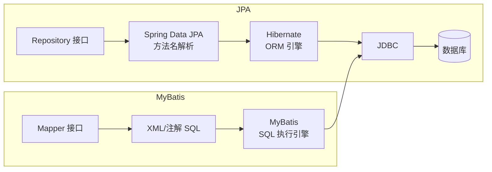

# Spring Data JPA 与 MyBatis 对比

> **文档说明**：深度对比 Spring Data JPA（Hibernate 实现）与 MyBatis 两大持久层框架的设计理念、核心机制、适用场景、性能差异、学习曲线，含可运行的 Spring Boot 代码（含 pom.xml/application.yml/实体类/Mapper/Repository）和复杂查询、分页、事务、缓存的实战对比。
>
> **适用人群**：Java 后端开发者、技术选型决策者、需要在项目中选择持久层框架的全栈工程师
>
> **前置知识**：[[SpringBoot-Web层设计]]、[[Java-数据库性能优化]]、[[SQLAlchemy-ORM核心原理]]

---

## 一、概述

### 1. 定义与核心价值

Spring Data JPA 是基于 JPA 规范（Hibernate 实现）的 ORM 框架，采用**面向对象**的方式操作数据库，通过方法名自动生成 SQL，适合领域驱动设计（DDD）。MyBatis 是**半 ORM** 框架，SQL 与 Java 代码分离，开发者完全控制 SQL，适合复杂查询和性能优化场景。两者并非对立关系，大型项目中常混合使用（JPA 做简单 CRUD，MyBatis 做复杂统计查询）。

### 2. 痛点对比

| 维度 | Spring Data JPA | MyBatis |
|------|----------------|---------|
| **设计理念** | 面向对象，SQL 自动生成 | SQL 优先，手动编写 |
| **简单 CRUD** | 继承 JpaRepository，零代码 | 需写 XML 或注解 SQL |
| **复杂查询** | @Query/JPQL/Criteria API | XML 动态 SQL，灵活强大 |
| **SQL 控制** | 弱（生成的 SQL 可能不优） | 强（完全手写，可优化） |
| **学习曲线** | 高（JPA 概念多：实体关系、懒加载、N+1） | 低（SQL 即核心） |
| **数据库迁移** | 容易（切换方言即可） | 需改 SQL（不同数据库语法差异） |
| **性能调优** | 难（需理解 Hibernate 内部机制） | 容易（直接优化 SQL） |
| **适用场景** | 业务复杂、领域模型丰富、CRUD 为主 | 查询复杂、报表统计、性能要求高 |

### 3. 架构对比



---

## 二、底层原理

### 1. Spring Data JPA 核心机制

| 机制 | 说明 |
|------|------|
| **方法名解析** | `findByUsernameAndAgeGreaterThan` 解析为 `WHERE username = ? AND age > ?` |
| **实体状态管理** | 瞬时态/持久态/游离态/删除态，持久态自动 flush |
| **一级缓存** | EntityManager 级别缓存，同一 EntityManager 内相同 ID 只查一次 |
| **二级缓存** | SessionFactory 级别缓存，需手动配置（Ehcache/Redis） |
| **懒加载** | `@OneToMany(fetch=LAZY)` 访问时才查询，可能导致 N+1 问题 |
| **脏检查** | 事务提交时对比实体快照，自动生成 UPDATE |

### 2. MyBatis 核心机制

| 机制 | 说明 |
|------|------|
| **动态 SQL** | `<if>`/`<choose>`/`<foreach>` 等标签构建动态 SQL |
| **结果映射** | `resultMap` 手动映射列与字段，支持复杂嵌套 |
| **一级缓存** | SqlSession 级别缓存（默认开启） |
| **二级缓存** | Mapper 级别缓存（需手动开启） |
| **插件机制** | Interceptor 拦截 SQL 执行（分页插件原理） |
| **OGNL 表达式** | 在 XML 中用 OGNL 表达式做条件判断 |

---

## 三、实操

### 1. Spring Data JPA 实现

```xml
<!-- pom.xml -->
<dependencies>
    <dependency>
        <groupId>org.springframework.boot</groupId>
        <artifactId>spring-boot-starter-data-jpa</artifactId>
    </dependency>
    <dependency>
        <groupId>com.mysql</groupId>
        <artifactId>mysql-connector-j</artifactId>
    </dependency>
</dependencies>
```

```yaml
# application.yml
spring:
  datasource:
    url: jdbc:mysql://localhost:3306/mydb?useSSL=false&serverTimezone=UTC
    username: root
    password: password
    driver-class-name: com.mysql.cj.jdbc.Driver
  jpa:
    hibernate:
      ddl-auto: update  # 自动建表（生产用 validate 或 none）
    show-sql: true
    properties:
      hibernate:
        format_sql: true
        dialect: org.hibernate.dialect.MySQLDialect
    open-in-view: false  # 关闭 OSIV，避免懒加载问题
```

```java
// User.java - 实体类
package com.example.jpa.entity;

import jakarta.persistence.*;
import java.time.LocalDateTime;
import java.util.ArrayList;
import java.util.List;

@Entity
@Table(name = "users")
public class User {

    @Id
    @GeneratedValue(strategy = GenerationType.IDENTITY)
    private Long id;

    @Column(nullable = false, length = 50)
    private String username;

    @Column(nullable = false, unique = true)
    private String email;

    @Column(name = "phone_number", length = 20)
    private String phoneNumber;

    @Enumerated(EnumType.STRING)
    @Column(length = 20)
    private UserStatus status;

    @Column(name = "created_at", updatable = false)
    private LocalDateTime createdAt;

    @Column(name = "updated_at")
    private LocalDateTime updatedAt;

    // 一对多：一个用户多个订单
    @OneToMany(mappedBy = "user", cascade = CascadeType.ALL, fetch = FetchType.LAZY)
    private List<Order> orders = new ArrayList<>();

    @PrePersist
    protected void onCreate() {
        createdAt = LocalDateTime.now();
        updatedAt = LocalDateTime.now();
    }

    @PreUpdate
    protected void onUpdate() {
        updatedAt = LocalDateTime.now();
    }

    // getters and setters
}
```

```java
// UserRepository.java - Repository 接口
package com.example.jpa.repository;

import com.example.jpa.entity.User;
import org.springframework.data.domain.Page;
import org.springframework.data.domain.Pageable;
import org.springframework.data.jpa.repository.JpaRepository;
import org.springframework.data.jpa.repository.Query;
import org.springframework.data.repository.query.Param;
import org.springframework.stereotype.Repository;

import java.time.LocalDateTime;
import java.util.List;
import java.util.Optional;

@Repository
public interface UserRepository extends JpaRepository<User, Long> {

    // 方法名自动生成 SQL
    Optional<User> findByEmail(String email);

    List<User> findByStatusAndCreatedAtAfter(UserStatus status, LocalDateTime date);

    Page<User> findByUsernameContaining(String keyword, Pageable pageable);

    boolean existsByEmail(String email);

    // JPQL 查询
    @Query("SELECT u FROM User u WHERE u.status = :status AND u.createdAt >= :startDate ORDER BY u.createdAt DESC")
    List<User> findActiveUsers(@Param("status") UserStatus status,
                               @Param("startDate") LocalDateTime startDate);

    // 原生 SQL 查询
    @Query(value = "SELECT * FROM users WHERE email LIKE %:domain%", nativeQuery = true)
    List<User> findByEmailDomain(@Param("domain") String domain);

    // 批量更新
    @Modifying
    @Query("UPDATE User u SET u.status = :status WHERE u.id IN :ids")
    int batchUpdateStatus(@Param("ids") List<Long> ids, @Param("status") UserStatus status);
}
```

```java
// UserService.java
package com.example.jpa.service;

import com.example.jpa.entity.User;
import com.example.jpa.repository.UserRepository;
import org.springframework.data.domain.Page;
import org.springframework.data.domain.PageRequest;
import org.springframework.data.domain.Sort;
import org.springframework.stereotype.Service;
import org.springframework.transaction.annotation.Transactional;

import java.util.List;

@Service
@Transactional(readOnly = true)
public class UserService {

    private final UserRepository userRepository;

    public UserService(UserRepository userRepository) {
        this.userRepository = userRepository;
    }

    @Transactional
    public User createUser(User user) {
        if (userRepository.existsByEmail(user.getEmail())) {
            throw new RuntimeException("邮箱已存在");
        }
        return userRepository.save(user);
    }

    public Page<User> listUsers(int page, int size, String keyword) {
        PageRequest pageRequest = PageRequest.of(
                page, size,
                Sort.by(Sort.Direction.DESC, "createdAt")
        );
        return userRepository.findByUsernameContaining(keyword, pageRequest);
    }

    @Transactional
    public User updateUser(Long id, User update) {
        User user = userRepository.findById(id)
                .orElseThrow(() -> new RuntimeException("用户不存在"));
        // 脏检查：修改后自动生成 UPDATE
        user.setUsername(update.getUsername());
        user.setPhoneNumber(update.getPhoneNumber());
        return user;  // 不需要显式 save，事务提交时自动更新
    }
}
```

### 2. MyBatis 实现

```xml
<!-- pom.xml -->
<dependencies>
    <dependency>
        <groupId>org.mybatis.spring.boot</groupId>
        <artifactId>mybatis-spring-boot-starter</artifactId>
        <version>3.0.3</version>
    </dependency>
    <dependency>
        <groupId>com.github.pagehelper</groupId>
        <artifactId>pagehelper-spring-boot-starter</artifactId>
        <version>2.1.0</version>
    </dependency>
    <dependency>
        <groupId>com.mysql</groupId>
        <artifactId>mysql-connector-j</artifactId>
    </dependency>
</dependencies>
```

```yaml
# application.yml
spring:
  datasource:
    url: jdbc:mysql://localhost:3306/mydb?useSSL=false&serverTimezone=UTC
    username: root
    password: password

mybatis:
  mapper-locations: classpath:mapper/*.xml
  type-aliases-package: com.example.mybatis.entity
  configuration:
    map-underscore-to-camel-case: true  # 下划线自动转驼峰
    cache-enabled: true
    log-impl: org.apache.ibatis.logging.stdout.StdOutImpl

pagehelper:
  helper-dialect: mysql
  reasonable: true
  support-methods-arguments: true
```

```java
// UserMapper.java - Mapper 接口
package com.example.mybatis.mapper;

import com.example.mybatis.entity.User;
import org.apache.ibatis.annotations.*;
import org.apache.ibatis.session.RowBounds;

import java.time.LocalDateTime;
import java.util.List;

@Mapper
public interface UserMapper {

    @Insert("INSERT INTO users(username, email, phone_number, status, created_at) " +
            "VALUES(#{username}, #{email}, #{phoneNumber}, #{status}, #{createdAt})")
    @Options(useGeneratedKeys = true, keyProperty = "id")
    int insert(User user);

    @Select("SELECT * FROM users WHERE id = #{id}")
    User findById(Long id);

    @Select("SELECT * FROM users WHERE email = #{email}")
    User findByEmail(String email);

    @Update("UPDATE users SET username = #{username}, phone_number = #{phoneNumber} WHERE id = #{id}")
    int update(User user);

    @Delete("DELETE FROM users WHERE id = #{id}")
    int deleteById(Long id);

    // 复杂查询用 XML
    List<User> findByCondition(@Param("status") String status,
                               @Param("startDate") LocalDateTime startDate,
                               @Param("keyword") String keyword);

    // 分页查询
    List<User> findAll(RowBounds rowBounds);
}
```

```xml
<!-- resources/mapper/UserMapper.xml -->
<?xml version="1.0" encoding="UTF-8"?>
<!DOCTYPE mapper PUBLIC "-//mybatis.org//DTD Mapper 3.0//EN"
        "http://mybatis.org/dtd/mybatis-3-mapper.dtd">
<mapper namespace="com.example.mybatis.mapper.UserMapper">

    <resultMap id="UserResultMap" type="com.example.mybatis.entity.User">
        <id property="id" column="id"/>
        <result property="username" column="username"/>
        <result property="email" column="email"/>
        <result property="phoneNumber" column="phone_number"/>
        <result property="status" column="status"/>
        <result property="createdAt" column="created_at"/>
        <result property="updatedAt" column="updated_at"/>
        <!-- 一对多嵌套 -->
        <collection property="orders" ofType="com.example.mybatis.entity.Order">
            <id property="id" column="order_id"/>
            <result property="product" column="product"/>
            <result property="amount" column="amount"/>
        </collection>
    </resultMap>

    <select id="findByCondition" resultMap="UserResultMap">
        SELECT * FROM users
        <where>
            <if test="status != null">
                AND status = #{status}
            </if>
            <if test="startDate != null">
                AND created_at &gt;= #{startDate}
            </if>
            <if test="keyword != null and keyword != ''">
                AND (username LIKE CONCAT('%', #{keyword}, '%')
                     OR email LIKE CONCAT('%', #{keyword}, '%'))
            </if>
        </where>
        ORDER BY created_at DESC
    </select>

    <select id="findAll" resultMap="UserResultMap">
        SELECT * FROM users ORDER BY created_at DESC
    </select>

    <!-- 批量插入 -->
    <insert id="batchInsert">
        INSERT INTO users(username, email, status) VALUES
        <foreach collection="list" item="user" separator=",">
            (#{user.username}, #{user.email}, #{user.status})
        </foreach>
    </insert>

    <!-- 动态更新 -->
    <update id="dynamicUpdate">
        UPDATE users
        <set>
            <if test="username != null">username = #{username},</if>
            <if test="phoneNumber != null">phone_number = #{phoneNumber},</if>
            <if test="status != null">status = #{status},</if>
        </set>
        WHERE id = #{id}
    </update>
</mapper>
```

```java
// UserService.java
package com.example.mybatis.service;

import com.example.mybatis.entity.User;
import com.example.mybatis.mapper.UserMapper;
import com.github.pagehelper.PageHelper;
import com.github.pagehelper.PageInfo;
import org.springframework.stereotype.Service;
import org.springframework.transaction.annotation.Transactional;

import java.time.LocalDateTime;
import java.util.List;

@Service
public class UserService {

    private final UserMapper userMapper;

    public UserService(UserMapper userMapper) {
        this.userMapper = userMapper;
    }

    @Transactional
    public User createUser(User user) {
        if (userMapper.findByEmail(user.getEmail()) != null) {
            throw new RuntimeException("邮箱已存在");
        }
        user.setCreatedAt(LocalDateTime.now());
        userMapper.insert(user);
        return user;
    }

    public PageInfo<User> listUsers(int page, int size, String keyword) {
        PageHelper.startPage(page, size);
        List<User> users = userMapper.findByCondition(null, null, keyword);
        return new PageInfo<>(users);
    }
}
```

### 3. 复杂查询对比

```java
// JPA：多表关联 + 聚合查询（用 JPQL）
@Query("SELECT new com.example.dto.UserOrderStats(u.username, COUNT(o), SUM(o.amount)) " +
       "FROM User u LEFT JOIN u.orders o " +
       "WHERE u.status = :status " +
       "GROUP BY u.id " +
       "HAVING SUM(o.amount) > :minAmount " +
       "ORDER BY SUM(o.amount) DESC")
List<UserOrderStats> getUserOrderStats(@Param("status") UserStatus status,
                                       @Param("minAmount") Double minAmount);
```

```xml
<!-- MyBatis：同样的查询，SQL 更直观 -->
<select id="getUserOrderStats" resultType="com.example.dto.UserOrderStats">
    SELECT u.username, COUNT(o.id) as orderCount, COALESCE(SUM(o.amount), 0) as totalAmount
    FROM users u
    LEFT JOIN orders o ON u.id = o.user_id
    WHERE u.status = #{status}
    GROUP BY u.id
    HAVING totalAmount > #{minAmount}
    ORDER BY totalAmount DESC
</select>
```

### 4. N+1 问题与解决

```java
// JPA N+1 问题：遍历用户时每个用户的订单都触发一次查询
// 错误写法
List<User> users = userRepository.findAll();
for (User user : users) {
    user.getOrders().size();  // 每个用户触发一次 SELECT（N+1）
}

// 解决方案 1：@EntityGraph 一次性加载
@EntityGraph(attributePaths = "orders")
List<User> findAllWithOrders();

// 解决方案 2：JOIN FETCH
@Query("SELECT u FROM User u LEFT JOIN FETCH u.orders WHERE u.status = :status")
List<User> findAllWithOrders(@Param("status") UserStatus status);
```

```xml
<!-- MyBatis：嵌套结果映射，一次查询解决 -->
<select id="findAllWithOrders" resultMap="UserWithOrdersMap">
    SELECT u.*, o.id as order_id, o.product, o.amount
    FROM users u
    LEFT JOIN orders o ON u.id = o.user_id
</select>
```

---

## 四、常见问题与排查

| 问题现象 | 原因 | 解决方案 |
|---------|------|---------|
| JPA 懒加载报 `LazyInitializationException` | Session 已关闭，访问懒加载属性 | 用 `JOIN FETCH` 或 `@EntityGraph` 预加载；或开启 OSIV（不推荐） |
| JPA 生成的 SQL 性能差 | 方法名查询生成的 SQL 未优化，或 N+1 问题 | 用 `@Query` 手写 JPQL；开启 `show-sql` 分析；用 `JOIN FETCH` 解决 N+1 |
| MyBatis 参数为 null 时报错 | `#{}` 无法处理 null 类型，或动态 SQL 条件错误 | 用 `jdbcType=VARCHAR` 指定类型；检查 `<if test="param != null">` |
| MyBatis 结果映射字段为 null | 列名与属性名不匹配，或 resultMap 配置错误 | 开启 `map-underscore-to-camel-case`；或手动配置 resultMap |
| JPA `save()` 执行了 UPDATE 而非 INSERT | 实体有 ID 且已存在，Hibernate 判定为更新 | 新实体不要设置 ID；或用 `entityManager.persist()` |
| MyBatis 分页插件不生效 | PageHelper.startPage() 后没有紧跟查询 | 确保 `PageHelper.startPage()` 后第一条 SQL 是查询语句 |
| JPA 事务中修改实体不生效 | 实体是游离态（不在 Persistence Context 中） | 用 `save()` 显式保存；或确保在事务内查询的实体才会自动更新 |
| MyBatis XML 中 `>` `<` 报错 | XML 中特殊字符需要转义 | 用 `&gt;` `&lt;` 或包裹在 `<![CDATA[ ]]>` 中 |
| JPA 批量更新慢 | 默认逐条执行，未开启批量 | 配置 `hibernate.jdbc.batch_size=50`；用 `@Modifying` 批量 JPQL |
| MyBatis 一级缓存导致数据不一致 | 同一 SqlSession 内重复查询返回缓存 | 增删改后自动清空缓存；或用 `flushCache="true"` |

---

## 五、进阶与最佳实践

### 1. 选型决策树

```
项目持久层选型
├── 业务复杂度高、领域模型丰富？
│   ├── 是 → Spring Data JPA（DDD 友好）
│   └── 否 → 继续判断
│
├── 查询复杂（多表关联、聚合、报表）？
│   ├── 是 → MyBatis（SQL 可控）
│   └── 否 → 继续判断
│
├── 团队 SQL 能力强、需要极致性能？
│   ├── 是 → MyBatis
│   └── 否 → Spring Data JPA
│
└── 混合使用（推荐）
    ├── 简单 CRUD → JPA Repository
    ├── 复杂查询/报表 → MyBatis Mapper
    └── 同一项目中两者共存
```

### 2. 混合使用方案

```java
// 同一项目中 JPA + MyBatis 共存
@Service
public class UserService {

    private final UserRepository userRepository;      // JPA：CRUD
    private final UserStatsMapper userStatsMapper;    // MyBatis：复杂统计

    public UserService(UserRepository userRepository, UserStatsMapper userStatsMapper) {
        this.userRepository = userRepository;
        this.userStatsMapper = userStatsMapper;
    }

    // 简单操作：JPA
    @Transactional
    public User createUser(User user) {
        return userRepository.save(user);
    }

    // 复杂统计：MyBatis
    public List<UserStatsDTO> getUserStats(String year) {
        return userStatsMapper.selectUserStats(year);
    }
}
```

### 3. 性能优化清单

| 优化项 | JPA | MyBatis |
|--------|-----|---------|
| **N+1 解决** | JOIN FETCH / @EntityGraph | 嵌套 resultMap / 嵌套 select |
| **批量操作** | batch_size + saveAll | foreach 批量 SQL |
| **分页** | Pageable | PageHelper |
| **索引优化** | @Index 注解 | 手写 SQL 时注意索引 |
| **慢查询** | show-sql 分析 | 直接看 SQL |
| **缓存** | 二级缓存（Redis） | 二级缓存（Redis） |
| **连接池** | HikariCP（默认） | HikariCP（默认） |

### 4. 代码生成工具

| 工具 | 适用框架 | 说明 |
|------|---------|------|
| **Spring Initializr** | JPA | 官方项目初始化 |
| **MyBatis Generator** | MyBatis | 自动生成实体+Mapper+XML |
| **MyBatis-Plus** | MyBatis增强 | 类似 JPA 的 CRUD 接口 + 代码生成器 |
| **jOOQ** | 两者之间 | 类型安全的 SQL 构建器 |

---

## 六、关联笔记

### 持久层
- [[MyBatis-Plus 知识点系统梳理_优化版]] · [[SQLAlchemy-ORM核心原理]] · [[Alembic-数据库迁移]]
- [[PostgreSQL-Python高级用法]] · [[Java-数据库性能优化]]

### Spring 生态
- [[SpringBoot-Web层设计]] · [[SpringBoot-自动装配原理]] · [[Spring-IOCAOP核心机制]]
- [[SpringDataJPA与MyBatis对比]]

### 数据库
- [[MySQL-索引与查询优化]] · [[PostgreSQL-高级特性]] · [[Redis-分布式锁与缓存穿透]]

### 导航
- [[MOC-后端开发]] · [[MOC-Java全栈-四级展开]] · [[Java-全栈技术枢纽]]

> **学习路径建议**：先掌握 [[SpringBoot-Web层设计]] Web 层基础 → 学习本文 JPA 与 MyBatis 对比选型 → 深入 [[MyBatis-Plus 知识点系统梳理_优化版]] MyBatis 增强 → 实践 [[Java-数据库性能优化]] SQL 优化 → 对比学习 [[SQLAlchemy-ORM核心原理]] Python ORM。
