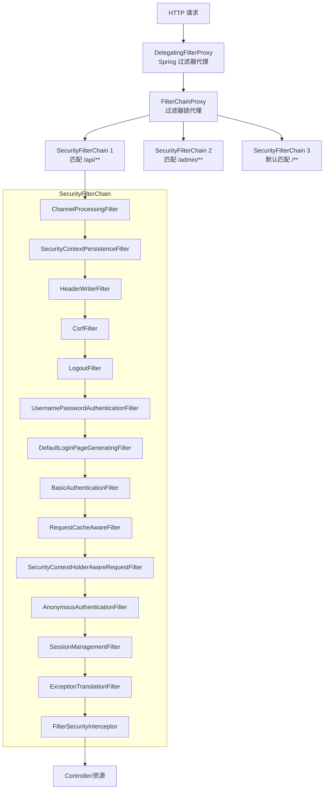
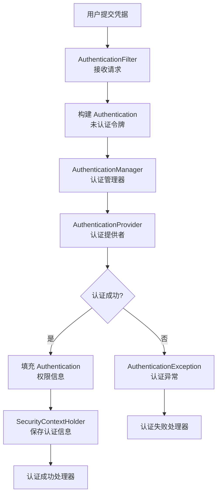
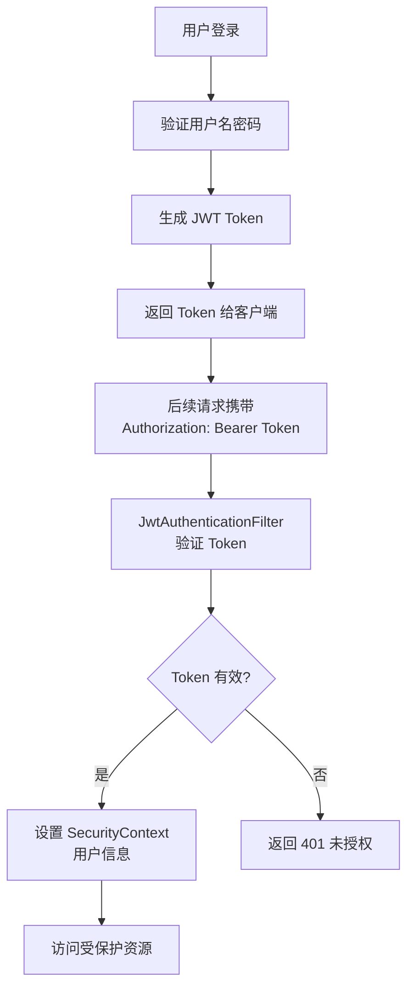

# SpringSecurity 认证授权

> **文档说明**：系统讲解 Spring Security 的核心架构、认证（Authentication）与授权（Authorization）机制、过滤器链、用户详情服务、密码编码、JWT 无状态认证、OAuth2 集成、方法级安全、CSRF/CORS 防护，以及生产级配置和常见问题排查。
>
> **适用人群**：Java 后端开发工程师、全栈开发者、需要构建安全认证体系的工程师
>
> **前置知识**：[[SpringBoot-自动装配原理]]、[[Spring-IOCAOP核心机制]]、[[JWT与OAuth2认证授权]]

---

## 一、概述

### 1. 什么是 Spring Security

**Spring Security** 是 Spring 生态的安全框架，提供认证（Authentication）、授权（Authorization）、攻击防护（CSRF、Session Fixation 等）等完整的安全解决方案，基于 Servlet 过滤器链实现。

### 2. 核心功能

| 功能 | 说明 |
|------|------|
| **认证（Authentication）** | 验证用户身份（用户名密码、Token、OAuth2 等） |
| **授权（Authorization）** | 控制用户能访问哪些资源（URL 级、方法级） |
| **CSRF 防护** | 跨站请求伪造防护 |
| **会话管理** | Session 固定防护、并发会话控制、Session 超时 |
| **密码编码** | BCrypt、SCrypt、Argon2 等安全密码哈希 |
| **记住我** | Remember-Me 功能 |
| **匿名认证** | 未登录用户的匿名身份 |
| **方法级安全** | @PreAuthorize、@PostAuthorize 等注解 |
| **OAuth2** | OAuth2 客户端、资源服务器、授权服务器 |

### 3. 核心架构：过滤器链



**核心过滤器说明**：
| 过滤器 | 说明 |
|--------|------|
| `SecurityContextPersistenceFilter` | 从 Session 加载 SecurityContext，请求结束后保存 |
| `UsernamePasswordAuthenticationFilter` | 表单登录认证（默认 /login POST） |
| `BasicAuthenticationFilter` | HTTP Basic 认证 |
| `BearerTokenAuthenticationFilter` | Bearer Token（JWT）认证 |
| `CsrfFilter` | CSRF 令牌验证 |
| `LogoutFilter` | 登出处理 |
| `AnonymousAuthenticationFilter` | 匿名用户身份设置 |
| `ExceptionTranslationFilter` | 异常转换（认证异常→登录页/401，授权异常→403） |
| `FilterSecurityInterceptor` | URL 级授权决策（最后一道过滤器） |

---

## 二、认证（Authentication）

### 1. 认证流程



### 2. 核心接口

| 接口 | 说明 |
|------|------|
| `Authentication` | 认证信息，包含主体（Principal）、凭据（Credentials）、权限（Authorities） |
| `AuthenticationManager` | 认证管理器，入口接口 |
| `ProviderManager` | AuthenticationManager 的默认实现，管理多个 AuthenticationProvider |
| `AuthenticationProvider` | 认证提供者，具体认证逻辑 |
| `UserDetailsService` | 用户详情服务，根据用户名加载用户 |
| `UserDetails` | 用户详情，包含用户名、密码、权限、状态 |
| `PasswordEncoder` | 密码编码器，加密和验证密码 |

### 3. 表单登录配置

```java
@Configuration
@EnableWebSecurity
public class SecurityConfig {

    @Bean
    public SecurityFilterChain securityFilterChain(HttpSecurity http) throws Exception {
        http
            .authorizeHttpRequests(auth -> auth
                .requestMatchers("/public/**", "/login", "/register").permitAll()
                .requestMatchers("/admin/**").hasRole("ADMIN")
                .requestMatchers("/user/**").hasAnyRole("USER", "ADMIN")
                .anyRequest().authenticated()
            )
            .formLogin(form -> form
                .loginPage("/login")              // 自定义登录页
                .loginProcessingUrl("/login")     // 登录提交 URL
                .defaultSuccessUrl("/home", true) // 登录成功跳转
                .failureUrl("/login?error=true")  // 登录失败跳转
                .usernameParameter("username")     // 用户名字段名
                .passwordParameter("password")     // 密码字段名
                .permitAll()
            )
            .logout(logout -> logout
                .logoutUrl("/logout")
                .logoutSuccessUrl("/login?logout=true")
                .invalidateHttpSession(true)
                .deleteCookies("JSESSIONID")
                .permitAll()
            )
            .csrf(csrf -> csrf.disable());  // 前后端分离可禁用 CSRF

        return http.build();
    }

    @Bean
    public PasswordEncoder passwordEncoder() {
        return new BCryptPasswordEncoder();  // BCrypt 密码编码
    }
}
```

### 4. 自定义 UserDetailsService

```java
@Service
public class CustomUserDetailsService implements UserDetailsService {

    @Autowired
    private UserRepository userRepository;

    @Override
    public UserDetails loadUserByUsername(String username) throws UsernameNotFoundException {
        User user = userRepository.findByUsername(username)
            .orElseThrow(() -> new UsernameNotFoundException("用户不存在: " + username));

        return org.springframework.security.core.userdetails.User.builder()
            .username(user.getUsername())
            .password(user.getPassword())  // 已加密的密码
            .roles(user.getRoles().toArray(new String[0]))  // 角色
            // .authorities(...)  // 权限（更细粒度）
            .accountExpired(!user.isAccountNonExpired())
            .accountLocked(!user.isAccountNonLocked())
            .credentialsExpired(!user.isCredentialsNonExpired())
            .disabled(!user.isEnabled())
            .build();
    }
}
```

### 5. 密码编码器

| 编码器 | 说明 | 推荐度 |
|--------|------|--------|
| `BCryptPasswordEncoder` | BCrypt 算法，自带盐值，自适应强度 | ⭐⭐⭐⭐⭐ 推荐 |
| `SCryptPasswordEncoder` | SCrypt 算法，内存硬，抗 GPU 攻击 | ⭐⭐⭐⭐ |
| `Argon2PasswordEncoder` | Argon2 算法，密码哈希竞赛冠军 | ⭐⭐⭐⭐⭐ 最新推荐 |
| `Pbkdf2PasswordEncoder` | PBKDF2 算法，NIST 推荐 | ⭐⭐⭐ |
| `NoOpPasswordEncoder` | 不加密（明文） | ❌ 仅测试用 |
| `DelegatingPasswordEncoder` | 委托编码器，支持多种算法前缀（{bcrypt}、{noop}） | ⭐⭐⭐⭐ 默认 |

```java
// BCrypt 使用
PasswordEncoder encoder = new BCryptPasswordEncoder();
String encoded = encoder.encode("password123");  // $2a$10$...
boolean matches = encoder.matches("password123", encoded);  // true

// 自定义强度
PasswordEncoder strongEncoder = new BCryptPasswordEncoder(12);  // 强度 12（默认 10）

// DelegatingPasswordEncoder（默认，支持 {id}password 格式）
// {bcrypt}$2a$10$...
// {noop}password123
// {scrypt}$e0801$...
PasswordEncoder delegating = PasswordEncoderFactories.createDelegatingPasswordEncoder();
```

---

## 三、JWT 无状态认证

### 1. JWT 认证流程



### 2. JWT 工具类

```java
@Component
public class JwtUtil {

    @Value("${jwt.secret}")
    private String secret;

    @Value("${jwt.expiration}")
    private Long expiration;  // 毫秒

    // 生成 Token
    public String generateToken(UserDetails userDetails) {
        Map<String, Object> claims = new HashMap<>();
        claims.put("username", userDetails.getUsername());
        claims.put("roles", userDetails.getAuthorities().stream()
            .map(GrantedAuthority::getAuthority).collect(Collectors.toList()));

        return Jwts.builder()
            .setClaims(claims)
            .setSubject(userDetails.getUsername())
            .setIssuedAt(new Date())
            .setExpiration(new Date(System.currentTimeMillis() + expiration))
            .signWith(SignatureAlgorithm.HS512, secret)
            .compact();
    }

    // 解析 Token
    public Claims parseToken(String token) {
        return Jwts.parser()
            .setSigningKey(secret)
            .parseClaimsJws(token)
            .getBody();
    }

    // 验证 Token
    public boolean validateToken(String token, UserDetails userDetails) {
        try {
            Claims claims = parseToken(token);
            String username = claims.getSubject();
            return username.equals(userDetails.getUsername()) && !isTokenExpired(token);
        } catch (Exception e) {
            return false;
        }
    }

    // 从 Token 获取用户名
    public String getUsernameFromToken(String token) {
        return parseToken(token).getSubject();
    }

    // Token 是否过期
    private boolean isTokenExpired(String token) {
        return parseToken(token).getExpiration().before(new Date());
    }
}
```

### 3. JWT 认证过滤器

```java
@Component
public class JwtAuthenticationFilter extends OncePerRequestFilter {

    @Autowired
    private JwtUtil jwtUtil;

    @Autowired
    private UserDetailsService userDetailsService;

    @Override
    protected void doFilterInternal(HttpServletRequest request,
                                    HttpServletResponse response,
                                    FilterChain filterChain) throws ServletException, IOException {
        // 从请求头获取 Token
        String authHeader = request.getHeader("Authorization");
        String token = null;
        String username = null;

        if (authHeader != null && authHeader.startsWith("Bearer ")) {
            token = authHeader.substring(7);
            try {
                username = jwtUtil.getUsernameFromToken(token);
            } catch (Exception e) {
                logger.warn("JWT Token 解析失败: " + e.getMessage());
            }
        }

        // 验证 Token 并设置 SecurityContext
        if (username != null && SecurityContextHolder.getContext().getAuthentication() == null) {
            UserDetails userDetails = userDetailsService.loadUserByUsername(username);
            if (jwtUtil.validateToken(token, userDetails)) {
                UsernamePasswordAuthenticationToken auth =
                    new UsernamePasswordAuthenticationToken(userDetails, null, userDetails.getAuthorities());
                auth.setDetails(new WebAuthenticationDetailsSource().buildDetails(request));
                SecurityContextHolder.getContext().setAuthentication(auth);
            }
        }

        filterChain.doFilter(request, response);
    }
}
```

### 4. JWT 安全配置

```java
@Configuration
@EnableWebSecurity
public class JwtSecurityConfig {

    @Autowired
    private JwtAuthenticationFilter jwtAuthenticationFilter;

    @Autowired
    private JwtAuthenticationEntryPoint jwtAuthenticationEntryPoint;

    @Bean
    public SecurityFilterChain securityFilterChain(HttpSecurity http) throws Exception {
        http
            .csrf(csrf -> csrf.disable())  // JWT 无状态，禁用 CSRF
            .sessionManagement(session -> session
                .sessionCreationPolicy(SessionCreationPolicy.STATELESS)  // 无状态
            )
            .exceptionHandling(ex -> ex
                .authenticationEntryPoint(jwtAuthenticationEntryPoint)  // 401 处理
            )
            .authorizeHttpRequests(auth -> auth
                .requestMatchers("/api/auth/**", "/api/public/**").permitAll()
                .requestMatchers("/api/admin/**").hasRole("ADMIN")
                .anyRequest().authenticated()
            )
            // 添加 JWT 过滤器在 UsernamePasswordAuthenticationFilter 之前
            .addFilterBefore(jwtAuthenticationFilter, UsernamePasswordAuthenticationFilter.class);

        return http.build();
    }
}

// 401 未授权处理
@Component
public class JwtAuthenticationEntryPoint implements AuthenticationEntryPoint {
    @Override
    public void commence(HttpServletRequest request, HttpServletResponse response,
                         AuthenticationException authException) throws IOException {
        response.setContentType("application/json;charset=UTF-8");
        response.setStatus(HttpServletResponse.SC_UNAUTHORIZED);
        response.getWriter().write("{\"code\":401,\"message\":\"未授权或Token已过期\"}");
    }
}
```

---

## 四、授权（Authorization）

### 1. URL 级授权

```java
@Configuration
@EnableWebSecurity
public class AuthorizationConfig {

    @Bean
    public SecurityFilterChain securityFilterChain(HttpSecurity http) throws Exception {
        http
            .authorizeHttpRequests(auth -> auth
                // 公开访问
                .requestMatchers("/public/**", "/login", "/register", "/error").permitAll()
                // 静态资源
                .requestMatchers("/css/**", "/js/**", "/images/**", "/favicon.ico").permitAll()
                // 角色控制
                .requestMatchers("/admin/**").hasRole("ADMIN")
                .requestMatchers("/user/**").hasAnyRole("USER", "ADMIN")
                // 权限控制（细粒度）
                .requestMatchers(HttpMethod.POST, "/api/users/**").hasAuthority("user:create")
                .requestMatchers(HttpMethod.DELETE, "/api/users/**").hasAuthority("user:delete")
                // IP 限制
                .requestMatchers("/internal/**").hasIpAddress("192.168.1.0/24")
                // 自定义表达式
                .requestMatchers("/api/orders/{id}/**").access("@orderSecurity.checkOwner(authentication, #id)")
                // 其他请求需认证
                .anyRequest().authenticated()
            );

        return http.build();
    }
}
```

### 2. 方法级安全

```java
@Configuration
@EnableMethodSecurity  // Spring Security 6+（替代 @EnableGlobalMethodSecurity）
public class MethodSecurityConfig {
}

@Service
public class UserService {

    // 前置授权：调用前检查权限
    @PreAuthorize("hasRole('ADMIN')")
    public void deleteUser(Long id) { ... }

    // 前置授权：SpEL 表达式
    @PreAuthorize("hasAuthority('user:update') and #user.id == authentication.principal.id")
    public void updateUser(User user) { ... }

    // 后置授权：返回后检查（可过滤返回值）
    @PostAuthorize("returnObject.owner == authentication.name")
    public User getUser(Long id) { ... }

    // 前置过滤：过滤输入集合
    @PreFilter("filterObject.owner == authentication.name")
    public void batchUpdate(List<User> users) { ... }

    // 后置过滤：过滤返回集合
    @PostFilter("filterObject.owner == authentication.name or hasRole('ADMIN')")
    public List<User> listUsers() { ... }
}
```

### 3. 角色 vs 权限

| 概念 | 说明 | 示例 |
|------|------|------|
| **角色（Role）** | 粗粒度权限，一组权限的集合 | ROLE_ADMIN、ROLE_USER |
| **权限（Authority）** | 细粒度权限，具体操作权限 | user:create、user:delete、order:read |

```java
// 角色检查
@PreAuthorize("hasRole('ADMIN')")           // 等价于 hasAuthority('ROLE_ADMIN')
@PreAuthorize("hasAnyRole('ADMIN', 'USER')")

// 权限检查
@PreAuthorize("hasAuthority('user:create')")
@PreAuthorize("hasAnyAuthority('user:create', 'user:update')")

// 组合
@PreAuthorize("hasRole('ADMIN') or hasAuthority('user:delete')")
```

---

## 五、OAuth2 集成

### 1. OAuth2 客户端（第三方登录）

```java
@Configuration
@EnableWebSecurity
public class OAuth2ClientConfig {

    @Bean
    public SecurityFilterChain securityFilterChain(HttpSecurity http) throws Exception {
        http
            .authorizeHttpRequests(auth -> auth
                .requestMatchers("/", "/login", "/oauth2/**").permitAll()
                .anyRequest().authenticated()
            )
            .oauth2Login(oauth2 -> oauth2
                .loginPage("/login")
                .defaultSuccessUrl("/home", true)
                .userInfoEndpoint(userInfo -> userInfo
                    .userService(customOAuth2UserService)  // 自定义用户服务
                )
            );

        return http.build();
    }
}
```

```yaml
# application.yml
spring:
  security:
    oauth2:
      client:
        registration:
          github:
            client-id: your-github-client-id
            client-secret: your-github-client-secret
            scope: read:user,user:email
          google:
            client-id: your-google-client-id
            client-secret: your-google-client-secret
            scope: profile,email
        provider:
          github:
            authorization-uri: https://github.com/login/oauth/authorize
            token-uri: https://github.com/login/oauth/access_token
            user-info-uri: https://api.github.com/user
            user-name-attribute: id
```

### 2. OAuth2 资源服务器

```java
@Configuration
@EnableWebSecurity
public class OAuth2ResourceServerConfig {

    @Bean
    public SecurityFilterChain securityFilterChain(HttpSecurity http) throws Exception {
        http
            .authorizeHttpRequests(auth -> auth
                .requestMatchers("/api/public/**").permitAll()
                .requestMatchers("/api/admin/**").hasRole("ADMIN")
                .anyRequest().authenticated()
            )
            .oauth2ResourceServer(oauth2 -> oauth2
                .jwt(jwt -> jwt
                    .jwkSetUri("https://auth-server.com/.well-known/jwks.json")
                    // 或本地解码
                    // .decoder(jwtDecoder())
                )
            );

        return http.build();
    }
}
```

---

## 六、安全防护

### 1. CSRF 防护

CSRF（Cross-Site Request Forgery）跨站请求伪造，Spring Security 默认启用。

```java
// 表单应用：启用 CSRF（默认）
http.csrf(csrf -> csrf.csrfTokenRepository(CookieCsrfTokenRepository.withHttpOnlyFalse()));

// 前后端分离/API 服务：禁用 CSRF（使用 Token 认证）
http.csrf(csrf -> csrf.disable());
```

### 2. CORS 配置

```java
@Configuration
public class CorsConfig {

    @Bean
    public CorsConfigurationSource corsConfigurationSource() {
        CorsConfiguration config = new CorsConfiguration();
        config.setAllowedOrigins(Arrays.asList("https://app.example.com"));
        config.setAllowedMethods(Arrays.asList("GET", "POST", "PUT", "DELETE", "OPTIONS"));
        config.setAllowedHeaders(Arrays.asList("*"));
        config.setAllowCredentials(true);
        config.setMaxAge(3600L);

        UrlBasedCorsConfigurationSource source = new UrlBasedCorsConfigurationSource();
        source.registerCorsConfiguration("/**", config);
        return source;
    }
}

// Security 配置中启用
http.cors(cors -> cors.configurationSource(corsConfigurationSource()));
```

### 3. 安全响应头

Spring Security 默认添加安全响应头：

| 响应头 | 说明 |
|--------|------|
| `X-Content-Type-Options: nosniff` | 防止 MIME 类型嗅探 |
| `X-Frame-Options: DENY` | 防止点击劫持（iframe 嵌套） |
| `X-XSS-Protection: 1; mode=block` | XSS 防护 |
| `Strict-Transport-Security` | HTTPS 强制（HSTS） |
| `Content-Security-Policy` | 内容安全策略（CSP） |

```java
http.headers(headers -> headers
    .contentTypeOptions(content -> content.disable())  // 禁用
    .frameOptions(frame -> frame.sameOrigin())          // 同源允许
    .xssProtection(xss -> xss.block(true))
    .httpStrictTransportSecurity(hsts -> hsts
        .includeSubDomains(true)
        .maxAgeInSeconds(31536000)
    )
    .contentSecurityPolicy(csp -> csp
        .policyDirectives("default-src 'self'; script-src 'self' 'unsafe-inline'")
    )
);
```

### 4. 会话管理

```java
http.sessionManagement(session -> session
    .sessionCreationPolicy(SessionCreationPolicy.IF_REQUIRED)  // 按需创建
    .sessionFixation(fixation -> fixation.newSession())  // 会话固定防护（新建 Session）
    .maximumSessions(1)  // 最大并发会话数
    .maxSessionsPreventsLogin(false)  // 超过后是否阻止新登录（false 则踢掉旧的）
    .expiredUrl("/login?expired=true")  // 会话过期跳转
    .and()
    .invalidSessionUrl("/login?invalid=true")  // 无效 Session 跳转
);
```

---

## 七、常见问题与排查

| 问题 | 原因 | 解决方案 |
|------|------|---------|
| **401 未授权** | Token 无效/过期 / 未携带 Token / 认证过滤器未生效 | 检查 Authorization 头、Token 有效期、过滤器顺序 |
| **403 禁止访问** | 权限不足 / 角色不匹配 / CSRF 令牌缺失 | 检查用户角色权限、@PreAuthorize 表达式、CSRF 配置 |
| **登录成功但仍 401** | SecurityContext 未保存 / Session 配置错误 / JWT 过滤器顺序错误 | 检查 SessionCreationPolicy、过滤器顺序、SecurityContextHolder |
| **密码验证失败** | 密码编码器不匹配 / 密码未加密存储 | 统一使用 BCryptPasswordEncoder、确保存储的是加密密码 |
| **CSRF 异常** | POST/PUT/DELETE 请求缺少 CSRF 令牌 | 表单包含 _csrf 字段 / API 服务禁用 CSRF |
| **CORS 错误** | 跨域配置不正确 / 预检请求被拦截 | 配置 CorsConfigurationSource、OPTIONS 请求放行 |
| **循环依赖** | SecurityConfig 依赖 UserDetailsService 导致循环 | 使用 @Lazy 注解或拆分配置 |
| **方法级安全不生效** | 未启用 @EnableMethodSecurity / 同类调用 | 启用注解、通过代理调用（避免 this 调用） |
| **Remember-Me 不生效** | Token 未持久化 / 配置错误 | 配置 PersistentTokenRepository、rememberMe 参数 |
| **并发会话不生效** | 未配置 SessionRegistry / 用户未实现 equals/hashCode | 注入 SessionRegistry、确保 UserDetails 正确 |
| **登出后仍能访问** | Session 未失效 / Token 未加入黑名单 | invalidateHttpSession、JWT 维护黑名单或短有效期 |
| **静态资源被拦截** | 未配置 permitAll | 配置静态资源路径 permitAll |
| **自定义登录页不生效** | loginPage 配置错误 / 页面未放行 | 检查 loginPage 路径、确保登录页 URL permitAll |
| **OAuth2 登录回调错误** | redirect_uri 不匹配 / 客户端配置错误 | 检查 OAuth2 应用回调地址、client-id/secret |

---

## 八、关联笔记

### Spring 生态
- [[SpringBoot-自动装配原理]] · [[Spring-IOCAOP核心机制]] · [[SpringBoot-Web层设计]]
- [[SpringCache-缓存抽象]] · [[SpringWebFlux-响应式编程]] · [[SpringAI-框架入门与模型抽象]]

### 安全认证
- [[JWT与OAuth2认证授权]] · [[SSO单点登录与分布式会话]] · [[Web安全-XSS-CSRF-SQL注入]]
- [[Java-数据加密与脱敏]] · [[前端安全-XSS-CSRF防护]] · [[CSP内容安全策略]]

### 后端
- [[Gateway-网关路由与鉴权]] · [[统一AI网关设计与实现]] · [[高并发系统设计案例]]
- [[Spring事务管理与传播机制]] · [[API设计规范与选型]]

### 微服务
- [[Nacos-注册中心与配置中心]] · [[Sentinel-流量控制与熔断]] · [[SpringCloud-Alibaba组件体系]]
- [[微服务核心组件知识点系统梳理_优化版]]

### 导航
- [[MOC-后端开发]] · [[MOC-Java全栈-四级展开]] · [[全栈+AI工程双轨融合学习路线图]]

> **学习路径建议**：先掌握 [[SpringBoot-自动装配原理]] Spring Boot 基础 → 学习 [[Spring-IOCAOP核心机制]] IOC/AOP 原理 → 深入本文 Spring Security 认证授权 → 实践 [[JWT与OAuth2认证授权]] Token 认证 → 研究 [[Gateway-网关路由与鉴权]] 网关层统一认证 → 应用于 [[高并发系统设计案例]] 生产环境安全架构。
