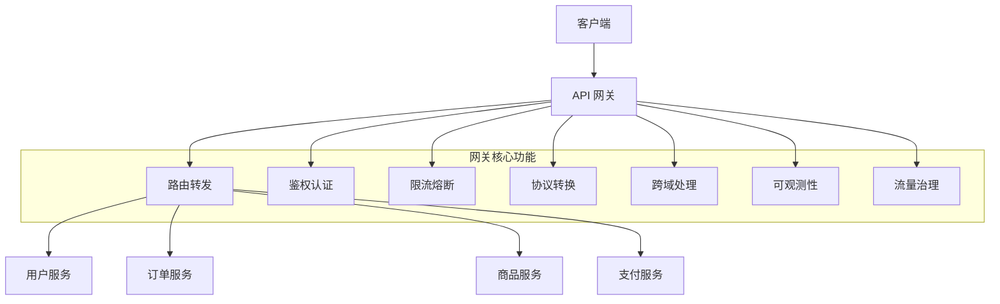
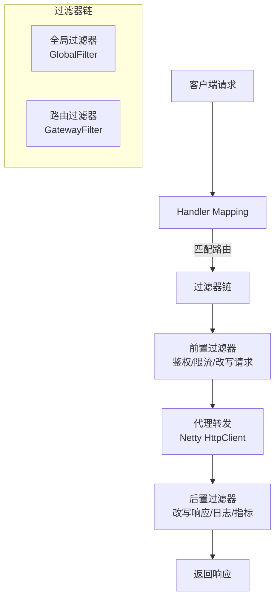
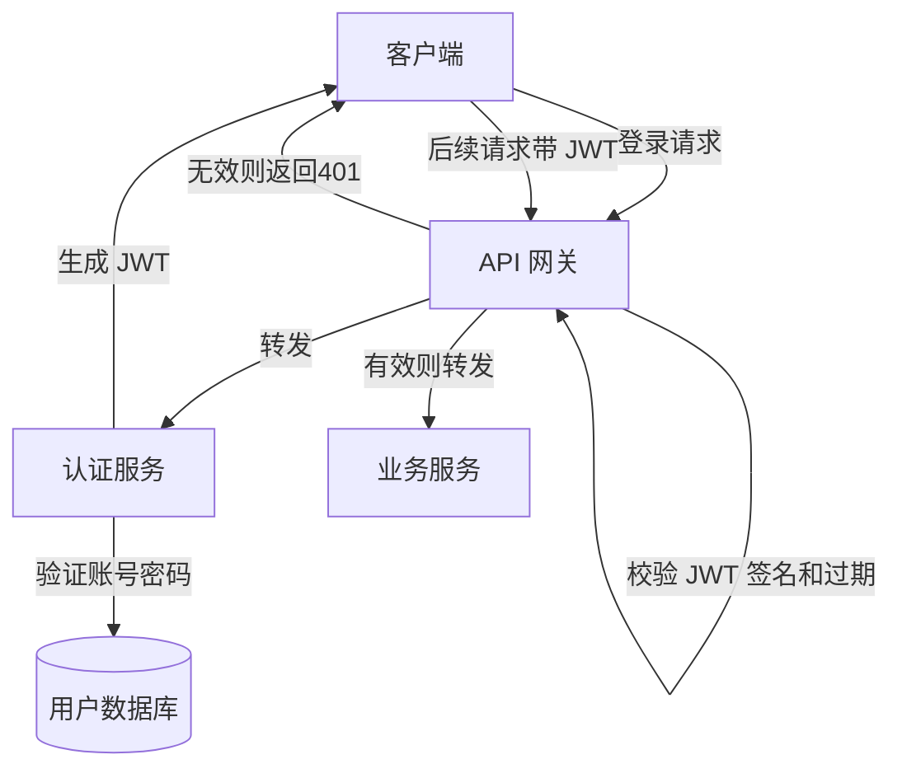
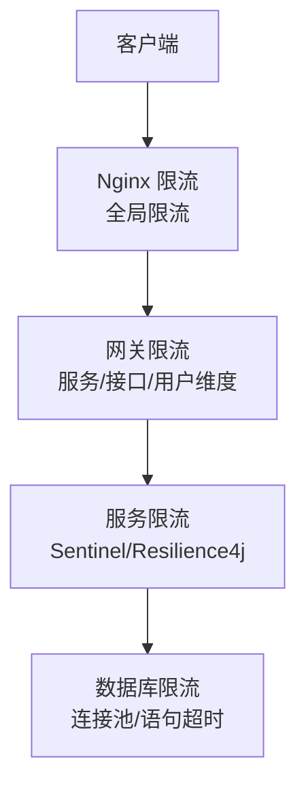

# Gateway 网关路由与鉴权

> **文档说明**：系统讲解 API 网关的核心功能、路由配置、鉴权认证（JWT/OAuth2）、限流熔断、过滤器链、负载均衡，以及 Spring Cloud Gateway 的完整实现和生产环境最佳实践。
>
> **适用人群**：后端开发工程师、微服务架构师、需要构建 API 网关的开发者
>
> **前置知识**：[[微服务架构核心概念]]、[[SpringBoot-自动装配原理]]、[[高可用架构设计]]

---

## 一、概述

**API 网关（API Gateway）** 是微服务架构中的核心组件，位于客户端和后端服务之间，是所有外部请求的统一入口。网关负责路由转发、鉴权认证、限流熔断、日志监控、协议转换等横切关注点，使后端服务专注于业务逻辑。

### 1. 为什么需要 API 网关

| 痛点（无网关） | 网关解决方案 |
|---------------|------------|
| 客户端直接调用多个服务，耦合严重 | 统一入口，客户端只与网关交互 |
| 每个服务都要实现鉴权、限流、日志 | 网关统一处理横切关注点 |
| 服务地址变化需要客户端修改 | 网关动态路由，服务地址对客户端透明 |
| 跨域问题（CORS） | 网关统一处理跨域 |
| 协议不统一（HTTP/gRPC/WebSocket） | 网关协议转换 |
| 服务直接暴露，安全风险高 | 网关作为安全边界，隐藏内部服务 |
| 无法统一监控和统计 | 网关统一收集请求日志和指标 |

### 2. 网关核心功能



| 功能 | 说明 |
|------|------|
| **路由转发** | 根据请求路径/方法/Header 转发到对应后端服务 |
| **鉴权认证** | JWT/OAuth2/API Key 验证，登录态校验 |
| **限流** | QPS/并发数/用户维度限流，保护后端服务 |
| **熔断降级** | 服务故障时熔断，返回降级结果 |
| **负载均衡** | 多实例负载均衡（轮询/随机/权重） |
| **协议转换** | HTTP→gRPC、WebSocket 代理、REST→GraphQL |
| **跨域处理** | 统一 CORS 配置 |
| **请求改写** | 修改请求路径/Header/参数 |
| **响应改写** | 修改响应 Header/Body，统一响应格式 |
| **黑白名单** | IP 黑白名单、用户黑名单 |
| **可观测性** | 请求日志、链路追踪、指标监控 |
| **灰度发布** | 按比例/Header/Cookie 路由到不同版本 |
| **缓存** | 静态资源/接口响应缓存 |

### 3. 主流网关对比

| 网关 | 语言 | 性能 | 配置方式 | 特点 | 适用场景 |
|------|------|------|---------|------|---------|
| **Nginx** | C | 极高 | 配置文件 | 成熟稳定，反向代理，Lua 扩展 | 静态资源、负载均衡、简单路由 |
| **Kong** | Lua/OpenResty | 高 | 配置文件/API/DB | 插件生态丰富，企业级 | 大规模 API 管理 |
| **Spring Cloud Gateway** | Java | 中高 | Java Config/YAML | Spring 生态，响应式（WebFlux） | Spring Cloud 微服务 |
| **Zuul 1.x** | Java | 中 | 配置文件 | 阻塞式 IO，Netflix 出品 | 老项目维护 |
| **Zuul 2.x** | Java | 高 | 配置文件 | 非阻塞 IO，性能提升 | 较少使用 |
| **APISIX** | Lua/OpenResty | 极高 | YAML/etcd/API | 云原生，高性能，插件丰富 | 云原生、高性能场景 |
| **Envoy** | C++ | 极高 | YAML/xDS | Service Mesh 数据平面，云原生 | Service Mesh、K8s |
| **Traefik** | Go | 高 | 动态配置 | 自动服务发现，K8s 友好 | K8s、容器环境 |
| **Higress** | Java/C++ | 高 | K8s CRD | 阿里出品，云原生，AI 网关 | 云原生、AI 场景 |

**选择建议**：
- Spring Cloud 技术栈 → **Spring Cloud Gateway**（生态整合最好）
- 云原生/K8s 环境 → **APISIX** / **Envoy** / **Higress**
- 传统运维/Nginx 经验 → **Kong** / **Nginx + Lua**
- 高性能/大规模 → **APISIX** / **Envoy**

---

## 二、Spring Cloud Gateway 核心概念

### 1. 架构

Spring Cloud Gateway 基于 **Spring WebFlux + Reactor + Netty** 构建，是响应式非阻塞网关。



**核心组件**：

| 组件 | 说明 |
|------|------|
| **Route（路由）** | 网关的基本单元，包含 ID、目标 URI、断言、过滤器 |
| **Predicate（断言）** | 匹配请求的条件（路径、方法、Header、Cookie 等） |
| **Filter（过滤器）** | 请求/响应的处理逻辑（鉴权、限流、改写等） |
| **GlobalFilter（全局过滤器）** | 对所有路由生效的过滤器 |
| **GatewayFilter（路由过滤器）** | 只对特定路由生效的过滤器 |

### 2. 路由配置

**YAML 配置方式**：

```yaml
spring:
  cloud:
    gateway:
      routes:
        # 用户服务路由
        - id: user-service
          uri: lb://user-service          # lb:// 表示从注册中心负载均衡
          predicates:
            - Path=/api/user/**           # 路径匹配
            - Method=GET,POST              # 方法匹配
          filters:
            - StripPrefix=1                # 去掉路径前缀 /api
            - name: RequestRateLimiter    # 限流
              args:
                redis-rate-limiter.replenishRate: 10
                redis-rate-limiter.burstCapacity: 20

        # 订单服务路由
        - id: order-service
          uri: lb://order-service
          predicates:
            - Path=/api/order/**
          filters:
            - StripPrefix=1
            - name: Hystrix                # 熔断
              args:
                name: fallbackcmd
                fallbackUri: forward:/fallback/order

        # 商品服务路由（带权重灰度）
        - id: product-service-v1
          uri: lb://product-service-v1
          predicates:
            - Path=/api/product/**
            - Weight=product-group, 80      # 80% 流量到 v1
          filters:
            - StripPrefix=1

        - id: product-service-v2
          uri: lb://product-service-v2
          predicates:
            - Path=/api/product/**
            - Weight=product-group, 20      # 20% 流量到 v2
          filters:
            - StripPrefix=1
```

**Java Config 方式**：

```java
@Configuration
public class GatewayConfig {

    @Bean
    public RouteLocator customRouteLocator(RouteLocatorBuilder builder) {
        return builder.routes()
            // 用户服务
            .route("user-service", r -> r
                .path("/api/user/**")
                .and().method(HttpMethod.GET, HttpMethod.POST)
                .filters(f -> f.stripPrefix(1))
                .uri("lb://user-service"))
            // 订单服务
            .route("order-service", r -> r
                .path("/api/order/**")
                .filters(f -> f.stripPrefix(1))
                .uri("lb://order-service"))
            .build();
    }
}
```

### 3. 断言（Predicate）

Spring Cloud Gateway 内置多种断言工厂：

| 断言 | 说明 | 示例 |
|------|------|------|
| **Path** | 路径匹配（支持 Ant 风格） | `Path=/api/user/**, /api/admin/**` |
| **Method** | HTTP 方法匹配 | `Method=GET,POST` |
| **Header** | 请求头匹配（支持正则） | `Header=X-Request-Id, \d+` |
| **Cookie** | Cookie 匹配 | `Cookie=sessionid, \d+` |
| **Query** | 查询参数匹配 | `Query=name, zhang.*` |
| **Host** | Host 匹配 | `Host=**.example.com` |
| **RemoteAddr** | 客户端 IP 匹配 | `RemoteAddr=192.168.1.0/24` |
| **Weight** | 权重路由（灰度发布） | `Weight=group1, 80` |
| **Between** | 时间区间匹配 | `Between=2026-01-01T00:00:00+08:00[Asia/Shanghai], 2026-12-31T23:59:59+08:00[Asia/Shanghai]` |
| **Before/After** | 时间之前/之后 | `After=2026-01-01T00:00:00+08:00[Asia/Shanghai]` |
| **XForwardedRemoteAddr** | X-Forwarded-For IP 匹配 | `XForwardedRemoteAddr=10.0.0.0/8` |

**自定义断言**：

```java
@Component
public class CustomRoutePredicateFactory
        extends AbstractRoutePredicateFactory<CustomRoutePredicateFactory.Config> {

    public CustomRoutePredicateFactory() {
        super(Config.class);
    }

    @Override
    public Predicate<ServerWebExchange> apply(Config config) {
        return exchange -> {
            // 自定义匹配逻辑
            String header = exchange.getRequest().getHeaders().getFirst(config.getHeaderName());
            return header != null && header.contains(config.getContains());
        };
    }

    public static class Config {
        private String headerName;
        private String contains;
        // getter/setter
    }
}
```

### 4. 过滤器（Filter）

**内置过滤器**：

| 过滤器 | 说明 | 示例 |
|--------|------|------|
| **StripPrefix** | 去掉路径前缀（N 段） | `StripPrefix=1` |
| **PrefixPath** | 添加路径前缀 | `PrefixPath=/api` |
| **SetPath** | 设置路径（支持模板变量） | `SetPath=/{segment}` |
| **RewritePath** | 重写路径（正则替换） | `RewritePath=/api/user/(?<segment>.*), /${segment}` |
| **AddRequestHeader** | 添加请求头 | `AddRequestHeader=X-Request-Foo, Bar` |
| **SetRequestHeader** | 设置请求头 | `SetRequestHeader=X-Request-Foo, Bar` |
| **RemoveRequestHeader** | 移除请求头 | `RemoveRequestHeader=X-Request-Foo` |
| **AddResponseHeader** | 添加响应头 | `AddResponseHeader=X-Response-Foo, Bar` |
| **DedupeResponseHeader** | 去重响应头 | `DedupeResponseHeader=Access-Control-Allow-Credentials Access-Control-Allow-Origin` |
| **AddRequestParameter** | 添加请求参数 | `AddRequestParameter=foo, bar` |
| **RequestRateLimiter** | 限流（基于 Redis） | 见下方限流章节 |
| **Hystrix / CircuitBreaker** | 熔断 | 见下方熔断章节 |
| **Retry** | 重试 | `Retry=3,GET,500,502,503` |
| **FallbackHeaders** | 降级响应头 | - |
| **RequestSize** | 请求大小限制 | `RequestSize=5000000` |
| **PreserveHostHeader** | 保留原始 Host | `PreserveHostHeader` |
| **SecureHeaders** | 安全响应头 | - |

**自定义全局过滤器**：

```java
@Component
public class AuthGlobalFilter implements GlobalFilter, Ordered {

    @Override
    public Mono<Void> filter(ServerWebExchange exchange, GatewayFilterChain chain) {
        ServerHttpRequest request = exchange.getRequest();
        String path = request.getURI().getPath();

        // 白名单路径直接放行
        if (isWhitelist(path)) {
            return chain.filter(exchange);
        }

        // 校验 Token
        String token = request.getHeaders().getFirst("Authorization");
        if (token == null || !token.startsWith("Bearer ")) {
            return unauthorized(exchange, "缺少认证令牌");
        }

        try {
            // 解析 JWT
            Claims claims = JwtUtil.parseToken(token.substring(7));
            // 将用户信息放入请求头，传递给下游服务
            ServerHttpRequest modifiedRequest = request.mutate()
                .header("X-User-Id", claims.getSubject())
                .header("X-User-Role", claims.get("role", String.class))
                .build();
            return chain.filter(exchange.mutate().request(modifiedRequest).build());
        } catch (Exception e) {
            return unauthorized(exchange, "令牌无效或已过期");
        }
    }

    private Mono<Void> unauthorized(ServerWebExchange exchange, String message) {
        exchange.getResponse().setStatusCode(HttpStatus.UNAUTHORIZED);
        exchange.getResponse().getHeaders().setContentType(MediaType.APPLICATION_JSON);
        String body = "{\"code\":401,\"message\":\"" + message + "\"}";
        DataBuffer buffer = exchange.getResponse().bufferFactory().wrap(body.getBytes());
        return exchange.getResponse().writeWith(Mono.just(buffer));
    }

    @Override
    public int getOrder() {
        return -100;  // 优先级，数字越小越先执行
    }
}
```

**自定义路由过滤器工厂**：

```java
@Component
public class CustomLogGatewayFilterFactory
        extends AbstractGatewayFilterFactory<CustomLogGatewayFilterFactory.Config> {

    public CustomLogGatewayFilterFactory() {
        super(Config.class);
    }

    @Override
    public GatewayFilter apply(Config config) {
        return (exchange, chain) -> {
            long start = System.currentTimeMillis();
            String path = exchange.getRequest().getURI().getPath();

            return chain.filter(exchange).then(Mono.fromRunnable(() -> {
                long duration = System.currentTimeMillis() - start;
                int status = exchange.getResponse().getStatusCode().value();
                // 记录请求日志
                log.info("请求: {} {} 状态: {} 耗时: {}ms",
                    exchange.getRequest().getMethod(), path, status, duration);
            }));
        };
    }

    public static class Config {
        private boolean enabled = true;
        // getter/setter
    }
}
```

---

## 三、鉴权认证

### 1. 鉴权架构



### 2. JWT 鉴权实现

**JWT（JSON Web Token）** 结构：`Header.Payload.Signature`

| 部分 | 内容 | 说明 |
|------|------|------|
| Header | `{"alg":"HS256","typ":"JWT"}` | 签名算法和类型 |
| Payload | `{"sub":"1001","role":"admin","exp":1756272000}` | 用户信息和过期时间 |
| Signature | `HMACSHA256(base64UrlEncode(header) + "." + base64UrlEncode(payload), secret)` | 签名，防止篡改 |

**网关 JWT 校验过滤器**：

```java
@Component
public class JwtAuthFilter implements GlobalFilter, Ordered {

    @Value("${jwt.secret}")
    private String secret;

    @Value("${jwt.white-list:/api/auth/login,/api/auth/register}")
    private List<String> whiteList;

    @Override
    public Mono<Void> filter(ServerWebExchange exchange, GatewayFilterChain chain) {
        ServerHttpRequest request = exchange.getRequest();
        String path = request.getURI().getPath();

        // 白名单放行
        if (whiteList.stream().anyMatch(path::startsWith)) {
            return chain.filter(exchange);
        }

        // 获取 Token
        String authHeader = request.getHeaders().getFirst(HttpHeaders.AUTHORIZATION);
        if (authHeader == null || !authHeader.startsWith("Bearer ")) {
            return errorResponse(exchange, 401, "未认证");
        }

        String token = authHeader.substring(7);
        try {
            // 验证签名和过期时间
            Claims claims = Jwts.parser()
                .setSigningKey(secret.getBytes())
                .parseClaimsJws(token)
                .getBody();

            // 将用户信息传递给下游服务
            ServerHttpRequest mutatedRequest = request.mutate()
                .header("X-User-Id", claims.getSubject())
                .header("X-User-Name", claims.get("username", String.class))
                .header("X-User-Role", claims.get("role", String.class))
                .build();

            return chain.filter(exchange.mutate().request(mutatedRequest).build());
        } catch (ExpiredJwtException e) {
            return errorResponse(exchange, 401, "令牌已过期");
        } catch (JwtException e) {
            return errorResponse(exchange, 401, "令牌无效");
        }
    }

    private Mono<Void> errorResponse(ServerWebExchange exchange, int code, String message) {
        ServerHttpResponse response = exchange.getResponse();
        response.setStatusCode(HttpStatus.valueOf(code));
        response.getHeaders().setContentType(MediaType.APPLICATION_JSON);
        String body = String.format("{\"code\":%d,\"message\":\"%s\"}", code, message);
        DataBuffer buffer = response.bufferFactory().wrap(body.getBytes(StandardCharsets.UTF_8));
        return response.writeWith(Mono.just(buffer));
    }

    @Override
    public int getOrder() {
        return -200;  // 鉴权过滤器优先级最高
    }
}
```

### 3. OAuth2 鉴权

Spring Cloud Gateway 支持 OAuth2 Resource Server 模式：

```yaml
spring:
  security:
    oauth2:
      resourceserver:
        jwt:
          issuer-uri: http://auth-server:9000  # 认证服务器地址
          jwk-set-uri: http://auth-server:9000/oauth2/jwks  # JWK 公钥地址
```

```java
@Configuration
@EnableWebFluxSecurity
public class SecurityConfig {

    @Bean
    public SecurityWebFilterChain securityWebFilterChain(ServerHttpSecurity http) {
        return http
            .authorizeExchange(exchanges -> exchanges
                .pathMatchers("/api/auth/**").permitAll()  // 白名单
                .pathMatchers("/api/admin/**").hasRole("ADMIN")  // 角色权限
                .anyExchange().authenticated()  // 其他需认证
            )
            .oauth2ResourceServer(oauth2 -> oauth2.jwt(Customizer.withDefaults()))
            .build();
    }
}
```

### 4. 鉴权方案对比

| 方案 | 优点 | 缺点 | 适用场景 |
|------|------|------|---------|
| **Session + Cookie** | 简单，服务端可主动失效 | 不适合分布式，跨域麻烦 | 单体应用、传统 Web |
| **JWT** | 无状态，适合分布式，跨域友好 | 无法主动失效（需黑名单），Token 体积大 | 微服务、前后端分离、移动端 |
| **OAuth2** | 标准协议，支持第三方登录，细粒度权限 | 复杂度高，需要认证服务器 | 企业级、多系统统一认证、第三方登录 |
| **API Key** | 简单，适合服务间调用 | 无法区分用户，权限粒度粗 | 开放 API、服务间调用、B2B |
| **mTLS** | 安全性极高，证书认证 | 配置复杂，证书管理成本高 | 金融、高安全要求、服务网格 |

---

## 四、限流

### 1. 限流算法

| 算法 | 原理 | 优点 | 缺点 |
|------|------|------|------|
| **固定窗口** | 固定时间窗口内计数，超过则拒绝 | 简单 | 窗口边界突发流量（2倍限流） |
| **滑动窗口** | 将窗口细分，滑动统计 | 解决边界突发 | 实现稍复杂 |
| **漏桶** | 请求进入桶，以固定速率流出 | 平滑流量，输出速率恒定 | 无法应对突发流量（桶满则拒绝） |
| **令牌桶** | 固定速率生成令牌，请求需获取令牌 | 允许突发流量（桶中有积累令牌） | 实现稍复杂 |

> **令牌桶是最常用的限流算法**，Spring Cloud Gateway 默认使用令牌桶（基于 Redis）。

### 2. Spring Cloud Gateway 限流

```yaml
spring:
  cloud:
    gateway:
      routes:
        - id: user-service
          uri: lb://user-service
          predicates:
            - Path=/api/user/**
          filters:
            - name: RequestRateLimiter
              args:
                redis-rate-limiter.replenishRate: 10    # 令牌生成速率（每秒10个）
                redis-rate-limiter.burstCapacity: 20    # 桶容量（突发20个）
                key-resolver: "#{@userKeyResolver}"       # 限流维度（按用户）
```

```java
// 按用户 ID 限流
@Bean
public KeyResolver userKeyResolver() {
    return exchange -> Mono.just(
        exchange.getRequest().getHeaders().getFirst("X-User-Id") != null
            ? exchange.getRequest().getHeaders().getFirst("X-User-Id")
            : "anonymous"
    );
}

// 按 IP 限流
@Bean
public KeyResolver ipKeyResolver() {
    return exchange -> Mono.just(
        exchange.getRequest().getRemoteAddress().getAddress().getHostAddress()
    );
}

// 按接口路径限流
@Bean
public KeyResolver pathKeyResolver() {
    return exchange -> Mono.just(exchange.getRequest().getURI().getPath());
}
```

### 3. 多级限流架构



| 层级 | 限流维度 | 工具 |
|------|---------|------|
| Nginx | 全局 QPS、连接数 | limit_req_zone、limit_conn_zone |
| 网关 | 服务级、接口级、用户级、IP级 | RequestRateLimiter、Sentinel |
| 服务 | 接口级、资源级 | Sentinel、Resilience4j、Hystrix |
| 数据库 | 连接数、查询超时 | 连接池配置、语句超时 |

---

## 五、熔断与降级

### 1. 熔断器模式

详见 [[高可用架构设计]] 熔断章节。网关层熔断保护后端服务，当服务故障时快速失败，返回降级结果。

### 2. Spring Cloud Gateway 熔断配置

**Resilience4j 熔断**（推荐）：

```yaml
spring:
  cloud:
    gateway:
      routes:
        - id: order-service
          uri: lb://order-service
          predicates:
            - Path=/api/order/**
          filters:
            - name: CircuitBreaker
              args:
                name: orderCircuitBreaker
                fallbackUri: forward:/fallback/order

resilience4j:
  circuitbreaker:
    instances:
      orderCircuitBreaker:
        sliding-window-type: COUNT_BASED
        sliding-window-size: 100
        minimum-number-of-calls: 20
        failure-rate-threshold: 50
        wait-duration-in-open-state: 30s
        permitted-number-of-calls-in-half-open-state: 5
```

**降级接口**：

```java
@RestController
public class FallbackController {

    @GetMapping("/fallback/order")
    public Map<String, Object> orderFallback() {
        Map<String, Object> result = new HashMap<>();
        result.put("code", 503);
        result.put("message", "订单服务暂时不可用，请稍后重试");
        result.put("data", null);
        return result;
    }
}
```

---

## 六、负载均衡

Spring Cloud Gateway 配合注册中心（Nacos/Eureka/Consul）实现客户端负载均衡。

```yaml
# uri 使用 lb:// 协议，自动从注册中心获取实例并负载均衡
spring:
  cloud:
    gateway:
      routes:
        - id: user-service
          uri: lb://user-service    # lb:// + 服务名
          predicates:
            - Path=/api/user/**
```

**负载均衡策略**：

| 策略 | 说明 |
|------|------|
| **轮询（RoundRobin）** | 默认策略，依次分配 |
| **随机（Random）** | 随机分配 |
| **权重（Weighted）** | 按权重分配（适合灰度/异构机器） |
| **最少连接（LeastConn）** | 分配给当前连接数最少的实例 |
| **一致性哈希（ConsistentHash）** | 相同请求路由到相同实例（适合会话粘性） |

---

## 七、跨域配置

```yaml
spring:
  cloud:
    gateway:
      globalcors:
        cors-configurations:
          '[/**]':
            allowedOriginPatterns: "*"
            allowedMethods:
              - GET
              - POST
              - PUT
              - DELETE
              - OPTIONS
            allowedHeaders: "*"
            allowCredentials: true
            maxAge: 3600
```

```java
@Configuration
public class CorsConfig {

    @Bean
    public CorsWebFilter corsFilter() {
        CorsConfiguration config = new CorsConfiguration();
        config.addAllowedOriginPattern("*");
        config.addAllowedMethod("*");
        config.addAllowedHeader("*");
        config.setAllowCredentials(true);
        config.setMaxAge(3600L);

        UrlBasedCorsConfigurationSource source = new UrlBasedCorsConfigurationSource();
        source.registerCorsConfiguration("/**", config);
        return new CorsWebFilter(source);
    }
}
```

---

## 八、生产环境最佳实践

### 1. 高可用部署

- [ ] 网关多实例部署（至少 2 个），前置 Nginx/SLB 负载均衡
- [ ] 网关节点分布在不同可用区/物理机
- [ ] 健康检查配置（`/actuator/health`）
- [ ] K8s 部署 + HPA 自动扩缩容
- [ ] 优雅上下线（滚动发布，连接排空）

### 2. 安全加固

- [ ] 网关作为唯一入口，后端服务不暴露公网
- [ ] HTTPS 强制（TLS 1.2+）
- [ ] 请求大小限制（防止大请求攻击）
- [ ] IP 黑白名单
- [ ] WAF 集成（SQL 注入/XSS 防护）
- [ ] 敏感 Header 过滤（不向下游传递内部 Header）
- [ ] 响应头安全加固（X-Frame-Options、X-XSS-Protection 等）

### 3. 可观测性

- [ ] 请求日志（访问日志、慢请求日志）
- [ ] 指标监控（QPS、延迟、错误率、限流次数、熔断状态）
- [ ] 链路追踪（Sleuth + Zipkin/Jaeger，TraceId 透传）
- [ ] 告警配置（错误率、延迟、限流触发）
- [ ] 仪表盘（Grafana）

### 4. 性能优化

- [ ] 响应式非阻塞（WebFlux + Netty）
- [ ] 合理配置 Netty 线程池和连接池
- [ ] 静态资源/接口缓存（Caffeine/Redis）
- [ ] 压缩（Gzip/Brotli）
- [ ] HTTP/2 支持
- [ ] 避免在网关做重业务逻辑（网关只做横切关注点）

### 5. 常见问题排查

| 问题 | 原因 | 解决方案 |
|------|------|---------|
| 路由不匹配 | 路径断言错误 / 路由顺序 | 检查 Path 配置，调整路由顺序（更具体的在前） |
| 503 服务不可用 | 注册中心无实例 / 实例不健康 | 检查服务注册状态，检查健康检查 |
| 401 未授权 | Token 缺失/无效/过期 | 检查 JWT 过滤器，验证 Token 签名和过期 |
| 限流误触发 | 限流配置过低 / KeyResolver 错误 | 调整限流参数，检查限流维度 |
| 跨域失败 | CORS 配置错误 / 预检请求被拦截 | 检查 CORS 配置，确保 OPTIONS 请求放行 |
| 响应慢 | 下游服务慢 / 网关阻塞 | 检查下游服务，避免网关同步阻塞操作 |
| 内存溢出 | 大请求/响应 / 过滤器内存泄漏 | 限制请求大小，检查过滤器资源释放 |
| WebFlux 错误 | 阻塞操作在响应式线程 | 避免在 filter 中使用阻塞 IO，用 Schedulers.elastic() |

---

## 九、关联笔记

### 微服务
- [[微服务架构核心概念]] · [[SpringCloud-服务注册与发现]] · [[配置中心-Nacos与Apollo]]
- [[分布式事务解决方案]] · [[分布式锁原理与实现]]

### 后端
- [[SpringBoot-自动装配原理]] · [[SpringBoot-部署与Docker化]] · [[SpringCache-缓存抽象]]
- [[统一AI网关设计与实现]]

### 架构
- [[高可用架构设计]] · [[高并发系统设计案例]] · [[秒杀系统架构设计]]
- [[技术选型决策指南]]

### 云原生
- [[Docker-核心原理与镜像优化]] · [[K8s-核心概念与架构]] · [[Nginx-反向代理与负载均衡]]
- [[Prometheus监控体系]]

### 安全
- [[JWT认证与授权]] · [[OAuth2.0协议详解]] · [[Web安全防护指南]]

### 导航
- [[MOC-后端开发]] · [[MOC-云原生与运维]] · [[全栈+AI工程双轨融合学习路线图]]

> **学习路径建议**：先掌握 [[微服务架构核心概念]] → 学习本文网关路由与鉴权 → 深入 [[SpringCloud-服务注册与发现]] 和 [[配置中心-Nacos与Apollo]] → 实践 [[高可用架构设计]] 和 [[高并发系统设计案例]] → 研究 [[统一AI网关设计与实现]] AI 场景网关。
