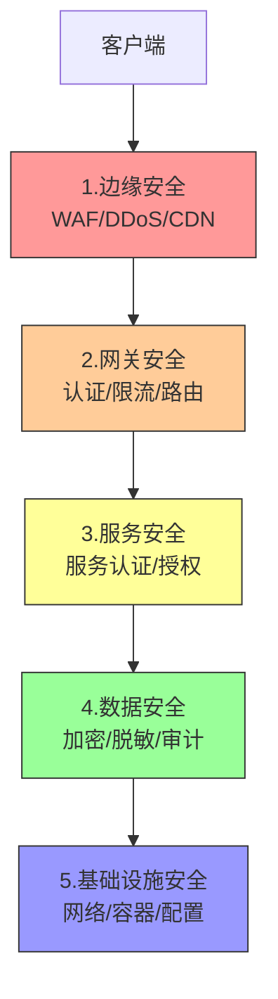
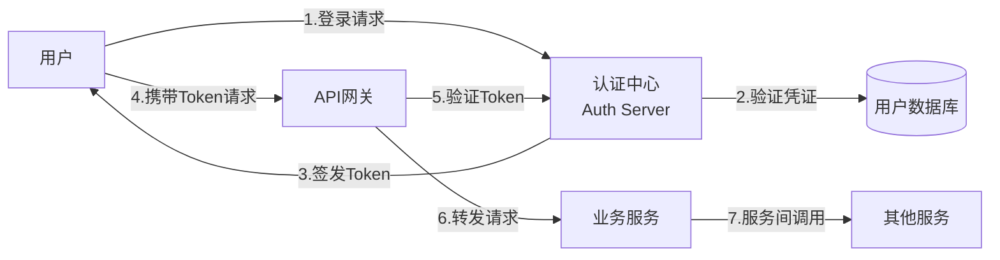

# Java-微服务安全架构

> **文档说明**：系统讲解 Java 微服务架构下的安全体系设计，包括认证授权、网关安全、服务间安全、数据安全、API 安全、配置安全、审计监控，以及生产级安全架构和最佳实践。
>
> **适用人群**：后端开发工程师、架构师、安全工程师、需要构建微服务安全体系的开发者
>
> **前置知识**：[[SpringSecurity-认证授权]]、[[Gateway-网关路由与鉴权]]、[[JWT与OAuth2认证授权]]、[[实战-SpringCloud微服务电商系统]]

---

## 一、概述

### 1. 微服务安全挑战

微服务架构将单体应用拆分为多个服务，安全边界从应用层扩展到服务间通信，带来新的挑战：

| 挑战 | 说明 |
|------|------|
| **认证分散** | 每个服务都需要认证，重复实现 |
| **服务间信任** | 服务间调用如何认证和授权 |
| **数据传输** | 服务间通信可能跨网络，需加密 |
| **权限粒度** | 细粒度到接口/数据级别的权限控制 |
| **配置安全** | 敏感配置（密钥、密码）如何安全管理 |
| **审计追踪** | 跨服务调用的完整审计链路 |
| **攻击面扩大** | 每个服务都是潜在攻击入口 |

### 2. 微服务安全架构分层



### 3. 安全设计原则

- [ ] **纵深防御**：多层安全防护，不依赖单一措施
- [ ] **最小权限**：服务和用户只拥有必要权限
- [ ] **零信任**：不信任任何内部/外部请求，每次都验证
- [ ] **默认安全**：默认拒绝，显式允许
- [ ] **可审计**：所有安全相关操作可追溯
- [ ] **安全左移**：在设计和开发阶段就考虑安全

---

## 二、认证授权架构

### 1. 统一认证中心

微服务架构下，认证应集中在统一认证中心，而非每个服务独立实现：



### 2. OAuth2 + JWT 架构

```java
// 认证服务器配置（Spring Authorization Server）
@Configuration
public class AuthServerConfig {

    @Bean
    public SecurityFilterChain authorizationServerSecurityFilterChain(HttpSecurity http) throws Exception {
        OAuth2AuthorizationServerConfiguration.applyDefaultSecurity(http);
        http.getConfigurer(OAuth2AuthorizationServerConfigurer.class)
            .oidc(Customizer.withDefaults());  // 启用 OIDC
        return http.build();
    }

    @Bean
    public RegisteredClientRepository registeredClientRepository() {
        RegisteredClient client = RegisteredClient.withId(UUID.randomUUID().toString())
            .clientId("web-client")
            .clientSecret("{noop}secret")
            .clientAuthenticationMethod(ClientAuthenticationMethod.CLIENT_SECRET_BASIC)
            .authorizationGrantType(AuthorizationGrantType.AUTHORIZATION_CODE)
            .authorizationGrantType(AuthorizationGrantType.REFRESH_TOKEN)
            .authorizationGrantType(AuthorizationGrantType.CLIENT_CREDENTIALS)
            .redirectUri("https://app.example.com/callback")
            .scope("read")
            .scope("write")
            .tokenSettings(TokenSettings.builder()
                .accessTokenTimeToLive(Duration.ofMinutes(30))
                .refreshTokenTimeToLive(Duration.ofDays(7))
                .build())
            .build();
        return new InMemoryRegisteredClientRepository(client);
    }

    @Bean
    public JwtDecoder jwtDecoder() {
        // 使用非对称密钥签名 JWT
        return NimbusJwtDecoder.withPublicKey(rsaKeyProperties.publicKey()).build();
    }
}
```

### 3. JWT Token 结构

```json
// JWT Header
{
  "alg": "RS256",
  "typ": "JWT"
}

// JWT Payload
{
  "sub": "user123",
  "name": "张三",
  "roles": ["USER", "ADMIN"],
  "permissions": ["user:read", "user:write"],
  "tenant_id": "tenant_001",
  "iat": 1693000000,
  "exp": 1693001800,
  "iss": "https://auth.example.com",
  "aud": "api-services"
}
```

### 4. 资源服务器配置

```java
// 业务服务作为资源服务器
@Configuration
@EnableWebSecurity
public class ResourceServerConfig {

    @Bean
    public SecurityFilterChain securityFilterChain(HttpSecurity http) throws Exception {
        http
            .authorizeHttpRequests(auth -> auth
                .requestMatchers("/actuator/health").permitAll()
                .requestMatchers("/api/public/**").permitAll()
                .requestMatchers("/api/admin/**").hasRole("ADMIN")
                .anyRequest().authenticated()
            )
            .oauth2ResourceServer(oauth2 -> oauth2
                .jwt(jwt -> jwt.jwtAuthenticationConverter(jwtAuthenticationConverter()))
            );
        return http.build();
    }

    // 自定义 JWT 权限转换
    private JwtAuthenticationConverter jwtAuthenticationConverter() {
        JwtGrantedAuthoritiesConverter converter = new JwtGrantedAuthoritiesConverter();
        converter.setAuthoritiesClaimName("roles");
        converter.setAuthorityPrefix("ROLE_");

        JwtAuthenticationConverter jwtConverter = new JwtAuthenticationConverter();
        jwtConverter.setJwtGrantedAuthoritiesConverter(converter);
        return jwtConverter;
    }
}
```

---

## 三、网关层安全

### 1. Spring Cloud Gateway 安全

```java
@Configuration
public class GatewaySecurityConfig {

    @Bean
    public SecurityFilterChain securityFilterChain(HttpSecurity http) throws Exception {
        http
            .csrf(csrf -> csrf.disable())
            .authorizeExchange(exchange -> exchange
                .pathMatchers("/auth/**").permitAll()
                .pathMatchers("/actuator/health").permitAll()
                .pathMatchers("/api/admin/**").hasRole("ADMIN")
                .anyExchange().authenticated()
            )
            .oauth2ResourceServer(oauth2 -> oauth2.jwt(Customizer.withDefaults()));
        return http.build();
    }
}
```

### 2. 网关全局过滤器

```java
// 认证过滤器
@Component
public class AuthGlobalFilter implements GlobalFilter, Ordered {

    @Autowired
    private JwtDecoder jwtDecoder;

    @Override
    public Mono<Void> filter(ServerWebExchange exchange, GatewayFilterChain chain) {
        String token = extractToken(exchange.getRequest());
        if (token == null) {
            return unauthorized(exchange);
        }

        try {
            Jwt jwt = jwtDecoder.decode(token);
            // 将用户信息传递给下游服务
            ServerHttpRequest request = exchange.getRequest().mutate()
                .header("X-User-Id", jwt.getSubject())
                .header("X-User-Roles", String.join(",", jwt.getClaimAsStringList("roles")))
                .header("X-Tenant-Id", jwt.getClaimAsString("tenant_id"))
                .build();
            return chain.filter(exchange.mutate().request(request).build());
        } catch (JwtException e) {
            return unauthorized(exchange);
        }
    }

    private String extractToken(ServerHttpRequest request) {
        String authHeader = request.getHeaders().getFirst(HttpHeaders.AUTHORIZATION);
        if (authHeader != null && authHeader.startsWith("Bearer ")) {
            return authHeader.substring(7);
        }
        return null;
    }

    private Mono<Void> unauthorized(ServerWebExchange exchange) {
        exchange.getResponse().setStatusCode(HttpStatus.UNAUTHORIZED);
        return exchange.getResponse().setComplete();
    }

    @Override
    public int getOrder() {
        return -100;
    }
}
```

### 3. 网关限流

```java
// 基于 Redis 的限流过滤器
@Configuration
public class RateLimitConfig {

    @Bean
    public RedisRateLimiter redisRateLimiter() {
        return new RedisRateLimiter(10, 20);  // 每秒10个，突发20个
    }

    @Bean
    public KeyResolver userKeyResolver() {
        return exchange -> {
            String userId = exchange.getRequest().getHeaders().getFirst("X-User-Id");
            return Mono.just(userId != null ? userId : "anonymous");
        };
    }
}

// 路由配置
spring:
  cloud:
    gateway:
      routes:
        - id: user-service
          uri: lb://user-service
          predicates:
            - Path=/api/users/**
          filters:
            - name: RequestRateLimiter
              args:
                redis-rate-limiter.replenishRate: 10
                redis-rate-limiter.burstCapacity: 20
                key-resolver: "#{@userKeyResolver}"
```

---

## 四、服务间安全

### 1. 服务间认证（Client Credentials）

```java
// 服务 A 调用服务 B，使用 Client Credentials 获取 Token
@Service
public class ServiceBClient {

    @Autowired
    private OAuth2AuthorizedClientManager clientManager;

    public String callServiceB() {
        // 获取服务间调用的 Token
        OAuth2AuthorizeRequest request = OAuth2AuthorizeRequest
            .withClientRegistrationId("service-b-client")
            .principal("service-a")
            .build();

        OAuth2AuthorizedClient client = clientManager.authorize(request);
        String token = client.getAccessToken().getTokenValue();

        // 携带 Token 调用服务 B
        return restTemplate.exchange(
            "http://service-b/api/data",
            HttpMethod.GET,
            new HttpEntity<>(createAuthHeaders(token)),
            String.class
        ).getBody();
    }

    private HttpHeaders createAuthHeaders(String token) {
        HttpHeaders headers = new HttpHeaders();
        headers.setBearerAuth(token);
        return headers;
    }
}
```

### 2. mTLS（双向 TLS）

```yaml
# 服务间 mTLS 配置（Spring Boot）
server:
  ssl:
    enabled: true
    key-store: classpath:keystore.p12
    key-store-password: ${KEYSTORE_PASSWORD}
    key-store-type: PKCS12
    trust-store: classpath:truststore.p12
    trust-store-password: ${TRUSTSTORE_PASSWORD}
    client-auth: need  # 需要客户端证书

# Feign 客户端 mTLS
feign:
  client:
    config:
      default:
        connectTimeout: 5000
        readTimeout: 10000
  httpclient:
    ssl:
      key-store: classpath:keystore.p12
      key-store-password: ${KEYSTORE_PASSWORD}
      trust-store: classpath:truststore.p12
      trust-store-password: ${TRUSTSTORE_PASSWORD}
```

### 3. 服务间权限传递

```java
// Feign 拦截器：传递用户上下文
@Component
public class FeignAuthInterceptor implements RequestInterceptor {

    @Override
    public void apply(RequestTemplate template) {
        // 从当前安全上下文获取用户信息
        Authentication auth = SecurityContextHolder.getContext().getAuthentication();
        if (auth != null && auth.getCredentials() != null) {
            // 传递原始 Token（令牌中继）
            template.header("Authorization", "Bearer " + auth.getCredentials());
        }
        // 传递服务身份
        template.header("X-Service-Id", "user-service");
    }
}
```

---

## 五、数据安全

### 1. 传输加密

- [ ] **HTTPS/TLS**：所有外部通信强制 HTTPS
- [ ] **mTLS**：服务间通信使用双向 TLS
- [ ] **证书管理**：使用 cert-manager 自动签发和续期证书
- [ ] **TLS 版本**：禁用 TLS 1.0/1.1，使用 TLS 1.2+

### 2. 存储加密

```java
// 数据库字段加密（JPA AttributeConverter）
@Converter
public class EncryptedAttributeConverter implements AttributeConverter<String, String> {

    @Autowired
    private EncryptionService encryptionService;

    @Override
    public String convertToDatabaseColumn(String attribute) {
        if (attribute == null) return null;
        return encryptionService.encrypt(attribute);
    }

    @Override
    public String convertToEntityAttribute(String dbData) {
        if (dbData == null) return null;
        return encryptionService.decrypt(dbData);
    }
}

// 使用
@Entity
public class User {
    @Id
    private Long id;

    @Convert(converter = EncryptedAttributeConverter.class)
    private String idCard;  // 身份证号加密存储

    @Convert(converter = EncryptedAttributeConverter.class)
    private String phone;   // 手机号加密存储
}
```

### 3. 数据脱敏

```java
// 日志脱敏
public class SensitiveDataMasker {

    public static String maskPhone(String phone) {
        if (phone == null || phone.length() < 7) return "***";
        return phone.substring(0, 3) + "****" + phone.substring(7);
    }

    public static String maskEmail(String email) {
        if (email == null || !email.contains("@")) return "***";
        int atIndex = email.indexOf("@");
        return email.charAt(0) + "***" + email.substring(atIndex);
    }

    public static String maskIdCard(String idCard) {
        if (idCard == null || idCard.length() < 10) return "***";
        return idCard.substring(0, 6) + "********" + idCard.substring(idCard.length() - 4);
    }
}

// 日志配置（Logback 脱敏 Pattern）
%msg{replace}{(?<=1[3-9])\d{4}(?=\d{4})}{****}
```

### 4. SQL 注入防护

详细参考 [[Java-SQL注入与XSS防护]]。

```java
// 使用预编译语句（MyBatis #{}）
@Select("SELECT * FROM users WHERE username = #{username}")
User findByUsername(@Param("username") String username);

// 禁止使用 ${}（字符串拼接）
// @Select("SELECT * FROM users WHERE username = '${username}'")  // 危险！
```

---

## 六、API 安全

### 1. 输入验证

```java
// Bean Validation
@RestController
@RequestMapping("/api/users")
public class UserController {

    @PostMapping
    public ResponseEntity<User> create(@Valid @RequestBody UserRequest request) {
        // ...
    }
}

public class UserRequest {
    @NotBlank(message = "用户名不能为空")
    @Size(min = 3, max = 50, message = "用户名长度3-50")
    @Pattern(regexp = "^[a-zA-Z0-9_]+$", message = "用户名只能包含字母数字下划线")
    private String username;

    @NotBlank
    @Email(message = "邮箱格式不正确")
    private String email;

    @NotBlank
    @Size(min = 8, max = 100)
    @Pattern(regexp = "^(?=.*[a-z])(?=.*[A-Z])(?=.*\\d).*$",
             message = "密码需包含大小写字母和数字")
    private String password;
}
```

### 2. 接口幂等性

```java
// 幂等性注解
@Target(ElementType.METHOD)
@Retention(RetentionPolicy.RUNTIME)
public @interface Idempotent {
    String value() default "idempotent";  // 幂等键前缀
    long expire() default 60;             // 过期时间（秒）
}

// 幂等性切面
@Aspect
@Component
public class IdempotentAspect {

    @Autowired
    private RedisTemplate<String, String> redisTemplate;

    @Around("@annotation(idempotent)")
    public Object around(ProceedingJoinPoint point, Idempotent idempotent) throws Throwable {
        // 从请求头获取幂等键
        String idempotencyKey = getRequest().getHeader("Idempotency-Key");
        if (idempotencyKey == null) {
            throw new BusinessException("缺少幂等键");
        }

        String redisKey = idempotent.value() + ":" + idempotencyKey;
        Boolean acquired = redisTemplate.opsForValue()
            .setIfAbsent(redisKey, "1", idempotent.expire(), TimeUnit.SECONDS);

        if (!acquired) {
            throw new BusinessException("重复请求");
        }

        try {
            return point.proceed();
        } finally {
            // 成功后保留键，失败则删除（允许重试）
        }
    }
}
```

### 3. 敏感接口保护

```java
// 敏感操作二次验证
@PostMapping("/transfer")
@RequireSecondVerification  // 自定义注解：需要二次验证
public ResponseEntity<?> transfer(@RequestBody TransferRequest request) {
    // 转账逻辑
}

// 二次验证：短信验证码 / 支付密码 / 生物识别
```

---

## 七、配置安全

### 1. 敏感配置管理

```yaml
# 不推荐：明文密码
spring:
  datasource:
    password: "plaintext_password"

# 推荐：环境变量注入
spring:
  datasource:
    password: ${DB_PASSWORD}

# 推荐：配置中心加密（Spring Cloud Config）
spring:
  datasource:
    password: '{cipher}AQA...encrypted...'
```

### 2. Vault 集成

```yaml
# Spring Cloud Vault 配置
spring:
  cloud:
    vault:
      uri: https://vault.example.com:8200
      authentication: TOKEN
      token: ${VAULT_TOKEN}
      scheme: https
      kv:
        enabled: true
        backend: secret
        default-context: myapp

# 从 Vault 读取敏感配置
# vault write secret/myapp db.password=secret api.key=abc123
```

### 3. 配置中心加密

```bash
# 使用 Spring Cloud Config 加密
# 生成密钥
keytool -genkeypair -alias config-key -keyalg RSA \
  -dname "CN=Config Server" -keystore config-server.jks \
  -keypass changeit -storepass changeit

# 加密配置
curl http://config-server/encrypt -d "my-secret-password"
# 返回加密后的字符串，放入配置文件：'{cipher}AQA...'
```

---

## 八、审计与监控

### 1. 安全审计日志

```java
// 审计日志注解
@Target(ElementType.METHOD)
@Retention(RetentionPolicy.RUNTIME)
public @interface AuditLog {
    String operation();      // 操作类型
    String resourceType();   // 资源类型
    String resourceId() default "";  // 资源 ID（SpEL）
}

// 审计切面
@Aspect
@Component
public class AuditLogAspect {

    @Autowired
    private AuditLogService auditLogService;

    @AfterReturning(pointcut = "@annotation(auditLog)", returning = "result")
    public void afterReturning(JoinPoint point, AuditLog auditLog, Object result) {
        AuditLogEntry entry = new AuditLogEntry();
        entry.setUserId(getCurrentUserId());
        entry.setOperation(auditLog.operation());
        entry.setResourceType(auditLog.resourceType());
        entry.setIp(getClientIp());
        entry.setTimestamp(LocalDateTime.now());
        entry.setSuccess(true);
        auditLogService.save(entry);
    }
}

// 使用
@DeleteMapping("/users/{id}")
@AuditLog(operation = "DELETE_USER", resourceType = "USER", resourceId = "#id")
public ResponseEntity<?> deleteUser(@PathVariable Long id) {
    userService.delete(id);
    return ResponseEntity.ok().build();
}
```

### 2. 安全监控指标

| 指标 | 说明 | 告警阈值 |
|------|------|---------|
| 登录失败率 | 失败次数/总次数 | > 10% |
| 异常登录位置 | 非常用地登录 | 任意一次 |
| API 401/403 率 | 未授权/禁止比例 | > 5% |
| 暴力破解检测 | 单 IP 多次失败 | 5 分钟内 > 10 次 |
| 敏感操作频率 | 高危操作次数 | 超出基线 |
| 异常数据访问 | 大量数据导出 | 单次 > 10000 条 |

---

## 九、容器与基础设施安全

### 1. Docker 安全

```dockerfile
# 安全的 Dockerfile
FROM eclipse-temurin:17-jre-alpine

# 非 root 用户运行
RUN addgroup -S appgroup && adduser -S appuser -G appgroup
USER appuser

# 只读文件系统（除必要目录）
VOLUME /tmp

# 不暴露敏感端口
EXPOSE 8080

COPY target/app.jar /app/app.jar
ENTRYPOINT ["java", "-jar", "/app/app.jar"]
```

### 2. K8s 安全配置

```yaml
# Pod 安全上下文
apiVersion: v1
kind: Pod
metadata:
  name: secure-app
spec:
  securityContext:
    runAsNonRoot: true
    runAsUser: 1000
    fsGroup: 2000
  containers:
    - name: app
      image: myapp:latest
      securityContext:
        allowPrivilegeEscalation: false
        readOnlyRootFilesystem: true
        capabilities:
          drop: ["ALL"]
      resources:
        limits:
          cpu: "1"
          memory: "512Mi"
        requests:
          cpu: "0.5"
          memory: "256Mi"
```

---

## 十、最佳实践

### 1. 安全开发流程

- [ ] **需求阶段**：安全需求评审，识别安全风险
- [ ] **设计阶段**：安全架构设计，威胁建模
- [ ] **开发阶段**：安全编码规范，代码审查
- [ ] **测试阶段**：安全测试（SAST/DAST/渗透测试）
- [ ] **部署阶段**：安全配置检查，漏洞扫描
- [ ] **运行阶段**：安全监控，应急响应

### 2. 安全检查清单

- [ ] 所有接口认证授权
- [ ] 密码加密存储（BCrypt）
- [ ] 敏感数据传输加密（HTTPS/mTLS）
- [ ] 输入验证和输出编码
- [ ] SQL 注入防护（预编译语句）
- [ ] XSS 防护（输出编码/CSP）
- [ ] CSRF 防护（Token/SameSite）
- [ ] 接口限流和熔断
- [ ] 敏感配置加密管理
- [ ] 安全审计日志
- [ ] 依赖漏洞扫描
- [ ] 容器安全配置
- [ ] 定期安全测试

---

## 十一、常见问题与排查

| 问题 | 原因 | 解决方案 |
|------|------|---------|
| **Token 过期频繁** | 过期时间太短 / 刷新机制不完善 | 合理设置过期时间，实现 Refresh Token |
| **服务间调用 401** | 未传递 Token / Token 无效 | 配置 Feign 拦截器，服务间认证 |
| **跨域问题** | 网关 CORS 未配置 | 网关层统一配置 CORS |
| **密码明文存储** | 未使用加密算法 | 使用 BCrypt/Argon2 加密 |
| **SQL 注入** | 使用字符串拼接 SQL | 使用预编译语句/MyBatis #{} |
| **敏感信息泄露** | 日志/响应未脱敏 | 日志脱敏、响应脱敏、字段级权限 |
| **配置泄露** | 配置文件明文存储 | 使用 Vault/配置中心加密 |
| **越权访问** | 权限校验缺失 | 接口级+数据级权限校验 |
| **暴力破解** | 无限流/锁定 | 登录限流、账户锁定、验证码 |
| **会话劫持** | Token 泄露 | 短过期时间、HTTPS、Token 轮换 |
| **CSRF 攻击** | 未防护 CSRF | CSRF Token / SameSite Cookie |
| **依赖漏洞** | 使用有漏洞的依赖 | 定期扫描、及时升级 |
| **容器提权** | 以 root 运行 | 非 root 用户、只读文件系统 |
| **审计缺失** | 未记录敏感操作 | 审计日志注解、统一审计框架 |

---

## 十二、关联笔记

### 安全相关
- [[SpringSecurity-认证授权]] · [[JWT与OAuth2认证授权]] · [[API安全最佳实践]]
- [[Java-SQL注入与XSS防护]] · [[Web安全-XSS-CSRF-SQL注入]] · [[零信任安全架构]]

### 微服务
- [[实战-SpringCloud微服务电商系统]] · [[Gateway-网关路由与鉴权]] · [[Nacos-注册中心与配置中心]]
- [[Sentinel-流量控制与熔断]] · [[分布式系统-高可用架构设计]]

### 运维
- [[SkyWalking-分布式链路追踪]] · [[K8s-核心概念与架构]] · [[云原生架构设计]]

### 导航
- [[MOC-后端开发]] · [[MOC-计算机基础]] · [[全栈+AI工程双轨融合学习路线图]]

> **学习路径建议**：先掌握 [[SpringSecurity-认证授权]] 基础安全 → 学习 [[JWT与OAuth2认证授权]] 认证协议 → 深入本文微服务安全架构 → 实践 [[Gateway-网关路由与鉴权]] 网关安全 → 研究 [[零信任安全架构]] 安全理念 → 应用于生产级微服务安全体系建设。
