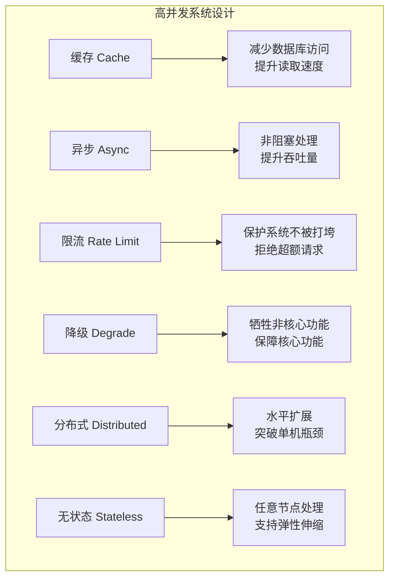
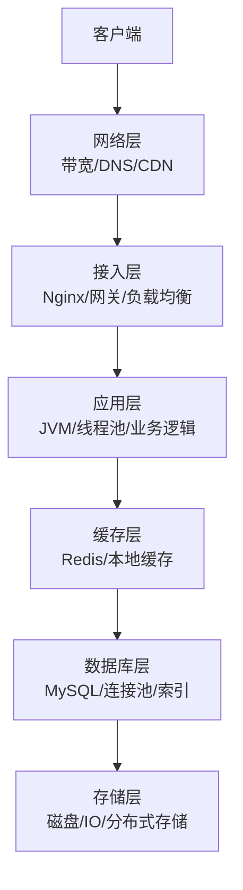
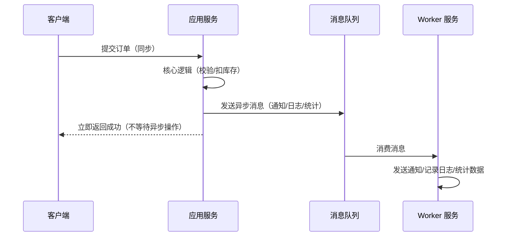

# ⚡ Java 高并发系统设计

> **文档说明**：系统讲解 Java 高并发系统设计的核心方法论和实战技术，涵盖高并发三要素（吞吐量/延迟/可用性）、六大核心手段（缓存/异步/限流/降级/分布式/无状态化）、缓存三大问题（穿透/击穿/雪崩）、Sentinel 限流熔断、消息队列削峰、多级缓存架构、分布式锁、连接池调优、全链路压测和生产级最佳实践，是构建秒杀、电商、社交等高并发系统的必备知识。
>
> **适用人群**：Java 后端工程师、系统架构师、需要设计高并发系统的技术负责人
>
> **前置知识**：[[Java-应用性能调优实战]] · [[Sentinel-流量控制与熔断]] · [[Redis缓存实战]]

---

## 一、概述

### 1.1 什么是高并发系统设计

高并发系统设计关注在**大量请求同时涌入**时，如何保持系统的**可用性**和**性能**。核心目标是：在有限的资源下，让系统承载尽可能多的请求，同时保证响应时间在可接受范围内，不发生雪崩式故障。

**高并发 ≠ 高 QPS**：高并发不仅是请求量大，还包括数据量大、计算密集、IO 密集等多种场景。设计高并发系统需要综合考虑业务场景、资源瓶颈、成本预算。

### 1.2 高并发三要素

| 要素 | 指标 | 说明 | 优化方向 |
|------|------|------|---------|
| **吞吐量** | QPS（每秒查询数）、TPS（每秒事务数） | 系统单位时间能处理的请求数 | 水平扩展、异步处理、缓存 |
| **响应时间** | 平均延迟、P50/P95/P99 延迟 | 请求从发收到响应的时间 | 缓存、并行处理、IO 优化 |
| **可用性** | SLA（99.9%/99.99%）、MTTR（平均恢复时间） | 系统正常服务的时间比例 | 限流、降级、熔断、多活 |

**三者的关系**：吞吐量和响应时间通常是矛盾的（请求越多，单个请求的响应时间越长），可用性是前两者的保障（系统挂了，吞吐量和延迟都无从谈起）。高并发设计就是在三者间找到最优平衡。

### 1.3 核心应用场景

| 场景 | 并发特征 | 核心挑战 | 典型技术 |
|------|---------|---------|---------|
| **秒杀/抢购** | 瞬时峰值极高（平时 100 QPS → 秒杀 10万 QPS） | 流量削峰、超卖控制、防刷 | 消息队列、Redis 预扣库存、限流 |
| **电商大促** | 持续高并发（数万 QPS 持续数小时） | 数据库压力、缓存一致性、库存 | 多级缓存、读写分离、分库分表 |
| **社交 Feed** | 读多写少（读:写 = 100:1），热点数据 | 缓存命中率、热点 Key、推送模式 | Redis 集群、本地缓存、推拉结合 |
| **即时通讯** | 长连接多（百万级连接），消息实时性 | 连接管理、消息推送、顺序性 | Netty、WebSocket、消息队列 |
| **支付系统** | 一致性要求高，不能超扣/重复扣 | 分布式事务、幂等、对账 | 分布式锁、事务消息、对账系统 |
| **直播/视频** | 高带宽、低延迟、弹幕实时 | 带宽成本、弹幕并发、CDN | CDN、边缘计算、弹幕合并 |
| **API 网关** | 所有流量入口，转发所有请求 | 路由性能、限流、鉴权 | 异步非阻塞（Netty/WebFlux）、集群 |

### 1.4 高并发六大核心手段



| 手段 | 作用 | 典型技术 |
|------|------|---------|
| **缓存** | 减少数据库访问，提升读取速度 | Redis、Caffeine、本地缓存、CDN |
| **异步** | 将耗时操作从主流程剥离，提升吞吐量 | 消息队列（Kafka/RabbitMQ）、异步线程池、CompletableFuture |
| **限流** | 限制请求速率，保护系统不被打垮 | Sentinel、Guava RateLimiter、Nginx 限流、网关限流 |
| **降级** | 系统压力大时关闭非核心功能，保障核心功能 | Sentinel 熔断降级、开关降级、兜底数据 |
| **分布式** | 多节点协同，突破单机瓶颈 | 微服务、集群部署、分库分表、负载均衡 |
| **无状态化** | 请求不依赖特定节点，支持弹性伸缩 | Session 集中存储（Redis）、JWT、无状态服务 |

---

## 二、底层原理

### 2.1 系统性能瓶颈分析

高并发系统的瓶颈通常出现在以下几个层面，需要逐层分析和优化：



| 层级 | 常见瓶颈 | 优化方向 |
|------|---------|---------|
| **网络层** | 带宽不足、DNS 解析慢、跨地域延迟 | CDN 加速、HTTP/2、带宽扩容、多线 BGP |
| **接入层** | Nginx 连接数上限、网关性能瓶颈 | Nginx 调优（worker/keepalive）、网关集群、LVS/F5 |
| **应用层** | 线程池满、GC 频繁、同步阻塞、慢 SQL | 异步非阻塞、线程池调优、JVM 调优、代码优化 |
| **缓存层** | 缓存穿透/击穿/雪崩、热点 Key、Redis 带宽 | 布隆过滤器、互斥锁、随机过期、本地缓存、Redis 集群 |
| **数据库层** | 连接池满、慢查询、锁等待、主从延迟 | 索引优化、读写分离、分库分表、连接池调优 |
| **存储层** | 磁盘 IO 慢、随机 IO | SSD、顺序 IO、对象存储、读写分离 |

### 2.2 缓存三大问题原理

#### 缓存穿透（Cache Penetration）

**问题**：查询一个**不存在**的数据，缓存中没有，请求直接打到数据库。如果被恶意攻击，大量查询不存在的 key，数据库会被打垮。

```
请求 → 缓存未命中 → 数据库查询（空结果）→ 不写入缓存 → 下次同样请求又打数据库
```

**解决方案**：
1. **布隆过滤器**：将所有可能存在的数据哈希到一个足够大的 bitmap 中，不存在的数据直接被拦截
2. **空值缓存**：查询结果为空也缓存（设置较短过期时间，如 60 秒）
3. **参数校验**：在入口层校验请求参数，非法请求直接拒绝

#### 缓存击穿（Cache Breakdown）

**问题**：某个**热点 Key** 在缓存过期的瞬间，大量并发请求同时涌入，都去查询数据库，导致数据库压力骤增。

```
热点 Key 过期 → 1000 个并发请求同时未命中 → 1000 个请求同时查数据库 → 数据库被打垮
```

**解决方案**：
1. **互斥锁（Mutex Lock）**：只让一个请求去查数据库并回写缓存，其他请求等待重试
2. **逻辑过期**：缓存不设置物理过期时间，在 value 中存储逻辑过期时间，过期后异步更新缓存
3. **热点数据永不过期**：对于确定的热点数据，设置超长过期时间或永不过期，主动更新

#### 缓存雪崩（Cache Avalanche）

**问题**：**大量 Key 在同一时间集中过期**，或 Redis 宕机，导致大量请求同时打到数据库。

```
大量 Key 同时过期 → 缓存命中率骤降 → 大量请求打到数据库 → 数据库连接池满 → 服务不可用
```

**解决方案**：
1. **过期时间随机化**：在基础过期时间上加随机值（如 30 分钟 + 0~5 分钟随机），避免集中过期
2. **多级缓存**：本地缓存（Caffeine）+ 分布式缓存（Redis），Redis 挂了本地缓存还能顶一阵
3. **Redis 高可用**：主从 + 哨兵 + 集群，避免单点故障
4. **限流降级**：缓存失效时限流，保护数据库

### 2.3 限流算法原理

| 算法 | 原理 | 优点 | 缺点 | 适用场景 |
|------|------|------|------|---------|
| **固定窗口** | 固定时间窗口内计数，超过阈值拒绝 | 实现简单 | 窗口边界问题（窗口切换时可能 2 倍流量） | 简单限流 |
| **滑动窗口** | 将时间窗口细分，滑动统计 | 解决边界问题 | 实现稍复杂 | 精确限流 |
| **漏桶算法** | 请求进入漏桶，以固定速率流出 | 流量平滑，输出速率恒定 | 无法应对突发流量 | 流量整形 |
| **令牌桶算法** | 以固定速率生成令牌，请求需获取令牌 | 允许一定突发流量 | 实现稍复杂 | 最常用，Sentinel/Guava 默认 |

**令牌桶算法原理**：
```
以固定速率（如 1000 个/秒）往桶里放令牌
桶有最大容量（如 2000 个），满了就丢弃
请求进来时从桶里取一个令牌，取到就通过，取不到就拒绝
突发流量时桶里有积累的令牌，可以应对短时突发
```

### 2.4 异步处理原理

异步处理的核心是**将耗时操作从主请求线程剥离**，让主流程快速返回，耗时操作在后台线程或消息队列中处理。



**异步的三种实现方式**：
1. **线程池异步**：`@Async` / `CompletableFuture`，适合简单异步任务
2. **消息队列**：Kafka/RabbitMQ/RocketMQ，适合解耦、削峰、可靠投递
3. **事件驱动**：Spring Event / Guava EventBus，适合进程内事件

### 2.5 无状态化原理

无状态服务是指**服务不保存任何请求相关的状态信息**，每个请求都包含所有必要信息，任意节点都能处理。

| 有状态服务 | 无状态服务 |
|-----------|-----------|
| Session 存在服务内存中 | Session 存在 Redis（集中存储） |
| 用户登录状态在 JVM 中 | JWT Token 包含用户信息 |
| 本地缓存用户数据 | 缓存统一在 Redis |
| 粘性会话（同一用户路由到同一节点） | 任意节点可处理，负载均衡更灵活 |
| 扩容需要数据同步 | 直接加节点，弹性伸缩 |

**无状态化的好处**：
- 水平扩展简单：加机器即可，无需数据迁移
- 故障恢复快：节点挂了，请求自动转到其他节点
- 弹性伸缩：根据流量自动扩缩容（K8s HPA）
- 发布平滑：滚动发布不影响用户

---

## 三、实操示例

### 3.1 多级缓存架构（Caffeine + Redis）

```java
/**
 * 多级缓存：本地缓存 Caffeine + 分布式缓存 Redis
 * 本地缓存：极快（ns级），容量小，进程内
 * Redis：快（ms级），容量大，分布式共享
 *
 * 读取顺序：本地缓存 → Redis → 数据库
 * 写入策略：更新数据库 → 删除缓存（Cache-Aside Pattern）
 */
@Service
@Slf4j
public class MultiLevelCacheService {

    // 本地缓存：Caffeine，最大 10000 条，写入后 10 分钟过期
    private final Cache<String, Object> localCache = Caffeine.newBuilder()
            .maximumSize(10_000)
            .expireAfterWrite(Duration.ofMinutes(10))
            .recordStats()  // 记录命中率等统计
            .build();

    @Autowired
    private RedisTemplate<String, Object> redisTemplate;

    @Autowired
    private UserMapper userMapper;

    // Redis 缓存过期时间：30 分钟 + 随机 0~5 分钟（防止雪崩）
    private static final long REDIS_EXPIRE_BASE = 30;
    private static final long REDIS_EXPIRE_RANDOM = 5;

    /**
     * 多级缓存读取
     */
    public User getUserById(Long userId) {
        String key = "user:" + userId;

        // 1. 先查本地缓存
        Object localValue = localCache.getIfPresent(key);
        if (localValue != null) {
            log.debug("本地缓存命中: {}", key);
            return (User) localValue;
        }

        // 2. 再查 Redis
        Object redisValue = redisTemplate.opsForValue().get(key);
        if (redisValue != null) {
            log.debug("Redis 缓存命中: {}", key);
            // 回填本地缓存
            localCache.put(key, redisValue);
            return (User) redisValue;
        }

        // 3. 查数据库（加互斥锁防击穿）
        String lockKey = "lock:user:" + userId;
        Boolean locked = redisTemplate.opsForValue()
                .setIfAbsent(lockKey, "1", Duration.ofSeconds(10));
        if (Boolean.TRUE.equals(locked)) {
            try {
                // 双重检查：拿到锁后再查一次缓存
                redisValue = redisTemplate.opsForValue().get(key);
                if (redisValue != null) {
                    localCache.put(key, redisValue);
                    return (User) redisValue;
                }

                // 查数据库
                User user = userMapper.selectById(userId);
                if (user != null) {
                    // 写入 Redis（随机过期时间防雪崩）
                    long expire = REDIS_EXPIRE_BASE + (long)(Math.random() * REDIS_EXPIRE_RANDOM);
                    redisTemplate.opsForValue().set(key, user, Duration.ofMinutes(expire));
                    // 写入本地缓存
                    localCache.put(key, user);
                } else {
                    // 空值缓存（防穿透），短过期时间
                    redisTemplate.opsForValue().set(key, new NullUser(), Duration.ofMinutes(1));
                }
                return user;
            } finally {
                redisTemplate.delete(lockKey);  // 释放锁
            }
        } else {
            // 没拿到锁，等待 50ms 后重试
            try {
                Thread.sleep(50);
            } catch (InterruptedException e) {
                Thread.currentThread().interrupt();
            }
            return getUserById(userId);  // 递归重试
        }
    }

    /**
     * 更新数据：先更新数据库，再删除缓存（Cache-Aside）
     */
    @Transactional
    public void updateUser(User user) {
        // 1. 更新数据库
        userMapper.updateById(user);

        // 2. 删除缓存（先删本地，再删 Redis）
        String key = "user:" + user.getId();
        localCache.invalidate(key);
        redisTemplate.delete(key);

        // 3. 延迟双删（防止并发导致缓存不一致）
        // 延迟 1 秒后再删一次（用消息队列或定时任务实现）
    }
}
```

### 3.2 Sentinel 限流熔断降级

```java
/**
 * Sentinel 限流 + 熔断 + 降级
 * Sentinel 是阿里开源的流量控制组件，替代 Hystrix
 */
@RestController
@RequestMapping("/api/order")
@Slf4j
public class OrderController {

    @Autowired
    private OrderService orderService;

    /**
     * 创建订单：限流 + 降级
     * value: 资源名
     * blockHandler: 限流触发时的处理方法
     * fallback: 异常降级方法
     */
    @PostMapping("/create")
    @SentinelResource(
        value = "createOrder",
        blockHandler = "handleBlock",
        fallback = "handleFallback"
    )
    public Result<OrderVO> createOrder(@RequestBody OrderRequest request) {
        Order order = orderService.create(request);
        return Result.success(convert(order));
    }

    /**
     * 限流触发：返回系统繁忙提示
     * 注意：参数必须和原方法一致，最后加 BlockException
     */
    public Result<OrderVO> handleBlock(OrderRequest request, BlockException ex) {
        log.warn("创建订单被限流: {}", ex.getRule());
        return Result.fail(429, "系统繁忙，请稍后重试");
    }

    /**
     * 异常降级：业务异常时返回兜底数据
     */
    public Result<OrderVO> handleFallback(OrderRequest request, Throwable ex) {
        log.error("创建订单异常降级", ex);
        return Result.fail(500, "服务暂时不可用，已为您加入排队");
    }
}

/**
 * Sentinel 配置类：限流规则 + 熔断规则
 */
@Configuration
public class SentinelConfig {

    @PostConstruct
    public void initRules() {
        // 1. 限流规则：QPS 限流
        List<FlowRule> flowRules = new ArrayList<>();
        FlowRule orderRule = new FlowRule();
        orderRule.setResource("createOrder");
        orderRule.setGrade(RuleConstant.FLOW_GRADE_QPS);  // QPS 模式
        orderRule.setCount(100);  // 每秒最多 100 个请求
        orderRule.setLimitApp("default");
        flowRules.add(orderRule);
        FlowRuleManager.loadRules(flowRules);

        // 2. 熔断规则：慢调用比例熔断
        List<DegradeRule> degradeRules = new ArrayList<>();
        DegradeRule degradeRule = new DegradeRule();
        degradeRule.setResource("createOrder");
        degradeRule.setGrade(RuleConstant.DEGRADE_GRADE_RT);  // 慢调用比例
        degradeRule.setCount(500);  // 响应时间超过 500ms 算慢调用
        degradeRule.setTimeWindow(10);  // 熔断时长 10 秒
        degradeRule.setSlowRatioThreshold(0.5);  // 慢调用比例超过 50% 触发熔断
        degradeRule.setMinRequestAmount(10);  // 最小请求数
        degradeRules.add(degradeRule);
        DegradeRuleManager.loadRules(degradeRules);

        // 3. 热点参数限流：对特定参数限流（如秒杀商品 ID）
        ParamFlowRule hotRule = new ParamFlowRule("createOrder")
                .setParamIdx(0)  // 第 0 个参数
                .setCount(10);   // 每个参数值每秒 10 次
        ParamFlowRuleManager.loadRules(Collections.singletonList(hotRule));
    }
}
```

### 3.3 消息队列削峰（秒杀场景）

```java
/**
 * 秒杀场景：消息队列削峰填谷
 * 核心思路：请求不直接操作数据库，先写入消息队列，
 * 消费者按数据库能承受的速率慢慢消费，避免数据库被打垮
 */
@Service
@Slf4j
public class SeckillService {

    @Autowired
    private RedisTemplate<String, Object> redisTemplate;

    @Autowired
    private RabbitTemplate rabbitTemplate;

    private static final String STOCK_KEY = "seckill:stock:";
    private static final String USER_KEY = "seckill:user:";

    /**
     * 秒杀下单（前置校验 + 异步下单）
     * 整个过程在 Redis 中完成，不直接操作数据库
     */
    public Result seckill(Long seckillId, Long userId) {
        String stockKey = STOCK_KEY + seckillId;
        String userKey = USER_KEY + seckillId + ":" + userId;

        // 1. 防重复下单：Redis Set 判断用户是否已下单
        Boolean isNew = redisTemplate.opsForSet().add(userKey, userId.toString());
        if (Boolean.FALSE.equals(isNew)) {
            return Result.fail("您已参与过秒杀，请勿重复下单");
        }

        // 2. 预扣库存：Redis DECR 原子操作
        Long stock = redisTemplate.opsForValue().decrement(stockKey);
        if (stock == null || stock < 0) {
            // 库存不足，回滚用户标记
            redisTemplate.opsForSet().remove(userKey, userId.toString());
            redisTemplate.opsForValue().increment(stockKey);  // 补回库存
            return Result.fail("商品已售罄");
        }

        // 3. 发送消息到队列（异步下单）
        SeckillMessage message = new SeckillMessage(seckillId, userId, System.currentTimeMillis());
        rabbitTemplate.convertAndSend("seckill.exchange", "seckill.order", message);

        // 4. 立即返回排队中（不等待数据库操作）
        return Result.success("排队中，请稍后查询结果");
    }
}

/**
 * 秒杀消费者：按数据库能承受的速率消费
 */
@Component
@Slf4j
@RabbitListener(queues = "seckill.order.queue")
public class SeckillConsumer {

    @Autowired
    private OrderMapper orderMapper;

    @Autowired
    private StockMapper stockMapper;

    @RabbitHandler
    public void handleSeckill(SeckillMessage message) {
        try {
            log.info("处理秒杀订单: seckillId={}, userId={}", message.getSeckillId(), message.getUserId());

            // 1. 数据库扣减库存（带乐观锁）
            int updated = stockMapper.decreaseStock(message.getSeckillId());
            if (updated <= 0) {
                log.warn("库存不足，秒杀失败: {}", message);
                return;
            }

            // 2. 创建订单
            Order order = new Order();
            order.setSeckillId(message.getSeckillId());
            order.setUserId(message.getUserId());
            order.setStatus(1);
            orderMapper.insert(order);

            log.info("秒杀订单创建成功: orderId={}", order.getId());
        } catch (Exception e) {
            log.error("秒杀订单处理失败", e);
            // 失败处理：回滚 Redis 库存、通知用户、重试等
        }
    }
}
```

### 3.4 分布式锁（Redis 实现）

```java
/**
 * 分布式锁：Redis SETNX + Lua 脚本保证原子性
 * 用于防止并发重复操作（如下单、扣库存）
 */
@Component
@Slf4j
public class RedisDistributedLock {

    @Autowired
    private RedisTemplate<String, Object> redisTemplate;

    private static final String LOCK_PREFIX = "lock:";
    private static final long DEFAULT_EXPIRE = 30;  // 默认 30 秒过期

    // Lua 脚本：释放锁时判断是否是自己的锁（防止误删）
    private static final String UNLOCK_SCRIPT =
        "if redis.call('get', KEYS[1]) == ARGV[1] then " +
        "    return redis.call('del', KEYS[1]) " +
        "else " +
        "    return 0 " +
        "end";

    /**
     * 尝试获取锁
     * @param lockKey 锁的 key
     * @param requestId 请求标识（UUID，用于释放锁时校验）
     * @param expireTime 过期时间（秒）
     * @return 是否获取成功
     */
    public boolean tryLock(String lockKey, String requestId, long expireTime) {
        String key = LOCK_PREFIX + lockKey;
        Boolean result = redisTemplate.opsForValue()
                .setIfAbsent(key, requestId, Duration.ofSeconds(expireTime));
        return Boolean.TRUE.equals(result);
    }

    /**
     * 释放锁（Lua 脚本保证原子性）
     */
    public boolean unlock(String lockKey, String requestId) {
        String key = LOCK_PREFIX + lockKey;
        DefaultRedisScript<Long> script = new DefaultRedisScript<>();
        script.setScriptText(UNLOCK_SCRIPT);
        script.setResultType(Long.class);
        Long result = redisTemplate.execute(script,
                Collections.singletonList(key), requestId);
        return result != null && result == 1;
    }

    /**
     * 使用示例：带自动释放的分布式锁
     */
    public <T> T executeWithLock(String lockKey, Supplier<T> action) {
        String requestId = UUID.randomUUID().toString();
        boolean locked = tryLock(lockKey, requestId, DEFAULT_EXPIRE);
        if (!locked) {
            throw new BusinessException("系统繁忙，请稍后重试");
        }
        try {
            return action.get();
        } finally {
            unlock(lockKey, requestId);  // finally 中释放，确保不死锁
        }
    }
}

// 使用示例
// public void createOrder(Long productId) {
//     distributedLock.executeWithLock("order:" + productId, () -> {
//         // 业务逻辑：扣库存 + 创建订单
//         return null;
//     });
// }
```

### 3.5 线程池调优与异步处理

```java
/**
 * 线程池配置：合理的线程池参数是高并发的基础
 * 线程数计算公式：
 * - CPU 密集型：CPU 核心数 + 1
 * - IO 密集型：CPU 核心数 * 2 或 CPU 核心数 / (1 - 阻塞系数)
 * - 一般 Web 应用：IO 密集型居多，2 * CPU 核心数 起步
 */
@Configuration
@Slf4j
public class ThreadPoolConfig {

    @Value("${cpu.cores:8}")
    private int cpuCores;

    /**
     * 业务异步线程池
     */
    @Bean("businessExecutor")
    public ThreadPoolExecutor businessExecutor() {
        int corePoolSize = cpuCores * 2;           // 核心线程数
        int maxPoolSize = cpuCores * 4;            // 最大线程数
        int queueCapacity = 200;                    // 队列容量
        long keepAliveTime = 60L;                   // 空闲线程存活时间

        ThreadPoolExecutor executor = new ThreadPoolExecutor(
            corePoolSize,
            maxPoolSize,
            keepAliveTime,
            TimeUnit.SECONDS,
            new LinkedBlockingQueue<>(queueCapacity),
            new ThreadFactoryBuilder().setNameFormat("business-%d").build(),
            new ThreadPoolExecutor.CallerRunsPolicy()  // 拒绝策略：由调用线程执行
        );

        log.info("业务线程池初始化: core={}, max={}, queue={}", corePoolSize, maxPoolSize, queueCapacity);
        return executor;
    }

    /**
     * CompletableFuture 异步编排示例
     */
    @Service
    @Slf4j
    public static class AsyncOrderService {

        @Autowired
        @Qualifier("businessExecutor")
        private ThreadPoolExecutor executor;

        /**
         * 并行查询订单详情：用户信息 + 商品信息 + 物流信息 并行查询
         */
        public OrderDetailVO getOrderDetail(Long orderId) {
            // 1. 并行查询三个接口
            CompletableFuture<UserVO> userFuture = CompletableFuture.supplyAsync(
                () -> userService.getUser(orderId), executor);

            CompletableFuture<ProductVO> productFuture = CompletableFuture.supplyAsync(
                () -> productService.getProduct(orderId), executor);

            CompletableFuture<LogisticsVO> logisticsFuture = CompletableFuture.supplyAsync(
                () -> logisticsService.getLogistics(orderId), executor);

            // 2. 等待所有完成（allOf）
            CompletableFuture.allOf(userFuture, productFuture, logisticsFuture).join();

            // 3. 组装结果
            OrderDetailVO detail = new OrderDetailVO();
            try {
                detail.setUser(userFuture.get());
                detail.setProduct(productFuture.get());
                detail.setLogistics(logisticsFuture.get());
            } catch (Exception e) {
                log.error("查询订单详情异常", e);
                throw new BusinessException("查询订单详情失败");
            }
            return detail;
        }
    }
}
```

### 3.6 数据库连接池调优（HikariCP）

```yaml
# application.yml - HikariCP 连接池配置
# HikariCP 是 Spring Boot 默认连接池，性能最好
spring:
  datasource:
    hikari:
      # 最小空闲连接数：保持在池中不被回收的最小连接数
      minimum-idle: 10
      # 最大连接数：池中最多的连接数（核心参数）
      # 计算公式：连接数 = ((核心数 * 2) + 有效磁盘数)
      # 一般 20-50 足够，不是越大越好（连接太多数据库反而慢）
      maximum-pool-size: 30
      # 连接超时：获取连接的最大等待时间（ms）
      connection-timeout: 30000
      # 空闲超时：空闲连接多久被回收（ms），需大于 minimum-idle 才生效
      idle-timeout: 600000
      # 最大生命周期：连接最大存活时间（ms），到期强制回收
      max-lifetime: 1800000
      # 连接测试查询
      connection-test-query: SELECT 1
      # 连接池名称（监控用）
      pool-name: HikariPool-Master
      # 只读连接（从库）
      # read-only: true
```

---

## 四、常见问题与排查

| 问题现象 | 可能原因 | 解决方案 |
|---------|---------|---------|
| **数据库连接池满，获取连接超时** | 连接池太小；慢 SQL 占用连接不释放；连接泄漏 | 增大 `maximum-pool-size`（但不要超过 50）；优化慢 SQL；检查是否有未关闭的连接（`try-with-resources`）；监控活跃连接数 |
| **缓存穿透，数据库被不存在的 key 打垮** | 恶意攻击查询不存在的数据；未做空值缓存 | 布隆过滤器拦截；空值缓存（短过期）；入口参数校验；监控异常查询模式 |
| **缓存击穿，热点 Key 过期瞬间数据库压力骤增** | 热点 Key 过期；大量并发同时查数据库 | 互斥锁（只让一个请求查库）；逻辑过期（异步更新）；热点数据永不过期 + 主动更新 |
| **缓存雪崩，大量 Key 同时过期** | 过期时间设置相同；Redis 宕机 | 过期时间加随机值；多级缓存（本地+Redis）；Redis 高可用（哨兵/集群）；限流保护数据库 |
| **Redis 大 Key 导致阻塞** | 单个 Key 存储大量数据（如百万级 Set）；大 Value | 拆分大 Key（Hash 分桶、List 分页）；避免 Value > 10KB；监控大 Key；用 `UNLINK` 替代 `DEL` 异步删除 |
| **热点 Key 导致单节点压力大** | 某个 Key 访问量极高，集中在一个 Redis 节点 | 本地缓存挡一层；热点 Key 复制多份（key_0, key_1...）分散压力；Redis Cluster 时注意热点 slot |
| **消息队列消息积压** | 消费者处理慢；消费者挂了；突发流量 | 扩容消费者；优化消费逻辑（批量处理）；临时扩容队列分区；监控积压量并告警 |
| **线程池满，任务被拒绝** | 线程池参数太小；任务处理慢；队列满了 | 调大核心/最大线程数；优化任务执行时间；增大队列容量；合理的拒绝策略（CallerRunsPolicy） |
| **Full GC 频繁，STW 时间长** | 内存泄漏；大对象直接进老年代；堆内存设置不合理 | dump 堆内存分析（MAT/JVisualVM）；检查是否有内存泄漏；调整新生代/老年代比例；G1 垃圾回收器 |
| **服务雪崩，一个服务挂了导致全链路不可用** | 服务间同步调用，没有超时和熔断；依赖服务故障 | 设置合理超时（连接/读取）；Sentinel 熔断降级；服务隔离（线程池/信号量隔离）；降级兜底数据 |
| **超卖（秒杀/库存）** | 并发扣库存没有原子性；没有分布式锁；先查后改非原子 | Redis DECR 原子预扣；数据库乐观锁（`UPDATE ... WHERE stock > 0`）；分布式锁；最终一致性对账 |
| **接口 P99 延迟很高** | 慢 SQL；GC STW；锁竞争；下游服务慢 | APM 全链路追踪定位慢节点；优化慢 SQL（加索引/改查询）；减少锁粒度；异步化非核心操作 |
| **水平扩展后性能没提升** | 有状态服务（Session 在本地）；数据库成为瓶颈；负载均衡不均 | 无状态化（Session 存 Redis）；数据库读写分离/分库分表；检查负载均衡策略（轮询/一致性哈希） |
| **限流不生效** | Sentinel 规则未配置；限流粒度不对；网关和应用层重复限流 | 检查 Sentinel 控制台规则是否推送成功；确认资源名（`@SentinelResource value`）匹配；限流在网关层统一做 |

---

## 五、进阶与最佳实践

### 5.1 高并发系统设计 Checklist

| 类别 | 检查项 | 说明 |
|------|--------|------|
| **缓存** | 是否有缓存？命中率多少？ | 读多写少必须加缓存，目标命中率 > 90% |
| **缓存** | 穿透/击穿/雪崩是否处理？ | 布隆过滤器 + 互斥锁 + 随机过期 |
| **缓存** | 是否多级缓存？ | 本地 Caffeine + Redis，热点数据本地缓存 |
| **缓存** | 缓存一致性策略？ | Cache-Aside（更新 DB → 删缓存），延迟双删 |
| **异步** | 耗时操作是否异步？ | 通知/日志/统计/搜索索引等非核心操作异步化 |
| **异步** | 是否用消息队列削峰？ | 秒杀/大促等突发流量用 MQ 削峰 |
| **异步** | 消息可靠性？ | 生产者确认 + 消费者手动 ACK + 死信队列 + 幂等消费 |
| **限流** | 是否有限流？ | 网关层 + 应用层双层限流，Sentinel 配置规则 |
| **限流** | 限流粒度？ | 全局限流 + 接口限流 + 用户限流 + 热点参数限流 |
| **降级** | 是否有降级方案？ | 非核心功能可降级（推荐/搜索/评论），核心功能保障 |
| **降级** | 降级开关？ | 配置中心动态开关，支持手动降级和自动熔断降级 |
| **分布式** | 是否无状态？ | Session/用户状态存 Redis，服务可任意扩展 |
| **分布式** | 数据库是否瓶颈？ | 读写分离 + 分库分表，连接池合理配置 |
| **分布式** | 是否有分布式锁？ | 跨节点互斥用 Redis/Zookeeper 分布式锁 |
| **线程池** | 线程池参数是否合理？ | CPU 密集型 N+1，IO 密集型 2N，监控活跃线程数 |
| **连接池** | 数据库连接池？ | HikariCP，最大连接数 20-50，监控连接获取时间 |
| **JVM** | GC 调优？ | G1 回收器，合理堆大小，监控 Full GC 频率和 STW 时间 |
| **监控** | 是否有全链路监控？ | APM（SkyWalking/Pinpoint）+ Prometheus + Grafana |
| **监控** | 告警是否完善？ | QPS/延迟/错误率/线程池/连接池/GC/积压量 告警 |
| **压测** | 是否做过全链路压测？ | 上线前压测，知道系统容量水位，提前发现瓶颈 |

### 5.2 全链路压测方法论

```
全链路压测流程：
1. 容量评估 → 估算目标 QPS（如大促目标 10万 QPS）
2. 环境准备 → 隔离压测环境（影子库/影子表）
3. 数据构造 → 构造真实比例的测试数据（用户/商品/订单）
4. 脚本编写 → JMeter/Gatling 编写压测脚本（模拟真实业务场景）
5. 梯度加压 → 从低 QPS 开始，逐步增加，观察系统水位
6. 瓶颈定位 → 找到第一个瓶颈（CPU/内存/连接池/数据库/网络）
7. 优化迭代 → 解决瓶颈后继续加压，找到下一个瓶颈
8. 容量验证 → 验证目标 QPS 下系统稳定（延迟/错误率达标）
9. 容量规划 → 根据压测结果规划机器数量和扩容策略
```

**压测关键指标**：
- **QPS/TPS**：系统吞吐量
- **响应时间**：平均/P50/P95/P99/P999 延迟
- **错误率**：超时/异常/限流的比例
- **资源使用率**：CPU/内存/磁盘 IO/网络 IO
- **中间件指标**：Redis 命中率/数据库慢查询/MQ 积压量/线程池活跃数

### 5.3 高可用架构模式

| 模式 | 说明 | 适用场景 |
|------|------|---------|
| **主从模式** | 一主多从，主写从读 | 读多写少，数据库/Redis |
| **集群模式** | 多主多从，数据分片 | 大数据量，高并发 |
| **同城双活** | 两个机房同时提供服务，数据同步 | 高可用，机房级故障 |
| **异地多活** | 多个城市机房同时服务，数据最终一致 | 极高可用，城市级故障 |
| **微服务化** | 按业务拆分服务，独立部署扩展 | 复杂业务，团队协作 |
| **服务网格** | Sidecar 代理服务间通信，统一治理 | 大规模微服务，流量治理 |

### 5.4 生产环境监控告警

```yaml
# 关键监控指标和告警阈值（Prometheus 规则示例）
groups:
  - name: high_concurrency_alerts
    rules:
      # 应用层
      - alert: HighErrorRate
        expr: rate(http_requests_total{status=~"5.."}[5m]) / rate(http_requests_total[5m]) > 0.05
        for: 2m
        labels: { severity: critical }
        annotations: { summary: "错误率超过 5%" }

      - alert: HighP99Latency
        expr: histogram_quantile(0.99, rate(http_request_duration_seconds_bucket[5m])) > 2
        for: 2m
        labels: { severity: warning }
        annotations: { summary: "P99 延迟超过 2 秒" }

      # 线程池
      - alert: ThreadPoolExhausted
        expr: threadpool_active_count / threadpool_max_count > 0.8
        for: 1m
        labels: { severity: critical }
        annotations: { summary: "线程池使用率超过 80%" }

      # 数据库连接池
      - alert: ConnectionPoolExhausted
        expr: hikaricp_connections_active / hikaricp_connections_max > 0.9
        for: 1m
        labels: { severity: critical }
        annotations: { summary: "数据库连接池使用率超过 90%" }

      # Redis
      - alert: RedisLowHitRate
        expr: rate(redis_keyspace_hits_total[5m]) / (rate(redis_keyspace_hits_total[5m]) + rate(redis_keyspace_misses_total[5m])) < 0.8
        for: 5m
        labels: { severity: warning }
        annotations: { summary: "Redis 命中率低于 80%" }

      # 消息队列
      - alert: MQLagHigh
        expr: rabbitmq_queue_messages > 10000
        for: 5m
        labels: { severity: warning }
        annotations: { summary: "消息队列积压超过 10000" }

      # JVM
      - alert: FullGCFrequent
        expr: increase(jvm_gc_pause_seconds_count{action="end of major GC"}[10m]) > 3
        for: 0m
        labels: { severity: warning }
        annotations: { summary: "10 分钟内 Full GC 超过 3 次" }
```

### 5.5 生产环境最佳实践

1. **容量规划先行**：上线前压测，知道系统能扛多少 QPS，不要等线上出问题才发现瓶颈
2. **降级预案常备**：每个非核心功能都要有降级开关和兜底方案，关键时刻能保命
3. **限流是底线**：任何系统都要有限流，宁可拒绝部分请求，也不能让系统整体崩溃
4. **异步化非核心**：通知、日志、统计、搜索索引等非核心操作一律异步，不阻塞主流程
5. **缓存无处不在**：能缓存的都缓存，从浏览器到 CDN 到网关到应用到数据库，层层缓存
6. **监控告警全覆盖**：QPS/延迟/错误率/资源/中间件/JVM，每一层都要有监控和告警
7. **无状态化设计**：服务不存状态，随时可以扩缩容和迁移
8. **幂等性保障**：所有写操作都要支持幂等，防止重试导致重复处理
9. **超时必设**：所有远程调用（HTTP/RPC/DB/Redis/MQ）都要设超时，不能无限等待
10. **灰度发布**：新功能灰度发布，先小流量验证，再全量，出问题能快速回滚

---

## 六、关联笔记

### 高并发与性能
- [[Java-应用性能调优实战]] · [[Sentinel-流量控制与熔断]] · [[Redis缓存实战]]
- [[秒杀系统架构设计]] · [[高并发系统设计案例]]

### 分布式与中间件
- [[消息队列-Kafka与RabbitMQ]] · [[分布式锁原理与实现]] · [[分库分表实战指南]]
- [[微服务架构设计]] · [[Spring Cloud Gateway]]

### 数据库
- [[MySQL性能优化]] · [[数据库连接池原理]] · [[读写分离实战]]

### 导航
- [[MOC-后端开发]] · [[MOC-微服务与中间件]] · [[MOC-综合导航]] · [[Home]]

> 🔍 **知识点深度解析**
>
> **作用**：高并发系统设计解决的是"系统在大量请求下如何保持可用和高性能"的问题，是后端工程师从 CRUD 走向架构师的核心能力。
>
> **底层原理**：高并发的本质是**资源有限，请求无限**，需要通过六大手段优化：缓存（减少计算和 IO）、异步（提高吞吐量）、限流（保护系统）、降级（保障核心）、分布式（突破单机）、无状态化（弹性伸缩）。缓存三大问题（穿透/击穿/雪崩）是缓存设计的核心考点，分别用布隆过滤器/互斥锁/随机过期解决。
>
> **用法要点**：① 读多写少必须加缓存（Caffeine+Redis 多级），处理穿透/击穿/雪崩 ② 耗时操作异步化（MQ/CompletableFuture），秒杀用 MQ 削峰 ③ 必须有限流（Sentinel）和降级（兜底数据） ④ 服务无状态化，Session 存 Redis ⑤ 线程池/连接池参数合理，监控活跃数 ⑥ 所有远程调用设超时 ⑦ 写操作幂等 ⑧ 上线前全链路压测。

> 💡 **深度讲解**：高并发系统设计没有银弹，不是用了 Redis 和 MQ 就能高并发。真正的高并发设计是**根据业务场景做权衡**：秒杀场景核心是削峰和防超卖，社交 Feed 核心是缓存和推送，支付核心是一致性和幂等。设计时要先找到系统的瓶颈在哪里（CPU/内存/IO/数据库/网络），然后针对性优化。很多新手一上来就分库分表、上微服务，结果系统更复杂性能反而更差。记住：**能单机解决的不要分布式，能缓存解决的不要分库，能异步解决的不要同步**。高并发设计的最高境界是"简单"——用最简单的架构满足业务需求。

> 📝 **精简总结**：高并发六大手段——缓存（Caffeine+Redis多级，防穿透/击穿/雪崩）、异步（MQ削峰/CompletableFuture并行）、限流（Sentinel令牌桶）、降级（熔断+兜底）、分布式（水平扩展+分库分表）、无状态化（Session存Redis）。核心三要素：吞吐量（QPS）、响应时间（P99延迟）、可用性（SLA）。缓存三大问题：穿透（布隆过滤器+空值缓存）、击穿（互斥锁+逻辑过期）、雪崩（随机过期+多级缓存+高可用）。生产必备：全链路压测、监控告警、超时设置、幂等性、灰度发布。

> **学习路径建议**：先掌握 [[Redis缓存实战]] 理解缓存层 → 学习 [[Sentinel-流量控制与熔断]] 掌握限流降级 → 学习 [[消息队列-Kafka与RabbitMQ]] 理解异步削峰 → 用本文档的架构方法论设计系统 → 参考 [[秒杀系统架构设计]] 学习典型场景 → 在真实项目中实践全链路压测和性能调优。

---

> **高并发不是堆机器，而是用智慧。在有限的资源下，用正确的架构和方法，让系统承载远超其设计能力的流量。这才是高并发设计的精髓。**
