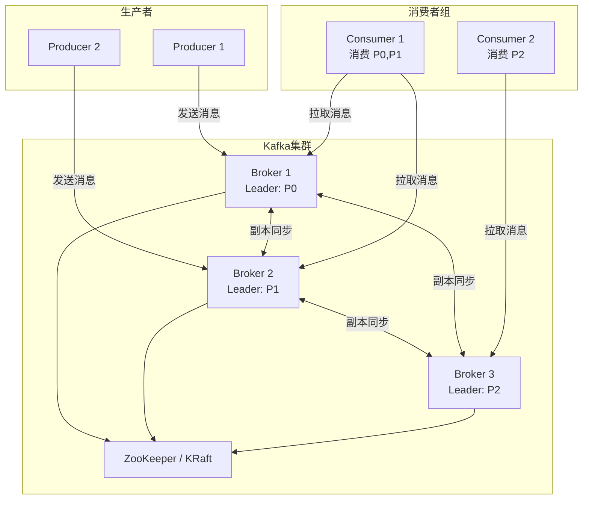
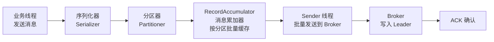

# Kafka 消息队列与消费模型

> **文档说明**：系统讲解 Apache Kafka 的核心架构、消息存储机制、生产者与消费者模型、高可用机制（副本/ISR/Leader选举）、消息顺序性与 Exactly-Once 语义、消费组重平衡、Offset 管理，以及生产级配置调优和常见问题排查。
>
> **适用人群**：后端开发工程师、全栈开发者、大数据工程师、需要使用 Kafka 的架构师
>
> **前置知识**：[[消息队列-Kafka与RabbitMQ]]、[[微服务核心组件知识点系统梳理_优化版]]

---

## 一、概述

**Apache Kafka** 是一个分布式、高吞吐、可持久化的消息队列系统，最初由 LinkedIn 开发，后成为 Apache 顶级项目。Kafka 不仅是消息队列，更是一个**分布式流处理平台**，广泛应用于日志收集、数据管道、实时计算、事件驱动架构等场景。

### 1. Kafka 核心特性

| 特性 | 说明 |
|------|------|
| **高吞吐** | 单机每秒可处理百万级消息，支持批量发送和压缩 |
| **低延迟** | 端到端延迟可低至毫秒级 |
| **持久化** | 消息持久化到磁盘，支持数据保留策略（时间/大小） |
| **高可用** | 多副本机制，Broker 故障自动切换 |
| **可扩展** | 水平扩展，增加 Broker 即可提升容量和吞吐 |
| **消息回溯** | 消费者可按 Offset 回溯消费历史消息 |
| **多客户端** | 支持 Java、Python、Go、C++ 等多种语言客户端 |
| **生态丰富** | Kafka Connect、Kafka Streams、ksqlDB 等生态组件 |

### 2. Kafka 架构



### 3. 核心概念

| 概念 | 说明 |
|------|------|
| **Broker** | Kafka 服务节点，一个 Kafka 集群由多个 Broker 组成 |
| **Topic** | 消息主题，消息的逻辑分类，类似数据库的表 |
| **Partition** | 分区，Topic 的物理分片，一个 Topic 可分为多个 Partition，分布在不同 Broker |
| **Replica** | 副本，每个 Partition 有多个副本（Leader + Follower），保证高可用 |
| **Leader** | 主副本，处理读写请求，每个 Partition 只有一个 Leader |
| **Follower** | 从副本，同步 Leader 数据，Leader 故障时可晋升为 Leader |
| **ISR** | In-Sync Replicas，与 Leader 保持同步的副本集合 |
| **Producer** | 生产者，向 Topic 发送消息 |
| **Consumer** | 消费者，从 Topic 拉取消息 |
| **Consumer Group** | 消费者组，一组消费者共同消费一个 Topic，每个 Partition 只能被组内一个消费者消费 |
| **Offset** | 消息偏移量，Partition 内消息的唯一标识，从 0 开始递增 |
| **ZooKeeper / KRaft** | 集群元数据管理，Kafka 2.8+ 支持 KRaft 模式（无需 ZooKeeper） |

---

## 二、消息存储机制

### 1. Partition 日志结构

每个 Partition 对应一个日志目录，消息以追加方式写入日志文件，按大小滚动生成新的 Segment。

```
Topic: my-topic, Partition: 0
└── my-topic-0/
    ├── 00000000000000000000.log      # 消息数据文件
    ├── 00000000000000000000.index    # 偏移量索引（稀疏索引）
    ├── 00000000000000000000.timeindex # 时间戳索引
    ├── 00000000000000001234.log      # 下一个 Segment（起始 Offset 1234）
    ├── 00000000000000001234.index
    ├── 00000000000000001234.timeindex
    └── leader-epoch-checkpoint         # Leader Epoch 检查点
```

| 文件 | 说明 |
|------|------|
| `.log` | 消息数据文件，存储实际消息内容 |
| `.index` | 偏移量索引，稀疏索引，加速按 Offset 查找消息 |
| `.timeindex` | 时间戳索引，加速按时间戳查找消息 |
| `leader-epoch-checkpoint` | Leader Epoch 检查点，用于数据一致性校验 |

### 2. 消息格式

Kafka 消息由消息头和消息体组成：

```
消息结构：
┌─────────────────────────────────────┐
│ offset (8 bytes)    消息偏移量       │
│ message size (4 bytes) 消息大小      │
├─────────────────────────────────────┤
│ crc (4 bytes)        CRC 校验        │
│ magic (1 byte)       版本号          │
│ attributes (1 byte)  属性（压缩等）  │
│ timestamp (8 bytes)  时间戳          │
│ key length (4 bytes) Key 长度        │
│ key (N bytes)        Key 内容        │
│ value length (4 bytes) Value 长度    │
│ value (N bytes)      Value 内容      │
│ headers (可变)       消息头           │
└─────────────────────────────────────┘
```

### 3. 消息保留策略

| 策略 | 参数 | 说明 |
|------|------|------|
| **时间保留** | `retention.ms` | 消息保留时间，默认 7 天（604800000ms） |
| **大小保留** | `retention.bytes` | Partition 最大保留大小，默认 -1（无限制） |
| **压缩保留** | `cleanup.policy=compact` | 日志压缩，保留相同 Key 的最新消息 |

```bash
# 创建 Topic 时设置保留策略
kafka-topics.sh --create \
  --bootstrap-server localhost:9092 \
  --topic my-topic \
  --partitions 3 \
  --replication-factor 2 \
  --config retention.ms=86400000 \       # 保留 1 天
  --config retention.bytes=1073741824 \  # 最大 1GB
  --config cleanup.policy=delete           # 删除策略（默认）

# 日志压缩策略（相同 Key 只保留最新）
kafka-topics.sh --create \
  --topic compact-topic \
  --partitions 3 \
  --replication-factor 2 \
  --config cleanup.policy=compact \
  --config min.cleanable.dirty.ratio=0.5
```

---

## 三、生产者

### 1. 生产者工作流程



**生产者核心组件**：
| 组件 | 说明 |
|------|------|
| **Serializer** | 序列化器，将 Key/Value 序列化为字节数组 |
| **Partitioner** | 分区器，决定消息发送到哪个 Partition |
| **RecordAccumulator** | 消息累加器，按分区缓存消息，批量发送 |
| **Sender** | 发送线程，从累加器获取批次，发送到 Broker |

### 2. 分区策略

| 策略 | 说明 |
|------|------|
| **指定 Partition** | 直接指定 Partition 编号，消息发送到该 Partition |
| **Key Hash** | 指定 Key 时，按 Key 的 Hash 值对 Partition 数取模，相同 Key 总是到同一 Partition |
| **轮询（Round-Robin）** | 未指定 Key 时，默认轮询分配到各 Partition，保证负载均衡 |
| **粘性分区（Sticky）** | Kafka 2.4+ 默认，减少批次切换，提升批量效率 |
| **自定义分区** | 实现 `Partitioner` 接口，自定义分区逻辑 |

```java
// 自定义分区器
public class CustomPartitioner implements Partitioner {
    @Override
    public int partition(String topic, Object key, byte[] keyBytes,
                         Object value, byte[] valueBytes, Cluster cluster) {
        List<PartitionInfo> partitions = cluster.partitionsForTopic(topic);
        int numPartitions = partitions.size();

        // 特殊 Key 发送到 0 号 Partition
        if ("special".equals(key)) {
            return 0;
        }
        // 其他 Key 按 Hash 分配
        return Math.abs(key.hashCode()) % (numPartitions - 1) + 1;
    }

    @Override
    public void close() {}
    @Override
    public void configure(Map<String, ?> configs) {}
}
```

### 3. 生产者配置

```java
Properties props = new Properties();
props.put("bootstrap.servers", "broker1:9092,broker2:9092,broker3:9092");
props.put("key.serializer", "org.apache.kafka.common.serialization.StringSerializer");
props.put("value.serializer", "org.apache.kafka.common.serialization.StringSerializer");

// 核心配置
props.put("acks", "all");              // 确认机制：0(不等)/1(Leader确认)/all(所有ISR确认)
props.put("retries", 3);               // 重试次数
props.put("batch.size", 16384);        // 批次大小（字节），默认 16KB
props.put("linger.ms", 5);              // 等待时间（ms），默认 0，达到批次大小或时间到就发送
props.put("buffer.memory", 33554432);  // 生产者缓冲区大小，默认 32MB
props.put("compression.type", "lz4");   // 压缩类型：none/gzip/snappy/lz4/zstd
props.put("max.in.flight.requests.per.connection", 5);  // 每个连接最大未确认请求数
props.put("enable.idempotence", true);  // 启用幂等性（默认 true）
props.put("transactional.id", "my-tx-id");  // 事务 ID（启用事务）

KafkaProducer<String, String> producer = new KafkaProducer<>(props);

// 发送消息（异步，带回调）
ProducerRecord<String, String> record = new ProducerRecord<>("my-topic", "key", "value");
producer.send(record, (metadata, exception) -> {
    if (exception != null) {
        exception.printStackTrace();
    } else {
        System.out.printf("发送成功: topic=%s, partition=%d, offset=%d%n",
            metadata.topic(), metadata.partition(), metadata.offset());
    }
});

// 同步发送（阻塞等待确认）
try {
    RecordMetadata metadata = producer.send(record).get();
    System.out.println("同步发送成功: " + metadata.offset());
} catch (InterruptedException | ExecutionException e) {
    e.printStackTrace();
}

producer.close();
```

### 4. 消息确认机制（acks）

| acks | 说明 | 性能 | 可靠性 |
|------|------|------|--------|
| `acks=0` | 生产者不等 Broker 确认，发送即认为成功 | 最高 | 最低（可能丢消息） |
| `acks=1` | Leader 写入成功后确认，不等 Follower 同步 | 中等 | 中等（Leader 故障可能丢消息） |
| `acks=all` | Leader 等待所有 ISR 副本写入成功后确认 | 最低 | 最高（配合 min.insync.replicas） |

**生产环境推荐**：`acks=all` + `min.insync.replicas=2`（副本数为 3 时），保证至少 2 个副本写入成功才确认。

### 5. 幂等性与事务

**幂等生产者**：
- 启用 `enable.idempotence=true`（默认）
- 生产者为每个消息分配 PID（Producer ID）和 Sequence Number
- Broker 缓存 PID+Partition+Sequence Number，重复消息直接忽略
- 保证单分区、单会话内消息不重复

**事务生产者**：
- 配置 `transactional.id`
- 支持跨分区、跨会话的原子性写入
- 配合消费者的 `isolation.level=read_committed` 实现 Exactly-Once

```java
// 事务生产者示例
producer.initTransactions();
try {
    producer.beginTransaction();
    producer.send(record1);
    producer.send(record2);
    producer.commitTransaction();
} catch (ProducerFencedException | OutOfOrderSequenceException | AuthorizationException e) {
    producer.close();
} catch (KafkaException e) {
    producer.abortTransaction();
}
```

---

## 四、消费者

### 1. 消费者模型

Kafka 采用**拉模型（Pull）**，消费者主动从 Broker 拉取消息，而非 Broker 推送。

```mermaid
graph TB
    subgraph Consumer Group: my-group
        C1[Consumer 1]
        C2[Consumer 2]
        C3[Consumer 3]
    end

    subgraph Topic: my-topic (3 Partitions)
        P0[Partition 0]
        P1[Partition 1]
        P2[Partition 2]
    end

    C1 -->|消费| P0
    C2 -->|消费| P1
    C3 -->|消费| P2
```

**消费者组核心规则**：
- 一个 Consumer Group 内的消费者共同消费一个 Topic
- 每个 Partition 只能被组内**一个**消费者消费（保证消息不重复消费）
- 一个消费者可以消费**多个** Partition
- 消费者数 > Partition 数时，多余消费者空闲
- 不同 Consumer Group 独立消费，互不影响（广播效果）

### 2. 消费者配置

```java
Properties props = new Properties();
props.put("bootstrap.servers", "broker1:9092,broker2:9092");
props.put("group.id", "my-consumer-group");
props.put("key.deserializer", "org.apache.kafka.common.serialization.StringDeserializer");
props.put("value.deserializer", "org.apache.kafka.common.serialization.StringDeserializer");

// 核心配置
props.put("enable.auto.commit", true);       // 自动提交 Offset（默认 true）
props.put("auto.commit.interval.ms", 5000);  // 自动提交间隔（默认 5000ms）
props.put("auto.offset.reset", "latest");     // 无 Offset 时的起始位置：earliest/latest/none
props.put("max.poll.records", 500);           // 每次 poll 最大返回消息数（默认 500）
props.put("max.poll.interval.ms", 300000);    // 两次 poll 最大间隔（默认 5 分钟）
props.put("session.timeout.ms", 45000);       // 会话超时（默认 45 秒）
props.put("heartbeat.interval.ms", 3000);      // 心跳间隔（默认 3 秒）
props.put("fetch.min.bytes", 1);                // 最小拉取字节数（默认 1）
props.put("fetch.max.wait.ms", 500);            // 最大等待时间（默认 500ms）
props.put("fetch.max.bytes", 52428800);         // 单次拉取最大字节数（默认 50MB）
props.put("isolation.level", "read_uncommitted"); // 隔离级别：read_uncommitted/read_committed

KafkaConsumer<String, String> consumer = new KafkaConsumer<>(props);

// 订阅 Topic
consumer.subscribe(Collections.singletonList("my-topic"));

// 消费消息
try {
    while (true) {
        ConsumerRecords<String, String> records = consumer.poll(Duration.ofMillis(100));
        for (ConsumerRecord<String, String> record : records) {
            System.out.printf("topic=%s, partition=%d, offset=%d, key=%s, value=%s%n",
                record.topic(), record.partition(), record.offset(),
                record.key(), record.value());
        }
    }
} finally {
    consumer.close();
}
```

### 3. Offset 管理

| 提交方式 | 说明 | 优缺点 |
|---------|------|--------|
| **自动提交** | `enable.auto.commit=true`，按间隔自动提交 | 简单，但可能重复消费或消息丢失 |
| **手动同步提交** | `consumer.commitSync()` | 可靠，阻塞等待确认，性能低 |
| **手动异步提交** | `consumer.commitAsync()` | 非阻塞，性能高，但失败不重试 |
| **指定 Offset 提交** | `commitSync(Map<TopicPartition, OffsetAndMetadata>)` | 精确控制提交的 Offset |
| **外部存储** | 将 Offset 存储到数据库/Redis | 与业务数据原子提交，实现 Exactly-Once |

```java
// 手动提交 Offset
while (true) {
    ConsumerRecords<String, String> records = consumer.poll(Duration.ofMillis(100));
    for (ConsumerRecord<String, String> record : records) {
        // 处理消息
        process(record);
    }
    // 处理完一批后同步提交
    consumer.commitSync();
}

// 异步提交带回调
consumer.commitAsync((offsets, exception) -> {
    if (exception != null) {
        System.err.println("提交 Offset 失败: " + offsets);
    }
});

// 精确控制 Offset
Map<TopicPartition, OffsetAndMetadata> offsets = new HashMap<>();
offsets.put(new TopicPartition("my-topic", 0), new OffsetAndMetadata(100));
consumer.commitSync(offsets);

// 从指定 Offset 开始消费
consumer.assign(Collections.singletonList(new TopicPartition("my-topic", 0)));
consumer.seek(new TopicPartition("my-topic", 0), 100);  // 从 Offset 100 开始

// 从最早/最新开始
consumer.seekToBeginning(Collections.singletonList(new TopicPartition("my-topic", 0)));
consumer.seekToEnd(Collections.singletonList(new TopicPartition("my-topic", 0)));
```

### 4. 消费组重平衡（Rebalance）

**触发条件**：
- 消费者组成员变化（新增/离开/崩溃）
- 订阅的 Topic 变化（新增/删除 Topic）
- Topic 的 Partition 数变化

**重平衡协议**：
| 协议 | 说明 | Kafka 版本 |
|------|------|-----------|
| **Eager（Range/RoundRobin）** | 重平衡时所有消费者停止消费，重新分配所有 Partition | 旧版默认 |
| **Cooperative（Sticky/CooperativeSticky）** | 增量重平衡，只调整变化的 Partition，不停止全部消费 | 2.4+ 推荐 |

**重平衡问题**：
- 重平衡期间消费者停止消费（Stop The World）
- 频繁重平衡影响消费性能
- 重平衡可能导致 Offset 提交异常

**避免频繁重平衡**：
- 增大 `max.poll.interval.ms`（处理慢的场景）
- 增大 `session.timeout.ms`
- 减少 `max.poll.records`（避免单次处理时间过长）
- 使用 CooperativeSticky 分配策略
- 避免消费者处理逻辑阻塞

---

## 五、高可用机制

### 1. 副本机制

每个 Partition 有多个副本（`replication.factor`），分为 Leader 和 Follower：

| 角色 | 职责 |
|------|------|
| **Leader** | 处理所有读写请求，维护 ISR 列表 |
| **Follower** | 从 Leader 拉取消息同步，不处理客户端请求 |
| **ISR** | In-Sync Replicas，与 Leader 保持同步的副本（包括 Leader） |

**Follower 进入 ISR 的条件**：
- 副本存活（心跳正常）
- 副本落后 Leader 的消息数不超过 `replica.lag.max.messages`（已废弃）
- 副本最后同步时间不超过 `replica.lag.time.max.ms`（默认 30 秒）

### 2. Leader 选举

当 Leader 故障时，从 ISR 中选举新的 Leader：

```
1. Controller 检测到 Broker 故障
2. 从该 Partition 的 ISR 列表中选择第一个存活副本作为新 Leader
3. 更新 Leader 和 ISR 信息到 ZooKeeper/KRaft
4. 通知所有 Broker 和客户端更新元数据
```

**不干净的 Leader 选举**：
- 如果 ISR 中所有副本都不可用，可配置 `unclean.leader.election.enable=true` 允许从非 ISR 副本选举
- 这可能导致数据丢失（非 ISR 副本数据落后）
- 生产环境建议 `unclean.leader.election.enable=false`（默认 false）

### 3. 最小同步副本数

`min.insync.replicas`：ISR 中最少需要的副本数，当 acks=all 时，如果 ISR 副本数小于此值，生产者写入会失败。

```
副本数 = 3，min.insync.replicas = 2
- 正常：3 个副本都在 ISR，写入成功
- 1 个 Follower 故障：ISR = 2（Leader + 1 Follower），写入成功
- 2 个 Follower 故障：ISR = 1（仅 Leader），写入失败（< min.insync.replicas）
```

**生产环境推荐配置**：
- `replication.factor=3`（3 副本）
- `min.insync.replicas=2`（至少 2 个同步副本）
- `acks=all`（等待所有 ISR 确认）
- `unclean.leader.election.enable=false`（禁止不干净选举）

---

## 六、消息顺序性与语义

### 1. 消息顺序性

| 范围 | 顺序保证 | 说明 |
|------|---------|------|
| **Partition 内** | ✅ 严格有序 | 同一 Partition 内消息按 Offset 顺序存储和消费 |
| **Topic 内** | ❌ 不保证 | 不同 Partition 之间无顺序保证 |
| **全局** | ❌ 不保证 | 整个 Topic 不保证全局有序 |

**实现全局有序的方法**：
- Topic 只设置 1 个 Partition（牺牲并行度和吞吐）
- 所有消息使用相同 Key（都路由到同一 Partition）

**实现业务级有序的方法**：
- 需要有序的消息使用相同 Key（如同一个订单 ID），保证同一业务实体的消息有序
- 不同业务实体的消息可以无序

### 2. 消息投递语义

| 语义 | 说明 | 实现方式 |
|------|------|---------|
| **At Most Once** | 最多一次，消息可能丢失，不重复 | acks=0，消费者先提交 Offset 再处理 |
| **At Least Once** | 至少一次，消息不丢失，可能重复 | acks=all，消费者先处理再提交 Offset |
| **Exactly Once** | 精确一次，不丢失不重复 | 幂等生产者 + 事务 + 消费者 read_committed |

**At Least Once 实现（默认推荐）**：
```
生产者：acks=all + 重试
消费者：先处理消息，处理成功后再提交 Offset
→ 保证不丢失，但处理失败重试可能导致重复消费
→ 业务端需保证幂等性
```

**Exactly Once 实现**：
```
生产者：启用幂等性（enable.idempotence=true）+ 事务（transactional.id）
Broker：事务日志，记录事务状态
消费者：isolation.level=read_committed（只读取已提交事务的消息）
→ 保证 Kafka 内部 Exactly-Once
→ 端到端 Exactly-Once 还需消费者处理逻辑幂等或事务性输出
```

---

## 七、生产级调优

### 1. 生产者调优

| 参数 | 推荐值 | 说明 |
|------|--------|------|
| `acks` | `all` | 最高可靠性 |
| `retries` | `Integer.MAX_VALUE` | 无限重试（配合幂等性） |
| `batch.size` | `32768` (32KB) | 增大批次提升吞吐 |
| `linger.ms` | `5-20` | 等待时间，平衡延迟和吞吐 |
| `compression.type` | `lz4` 或 `zstd` | 压缩减少网络和存储开销 |
| `buffer.memory` | `67108864` (64MB) | 增大缓冲区 |
| `max.in.flight.requests.per.connection` | `5` | 配合幂等性保证顺序 |

### 2. 消费者调优

| 参数 | 推荐值 | 说明 |
|------|--------|------|
| `max.poll.records` | `500-1000` | 根据处理速度调整 |
| `max.poll.interval.ms` | `300000` | 处理慢时增大 |
| `fetch.min.bytes` | `1048576` (1MB) | 增大减少请求次数 |
| `fetch.max.wait.ms` | `500` | 等待时间 |
| `enable.auto.commit` | `false` | 手动提交更可靠 |
| `partition.assignment.strategy` | `CooperativeStickyAssignor` | 增量重平衡 |

### 3. Broker 调优

| 参数 | 推荐值 | 说明 |
|------|--------|------|
| `num.network.threads` | `8` | 网络处理线程数 |
| `num.io.threads` | `16` | 磁盘 IO 线程数 |
| `socket.send.buffer.bytes` | `1048576` | 发送缓冲区 |
| `socket.receive.buffer.bytes` | `1048576` | 接收缓冲区 |
| `log.segment.bytes` | `1073741824` (1GB) | Segment 大小 |
| `log.retention.hours` | `168` (7天) | 保留时间 |
| `num.recovery.threads.per.data.dir` | `8` | 恢复线程数 |
| `replica.lag.time.max.ms` | `30000` | 副本同步超时 |

### 4. 操作系统调优

| 配置 | 推荐值 | 说明 |
|------|--------|------|
| 文件描述符 | `1000000` | Kafka 需要大量文件句柄 |
| 套接字缓冲区 | `1048576` | 提升网络吞吐 |
| 磁盘调度 | `noop` 或 `deadline` | SSD 用 noop，HDD 用 deadline |
| 文件系统 | `XFS` 或 `ext4` | XFS 性能更好 |
| 内存 | 至少 32GB | 页缓存提升读性能 |
| 磁盘 | SSD/NVMe | 高吞吐低延迟 |

---

## 八、常见问题与排查

| 问题 | 原因 | 解决方案 |
|------|------|---------|
| **消息丢失** | acks=0 / Leader 故障未同步 / 消费者先提交后处理 | acks=all + min.insync.replicas=2 + 手动提交 Offset |
| **消息重复** | 生产者重试 / 消费者重平衡 / Offset 提交失败 | 幂等生产者 + 业务端幂等处理 |
| **消费延迟** | 消费者处理慢 / Partition 数不足 / 重平衡频繁 | 增加消费者/Partition、优化处理逻辑、调整 poll 参数 |
| **生产延迟高** | acks=all / 批次太小 / 网络延迟 | 调整 linger.ms/batch.size、检查网络、使用压缩 |
| **Leader 频繁切换** | Broker 不稳定 / 网络分区 / GC 停顿 | 检查 Broker 健康、网络、JVM GC |
| **ISR 频繁收缩** | Follower 同步慢 / 网络延迟 / 磁盘 IO 瓶颈 | 检查网络、磁盘性能、增大 replica.lag.time.max.ms |
| **磁盘满** | 保留时间太长 / 消息量突增 | 调整 retention.ms/bytes、监控磁盘、扩容 |
| **重平衡频繁** | 消费者处理超时 / 心跳超时 / 频繁上下线 | 增大 max.poll.interval.ms、优化处理逻辑 |
| **Offset 越界** | 消息已被删除但 Offset 还指向旧位置 | auto.offset.reset=earliest/latest、检查保留策略 |
| **分区不均衡** | 分区器分配不均 / Broker 磁盘使用不均 | 使用轮询/粘性分区、分区重分配 |
| **Broker OOM** | 堆内存设置不当 / 大量积压消息 | 调整 JVM 参数、检查消费延迟、增加内存 |
| **Controller 切换** | Controller Broker 故障 / 网络问题 | 检查 Broker 健康、ZooKeeper/KRaft 状态 |

### 常用排查命令

```bash
# 查看 Topic 列表和详情
kafka-topics.sh --list --bootstrap-server localhost:9092
kafka-topics.sh --describe --topic my-topic --bootstrap-server localhost:9092

# 查看消费者组
kafka-consumer-groups.sh --list --bootstrap-server localhost:9092
kafka-consumer-groups.sh --describe --group my-group --bootstrap-server localhost:9092

# 查看消费延迟（Lag）
kafka-consumer-groups.sh --describe --group my-group --bootstrap-server localhost:9092 | grep -E "TOPIC|my-topic"

# 查看 Broker 配置
kafka-configs.sh --describe --entity-type brokers --entity-name 0 --bootstrap-server localhost:9092

# 重置 Offset
kafka-consumer-groups.sh --reset-offsets --group my-group --topic my-topic --to-earliest --execute --bootstrap-server localhost:9092
kafka-consumer-groups.sh --reset-offsets --group my-group --topic my-topic --to-latest --execute --bootstrap-server localhost:9092
kafka-consumer-groups.sh --reset-offsets --group my-group --topic my-topic --to-offset 100 --execute --bootstrap-server localhost:9092

# 手动消费消息（调试）
kafka-console-consumer.sh --topic my-topic --from-beginning --bootstrap-server localhost:9092
kafka-console-consumer.sh --topic my-topic --partition 0 --offset 100 --bootstrap-server localhost:9092

# 手动生产消息（调试）
kafka-console-producer.sh --topic my-topic --bootstrap-server localhost:9092

# 查看分区重分配
kafka-reassign-partitions.sh --generate --topics-to-move-json-file topics.json --broker-list "0,1,2"

# JMX 监控
# 开启 JMX：JMX_PORT=9999 kafka-server-start.sh server.properties
# 使用 JConsole/VisualVM 连接 9999 端口查看 MBean
```

---

## 九、关联笔记

### 中间件
- [[消息队列-Kafka与RabbitMQ]] · [[RabbitMQ-消息中间件]] · [[RocketMQ-事务消息]]
- [[Kafka深度实战]] · [[消息队列深度 知识点系统梳理_优化版]]

### 微服务
- [[微服务核心组件知识点系统梳理_优化版]] · [[SpringCloud-Alibaba组件体系]]
- [[Gateway-网关路由与鉴权]] · [[Nacos-注册中心与配置中心]]

### 后端
- [[高并发系统设计案例]] · [[高可用架构设计]] · [[秒杀系统架构设计]]
- [[分布式事务 知识点系统梳理_优化版]] · [[分布式锁知识点系统梳理_优化版]]

### 大数据
- [[Flink实时计算入门]] · [[Spark核心概念与使用]] · [[ClickHouse OLAP引擎实战]]
- [[Elasticsearch-全文检索引擎]]

### 云原生
- [[Docker-核心原理与镜像优化]] · [[K8s-核心概念与架构]] · [[Prometheus监控体系]]

### 导航
- [[MOC-后端开发]] · [[MOC-分布式与中间件]] · [[全栈+AI工程双轨融合学习路线图]]

> **学习路径建议**：先掌握 [[消息队列-Kafka与RabbitMQ]] 消息队列基础 → 深入本文 Kafka 架构与消费模型 → 实践 [[Kafka深度实战]] 生产部署 → 研究 [[高并发系统设计案例]] 消息队列应用 → 学习 [[Flink实时计算入门]] 流处理 → 应用于 [[秒杀系统架构设计]] 高并发场景。
