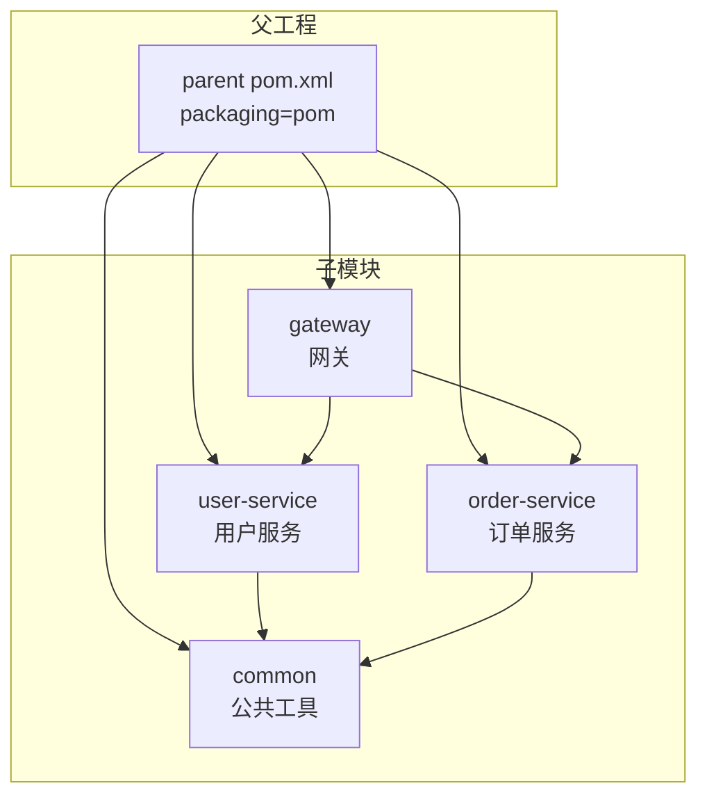

# Maven 多模块与依赖管理

> **文档说明**：系统讲解 Maven 多模块项目的构建与依赖管理，包括父子 POM 继承、dependencyManagement 版本统一、模块间依赖、私服（Nexus）配置、依赖冲突解决、生命周期与插件、构建优化，含可运行的微服务多模块项目完整 pom.xml 配置和最佳实践。
>
> **适用人群**：Java 后端开发者、需要搭建多模块项目的全栈工程师、关注构建效率的技术负责人
>
> **前置知识**：[[SpringBoot-自动装配原理]]、[[微服务架构设计]]、[[SpringCloud-Alibaba组件体系]]

---

## 一、概述

### 1. 定义与核心价值

Maven 多模块项目通过父 POM 统一管理依赖版本、插件配置、构建属性，子模块继承父配置并可按需覆盖。核心价值在于**版本一致性**（避免不同模块依赖版本冲突）、**构建复用**（公共配置只写一次）、**模块化开发**（各模块独立编译测试，可并行构建）。微服务架构中，多模块 Maven 项目是标准实践。

### 2. 痛点对比

| 痛点（单模块/无统一管理） | Maven 多模块解决方式 |
|----------------------|-------------------|
| 每个模块单独管理依赖版本，版本不一致 | 父 POM `dependencyManagement` 统一版本 |
| 重复配置插件、编译参数 | 父 POM `pluginManagement` 统一插件 |
| 依赖冲突（A 依赖 X 1.0，B 依赖 X 2.0） | `mvn dependency:tree` 分析，exclusion 排除 |
| 公共代码重复复制 | 抽取 common 模块，其他模块依赖 |
| 构建慢，无法并行 | 多模块支持 `-T 4` 并行构建 |
| 发布时版本号逐个修改 | `versions:set` 批量更新版本 |

### 3. 多模块项目结构



---

## 二、底层原理

### 1. 依赖调解机制

Maven 解决依赖冲突的两个原则：

| 原则 | 说明 |
|------|------|
| **最短路径优先** | 依赖树中路径最短的版本胜出 |
| **声明顺序优先** | 路径相同时，POM 中先声明的胜出 |

```
项目 A
├── B（依赖 X 1.0）→ 路径长度 2
└── C（依赖 D，D 依赖 X 2.0）→ 路径长度 3
→ 最终使用 X 1.0（路径更短）
```

### 2. 依赖范围（Scope）

| Scope | 编译 | 测试 | 运行 | 打包 | 说明 |
|-------|------|------|------|------|------|
| `compile` | 是 | 是 | 是 | 是 | 默认范围 |
| `provided` | 是 | 是 | 否 | 否 | 容器提供（如 servlet-api） |
| `runtime` | 否 | 是 | 是 | 是 | 运行时需要（如 JDBC 驱动） |
| `test` | 否 | 是 | 否 | 否 | 仅测试（如 JUnit） |
| `system` | 是 | 是 | 否 | 否 | 本地 jar（不推荐） |
| `import` | - | - | - | - | 仅用于 dependencyManagement |

---

## 三、实操

### 1. 父工程 POM

```xml
<!-- pom.xml（父工程） -->
<?xml version="1.0" encoding="UTF-8"?>
<project xmlns="http://maven.apache.org/POM/4.0.0"
         xmlns:xsi="http://www.w3.org/2001/XMLSchema-instance"
         xsi:schemaLocation="http://maven.apache.org/POM/4.0.0
         http://maven.apache.org/xsd/maven-4.0.0.xsd">
    <modelVersion>4.0.0</modelVersion>

    <groupId>com.example</groupId>
    <artifactId>cloud-parent</artifactId>
    <version>1.0.0-SNAPSHOT</version>
    <packaging>pom</packaging>
    <name>cloud-parent</name>

    <!-- 子模块列表 -->
    <modules>
        <module>common</module>
        <module>user-service</module>
        <module>order-service</module>
        <module>gateway</module>
    </modules>

    <!-- 统一版本属性 -->
    <properties>
        <java.version>17</java.version>
        <maven.compiler.source>17</maven.compiler.source>
        <maven.compiler.target>17</maven.compiler.target>
        <project.build.sourceEncoding>UTF-8</project.build.sourceEncoding>

        <!-- 框架版本 -->
        <spring-boot.version>3.2.0</spring-boot.version>
        <spring-cloud.version>2023.0.0</spring-cloud.version>
        <spring-cloud-alibaba.version>2023.0.1.0</spring-cloud-alibaba.version>

        <!-- 工具版本 -->
        <mybatis-plus.version>3.5.5</mybatis-plus.version>
        <hutool.version>5.8.25</hutool.version>
        <lombok.version>1.18.30</lombok.version>
        <knife4j.version>4.4.0</knife4j.version>
    </properties>

    <!-- 依赖版本管理（子模块引用时不需要写版本号） -->
    <dependencyManagement>
        <dependencies>
            <!-- Spring Boot BOM -->
            <dependency>
                <groupId>org.springframework.boot</groupId>
                <artifactId>spring-boot-dependencies</artifactId>
                <version>${spring-boot.version}</version>
                <type>pom</type>
                <scope>import</scope>
            </dependency>

            <!-- Spring Cloud BOM -->
            <dependency>
                <groupId>org.springframework.cloud</groupId>
                <artifactId>spring-cloud-dependencies</artifactId>
                <version>${spring-cloud.version}</version>
                <type>pom</type>
                <scope>import</scope>
            </dependency>

            <!-- Spring Cloud Alibaba BOM -->
            <dependency>
                <groupId>com.alibaba.cloud</groupId>
                <artifactId>spring-cloud-alibaba-dependencies</artifactId>
                <version>${spring-cloud-alibaba.version}</version>
                <type>pom</type>
                <scope>import</scope>
            </dependency>

            <!-- 内部模块 -->
            <dependency>
                <groupId>com.example</groupId>
                <artifactId>common</artifactId>
                <version>${project.version}</version>
            </dependency>

            <!-- 第三方库 -->
            <dependency>
                <groupId>com.baomidou</groupId>
                <artifactId>mybatis-plus-boot-starter</artifactId>
                <version>${mybatis-plus.version}</version>
            </dependency>
            <dependency>
                <groupId>cn.hutool</groupId>
                <artifactId>hutool-all</artifactId>
                <version>${hutool.version}</version>
            </dependency>
        </dependencies>
    </dependencyManagement>

    <!-- 所有子模块都引入的依赖 -->
    <dependencies>
        <dependency>
            <groupId>org.projectlombok</groupId>
            <artifactId>lombok</artifactId>
            <optional>true</optional>
        </dependency>
    </dependencies>

    <!-- 插件版本管理 -->
    <build>
        <pluginManagement>
            <plugins>
                <plugin>
                    <groupId>org.springframework.boot</groupId>
                    <artifactId>spring-boot-maven-plugin</artifactId>
                    <version>${spring-boot.version}</version>
                    <configuration>
                        <excludes>
                            <exclude>
                                <groupId>org.projectlombok</groupId>
                                <artifactId>lombok</artifactId>
                            </exclude>
                        </excludes>
                    </configuration>
                </plugin>
                <plugin>
                    <groupId>org.apache.maven.plugins</groupId>
                    <artifactId>maven-compiler-plugin</artifactId>
                    <version>3.11.0</version>
                    <configuration>
                        <source>${java.version}</source>
                        <target>${java.version}</target>
                        <encoding>UTF-8</encoding>
                        <annotationProcessorPaths>
                            <path>
                                <groupId>org.projectlombok</groupId>
                                <artifactId>lombok</artifactId>
                                <version>${lombok.version}</version>
                            </path>
                        </annotationProcessorPaths>
                    </configuration>
                </plugin>
            </plugins>
        </pluginManagement>
    </build>
</project>
```

### 2. 公共模块

```xml
<!-- common/pom.xml -->
<project>
    <parent>
        <groupId>com.example</groupId>
        <artifactId>cloud-parent</artifactId>
        <version>1.0.0-SNAPSHOT</version>
    </parent>

    <artifactId>common</artifactId>
    <name>common</name>
    <description>公共工具模块</description>

    <dependencies>
        <dependency>
            <groupId>cn.hutool</groupId>
            <artifactId>hutool-all</artifactId>
        </dependency>
        <dependency>
            <groupId>com.fasterxml.jackson.core</groupId>
            <artifactId>jackson-databind</artifactId>
        </dependency>
    </dependencies>
</project>
```

```java
// common/src/main/java/com/example/common/result/Result.java
package com.example.common.result;

import lombok.Data;

@Data
public class Result<T> {
    private Integer code;
    private String message;
    private T data;

    public static <T> Result<T> success(T data) {
        Result<T> result = new Result<>();
        result.setCode(200);
        result.setMessage("success");
        result.setData(data);
        return result;
    }

    public static <T> Result<T> error(Integer code, String message) {
        Result<T> result = new Result<>();
        result.setCode(code);
        result.setMessage(message);
        return result;
    }
}
```

### 3. 业务服务模块

```xml
<!-- user-service/pom.xml -->
<project>
    <parent>
        <groupId>com.example</groupId>
        <artifactId>cloud-parent</artifactId>
        <version>1.0.0-SNAPSHOT</version>
    </parent>

    <artifactId>user-service</artifactId>
    <name>user-service</name>

    <dependencies>
        <!-- 内部公共模块 -->
        <dependency>
            <groupId>com.example</groupId>
            <artifactId>common</artifactId>
        </dependency>

        <!-- Web -->
        <dependency>
            <groupId>org.springframework.boot</groupId>
            <artifactId>spring-boot-starter-web</artifactId>
        </dependency>

        <!-- Nacos -->
        <dependency>
            <groupId>com.alibaba.cloud</groupId>
            <artifactId>spring-cloud-starter-alibaba-nacos-discovery</artifactId>
        </dependency>

        <!-- MyBatis-Plus -->
        <dependency>
            <groupId>com.baomidou</groupId>
            <artifactId>mybatis-plus-boot-starter</artifactId>
        </dependency>

        <!-- MySQL -->
        <dependency>
            <groupId>com.mysql</groupId>
            <artifactId>mysql-connector-j</artifactId>
            <scope>runtime</scope>
        </dependency>

        <!-- 测试 -->
        <dependency>
            <groupId>org.springframework.boot</groupId>
            <artifactId>spring-boot-starter-test</artifactId>
            <scope>test</scope>
        </dependency>
    </dependencies>

    <build>
        <plugins>
            <plugin>
                <groupId>org.springframework.boot</groupId>
                <artifactId>spring-boot-maven-plugin</artifactId>
            </plugin>
        </plugins>
    </build>
</project>
```

### 4. 私服配置

```xml
<!-- settings.xml（Maven 全局配置，~/.m2/settings.xml） -->
<settings>
    <servers>
        <server>
            <id>nexus-releases</id>
            <username>admin</username>
            <password>your-password</password>
        </server>
        <server>
            <id>nexus-snapshots</id>
            <username>admin</username>
            <password>your-password</password>
        </server>
    </servers>

    <mirrors>
        <mirror>
            <id>nexus-public</id>
            <mirrorOf>*</mirrorOf>
            <url>http://nexus.example.com:8081/repository/maven-public/</url>
        </mirror>
    </mirrors>

    <profiles>
        <profile>
            <id>nexus</id>
            <repositories>
                <repository>
                    <id>nexus-releases</id>
                    <url>http://nexus.example.com:8081/repository/maven-releases/</url>
                    <releases><enabled>true</enabled></releases>
                    <snapshots><enabled>false</enabled></snapshots>
                </repository>
                <repository>
                    <id>nexus-snapshots</id>
                    <url>http://nexus.example.com:8081/repository/maven-snapshots/</url>
                    <releases><enabled>false</enabled></releases>
                    <snapshots><enabled>true</enabled></snapshots>
                </repository>
            </repositories>
        </profile>
    </profiles>

    <activeProfiles>
        <activeProfile>nexus</activeProfile>
    </activeProfiles>
</settings>
```

```xml
<!-- 父 POM 中配置发布到私服 -->
<distributionManagement>
    <repository>
        <id>nexus-releases</id>
        <url>http://nexus.example.com:8081/repository/maven-releases/</url>
    </repository>
    <snapshotRepository>
        <id>nexus-snapshots</id>
        <url>http://nexus.example.com:8081/repository/maven-snapshots/</url>
    </snapshotRepository>
</distributionManagement>
```

### 5. 依赖冲突解决

```bash
# 查看依赖树
mvn dependency:tree

# 查看特定依赖的路径
mvn dependency:tree -Dincludes=com.google.guava:guava

# 分析未使用和需要的依赖
mvn dependency:analyze
```

```xml
<!-- 排除冲突依赖 -->
<dependency>
    <groupId>org.springframework.boot</groupId>
    <artifactId>spring-boot-starter-web</artifactId>
    <exclusions>
        <exclusion>
            <groupId>org.springframework.boot</groupId>
            <artifactId>spring-boot-starter-tomcat</artifactId>
        </exclusion>
    </exclusions>
</dependency>

<!-- 显式指定版本（最短路径优先） -->
<dependency>
    <groupId>com.google.guava</groupId>
    <artifactId>guava</artifactId>
    <version>32.1.3-jre</version>
</dependency>
```

### 6. 常用 Maven 命令

```bash
# 清理编译
mvn clean compile

# 打包（跳过测试）
mvn clean package -DskipTests

# 安装到本地仓库
mvn clean install -DskipTests

# 发布到私服
mvn clean deploy

# 并行构建（4 线程）
mvn clean package -T 4

# 只构建某个模块及其依赖
mvn clean package -pl user-service -am

# 只构建某个模块，不构建依赖
mvn clean package -pl user-service

# 批量更新版本号
mvn versions:set -DnewVersion=2.0.0-SNAPSHOT
mvn versions:commit  # 确认更新
mvn versions:revert  # 回滚

# 跳过测试编译
mvn clean package -Dmaven.test.skip=true

# 运行单个测试
mvn test -Dtest=UserServiceTest

# 查看有效 POM（继承后的完整 POM）
mvn help:effective-pom
```

### 7. 构建优化

```xml
<!-- 父 POM 构建优化 -->
<build>
    <!-- 并行构建需要配置 -->
    <plugins>
        <plugin>
            <groupId>org.apache.maven.plugins</groupId>
            <artifactId>maven-compiler-plugin</artifactId>
            <configuration>
                <!-- 增量编译 -->
                <useIncrementalCompilation>true</useIncrementalCompilation>
                <!-- 编译参数 -->
                <compilerArgs>
                    <arg>-parameters</arg>
                </compilerArgs>
            </configuration>
        </plugin>

        <!-- 跳过测试的 profile -->
        <plugin>
            <groupId>org.apache.maven.plugins</groupId>
            <artifactId>maven-surefire-plugin</artifactId>
            <configuration>
                <skipTests>${skipTests}</skipTests>
                <parallel>methods</parallel>
                <threadCount>4</threadCount>
            </configuration>
        </plugin>
    </plugins>
</build>

<!-- 快速构建 profile -->
<profiles>
    <profile>
        <id>fast</id>
        <properties>
            <skipTests>true</skipTests>
        </properties>
    </profile>
</profiles>
```

```bash
# 快速构建（跳过测试 + 并行）
mvn clean package -Pfast -T 4

# 离线构建（使用本地缓存，不联网）
mvn clean package -o
```

---

## 四、常见问题与排查

| 问题现象 | 原因 | 解决方案 |
|---------|------|---------|
| `Could not resolve dependencies` | 依赖不存在、版本错误、私服不可达 | 检查依赖坐标和版本；确认私服连接；`mvn clean install -U` 强制更新 |
| 依赖版本冲突（NoSuchMethodError） | 传递依赖版本被调解到旧版本 | `mvn dependency:tree -Dincludes=...` 定位；用 exclusion 排除或显式声明版本 |
| 子模块找不到父 POM | 父 POM 未 install 到本地仓库，或 relativePath 错误 | 先 `mvn install` 父工程；检查 `<relativePath>` 配置 |
| 打包后 jar 无法运行（没有主清单属性） | 未配置 spring-boot-maven-plugin | 在启动模块添加 `spring-boot-maven-plugin` |
| `package` 打包包含了 provided 依赖 | provided 范围理解错误，或插件配置问题 | 确认依赖 scope 为 provided；检查 `maven-assembly-plugin` 配置 |
| 多模块构建顺序错误 | 模块间依赖未声明，Maven 无法确定构建顺序 | 在子模块 POM 中声明对其他模块的依赖 |
| 私服上传 401 | settings.xml 中 server id 与 distributionManagement id 不匹配 | 确保两个 id 完全一致；检查用户名密码 |
| 编译编码乱码 | 未设置 UTF-8 编码 | 在 properties 中设置 `project.build.sourceEncoding=UTF-8` |
| `mvn deploy` 上传了测试代码 | 测试代码不应被打包 | 测试代码在 `src/test` 下，默认不打包；检查 build 配置 |
| IDEA 中 Maven 依赖不刷新 | IDEA 缓存问题或 Maven 配置不同步 | 点击 Maven 面板的 Reload 按钮；或 `File → Invalidate Caches` |

---

## 五、进阶与最佳实践

### 1. 模块划分原则

| 模块类型 | 职责 | 依赖方向 |
|---------|------|---------|
| `common` | 通用工具、常量、异常、Result | 无业务依赖 |
| `common-core` | 核心配置（Web、安全、数据源） | 依赖 common |
| `api` | 对外 API 接口定义（Feign） | 依赖 common |
| `service` | 业务实现 | 依赖 api + common-core |
| `gateway` | 网关路由 | 依赖各 service 的 api |

**依赖方向必须是单向的**：service → api → common，禁止反向依赖。

### 2. 版本管理策略

| 场景 | 版本策略 |
|------|---------|
| 开发阶段 | `1.0.0-SNAPSHOT`（快照，可覆盖） |
| 测试阶段 | `1.0.0-RC1`、`1.0.0-RC2` |
| 生产发布 | `1.0.0`（正式版，不可覆盖） |
| 热修复 | `1.0.1`（patch 版本递增） |
| 新功能 | `1.1.0`（minor 版本递增） |
| 不兼容升级 | `2.0.0`（major 版本递增） |

### 3. Maven vs Gradle

| 维度 | Maven | Gradle |
|------|-------|--------|
| 配置格式 | XML（冗长） | Groovy/Kotlin DSL（简洁） |
| 构建速度 | 中 | 快（增量构建 + 构建缓存） |
| 灵活性 | 低（约定优于配置） | 高（可编程） |
| 学习曲线 | 低 | 中 |
| 生态 | 成熟（插件多） | 增长中 |
| 适用 | 企业级 Java 项目 | Android、多模块大项目 |

### 4. CI/CD 集成

```yaml
# .gitlab-ci.yml
stages:
  - build
  - test
  - deploy

variables:
  MAVEN_OPTS: "-Dmaven.repo.local=.m2/repository"

build:
  stage: build
  script:
    - mvn clean compile -T 4
  cache:
    paths:
      - .m2/repository

test:
  stage: test
  script:
    - mvn test
  artifacts:
    reports:
      junit: target/surefire-reports/*.xml

deploy:
  stage: deploy
  script:
    - mvn clean deploy -DskipTests
  only:
    - main
```

---

## 六、关联笔记

### 工程化
- [[SonarQube-代码质量门禁]] · [[JUnit5与Mockito测试]] · [[CI-CD持续集成与部署]]
- [[Docker容器化部署]] · [[Jenkins流水线设计]]

### 微服务
- [[SpringCloud-Alibaba组件体系]] · [[微服务架构设计]] · [[OpenFeign-服务间调用]]
- [[实战-SpringCloud微服务电商系统]]

### Spring
- [[SpringBoot-自动装配原理]] · [[SpringBoot项目模板与最佳实践]]

### 导航
- [[MOC-后端开发]] · [[MOC-Java全栈-四级展开]] · [[Java-全栈技术枢纽]]

> **学习路径建议**：先掌握 [[SpringBoot-自动装配原理]] Spring Boot 基础 → 学习本文 Maven 多模块管理 → 实践 [[SpringCloud-Alibaba组件体系]] 微服务架构 → 深入 [[JUnit5与Mockito测试]] 测试集成 → 应用于 [[实战-SpringCloud微服务电商系统]] 完整项目。
