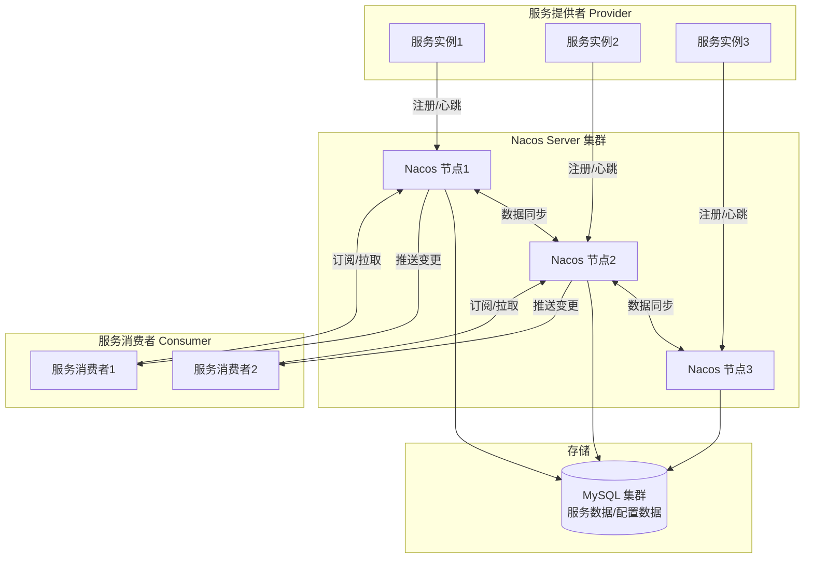
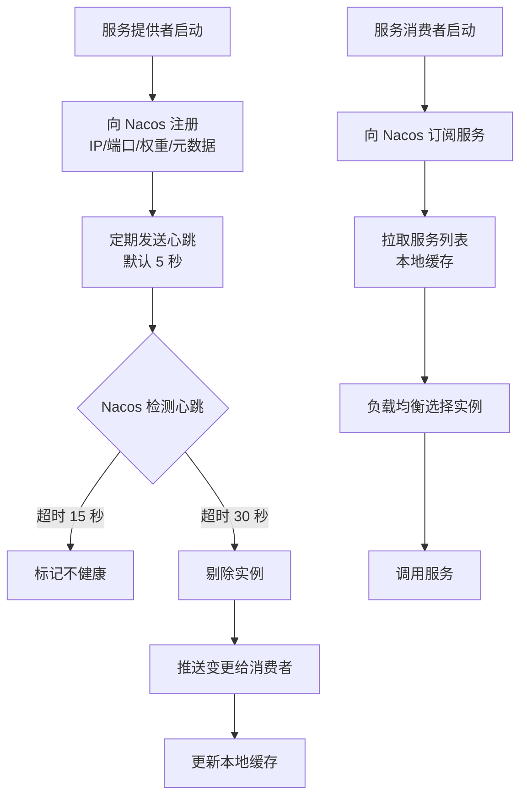

# Nacos 注册中心与配置中心

> **文档说明**：系统讲解 Nacos（Dynamic Naming and Configuration Service）的核心架构、服务注册发现原理、配置中心原理、部署方式（单机/集群）、Spring Cloud Alibaba 集成、命名空间/分组/集群管理、健康检查、配置动态刷新与灰度发布，以及生产级最佳实践和常见问题排查。
>
> **适用人群**：Java 后端开发工程师、全栈开发者、微服务架构师、需要构建服务注册发现和配置中心的工程师
>
> **前置知识**：[[SpringCloud-Alibaba组件体系]]、[[微服务核心组件知识点系统梳理_优化版]]、[[SpringBoot-配置管理与多环境]]

---

## 一、概述

### 1. 什么是 Nacos

**Nacos**（Dynamic Naming and Configuration Service）是阿里巴巴开源的动态服务发现、配置管理和服务管理平台，致力于帮助开发者更敏捷和容易地构建、交付和管理微服务平台。

### 2. 核心功能

| 功能 | 说明 |
|------|------|
| **服务发现** | 支持 DNS 和 RPC 两种服务发现模式，自动注册和发现服务 |
| **服务健康监测** | 支持多种健康检查方式（TCP/HTTP/MySQL/客户端心跳） |
| **动态配置服务** | 集中化、外部化、动态化管理配置，支持配置推送 |
| **动态 DNS 服务** | 支持权重路由、灰度发布、流量调度 |
| **服务及其元数据管理** | 管理服务元数据、描述、标签等 |
| **多数据中心** | 支持多数据中心部署和数据同步 |
| **控制台** | 提供 Web 管理界面，可视化管理服务和配置 |

### 3. Nacos vs Eureka vs Consul vs ZooKeeper

| 维度 | Nacos | Eureka | Consul | ZooKeeper |
|------|-------|--------|--------|-----------|
| **服务发现** | ✅ AP/CP 可切换 | ✅ AP | ✅ CP | ✅ CP |
| **配置中心** | ✅ 内置 | ❌ | ✅ KV 存储 | ✅ KV 存储 |
| **健康检查** | TCP/HTTP/MySQL/心跳 | 客户端心跳 | Agent 检查 | 会话保持 |
| **一致性协议** | Raft（CP）/ Distro（AP） | 无（最终一致） | Raft | ZAB |
| **多数据中心** | ✅ | ❌ | ✅ | ❌ |
| **灰度发布** | ✅ 权重路由 | ❌ | ❌ | ❌ |
| **管理界面** | ✅ 丰富 | ✅ 简单 | ✅ 简单 | ❌ |
| **Spring Cloud 集成** | ✅ Alibaba | ✅ Netflix | ✅ | ✅ |
| **语言支持** | 多语言 | Java | 多语言 | 多语言 |
| **社区活跃度** | ⭐⭐⭐⭐⭐ | ⭐⭐⭐（停止维护） | ⭐⭐⭐⭐ | ⭐⭐⭐⭐ |

### 4. 架构



### 5. 核心概念

| 概念 | 说明 |
|------|------|
| **命名空间（Namespace）** | 用于环境隔离（dev/test/prod），默认 public |
| **分组（Group）** | 用于服务/配置分组，默认 DEFAULT_GROUP |
| **服务（Service）** | 服务的抽象，包含多个服务实例 |
| **服务实例（Instance）** | 具体的服务节点，包含 IP、端口、权重、健康状态 |
| **集群（Cluster）** | 服务实例的分组，用于机房/地域隔离 |
| **配置（Config）** | 键值对配置，支持多种格式（yaml/properties/json/xml） |
| **DataId** | 配置的唯一标识，通常为 应用名-环境.扩展名 |
| **元数据（Metadata）** | 服务/实例/配置的附加信息（标签、描述等） |

---

## 二、部署

### 1. 单机部署

```bash
# 1. 下载
wget https://github.com/alibaba/nacos/releases/download/2.3.0/nacos-server-2.3.0.tar.gz
tar -xzf nacos-server-2.3.0.tar.gz
cd nacos

# 2. 初始化数据库（MySQL 5.7+）
mysql -u root -p < conf/nacos-mysql.sql

# 3. 修改配置 conf/application.properties
# spring.datasource.platform=mysql
# db.num=1
# db.url.0=jdbc:mysql://127.0.0.1:3306/nacos?characterEncoding=utf8&connectTimeout=1000&socketTimeout=3000&autoReconnect=true&useUnicode=true&serverTimezone=UTC
# db.user.0=root
# db.password.0=root

# 4. 启动（单机模式）
sh bin/startup.sh -m standalone
# Windows
bin/startup.cmd -m standalone

# 5. 访问控制台
# http://localhost:8848/nacos
# 默认账号：nacos / nacos

# 6. 关闭
sh bin/shutdown.sh
```

### 2. 集群部署

```bash
# 1. 准备 3 台服务器（nacos1, nacos2, nacos3）
# 2. 每台都下载并解压 Nacos

# 3. 配置集群 conf/cluster.conf
# 192.168.1.10:8848
# 192.168.1.11:8848
# 192.168.1.12:8848

# 4. 配置 MySQL（共享同一数据库）
# conf/application.properties 中配置数据源

# 5. 每台启动（集群模式，默认）
sh bin/startup.sh

# 6. Nginx 负载均衡
# upstream nacos {
#     server 192.168.1.10:8848;
#     server 192.168.1.11:8848;
#     server 192.168.1.12:8848;
# }
# server {
#     listen 80;
#     location /nacos {
#         proxy_pass http://nacos/nacos;
#     }
# }
```

**集群注意事项**：
- 至少 3 个节点保证高可用（奇数节点）
- 所有节点共享同一 MySQL 数据库
- 节点间网络互通（端口 8848、9848、9849）
- 建议使用 Nginx 做负载均衡

### 3. Docker 部署

```bash
# 单机
docker run -d \
  --name nacos-standalone \
  -e MODE=standalone \
  -e SPRING_DATASOURCE_PLATFORM=mysql \
  -e MYSQL_SERVICE_HOST=mysql-host \
  -e MYSQL_SERVICE_DB_NAME=nacos \
  -e MYSQL_SERVICE_USER=root \
  -e MYSQL_SERVICE_PASSWORD=root \
  -p 8848:8848 \
  -p 9848:9848 \
  nacos/nacos-server:v2.3.0

# docker-compose 集群
# version: '3'
# services:
#   nacos1:
#     image: nacos/nacos-server:v2.3.0
#     environment:
#       - MODE=cluster
#       - NACOS_SERVERS=nacos1:8848 nacos2:8848 nacos3:8848
#       - SPRING_DATASOURCE_PLATFORM=mysql
#       - MYSQL_SERVICE_HOST=mysql
#     ports:
#       - "8848:8848"
```

---

## 三、服务注册发现

### 1. 注册发现流程



### 2. Spring Cloud Alibaba 集成

```xml
<!-- Maven 依赖 -->
<dependency>
    <groupId>com.alibaba.cloud</groupId>
    <artifactId>spring-cloud-starter-alibaba-nacos-discovery</artifactId>
</dependency>
```

```yaml
# application.yml
spring:
  application:
    name: user-service
  cloud:
    nacos:
      discovery:
        server-addr: localhost:8848       # Nacos 地址
        namespace: dev                     # 命名空间（环境隔离）
        group: DEFAULT_GROUP               # 分组
        cluster-name: BJ                   # 集群名（机房）
        weight: 1                          # 权重（0-1，越大流量越多）
        metadata:                          # 元数据
          version: 1.0.0
          region: beijing
        heart-beat-interval: 5000         # 心跳间隔（毫秒）
        heart-beat-timeout: 15000         # 心跳超时（毫秒）
        ip-delete-timeout: 30000          # IP 删除超时（毫秒）
        enabled: true                      # 是否启用注册发现
```

```java
// 启动类
@SpringBootApplication
@EnableDiscoveryClient  // 启用服务发现（Spring Cloud 2020+ 可不加，自动启用）
public class UserServiceApplication {
    public static void main(String[] args) {
        SpringApplication.run(UserServiceApplication.class, args);
    }
}
```

### 3. 服务调用（RestTemplate + LoadBalancer）

```java
@Configuration
public class RestTemplateConfig {

    @Bean
    @LoadBalanced  // 启用负载均衡
    public RestTemplate restTemplate() {
        return new RestTemplate();
    }
}

@Service
public class UserService {

    @Autowired
    private RestTemplate restTemplate;

    public User getUser(Long id) {
        // 通过服务名调用（Nacos 自动解析）
        String url = "http://order-service/api/orders/" + id;
        return restTemplate.getForObject(url, User.class);
    }
}
```

### 4. 服务调用（OpenFeign）

```xml
<dependency>
    <groupId>org.springframework.cloud</groupId>
    <artifactId>spring-cloud-starter-openfeign</artifactId>
</dependency>
```

```java
@SpringBootApplication
@EnableFeignClients
public class UserServiceApplication { }

@FeignClient(name = "order-service", path = "/api/orders")
public interface OrderFeignClient {

    @GetMapping("/{id}")
    Order getOrder(@PathVariable("id") Long id);

    @PostMapping
    Order createOrder(@RequestBody Order order);
}
```

### 5. 负载均衡策略

```java
// 自定义负载均衡策略（随机）
@Configuration
public class LoadBalancerConfig {

    @Bean
    public ReactorLoadBalancer<ServiceInstance> randomLoadBalancer(
            Environment environment,
            LoadBalancerClientFactory loadBalancerClientFactory) {
        String name = environment.getProperty(LoadBalancerClientFactory.PROPERTY_NAME);
        return new RandomLoadBalancer(
            loadBalancerClientFactory.getLazyProvider(name, ServiceInstanceListSupplier.class),
            name
        );
    }
}

// 指定服务使用特定策略
@FeignClient(name = "order-service", configuration = LoadBalancerConfig.class)
public interface OrderFeignClient { }
```

**内置策略**：
| 策略 | 说明 |
|------|------|
| **RoundRobin** | 轮询（默认） |
| **Random** | 随机 |
| **NacosLoadBalancer** | Nacos 权重负载均衡（按权重分配流量） |

---

## 四、配置中心

### 1. 配置管理流程

```mermaid
graph TB
    A[开发者在控制台修改配置] --> B[Nacos 保存配置<br/>更新版本号]
    B --> C[长轮询检测变更]
    C --> D[推送配置变更<br/>给订阅的客户端]
    D --> E[客户端接收变更]
    E --> F[更新本地配置缓存]
    F --> G[@RefreshScope Bean 刷新]
    G --> H[应用使用新配置]
```

### 2. Spring Cloud 集成

```xml
<dependency>
    <groupId>com.alibaba.cloud</groupId>
    <artifactId>spring-cloud-starter-alibaba-nacos-config</artifactId>
</dependency>
```

```yaml
# bootstrap.yml（必须，优先级高于 application.yml）
spring:
  application:
    name: user-service
  profiles:
    active: dev
  cloud:
    nacos:
      config:
        server-addr: localhost:8848
        namespace: dev
        group: DEFAULT_GROUP
        file-extension: yaml          # 配置文件格式
        username: nacos
        password: nacos
        # 共享配置（多个服务共用）
        shared-configs:
          - data-id: common.yaml
            group: DEFAULT_GROUP
            refresh: true
          - data-id: redis-common.yaml
            group: COMMON_GROUP
            refresh: true
        # 扩展配置
        extension-configs:
          - data-id: user-service-ext.yaml
            group: DEFAULT_GROUP
            refresh: true
```

**DataId 命名规则**：
```
${prefix}-${spring.profiles.active}.${file-extension}
示例：user-service-dev.yaml

默认 prefix = spring.application.name
```

**配置优先级（从高到低）**：
1. 扩展配置（extension-configs，后定义的优先级高）
2. 应用自身配置（user-service-dev.yaml）
3. 共享配置（shared-configs，后定义的优先级高）
4. 本地 application.yml

### 3. 配置动态刷新

```java
// 方式1：@RefreshScope + @Value
@RestController
@RefreshScope  // 配置变更后自动刷新
public class ConfigController {

    @Value("${app.name}")
    private String appName;

    @Value("${app.version}")
    private String appVersion;

    @GetMapping("/config")
    public Map<String, String> getConfig() {
        return Map.of("name", appName, "version", appVersion);
    }
}

// 方式2：@ConfigurationProperties（自动刷新，不需 @RefreshScope）
@Component
@ConfigurationProperties(prefix = "app")
@Data
public class AppProperties {
    private String name;
    private String version;
    private List<String> servers;
}

// 方式3：监听配置变更事件
@Component
public class ConfigChangeListener {

    @NacosConfigListener(dataId = "user-service-dev.yaml")
    public void onConfigChange(String config) {
        System.out.println("配置变更: " + config);
    }
}
```

### 4. 配置灰度发布

Nacos 支持基于 Beta 发布的灰度配置：

```
控制台操作：
1. 编辑配置 → 勾选 "Beta 发布"
2. 填写 Beta 客户端 IP（逗号分隔）
3. 发布配置
4. 只有指定 IP 的客户端会收到新配置
5. 验证无误后，点击 "停止 Beta" → 全量发布
```

### 5. 配置版本回滚

```
控制台操作：
1. 配置管理 → 配置列表 → 点击 "详情"
2. 查看历史版本（每次修改生成一个版本）
3. 选择目标版本 → 点击 "回滚"
4. 确认回滚，配置恢复到指定版本
```

---

## 五、命名空间/分组/集群

### 1. 三级隔离模型

```
Namespace（命名空间）→ 环境隔离
    └── Group（分组）→ 业务/应用分组
        └── Service/DataId → 具体服务/配置
            └── Cluster（集群）→ 机房/地域隔离
                └── Instance → 具体实例
```

| 层级 | 用途 | 示例 |
|------|------|------|
| **Namespace** | 环境隔离 | dev、test、staging、prod |
| **Group** | 业务分组 | DEFAULT_GROUP、ORDER_GROUP、USER_GROUP |
| **Service** | 服务名 | user-service、order-service |
| **Cluster** | 机房/地域 | BJ（北京）、SH（上海）、SZ（深圳） |
| **Instance** | 具体实例 | 192.168.1.10:8080 |

### 2. 同集群优先调用

```yaml
spring:
  cloud:
    nacos:
      discovery:
        cluster-name: BJ  # 当前服务所在集群

# 消费者配置同集群优先
spring:
  cloud:
    loadbalancer:
      nacos:
        enabled: true  # 启用 Nacos 负载均衡（同集群优先）
```

---

## 六、健康检查

| 检查类型 | 说明 | 适用场景 |
|---------|------|---------|
| **客户端心跳** | 客户端定期发送心跳（默认 5 秒） | 临时实例（默认） |
| **TCP 探测** | Nacos 主动 TCP 连接探测 | 永久实例 |
| **HTTP 探测** | Nacos 主动 HTTP 请求探测 | 永久实例，需配置健康检查 URL |
| **MySQL 探测** | Nacos 主动 MySQL 连接探测 | 数据库服务 |

```yaml
spring:
  cloud:
    nacos:
      discovery:
        # 临时实例（默认，心跳模式）
        ephemeral: true
        # 永久实例（需配置主动探测）
        # ephemeral: false
        heart-beat-interval: 5000   # 心跳间隔
        heart-beat-timeout: 15000   # 心跳超时（标记不健康）
        ip-delete-timeout: 30000    # IP 删除超时（剔除）
```

---

## 七、生产最佳实践

### 1. 服务治理规范

- [ ] **命名规范**：服务名使用小写+中划线（user-service），DataId 使用 应用名-环境.扩展名
- [ ] **环境隔离**：不同环境使用不同 Namespace，严禁混用
- [ ] **权重管理**：通过权重实现灰度发布（新实例权重 0→逐步增加）
- [ ] **元数据**：使用元数据标记版本、区域、负责人等信息
- [ ] **优雅上下线**：上线时先注册再预热，下线时先摘流量再停止
- [ ] **监控告警**：监控服务实例数、健康状态、配置变更

### 2. 配置管理规范

- [ ] **配置分类**：公共配置放 shared-configs，应用配置放自身 DataId
- [ ] **敏感信息**：密码、密钥使用加密配置或环境变量，不明文存储
- [ ] **版本管理**：配置变更记录版本，支持回滚
- [ ] **灰度发布**：重要配置变更先 Beta 发布验证，再全量
- [ ] **动态刷新**：需要动态刷新的 Bean 加 @RefreshScope
- [ ] **配置审计**：定期审计配置变更记录

### 3. 高可用部署

- [ ] **集群部署**：生产环境至少 3 节点 Nacos 集群
- [ ] **数据库高可用**：MySQL 主从或集群，定期备份
- [ ] **负载均衡**：Nginx 或 SLB 做 Nacos 节点负载均衡
- [ ] **多数据中心**：跨地域部署使用 Nacos 多数据中心同步
- [ ] **容量规划**：根据服务实例数和配置数规划资源

---

## 八、常见问题与排查

| 问题 | 原因 | 解决方案 |
|------|------|---------|
| **服务注册失败** | Nacos 地址错误 / 网络不通 / 命名空间不存在 | 检查 server-addr、网络连通性、namespace |
| **服务列表为空** | 服务未注册 / 分组不匹配 / 命名空间不匹配 | 检查服务注册状态、group、namespace 配置 |
| **配置不生效** | DataId 不匹配 / file-extension 错误 / 优先级被覆盖 | 检查 DataId 格式、file-extension、配置优先级 |
| **配置不刷新** | 未加 @RefreshScope / refresh: false / 长轮询断开 | 添加 @RefreshScope、检查 refresh 配置、网络 |
| **服务调用失败** | 实例不健康 / 负载均衡问题 / 网络不通 | 检查实例健康状态、负载均衡策略、网络 |
| **Nacos 控制台无法访问** | 端口被占用 / 启动失败 / 数据库连接失败 | 检查 8848 端口、启动日志、数据库配置 |
| **集群不同步** | 节点间网络不通 / cluster.conf 配置错误 | 检查节点网络、cluster.conf 配置、9848/9849 端口 |
| **心跳超时频繁** | 网络不稳定 / 实例 GC 停顿 / 心跳间隔不合理 | 检查网络、优化 JVM、调整心跳参数 |
| **配置推送延迟** | 长轮询超时 / 网络抖动 / Nacos 负载高 | 检查网络、Nacos 性能、增加节点 |
| **临时实例被剔除** | 心跳超时 / 应用异常退出 / 网络中断 | 检查心跳、应用状态、网络 |
| **永久实例不健康** | 探测 URL 错误 / 探测超时 / 服务未就绪 | 检查健康检查 URL、超时时间、服务状态 |
| **同集群优先不生效** | 未启用 NacosLoadBalancer / cluster-name 不匹配 | 启用 Nacos 负载均衡、检查 cluster-name |
| **灰度发布不生效** | Beta IP 配置错误 / 客户端 IP 获取错误 | 检查 Beta IP 配置、客户端实际 IP |
| **MySQL 连接失败** | 数据库地址错误 / 权限不足 / 表结构未初始化 | 检查数据库配置、权限、nacos-mysql.sql |
| **Nacos 启动慢** | 数据库连接慢 / 内存不足 / 数据量大 | 优化数据库、增加内存、清理历史数据 |

---

## 九、关联笔记

### 微服务
- [[SpringCloud-Alibaba组件体系]] · [[微服务核心组件知识点系统梳理_优化版]] · [[Sentinel-流量控制与熔断]]
- [[Seata-分布式事务]] · [[Gateway-网关路由与鉴权]] · [[XXL-Job-分布式任务调度]]
- [[分布式任务调度实战]] · [[服务注册发现知识点系统梳理_优化版]]

### Spring 生态
- [[SpringBoot-自动装配原理]] · [[SpringBoot-配置管理与多环境]] · [[Spring-IOCAOP核心机制]]
- [[SpringSecurity-认证授权]] · [[SpringBoot-Web层设计]]

### 分布式
- [[分布式ID生成方案]] · [[Raft共识算法详解]] · [[ZooKeeper核心原理与实战]]
- [[分布式锁知识点系统梳理_优化版]] · [[分布式事务 知识点系统梳理_优化版]]

### 云原生
- [[Docker-核心原理与镜像优化]] · [[K8s-核心概念与架构]] · [[Nginx-反向代理与负载均衡]]
- [[Prometheus监控体系]]

### 导航
- [[MOC-后端开发]] · [[MOC-分布式与中间件]] · [[全栈+AI工程双轨融合学习路线图]]

> **学习路径建议**：先掌握 [[微服务核心组件知识点系统梳理_优化版]] 微服务基础 → 学习 [[SpringCloud-Alibaba组件体系]] Spring Cloud Alibaba → 深入本文 Nacos 注册中心与配置中心 → 实践 [[Gateway-网关路由与鉴权]] 网关 → 研究 [[Sentinel-流量控制与熔断]] 流量治理 → 应用于 [[高可用架构设计]] 生产微服务架构。
