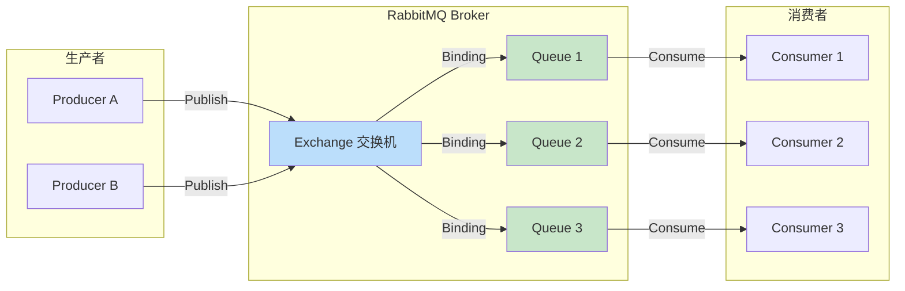

# RabbitMQ-消息中间件

> **文档说明**：系统讲解 RabbitMQ 消息中间件，包括架构原理、核心概念（Exchange/Queue/Binding）、Exchange 类型、消息确认、持久化、死信队列、延迟队列、幂等性、高可用集群、客户端使用（Python/Java）、监控运维、最佳实践和常见问题。
>
> **适用人群**：后端开发者、微服务架构师、DevOps 工程师、需要异步通信的全栈开发者
>
> **前置知识**：[[微服务架构设计模式]]、[[分布式系统-Raft共识算法]]、[[Kafka消息队列实战]]

---

## 一、概述

### 1. 消息队列是什么

```
消息队列（Message Queue，MQ）：
- 应用间异步通信的中间件
- 生产者（Producer）发送消息到队列，消费者（Consumer）从队列读取消息
- 解耦、异步、削峰填谷

核心价值：

1. 解耦（Decoupling）
   - 生产者不需要知道消费者是谁、有多少个
   - 消费者可以独立增减、升级
   - 系统模块间松耦合

2. 异步（Asynchronous）
   - 生产者发送消息后立即返回，不需要等待处理完成
   - 消费者按需处理，提高系统响应速度
   - 适合非实时任务（邮件、通知、日志）

3. 削峰填谷（Peak Shaving）
   - 突发流量时，消息暂存在队列中
   - 消费者按处理能力消费，避免系统被冲垮
   - 秒杀、大促场景必备

4. 可靠性（Reliability）
   - 消息持久化，不丢失
   - 消息确认机制，确保被处理
   - 重试机制，处理失败自动重试

5. 扩展性（Scalability）
   - 消费者可以水平扩展
   - 多个消费者竞争消费，提高吞吐量
   - 支持多种消息模式

常见消息队列对比：
| 特性 | RabbitMQ | Kafka | RocketMQ | Pulsar |
|------|----------|-------|----------|--------|
| 协议 | AMQP | 自定义 | 自定义 | 自定义 |
| 吞吐量 | 万级 | 十万级 | 十万级 | 十万级 |
| 延迟 | 微秒级 | 毫秒级 | 毫秒级 | 毫秒级 |
| 消息模型 | Exchange/Queue | Topic/Partition | Topic/Queue | Topic/Subscription |
| 持久化 | 支持 | 支持 | 支持 | 支持 |
| 事务 | 支持 | 支持 | 支持 | 支持 |
| 死信队列 | 支持 | 不原生支持 | 支持 | 支持 |
| 延迟队列 | 插件支持 | 不支持 | 原生支持 | 支持 |
| 适用场景 | 业务消息、路由 | 日志、大数据 | 电商、金融 | 云原生、多租户 |
```

### 2. RabbitMQ 介绍

```
RabbitMQ：
- 开源的消息代理（Message Broker）
- 由 Erlang 编写，基于 AMQP（Advanced Message Queuing Protocol）协议
- 2007 年发布，目前由 VMware 维护
- 最流行的开源消息队列之一

核心特性：
1. 多协议支持
   - AMQP 0-9-1（原生）
   - STOMP（文本协议）
   - MQTT（物联网）
   - HTTP（REST API）

2. 灵活的路由
   - Exchange 路由模型
   - 4 种 Exchange 类型：Direct、Topic、Fanout、Headers
   - 支持复杂的路由规则

3. 消息可靠性
   - 消息持久化
   - 发布确认（Publisher Confirm）
   - 消费者确认（Consumer ACK）
   - 事务支持
   - 死信队列（DLX）

4. 高可用
   - 镜像队列（Mirrored Queue）
   - Quorum Queue（Raft 共识）
   - 集群部署
   - 负载均衡

5. 管理与监控
   - Web 管理界面（Management Plugin）
   - HTTP API
   - CLI 工具（rabbitmqctl）
   - Prometheus 指标
   - 消息追踪（Tracing）

6. 插件生态
   - 管理插件
   - 延迟消息插件
   - 联邦插件（Federation）
   - Shovel 插件
   - 监控插件

适用场景：
- 微服务间异步通信
- 任务队列（邮件、短信、通知）
- 事件驱动架构
- 订单处理、支付回调
- 日志收集与处理
- IoT 设备消息
```



---

## 二、架构与核心概念

### 1. RabbitMQ 架构

```
RabbitMQ 核心组件：

1. Broker（代理/服务器）
   - RabbitMQ 服务进程
   - 接收和分发消息
   - 管理 Exchange、Queue、Binding

2. Virtual Host（虚拟主机，vhost）
   - 逻辑隔离单元
   - 类似数据库的 schema
   - 每个 vhost 有独立的 Exchange、Queue、权限
   - 默认 vhost："/"
   - 用于多租户隔离

3. Exchange（交换机）
   - 接收生产者发送的消息
   - 根据路由规则将消息路由到 Queue
   - 不存储消息，只做路由
   - 4 种类型：Direct、Topic、Fanout、Headers

4. Queue（队列）
   - 存储消息的缓冲区
   - 消费者从 Queue 读取消息
   - 消息持久化在 Queue 中
   - FIFO（先进先出），但优先级队列可以打乱

5. Binding（绑定）
   - Exchange 和 Queue 之间的连接
   - 包含 Binding Key（绑定键）
   - Exchange 根据 Routing Key 和 Binding Key 的匹配规则路由消息

6. Routing Key（路由键）
   - 生产者发送消息时指定
   - Exchange 根据 Routing Key 决定消息路由到哪些 Queue

7. Connection（连接）
   - 生产者/消费者与 Broker 的 TCP 连接
   - 基于 AMQP 协议

8. Channel（信道）
   - Connection 内的虚拟连接
   - 多路复用，减少 TCP 连接开销
   - 所有操作通过 Channel 进行
   - 一个 Connection 可以有多个 Channel

消息流转过程：
Producer → Connection → Channel → Exchange → (Routing Key 匹配 Binding Key) → Queue → Channel → Connection → Consumer
```

### 2. AMQP 消息模型

```
AMQP（Advanced Message Queuing Protocol）消息模型：

消息（Message）结构：
1. Header（消息头）
   - content-type：内容类型
   - content-encoding：内容编码
   - delivery-mode：投递模式（1=非持久化，2=持久化）
   - priority：优先级（0-255）
   - correlation-id：关联 ID（请求-响应模式）
   - reply-to：回复队列
   - expiration：过期时间（TTL）
   - message-id：消息 ID
   - timestamp：时间戳
   - type：消息类型
   - user-id：用户 ID
   - app-id：应用 ID
   - headers：自定义头部

2. Body（消息体）
   - 实际的消息内容
   - 二进制数据，无格式限制
   - 通常是 JSON、XML、Protocol Buffers 等

消息状态：
1. 就绪（Ready）：在队列中等待消费
2. 未确认（Unacked）：已投递给消费者但未确认
3. 已确认（Acked）：消费者已确认，消息被删除
```

---

## 三、Exchange 类型

### 1. Direct Exchange（直连交换机）

```
Direct Exchange：
- 精确匹配 Routing Key 和 Binding Key
- 消息路由到 Routing Key == Binding Key 的 Queue
- 最简单、最常用的 Exchange 类型

示例：
- Exchange: order.direct
- Queue A binding key: "order.created"
- Queue B binding key: "order.paid"
- 消息 routing key: "order.created" → 路由到 Queue A
- 消息 routing key: "order.paid" → 路由到 Queue B
- 消息 routing key: "order.cancelled" → 无匹配，丢弃或返回

适用场景：
- 任务分发
- 按类型路由
- 需要精确控制消息去向
```

```python
# Python pika 示例：Direct Exchange
import pika

connection = pika.BlockingConnection(pika.ConnectionParameters('localhost'))
channel = connection.channel()

# 声明 Direct Exchange
channel.exchange_declare(exchange='order.direct', exchange_type='direct')

# 声明队列
channel.queue_declare(queue='order.created.queue')
channel.queue_declare(queue='order.paid.queue')

# 绑定
channel.queue_bind(exchange='order.direct', queue='order.created.queue', routing_key='order.created')
channel.queue_bind(exchange='order.direct', queue='order.paid.queue', routing_key='order.paid')

# 发送消息
channel.basic_publish(
    exchange='order.direct',
    routing_key='order.created',
    body='{"order_id": 123, "amount": 99.9}'
)

connection.close()
```

### 2. Topic Exchange（主题交换机）

```
Topic Exchange：
- 支持通配符匹配 Routing Key 和 Binding Key
- Routing Key 用点号分隔单词："order.created.us"
- Binding Key 支持通配符：
  - *（星号）：匹配一个单词
  - #（井号）：匹配零个或多个单词

示例：
- Binding Key "order.*" → 匹配 "order.created"、"order.paid"，不匹配 "order.created.us"
- Binding Key "order.#" → 匹配 "order.created"、"order.created.us"、"order.paid.2024"
- Binding Key "*.created.*" → 匹配 "order.created.us"、"payment.created.eu"

适用场景：
- 多维度路由
- 事件驱动架构
- 按主题订阅
- 日志分级（按模块和级别）
```

```python
# Topic Exchange 示例
channel.exchange_declare(exchange='events.topic', exchange_type='topic')

# 队列：处理所有订单事件
channel.queue_declare(queue='all.orders')
channel.queue_bind(exchange='events.topic', queue='all.orders', routing_key='order.#')

# 队列：处理美国的创建事件
channel.queue_declare(queue='us.created')
channel.queue_bind(exchange='events.topic', queue='us.created', routing_key='*.created.us')

# 发送消息
channel.basic_publish(exchange='events.topic', routing_key='order.created.us', body='...')
# 会路由到 all.orders 和 us.created
```

### 3. Fanout Exchange（广播交换机）

```
Fanout Exchange：
- 忽略 Routing Key，将消息广播到所有绑定的 Queue
- 每个绑定的 Queue 都会收到一份完整消息
- 最简单的 Exchange 类型

示例：
- Exchange: logs.fanout
- Queue A、Queue B、Queue C 都绑定到该 Exchange
- 发送一条消息 → A、B、C 都收到

适用场景：
- 广播通知
- 事件发布/订阅
- 配置更新
- 多消费者处理同一消息（各自独立处理）
```

```python
# Fanout Exchange 示例
channel.exchange_declare(exchange='broadcast.fanout', exchange_type='fanout')

# 多个队列绑定
channel.queue_declare(queue='sms.queue')
channel.queue_declare(queue='email.queue')
channel.queue_declare(queue='push.queue')

channel.queue_bind(exchange='broadcast.fanout', queue='sms.queue')
channel.queue_bind(exchange='broadcast.fanout', queue='email.queue')
channel.queue_bind(exchange='broadcast.fanout', queue='push.queue')

# 发送消息（不需要 routing_key）
channel.basic_publish(exchange='broadcast.fanout', routing_key='', body='系统维护通知')
# 三个队列都收到消息
```

### 4. Headers Exchange（头交换机）

```
Headers Exchange：
- 根据消息头（Headers）属性路由，而不是 Routing Key
- 忽略 Routing Key
- Binding 时指定匹配的 header 键值对
- 支持 x-match 参数：
  - x-match: all（默认）：所有 header 都匹配才路由
  - x-match: any：任意一个 header 匹配就路由

适用场景：
- 复杂的多维度路由
- Routing Key 无法表达的路由规则
- 不常用，了解即可
```

```python
# Headers Exchange 示例
channel.exchange_declare(exchange='notifications.headers', exchange_type='headers')

channel.queue_declare(queue='urgent.queue')
channel.queue_bind(
    exchange='notifications.headers',
    queue='urgent.queue',
    arguments={'x-match': 'all', 'priority': 'high', 'type': 'urgent'}
)

# 发送消息，带 headers
properties = pika.BasicProperties(headers={'priority': 'high', 'type': 'urgent'})
channel.basic_publish(
    exchange='notifications.headers',
    routing_key='',
    properties=properties,
    body='紧急通知'
)
```

---

## 四、消息可靠性

### 1. 消息持久化

```
消息持久化三要素（缺一不可）：

1. Exchange 持久化
   - 声明 Exchange 时 durable=True
   - Broker 重启后 Exchange 不丢失

2. Queue 持久化
   - 声明 Queue 时 durable=True
   - Broker 重启后 Queue 不丢失

3. 消息持久化
   - 发送消息时 delivery_mode=2（Persistent）
   - 消息写入磁盘，Broker 重启后不丢失

注意：
- 即使三者都持久化，也不能 100% 保证不丢失
- 因为消息可能在写入磁盘前 Broker 崩溃
- 需要配合 Publisher Confirm 机制
- 或使用事务（性能差）
```

```python
# 持久化示例
# 1. 持久化 Exchange
channel.exchange_declare(exchange='durable.exchange', exchange_type='direct', durable=True)

# 2. 持久化 Queue
channel.queue_declare(queue='durable.queue', durable=True)

# 绑定
channel.queue_bind(exchange='durable.exchange', queue='durable.queue', routing_key='task')

# 3. 持久化消息
properties = pika.BasicProperties(
    delivery_mode=2,  # 2 = Persistent
    content_type='application/json',
)
channel.basic_publish(
    exchange='durable.exchange',
    routing_key='task',
    properties=properties,
    body='{"task": "send_email"}'
)
```

### 2. 发布确认（Publisher Confirm）

```
Publisher Confirm（发布者确认）：
- 生产者发送消息后，Broker 确认收到
- 确保消息到达 Broker
- 异步确认，性能比事务好

两种模式：

1. 同步确认（Confirm.select + wait）
   - 发送后等待确认
   - 简单但慢（每条消息一次往返）

2. 异步确认（Confirm.select + 回调）
   - 注册回调函数
   - Broker 确认后调用回调
   - 性能好，推荐使用

确认类型：
- ack：消息已成功接收
- nack：消息接收失败（Broker 内部错误）
- 未确认：超时或连接断开

最佳实践：
- 生产环境必须开启 Publisher Confirm
- 异步确认 + 本地缓存未确认消息
- 确认失败时重试或告警
```

```python
# Publisher Confirm 异步示例
import pika

connection = pika.BlockingConnection(pika.ConnectionParameters('localhost'))
channel = connection.channel()

# 开启 Confirm 模式
channel.confirm_delivery()

# 未确认的消息缓存
unconfirmed = {}

def on_ack(delivery_tag):
    if delivery_tag in unconfirmed:
        del unconfirmed[delivery_tag]
        print(f"消息 {delivery_tag} 已确认")

def on_nack(delivery_tag):
    if delivery_tag in unconfirmed:
        msg = unconfirmed[delivery_tag]
        print(f"消息 {delivery_tag} 被拒绝，需要重发: {msg}")
        # 重发逻辑
        del unconfirmed[delivery_tag]

# 注册回调
channel.add_on_return_callback(lambda ch, method, properties, body: print(f"返回: {body}"))

# 发送消息
for i in range(10):
    delivery_tag = channel.next_publish_seq_no
    unconfirmed[delivery_tag] = f"message-{i}"
    channel.basic_publish(
        exchange='',
        routing_key='task.queue',
        body=f'message-{i}',
        properties=pika.BasicProperties(delivery_mode=2),
        mandatory=True  # 无法路由时返回给生产者
    )

# 等待所有确认
connection.sleep(5)
print(f"未确认消息数: {len(unconfirmed)}")
connection.close()
```

### 3. 消费者确认（Consumer ACK）

```
Consumer ACK（消费者确认）：
- 消费者处理完消息后，向 Broker 发送确认
- Broker 收到确认后才删除消息
- 确保消息被正确处理

确认模式：

1. 自动确认（auto_ack=True）
   - 消息投递给消费者后立即确认
   - 消费者处理过程中崩溃会丢失消息
   - 不推荐，除非消息不重要

2. 手动确认（auto_ack=False）
   - 消费者处理完后手动调用 basic_ack
   - 处理失败可以 nack 或不确认
   - 推荐使用

手动确认操作：
- basic_ack(delivery_tag)：确认消息，Broker 删除
- basic_nack(delivery_tag, requeue=True)：拒绝消息，重新入队
- basic_reject(delivery_tag, requeue=True)：拒绝单条消息（不支持批量）

注意：
- 忘记 ack 会导致消息一直处于 Unacked 状态
- 消费者断开后，Unacked 消息会重新入队
- 可以设置消费者超时（consumer_timeout）
- 避免无限重试导致死循环（配合死信队列）
```

```python
# 消费者手动确认示例
import pika

connection = pika.BlockingConnection(pika.ConnectionParameters('localhost'))
channel = connection.channel()

channel.queue_declare(queue='task.queue', durable=True)

def callback(ch, method, properties, body):
    try:
        # 处理消息
        print(f"处理消息: {body.decode()}")
        # 模拟处理
        result = process_message(body)

        if result:
            # 处理成功，确认消息
            ch.basic_ack(delivery_tag=method.delivery_tag)
        else:
            # 处理失败，拒绝并重入队（或进入死信队列）
            ch.basic_nack(delivery_tag=method.delivery_tag, requeue=False)
    except Exception as e:
        print(f"处理异常: {e}")
        # 异常时拒绝，重新入队（谨慎使用，可能无限循环）
        ch.basic_nack(delivery_tag=method.delivery_tag, requeue=True)

# 手动确认模式
channel.basic_consume(queue='task.queue', on_message_callback=callback, auto_ack=False)

# 公平分发：每次只给消费者一条消息，处理完再发下一条
channel.basic_qos(prefetch_count=1)

print('等待消息...')
channel.start_consuming()
```

---

## 五、高级特性

### 1. 死信队列（DLX）

```
死信队列（Dead Letter Exchange，DLX）：
- 消息变成"死信"后，被转发到指定的 Exchange
- 用于处理无法正常消费的消息
- 避免消息丢失，便于排查和重试

消息变成死信的条件：
1. 消费者拒绝消息（basic_reject / basic_nack）且 requeue=False
2. 消息过期（TTL 到期）
3. 队列达到最大长度（max-length），最早的消息被挤出

DLX 配置：
- 声明队列时指定 x-dead-letter-exchange 参数
- 可选 x-dead-letter-routing-key（修改死信的 routing key）

典型架构：
- 业务队列 → 处理失败 → DLX → 死信队列 → 人工处理/定时重试
```

```python
# 死信队列示例
# 1. 声明死信 Exchange 和死信队列
channel.exchange_declare(exchange='dlx.exchange', exchange_type='direct', durable=True)
channel.queue_declare(queue='dead.letter.queue', durable=True)
channel.queue_bind(exchange='dlx.exchange', queue='dead.letter.queue', routing_key='dead')

# 2. 声明业务队列，指定 DLX
channel.exchange_declare(exchange='business.exchange', exchange_type='direct', durable=True)
channel.queue_declare(
    queue='business.queue',
    durable=True,
    arguments={
        'x-dead-letter-exchange': 'dlx.exchange',
        'x-dead-letter-routing-key': 'dead',
        # 可选：消息 TTL
        'x-message-ttl': 60000,  # 60秒
        # 可选：队列最大长度
        'x-max-length': 10000,
    }
)
channel.queue_bind(exchange='business.exchange', queue='business.queue', routing_key='task')

# 3. 消费者处理失败时，拒绝且不重入队 → 进入死信队列
def callback(ch, method, properties, body):
    try:
        process(body)
        ch.basic_ack(delivery_tag=method.delivery_tag)
    except Exception as e:
        print(f"处理失败: {e}，消息进入死信队列")
        ch.basic_nack(delivery_tag=method.delivery_tag, requeue=False)
```

### 2. 延迟队列

```
延迟队列（Delayed Queue）：
- 消息发送后，延迟一段时间才被消费
- 用于定时任务、超时处理、延迟通知

RabbitMQ 实现延迟队列的方式：

1. TTL + DLX（原生方式）
   - 消息设置 TTL（过期时间）
   - 消息过期后进入死信队列
   - 消费者消费死信队列，实现延迟
   - 缺点：队列头部消息阻塞（先过期的消息在头部，后过期的被阻塞）

2. 延迟消息插件（rabbitmq_delayed_message_exchange）
   - 官方插件，推荐使用
   - 声明 x-delayed-message 类型的 Exchange
   - 消息头指定 x-delay（延迟毫秒数）
   - 插件内部按延迟时间排序，不阻塞
   - 支持任意延迟时间

安装插件：
```bash
# 下载插件
wget https://github.com/rabbitmq/rabbitmq-delayed-message-exchange/releases/download/v3.12.0/rabbitmq_delayed_message_exchange-3.12.0.ez
# 复制到插件目录
cp rabbitmq_delayed_message_exchange-3.12.0.ez /usr/lib/rabbitmq/lib/rabbitmq_server-*/plugins/
# 启用插件
rabbitmq-plugins enable rabbitmq_delayed_message_exchange
# 重启 RabbitMQ
rabbitmqctl restart
```
```

```python
# 延迟消息插件示例
# 声明延迟 Exchange
channel.exchange_declare(
    exchange='delayed.exchange',
    exchange_type='x-delayed-message',
    durable=True,
    arguments={'x-delayed-type': 'direct'}  # 底层路由类型
)

# 声明队列
channel.queue_declare(queue='delayed.queue', durable=True)
channel.queue_bind(exchange='delayed.exchange', queue='delayed.queue', routing_key='delay')

# 发送延迟消息（延迟 10 秒）
properties = pika.BasicProperties(
    headers={'x-delay': 10000},  # 延迟毫秒数
    delivery_mode=2,
)
channel.basic_publish(
    exchange='delayed.exchange',
    routing_key='delay',
    properties=properties,
    body='10秒后处理的消息'
)

# 消费者：10秒后收到消息
def callback(ch, method, properties, body):
    print(f"收到延迟消息: {body.decode()}")
    ch.basic_ack(delivery_tag=method.delivery_tag)

channel.basic_consume(queue='delayed.queue', on_message_callback=callback)
channel.start_consuming()
```

### 3. 消息幂等性

```
消息幂等性（Idempotency）：
- 同一条消息被消费多次，结果相同
- 因为网络重试、消费者重启等原因，消息可能重复投递
- 必须保证消费者幂等

实现幂等的方式：

1. 唯一消息 ID + 去重表
   - 每条消息有唯一 ID（message-id 或业务 ID）
   - 消费者处理前检查 ID 是否已处理
   - 已处理则跳过，未处理则处理并记录
   - 用 Redis/数据库存储已处理 ID

2. 数据库唯一约束
   - 利用数据库唯一索引防止重复插入
   - 例如订单号唯一，重复插入会报错
   - 捕获唯一约束异常，视为重复消息

3. 乐观锁
   - 数据库记录加 version 字段
   - 更新时带 version 条件
   - 重复消息更新时 version 不匹配，影响行数为 0

4. 状态机
   - 业务有明确的状态流转
   - 重复消息触发相同状态转换，结果一致
   - 例如订单状态：待支付 → 已支付，重复支付消息不会重复扣库存

5. 先查后改
   - 处理前查询当前状态
   - 如果已经是目标状态，跳过
   - 否则执行操作

最佳实践：
- 消息必须包含唯一业务 ID
- 消费者必须实现幂等
- 用 Redis 做去重（高性能）
- 数据库唯一约束做兜底
- 幂等表设置过期时间，避免无限增长
```

```python
# 幂等消费者示例
import redis
import pika

redis_client = redis.Redis(host='localhost', port=6379, db=0)

def is_processed(message_id):
    """检查消息是否已处理"""
    return redis_client.exists(f"processed:{message_id}")

def mark_processed(message_id, ttl=86400):
    """标记消息已处理，TTL 24小时"""
    redis_client.setex(f"processed:{message_id}", ttl, "1")

def callback(ch, method, properties, body):
    message_id = properties.message_id or body.decode().split('|')[0]

    # 1. 幂等检查
    if is_processed(message_id):
        print(f"消息 {message_id} 已处理，跳过")
        ch.basic_ack(delivery_tag=method.delivery_tag)
        return

    try:
        # 2. 处理消息
        process_message(body)

        # 3. 标记已处理
        mark_processed(message_id)

        # 4. 确认
        ch.basic_ack(delivery_tag=method.delivery_tag)
    except Exception as e:
        print(f"处理失败: {e}")
        ch.basic_nack(delivery_tag=method.delivery_tag, requeue=True)
```

### 4. 优先级队列

```
优先级队列（Priority Queue）：
- 消息有优先级，高优先级消息先被消费
- 默认 FIFO，优先级队列打破 FIFO

配置：
- 声明队列时指定 x-max-priority（最大优先级，0-255）
- 发送消息时设置 priority 属性
- 优先级高的消息排在前面

注意：
- 优先级队列性能略低于普通队列
- 消费者 prefetch 会影响优先级（已预取的消息不会重新排序）
- 建议 prefetch_count=1 以保证优先级严格生效
```

```python
# 优先级队列示例
channel.queue_declare(
    queue='priority.queue',
    durable=True,
    arguments={'x-max-priority': 10}  # 最大优先级 10
)

# 发送高优先级消息
high_priority = pika.BasicProperties(priority=10, delivery_mode=2)
channel.basic_publish(exchange='', routing_key='priority.queue',
                      properties=high_priority, body='紧急任务')

# 发送低优先级消息
low_priority = pika.BasicProperties(priority=1, delivery_mode=2)
channel.basic_publish(exchange='', routing_key='priority.queue',
                      properties=low_priority, body='普通任务')

# 消费者会先收到"紧急任务"
```

---

## 六、高可用集群

### 1. 集群模式

```
RabbitMQ 高可用方案：

1. 普通集群（Normal Cluster）
   - 多个节点组成集群
   - Queue 只存在于一个节点（创建节点）
   - 其他节点只保存 Queue 的元数据和路由信息
   - 消费者连接到非 Queue 节点时，消息从 Queue 节点转发
   - Queue 节点宕机，该 Queue 不可用
   - 提高吞吐量，不提供高可用

2. 镜像队列（Mirrored Queue，经典 HA）
   - Queue 的消息同步到多个节点（主节点 + 从节点）
   - 主节点负责读写，从节点同步
   - 主节点宕机，从节点提升为主
   - 提供高可用
   - 缺点：同步开销大，性能下降，脑裂问题

3. Quorum Queue（仲裁队列，推荐）
   - 基于 Raft 共识算法
   - 多节点复制，多数派确认
   - 比镜像队列更可靠、性能更好
   - 支持消息保留（不自动删除已确认消息）
   - RabbitMQ 3.8+ 推荐使用
   - 缺点：不支持所有特性（如 TTL 略有不同）

4. 流式队列（Stream Queue）
   - 类似 Kafka 的持久化日志
   - 消息追加写入，不可删除
   - 支持重复消费
   - 高吞吐量
   - 适合事件溯源、日志场景
```

### 2. Quorum Queue 配置

```bash
# 创建集群（3 节点）
# 节点1
rabbitmqctl stop_app
rabbitmqctl join_cluster rabbit@node1
rabbitmqctl start_app

# 节点2
rabbitmqctl stop_app
rabbitmqctl join_cluster rabbit@node1
rabbitmqctl start_app

# 查看集群状态
rabbitmqctl cluster_status
```

```python
# Quorum Queue 声明
channel.queue_declare(
    queue='quorum.queue',
    durable=True,
    arguments={
        'x-queue-type': 'quorum',  # 指定为 Quorum Queue
        # 可选：复制因子（默认 3，建议奇数）
        # 'x-quorum-initial-group-size': 3,
    }
)

# Quorum Queue 特点：
# - 自动在集群节点间复制
# - 多数派确认后才返回成功
# - 节点宕机自动选主
# - 支持消息保留（x-max-length-bytes 等）
```

### 3. 镜像队列配置（旧方案）

```bash
# 设置镜像队列策略（所有队列镜像到 2 个节点）
rabbitmqctl set_policy ha-all "^" \
  '{"ha-mode":"exactly","ha-params":2,"ha-sync-mode":"automatic"}'

# ha-mode:
# - all：镜像到所有节点
# - exactly：镜像到指定数量节点
# - nodes：镜像到指定节点

# ha-sync-mode:
# - automatic：自动同步
# - manual：手动同步
```

---

## 七、客户端使用

### 1. Python（pika）

```python
# 完整的生产者和消费者示例
import pika
import json
import time

class RabbitMQClient:
    def __init__(self, host='localhost', port=5672, username='guest', password='guest'):
        self.credentials = pika.PlainCredentials(username, password)
        self.parameters = pika.ConnectionParameters(
            host=host, port=port, credentials=self.credentials,
            heartbeat=60, blocked_connection_timeout=300
        )
        self.connection = None
        self.channel = None

    def connect(self):
        """建立连接"""
        self.connection = pika.BlockingConnection(self.parameters)
        self.channel = self.connection.channel()
        # 开启发布确认
        self.channel.confirm_delivery()
        return self

    def declare_exchange(self, exchange, exchange_type='direct', durable=True):
        """声明交换机"""
        self.channel.exchange_declare(
            exchange=exchange, exchange_type=exchange_type, durable=durable
        )

    def declare_queue(self, queue, durable=True, arguments=None):
        """声明队列"""
        self.channel.queue_declare(queue=queue, durable=durable, arguments=arguments or {})

    def bind_queue(self, queue, exchange, routing_key=''):
        """绑定队列到交换机"""
        self.channel.queue_bind(queue=queue, exchange=exchange, routing_key=routing_key)

    def publish(self, exchange, routing_key, body, properties=None):
        """发送消息"""
        if properties is None:
            properties = pika.BasicProperties(
                delivery_mode=2,  # 持久化
                content_type='application/json',
                timestamp=int(time.time()),
            )
        if isinstance(body, dict):
            body = json.dumps(body, ensure_ascii=False)

        try:
            self.channel.basic_publish(
                exchange=exchange, routing_key=routing_key,
                body=body, properties=properties, mandatory=True
            )
            return True
        except pika.exceptions.UnroutableError:
            print(f"消息无法路由: {body}")
            return False

    def consume(self, queue, callback, prefetch_count=1):
        """消费消息"""
        self.channel.basic_qos(prefetch_count=prefetch_count)
        self.channel.basic_consume(queue=queue, on_message_callback=callback, auto_ack=False)
        print(f"开始消费队列: {queue}")
        self.channel.start_consuming()

    def close(self):
        """关闭连接"""
        if self.connection and self.connection.is_open:
            self.connection.close()


# 使用示例
if __name__ == '__main__':
    # 生产者
    client = RabbitMQClient().connect()
    client.declare_exchange('orders', 'direct')
    client.declare_queue('orders.created')
    client.bind_queue('orders.created', 'orders', 'order.created')

    client.publish('orders', 'order.created', {'order_id': 123, 'amount': 99.9})
    client.close()

    # 消费者
    def on_message(ch, method, properties, body):
        data = json.loads(body)
        print(f"处理订单: {data}")
        ch.basic_ack(delivery_tag=method.delivery_tag)

    consumer = RabbitMQClient().connect()
    consumer.consume('orders.created', on_message)
```

### 2. Java（Spring AMQP / Spring Boot）

```java
// Spring Boot 配置
// application.yml
spring:
  rabbitmq:
    host: localhost
    port: 5672
    username: guest
    password: guest
    virtual-host: /
    publisher-confirm-type: correlated  # 发布确认
    publisher-returns: true             # 消息返回
    listener:
      simple:
        acknowledge-mode: manual        # 手动确认
        prefetch: 1                      # 公平分发
        retry:
          enabled: true
          max-attempts: 3

// 配置类
@Configuration
public class RabbitMQConfig {
    public static final String EXCHANGE = "order.exchange";
    public static final String QUEUE = "order.queue";
    public static final String ROUTING_KEY = "order.created";

    @Bean
    public DirectExchange orderExchange() {
        return new DirectExchange(EXCHANGE, true, false);
    }

    @Bean
    public Queue orderQueue() {
        return QueueBuilder.durable(QUEUE)
                .withArgument("x-dead-letter-exchange", "dlx.exchange")
                .withArgument("x-dead-letter-routing-key", "dead")
                .build();
    }

    @Bean
    public Binding orderBinding() {
        return BindingBuilder.bind(orderQueue()).to(orderExchange()).with(ROUTING_KEY);
    }
}

// 生产者
@Service
public class OrderProducer {
    @Autowired
    private RabbitTemplate rabbitTemplate;

    public void sendOrder(Order order) {
        rabbitTemplate.convertAndSend(
            RabbitMQConfig.EXCHANGE,
            RabbitMQConfig.ROUTING_KEY,
            order,
            message -> {
                message.getMessageProperties().setDeliveryMode(MessageDeliveryMode.PERSISTENT);
                message.getMessageProperties().setMessageId(UUID.randomUUID().toString());
                return message;
            }
        );
    }
}

// 消费者
@Service
public class OrderConsumer {
    @RabbitListener(queues = RabbitMQConfig.QUEUE)
    public void onMessage(Message message, Channel channel) throws IOException {
        long deliveryTag = message.getMessageProperties().getDeliveryTag();
        try {
            String body = new String(message.getBody());
            Order order = new ObjectMapper().readValue(body, Order.class);
            // 处理订单
            processOrder(order);
            channel.basicAck(deliveryTag, false);
        } catch (Exception e) {
            channel.basicNack(deliveryTag, false, false);  // 进入死信队列
        }
    }
}
```

---

## 八、监控与运维

### 1. 管理界面

```bash
# 启用管理插件
rabbitmq-plugins enable rabbitmq_management

# 访问 http://localhost:15672
# 默认账号：guest / guest（仅本地访问）

# 创建管理员用户
rabbitmqctl add_user admin your_password
rabbitmqctl set_user_tags admin administrator
rabbitmqctl set_permissions -p / admin ".*" ".*" ".*"
```

### 2. 常用运维命令

```bash
# 集群管理
rabbitmqctl cluster_status           # 查看集群状态
rabbitmqctl join_cluster rabbit@node2  # 加入集群
rabbitmqctl forget_cluster_node rabbit@node3  # 移除节点

# 用户管理
rabbitmqctl list_users               # 列出用户
rabbitmqctl add_user username password  # 添加用户
rabbitmqctl delete_user username     # 删除用户
rabbitmqctl change_password username newpass  # 修改密码
rabbitmqctl set_user_tags username administrator  # 设置角色

# 权限管理
rabbitmqctl list_permissions -p /    # 列出权限
rabbitmqctl set_permissions -p / username ".*" ".*" ".*"  # 设置权限

# 队列管理
rabbitmqctl list_queues              # 列出队列
rabbitmqctl list_queues name messages consumers  # 队列详情
rabbitmqctl purge_queue queue_name   # 清空队列
rabbitmqctl delete_queue queue_name  # 删除队列

# 消息管理
rabbitmqctl list_exchanges           # 列出交换机
rabbitmqctl list_bindings            # 列出绑定

# 连接管理
rabbitmqctl list_connections         # 列出连接
rabbitmqctl close_connection <pid> "reason"  # 关闭连接

# 健康检查
rabbitmq-diagnostics ping            # 检查节点状态
rabbitmq-diagnostics check_port_connectivity  # 检查端口
rabbitmq-diagnostics status          # 详细状态
rabbitmq-diagnostics memory_breakdown  # 内存分析
```

### 3. Prometheus 监控

```bash
# 启用 Prometheus 插件
rabbitmq-plugins enable rabbitmq_prometheus

# 指标端点：http://localhost:15692/metrics
```

```yaml
# prometheus.yml 配置
scrape_configs:
  - job_name: 'rabbitmq'
    static_configs:
      - targets: ['localhost:15692']
```

```
关键监控指标：
- rabbitmq_queue_messages：队列消息数（Ready + Unacked）
- rabbitmq_queue_messages_ready：就绪消息数
- rabbitmq_queue_messages_unacked：未确认消息数
- rabbitmq_queue_consumers：消费者数
- rabbitmq_connection_count：连接数
- rabbitmq_channel_count：信道数
- rabbitmq_erlang_vm_memory_used_bytes：内存使用
- rabbitmq_process_open_fds：文件描述符
- rabbitmq_queues_declared_total：声明队列数
- rabbitmq_messages_published_total：发布消息数
- rabbitmq_messages_delivered_total：投递消息数
- rabbitmq_messages_acknowledged_total：确认消息数

告警规则：
- 队列消息堆积 > 阈值（如 10000）
- 消费者数为 0
- 未确认消息数持续增长
- 内存使用率 > 80%
- 文件描述符使用率 > 80%
- 节点离线
```

---

## 九、最佳实践

### 1. 消息设计

- [ ] **消息包含唯一 ID**：用于幂等和追踪
- [ ] **消息体用 JSON**：可读性好，跨语言
- [ ] **消息体尽量小**：大消息用引用（文件 ID/URL）
- [ ] **设置消息 TTL**：避免过期消息堆积
- [ ] **消息持久化**：delivery_mode=2
- [ ] **消息版本化**：字段变更时加 version，兼容旧消费者

### 2. 队列设计

- [ ] **队列持久化**：durable=True
- [ ] **设置队列最大长度**：x-max-length，防止无限堆积
- [ ] **配置死信队列**：处理失败消息
- [ ] **队列命名规范**：业务.动作.环境（如 order.created.prod）
- [ ] **避免单队列过载**：按业务拆分队列
- [ ] **临时队列用自动删除**：exclusive=True, auto_delete=True

### 3. 生产者实践

- [ ] **开启 Publisher Confirm**：确保消息到达 Broker
- [ ] **mandatory=True**：无法路由时返回，避免静默丢失
- [ ] **异步发送**：批量发送提高性能
- [ ] **失败重试**：网络异常时重试（有上限）
- [ ] **本地缓存**：Broker 不可用时本地暂存，恢复后重发
- [ ] **监控发送失败率**：告警

### 4. 消费者实践

- [ ] **手动确认**：auto_ack=False，处理完再确认
- [ ] **实现幂等**：防止重复消费
- [ ] **公平分发**：basic_qos(prefetch_count=1)
- [ ] **异常处理**：捕获异常，nack 到死信队列
- [ ] **避免无限重试**：requeue=True 可能导致死循环
- [ ] **消费者并发**：多实例消费提高吞吐量
- [ ] **优雅关闭**：处理完当前消息再退出

### 5. 高可用实践

- [ ] **用 Quorum Queue**：替代镜像队列，更可靠
- [ ] **至少 3 节点集群**：容忍 1 节点故障
- [ ] **跨可用区部署**：机房级容灾
- [ ] **负载均衡**：前面加 HAProxy/Nginx
- [ ] **数据备份**：定期导出定义和消息
- [ ] **演练故障恢复**：定期测试节点宕机恢复

### 6. 性能优化

- [ ] **批量消费**：prefetch_count 适当调大（如 10-100）
- [ ] **异步确认**：批量 ack 减少网络往返
- [ ] **避免持久化**：非关键消息用非持久化（更快）
- [ ] **多队列分流**：单队列瓶颈时拆分
- [ ] **消息压缩**：大消息体压缩
- [ ] **连接复用**：用 Channel 多路复用，避免频繁建连

---

## 十、常见问题与排查

| 问题 | 原因 | 解决方案 |
|------|------|---------|
| **消息丢失** | 未持久化/未开确认/消费者自动确认 | 三要素持久化；开 Publisher Confirm；手动 ACK；死信队列兜底 |
| **消息重复消费** | 消费者处理后崩溃未 ACK/网络重传 | 实现幂等；唯一消息 ID + 去重表；数据库唯一约束 |
| **消息堆积** | 消费者处理慢/消费者宕机/流量突增 | 扩容消费者；优化处理逻辑；削峰填谷；告警通知；临时扩容 |
| **消费者收不到消息** | 绑定错误/routing key 不匹配/队列名错 | 检查 Exchange/Queue/Binding；用管理界面查看；测试 mandatory 返回 |
| **连接断开** | 网络波动/心跳超时/Broker 重启 | 配置心跳（heartbeat）；自动重连；连接池；捕获异常重连 |
| **Channel 关闭** | 操作错误（如声明已存在的不同参数队列） | 检查声明参数一致性；幂等声明；查看 Broker 日志 |
| **内存溢出（OOM）** | 消息堆积太多/未设置最大长度 | 设置 x-max-length；消息 TTL；持久化到磁盘；扩容内存；消费者加速 |
| **磁盘满** | 持久化消息太多/日志太多 | 设置队列最大长度；定期清理日志；监控磁盘；扩容磁盘 |
| **延迟队列不准** | TTL 头部阻塞/插件未安装 | 用延迟插件（x-delayed-message）；避免 TTL+DLX 的头部阻塞；检查插件状态 |
| **死信队列消息不进 DLX** | 队列未配置 x-dead-letter-exchange/requeue=True | 声明队列时加 DLX 参数；nack 时 requeue=False；检查 DLX 绑定 |
| **集群节点不同步** | 网络分区/节点宕机/镜像同步慢 | 检查网络；用 Quorum Queue；查看同步状态；等待同步完成 |
| **Quorum Queue 性能差** | 复制因子太大/多数派确认开销 | 复制因子 3（不要 5+）；合理设置批量；用非持久化消息（可接受丢失时） |
| **管理界面打不开** | 插件未启用/端口被占/防火墙 | rabbitmq-plugins enable rabbitmq_management；检查 15672 端口；开放防火墙 |
| **guest 用户无法远程登录** | guest 默认仅本地 | 创建新用户并设为 administrator；或修改配置允许远程 guest（不推荐） |
| **消息顺序错乱** | 多消费者竞争/优先级队列/重入队 | 单消费者保证顺序；或用单队列单消费者；消息带序号消费者排序 |
| **prefetch 不生效** | 消费者已预取消息/auto_ack=True | auto_ack=False；重启消费者；检查 basic_qos 调用时机 |
| **事务性能差** | 事务每次 fsync/阻塞 | 用 Publisher Confirm 替代事务；只在必要时用事务；批量提交 |
| **虚拟主机隔离不生效** | 用户权限未限制 | 用 set_permissions 限制 vhost 权限；不同环境用不同 vhost |
| **消息追踪（Tracing）开销大** | 追踪所有消息性能影响大 | 只在排查时开启；限制追踪的 Exchange/Queue；用完关闭 |
| **Erlang VM 内存高** | 消息堆积/原子表/进程数 | 检查队列消息数；减少原子表（atom count）；限制连接数；调整 VM 参数 |
| **文件描述符耗尽** | 连接太多/队列太多 | 调大 ulimit -n；限制连接数；复用连接；监控 fd 使用 |
| **迁移队列到 Quorum** | 不能直接转换队列类型 | 创建新 Quorum 队列；用 Shovel/Federation 迁移消息；切换生产者消费者；删除旧队列 |

---

## 十一、关联笔记

### 后端开发
- [[微服务架构设计模式]] · [[分布式系统-Raft共识算法]] · [[Kafka消息队列实战]]
- [[SpringValidation-参数校验]] · [[Java-应用性能调优实战]] · [[API安全最佳实践]]

### 云原生与运维
- [[K8s-核心概念与架构]] · [[APM应用性能监控-SkyWalking]] · [[Jenkins流水线实战]]
- [[混沌工程-ChaosMesh]]

### Python 全栈
- [[Python-异步编程asyncio]] · [[Python-Web框架FastAPI实战]] · [[Python-LangChain应用开发]]

### 导航
- [[MOC-后端开发]] · [[MOC-云原生与运维]] · [[全栈+AI工程双轨融合学习路线图]]

> **学习路径建议**：先掌握 [[微服务架构设计模式]] 微服务基础 → 学习本文 RabbitMQ 消息队列 → 对比学习 [[Kafka消息队列实战]] 高吞吐消息队列 → 实践 [[分布式系统-Raft共识算法]] 分布式理论 → 研究 [[混沌工程-ChaosMesh]] 稳定性验证 → 构建完整的微服务异步通信与高可用体系。
