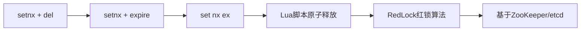
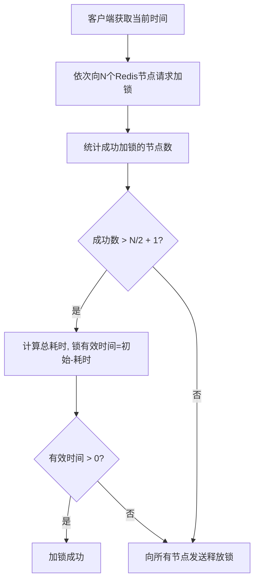
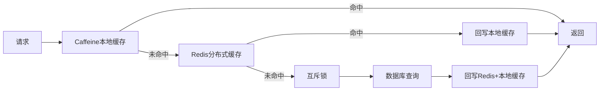

# Redis 分布式锁与缓存穿透

> **文档说明**：深入讲解 Redis 分布式锁的实现原理、演进过程、常见陷阱，以及缓存三大问题（穿透、击穿、雪崩）的成因与解决方案。
>
> **适用人群**：后端开发工程师、需要构建高并发系统的全栈工程师
>
> **前置知识**：[[Redis-数据结构与持久化]]、[[Java-并发编程JUC]]、[[关系型数据库索引原理]]

---

## 一、概述

在分布式系统中，多个进程/服务实例需要协调对共享资源的访问。**分布式锁**是实现跨进程互斥的核心机制，而 **Redis** 因其高性能和原子操作支持，成为分布式锁最常用的实现方案。

同时，Redis 作为缓存层时面临三大经典问题：**缓存穿透、缓存击穿、缓存雪崩**。这些问题在高并发场景下可能导致数据库被打垮，是后端工程师必须掌握的核心知识。

### 1. 为什么需要分布式锁

| 场景 | 问题 | 分布式锁的作用 |
|------|------|--------------|
| 库存扣减 | 超卖 | 确保同一商品同时只有一个请求扣减 |
| 定时任务 | 多实例重复执行 | 确保任务只被一个实例执行 |
| 数据修改 | 并发覆盖 | 保证修改操作的原子性和顺序性 |
| 分布式ID生成 | ID重复 | 串行化ID生成过程 |

### 2. 缓存三大问题对比

| 问题 | 定义 | 根本原因 | 关键词 |
|------|------|---------|--------|
| **缓存穿透** | 查询不存在的数据，请求直达数据库 | 缓存中没有，数据库也没有 | 不存在的数据 |
| **缓存击穿** | 热点 key 过期瞬间，大量请求直达数据库 | 热点 key 过期 | 热点 key 过期 |
| **缓存雪崩** | 大量 key 同时过期，或 Redis 宕机 | 批量过期 / 服务不可用 | 大面积失效 |

---

## 二、分布式锁底层原理

### 1. 分布式锁的演进



#### 阶段一：setnx + del（有缺陷）

```java
// 错误示范：非原子操作，可能死锁
public boolean lock(String key, String value) {
    // setnx: key不存在时才设置成功
    Boolean result = redisTemplate.opsForValue().setIfAbsent(key, value);
    if (Boolean.TRUE.equals(result)) {
        // 如果在这里进程崩溃，锁永远不会释放 → 死锁
        redisTemplate.expire(key, 30, TimeUnit.SECONDS);
        return true;
    }
    return false;
}
```

**缺陷**：`setnx` 和 `expire` 不是原子操作，中间崩溃会导致死锁。

#### 阶段二：set nx ex（原子加锁）

```java
// 正确加锁：SET key value NX EX 30
public boolean lock(String key, String value, long expireSeconds) {
    return Boolean.TRUE.equals(
        redisTemplate.opsForValue().setIfAbsent(key, value, expireSeconds, TimeUnit.SECONDS)
    );
}
```

`SET key value NX EX seconds` 是原子操作，同时完成"设置+过期时间"。

#### 阶段三：Lua 脚本原子释放（防误删）

```java
// 错误示范：判断和删除不是原子操作
public void unlockWrong(String key, String value) {
    String current = redisTemplate.opsForValue().get(key);
    if (value.equals(current)) {
        // 在这里锁过期了，其他线程获取了锁
        redisTemplate.delete(key);  // 删除了别人的锁！
    }
}

// 正确释放：Lua 脚本保证判断+删除原子性
private static final String UNLOCK_SCRIPT = """
    if redis.call('get', KEYS[1]) == ARGV[1] then
        return redis.call('del', KEYS[1])
    else
        return 0
    end
    """;

public void unlock(String key, String value) {
    redisTemplate.execute(
        new DefaultRedisScript<>(UNLOCK_SCRIPT, Long.class),
        Collections.singletonList(key),
        value
    );
}
```

**为什么需要 value 唯一标识**：防止释放别人的锁。每个客户端加锁时生成唯一 value（如 UUID），释放时校验。

### 2. 锁的自动续期（Watch Dog）

业务执行时间超过锁过期时间会导致锁提前释放。Redisson 的 Watch Dog 机制自动续期：

```java
// Redisson 自动续期
RLock lock = redissonClient.getLock("order:lock:123");
lock.lock(30, TimeUnit.SECONDS);  // 30秒后自动释放
// Watch Dog 每 10 秒检查一次，如果锁仍被持有，续期到 30 秒
try {
    // 业务逻辑，可能执行超过30秒
    processOrder();
} finally {
    lock.unlock();
}
```

**原理**：后台定时任务（默认每 1/3 过期时间执行一次）检查锁是否仍被当前线程持有，如果是则刷新过期时间。

### 3. RedLock 红锁算法

在 Redis 主从架构下，主节点加锁成功后未同步到从节点就宕机，从节点提升为主后锁丢失。RedLock 通过多个独立 Redis 节点解决：



通常使用 5 个独立 Redis 节点，需要至少 3 个加锁成功。但 RedLock 存在争议（Martin Kleppmann 与 antirez 的辩论），生产环境多数场景单节点 Redis 锁已足够。

---

## 三、缓存三大问题详解

### 1. 缓存穿透

**现象**：查询一个数据库中不存在的数据，缓存永远不命中，每次请求都打到数据库。

**解决方案**：

#### 方案一：缓存空值

```java
public User getUserById(Long id) {
    String key = "user:" + id;
    User user = redisTemplate.opsForValue().get(key);
    if (user != null) {
        return user;
    }
    // 查数据库
    user = userMapper.selectById(id);
    if (user == null) {
        // 缓存空值，设置较短过期时间
        redisTemplate.opsForValue().set(key, new User(), 5, TimeUnit.MINUTES);
    } else {
        redisTemplate.opsForValue().set(key, user, 30, TimeUnit.MINUTES);
    }
    return user;
}
```

#### 方案二：布隆过滤器（Bloom Filter）

```java
// 使用 Guava BloomFilter
BloomFilter<Long> bloomFilter = BloomFilter.create(
    Funnels.longFunnel(),
    1000000,  // 预期数据量
    0.01      // 误判率
);

// 初始化时将所有存在的ID加入布隆过滤器
userMapper.selectAllIds().forEach(bloomFilter::put);

public User getUserById(Long id) {
    // 布隆过滤器说不存在 → 一定不存在
    if (!bloomFilter.mightContain(id)) {
        return null;
    }
    // 布隆过滤器说可能存在 → 查缓存/数据库
    return queryFromCacheOrDB(id);
}
```

| 方案 | 优点 | 缺点 | 适用场景 |
|------|------|------|---------|
| 缓存空值 | 简单直接 | 占用内存，可能被恶意攻击利用 | 数据量小，穿透请求少 |
| 布隆过滤器 | 内存效率高，支持大数据量 | 有一定误判率，不支持删除 | 数据量大，恶意攻击防护 |

### 2. 缓存击穿

**现象**：某个热点 key 过期的瞬间，大量并发请求同时到达，全部穿透到数据库。

**解决方案**：

#### 方案一：互斥锁（Mutex Key）

```java
public Product getProductWithMutex(Long id) {
    String key = "product:" + id;
    Product product = redisTemplate.opsForValue().get(key);
    if (product != null) return product;

    String lockKey = "lock:product:" + id;
    // 尝试获取互斥锁
    if (Boolean.TRUE.equals(redisTemplate.opsForValue()
            .setIfAbsent(lockKey, "1", 10, TimeUnit.SECONDS))) {
        try {
            // 双重检查：获取锁后再查一次缓存
            product = redisTemplate.opsForValue().get(key);
            if (product != null) return product;
            // 查数据库并回写缓存
            product = productMapper.selectById(id);
            redisTemplate.opsForValue().set(key, product, 30, TimeUnit.MINUTES);
        } finally {
            redisTemplate.delete(lockKey);
        }
    } else {
        // 没拿到锁，等待后重试
        Thread.sleep(50);
        return getProductWithMutex(id);  // 递归重试
    }
    return product;
}
```

#### 方案二：热点数据永不过期

```java
// 逻辑过期：不设置 TTL，在 value 中存储过期时间
public class CacheData<T> {
    private T data;
    private LocalDateTime expireTime;  // 逻辑过期时间
}

public Product getProductWithLogicalExpire(Long id) {
    CacheData<Product> cache = redisTemplate.opsForValue().get("product:" + id);
    if (cache == null) return null;

    if (cache.getExpireTime().isAfter(LocalDateTime.now())) {
        return cache.getData();  // 未过期，直接返回
    }
    // 已过期：异步重建缓存，返回旧数据
    if (tryLock("rebuild:product:" + id)) {
        executorService.submit(() -> rebuildProductCache(id));
    }
    return cache.getData();  // 返回旧值，保证可用性
}
```

| 方案 | 优点 | 缺点 | 适用场景 |
|------|------|------|---------|
| 互斥锁 | 一致性好 | 等待的请求有延迟 | 一致性要求高 |
| 逻辑过期 | 无延迟，高可用 | 短暂返回旧数据 | 高可用优先，允许短暂不一致 |

### 3. 缓存雪崩

**现象**：大量缓存 key 在同一时间过期，或 Redis 实例宕机，导致所有请求瞬间打到数据库。

**解决方案**：

| 方案 | 实现 | 说明 |
|------|------|------|
| 过期时间加随机值 | `expire = baseTime + random(0, 300s)` | 避免批量同时过期 |
| 多级缓存 | Caffeine 本地缓存 + Redis 分布式缓存 | Redis 挂了本地缓存兜底 |
| Redis 高可用 | 主从 + 哨兵 / Cluster | 避免单点故障 |
| 限流降级 | Sentinel/Hystrix 限流 | 保护数据库不被打垮 |
| 缓存预热 | 系统启动前加载热点数据 | 避免启动时大量穿透 |

```java
// 过期时间加随机值
public void setWithRandomExpire(String key, Object value) {
    int baseSeconds = 1800;  // 30分钟
    int randomSeconds = ThreadLocalRandom.current().nextInt(0, 300);  // 0-5分钟随机
    redisTemplate.opsForValue().set(key, value, baseSeconds + randomSeconds, TimeUnit.SECONDS);
}
```

---

## 四、常见问题与排查

### 1. 分布式锁问题

| 问题 | 原因 | 解决方案 |
|------|------|---------|
| 死锁 | 加锁后未释放就崩溃 | 使用 `set nx ex` 原子加锁，设置过期时间 |
| 误删别人的锁 | 释放时未校验 value | 使用 Lua 脚本原子释放，校验唯一标识 |
| 锁提前释放 | 业务执行超过过期时间 | 使用 Redisson Watch Dog 自动续期 |
| 主从切换锁丢失 | 主节点未同步就宕机 | 使用 RedLock 或接受小概率不一致 |
| 锁不公平 | 等待的线程随机获取 | 使用 Redisson 的 FairLock（基于队列） |

### 2. 缓存问题排查

**排查步骤**：
1. 监控 Redis 命中率：`info stats` 查看 `keyspace_hits / keyspace_misses`
2. 命中率突降 → 检查是否有批量 key 过期（雪崩）或热点 key 过期（击穿）
3. 数据库 QPS 突增 → 结合 Redis 慢查询和数据库连接池监控
4. 使用 `redis-cli --bigkeys` 检查是否有大 key 导致阻塞

### 3. 典型错误

**Q: 分布式锁的过期时间设多长合适？**
A: 一般设为业务最长执行时间的 2-3 倍。如果业务执行时间不确定，使用 Redisson 的自动续期机制。过短会导致锁提前释放，过长会影响故障恢复时间。

**Q: 布隆过滤器的误判率怎么选？**
A: 误判率越低，需要的内存和哈希函数越多。一般 0.01（1%）是平衡点。100 万数据、1% 误判率约需 1.2MB 内存和 7 个哈希函数。

---

## 五、进阶与最佳实践

### 1. 缓存更新策略

| 策略 | 操作顺序 | 一致性 | 复杂度 | 适用场景 |
|------|---------|--------|--------|---------|
| Cache Aside | 先更新DB，再删缓存 | 最终一致 | 低 | 最常用，读多写少 |
| Write Through | 先更新缓存，缓存同步更新DB | 强一致 | 中 | 写多读少 |
| Write Behind | 先更新缓存，异步批量更新DB | 弱一致 | 高 | 写入量极大 |

**Cache Aside 为什么是删缓存而不是更新缓存？**
- 更新缓存可能导致并发写时缓存值错乱
- 删除缓存简单，下次读取时自动加载最新值
- 极端情况（先删缓存→读请求加载旧值→写请求更新DB）需要延迟双删

```java
// 延迟双删
public void updateProduct(Product product) {
    redisTemplate.delete("product:" + product.getId());  // 先删缓存
    productMapper.updateById(product);                    // 更新DB
    Thread.sleep(500);                                    // 延迟
    redisTemplate.delete("product:" + product.getId());  // 再删一次
}
```

### 2. 生产级缓存架构



### 3. 监控指标

| 指标 | 正常值 | 告警阈值 |
|------|--------|---------|
| 缓存命中率 | > 90% | < 80% |
| Redis 内存使用率 | < 70% | > 85% |
| 平均响应时间 | < 1ms | > 5ms |
| 数据库 QPS | 平稳 | 突增 3 倍 |
| 锁等待时间 | < 100ms | > 1s |

---

## 六、关联笔记

### Redis 核心
- [[Redis-数据结构与持久化]] · [[Redis-集群与高可用]] · [[Redis-性能优化与内存管理]]

### 分布式系统
- [[分布式事务基础]] · [[Seata-分布式事务]] · [[Sentinel-流量控制与熔断]]
- [[Java-高并发系统设计]] · [[高可用架构设计]]

### 数据库
- [[关系型数据库索引原理]] · [[数据库分库分表策略]] · [[数据库主从复制与读写分离]]

### 实战项目
- [[秒杀系统架构设计]] · [[高并发系统设计案例]]

### 导航
- [[MOC-后端开发]] · [[MOC-分布式与中间件]] · [[全栈+AI工程双轨融合学习路线图]]

> **学习路径建议**：先掌握 [[Redis-数据结构与持久化]] 基础 → 理解本文分布式锁与缓存问题 → 实践 [[秒杀系统架构设计]] 综合应用 → 研究 [[Redis-集群与高可用]] 进阶。
