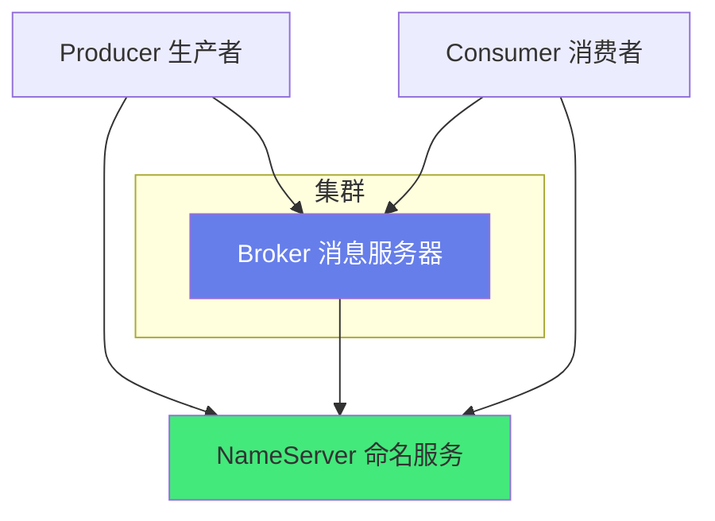
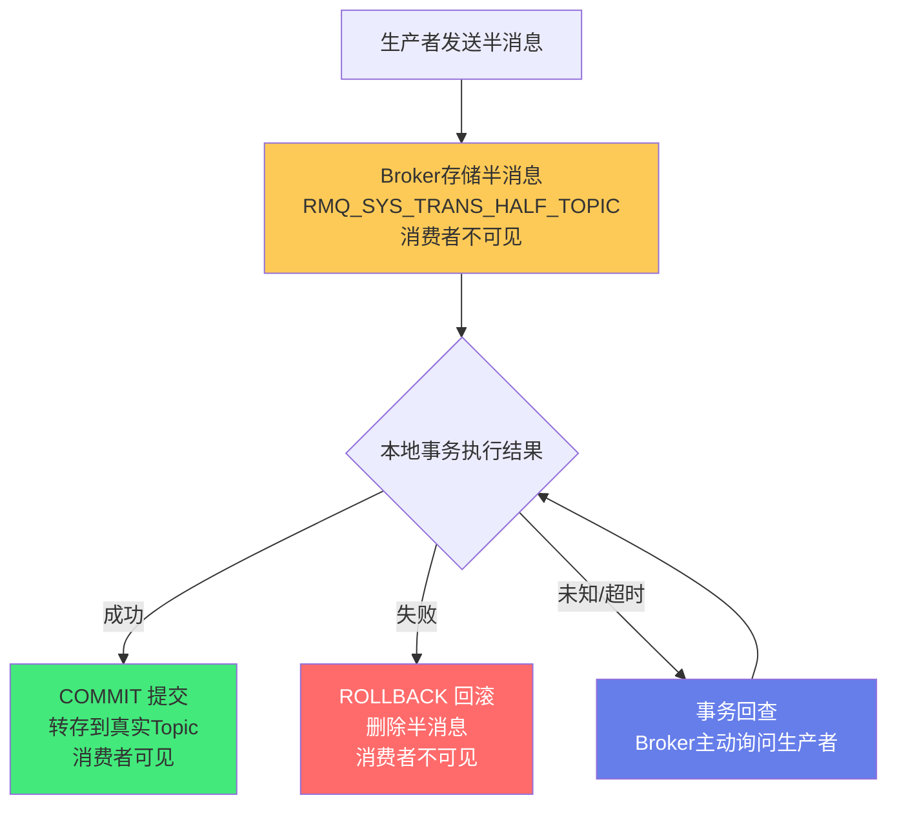
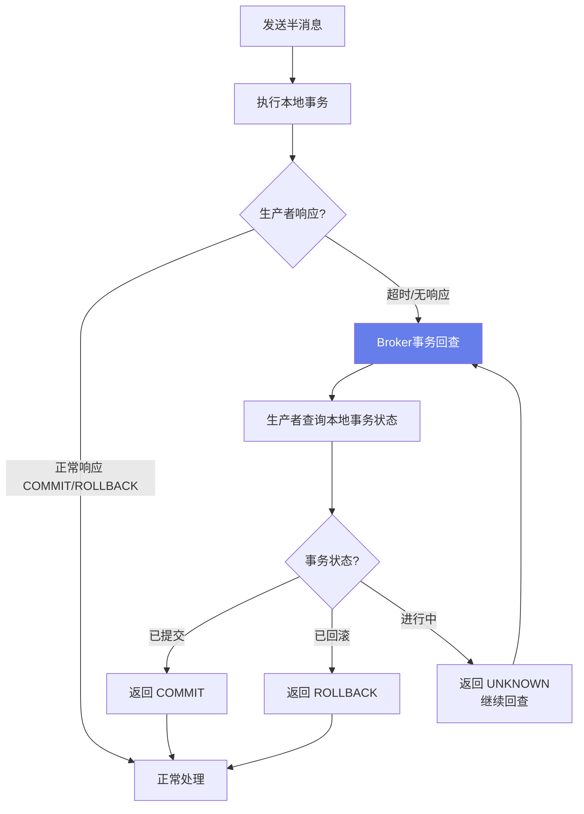
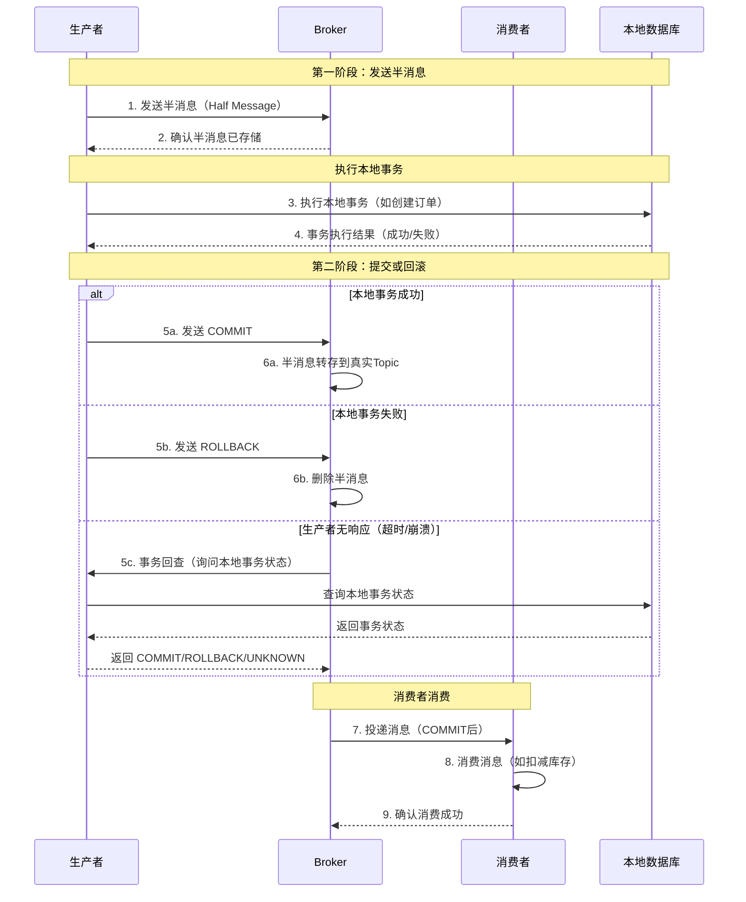

# 🚀 RocketMQ 事务消息

> **文档说明**：系统讲解 RocketMQ 事务消息的完整原理与实战，涵盖 RocketMQ 概述（什么是 RocketMQ / 核心概念 / 与 Kafka/RabbitMQ 对比 / 适用场景）、事务消息概述（什么是事务消息 / 解决什么问题 / 与普通消息区别 / 适用场景）、事务消息核心原理（半消息 Half Message / 两阶段提交 2PC / 事务状态 COMMIT/ROLLBACK/UNKNOWN / 事务回查机制 / 消息状态流转 / 与 XA 事务区别）、事务消息完整流程（发送半消息 → Broker 存储半消息 → 执行本地事务 → 提交或回滚 → 消费者消费 → 事务回查补偿）、代码实战（Maven 依赖 / 生产者配置 / 事务监听器实现 / 本地事务执行 / 事务回查 / 消费者配置 / 完整示例）、事务消息与分布式事务（与 Seata AT/TCC 对比 / 可靠消息最终一致性原理 / 最大努力通知 / 场景选型指南 / 优缺点对比）、常见问题与解决方案（消息丢失 / 重复消费 / 半消息堆积 / 事务回查失败 / 本地事务执行失败 / 消费者处理失败 / 消息顺序性）、最佳实践（幂等性设计 / 补偿机制 / 本地消息表 / 死信队列处理 / 监控告警 / 性能优化 / 超时配置 / 日志规范）、实战案例（支付成功通知订单更新 / 订单超时自动取消 / 库存扣减与回滚 / 用户注册送积分 / 跨服务数据同步）。
>
> **适用人群**：Java 后端开发者、微服务架构师、分布式系统开发者、中间件运维工程师
>
> **前置知识**：[[Kafka-消息队列与消费模型]] · [[分布式事务详解]] · [[实战-SpringCloud微服务电商系统]]

---

## 一、RocketMQ 概述

### 1.1 什么是 RocketMQ

**RocketMQ** 是阿里巴巴开源的分布式消息中间件，基于 Java 开发，具有低延迟、高可靠、万亿级消息容量、灵活可扩展等特点，是金融级消息队列的代表。2016 年捐赠给 Apache 基金会，成为 Apache 顶级项目。



**核心组件**：
- **NameServer**：命名服务，轻量级注册中心，管理 Broker 路由信息
- **Broker**：消息服务器，负责消息存储、投递、查询
- **Producer**：消息生产者，发送消息到 Broker
- **Consumer**：消息消费者，从 Broker 拉取消息消费
- **Topic**：消息主题，消息的第一级分类
- **Queue**：消息队列，Topic 下的分区，实现并行消费

### 1.2 RocketMQ 核心特性

| 特性 | 说明 |
|------|------|
| **事务消息** | 支持分布式事务消息，保证本地事务与消息发送的原子性 |
| **定时/延迟消息** | 支持 18 个延迟级别，也支持任意时间延迟（4.x+） |
| **顺序消息** | 支持全局顺序和分区顺序消息 |
| **消息过滤** | 支持 Tag 过滤和 SQL92 语法过滤 |
| **高可靠** | 同步刷盘 + 主从复制，消息不丢失 |
| **高吞吐** | 单机支持 10 万+ QPS，万亿级消息堆积 |
| **死信队列** | 消费失败的消息进入死信队列，可人工处理 |
| **消息轨迹** | 追踪消息从生产到消费的完整链路 |

### 1.3 与 Kafka/RabbitMQ 对比

| 维度 | RocketMQ | Kafka | RabbitMQ |
|------|----------|-------|----------|
| **开发语言** | Java | Scala/Java | Erlang |
| **吞吐量** | 高（10万+ QPS） | 极高（百万级 QPS） | 中（万级 QPS） |
| **延迟** | 低（ms级） | 低（ms级） | 低（微秒级） |
| **事务消息** | ✅ 原生支持 | ❌ 需自己实现 | ❌ 需自己实现 |
| **延迟消息** | ✅ 原生支持 | ❌ 需自己实现 | ✅ 原生支持（插件） |
| **顺序消息** | ✅ 支持 | ✅ 分区顺序 | ⚠️ 有限支持 |
| **消息过滤** | ✅ Tag/SQL | ✅ 分区+客户端 | ✅ Exchange路由 |
| **消息回溯** | ✅ 按时间回溯 | ✅ 按offset回溯 | ❌ 消费后删除 |
| **死信队列** | ✅ 原生 | ⚠️ 需自己实现 | ✅ DLX |
| **适用场景** | 金融、电商、事务 | 大数据、日志、流处理 | 中小规模、路由复杂 |
| **运维复杂度** | 中 | 高 | 低 |

> **结论**：RocketMQ 的核心优势是**事务消息**和**金融级可靠性**，在电商、支付、金融等需要分布式事务的场景下是首选；Kafka 适合大数据量、高吞吐的日志/流处理场景；RabbitMQ 适合中小规模、路由逻辑复杂的场景。

---

## 二、事务消息概述

### 2.1 什么是事务消息

**事务消息**是 RocketMQ 的核心特性，它保证了「本地事务执行」与「消息发送」的原子性——要么本地事务和消息发送都成功，要么都失败，不会出现「本地事务成功但消息没发出去」或「消息发出去了但本地事务回滚了」的不一致情况。

```mermaid
graph LR
    A[本地事务<br/>如：创建订单] --> B{事务消息保证}
    B --> C[消息发送<br/>如：通知库存扣减]
    A 和 C 要么都成功，要么都失败
    
    style B fill:#ff6b6b,color:#fff
```

### 2.2 解决什么问题

**经典问题**：在微服务架构中，一个业务操作需要同时执行本地事务和发送消息（如创建订单后通知库存扣减），如何保证两者的一致性？

```
传统方式的问题：

方式1：先发送消息，再执行本地事务
  → 消息发送成功，但本地事务回滚了
  → 结果：库存被扣了，但订单没创建 → 数据不一致

方式2：先执行本地事务，再发送消息
  → 本地事务提交成功，但消息发送失败了（网络抖动/Broker宕机）
  → 结果：订单创建了，但库存没扣 → 超卖风险

方式3：本地事务 + 消息表（轮询发送）
  → 可靠但有延迟，需要额外维护消息表和定时任务
  → 结果：可靠但不够实时，运维成本高

事务消息的解决方案：
  → RocketMQ 原生支持，保证本地事务和消息发送的原子性
  → 结果：要么都成功，要么都失败，最终一致
```

### 2.3 与普通消息的区别

| 维度 | 普通消息 | 事务消息 |
|------|---------|---------|
| **发送方式** | 直接发送 | 两阶段提交（半消息+提交/回滚） |
| **消费者可见性** | 发送后立即可见 | 提交后才可见，回滚后不可见 |
| **本地事务关联** | 无关联 | 与本地事务绑定，保证原子性 |
| **事务回查** | 无 | 有（Producer 未响应时 Broker 主动回查） |
| **性能开销** | 低 | 中（多一次网络交互+回查机制） |
| **适用场景** | 普通异步通知 | 需要分布式事务一致性的场景 |

### 2.4 适用场景

| 场景 | 说明 |
|------|------|
| **支付成功通知** | 支付服务本地事务（更新支付状态）+ 发送消息（通知订单服务更新订单状态） |
| **订单创建** | 订单服务本地事务（创建订单）+ 发送消息（通知库存扣减/优惠券核销） |
| **用户注册** | 用户服务本地事务（创建用户）+ 发送消息（通知积分服务送积分/邮件服务发欢迎邮件） |
| **订单取消** | 订单服务本地事务（取消订单）+ 发送消息（通知库存回滚/优惠券退回） |
| **跨服务数据同步** | 主服务更新数据 + 发送消息（通知从服务同步数据） |
| **金融转账** | 扣款服务本地事务（扣减余额）+ 发送消息（通知收款服务增加余额） |

---

## 三、事务消息核心原理

### 3.1 半消息（Half Message）

**半消息**是事务消息的核心概念——生产者发送的事务消息首先被标记为「暂不可投递给消费者」的状态，存储在 Broker 的半消息主题（RMQ_SYS_TRANS_HALF_TOPIC）中，消费者看不到也消费不到。只有当生产者提交（COMMIT）后，半消息才会被转存到真实的 Topic 中，消费者才能消费；如果生产者回滚（ROLLBACK），半消息会被删除。



### 3.2 两阶段提交（2PC）

事务消息本质上是一个**两阶段提交（Two-Phase Commit）**协议：

| 阶段 | 动作 | 说明 |
|------|------|------|
| **第一阶段（Prepare）** | 发送半消息 | 生产者发送半消息到 Broker，Broker 存储但不投递 |
| **第二阶段（Commit/Rollback）** | 提交或回滚 | 生产者根据本地事务执行结果，发送 COMMIT 或 ROLLBACK |

```
第一阶段（Prepare）：
  生产者 → Broker: 发送半消息（Half Message）
  Broker → 生产者: 确认收到半消息
  此时消费者看不到这条消息

第二阶段（Commit/Rollback）：
  生产者执行本地事务
  如果本地事务成功 → 生产者 → Broker: COMMIT
    Broker 将半消息转存到真实 Topic，消费者可以消费
  如果本地事务失败 → 生产者 → Broker: ROLLBACK
    Broker 删除半消息，消费者永远看不到
```

### 3.3 事务状态

| 状态 | 说明 | Broker 行为 |
|------|------|------------|
| **COMMIT_MESSAGE** | 提交事务 | 将半消息转存到真实 Topic，消费者可见 |
| **ROLLBACK_MESSAGE** | 回滚事务 | 删除半消息，消费者不可见 |
| **UNKNOWN** | 未知状态 | Broker 触发事务回查，询问生产者本地事务状态 |

### 3.4 事务回查机制

**事务回查**是事务消息可靠性的保障——如果生产者在第二阶段没有及时发送 COMMIT 或 ROLLBACK（如应用崩溃、网络中断、处理超时），Broker 会主动向生产者发起事务回查，询问本地事务的执行状态。



**回查参数配置**：

| 参数 | 默认值 | 说明 |
|------|--------|------|
| `transactionCheckMax` | 15 | 最大回查次数，超过则丢弃消息并记录错误日志 |
| `transactionCheckInterval` | 60000ms | 回查间隔（1分钟） |
| `transactionTimeOut` | 6000ms | 事务超时时间，超过则触发回查 |
| `transactionCheckListener** | - | 事务回查监听器，生产者实现 |

> **注意**：事务回查不是无限次的，默认最多回查 15 次，超过后消息会被丢弃并记录错误日志。因此本地事务的执行时间不宜过长，且必须保证事务回查接口能正确查询本地事务状态。

### 3.5 消息状态流转

```
半消息状态流转：

[发送半消息] → [半消息存储 HALF_TOPIC] → {
    COMMIT → [转存到真实 Topic] → [消费者消费] → [消费成功/失败/重试/死信]
    ROLLBACK → [删除半消息] → [消息消失]
    UNKNOWN → [事务回查] → {
        COMMIT → 转存
        ROLLBACK → 删除
        UNKNOWN → 继续回查（最多15次）
    }
}
```

### 3.6 与 XA 事务的区别

| 维度 | RocketMQ 事务消息 | XA 两阶段提交 |
|------|------------------|---------------|
| **一致性级别** | 最终一致性 | 强一致性 |
| **阻塞** | 非阻塞（异步） | 阻塞（同步等待所有参与者） |
| **性能** | 高 | 低（锁持有时间长） |
| **参与者** | 生产者本地事务 + 消息 | 多个数据库/服务 |
| **回滚** | 消息回滚（删除半消息） | 所有参与者回滚 |
| **协调者** | Broker（半消息+回查） | 事务协调者（TM） |
| **适用场景** | 本地事务+消息通知 | 跨数据库强一致事务 |
| **缺点** | 有短暂不一致窗口 | 性能差、可用性低（阻塞） |

> **核心区别**：RocketMQ 事务消息保证的是「本地事务」和「消息发送」的原子性，是**最终一致性**方案（消费者异步消费，有短暂延迟）；XA 事务保证的是「多个数据库/服务」的强一致性，是**强一致性**方案（同步阻塞，性能差）。

---

## 四、事务消息完整流程

### 4.1 完整流程图



### 4.2 各阶段详细说明

| 步骤 | 动作 | 说明 | 失败处理 |
|------|------|------|---------|
| **1. 发送半消息** | 生产者调用 `sendMessageInTransaction` | 消息被标记为半消息，存储在 HALF_TOPIC | 发送失败则本地事务不执行，直接返回失败 |
| **2. 确认存储** | Broker 返回发送结果 | 确认半消息已持久化 | 未收到确认则重试或返回失败 |
| **3. 执行本地事务** | 生产者执行数据库操作 | 如创建订单、更新支付状态 | 事务回滚则后续发送 ROLLBACK |
| **4. 获取事务结果** | 本地事务返回成功/失败 | 决定下一步 COMMIT 还是 ROLLBACK | - |
| **5. 提交/回滚** | 发送 COMMIT 或 ROLLBACK | COMMIT 则消息可见，ROLLBACK 则删除 | 发送失败则 Broker 触发回查 |
| **6. 消息转存/删除** | Broker 处理半消息 | COMMIT 转存到真实 Topic，ROLLBACK 删除 | - |
| **7. 投递消息** | Broker 推送给消费者 | 消费者拉取或 Broker 推送 | - |
| **8. 消费消息** | 消费者执行业务逻辑 | 如扣减库存、更新订单状态 | 消费失败则重试，多次失败进死信队列 |
| **9. 确认消费** | 消费者发送 ACK | 确认消费成功，消息不重复投递 | 未 ACK 则重试 |

### 4.3 事务回查触发条件

Broker 在以下情况触发事务回查：
1. 生产者发送半消息后，在 `transactionTimeOut`（默认6秒）内没有发送 COMMIT 或 ROLLBACK
2. 生产者发送 COMMIT/ROLLBACK 失败（网络问题）
3. Broker 重启后，扫描 HALF_TOPIC 中未处理的半消息

回查流程：
1. Broker 从 HALF_TOPIC 取出超时的半消息
2. Broker 向生产者发送事务回查请求
3. 生产者的 `TransactionListener.checkLocalTransaction` 方法被调用
4. 生产者查询本地事务状态（查数据库）
5. 返回 COMMIT_MESSAGE / ROLLBACK_MESSAGE / UNKNOWN
6. Broker 根据返回结果处理半消息

---

## 五、代码实战

### 5.1 Maven 依赖

```xml
<dependency>
    <groupId>org.apache.rocketmq</groupId>
    <artifactId>rocketmq-client</artifactId>
    <version>5.1.4</version>
</dependency>

<!-- Spring Boot Starter（推荐） -->
<dependency>
    <groupId>org.apache.rocketmq</groupId>
    <artifactId>rocketmq-spring-boot-starter</artifactId>
    <version>2.3.0</version>
</dependency>
```

### 5.2 配置

```yaml
# application.yml
rocketmq:
  name-server: 127.0.0.1:9876
  producer:
    group: order-producer-group
    send-message-timeout: 3000
    retry-times-when-send-failed: 2
    retry-times-when-send-async-failed: 2
  consumer:
    group: order-consumer-group
```

### 5.3 事务监听器实现

```java
/**
 * 订单事务消息监听器
 * 实现 RocketMQ 的 TransactionListener 接口
 */
@Slf4j
@Component
@RocketMQTransactionListener
public class OrderTransactionListener implements TransactionListener {

    @Autowired
    private OrderService orderService;

    /**
     * 执行本地事务（半消息发送成功后调用）
     * @param msg 半消息
     * @param arg 业务参数（发送消息时传入）
     * @return 事务状态：COMMIT_MESSAGE / ROLLBACK_MESSAGE / UNKNOWN
     */
    @Override
    public LocalTransactionState executeLocalTransaction(Message msg, Object arg) {
        log.info("执行本地事务, msgId={}, arg={}", msg.getTransactionId(), arg);
        
        try {
            // 解析业务参数
            OrderCreateRequest request = (OrderCreateRequest) arg;
            
            // 执行本地事务：创建订单
            // 注意：这里的事务由 Spring @Transactional 管理
            orderService.createOrder(request);
            
            log.info("本地事务执行成功, 订单号={}", request.getOrderNo());
            // 本地事务成功，提交消息（消费者可见）
            return LocalTransactionState.COMMIT_MESSAGE;
            
        } catch (Exception e) {
            log.error("本地事务执行失败", e);
            // 本地事务失败，回滚消息（消费者不可见）
            return LocalTransactionState.ROLLBACK_MESSAGE;
        }
    }

    /**
     * 事务回查（Broker 主动询问本地事务状态）
     * 触发条件：生产者未在超时时间内发送 COMMIT/ROLLBACK
     * @param msg 半消息
     * @return 事务状态
     */
    @Override
    public LocalTransactionState checkLocalTransaction(MessageExt msg) {
        log.info("事务回查, msgId={}, transactionId={}", 
            msg.getMsgId(), msg.getTransactionId());
        
        try {
            // 从消息中获取业务标识（如订单号）
            String orderNo = msg.getUserProperty("orderNo");
            
            // 查询本地事务状态（查数据库）
            Order order = orderService.getByOrderNo(orderNo);
            
            if (order == null) {
                log.warn("订单不存在, 回滚消息, orderNo={}", orderNo);
                return LocalTransactionState.ROLLBACK_MESSAGE;
            }
            
            if (order.getStatus() == OrderStatus.CREATED.getCode()) {
                log.info("订单已创建, 提交消息, orderNo={}", orderNo);
                return LocalTransactionState.COMMIT_MESSAGE;
            }
            
            // 事务还在进行中，返回 UNKNOWN，Broker 会继续回查
            log.info("订单状态未知, 继续回查, orderNo={}, status={}", orderNo, order.getStatus());
            return LocalTransactionState.UNKNOWN;
            
        } catch (Exception e) {
            log.error("事务回查异常", e);
            // 异常时返回 UNKNOWN，避免误删消息
            return LocalTransactionState.UNKNOWN;
        }
    }
}
```

### 5.4 生产者发送事务消息

```java
@Service
@Slf4j
public class OrderProducer {

    @Autowired
    private RocketMQTemplate rocketMQTemplate;

    /**
     * 发送事务消息：创建订单
     * @param request 订单创建请求
     */
    public void sendCreateOrderMessage(OrderCreateRequest request) {
        log.info("发送事务消息, 订单号={}", request.getOrderNo());
        
        // 构建消息
        Message<OrderCreateRequest> message = MessageBuilder
            .withPayload(request)
            .setHeader(RocketMQHeaders.TRANSACTION_ID, request.getOrderNo())
            .setHeader("orderNo", request.getOrderNo())
            .build();
        
        // 发送事务消息
        // 参数1: topic
        // 参数2: 消息
        // 参数3: 事务监听器（@RocketMQTransactionListener 注解的 Bean）
        // 参数4: 业务参数（传递给 executeLocalTransaction 的 arg）
        TransactionSendResult result = rocketMQTemplate.sendMessageInTransaction(
            "order-create-topic",
            message,
            request
        );
        
        log.info("事务消息发送结果, sendStatus={}, localTransactionState={}, msgId={}",
            result.getSendStatus(),
            result.getLocalTransactionState(),
            result.getMsgId());
        
        // 根据发送结果处理
        if (result.getSendStatus() != SendStatus.SEND_OK) {
            throw new BusinessException("事务消息发送失败");
        }
    }
}
```

### 5.5 消费者

```java
/**
 * 订单创建消费者：扣减库存
 */
@Slf4j
@Component
@RocketMQMessageListener(
    topic = "order-create-topic",
    consumerGroup = "order-create-consumer-group",
    consumeMode = ConsumeMode.CONCURRENTLY,  // 并发消费
    messageModel = MessageModel.CLUSTERING     // 集群消费
)
public class OrderCreateConsumer implements RocketMQListener<OrderCreateRequest> {

    @Autowired
    private InventoryService inventoryService;

    @Override
    public void onMessage(OrderCreateRequest request) {
        log.info("消费订单创建消息, 订单号={}", request.getOrderNo());
        
        try {
            // 幂等校验：防止重复消费
            if (inventoryService.isProcessed(request.getOrderNo())) {
                log.info("消息已消费，跳过, 订单号={}", request.getOrderNo());
                return;
            }
            
            // 执行业务逻辑：扣减库存
            inventoryService.deductStock(request);
            
            // 记录消费成功（幂等标记）
            inventoryService.markProcessed(request.getOrderNo());
            
            log.info("订单创建消息消费成功, 订单号={}", request.getOrderNo());
            
        } catch (Exception e) {
            log.error("订单创建消息消费失败, 订单号={}", request.getOrderNo(), e);
            // 抛出异常，RocketMQ 会重试消费
            // 重试多次失败后进入死信队列
            throw new RuntimeException("消费失败", e);
        }
    }
}
```

### 5.6 完整业务示例：下单流程

```java
/**
 * 订单服务：创建订单（事务消息保证一致性）
 */
@Service
@Slf4j
public class OrderService {

    @Autowired
    private OrderRepository orderRepository;
    @Autowired
    private OrderProducer orderProducer;

    /**
     * 创建订单（事务消息方式）
     * 流程：发送半消息 → 执行本地事务（创建订单）→ 提交消息 → 消费者扣减库存
     */
    public void createOrder(OrderCreateRequest request) {
        // 1. 参数校验
        validateRequest(request);
        
        // 2. 生成订单号
        String orderNo = generateOrderNo();
        request.setOrderNo(orderNo);
        
        // 3. 发送事务消息（内部会调用 executeLocalTransaction 创建订单）
        orderProducer.sendCreateOrderMessage(request);
        
        log.info("订单创建流程完成, 订单号={}", orderNo);
    }

    /**
     * 实际创建订单（被事务监听器调用）
     * 注意：这个方法需要 @Transactional 保证本地事务
     */
    @Transactional(rollbackFor = Exception.class)
    public void doCreateOrder(OrderCreateRequest request) {
        // 1. 创建订单
        Order order = Order.builder()
            .orderNo(request.getOrderNo())
            .userId(request.getUserId())
            .totalAmount(request.getTotalAmount())
            .status(OrderStatus.CREATED.getCode())
            .build();
        orderRepository.save(order);
        
        // 2. 创建订单项
        for (OrderItem item : request.getItems()) {
            orderRepository.saveItem(item);
        }
        
        log.info("订单创建成功, 订单号={}", request.getOrderNo());
    }

    /**
     * 根据订单号查询订单（事务回查用）
     */
    public Order getByOrderNo(String orderNo) {
        return orderRepository.findByOrderNo(orderNo);
    }
}
```

---

## 六、事务消息与分布式事务

### 6.1 分布式事务方案对比

| 方案 | 一致性 | 性能 | 复杂度 | 适用场景 |
|------|--------|------|--------|---------|
| **2PC/XA** | 强一致 | 低（阻塞） | 中 | 跨数据库强一致 |
| **TCC** | 最终一致 | 高 | 高（业务侵入） | 资金、库存核心 |
| **Saga** | 最终一致 | 高 | 中 | 长流程业务 |
| **RocketMQ事务消息** | 最终一致 | 高 | 低 | 本地事务+消息通知 |
| **本地消息表** | 最终一致 | 中 | 中 | 通用异步解耦 |
| **最大努力通知** | 最终一致 | 高 | 低 | 支付回调、第三方通知 |

### 6.2 可靠消息最终一致性原理

RocketMQ 事务消息是「可靠消息最终一致性」的最佳实现：

```
可靠消息最终一致性的核心：
1. 保证消息一定能发出去（事务消息保证本地事务和消息发送的原子性）
2. 保证消息一定能被消费（消费者重试+死信队列+人工补偿）
3. 保证消费幂等（消费者去重，防止重复消费）
4. 最终一致性（允许短暂不一致，最终一定一致）
```

### 6.3 与 Seata 对比

| 维度 | RocketMQ 事务消息 | Seata AT | Seata TCC |
|------|------------------|----------|-----------|
| **一致性** | 最终一致 | 强一致（AT） | 最终一致 |
| **性能** | 高（异步） | 中（全局锁） | 高 |
| **业务侵入** | 低（只需事务监听器） | 低（自动代理） | 高（Try/Confirm/Cancel三个方法） |
| **依赖** | RocketMQ | Seata Server + 数据库 | Seata Server |
| **适用场景** | 本地事务+异步消息 | 跨数据库事务 | 资金、库存等核心 |
| **回滚方式** | 消息回滚（删除半消息） | 自动生成回滚 SQL | 业务 Cancel 方法 |
| **消费者** | 需要自己实现消费逻辑 | 无（直接操作数据库） | 无 |

> **选型建议**：
> - 如果是「本地事务 + 异步通知其他服务」，用 **RocketMQ 事务消息**（最简单可靠）
> - 如果是「跨多个数据库的强一致事务」，用 **Seata AT**（自动回滚，业务侵入低）
> - 如果是「资金、库存等对一致性要求极高的核心场景」，用 **Seata TCC**（业务层面控制，最可靠）
> - 实际项目中往往是**组合使用**：核心链路用 TCC/AT，异步通知用事务消息

### 6.4 场景选型指南

```
场景1：支付成功 → 通知订单更新状态
  → 推荐：RocketMQ 事务消息
  → 理由：支付服务本地事务（更新支付状态）+ 异步通知订单服务，最终一致即可

场景2：下单 → 扣库存 + 扣优惠券 + 创建订单
  → 推荐：Seata AT 或 TCC
  → 理由：跨多个服务/数据库的强一致操作，需要保证原子性

场景3：用户注册 → 送积分 + 发欢迎邮件
  → 推荐：RocketMQ 事务消息（普通消息也可）
  → 理由：用户创建是核心，送积分和发邮件是次要，允许延迟

场景4：转账（A扣钱 + B加钱）
  → 推荐：Seata TCC
  → 理由：资金操作，对一致性要求极高，不能出现A扣了B没加的情况

场景5：订单超时取消 → 回滚库存 + 退回优惠券
  → 推荐：RocketMQ 延迟消息 + 事务消息
  → 理由：延迟触发，异步处理，最终一致即可
```

---

## 七、常见问题与解决方案

### 7.1 消息丢失

| 丢失环节 | 原因 | 解决方案 |
|---------|------|---------|
| **生产者发送丢失** | 网络抖动/Broker宕机 | 同步发送 + 重试机制 + 事务消息保证 |
| **Broker 存储丢失** | 异步刷盘/主从切换 | 同步刷盘 + 同步双写 + 主从复制 |
| **消费者丢失** | 消费失败未重试 | 集群消费 + 重试机制 + 死信队列 |
| **半消息丢失** | Broker 宕机时半消息未持久化 | 同步刷盘 + 事务回查补偿 |

**Broker 端配置（高可靠）**：
```properties
# 同步刷盘（消息持久化到磁盘才返回成功）
flushDiskType=SYNC_FLUSH

# 同步双写（主从都写成功才返回）
brokerRole=SYNC_MASTER

# 主从复制
brokerRole=SLAVE
```

### 7.2 重复消费

**原因**：
- 消费者处理成功但 ACK 失败（网络问题）
- 消费者处理超时，Broker 重新投递
- 应用重启，未 ACK 的消息重新投递

**解决方案：幂等性设计**

```java
// 方案1：数据库唯一索引
// 在消费记录表中建立业务唯一索引，重复消费时插入失败
@Transactional
public void consume(OrderCreateRequest request) {
    try {
        // 插入消费记录（唯一索引：order_no）
        consumeRecordMapper.insert(new ConsumeRecord(request.getOrderNo()));
    } catch (DuplicateKeyException e) {
        // 重复消费，直接返回
        log.info("重复消费，跳过, orderNo={}", request.getOrderNo());
        return;
    }
    // 执行业务逻辑
    doBusiness(request);
}

// 方案2：Redis 去重
public void consume(OrderCreateRequest request) {
    String key = "consume:order:" + request.getOrderNo();
    // SETNX：如果 key 不存在则设置成功，返回 true
    Boolean isNew = redisTemplate.opsForValue().setIfAbsent(key, "1", 24, TimeUnit.HOURS);
    if (Boolean.FALSE.equals(isNew)) {
        log.info("重复消费，跳过, orderNo={}", request.getOrderNo());
        return;
    }
    doBusiness(request);
}

// 方案3：业务状态机
// 订单状态：CREATED → PAID → SHIPPED → COMPLETED
// 只有当前状态符合预期才处理，否则跳过
public void updatePaid(String orderNo) {
    Order order = orderMapper.selectByOrderNo(orderNo);
    if (order.getStatus() != OrderStatus.CREATED.getCode()) {
        log.info("订单状态不匹配，跳过, orderNo={}, status={}", orderNo, order.getStatus());
        return;
    }
    // 乐观锁更新
    int rows = orderMapper.updateStatus(orderNo, OrderStatus.CREATED.getCode(), OrderStatus.PAID.getCode());
    if (rows == 0) {
        log.info("并发更新，跳过, orderNo={}", orderNo);
        return;
    }
}
```

### 7.3 半消息堆积

**原因**：
- 生产者发送半消息后崩溃，未发送 COMMIT/ROLLBACK
- 事务回查接口异常，一直返回 UNKNOWN
- Broker 回查线程阻塞

**解决方案**：
1. 保证事务回查接口稳定可用，正确查询本地事务状态
2. 本地事务执行时间不宜过长（建议 < 6秒）
3. 监控 HALF_TOPIC 的消息堆积量，及时告警
4. 超过最大回查次数（默认15次）的消息会被丢弃，需要人工补偿
5. 定时任务扫描本地事务表，发现「事务执行成功但消息未提交」的情况，手动提交

### 7.4 事务回查失败

**原因**：
- 生产者应用已关闭/崩溃
- 事务回查接口异常
- 网络不通

**解决方案**：
1. 生产者保证高可用（多实例部署）
2. 事务回查接口做异常处理，异常时返回 UNKNOWN（避免误删）
3. 本地事务表记录事务状态，回查时查表判断
4. 超过最大回查次数后，人工介入处理
5. 建立对账机制，定期核对本地事务和消息状态

### 7.5 消费者处理失败

**RocketMQ 重试机制**：
- 消费失败后，消息会进入重试队列（%RETRY%ConsumerGroup）
- 重试间隔：10s → 30s → 1m → 2m → 3m → 4m → 5m → 6m → 7m → 8m → 9m → 10m → 20m → 30m → 1h → 2h（共16次）
- 重试16次仍失败，进入死信队列（%DLQ%ConsumerGroup）

**解决方案**：
1. 消费者做好幂等，允许重试
2. 消费逻辑做异常捕获，区分「可重试异常」和「不可重试异常」
3. 不可重试异常（如参数错误）直接 ACK，记录到人工处理表
4. 监控死信队列，及时人工处理
5. 死信消息可以通过控制台或 API 重新投递

### 7.6 消息顺序性

事务消息本身不保证全局顺序，只保证「同一队列内的消息按发送顺序消费」。

**保证顺序的方法**：
1. **分区顺序**：相同业务 key 的消息发送到同一个 Queue（如相同订单号的消息）
2. **全局顺序**：Topic 只设置一个 Queue（性能差，不推荐）
3. **消费者顺序消费**：`consumeMode = ConsumeMode.ORDERLY`

```java
// 分区顺序：相同 orderNo 的消息发送到同一个 queue
Message msg = new Message(topic, tags, body.getBytes());
// 设置顺序消息的分区 key
SendResult result = producer.send(msg, new MessageQueueSelector() {
    @Override
    public MessageQueue select(List<MessageQueue> mqs, Message msg, Object arg) {
        int index = arg.hashCode() % mqs.size();
        return mqs.get(index);
    }
}, orderNo);  // orderNo 作为分区 key
```

---

## 八、最佳实践

### 8.1 幂等性设计

**幂等是消息系统的第一原则**——消费者必须保证重复消费不影响业务结果。

| 幂等方案 | 适用场景 | 优缺点 |
|---------|---------|--------|
| **数据库唯一索引** | 有唯一业务标识 | 简单可靠，但需要额外表 |
| **Redis SETNX** | 通用场景 | 高性能，但有过期时间限制 |
| **业务状态机** | 有状态流转的业务 | 最符合业务逻辑 |
| **乐观锁** | 更新操作 | 简单，并发高时冲突多 |
| **全局唯一ID** | 通用场景 | 需要ID生成器 |

> **推荐**：数据库唯一索引 + 业务状态机 组合使用，最可靠。

### 8.2 补偿机制

即使有事务消息和重试机制，仍可能出现极端情况导致不一致，需要补偿机制：

```
补偿机制设计：

1. 本地事务记录表
   - 记录每个事务消息的业务ID、状态、创建时间
   - 定时任务扫描「执行超过N分钟但状态未知」的记录
   - 根据业务逻辑决定提交还是回滚

2. 对账机制
   - 定时（如每天凌晨）核对上下游数据一致性
   - 如：订单表和支付表核对、订单表和库存表核对
   - 发现不一致生成对账差异表，人工或自动补偿

3. 死信队列处理
   - 监控死信队列消息量
   - 死信消息人工审核后重新投递或丢弃
   - 建立死信处理 SOP

4. 人工补偿接口
   - 提供管理后台，支持手动触发补偿
   - 如：手动重发消息、手动回滚事务
```

### 8.3 本地消息表 vs 事务消息

| 维度 | RocketMQ 事务消息 | 本地消息表 |
|------|------------------|-----------|
| **实现复杂度** | 低（框架支持） | 中（需要自己维护消息表和定时任务） |
| **实时性** | 高（实时投递） | 中（依赖定时任务轮询） |
| **可靠性** | 高（Broker 持久化+回查） | 高（本地事务保证） |
| **运维成本** | 低（RocketMQ 自带） | 中（需要维护定时任务和消息表） |
| **消息中间件依赖** | 强依赖 RocketMQ | 弱依赖（任何 MQ 都可以） |
| **适用场景** | 使用 RocketMQ 的项目 | 使用其他 MQ 或不想依赖事务消息特性 |

> **结论**：如果已经在用 RocketMQ，优先用**事务消息**（更简单、更实时）；如果用的是 Kafka/RabbitMQ 等不支持事务消息的 MQ，用**本地消息表**方案。

### 8.4 监控告警

| 监控指标 | 告警阈值 | 说明 |
|---------|---------|------|
| **半消息堆积数** | > 100 | 可能生产者有问题或回查失败 |
| **消息发送失败率** | > 1% | 网络或 Broker 问题 |
| **消费失败率** | > 5% | 消费者逻辑异常 |
| **消费延迟** | > 1分钟 | 消费者处理慢或堆积 |
| **死信队列消息数** | > 0 | 有消费失败的消息需要人工处理 |
| **事务回查次数** | 突增 | 生产者可能有问题 |
| **Broker 磁盘使用率** | > 80% | 消息堆积，需要清理或扩容 |

### 8.5 性能优化

| 优化方向 | 方法 |
|---------|------|
| **发送端** | 批量发送、异步发送、合理设置重试次数 |
| **Broker** | 同步刷盘→异步刷盘（权衡可靠性）、SSD 磁盘、合理设置队列数 |
| **消费端** | 并发消费、批量消费、消费者水平扩展、优化消费逻辑 |
| **消息大小** | 消息体不宜过大（建议 < 1MB），大消息用引用方式 |
| **Topic/Queue** | 合理设置队列数（4-16个），过多会增加 Broker 压力 |
| **网络** | 生产者/消费者与 Broker 同机房部署，减少网络延迟 |

### 8.6 超时配置

```properties
# 生产者发送超时（默认3000ms）
sendMsgTimeout=5000

# 事务超时时间（超过则触发回查，默认6000ms）
transactionTimeOut=10000

# 事务回查间隔（默认60000ms=1分钟）
transactionCheckInterval=30000

# 事务最大回查次数（默认15次）
transactionCheckMax=20

# 消费者消费超时（默认15分钟，超过则重新投递）
consumeTimeout=300000
```

> **建议**：本地事务执行时间应小于 `transactionTimeOut`，避免频繁触发回查。如果事务确实需要长时间执行，适当调大 `transactionTimeOut`，但不建议超过 30 秒。

---

## 九、实战案例

### 9.1 支付成功通知订单更新

```
场景：用户支付成功后，支付服务更新支付状态，同时通知订单服务更新订单状态为已支付。

问题：如何保证「支付状态更新」和「消息发送」的原子性？

方案：RocketMQ 事务消息

流程：
1. 支付服务发送半消息（topic: payment-success）
2. Broker 存储半消息
3. 支付服务执行本地事务：更新支付记录状态为已支付
4. 本地事务成功 → 发送 COMMIT
5. Broker 将消息转存到 payment-success topic
6. 订单服务消费消息，更新订单状态为已支付
7. 订单服务幂等校验，防止重复更新

事务回查：
- 如果支付服务在第4步崩溃，Broker 触发回查
- 支付服务查询支付记录表，判断支付状态
- 已支付 → 返回 COMMIT
- 未支付 → 返回 ROLLBACK
```

### 9.2 订单超时自动取消

```
场景：订单创建后30分钟未支付，自动取消订单并回滚库存。

方案：RocketMQ 延迟消息 + 事务消息

流程：
1. 创建订单时，发送延迟消息（延迟级别=16，即30分钟）
2. 30分钟后，消息投递给消费者
3. 消费者查询订单状态
4. 如果订单仍为「待支付」→ 取消订单 + 回滚库存（事务消息）
5. 如果订单已支付 → 直接 ACK，不处理

注意：延迟消息本身不需要事务消息，取消订单时的「取消订单+回滚库存」用事务消息。
```

### 9.3 用户注册送积分

```
场景：用户注册成功后，赠送100积分，并发送欢迎邮件。

问题：如何保证「用户创建」和「送积分/发邮件」的一致性？

方案：RocketMQ 事务消息（或普通消息，因为送积分和发邮件是次要操作）

流程：
1. 用户服务发送半消息（topic: user-register）
2. 执行本地事务：创建用户
3. 成功 → COMMIT
4. 积分服务消费消息，给用户加100积分（幂等）
5. 邮件服务消费消息，发送欢迎邮件（失败可重试，不影响主流程）

注意：发邮件可以用普通消息（不要求强一致），送积分建议用事务消息（需要一致性）。
```

---

## 十、关联笔记

### 微服务与中间件
- [[Kafka-消息队列与消费模型]] · [[RocketMQ-事务消息]] · [[分布式事务详解]]
- [[注册中心对比与选型]] · [[Sentinel限流熔断实战]] · [[Seata-分布式事务]]
- [[分布式锁原理与实践]] · [[分库分表实战指南]]

### Java 后端
- [[SpringBoot实战]] · [[SpringCloud-Alibaba组件体系]] · [[微服务架构设计]]
- [[Java-LTS版本新特性]] · [[MySQL问题排查手册]] · [[Redis缓存实战]]

### 全栈项目
- [[实战-SpringCloud微服务电商系统]] · [[实战-SpringBoot+Vue3权限管理系统]]
- [[实战-RAG企业知识库问答系统]] · [[实战-Java对接大模型智能客服]]

### 运维部署
- [[Docker容器化]] · [[Kubernetes入门与实践]] · [[Prometheus监控体系]]
- [[ELK日志分析]] · [[CI-CD持续集成与部署]]

### 导航
- [[MOC-微服务与中间件]] · [[MOC-后端开发]] · [[MOC-项目实战]] · [[Home]] · [[学习路线总览]]

> 🔍 **核心认知深度解析**
>
> **作用**：RocketMQ 事务消息解决的是「微服务架构中，如何保证本地事务执行与消息发送的原子性，避免出现『本地事务成功但消息没发出去』或『消息发出去了但本地事务回滚了』的数据不一致问题」的核心问题——这是分布式系统中最经典的一致性难题之一，也是从单体架构迁移到微服务架构后必须面对的挑战。
>
> **底层原理**：①事务消息的本质是「两阶段提交（2PC）+ 事务回查补偿」的混合协议——第一阶段生产者发送「半消息」（Half Message）到 Broker，Broker 将消息存储在特殊的半消息主题（RMQ_SYS_TRANS_HALF_TOPIC）中，此时消息对消费者不可见；第二阶段生产者执行本地事务，根据执行结果向 Broker 发送 COMMIT（提交，消息转存到真实 Topic，消费者可见）或 ROLLBACK（回滚，删除半消息，消费者不可见）。如果生产者在第二阶段没有及时响应（应用崩溃、网络中断、处理超时），Broker 会主动发起「事务回查」——定时扫描半消息主题，向生产者询问本地事务状态，生产者查询本地事务表后返回 COMMIT/ROLLBACK/UNKNOWN，Broker 根据结果处理半消息。这种「2PC + 回查补偿」的设计既保证了原子性，又避免了纯 2PC 的阻塞问题（半消息不阻塞本地事务执行），是一种务实的工程折中。②半消息是事务消息的核心创新——传统消息发送后立即可见，无法与本地事务关联；半消息是一种「暂不可见」的消息状态，存储在独立的半消息主题中，只有生产者提交后才转存到真实主题。这种设计的巧妙之处在于：它利用了消息中间件本身的存储能力来「暂存」待确认的消息，不需要额外的数据库表或协调者，Broker 天然支持消息的持久化、高可用和重试，半消息只是利用了这些现有能力。半消息主题（RMQ_SYS_TRANS_HALF_TOPIC）是 RocketMQ 内部的系统主题，用户不可见，Broker 会定期扫描这个主题中的超时消息并触发回查。③事务回查是可靠性的「最后一道防线」——在理想情况下，生产者执行完本地事务后会立即发送 COMMIT 或 ROLLBACK，不需要回查；但在分布式系统中，网络抖动、应用崩溃、GC 停顿等异常随时可能发生，导致第二阶段消息丢失。事务回查机制就是为这种异常场景设计的补偿方案：Broker 定时扫描半消息主题，对超时未处理的半消息向生产者发起回查请求，生产者的 `checkLocalTransaction` 方法被调用，查询本地事务状态后返回结果。这个机制的关键在于「本地事务状态必须可查询」——生产者需要在本地事务表中记录事务状态，回查时查表判断，而不是依赖内存状态（因为应用可能重启过）。回查不是无限次的，默认最多15次，超过后消息被丢弃并记录错误日志，需要人工补偿——这是「最终一致性」的体现：在系统自动恢复能力之外，保留人工介入的兜底方案。④事务消息保证的是「最终一致性」而非「强一致性」——即使事务消息保证了本地事务和消息发送的原子性，消费者也是异步消费消息的，从本地事务提交到消费者消费完成之间存在时间窗口，这个窗口内数据是不一致的（如订单已创建但库存还没扣）。这就是「最终一致性」：允许短暂的不一致，但保证最终一定一致（消费者最终会消费成功，或进入死信队列人工处理）。这与 XA/2PC 的「强一致性」不同——强一致要求所有参与者同时提交或同时回滚，在事务完成前数据始终一致，但代价是性能差、阻塞、可用性低。在大多数电商场景（下单、支付、通知）中，最终一致性完全可以接受（用户感知不到几百毫秒的延迟），而性能和可用性的收益巨大。因此 RocketMQ 事务消息是「务实的最终一致性方案」，而不是强一致方案。⑤幂等性是消息系统的「第一原则」——在分布式系统中，「至少一次投递」（At Least Once）是最常见的投递保证，意味着消息可能被重复投递（消费者处理成功但 ACK 丢失、消费者处理超时重新投递等）。因此消费者必须保证「幂等性」——同一条消息消费一次和消费多次的结果相同。幂等性的实现方案有：数据库唯一索引（业务唯一键，重复插入失败即跳过）、Redis SETNX（设置成功才处理）、业务状态机（只有当前状态符合预期才处理，如订单只有「待支付」才能改为「已支付」）、乐观锁（更新时带版本号，版本不匹配则跳过）。在事务消息场景中，幂等性尤为重要——因为事务回查可能导致消息被重复提交，消费者必须能正确处理重复消息。推荐「数据库唯一索引 + 业务状态机」的组合方案，既简单又可靠。⑥可靠消息最终一致性的「可靠」体现在三个层面——「消息一定能发出去」（事务消息保证本地事务和消息发送的原子性，不会出现本地事务成功但消息丢失的情况）、「消息一定能被投递」（Broker 持久化存储，主从复制，消费者拉取模式保证消息不丢）、「消息一定能被消费成功」（消费者重试机制，最多16次重试，重试失败进死信队列，人工处理）。这三个层面的保障使得「可靠消息最终一致性」成为分布式事务中最实用、最广泛使用的方案——它不追求强一致（性能差），而是通过「保证消息可靠投递 + 消费者幂等 + 重试 + 死信 + 人工补偿」的组合，保证最终一定一致，同时保持了高性能和高可用。这也是为什么 RocketMQ 事务消息在电商、支付、金融等领域被广泛使用的原因。⑦与本地消息表方案的对比——本地消息表是另一种可靠消息最终一致性方案：在本地事务中同时写入业务数据和消息记录到「消息表」，事务提交后，定时任务扫描消息表中未发送的消息，发送到 MQ，发送成功后更新消息状态。这种方案不依赖 MQ 的事务消息特性，任何 MQ 都可以用，但需要自己维护消息表和定时任务，实时性较差（依赖轮询频率）。RocketMQ 事务消息是「框架级」的方案——Broker 原生支持半消息和回查，不需要额外的消息表和定时任务，实时性更好（本地事务提交后立即投递），但强依赖 RocketMQ。选型建议：如果已经在用 RocketMQ，优先用事务消息；如果用的是 Kafka/RabbitMQ 等不支持事务消息的 MQ，用本地消息表方案。实际项目中两者也可以结合使用——核心链路用事务消息，非核心链路用本地消息表+普通消息。
>
> **用法要点**：① 核心概念：半消息Half Message(暂不可见存储在RMQ_SYS_TRANS_HALF_TOPIC)、两阶段提交2PC(第一阶段发半消息+第二阶段COMMIT/ROLLBACK)、事务回查(生产者无响应时Broker主动询问本地事务状态)、事务状态(COMMIT_MESSAGE提交/ROLLBACK_MESSAGE回滚/UNKNOWN未知继续回查)、最终一致性(允许短暂不一致最终一致) ② 适用场景：支付成功通知订单、订单创建通知库存扣减、用户注册送积分、订单取消回滚库存、跨服务数据同步、金融转账(扣款+通知收款) ③ 代码实现：依赖rocketmq-spring-boot-starter→@RocketMQTransactionListener实现TransactionListener(executeLocalTransaction执行本地事务返回事务状态/checkLocalTransaction事务回查查数据库返回状态)→生产者rocketMQTemplate.sendMessageInTransaction(topic,message,arg)→消费者@RocketMQMessageListener实现RocketMQListener(幂等校验+业务逻辑+异常抛出触发重试) ④ 关键配置：name-server、producer.group、send-message-timeout(发送超时)、transactionTimeOut(事务超时默认6s触发回查)、transactionCheckInterval(回查间隔默认60s)、transactionCheckMax(最大回查次数默认15) ⑤ 与其他方案对比：vs XA(事务消息最终一致高性能异步 vs XA强一致低性能阻塞)、vs Seata AT(事务消息本地事务+消息异步 vs AT跨数据库强一致全局锁)、vs Seata TCC(事务消息低侵入 vs TCC高侵入Try/Confirm/Cancel)、vs 本地消息表(事务消息实时性好依赖RocketMQ vs 本地消息表通用但需维护表和定时任务) ⑥ 常见问题：消息丢失(同步刷盘+同步双写+重试+事务消息)、重复消费(幂等：唯一索引+Redis SETNX+状态机+乐观锁)、半消息堆积(保证回查接口稳定+本地事务<6s+监控+人工补偿)、回查失败(多实例+异常返回UNKNOWN+本地事务表+对账)、消费失败(重试16次+死信队列+幂等+区分可重试异常)、顺序性(分区顺序+ORDERLY消费模式) ⑦ 最佳实践：幂等性第一原则(数据库唯一索引+业务状态机组合)、补偿机制(本地事务记录表+定时对账+死信处理+人工补偿接口)、监控告警(半消息堆积/发送失败率/消费失败率/消费延迟/死信数/回查次数/磁盘使用率)、性能优化(批量异步发送+SSD+并发消费+消息体<1MB+合理队列数+同机房部署)、超时配置(本地事务<transactionTimeOut+回查间隔30s+最大回查20次) ⑧ 选型建议：已用RocketMQ→事务消息(最简单实时)；用Kafka/RabbitMQ→本地消息表；跨数据库强一致→Seata AT；资金库存核心→Seata TCC；本地事务+异步通知→RocketMQ事务消息；实际项目组合使用(核心TCC/AT+异步事务消息) ⑨ 开发流程：定义Topic和Tag→实现事务监听器(executeLocalTransaction+checkLocalTransaction)→生产者发送事务消息→消费者实现(幂等+业务+异常处理)→测试(正常流程+异常回滚+回查+重复消费)→部署→监控→持续优化 ⑩ 注意事项：本地事务方法加@Transactional、事务回查接口必须查数据库(不能依赖内存)、消费者必须幂等、半消息不能被消费者直接消费、COMMIT后消息才可见、ROLLBACK后消息被删除、回查最多15次需人工补偿、消息体不宜过大。

> 💡 **深度讲解**：RocketMQ 事务消息最核心的智慧是「两阶段提交 + 事务回查补偿的务实工程方案，在保证本地事务与消息发送原子性的同时，避免了纯 2PC 的阻塞和性能问题，是最终一致性在消息中间件层面的最佳实现」——分布式事务是微服务架构的核心难题，CAP 定理告诉我们分布式系统只能在一致性和可用性之间权衡，RocketMQ 事务消息选择了「最终一致性 + 高可用」的务实路线，这也是大多数业务场景的最佳选择。半消息是事务消息的核心创新——传统消息发送后立即可见无法与本地事务关联，半消息是一种「暂不可见」的消息状态，存储在独立的半消息主题中，只有生产者提交后才转存到真实主题，这种设计巧妙利用了消息中间件本身的持久化和高可用能力，不需要额外的协调者或数据库表。事务回查是可靠性的「最后一道防线」——在理想情况下生产者执行完本地事务后立即发送 COMMIT/ROLLBACK，但分布式系统中网络抖动、应用崩溃、GC 停顿随时可能发生导致第二阶段消息丢失，事务回查机制就是为这种异常设计的补偿：Broker 定时扫描半消息主题，对超时消息向生产者发起回查，生产者查询本地事务表返回结果，这个机制的关键是「本地事务状态必须可查询」——需要在本地事务表中记录状态，回查时查表判断而不是依赖内存（应用可能重启过），回查最多15次超过后人工补偿，这是「最终一致性」的体现：系统自动恢复之外保留人工兜底。事务消息保证的是「最终一致性」而非「强一致性」——即使保证了本地事务和消息发送的原子性，消费者也是异步消费的，从本地事务提交到消费者消费完成之间存在时间窗口，这个窗口内数据不一致（如订单已创建但库存还没扣），但保证最终一致（消费者最终消费成功或进死信人工处理），这与 XA/2PC 的强一致不同——强一致要求所有参与者同时提交或回滚，事务完成前数据始终一致但性能差阻塞可用性低，大多数电商场景最终一致完全可接受（用户感知不到几百毫秒延迟），性能和可用性收益巨大，因此 RocketMQ 事务消息是「务实的最终一致性方案」。幂等性是消息系统的「第一原则」——分布式系统中「至少一次投递」最常见，消息可能重复投递（ACK丢失、处理超时重新投递），消费者必须保证幂等（同一条消息消费一次和多次结果相同），实现方案有数据库唯一索引、Redis SETNX、业务状态机、乐观锁，事务消息场景中幂等尤为重要（回查可能导致重复提交），推荐「数据库唯一索引+业务状态机」组合。可靠消息最终一致性的「可靠」体现在三层：消息一定能发出去（事务消息保证原子性）、消息一定能被投递（Broker持久化+主从复制+拉取模式）、消息一定能被消费成功（重试16次+死信+人工处理），这三层保障使其成为分布式事务中最实用最广泛的方案——不追求强一致（性能差），而是通过「可靠投递+幂等+重试+死信+人工补偿」保证最终一致，同时保持高性能高可用，这也是 RocketMQ 事务消息在电商支付金融领域被广泛使用的原因。与本地消息表方案对比：本地消息表在本地事务中同时写业务数据和消息记录，定时任务扫描发送，不依赖 MQ 事务特性任何 MQ 可用但需维护表和定时任务实时性差；RocketMQ 事务消息是框架级方案，Broker 原生支持半消息和回查不需要额外表和定时任务实时性好但强依赖 RocketMQ，选型建议已用 RocketMQ 优先事务消息，用 Kafka/RabbitMQ 用本地消息表，实际项目可结合使用。如果你在做微服务架构，事务消息是必须掌握的核心技能——理解了半消息、两阶段提交、事务回查、最终一致性、幂等性这些核心概念，就能在实际项目中正确选型和落地分布式事务方案，这也是后端高级开发和架构师面试的高频考点。

> 📝 **精简总结**：RocketMQ事务消息=半消息+两阶段提交+事务回查补偿，保证本地事务与消息发送原子性(最终一致性)。核心：半消息(Half Message暂不可见)、2PC(第一阶段发半消息/第二阶段COMMIT或ROLLBACK)、事务回查(超时Broker主动询问)、事务状态(COMMIT/ROLLBACK/UNKNOWN)。实现：@RocketMQTransactionListener(executeLocalTransaction+checkLocalTransaction)+sendMessageInTransaction+消费者幂等。适用：支付通知/订单库存/用户积分等本地事务+异步通知场景。关键：消费者必须幂等(唯一索引+状态机)、回查接口查数据库、监控半消息堆积和死信、本地事务<6s。vs XA(最终一致高性能 vs 强一致低性能)、vs Seata(消息异步 vs 跨库强一致)、vs 本地消息表(实时依赖RocketMQ vs 通用需维护表)。

> **学习路径建议**：先学习 [[Kafka-消息队列与消费模型]] 理解消息队列基础 → 学习 [[分布式事务详解]] 理解分布式事务理论（CAP/BASE/2PC/3PC/TCC/Saga）→ 学习本文档掌握 RocketMQ 事务消息原理和实战 → 学习 [[Seata-分布式事务]] 对比不同方案 → 学习 [[实战-SpringCloud微服务电商系统]] 在实际项目中应用事务消息 → 动手实践：搭建 RocketMQ，实现支付通知订单的事务消息完整流程 → 测试异常场景（崩溃回滚、回查、重复消费）→ 学习监控告警和补偿机制 → 在实际项目中根据场景选择合适的分布式事务方案。

---

> **RocketMQ 事务消息最核心的智慧是「两阶段提交 + 事务回查补偿的务实工程方案，在保证本地事务与消息发送原子性的同时避免了纯 2PC 的阻塞和性能问题，是最终一致性在消息中间件层面的最佳实现」——分布式事务是微服务架构的核心难题，CAP 定理告诉我们分布式系统只能在一致性和可用性之间权衡，RocketMQ 事务消息选择了最终一致性+高可用的务实路线，这也是大多数业务场景的最佳选择。半消息是事务消息的核心创新——传统消息发送后立即可见无法与本地事务关联，半消息是一种暂不可见的消息状态存储在独立的半消息主题中，只有生产者提交后才转存到真实主题，这种设计巧妙利用了消息中间件本身的持久化和高可用能力不需要额外的协调者或数据库表。事务回查是可靠性的最后一道防线——理想情况下生产者执行完本地事务后立即发送 COMMIT/ROLLBACK，但分布式系统中网络抖动、应用崩溃、GC 停顿随时可能发生导致第二阶段消息丢失，事务回查机制就是为这种异常设计的补偿：Broker 定时扫描半消息主题对超时消息向生产者发起回查，生产者查询本地事务表返回结果，关键是本地事务状态必须可查询（需要在本地事务表中记录状态回查时查表判断而不是依赖内存，因为应用可能重启过），回查最多15次超过后人工补偿，这是最终一致性的体现：系统自动恢复之外保留人工兜底。事务消息保证的是最终一致性而非强一致性——即使保证了本地事务和消息发送的原子性，消费者也是异步消费的，从本地事务提交到消费者消费完成之间存在时间窗口数据不一致（如订单已创建但库存还没扣），但保证最终一致（消费者最终消费成功或进死信人工处理），这与 XA/2PC 的强一致不同——强一致要求所有参与者同时提交或回滚事务完成前数据始终一致但性能差阻塞可用性低，大多数电商场景最终一致完全可接受（用户感知不到几百毫秒延迟），性能和可用性收益巨大，因此 RocketMQ 事务消息是务实的最终一致性方案。幂等性是消息系统的第一原则——分布式系统中至少一次投递最常见，消息可能重复投递（ACK丢失、处理超时重新投递），消费者必须保证幂等（同一条消息消费一次和多次结果相同），实现方案有数据库唯一索引、Redis SETNX、业务状态机、乐观锁，事务消息场景中幂等尤为重要（回查可能导致重复提交），推荐数据库唯一索引+业务状态机组合。可靠消息最终一致性的可靠体现在三层：消息一定能发出去（事务消息保证原子性）、消息一定能被投递（Broker持久化+主从复制+拉取模式）、消息一定能被消费成功（重试16次+死信+人工处理），这三层保障使其成为分布式事务中最实用最广泛的方案——不追求强一致（性能差）而是通过可靠投递+幂等+重试+死信+人工补偿保证最终一致同时保持高性能高可用，这也是 RocketMQ 事务消息在电商支付金融领域被广泛使用的原因。与本地消息表方案对比：本地消息表在本地事务中同时写业务数据和消息记录定时任务扫描发送，不依赖 MQ 事务特性任何 MQ 可用但需维护表和定时任务实时性差；RocketMQ 事务消息是框架级方案 Broker 原生支持半消息和回查不需要额外表和定时任务实时性好但强依赖 RocketMQ，选型建议已用 RocketMQ 优先事务消息用 Kafka/RabbitMQ 用本地消息表实际项目可结合使用。如果你在做微服务架构事务消息是必须掌握的核心技能——理解了半消息、两阶段提交、事务回查、最终一致性、幂等性这些核心概念就能在实际项目中正确选型和落地分布式事务方案，这也是后端高级开发和架构师面试的高频考点。**
