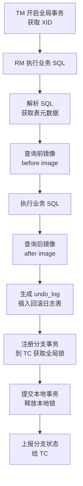
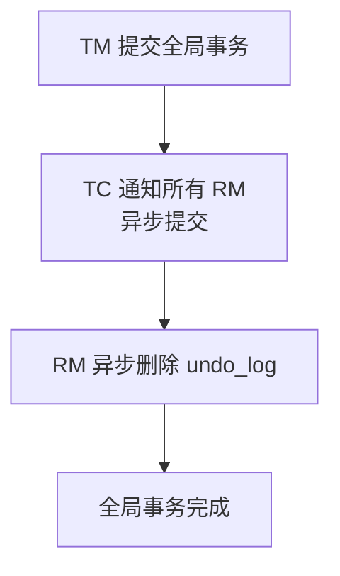
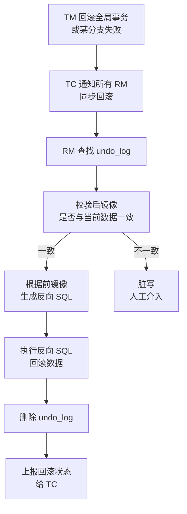

# Seata 分布式事务

> **文档说明**：系统讲解 Seata（Simple Extensible Autonomous Transaction Architecture）分布式事务框架的核心架构（TC/TM/RM）、四种事务模式（AT/TCC/Saga/XA）的原理与适用场景、AT 模式深入解析（一阶段/二阶段/undo_log/全局锁）、部署方式（单机/集群）、Spring Cloud Alibaba 集成、配置详解，以及生产级最佳实践和常见问题排查。
>
> **适用人群**：Java 后端开发工程师、全栈开发者、微服务架构师、需要解决分布式事务一致性问题的工程师
>
> **前置知识**：[[分布式事务 知识点系统梳理_优化版]]、[[SpringCloud-Alibaba组件体系]]、[[Spring事务管理与传播机制]]

---

## 一、概述

### 1. 什么是 Seata

**Seata**（Simple Extensible Autonomous Transaction Architecture）是阿里巴巴开源的分布式事务解决方案，致力于提供高性能和简单易用的分布式事务服务。Seata 提供了 AT、TCC、Saga 和 XA 四种事务模式，覆盖微服务架构下的各种分布式事务场景。

### 2. 核心架构

```mermaid
graph TB
    subgraph 事务协调者 TC
        A[Seata Server<br/>事务协调者]
    end

    subgraph 事务管理器 TM
        B[业务服务A<br/>@GlobalTransactional]
    end

    subgraph 资源管理器 RM
        C[业务服务B<br/>分支事务]
        D[业务服务C<br/>分支事务]
    end

    subgraph 存储
        E[(MySQL<br/>事务日志/undo_log/锁表)]
    end

    B -->|1. 开启全局事务| A
    A -->|2. 返回 XID| B
    B -->|3. 调用服务B (XID 传播)| C
    B -->|4. 调用服务C (XID 传播)| D
    C -->|5. 注册分支事务| A
    D -->|6. 注册分支事务| A
    C -->|7. 提交本地事务+undo_log| E
    D -->|8. 提交本地事务+undo_log| E
    B -->|9. 提交全局事务| A
    A -->|10. 通知分支提交/回滚| C
    A -->|11. 通知分支提交/回滚| D
    A --> E
```

### 3. 三大核心角色

| 角色 | 全称 | 说明 |
|------|------|------|
| **TC** | Transaction Coordinator | 事务协调者，Seata Server，维护全局事务和分支事务状态，驱动全局提交或回滚 |
| **TM** | Transaction Manager | 事务管理器，业务发起方，开启全局事务（@GlobalTransactional），提交或回滚 |
| **RM** | Resource Manager | 资源管理器，业务参与方，管理分支事务，与 TC 通信注册分支、上报状态、执行提交/回滚 |

### 4. 四种事务模式对比

| 模式 | 原理 | 一致性 | 性能 | 侵入性 | 适用场景 |
|------|------|--------|------|--------|---------|
| **AT** | 自动补偿，基于 undo_log 反向回滚 | 最终一致 | 高 | 低（注解即可） | 大多数微服务场景，基于关系型数据库 |
| **TCC** | Try-Confirm-Cancel，业务层面两阶段 | 最终一致 | 高 | 高（需写三个方法） | 高性能、非关系型数据库、资金类场景 |
| **Saga** | 长事务，每个步骤都有补偿操作 | 最终一致 | 中 | 中（需定义状态机） | 长事务、跨组织、多步骤业务流程 |
| **XA** | 基于数据库 XA 协议，强一致两阶段提交 | 强一致 | 低 | 低 | 强一致性要求、短事务、数据库支持 XA |

---

## 二、AT 模式深入解析

### 1. AT 模式概述

AT 模式是 Seata 默认的事务模式，基于关系型数据库，通过自动生成 undo_log 实现反向补偿，业务代码无侵入（只需加 @GlobalTransactional 注解）。

### 2. 一阶段：业务执行



**一阶段关键步骤**：
1. TM 开启全局事务，获取 XID
2. RM 拦截业务 SQL，解析表元数据
3. 查询修改前的数据（前镜像 before image）
4. 执行业务 SQL
5. 查询修改后的数据（后镜像 after image）
6. 生成 undo_log 并插入回滚日志表
7. 向 TC 注册分支事务，获取全局锁
8. 提交本地事务，释放本地锁
9. 上报分支状态给 TC

### 3. 二阶段：全局提交



**全局提交**：因为一阶段已经提交了本地事务，二阶段只需异步删除 undo_log，非常快。

### 4. 二阶段：全局回滚



**全局回滚**：根据 undo_log 的前镜像生成反向 SQL，恢复数据到修改前状态。

### 5. undo_log 表结构

```sql
-- 每个业务数据库都需要创建 undo_log 表
CREATE TABLE `undo_log` (
  `id` bigint(20) NOT NULL AUTO_INCREMENT,
  `branch_id` bigint(20) NOT NULL COMMENT '分支事务 ID',
  `xid` varchar(128) NOT NULL COMMENT '全局事务 ID',
  `context` varchar(128) NOT NULL COMMENT '上下文',
  `rollback_info` longblob NOT NULL COMMENT '回滚信息（前镜像/后镜像）',
  `log_status` int(11) NOT NULL COMMENT '日志状态：0=正常，1=防御性',
  `log_created` datetime NOT NULL COMMENT '创建时间',
  `log_modified` datetime NOT NULL COMMENT '修改时间',
  PRIMARY KEY (`id`),
  UNIQUE KEY `ux_undo_log` (`xid`, `branch_id`)
) ENGINE=InnoDB AUTO_INCREMENT=1 DEFAULT CHARSET=utf8 COMMENT='AT 模式回滚日志表';
```

### 6. 全局锁机制

Seata AT 模式使用全局锁保证写隔离：

```
事务A（全局事务）：
  1. 一阶段：获取全局锁 → 提交本地事务 → 释放本地锁（全局锁仍持有）
  2. 二阶段：提交/回滚 → 释放全局锁

事务B（全局事务或本地事务）：
  1. 尝试获取全局锁 → 被阻塞（事务A持有中）
  2. 等待事务A释放全局锁 → 获取锁 → 继续执行
```

**全局锁 vs 本地锁**：
| 锁类型 | 持有时间 | 说明 |
|--------|---------|------|
| **本地锁** | 一阶段提交后释放 | 数据库行锁，保证本地事务一致性 |
| **全局锁** | 二阶段完成后释放 | Seata TC 维护，保证全局事务写隔离 |

---

## 三、TCC 模式

### 1. TCC 概述

TCC（Try-Confirm-Cancel）是业务层面的两阶段提交，需要开发者手动实现三个方法：
- **Try**：预留资源（冻结金额、锁定库存）
- **Confirm**：确认执行（扣减冻结金额、扣减库存）
- **Cancel**：取消执行（释放冻结金额、释放库存）

### 2. 代码示例

```java
// 账户服务 TCC 接口
@LocalTCC
public interface AccountTCCService {

    // Try：冻结金额
    @TwoPhaseBusinessAction(name = "freezeAmount", commitMethod = "confirm", rollbackMethod = "cancel")
    boolean freezeAmount(
        @BusinessActionContextParameter(paramName = "userId") String userId,
        @BusinessActionContextParameter(paramName = "amount") BigDecimal amount
    );

    // Confirm：确认扣减
    boolean confirm(BusinessActionContext context);

    // Cancel：释放冻结
    boolean cancel(BusinessActionContext context);
}

@Service
public class AccountTCCServiceImpl implements AccountTCCService {

    @Autowired
    private AccountMapper accountMapper;

    @Override
    public boolean freezeAmount(String userId, BigDecimal amount) {
        // Try：冻结金额（从可用余额转到冻结余额）
        return accountMapper.freeze(userId, amount) > 0;
    }

    @Override
    public boolean confirm(BusinessActionContext context) {
        // Confirm：确认扣减（从冻结余额扣除）
        String userId = context.getActionContext("userId").toString();
        BigDecimal amount = new BigDecimal(context.getActionContext("amount").toString());
        return accountMapper.deductFreeze(userId, amount) > 0;
    }

    @Override
    public boolean cancel(BusinessActionContext context) {
        // Cancel：释放冻结（从冻结余额转回可用余额）
        String userId = context.getActionContext("userId").toString();
        BigDecimal amount = new BigDecimal(context.getActionContext("amount").toString());
        return accountMapper.unfreeze(userId, amount) > 0;
    }
}

// 业务调用
@Service
public class OrderService {

    @Autowired
    private AccountTCCService accountTCCService;

    @GlobalTransactional
    public void createOrder(Order order) {
        // 调用账户服务 TCC（自动传播 XID）
        accountTCCService.freezeAmount(order.getUserId(), order.getAmount());
        // 调用库存服务 TCC
        // inventoryTCCService.freezeStock(order.getProductId(), order.getCount());
        // 创建订单
        orderMapper.insert(order);
    }
}
```

### 3. TCC 注意事项

- [ ] **幂等性**：Confirm/Cancel 可能被重复调用，必须保证幂等
- [ ] **空回滚**：Try 未执行但 Cancel 被调用，需处理空回滚
- [ ] **悬挂**：Cancel 先于 Try 执行，Try 需判断是否已回滚
- [ ] **事务控制**：Try/Confirm/Cancel 各自是独立的本地事务

---

## 四、Saga 模式

### 1. Saga 概述

Saga 模式适用于长事务，将长事务拆分为多个本地事务，每个本地事务都有对应的补偿操作。如果某个步骤失败，按逆序执行已完成步骤的补偿操作。

### 2. 状态机定义

```json
{
  "Name": "createOrderSaga",
  "Comment": "创建订单 Saga 状态机",
  "StartState": "CreateOrder",
  "States": {
    "CreateOrder": {
      "Type": "ServiceTask",
      "ServiceName": "orderService",
      "ServiceMethod": "createOrder",
      "CompensateState": "RejectOrder",
      "Next": "DeductInventory",
      "Input": [
        {"Name": "order", "Type": "com.example.Order"}
      ],
      "Output": [
        {"Name": "orderId", "Type": "java.lang.Long"}
      ]
    },
    "DeductInventory": {
      "Type": "ServiceTask",
      "ServiceName": "inventoryService",
      "ServiceMethod": "deductStock",
      "CompensateState": "RestoreInventory",
      "Next": "DeductAccount",
      "Input": [
        {"Name": "productId", "Type": "java.lang.Long"},
        {"Name": "count", "Type": "java.lang.Integer"}
      ]
    },
    "DeductAccount": {
      "Type": "ServiceTask",
      "ServiceName": "accountService",
      "ServiceMethod": "deductAmount",
      "CompensateState": "RestoreAccount",
      "Next": "Succeed",
      "Input": [
        {"Name": "userId", "Type": "java.lang.String"},
        {"Name": "amount", "Type": "java.math.BigDecimal"}
      ]
    },
    "RejectOrder": {
      "Type": "ServiceTask",
      "ServiceName": "orderService",
      "ServiceMethod": "rejectOrder",
      "Next": "Fail"
    },
    "RestoreInventory": {
      "Type": "ServiceTask",
      "ServiceName": "inventoryService",
      "ServiceMethod": "restoreStock",
      "Next": "RejectOrder"
    },
    "RestoreAccount": {
      "Type": "ServiceTask",
      "ServiceName": "accountService",
      "ServiceMethod": "restoreAmount",
      "Next": "RestoreInventory"
    },
    "Succeed": {"Type": "Succeed"},
    "Fail": {"Type": "Fail"}
  }
}
```

### 3. 代码调用

```java
@Service
public class OrderSagaService {

    @Autowired
    private StateMachineEngine stateMachineEngine;

    public void createOrderSaga(Order order) {
        // 启动 Saga 状态机
        StateMachineInstance instance = stateMachineEngine.start(
            "createOrderSaga",  // 状态机名称
            null,                // 业务 key
            Map.of("order", order)  // 输入参数
        );
    }
}
```

---

## 五、XA 模式

### 1. XA 概述

XA 模式基于数据库 XA 协议（两阶段提交），由 Seata 协调各分支事务的 XA 资源，实现强一致性。

### 2. XA 流程

```
一阶段（Prepare）：
  TM 开启全局事务 → RM 执行 XA Start → 执行业务 SQL → XA End → XA Prepare → 上报 TC

二阶段（Commit/Rollback）：
  所有分支 Prepare 成功 → TC 通知所有分支 XA Commit
  任一分支 Prepare 失败 → TC 通知所有分支 XA Rollback
```

### 3. XA 特点

- **强一致性**：基于数据库 XA 协议，保证全局事务的 ACID
- **性能低**：一阶段 Prepare 后资源被锁定，直到二阶段完成，并发度低
- **无侵入**：业务代码不需修改，只需配置 XA 数据源
- **数据库支持**：需要数据库支持 XA（MySQL、Oracle、PostgreSQL 等）

---

## 六、部署

### 1. Seata Server 单机部署

```bash
# 1. 下载
wget https://github.com/seata/seata/releases/download/v1.7.0/seata-server-1.7.0.tar.gz
tar -xzf seata-server-1.7.0.tar.gz
cd seata

# 2. 初始化数据库（MySQL）
# 执行 conf/db/seata.sql（创建 global_table、branch_table、lock_table）
mysql -u root -p < conf/db/seata.sql

# 3. 修改配置 conf/application.yml
# server:
#   port: 7091
# spring:
#   application:
#     name: seata-server
# console:
#   user:
#     username: seata
#     password: seata
# seata:
#   config:
#     type: nacos  # 配置中心：nacos / file / consul / apollo
#     nacos:
#       server-addr: localhost:8848
#       namespace: seata
#       group: SEATA_GROUP
#   registry:
#     type: nacos  # 注册中心：nacos / eureka / consul / zk
#     nacos:
#       server-addr: localhost:8848
#       namespace: seata
#       application: seata-server
#   store:
#     mode: db  # 存储模式：db / file / redis
#     db:
#       datasource: druid
#       db-type: mysql
#       driver-class-name: com.mysql.cj.jdbc.Driver
#       url: jdbc:mysql://localhost:3306/seata?useUnicode=true&rewriteBatchedStatements=true
#       user: root
#       password: root

# 4. 启动
sh bin/seata-server.sh
# Windows
bin/seata-server.bat

# 5. 访问控制台
# http://localhost:7091
# 默认账号：seata / seata
```

### 2. Seata Server 集群部署

```bash
# 至少 3 节点，共享同一数据库
# 节点1
sh bin/seata-server.sh -p 7091 -n 1

# 节点2
sh bin/seata-server.sh -p 7092 -n 2

# 节点3
sh bin/seata-server.sh -p 7093 -n 3

# 注册到 Nacos，客户端通过 Nacos 发现 Seata Server 集群
# Nginx 负载均衡控制台
```

### 3. 数据库表结构

```sql
-- Seata Server 全局事务表
CREATE TABLE `global_table` (
  `xid` varchar(128) NOT NULL,
  `transaction_id` bigint(20) DEFAULT NULL,
  `status` tinyint(4) NOT NULL,
  `application_id` varchar(32) DEFAULT NULL,
  `transaction_service_group` varchar(32) DEFAULT NULL,
  `transaction_name` varchar(128) DEFAULT NULL,
  `timeout` int(11) DEFAULT NULL,
  `begin_time` bigint(20) DEFAULT NULL,
  `application_data` varchar(2000) DEFAULT NULL,
  `gmt_create` datetime DEFAULT NULL,
  `gmt_modified` datetime DEFAULT NULL,
  PRIMARY KEY (`xid`),
  KEY `idx_status_gmt_modified` (`status`, `gmt_modified`),
  KEY `idx_transaction_id` (`transaction_id`)
) ENGINE=InnoDB DEFAULT CHARSET=utf8;

-- 分支事务表
CREATE TABLE `branch_table` (
  `branch_id` bigint(20) NOT NULL,
  `xid` varchar(128) NOT NULL,
  `transaction_id` bigint(20) DEFAULT NULL,
  `resource_group_id` varchar(32) DEFAULT NULL,
  `resource_id` varchar(256) DEFAULT NULL,
  `branch_type` varchar(8) DEFAULT NULL,
  `status` tinyint(4) DEFAULT NULL,
  `client_id` varchar(64) DEFAULT NULL,
  `application_data` varchar(2000) DEFAULT NULL,
  `gmt_create` datetime(6) DEFAULT NULL,
  `gmt_modified` datetime(6) DEFAULT NULL,
  PRIMARY KEY (`branch_id`),
  KEY `idx_xid` (`xid`)
) ENGINE=InnoDB DEFAULT CHARSET=utf8;

-- 全局锁表
CREATE TABLE `lock_table` (
  `row_key` varchar(128) NOT NULL,
  `xid` varchar(96) DEFAULT NULL,
  `transaction_id` bigint(20) DEFAULT NULL,
  `branch_id` bigint(20) NOT NULL,
  `resource_id` varchar(256) DEFAULT NULL,
  `table_name` varchar(32) DEFAULT NULL,
  `pk` varchar(36) DEFAULT NULL,
  `gmt_create` datetime DEFAULT NULL,
  `gmt_modified` datetime DEFAULT NULL,
  PRIMARY KEY (`row_key`),
  KEY `idx_branch_id` (`branch_id`)
) ENGINE=InnoDB DEFAULT CHARSET=utf8;
```

---

## 七、Spring Cloud 集成

### 1. Maven 依赖

```xml
<!-- Seata Spring Cloud Starter -->
<dependency>
    <groupId>com.alibaba.cloud</groupId>
    <artifactId>spring-cloud-starter-alibaba-seata</artifactId>
</dependency>
```

### 2. 配置

```yaml
# application.yml
spring:
  application:
    name: order-service
  cloud:
    alibaba:
      seata:
        tx-service-group: default_tx_group  # 事务分组（需与 Seata Server 配置一致）

seata:
  enabled: true
  application-id: ${spring.application.name}
  tx-service-group: default_tx_group
  # 注册中心（发现 Seata Server）
  registry:
    type: nacos
    nacos:
      server-addr: localhost:8848
      namespace: seata
      application: seata-server
      group: SEATA_GROUP
  # 配置中心（从 Nacos 读取 Seata 配置）
  config:
    type: nacos
    nacos:
      server-addr: localhost:8848
      namespace: seata
      group: SEATA_GROUP
  # AT 模式数据源代理
  data-source-proxy-mode: AT
```

### 3. 业务代码

```java
@Service
public class OrderService {

    @Autowired
    private OrderMapper orderMapper;

    @Autowired
    private InventoryFeignClient inventoryFeignClient;

    @Autowired
    private AccountFeignClient accountFeignClient;

    // 开启全局事务（TM）
    @GlobalTransactional(name = "createOrder", rollbackFor = Exception.class)
    public void createOrder(Order order) {
        // 1. 创建订单（本地事务，RM）
        orderMapper.insert(order);

        // 2. 扣减库存（远程调用，自动传播 XID）
        inventoryFeignClient.deductStock(order.getProductId(), order.getCount());

        // 3. 扣减账户（远程调用，自动传播 XID）
        accountFeignClient.deductAmount(order.getUserId(), order.getAmount());

        // 任一环节抛出异常，全局事务回滚
    }
}
```

### 4. XID 传播

Seata 通过拦截器自动在 Feign/RestTemplate 调用中传播 XID：

```
XID 通过 HTTP Header（tx_xid）传播
服务A（TM）→ HTTP Header: tx_xid=192.168.1.10:8091:123456 → 服务B（RM）
服务B 解析 XID → 加入全局事务 → 注册分支事务
```

---

## 八、生产最佳实践

### 1. 模式选择

| 场景 | 推荐模式 | 原因 |
|------|---------|------|
| 大多数微服务 CRUD | AT | 无侵入、性能高、开发快 |
| 资金/账户类高一致性 | TCC | 业务可控、性能高、避免脏写 |
| 长事务/跨组织流程 | Saga | 支持长事务、补偿灵活 |
| 强一致性短事务 | XA | 强一致、无侵入 |
| 非关系型数据库（Redis/Mongo） | TCC | AT 不支持非关系型数据库 |

### 2. AT 模式注意事项

- [ ] **必须有主键**：AT 模式需要主键定位数据，不支持无主键表
- [ ] **不支持全表更新**：UPDATE/DELETE 必须有 WHERE 条件
- [ ] **undo_log 表**：每个业务库都必须创建 undo_log 表
- [ ] **避免大事务**：全局事务时间不宜过长，否则锁定资源影响并发
- [ ] **事务超时**：合理设置全局事务超时时间（默认 60 秒）
- [ ] **避免跨库 JOIN**：AT 模式不支持跨库事务中的 JOIN 查询
- [ ] **SQL 解析**：复杂 SQL 可能解析失败，尽量使用简单 SQL

### 3. 高可用部署

- [ ] **TC 集群**：生产环境至少 3 节点 Seata Server 集群
- [ ] **数据库高可用**：Seata 存储数据库主从或集群
- [ ] **注册中心**：使用 Nacos 集群做服务发现
- [ ] **配置中心**：使用 Nacos 集群管理配置
- [ ] **监控告警**：监控全局事务成功率、回滚率、TC 节点状态

### 4. 性能优化

- [ ] **合理设置超时**：避免事务长时间占用全局锁
- [ ] **减少远程调用**：全局事务内尽量减少跨服务调用
- [ ] **异步化**：非核心逻辑异步处理，不纳入全局事务
- [ ] **批量操作**：尽量批量操作，减少分支事务数量
- [ ] **数据库优化**：合理索引，避免慢 SQL 导致事务超时

---

## 九、常见问题与排查

| 问题 | 原因 | 解决方案 |
|------|------|---------|
| **Could not register global transaction** | Seata Server 不可达 / 注册中心配置错误 / 事务分组不匹配 | 检查 Seata Server 状态、Nacos 配置、tx-service-group |
| **分支事务注册失败** | 数据源未被代理 / undo_log 表不存在 / 数据库连接失败 | 检查 DataSourceProxy、undo_log 表、数据库连接 |
| **全局锁获取超时** | 其他全局事务持有锁 / 事务超时 / 死锁 | 检查是否有长事务、优化事务、设置合理超时 |
| **回滚失败（脏写）** | 数据被其他事务修改 / undo_log 后镜像不匹配 | 检查是否有本地事务修改数据、人工介入处理 |
| **XID 未传播** | Feign 拦截器未生效 / 自定义 HTTP 客户端 / 跨线程 | 检查 Feign 配置、使用默认客户端、跨线程手动传递 XID |
| **AT 模式 SQL 解析失败** | SQL 过于复杂 / 不支持的语法 / 特殊字符 | 简化 SQL、使用 Seata 支持的语法、检查特殊字符 |
| **undo_log 表膨胀** | 二阶段提交未及时清理 / 异常事务未清理 | 检查 TC 是否正常、定期清理异常 undo_log、优化事务 |
| **全局事务超时** | 业务逻辑慢 / 远程调用超时 / 数据库慢查询 | 优化业务、设置合理超时、检查慢 SQL |
| **TCC 空回滚** | Try 未执行但 Cancel 被调用 | Cancel 方法判断 Try 是否已执行，处理空回滚 |
| **TCC 悬挂** | Cancel 先于 Try 执行 | Try 方法判断是否已 Cancel，避免悬挂 |
| **Saga 状态机启动失败** | 状态机定义错误 / 服务方法不存在 / 参数不匹配 | 检查状态机 JSON、服务方法签名、参数类型 |
| **XA 模式不支持** | 数据库不支持 XA / 驱动版本过低 / 未启用 XA | 检查数据库 XA 支持、升级驱动、启用 XA |
| **Seata Server 启动失败** | 数据库连接失败 / 端口被占用 / 配置错误 | 检查数据库配置、7091 端口、application.yml |
| **客户端连接 TC 失败** | 网络不通 / 注册中心未注册 / 防火墙 | 检查网络、Nacos 服务列表、防火墙端口 |
| **全局事务状态异常** | TC 宕机 / 网络分区 / 事务日志丢失 | 检查 TC 集群、恢复事务、人工补偿 |

---

## 十、关联笔记

### 分布式
- [[分布式事务 知识点系统梳理_优化版]] · [[分布式锁知识点系统梳理_优化版]] · [[分布式ID生成方案]]
- [[Raft共识算法详解]] · [[ZooKeeper核心原理与实战]] · [[分布式任务调度实战]]

### 微服务
- [[SpringCloud-Alibaba组件体系]] · [[微服务核心组件知识点系统梳理_优化版]] · [[Nacos-注册中心与配置中心]]
- [[Sentinel-流量控制与熔断]] · [[Gateway-网关路由与鉴权]] · [[XXL-Job-分布式任务调度]]

### Spring 生态
- [[Spring事务管理与传播机制]] · [[SpringBoot-自动装配原理]] · [[Spring-IOCAOP核心机制]]
- [[SpringBoot-Web层设计]] · [[SpringSecurity-认证授权]]

### 数据库
- [[MySQL-事务与锁机制]] · [[数据库优化知识点系统梳理_优化版]] · [[分库分表实战指南]]
- [[Redis缓存设计与优化]]

### 架构
- [[高可用架构设计]] · [[高并发系统设计案例]] · [[微服务架构设计模式]]
- [[领域驱动设计DDD核心概念]]

### 导航
- [[MOC-后端开发]] · [[MOC-分布式与中间件]] · [[全栈+AI工程双轨融合学习路线图]]

> **学习路径建议**：先掌握 [[Spring事务管理与传播机制]] 本地事务 → 学习 [[分布式事务 知识点系统梳理_优化版]] 分布式事务理论 → 深入本文 Seata 分布式事务实战 → 实践 [[Nacos-注册中心与配置中心]] 微服务基础 → 研究 [[高可用架构设计]] 数据一致性 → 应用于 [[高并发系统设计案例]] 生产分布式事务。
