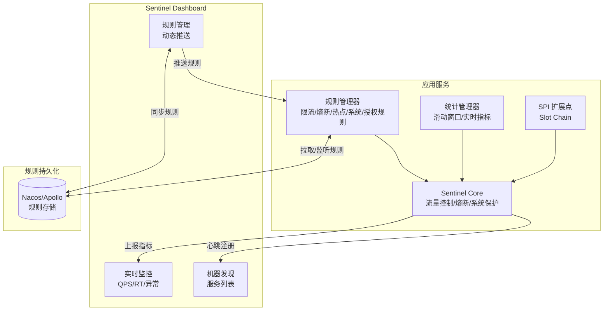
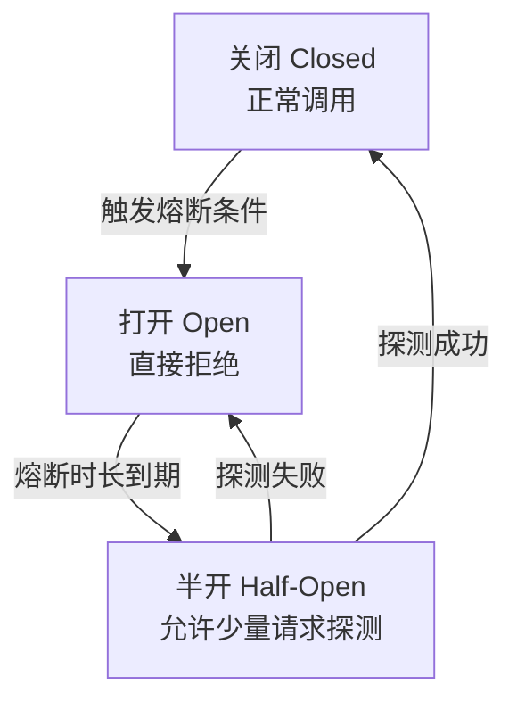

# Sentinel 流量控制与熔断

> **文档说明**：系统讲解 Sentinel（分布式系统的流量防卫兵）的核心架构、流量控制（QPS/线程数/关联/链路）、熔断降级（慢调用/异常比例/异常数）、热点参数限流、系统自适应保护、授权规则、Sentinel Dashboard 部署与使用、Spring Cloud Alibaba 集成、规则持久化（Nacos），以及生产级最佳实践和常见问题排查。
>
> **适用人群**：Java 后端开发工程师、全栈开发者、微服务架构师、需要构建高可用流量防护体系的工程师
>
> **前置知识**：[[SpringCloud-Alibaba组件体系]]、[[微服务核心组件知识点系统梳理_优化版]]、[[Nacos-注册中心与配置中心]]

---

## 一、概述

### 1. 什么是 Sentinel

**Sentinel**（分布式系统的流量防卫兵）是阿里巴巴开源的面向分布式服务架构的流量控制组件，以流量为切入点，从流量控制、熔断降级、系统自适应保护等多个维度保护服务的稳定性。

### 2. 核心特性

| 特性 | 说明 |
|------|------|
| **流量控制** | 支持 QPS、线程数、关联流量、链路流量等多种限流模式 |
| **熔断降级** | 慢调用比例、异常比例、异常数三种熔断策略 |
| **热点参数限流** | 针对热点参数（如商品 ID、用户 ID）的精细化限流 |
| **系统自适应保护** | 基于系统 Load、CPU、RT、入口 QPS、线程数的系统级保护 |
| **授权规则** | 黑白名单控制，限制调用来源 |
| **控制台** | 提供 Web 管理界面，动态配置规则、实时监控 |
| **多语言支持** | Java、Go、C++ 等多语言客户端 |
| **云原生** | 支持 Service Mesh、Envoy 集成 |
| **规则持久化** | 支持 Nacos、Apollo、ZooKeeper、Redis 等持久化 |

### 3. Sentinel vs Hystrix vs Resilience4j

| 维度 | Sentinel | Hystrix | Resilience4j |
|------|----------|---------|--------------|
| **流量控制** | ✅ 丰富（QPS/线程/关联/链路/热点） | ❌ 仅线程池隔离 | ⚠️ 简单 RateLimiter |
| **熔断降级** | ✅ 慢调用/异常比例/异常数 | ✅ 异常比例 | ✅ 多种策略 |
| **系统保护** | ✅ 自适应系统保护 | ❌ | ❌ |
| **热点限流** | ✅ 参数级限流 | ❌ | ❌ |
| **控制台** | ✅ 丰富 | ⚠️ 简单 Dashboard | ❌ |
| **规则动态配置** | ✅ 实时推送 | ❌ 需重启 | ⚠️ 需配置 |
| **维护状态** | ⭐⭐⭐⭐⭐ 活跃 | ❌ 停止维护 | ⭐⭐⭐⭐ 活跃 |
| **隔离策略** | 信号量（轻量） | 线程池（重量） | 信号量 |

### 4. 架构



### 5. 核心概念

| 概念 | 说明 |
|------|------|
| **资源（Resource）** | Sentinel 保护的基本单位，可以是方法、URL、服务 |
| **规则（Rule）** | 流量控制规则、熔断降级规则、热点规则、系统规则、授权规则 |
| **Slot Chain** | Sentinel 的处理链，由多个 Slot 组成，依次执行校验 |
| **Context** | 调用上下文，记录调用链路、入口、来源 |
| **Entry** | 资源入口，通过 SphU.entry() 获取 |
| **Node** | 统计节点，记录资源的实时指标（QPS、RT、异常数） |
| **滑动窗口** | Sentinel 的统计机制，基于滑动窗口实时统计指标 |

---

## 二、部署

### 1. Sentinel Dashboard 部署

```bash
# 1. 下载
wget https://github.com/alibaba/Sentinel/releases/download/1.8.6/sentinel-dashboard-1.8.6.jar

# 2. 启动
java -Dserver.port=8080 \
     -Dcsp.sentinel.dashboard.server=localhost:8080 \
     -Dproject.name=sentinel-dashboard \
     -jar sentinel-dashboard-1.8.6.jar

# 3. 访问控制台
# http://localhost:8080
# 默认账号：sentinel / sentinel

# 4. 生产环境参数
java -Dserver.port=8080 \
     -Dcsp.sentinel.dashboard.server=sentinel.example.com:8080 \
     -Dauth.username=admin \
     -Dauth.password=your-password \
     -Dsentinel.dashboard.auth.username=admin \
     -Dsentinel.dashboard.auth.password=your-password \
     -jar sentinel-dashboard-1.8.6.jar
```

### 2. 集群部署

```bash
# Sentinel Dashboard 本身无状态，可多实例部署 + Nginx 负载均衡
# 注意：客户端需配置所有 Dashboard 地址或通过 Nginx 统一入口

# Nginx 配置
# upstream sentinel_dashboard {
#     server 192.168.1.10:8080;
#     server 192.168.1.11:8080;
# }
# server {
#     listen 80;
#     location / {
#         proxy_pass http://sentinel_dashboard;
#     }
# }
```

---

## 三、Spring Cloud Alibaba 集成

### 1. Maven 依赖

```xml
<!-- Sentinel 核心 -->
<dependency>
    <groupId>com.alibaba.cloud</groupId>
    <artifactId>spring-cloud-starter-alibaba-sentinel</artifactId>
</dependency>

<!-- Sentinel 对 Feign 的支持 -->
<dependency>
    <groupId>com.alibaba.cloud</groupId>
    <artifactId>spring-cloud-starter-alibaba-sentinel</artifactId>
</dependency>

<!-- Sentinel 对 Gateway 的支持 -->
<dependency>
    <groupId>com.alibaba.cloud</groupId>
    <artifactId>spring-cloud-alibaba-sentinel-gateway</artifactId>
</dependency>

<!-- Sentinel 规则持久化到 Nacos -->
<dependency>
    <groupId>com.alibaba.csp</groupId>
    <artifactId>sentinel-datasource-nacos</artifactId>
</dependency>
```

### 2. 配置

```yaml
spring:
  cloud:
    sentinel:
      transport:
        dashboard: localhost:8080       # Sentinel Dashboard 地址
        port: 8719                       # 客户端通信端口（默认 8719，冲突自动+1）
        heartbeat-interval-ms: 10000     # 心跳间隔
      eager: true                         # 饥饿加载（立即初始化，不等待首次请求）
      web-context-unify: false           # 是否统一 Web 上下文（false 支持链路限流）
      filter:
        enabled: true                     # 启用 Sentinel Web Filter
      # 规则持久化（Nacos）
      datasource:
        flow:
          nacos:
            server-addr: localhost:8848
            dataId: ${spring.application.name}-flow-rules
            groupId: SENTINEL_GROUP
            rule-type: flow               # 限流规则
        degrade:
          nacos:
            server-addr: localhost:8848
            dataId: ${spring.application.name}-degrade-rules
            groupId: SENTINEL_GROUP
            rule-type: degrade            # 熔断规则
        param-flow:
          nacos:
            server-addr: localhost:8848
            dataId: ${spring.application.name}-param-flow-rules
            groupId: SENTINEL_GROUP
            rule-type: param-flow         # 热点参数规则
        system:
          nacos:
            server-addr: localhost:8848
            dataId: ${spring.application.name}-system-rules
            groupId: SENTINEL_GROUP
            rule-type: system             # 系统规则
        authority:
          nacos:
            server-addr: localhost:8848
            dataId: ${spring.application.name}-authority-rules
            groupId: SENTINEL_GROUP
            rule-type: authority          # 授权规则

# 开启 Feign 对 Sentinel 的支持
feign:
  sentinel:
    enabled: true
```

---

## 四、流量控制

### 1. 限流模式

| 模式 | 说明 | 适用场景 |
|------|------|---------|
| **直接** | 直接限制当前资源的 QPS/线程数 | 最常用，保护自身接口 |
| **关联** | 当关联资源达到阈值时，限制当前资源 | 保护下游，如读接口限流保护写接口 |
| **链路** | 只限制从指定链路进入的流量 | 精细化控制，如只限制从某个入口调用的流量 |

### 2. 限流阈值类型

| 类型 | 说明 |
|------|------|
| **QPS** | 每秒请求数，超过阈值直接拒绝 |
| **线程数** | 并发线程数，超过阈值拒绝（防止慢调用占满线程） |

### 3. 流控效果

| 效果 | 说明 | 适用场景 |
|------|------|---------|
| **快速失败** | 超过阈值直接抛出 FlowException（默认） | 大多数场景 |
| **Warm Up（预热）** | 冷启动，阈值从低到高逐步增加到设定值 | 秒杀系统启动，防止瞬间压垮 |
| **排队等待** | 匀速通过，请求排队等待，超时则拒绝 | 消息处理、请求间隔均匀的场景 |

### 4. 代码示例

```java
@RestController
@RequestMapping("/api/users")
public class UserController {

    // 方式1：注解方式（推荐）
    @SentinelResource(value = "getUser", blockHandler = "getUserBlockHandler")
    @GetMapping("/{id}")
    public User getUser(@PathVariable Long id) {
        return userService.getUser(id);
    }

    // 限流降级处理
    public User getUserBlockHandler(Long id, BlockException ex) {
        return User.builder()
            .id(id)
            .name("系统繁忙，请稍后重试")
            .build();
    }

    // 方式2：手动 API 方式
    @GetMapping("/list")
    public List<User> listUsers() {
        Entry entry = null;
        try {
            entry = SphU.entry("listUsers");
            return userService.listUsers();
        } catch (BlockException ex) {
            // 限流/熔断处理
            return Collections.emptyList();
        } finally {
            if (entry != null) {
                entry.exit();
            }
        }
    }

    // 方式3：关联限流（读接口保护写接口）
    @SentinelResource(value = "readUsers", blockHandler = "readBlockHandler")
    @GetMapping("/read")
    public List<User> readUsers() {
        return userService.listUsers();
    }

    @SentinelResource(value = "writeUsers")
    @PostMapping("/write")
    public void writeUser(@RequestBody User user) {
        userService.saveUser(user);
    }
    // 规则配置：资源 readUsers，关联资源 writeUsers，当 writeUsers QPS > 100 时限流 readUsers
}
```

### 5. Feign 集成限流

```java
@FeignClient(name = "order-service", fallback = OrderFeignFallback.class)
public interface OrderFeignClient {

    @GetMapping("/api/orders/{id}")
    @SentinelResource(value = "getOrder", fallback = "getOrderFallback")
    Order getOrder(@PathVariable("id") Long id);
}

@Component
public class OrderFeignFallback implements OrderFeignClient {
    @Override
    public Order getOrder(Long id) {
        return Order.builder().id(id).status("服务降级").build();
    }
}
```

---

## 五、熔断降级

### 1. 熔断策略

| 策略 | 说明 | 触发条件 |
|------|------|---------|
| **慢调用比例** | 慢调用（RT > 阈值）占比超过阈值时熔断 | 最小请求数 ≥ 5 且慢调用比例 > 阈值 |
| **异常比例** | 异常数占比超过阈值时熔断 | 最小请求数 ≥ 5 且异常比例 > 阈值 |
| **异常数** | 异常数超过阈值时熔断 | 异常数 > 阈值（1 分钟内） |

### 2. 熔断状态机



| 状态 | 说明 |
|------|------|
| **Closed（关闭）** | 正常状态，请求正常通过，统计指标 |
| **Open（打开）** | 熔断状态，请求直接拒绝（快速失败） |
| **Half-Open（半开）** | 熔断超时后，允许少量请求探测，成功则关闭，失败则继续打开 |

### 3. 代码示例

```java
@Service
public class OrderService {

    // 慢调用比例熔断：RT > 1000ms 的调用占比 > 50% 时熔断，熔断时长 10 秒
    @SentinelResource(
        value = "createOrder",
        fallback = "createOrderFallback",
        blockHandler = "createOrderBlockHandler"
    )
    public Order createOrder(OrderRequest request) {
        // 业务逻辑（可能慢调用或异常）
        return orderRepository.save(request);
    }

    // 降级处理（业务异常或熔断时调用）
    public Order createOrderFallback(OrderRequest request, Throwable ex) {
        log.warn("创建订单降级: " + ex.getMessage());
        return Order.builder()
            .status("PENDING")
            .message("系统繁忙，订单已进入排队")
            .build();
    }

    // 限流处理（被限流时调用）
    public Order createOrderBlockHandler(OrderRequest request, BlockException ex) {
        return Order.builder()
            .status("REJECTED")
            .message("请求过于频繁，请稍后重试")
            .build();
    }
}
```

### 4. 规则配置示例（Nacos JSON）

```json
[
  {
    "resource": "createOrder",
    "grade": 0,
    "count": 1000,
    "slowRatioThreshold": 0.5,
    "timeWindow": 10,
    "minRequestAmount": 5
  }
]
```

| 字段 | 说明 |
|------|------|
| `grade` | 熔断策略：0=慢调用比例，1=异常比例，2=异常数 |
| `count` | 慢调用 RT 阈值（ms）/ 异常比例阈值 / 异常数阈值 |
| `slowRatioThreshold` | 慢调用比例阈值（grade=0 时有效） |
| `timeWindow` | 熔断时长（秒） |
| `minRequestAmount` | 最小请求数（低于此数不触发熔断） |

---

## 六、热点参数限流

### 1. 概述

热点参数限流针对资源的某个参数进行限流，如商品 ID、用户 ID，防止热点参数（如爆款商品）压垮系统。

### 2. 代码示例

```java
@RestController
@RequestMapping("/api/products")
public class ProductController {

    // 热点参数限流：对第一个参数（productId）限流
    @SentinelResource(value = "getProduct", blockHandler = "getProductBlockHandler")
    @GetMapping("/{productId}")
    public Product getProduct(@PathVariable Long productId) {
        return productService.getProduct(productId);
    }

    public Product getProductBlockHandler(Long productId, BlockException ex) {
        return Product.builder()
            .id(productId)
            .name("商品访问过于频繁，请稍后重试")
            .build();
    }

    // 热点参数 + 例外项：普通商品 QPS 限制 10，指定商品（如 1001）QPS 限制 100
    @SentinelResource(value = "getProductHot", blockHandler = "hotBlockHandler")
    @GetMapping("/hot/{productId}")
    public Product getProductHot(@PathVariable Long productId) {
        return productService.getProduct(productId);
    }
}
```

### 3. 规则配置

```json
[
  {
    "resource": "getProduct",
    "paramIdx": 0,
    "count": 10,
    "grade": 1,
    "durationInSec": 1,
    "paramFlowItemList": [
      {
        "object": "1001",
        "classType": "java.lang.Long",
        "count": 100
      },
      {
        "object": "1002",
        "classType": "java.lang.Long",
        "count": 50
      }
    ]
  }
]
```

| 字段 | 说明 |
|------|------|
| `paramIdx` | 限流参数索引（第几个参数，从 0 开始） |
| `count` | 默认限流阈值 |
| `paramFlowItemList` | 例外项（指定参数值使用不同阈值） |
| `classType` | 参数类型（java.lang.Long / String / Integer 等） |

---

## 七、系统自适应保护

### 1. 概述

系统自适应保护从应用整体维度控制入口流量，基于系统 Load、CPU 使用率、平均 RT、入口 QPS、并发线程数等指标，自动调整流量，保护系统不被压垮。

### 2. 系统规则

| 指标 | 说明 | 推荐阈值 |
|------|------|---------|
| **Load** | 系统负载（Linux 有效） | CPU 核数 × 0.8 |
| **CPU 使用率** | CPU 使用率 | 0.7（70%） |
| **平均 RT** | 所有入口流量的平均响应时间 | 根据业务设置 |
| **入口 QPS** | 所有入口资源的 QPS 总和 | 根据容量设置 |
| **并发线程数** | 所有入口资源的并发线程数总和 | 根据线程池设置 |

### 3. 规则配置

```json
[
  {
    "highestSystemLoad": 4.0,
    "highestCpuUsage": 0.7,
    "avgRt": 100,
    "qps": 1000,
    "maxThread": 200
  }
]
```

---

## 八、授权规则（黑白名单）

### 1. 概述

授权规则通过调用来源（Origin）控制资源访问，支持白名单（只允许）和黑名单（只拒绝）。

### 2. 代码示例

```java
// 配置调用来源解析器
@Component
public class RequestOriginParser implements RequestOriginParser {
    @Override
    public String parseOrigin(HttpServletRequest request) {
        // 从请求头或参数获取调用来源
        String origin = request.getHeader("X-Origin");
        return origin != null ? origin : "unknown";
    }
}
```

### 3. 规则配置

```json
[
  {
    "resource": "getUser",
    "limitApp": "app1,app2",
    "strategy": 0
  }
]
```

| 字段 | 说明 |
|------|------|
| `limitApp` | 调用来源列表（逗号分隔） |
| `strategy` | 0=白名单（只允许 limitApp 中的来源），1=黑名单（拒绝 limitApp 中的来源） |

---

## 九、规则持久化

### 1. 为什么需要持久化

Sentinel Dashboard 配置的规则默认存储在内存中，应用重启后规则丢失。生产环境必须持久化规则到 Nacos/Apollo 等配置中心。

### 2. Nacos 持久化配置

```yaml
# 应用配置（客户端拉取规则）
spring:
  cloud:
    sentinel:
      datasource:
        flow:
          nacos:
            server-addr: localhost:8848
            namespace: dev
            dataId: user-service-flow-rules
            groupId: SENTINEL_GROUP
            rule-type: flow
        degrade:
          nacos:
            server-addr: localhost:8848
            dataId: user-service-degrade-rules
            groupId: SENTINEL_GROUP
            rule-type: degrade
```

### 3. Nacos 中配置规则

在 Nacos 控制台创建配置：
- DataId: `user-service-flow-rules`
- Group: `SENTINEL_GROUP`
- 格式: JSON
- 内容: 规则数组

```json
[
  {
    "resource": "/api/users/{id}",
    "limitApp": "default",
    "grade": 1,
    "count": 100,
    "strategy": 0,
    "controlBehavior": 0,
    "clusterMode": false
  }
]
```

---

## 十、生产最佳实践

### 1. 规则配置规范

- [ ] **核心接口必配**：所有对外接口配置限流规则，防止流量突增
- [ ] **下游依赖必配熔断**：所有外部调用（DB、Redis、HTTP、MQ）配置熔断
- [ ] **阈值合理设置**：基于压测结果设置阈值，不要凭感觉
- [ ] **分级限流**：网关层、服务层、接口层多级限流
- [ ] **降级兜底**：每个限流/熔断都要有降级处理，不能直接抛异常给用户
- [ ] **规则持久化**：生产环境必须持久化规则到 Nacos/Apollo
- [ ] **监控告警**：监控限流次数、熔断次数、RT、异常率

### 2. 限流阈值参考

| 接口类型 | QPS 阈值参考 | 说明 |
|---------|-------------|------|
| 静态资源 | 1000+ | CDN 缓存，高阈值 |
| 查询接口 | 100-500 | 根据 DB 性能 |
| 写入接口 | 50-200 | 根据 DB 写入性能 |
| 复杂查询 | 10-50 | 慢查询，低阈值 |
| 外部调用 | 20-100 | 根据下游容量 |

### 3. 常见降级策略

| 场景 | 降级策略 |
|------|---------|
| 查询接口 | 返回缓存数据 / 默认值 / 空列表 |
| 写入接口 | 异步写入 MQ / 返回受理成功 |
| 外部调用 | 返回兜底数据 / 跳过非核心逻辑 |
| 非核心功能 | 直接关闭功能（如推荐、评论） |

---

## 十一、常见问题与排查

| 问题 | 原因 | 解决方案 |
|------|------|---------|
| **控制台看不到服务** | 客户端未注册 / Dashboard 地址错误 / 网络不通 | 检查 spring.cloud.sentinel.transport.dashboard、网络、eager 加载 |
| **规则不生效** | 资源名不匹配 / 规则未持久化 / 应用未重启 | 检查 @SentinelResource value、规则持久化、客户端日志 |
| **限流不准确** | QPS 统计延迟 / 集群限流未配置 | 单机限流有误差，精确限流需集群限流 |
| **熔断不触发** | 最小请求数未达到 / 阈值设置过高 / 异常未被统计 | 检查 minRequestAmount、count 阈值、异常是否被 catch |
| **@SentinelResource 不生效** | 同类调用（this 调用）/ 注解未被 AOP 拦截 | 通过代理调用、检查 AOP 配置 |
| **Feign 降级不生效** | 未开启 feign.sentinel.enabled / fallback 类未注册 | 开启配置、检查 fallback 类 @Component |
| **规则推送后延迟** | Nacos 推送延迟 / 客户端拉取间隔 | 检查 Nacos 配置、客户端日志 |
| **热点参数限流不生效** | 参数索引错误 / 参数类型不匹配 / 未加 @SentinelResource | 检查 paramIdx、classType、注解 |
| **系统保护不生效** | 非 Linux 系统（Load 无效）/ 阈值设置过高 | Linux 系统有效、检查阈值 |
| **网关限流不生效** | 未引入 sentinel-gateway 依赖 / 路由配置错误 | 检查依赖、路由 ID、资源名 |
| **集群限流不生效** | 未部署 Token Server / 集群配置错误 | 部署 Sentinel 集群限流服务、检查 clusterMode |
| **应用启动慢** | Sentinel 初始化慢 / 规则拉取慢 | 开启 eager、检查 Nacos 连接 |
| **内存占用高** | 统计节点过多 / 规则过多 | 优化资源名、清理无用规则 |
| **RT 统计异常** | 慢调用未正确统计 / 异步调用问题 | 检查 entry.exit() 是否在 finally 中、异步处理 |

---

## 十二、关联笔记

### 微服务
- [[SpringCloud-Alibaba组件体系]] · [[微服务核心组件知识点系统梳理_优化版]] · [[Nacos-注册中心与配置中心]]
- [[Gateway-网关路由与鉴权]] · [[Seata-分布式事务]] · [[XXL-Job-分布式任务调度]]
- [[高可用架构设计]] · [[高并发系统设计案例]]

### Spring 生态
- [[SpringBoot-自动装配原理]] · [[SpringBoot-Web层设计]] · [[Spring-IOCAOP核心机制]]
- [[SpringSecurity-认证授权]] · [[SpringCache-缓存抽象]]

### 分布式
- [[分布式锁知识点系统梳理_优化版]] · [[分布式事务 知识点系统梳理_优化版]] · [[分布式ID生成方案]]
- [[Raft共识算法详解]] · [[ZooKeeper核心原理与实战]]

### 性能优化
- [[接口性能优化实战]] · [[数据库优化知识点系统梳理_优化版]] · [[JVM-内存模型与GC调优]]
- [[Redis缓存设计与优化]]

### 导航
- [[MOC-后端开发]] · [[MOC-分布式与中间件]] · [[全栈+AI工程双轨融合学习路线图]]

> **学习路径建议**：先掌握 [[微服务核心组件知识点系统梳理_优化版]] 微服务基础 → 学习 [[Nacos-注册中心与配置中心]] 服务注册 → 深入本文 Sentinel 流量控制与熔断 → 实践 [[Gateway-网关路由与鉴权]] 网关限流 → 研究 [[高可用架构设计]] 高可用体系 → 应用于 [[高并发系统设计案例]] 生产流量防护。
