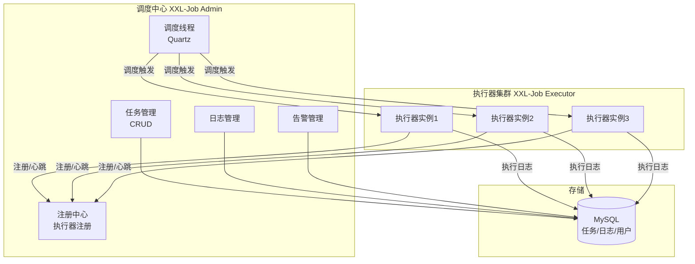
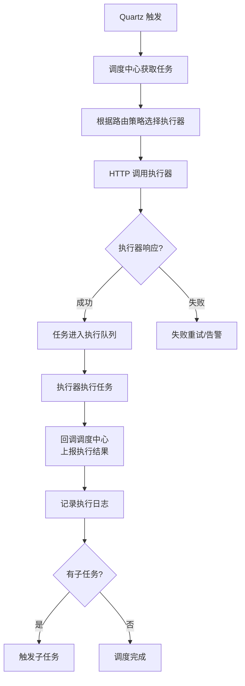

# XXL-Job 分布式任务调度

> **文档说明**：系统讲解 XXL-Job 分布式任务调度框架的核心架构、部署配置、任务开发（Bean 模式/GLUE 模式/脚本模式）、路由策略、阻塞处理策略、失败重试与告警、分片广播、调度原理，以及生产级最佳实践和常见问题排查。
>
> **适用人群**：Java 后端开发工程师、全栈开发者、需要构建分布式任务调度系统的工程师
>
> **前置知识**：[[SpringBoot-自动装配原理]]、[[分布式任务调度实战]]、[[Spring-IOCAOP核心机制]]

---

## 一、概述

### 1. 什么是 XXL-Job

**XXL-Job** 是由 xuxueli 开源的分布式任务调度平台，核心设计目标是快速开发、简单学习、轻量级、易扩展。现已开放源代码并接入多家公司线上产品线，支持定时任务、分片任务、脚本任务、GLUE 在线编辑等多种任务模式。

### 2. 核心特性

| 特性 | 说明 |
|------|------|
| **简单易用** | 提供 Web 管理界面，任务配置可视化 |
| **动态管理** | 支持任务的增删改查、启动/停止、手动触发 |
| **调度中心 HA** | 调度中心基于 Quartz 集群，支持高可用部署 |
| **执行器 HA** | 执行器自动注册，支持动态扩缩容 |
| **弹性扩容** | 执行器实例增加时自动负载均衡 |
| **路由策略** | 支持多种路由策略（轮询、随机、一致性哈希等） |
| **失败处理** | 支持失败重试、失败告警、失败转移 |
| **分片广播** | 支持分片广播任务，分布式处理大数据 |
| **任务依赖** | 支持子任务，任务执行完成后触发子任务 |
| **GLUE 模式** | 支持在线编辑代码，无需重新部署 |
| **脚本任务** | 支持 Shell、Python、NodeJS、PHP、PowerShell 等脚本 |
| **用户管理** | 支持多用户、权限管理 |
| **日志追踪** | 完整的执行日志，支持实时查看 |

### 3. 架构



### 4. 核心概念

| 概念 | 说明 |
|------|------|
| **调度中心（Admin）** | 负责任务调度、管理、监控，基于 Quartz 集群 |
| **执行器（Executor）** | 负责任务执行，自动注册到调度中心 |
| **任务（Job）** | 调度的基本单位，包含任务配置和执行逻辑 |
| **JobHandler** | 任务处理器，执行器中具体的任务执行逻辑 |
| **Cron** | Cron 表达式，定义任务调度时间 |
| **路由策略** | 调度中心选择执行器实例的策略 |
| **阻塞策略** | 任务调度时上一次执行未完成的处理策略 |
| **分片参数** | 分片广播任务的分片索引和总数 |

---

## 二、部署与配置

### 1. 调度中心部署

```bash
# 1. 下载源码
git clone https://github.com/xuxueli/xxl-job.git
cd xxl-job

# 2. 初始化数据库（MySQL）
mysql -u root -p < doc/db/tables_xxl_job.sql

# 3. 修改配置
# xxl-job-admin/src/main/resources/application.properties
# spring.datasource.url=jdbc:mysql://127.0.0.1:3306/xxl_job?useUnicode=true&characterEncoding=UTF-8&autoReconnect=true&serverTimezone=Asia/Shanghai
# spring.datasource.username=root
# spring.datasource.password=root_pwd
# xxl.job.accessToken=default_token

# 4. 打包
mvn clean package -DskipTests

# 5. 启动
java -jar xxl-job-admin/target/xxl-job-admin-2.4.0.jar

# 6. 访问
# http://localhost:8080/xxl-job-admin
# 默认账号：admin / 123456
```

### 2. 调度中心集群部署

```bash
# 多实例部署（需共享同一数据库）
# 实例1
java -jar xxl-job-admin.jar --server.port=8080

# 实例2
java -jar xxl-job-admin.jar --server.port=8081

# 实例3
java -jar xxl-job-admin.jar --server.port=8082

# Nginx 负载均衡
# upstream xxl_job_admin {
#     server 127.0.0.1:8080;
#     server 127.0.0.1:8081;
#     server 127.0.0.1:8082;
# }
```

**集群注意事项**：
- 所有实例必须连接同一个 MySQL 数据库
- Quartz 集群模式通过数据库行锁保证任务只被一个实例调度
- 建议至少 2 个实例保证高可用

### 3. 执行器集成（Spring Boot）

```xml
<!-- Maven 依赖 -->
<dependency>
    <groupId>com.xuxueli</groupId>
    <artifactId>xxl-job-core</artifactId>
    <version>2.4.0</version>
</dependency>
```

```yaml
# application.yml
xxl:
  job:
    admin:
      addresses: http://127.0.0.1:8080/xxl-job-admin  # 调度中心地址，多个用逗号分隔
    accessToken: default_token  # 与调度中心一致
    executor:
      appname: my-executor       # 执行器名称（调度中心配置对应）
      address:                   # 执行器地址（为空则自动获取）
      ip:                        # 执行器 IP（为空则自动获取）
      port: 9999                 # 执行器端口（默认 9999）
      logpath: /data/applogs/xxl-job/jobhandler  # 日志路径
      logretentiondays: 30       # 日志保留天数
```

```java
// 执行器配置类
@Configuration
public class XxlJobConfig {

    @Value("${xxl.job.admin.addresses}")
    private String adminAddresses;

    @Value("${xxl.job.accessToken}")
    private String accessToken;

    @Value("${xxl.job.executor.appname}")
    private String appname;

    @Value("${xxl.job.executor.address}")
    private String address;

    @Value("${xxl.job.executor.ip}")
    private String ip;

    @Value("${xxl.job.executor.port}")
    private int port;

    @Value("${xxl.job.executor.logpath}")
    private String logPath;

    @Value("${xxl.job.executor.logretentiondays}")
    private int logRetentionDays;

    @Bean
    public XxlJobSpringExecutor xxlJobExecutor() {
        XxlJobSpringExecutor executor = new XxlJobSpringExecutor();
        executor.setAdminAddresses(adminAddresses);
        executor.setAppname(appname);
        executor.setAddress(address);
        executor.setIp(ip);
        executor.setPort(port);
        executor.setAccessToken(accessToken);
        executor.setLogPath(logPath);
        executor.setLogRetentionDays(logRetentionDays);
        return executor;
    }
}
```

---

## 三、任务开发

### 1. Bean 模式（类形式）

```java
@Component
public class MyJobHandler {

    // 方式1：@XxlJob 注解（推荐，2.2.0+）
    @XxlJob("demoJobHandler")
    public void demoJobHandler() throws Exception {
        // 获取参数
        String param = XxlJobHelper.getJobParam();
        XxlJobHelper.log("任务开始执行，参数: " + param);

        try {
            // 业务逻辑
            System.out.println("执行任务: " + param);

            // 设置任务结果
            XxlJobHelper.handleSuccess("执行成功");
        } catch (Exception e) {
            XxlJobHelper.log("任务执行失败: " + e.getMessage());
            XxlJobHelper.handleFail("执行失败: " + e.getMessage());
            throw e;
        }
    }

    // 分片广播任务
    @XxlJob("shardingJobHandler")
    public void shardingJobHandler() throws Exception {
        // 分片参数
        int shardIndex = XxlJobHelper.getShardIndex();  // 当前分片索引
        int shardTotal = XxlJobHelper.getShardTotal();  // 总分片数

        XxlJobHelper.log("分片参数: 索引=" + shardIndex + ", 总数=" + shardTotal);

        // 分片处理：每个执行器处理一部分数据
        List<Long> allData = loadAllData();
        List<Long> myData = allData.stream()
            .filter(id -> id % shardTotal == shardIndex)
            .collect(Collectors.toList());

        XxlJobHelper.log("处理数据量: " + myData.size());
        processData(myData);
    }

    // 方式2：继承 IJobHandler（旧方式）
    @Component
    public class OldJobHandler extends IJobHandler {
        @Override
        public void execute() throws Exception {
            XxlJobHelper.log("旧方式任务执行");
        }
    }
}
```

### 2. GLUE 模式（Java 代码在线编辑）

GLUE（General Language Universal Engine）模式允许在调度中心 Web 界面在线编辑 Java 代码，无需重新部署执行器。

```java
// GLUE 模式任务示例（在调度中心 Web 界面编辑）
package com.xxl.job.service.handler;

import com.xxl.job.core.context.XxlJobHelper;
import com.xxl.job.core.handler.IJobHandler;

public class GlueJobHandler extends IJobHandler {
    @Override
    public void execute() throws Exception {
        XxlJobHelper.log("GLUE 模式任务执行");
        String param = XxlJobHelper.getJobParam();
        // 在线编辑业务逻辑，无需重新部署
        System.out.println("GLUE 任务: " + param);
    }
}
```

**GLUE 模式特点**：
- 代码存储在调度中心数据库
- 支持版本回溯（最近 30 个版本）
- 代码变更实时生效，不需重启执行器
- 适合临时任务、快速验证场景

### 3. 脚本模式

支持 Shell、Python、NodeJS、PHP、PowerShell 等脚本任务，脚本在调度中心 Web 界面维护。

```bash
# Shell 脚本示例
#!/bin/bash
echo "Shell 任务开始"
echo "参数: $1"
# 业务逻辑
date
echo "Shell 任务结束"
```

```python
# Python 脚本示例
import sys
print("Python 任务开始")
print("参数:", sys.argv[1] if len(sys.argv) > 1 else "无")
# 业务逻辑
print("Python 任务结束")
```

---

## 四、路由策略

| 策略 | 说明 | 适用场景 |
|------|------|---------|
| **FIRST** | 固定选择第一个执行器 | 单执行器或指定执行器 |
| **LAST** | 固定选择最后一个执行器 | 单执行器或指定执行器 |
| **ROUND（轮询）** | 按顺序轮流选择执行器 | 负载均衡，任务均匀分布 |
| **RANDOM（随机）** | 随机选择执行器 | 简单负载均衡 |
| **CONSISTENT_HASH（一致性哈希）** | 一致性哈希，相同参数路由到相同执行器 | 需要任务参数与执行器绑定 |
| **LEAST_FREQUENTLY_USED（最不经常使用）** | 选择使用频率最低的执行器 | 负载均衡 |
| **LEAST_RECENTLY_USED（最近最久未使用）** | 选择最久未使用的执行器 | 负载均衡 |
| **FAILOVER（故障转移）** | 依次尝试，直到成功 | 高可用，任务必须成功 |
| **BUSYOVER（忙碌转移）** | 选择最空闲的执行器 | 负载均衡，避免忙碌执行器 |
| **SHARDING_BROADCAST（分片广播）** | 广播到所有执行器，每个执行器处理一个分片 | 大数据分布式处理 |

---

## 五、阻塞处理策略

当任务调度时上一次执行尚未完成时的处理策略：

| 策略 | 说明 |
|------|------|
| **SERIAL_EXECUTION（单机串行）** | 调度请求进入 FIFO 队列，串行执行（默认） |
| **DISCARD_LATER（丢弃后续调度）** | 丢弃本次调度，等待上一次完成 |
| **COVER_EARLY（覆盖之前调度）** | 终止上一次执行，启动本次执行 |

---

## 六、失败处理与告警

### 1. 失败重试

```
调度中心配置：
- 失败重试次数：0-5 次（可配置）
- 重试间隔：固定间隔
```

### 2. 失败告警

| 告警方式 | 说明 |
|---------|------|
| **邮件告警** | 配置邮件服务器，任务失败发送邮件 |
| **企业微信/钉钉** | 通过 Webhook 发送告警（需扩展） |
| **短信告警** | 集成短信网关（需扩展） |

### 3. 子任务依赖

```
任务配置：
- 子任务 ID：配置子任务的 JobId
- 主任务执行成功后自动触发子任务
- 支持多个子任务（逗号分隔）
```

---

## 七、调度原理

### 1. 调度流程



### 2. 执行器注册与心跳

```
执行器启动 → 注册到调度中心（POST /api/registry）
执行器运行 → 定期心跳（默认 30 秒）
执行器停止 → 注销（POST /api/remove）
调度中心 → 90 秒未收到心跳则标记为死亡，从可用列表移除
```

### 3. 调度中心 HA

调度中心基于 Quartz 集群模式，通过数据库行锁（`QRTZ_LOCKS` 表）保证同一任务只被一个调度实例触发。

```
调度中心集群（3 实例）
    ↓ 共享 MySQL
Quartz 集群获取行锁
    ↓ 获取锁的实例执行调度
任务触发 → 调用执行器
    ↓
释放锁 → 下一轮调度
```

---

## 八、生产最佳实践

### 1. 任务开发规范

- [ ] **任务幂等**：任务可重复执行，不会导致数据异常
- [ ] **参数化**：通过任务参数控制行为，避免硬编码
- [ ] **日志规范**：使用 `XxlJobHelper.log()` 记录关键日志
- [ ] **异常处理**：捕获异常，明确标记成功/失败
- [ ] **分片设计**：大数据任务使用分片广播，均匀分配
- [ ] **超时控制**：设置合理的任务超时时间
- [ ] **资源隔离**：不同业务使用不同执行器 appname

### 2. 调度配置建议

| 配置项 | 建议 |
|--------|------|
| 路由策略 | 轮询（负载均衡）/ 分片广播（大数据） |
| 阻塞策略 | 单机串行（默认）/ 丢弃后续（避免堆积） |
| 失败重试 | 2-3 次（幂等任务）/ 0 次（非幂等任务） |
| Cron 表达式 | 避免整点集中调度，错峰执行 |
| 任务超时 | 根据业务设置合理超时 |
| 子任务 | 合理使用，避免过深依赖链 |

### 3. 监控与运维

```bash
# 关键监控指标
- 调度中心：QPS、任务成功率、调度延迟
- 执行器：在线实例数、任务队列长度、执行耗时
- 数据库：连接数、慢查询、表空间
- 告警：任务失败率 > 5%、执行器离线、调度延迟 > 1分钟

# 日志清理
- 调度中心自动清理（logretentiondays 配置）
- 定期归档历史日志
- 监控磁盘空间

# 备份
- 定期备份 xxl_job 数据库
- 备份任务配置（可通过 API 导出）
```

---

## 九、常见问题与排查

| 问题 | 原因 | 解决方案 |
|------|------|---------|
| **执行器注册失败** | 调度中心地址错误 / accessToken 不匹配 / 网络不通 | 检查 admin.addresses、accessToken、网络连通性 |
| **任务调度失败** | 执行器离线 / 路由策略选择失败 / 执行器端口不通 | 检查执行器在线状态、端口连通性、路由策略 |
| **任务执行超时** | 业务逻辑耗时过长 / 执行器资源不足 | 优化业务逻辑、增加执行器资源、设置合理超时 |
| **任务重复执行** | 调度中心集群配置错误 / 执行器阻塞策略问题 | 检查 Quartz 集群配置、阻塞策略 |
| **日志看不到** | 日志路径配置错误 / 权限不足 / 日志被清理 | 检查 logpath 配置、目录权限、日志保留天数 |
| **GLUE 代码不生效** | 代码未保存 / 版本未切换 / 执行器缓存 | 确认保存并使用最新版本、检查执行器日志 |
| **分片任务不均衡** | 分片逻辑问题 / 执行器数量变化 | 检查分片算法、确保执行器数量稳定 |
| **调度中心启动失败** | 数据库连接失败 / 端口冲突 / 表结构错误 | 检查数据库配置、端口占用、数据库表初始化 |
| **Cron 表达式不生效** | 表达式错误 / 时区问题 | 验证 Cron 表达式、检查 JVM 时区设置 |
| **任务堆积** | 执行器处理能力不足 / 阻塞策略串行 | 增加执行器实例、优化任务性能、调整阻塞策略 |
| **邮件告警不发送** | 邮件服务器配置错误 / 未开启告警 | 检查邮件配置、任务告警开关 |
| **执行器频繁掉线** | 心跳超时 / 网络不稳定 / 执行器 GC 停顿 | 检查网络、调整心跳间隔、优化 JVM |
| **子任务不触发** | 子任务 ID 错误 / 主任务未成功 / 子任务已停止 | 检查子任务 ID、主任务状态、子任务状态 |

---

## 十、关联笔记

### 微服务
- [[分布式任务调度实战]] · [[Nacos-注册中心与配置中心]] · [[Sentinel-流量控制与熔断]]
- [[Seata-分布式事务]] · [[SpringCloud-Alibaba组件体系]] · [[微服务核心组件知识点系统梳理_优化版]]

### 后端
- [[SpringBoot-自动装配原理]] · [[Spring-IOCAOP核心机制]] · [[SpringBoot-Web层设计]]
- [[SpringSecurity-认证授权]] · [[高并发系统设计案例]] · [[高可用架构设计]]

### 分布式
- [[分布式ID生成方案]] · [[Raft共识算法详解]] · [[ZooKeeper核心原理与实战]]
- [[分布式锁知识点系统梳理_优化版]] · [[分布式事务 知识点系统梳理_优化版]]

### 云原生
- [[Docker-核心原理与镜像优化]] · [[K8s-核心概念与架构]] · [[Prometheus监控体系]]

### 导航
- [[MOC-后端开发]] · [[MOC-分布式与中间件]] · [[全栈+AI工程双轨融合学习路线图]]

> **学习路径建议**：先掌握 [[SpringBoot-自动装配原理]] Spring Boot 基础 → 学习 [[分布式任务调度实战]] 任务调度基础 → 深入本文 XXL-Job 分布式任务调度 → 实践 [[Nacos-注册中心与配置中心]] 服务注册发现 → 研究 [[高可用架构设计]] 生产高可用 → 应用于 [[高并发系统设计案例]] 定时任务场景。
