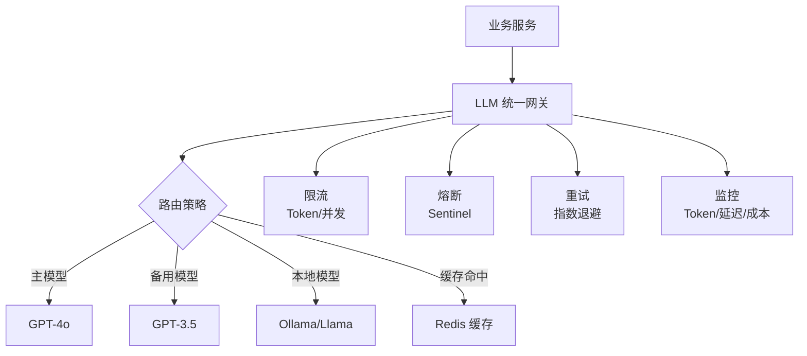

# Java LLM 接口封装与降级策略

> **文档说明**：系统讲解 Java 后端大模型接口的工程化封装，包括统一模型抽象、多模型路由、超时控制、重试机制、熔断降级、Token 限流、成本监控、异步队列、缓存策略，含可运行的 Spring Boot 代码（含 pom.xml/application.yml/服务层/降级实现）和生产级 LLM 网关设计。
>
> **适用人群**：Java 后端开发者、AI 应用架构师、需要在生产环境集成大模型的全栈工程师
>
> **前置知识**：[[Java调用OpenAI兼容API]]、[[Sentinel-流量控制与熔断]]、[[SpringAI-框架入门与模型抽象]]

---

## 一、概述

### 1. 定义与核心价值

大模型接口具有高延迟、高成本、不稳定的特点，直接在业务代码中调用会导致系统脆弱。工程化封装通过**统一抽象层**屏蔽不同模型提供商的差异，通过**降级策略**（超时、重试、熔断、备用模型、缓存）保证系统可用性，通过**限流和成本监控**控制资源消耗。这是 AI 应用从 Demo 走向生产的关键一步。

### 2. 痛点对比

| 痛点（直接调用 LLM API） | 工程化封装解决方式 |
|----------------------|-----------------|
| 模型 API 超时导致请求挂起 | 统一超时配置 + 异步处理 |
| 模型服务不可用导致整个功能瘫痪 | 熔断 + 备用模型切换 + 缓存兜底 |
| 不同模型 API 格式不同，切换成本高 | 统一接口抽象，配置切换模型 |
| Token 消耗不可控，成本飙升 | Token 计数 + 限流 + 预算告警 |
| 突发流量压垮模型服务 | 信号量限流 + 请求队列 + 优先级调度 |
| 重复请求浪费 Token | 语义缓存 + 结果缓存 |
| 无法追踪哪个业务消耗了多少 Token | 调用链埋点 + 按业务维度统计 |

### 3. LLM 网关架构



---

## 二、底层原理

### 1. 降级策略层级

| 层级 | 策略 | 触发条件 | 效果 |
|------|------|---------|------|
| L1 | 超时控制 | 响应超过阈值 | 快速失败，避免资源耗尽 |
| L2 | 重试 | 网络抖动/5xx | 自动重试，提高成功率 |
| L3 | 模型切换 | 主模型不可用 | 切换到备用模型 |
| L4 | 结果缓存 | 相同/相似问题 | 返回缓存结果 |
| L5 | 模板兜底 | 所有模型不可用 | 返回预设的安全回复 |
| L6 | 功能降级 | 完全不可用 | 关闭 AI 功能，保留基础功能 |

### 2. 熔断状态机

```
CLOSED（正常）→ 失败率超阈值 → OPEN（熔断，直接拒绝）
OPEN → 冷却时间后 → HALF_OPEN（试探性放行）
HALF_OPEN → 成功 → CLOSED
HALF_OPEN → 失败 → OPEN
```

---

## 三、实操

### 1. 项目配置

```xml
<!-- pom.xml -->
<dependencies>
    <dependency>
        <groupId>org.springframework.boot</groupId>
        <artifactId>spring-boot-starter-web</artifactId>
    </dependency>
    <dependency>
        <groupId>org.springframework.boot</groupId>
        <artifactId>spring-boot-starter-data-redis</artifactId>
    </dependency>
    <dependency>
        <groupId>com.alibaba.cloud</groupId>
        <artifactId>spring-cloud-starter-alibaba-sentinel</artifactId>
    </dependency>
    <dependency>
        <groupId>io.github.resilience4j</groupId>
        <artifactId>resilience4j-spring-boot3</artifactId>
        <version>2.2.0</version>
    </dependency>
    <dependency>
        <groupId>com.squareup.okhttp3</groupId>
        <artifactId>okhttp</artifactId>
        <version>4.12.0</version>
    </dependency>
</dependencies>
```

```yaml
# application.yml
llm:
  providers:
    primary:
      name: openai-gpt4o
      base-url: https://api.openai.com/v1
      api-key: ${OPENAI_API_KEY}
      model: gpt-4o
      timeout: 30s
      max-tokens: 2000
    fallback:
      name: openai-gpt35
      base-url: https://api.openai.com/v1
      api-key: ${OPENAI_API_KEY}
      model: gpt-3.5-turbo
      timeout: 15s
      max-tokens: 1000
    local:
      name: ollama-llama3
      base-url: http://localhost:11434/v1
      api-key: ollama
      model: llama3
      timeout: 60s

  cache:
    enabled: true
    ttl: 3600  # 缓存 1 小时

  rate-limit:
    enabled: true
    max-concurrent: 10  # 最大并发
    max-tokens-per-minute: 100000

resilience4j:
  circuitbreaker:
    instances:
      llmCall:
        failure-rate-threshold: 50
        wait-duration-in-open-state: 30s
        sliding-window-size: 20
        minimum-number-of-calls: 5
  retry:
    instances:
      llmRetry:
        max-attempts: 3
        wait-duration: 1s
        exponential-backoff-multiplier: 2
        retry-exceptions:
          - java.net.SocketTimeoutException
          - java.io.IOException
```

### 2. 统一模型接口

```java
// LlmService.java - 统一接口
package com.example.llm;

import java.util.List;

public interface LlmService {

    /**
     * 同步调用
     */
    LlmResponse chat(LlmRequest request);

    /**
     * 流式调用
     */
    void chatStream(LlmRequest request, LlmStreamCallback callback);

    /**
     * 模型名称
     */
    String getModelName();

    /**
     * 是否可用（健康检查）
     */
    boolean isAvailable();
}

// 请求/响应模型
public record LlmRequest(
        List<Message> messages,
        Double temperature,
        Integer maxTokens,
        String businessType  // 业务类型，用于统计和限流
) {
    public record Message(String role, String content) {}
}

public record LlmResponse(
        String content,
        int promptTokens,
        int completionTokens,
        int totalTokens,
        String model
) {}

public interface LlmStreamCallback {
    void onNext(String chunk);
    void onComplete(LlmResponse response);
    void onError(Throwable error);
}
```

### 3. OpenAI 兼容实现

```java
// OpenAiLlmService.java
package com.example.llm.impl;

import com.example.llm.*;
import com.fasterxml.jackson.databind.ObjectMapper;
import okhttp3.*;
import org.springframework.beans.factory.annotation.Value;
import org.springframework.stereotype.Service;

import java.io.IOException;
import java.util.concurrent.TimeUnit;

@Service
public class OpenAiLlmService implements LlmService {

    private final OkHttpClient client;
    private final ObjectMapper objectMapper = new ObjectMapper();

    @Value("${llm.providers.primary.base-url}")
    private String baseUrl;

    @Value("${llm.providers.primary.api-key}")
    private String apiKey;

    @Value("${llm.providers.primary.model}")
    private String model;

    public OpenAiLlmService() {
        this.client = new OkHttpClient.Builder()
                .connectTimeout(10, TimeUnit.SECONDS)
                .readTimeout(30, TimeUnit.SECONDS)
                .writeTimeout(10, TimeUnit.SECONDS)
                .build();
    }

    @Override
    public LlmResponse chat(LlmRequest request) {
        try {
            String jsonBody = objectMapper.writeValueAsString(new OpenAiRequest(
                    model,
                    request.messages().stream()
                            .map(m -> new OpenAiMessage(m.role(), m.content()))
                            .toList(),
                    request.temperature(),
                    request.maxTokens()
            ));

            Request httpRequest = new Request.Builder()
                    .url(baseUrl + "/chat/completions")
                    .addHeader("Authorization", "Bearer " + apiKey)
                    .addHeader("Content-Type", "application/json")
                    .post(RequestBody.create(jsonBody, MediaType.parse("application/json")))
                    .build();

            try (Response response = client.newCall(httpRequest).execute()) {
                if (!response.isSuccessful()) {
                    throw new LlmException("API 调用失败: " + response.code());
                }
                OpenAiResponse apiResponse = objectMapper.readValue(
                        response.body().string(), OpenAiResponse.class);

                return new LlmResponse(
                        apiResponse.choices().get(0).message().content(),
                        apiResponse.usage().promptTokens(),
                        apiResponse.usage().completionTokens(),
                        apiResponse.usage().totalTokens(),
                        model
                );
            }
        } catch (IOException e) {
            throw new LlmException("网络异常", e);
        }
    }

    @Override
    public void chatStream(LlmRequest request, LlmStreamCallback callback) {
        // SSE 流式实现
        new Thread(() -> {
            try {
                // ... SSE 解析逻辑
                callback.onComplete(new LlmResponse("...", 0, 0, 0, model));
            } catch (Exception e) {
                callback.onError(e);
            }
        }).start();
    }

    @Override
    public String getModelName() { return model; }

    @Override
    public boolean isAvailable() {
        // 简单健康检查
        try {
            Request request = new Request.Builder()
                    .url(baseUrl + "/models")
                    .addHeader("Authorization", "Bearer " + apiKey)
                    .get().build();
            try (Response response = client.newCall(request).execute()) {
                return response.isSuccessful();
            }
        } catch (IOException e) {
            return false;
        }
    }

    // JSON 映射记录类
    private record OpenAiRequest(String model, List<OpenAiMessage> messages,
                                  Double temperature, Integer max_tokens) {}
    private record OpenAiMessage(String role, String content) {}
    private record OpenAiResponse(List<Choice> choices, Usage usage) {
        record Choice(OpenAiMessage message) {}
        record Usage(int promptTokens, int completionTokens, int totalTokens) {}
    }
}
```

### 4. 带熔断降级的网关

```java
// LlmGateway.java - 统一网关
package com.example.llm;

import io.github.resilience4j.circuitbreaker.annotation.CircuitBreaker;
import io.github.resilience4j.retry.annotation.Retry;
import lombok.RequiredArgsConstructor;
import lombok.extern.slf4j.Slf4j;
import org.springframework.data.redis.core.StringRedisTemplate;
import org.springframework.stereotype.Service;

import java.security.MessageDigest;
import java.util.HexFormat;
import java.util.List;
import java.util.concurrent.Semaphore;

@Slf4j
@Service
@RequiredArgsConstructor
public class LlmGateway {

    private final LlmService primaryLlm;       // 主模型
    private final LlmService fallbackLlm;      // 备用模型
    private final StringRedisTemplate redisTemplate;
    private final TokenRateLimiter rateLimiter;

    // 并发控制
    private final Semaphore semaphore = new Semaphore(10);

    /**
     * 带熔断、重试、降级的统一调用入口
     */
    @CircuitBreaker(name = "llmCall", fallbackMethod = "fallback")
    @Retry(name = "llmRetry")
    public LlmResponse chat(LlmRequest request) {
        // 1. 限流检查
        rateLimiter.checkRateLimit(request.businessType());

        // 2. 缓存检查
        String cacheKey = buildCacheKey(request);
        String cached = redisTemplate.opsForValue().get(cacheKey);
        if (cached != null) {
            log.info("缓存命中: {}", cacheKey);
            return new LlmResponse(cached, 0, 0, 0, "cache");
        }

        // 3. 并发控制
        try {
            semaphore.acquire();
        } catch (InterruptedException e) {
            Thread.currentThread().interrupt();
            throw new LlmException("请求被中断");
        }

        try {
            // 4. 调用主模型
            log.info("调用主模型: {}, 业务类型: {}", primaryLlm.getModelName(), request.businessType());
            LlmResponse response = primaryLlm.chat(request);

            // 5. 写入缓存
            redisTemplate.opsForValue().set(cacheKey, response.content(), 3600, java.util.concurrent.TimeUnit.SECONDS);

            // 6. 记录 Token 消耗
            rateLimiter.recordUsage(request.businessType(), response.totalTokens());

            return response;
        } finally {
            semaphore.release();
        }
    }

    /**
     * 降级方法：切换到备用模型
     */
    public LlmResponse fallback(LlmRequest request, Throwable ex) {
        log.warn("主模型熔断，切换备用模型: {}", ex.getMessage());

        if (fallbackLlm.isAvailable()) {
            try {
                return fallbackLlm.chat(request);
            } catch (Exception e) {
                log.error("备用模型也不可用: {}", e.getMessage());
            }
        }

        // 最终兜底：返回预设回复
        return getDefaultResponse(request);
    }

    private LlmResponse getDefaultResponse(LlmRequest request) {
        return new LlmResponse(
                "抱歉，AI 服务暂时不可用，请稍后再试。您的问题已记录，我们会尽快处理。",
                0, 0, 0, "fallback"
        );
    }

    private String buildCacheKey(LlmRequest request) {
        try {
            String content = request.messages().stream()
                    .map(LlmRequest.Message::content)
                    .reduce("", String::concat);
            MessageDigest md = MessageDigest.getInstance("MD5");
            byte[] hash = md.digest(content.getBytes());
            return "llm:cache:" + HexFormat.of().formatHex(hash);
        } catch (Exception e) {
            return "llm:cache:" + request.hashCode();
        }
    }
}
```

### 5. Token 限流

```java
// TokenRateLimiter.java
package com.example.llm;

import lombok.RequiredArgsConstructor;
import lombok.extern.slf4j.Slf4j;
import org.springframework.data.redis.core.StringRedisTemplate;
import org.springframework.stereotype.Component;

import java.util.concurrent.TimeUnit;

@Slf4j
@Component
@RequiredArgsConstructor
public class TokenRateLimiter {

    private final StringRedisTemplate redisTemplate;

    private static final long MAX_TOKENS_PER_MINUTE = 100_000;
    private static final long MAX_TOKENS_PER_DAY = 1_000_000;

    /**
     * 检查限流（滑动窗口）
     */
    public void checkRateLimit(String businessType) {
        String minuteKey = "llm:rate:minute:" + businessType + ":" + currentMinute();
        String dayKey = "llm:rate:day:" + businessType + ":" + currentDay();

        Long minuteUsage = redisTemplate.opsForValue().increment(minuteKey, 0);
        Long dayUsage = redisTemplate.opsForValue().increment(dayKey, 0);

        if (minuteUsage != null && minuteUsage > MAX_TOKENS_PER_MINUTE) {
            throw new RateLimitException("每分钟 Token 限额已达上限");
        }
        if (dayUsage != null && dayUsage > MAX_TOKENS_PER_DAY) {
            throw new RateLimitException("每日 Token 限额已达上限");
        }
    }

    /**
     * 记录 Token 使用量
     */
    public void recordUsage(String businessType, int tokens) {
        String minuteKey = "llm:rate:minute:" + businessType + ":" + currentMinute();
        String dayKey = "llm:rate:day:" + businessType + ":" + currentDay();

        redisTemplate.opsForValue().increment(minuteKey, tokens);
        redisTemplate.expire(minuteKey, 2, TimeUnit.MINUTES);

        redisTemplate.opsForValue().increment(dayKey, tokens);
        redisTemplate.expire(dayKey, 25, TimeUnit.HOURS);

        log.info("Token 消耗: business={}, tokens={}", businessType, tokens);
    }

    private String currentMinute() {
        return java.time.LocalDateTime.now().format(java.time.format.DateTimeFormatter.ofPattern("yyyyMMddHHmm"));
    }

    private String currentDay() {
        return java.time.LocalDate.now().toString();
    }
}
```

### 6. 异步队列处理

```java
// AsyncLlmService.java - 异步处理大请求
package com.example.llm;

import lombok.RequiredArgsConstructor;
import lombok.extern.slf4j.Slf4j;
import org.springframework.scheduling.annotation.Async;
import org.springframework.stereotype.Service;

import java.util.concurrent.CompletableFuture;

@Slf4j
@Service
@RequiredArgsConstructor
public class AsyncLlmService {

    private final LlmGateway llmGateway;

    /**
     * 异步调用，返回 CompletableFuture
     */
    @Async("llmExecutor")
    public CompletableFuture<LlmResponse> asyncChat(LlmRequest request) {
        try {
            LlmResponse response = llmGateway.chat(request);
            return CompletableFuture.completedFuture(response);
        } catch (Exception e) {
            return CompletableFuture.failedFuture(e);
        }
    }
}
```

```java
// ThreadPoolConfig.java
@Configuration
public class ThreadPoolConfig {
    @Bean("llmExecutor")
    public Executor llmExecutor() {
        ThreadPoolTaskExecutor executor = new ThreadPoolTaskExecutor();
        executor.setCorePoolSize(5);
        executor.setMaxPoolSize(20);
        executor.setQueueCapacity(100);
        executor.setThreadNamePrefix("llm-async-");
        executor.setRejectedExecutionHandler(new ThreadPoolExecutor.CallerRunsPolicy());
        executor.initialize();
        return executor;
    }
}
```

### 7. Controller 层

```java
// LlmController.java
package com.example.controller;

import com.example.llm.LlmGateway;
import com.example.llm.LlmRequest;
import com.example.llm.LlmResponse;
import lombok.RequiredArgsConstructor;
import org.springframework.web.bind.annotation.*;

import java.util.List;
import java.util.Map;

@RestController
@RequestMapping("/api/ai")
@RequiredArgsConstructor
public class LlmController {

    private final LlmGateway llmGateway;

    @PostMapping("/chat")
    public Map<String, Object> chat(@RequestBody Map<String, String> body) {
        LlmRequest request = new LlmRequest(
                List.of(
                        new LlmRequest.Message("system", "你是一个专业助手"),
                        new LlmRequest.Message("user", body.get("message"))
                ),
                0.7,
                2000,
                body.getOrDefault("businessType", "chat")
        );

        LlmResponse response = llmGateway.chat(request);
        return Map.of(
                "content", response.content(),
                "model", response.model(),
                "tokens", response.totalTokens()
        );
    }
}
```

---

## 四、常见问题与排查

| 问题现象 | 原因 | 解决方案 |
|---------|------|---------|
| 模型调用超时导致整个请求挂起 | 未设置合理的超时时间 | 设置 connect-timeout 和 read-timeout；异步处理长请求 |
| 熔断后不恢复 | 熔断配置的冷却时间过长或半开机制未生效 | 检查 `wait-duration-in-open-state`；确认 HALF_OPEN 状态有试探请求 |
| 备用模型切换后质量下降 | 备用模型能力弱于主模型 | 在降级响应中标注"简化回复"；关键业务不自动降级，返回错误 |
| Token 消耗超出预算 | 无限流，或 max-tokens 设置过大 | 配置 Token 限流；设置合理的 max-tokens；监控告警 |
| 缓存返回了过时的答案 | 缓存 TTL 过长，或缓存 key 未包含系统提示词 | 缩短 TTL；缓存 key 包含所有影响输出的参数 |
| 并发请求导致模型服务 429 | 未做并发控制，超过模型 API 速率限制 | 用 Semaphore 限制并发；配置指数退避重试 |
| 重试导致重复扣费 | 非幂等请求被重试，或重试时模型已开始生成 | 对流式请求不重试；重试前确认请求未到达模型 |
| 降级方法不生效 | fallbackMethod 签名不匹配，或异常类型不在重试列表 | 确保 fallback 方法参数和返回值与原方法一致（加 Throwable 参数） |
| 内存溢出（流式响应） | 流式响应未正确处理，累积了完整响应 | 流式回调逐块处理，不要累积完整字符串；设置最大响应长度 |
| 多模型路由逻辑混乱 | 硬编码模型选择，无法动态调整 | 用配置中心（Nacos）动态配置路由规则；按业务类型路由 |

---

## 五、进阶与最佳实践

### 1. 生产级 LLM 网关检查清单

| 检查项 | 说明 |
|--------|------|
| 超时控制 | connect ≤ 5s，read ≤ 30s（流式除外） |
| 重试机制 | 最多 3 次，指数退避，仅网络异常重试 |
| 熔断降级 | 失败率 >50% 熔断，30s 后半开试探 |
| 备用模型 | 至少配置一个备用模型，自动切换 |
| 结果缓存 | 相同问题缓存，TTL 1-24 小时 |
| 并发限流 | Semaphore 限制并发，队列缓冲 |
| Token 限流 | 按分钟/天/业务维度限流 |
| 成本监控 | 实时统计 Token 消耗，超预算告警 |
| 链路追踪 | TraceId 贯穿，记录每次调用的模型/Token/延迟 |
| 异步处理 | 长任务异步化，避免阻塞业务线程 |

### 2. 模型路由策略

```java
// ModelRouter.java - 智能路由
public class ModelRouter {

    public LlmService route(LlmRequest request) {
        // 策略 1：按业务类型
        if ("code-review".equals(request.businessType())) {
            return codeModel;  // 代码专用模型
        }

        // 策略 2：按输入长度
        int inputLength = request.messages().stream()
                .mapToInt(m -> m.content().length()).sum();
        if (inputLength > 8000) {
            return longContextModel;  // 长上下文模型
        }

        // 策略 3：按时间（高峰期用便宜模型）
        if (isPeakHour()) {
            return costEffectiveModel;
        }

        return primaryModel;
    }
}
```

### 3. 成本优化

| 优化手段 | 效果 |
|---------|------|
| **结果缓存** | 重复问题节省 30-50% Token |
| **模型分级** | 简单问题用小模型，复杂问题用大模型 |
| **Prompt 精简** | 减少不必要的系统提示和示例 |
| **max_tokens 限制** | 避免模型输出过长 |
| **批量处理** | 多个小请求合并为一次调用 |
| **本地模型** | 简单任务用 Ollama 本地模型，零成本 |

---

## 六、关联笔记

### AI 后端集成
- [[Java调用OpenAI兼容API]] · [[SpringAI-框架入门与模型抽象]] · [[LangChain4j-Agent与RAG实现]]
- [[Java-向量数据库客户端]] · [[Java-AI流式响应实战]]

### 稳定性
- [[Sentinel-流量控制与熔断]] · [[分布式限流方案]] · [[服务降级与熔断设计]]
- [[Java-应用性能调优实战]]

### AI 应用
- [[大模型应用开发实战]] · [[统一AI网关设计与实现]] · [[成本控制与Token计费]]
- [[AI应用可观测性-Langfuse]] · [[实战-SpringBoot+AI Agent平台]]

### 导航
- [[MOC-后端开发]] · [[MOC-Java全栈-四级展开]] · [[Java-全栈技术枢纽]]

> **学习路径建议**：先掌握 [[Java调用OpenAI兼容API]] 原生 API → 学习 [[Sentinel-流量控制与熔断]] 熔断基础 → 深入本文 LLM 封装与降级 → 实践 [[SpringAI-框架入门与模型抽象]] 框架抽象 → 应用于 [[实战-SpringBoot+AI Agent平台]] 完整项目。
