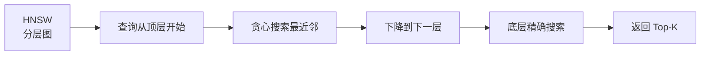

# Java 向量数据库客户端

> **文档说明**：系统讲解 Java 后端向量数据库的集成与使用，包括 Milvus、Pinecone、PgVector、Elasticsearch 向量检索的客户端配置与操作，涵盖向量插入、相似度检索、元数据过滤、索引优化、批量操作，含可运行的 Spring Boot 代码（含 pom.xml/application.yml/服务层）和 RAG 知识库完整实现。
>
> **适用人群**：Java 后端开发者、AI 应用工程师、需要构建 RAG 系统的全栈工程师
>
> **前置知识**：[[Java调用OpenAI兼容API]]、[[RAG架构设计与流程]]、[[Embedding模型选型]]

---

## 一、概述

### 1. 定义与核心价值

向量数据库专门存储和检索高维向量（Embedding），支持相似度搜索（ANN），是 RAG（检索增强生成）系统的核心组件。Java 生态中常用的向量数据库包括 Milvus（高性能分布式）、Pinecone（全托管云服务）、PgVector（PostgreSQL 扩展）、Elasticsearch（8.x+ 支持向量检索）。选择取决于数据规模、性能要求、运维成本。

### 2. 痛点对比

| 痛点（传统数据库） | 向量数据库解决方式 |
|----------------|-----------------|
| 文本搜索只能精确匹配关键词 | 语义相似度检索，理解含义 |
| 高维向量存储和检索效率低 | 专用 ANN 索引（HNSW/IVF），毫秒级检索 |
| 无法按相似度排序 | 内置余弦相似度/欧氏距离计算 |
| 元数据过滤与向量检索分离 | 支持向量检索 + 标量过滤组合查询 |
| 大规模向量检索内存不足 | 分布式分片、量化压缩（PQ/SQ） |

### 3. 向量数据库对比

| 特性 | Milvus | Pinecone | PgVector | Elasticsearch |
|------|--------|----------|----------|---------------|
| 部署方式 | 自建/云 | 全托管 | PostgreSQL 扩展 | 自建/云 |
| 性能 | 极高 | 高 | 中 | 中高 |
| 规模 | 十亿级 | 亿级 | 千万级 | 亿级 |
| 索引类型 | HNSW/IVF/ANNOY | HNSW | HNSW/IVFFlat | HNSW |
| 元数据过滤 | 支持 | 支持 | 支持（SQL） | 支持 |
| Java SDK | 官方 SDK | 官方 SDK | JDBC | 官方 Java Client |
| 运维成本 | 高 | 零 | 低（已有 PG） | 中 |
| 适用场景 | 大规模生产 | 快速上线 | 中小规模 | 已有 ES 栈 |

---

## 二、底层原理

### 1. 相似度计算

| 度量方式 | 公式 | 适用场景 |
|---------|------|---------|
| 余弦相似度 | cos(θ) = A·B / (|A|·|B|) | 文本语义（最常用） |
| 欧氏距离 | √Σ(Ai-Bi)² | 图像、数值 |
| 内积 | A·B | 已归一化向量 |
| Jaccard | 交集/并集 | 集合数据 |

### 2. ANN 索引原理



HNSW（Hierarchical Navigable Small World）是目前最流行的向量索引，通过多层图结构实现对数级查询复杂度。

---

## 三、实操

### 1. Milvus 集成

```xml
<!-- pom.xml -->
<dependencies>
    <dependency>
        <groupId>io.milvus</groupId>
        <artifactId>milvus-sdk-java</artifactId>
        <version>2.4.0</version>
    </dependency>
    <dependency>
        <groupId>org.springframework.boot</groupId>
        <artifactId>spring-boot-starter-web</artifactId>
    </dependency>
</dependencies>
```

```yaml
# application.yml
milvus:
  host: localhost
  port: 19530
  collection: knowledge_base
  dimension: 1536  # text-embedding-3-small 维度
```

```java
// MilvusConfig.java
package com.example.vector.config;

import io.milvus.client.MilvusServiceClient;
import io.milvus.param.ConnectParam;
import org.springframework.beans.factory.annotation.Value;
import org.springframework.context.annotation.Bean;
import org.springframework.context.annotation.Configuration;

@Configuration
public class MilvusConfig {

    @Value("${milvus.host}")
    private String host;

    @Value("${milvus.port}")
    private int port;

    @Bean
    public MilvusServiceClient milvusClient() {
        ConnectParam connectParam = ConnectParam.newBuilder()
                .withHost(host)
                .withPort(port)
                .withConnectTimeout(10, java.util.concurrent.TimeUnit.SECONDS)
                .build();
        return new MilvusServiceClient(connectParam);
    }
}
```

```java
// MilvusVectorStore.java
package com.example.vector.store;

import io.milvus.client.MilvusServiceClient;
import io.milvus.grpc.DataType;
import io.milvus.param.collection.*;
import io.milvus.param.dml.*;
import io.milvus.param.index.CreateIndexParam;
import io.milvus.response.SearchResultsWrapper;
import lombok.RequiredArgsConstructor;
import lombok.extern.slf4j.Slf4j;
import org.springframework.beans.factory.annotation.Value;
import org.springframework.stereotype.Service;

import java.util.*;

@Slf4j
@Service
@RequiredArgsConstructor
public class MilvusVectorStore {

    private final MilvusServiceClient client;

    @Value("${milvus.collection}")
    private String collectionName;

    @Value("${milvus.dimension}")
    private int dimension;

    /**
     * 创建集合（如果不存在）
     */
    public void createCollectionIfNotExists() {
        boolean exists = client.hasCollection(
                HasCollectionParam.newBuilder().withCollectionName(collectionName).build()
        ).getData();

        if (exists) return;

        FieldType idField = FieldType.newBuilder()
                .withName("id")
                .withDataType(DataType.Int64)
                .withPrimaryKey(true)
                .withAutoID(true)
                .build();

        FieldType vectorField = FieldType.newBuilder()
                .withName("vector")
                .withDataType(DataType.FloatVector)
                .withDimension(dimension)
                .build();

        FieldType contentField = FieldType.newBuilder()
                .withName("content")
                .withDataType(DataType.VarChar)
                .withMaxLength(5000)
                .build();

        FieldType sourceField = FieldType.newBuilder()
                .withName("source")
                .withDataType(DataType.VarChar)
                .withMaxLength(500)
                .build();

        CreateCollectionParam createParam = CreateCollectionParam.newBuilder()
                .withCollectionName(collectionName)
                .withDescription("知识库向量集合")
                .addFieldType(idField)
                .addFieldType(vectorField)
                .addFieldType(contentField)
                .addFieldType(sourceField)
                .build();

        client.createCollection(createParam);

        // 创建 HNSW 索引
        client.createIndex(CreateIndexParam.newBuilder()
                .withCollectionName(collectionName)
                .withFieldName("vector")
                .withIndexType(io.milvus.param.Constant.IndexType.HNSW)
                .withMetricType(io.milvus.param.Constant.MetricType.COSINE)
                .withExtraParam("{\"M\":16, \"efConstruction\":200}")
                .build());

        client.loadCollection(LoadCollectionParam.newBuilder()
                .withCollectionName(collectionName).build());

        log.info("集合创建成功: {}", collectionName);
    }

    /**
     * 插入向量
     */
    public void insert(List<Float> vector, String content, String source) {
        List<List<Float>> vectors = Collections.singletonList(vector);
        List<String> contents = Collections.singletonList(content);
        List<String> sources = Collections.singletonList(source);

        InsertParam insertParam = InsertParam.newBuilder()
                .withCollectionName(collectionName)
                .addField("vector", vectors)
                .addField("content", contents)
                .addField("source", sources)
                .build();

        client.insert(insertParam);
        client.flush(FlushParam.newBuilder()
                .addCollectionName(collectionName).build());
    }

    /**
     * 批量插入
     */
    public void batchInsert(List<List<Float>> vectors, List<String> contents, List<String> sources) {
        InsertParam insertParam = InsertParam.newBuilder()
                .withCollectionName(collectionName)
                .addField("vector", vectors)
                .addField("content", contents)
                .addField("source", sources)
                .build();
        client.insert(insertParam);
    }

    /**
     * 相似度搜索
     */
    public List<SearchResult> search(List<Float> queryVector, int topK, String sourceFilter) {
        SearchParam.Builder searchBuilder = SearchParam.newBuilder()
                .withCollectionName(collectionName)
                .withMetricType(io.milvus.param.Constant.MetricType.COSINE)
                .withTopK(topK)
                .withVectors(Collections.singletonList(queryVector))
                .withVectorFieldName("vector")
                .withOutFields(Arrays.asList("content", "source"))
                .withParams("{\"ef\":128}");

        if (sourceFilter != null && !sourceFilter.isEmpty()) {
            searchBuilder.withExpr("source == \"" + sourceFilter + "\"");
        }

        SearchResultsWrapper results = new SearchResultsWrapper(
                client.search(searchBuilder.build()).getData().getResults());

        List<SearchResult> searchResults = new ArrayList<>();
        for (SearchResultsWrapper.IDScore score : results.getIDScore(0)) {
            String content = (String) results.getFieldData("content", 0, (int) score.getLongID());
            String source = (String) results.getFieldData("source", 0, (int) score.getLongID());
            searchResults.add(new SearchResult(score.getLongID(), content, source, score.getScore()));
        }
        return searchResults;
    }

    public record SearchResult(long id, String content, String source, float score) {}
}
```

### 2. PgVector 集成

```xml
<dependency>
    <groupId>org.postgresql</groupId>
    <artifactId>postgresql</artifactId>
</dependency>
<dependency>
    <groupId>org.springframework.boot</groupId>
    <artifactId>spring-boot-starter-jdbc</artifactId>
</dependency>
```

```java
// PgVectorStore.java
package com.example.vector.store;

import lombok.RequiredArgsConstructor;
import org.springframework.jdbc.core.JdbcTemplate;
import org.springframework.stereotype.Service;

import java.sql.Array;
import java.sql.Connection;
import java.util.List;

@Service
@RequiredArgsConstructor
public class PgVectorStore {

    private final JdbcTemplate jdbcTemplate;

    /**
     * 初始化扩展和表
     */
    public void init() {
        jdbcTemplate.execute("CREATE EXTENSION IF NOT EXISTS vector");
        jdbcTemplate.execute("""
            CREATE TABLE IF NOT EXISTS documents (
                id BIGSERIAL PRIMARY KEY,
                content TEXT NOT NULL,
                source VARCHAR(500),
                embedding vector(1536) NOT NULL,
                created_at TIMESTAMP DEFAULT NOW()
            )
        """);
        // 创建 HNSW 索引
        jdbcTemplate.execute("""
            CREATE INDEX IF NOT EXISTS documents_embedding_idx
            ON documents USING hnsw (embedding vector_cosine_ops)
            WITH (m = 16, ef_construction = 200)
        """);
    }

    /**
     * 插入向量
     */
    public void insert(float[] embedding, String content, String source) {
        jdbcTemplate.update(
                "INSERT INTO documents (content, source, embedding) VALUES (?, ?, ?::vector)",
                content, source, arrayToString(embedding)
        );
    }

    /**
     * 相似度搜索
     */
    public List<SearchResult> search(float[] queryEmbedding, int topK) {
        return jdbcTemplate.query(
                """
                SELECT id, content, source, 1 - (embedding <=> ?::vector) as similarity
                FROM documents
                ORDER BY embedding <=> ?::vector
                LIMIT ?
                """,
                (rs, rowNum) -> new SearchResult(
                        rs.getLong("id"),
                        rs.getString("content"),
                        rs.getString("source"),
                        rs.getFloat("similarity")
                ),
                arrayToString(queryEmbedding), arrayToString(queryEmbedding), topK
        );
    }

    /**
     * 带元数据过滤的搜索
     */
    public List<SearchResult> searchWithFilter(float[] queryEmbedding, int topK, String source) {
        return jdbcTemplate.query(
                """
                SELECT id, content, source, 1 - (embedding <=> ?::vector) as similarity
                FROM documents
                WHERE source = ?
                ORDER BY embedding <=> ?::vector
                LIMIT ?
                """,
                (rs, rowNum) -> new SearchResult(
                        rs.getLong("id"), rs.getString("content"),
                        rs.getString("source"), rs.getFloat("similarity")
                ),
                arrayToString(queryEmbedding), source, arrayToString(queryEmbedding), topK
        );
    }

    private String arrayToString(float[] array) {
        StringBuilder sb = new StringBuilder("[");
        for (int i = 0; i < array.length; i++) {
            if (i > 0) sb.append(",");
            sb.append(array[i]);
        }
        sb.append("]");
        return sb.toString();
    }

    public record SearchResult(long id, String content, String source, float similarity) {}
}
```

### 3. RAG 服务整合

```java
// RagService.java
package com.example.rag;

import com.example.llm.EmbeddingService;
import com.example.llm.LlmService;
import com.example.vector.store.MilvusVectorStore;
import lombok.RequiredArgsConstructor;
import org.springframework.stereotype.Service;

import java.util.List;
import java.util.stream.Collectors;

@Service
@RequiredArgsConstructor
public class RagService {

    private final EmbeddingService embeddingService;
    private final MilvusVectorStore vectorStore;
    private final LlmService llmService;

    /**
     * 添加文档到知识库
     */
    public void addDocument(String content, String source) {
        // 1. 文本分块
        List<String> chunks = TextSplitter.split(content, 500, 50);

        // 2. 生成 Embedding
        for (String chunk : chunks) {
            List<Float> embedding = embeddingService.embed(chunk);
            vectorStore.insert(embedding, chunk, source);
        }
    }

    /**
     * 基于知识库问答
     */
    public String ask(String question) {
        // 1. 问题向量化
        List<Float> queryEmbedding = embeddingService.embed(question);

        // 2. 检索相关文档
        List<MilvusVectorStore.SearchResult> results = vectorStore.search(queryEmbedding, 5, null);

        // 3. 构建上下文
        String context = results.stream()
                .map(MilvusVectorStore.SearchResult::content)
                .collect(Collectors.joining("\n\n---\n\n"));

        // 4. 构建 Prompt
        String prompt = String.format("""
                请根据以下参考资料回答问题。如果参考资料中没有相关信息，请回答"根据现有资料无法回答"。

                参考资料：
                %s

                问题：%s
                """, context, question);

        // 5. 调用 LLM
        return llmService.chat(prompt);
    }
}
```

```java
// TextSplitter.java - 文本分块工具
public class TextSplitter {
    public static List<String> split(String text, int chunkSize, int overlap) {
        List<String> chunks = new ArrayList<>();
        int start = 0;
        while (start < text.length()) {
            int end = Math.min(start + chunkSize, text.length());
            chunks.add(text.substring(start, end));
            start += chunkSize - overlap;
        }
        return chunks;
    }
}
```

### 4. Elasticsearch 向量检索

```java
// ElasticsearchVectorStore.java
package com.example.vector.store;

import co.elastic.clients.elasticsearch.ElasticsearchClient;
import co.elastic.clients.elasticsearch.core.SearchResponse;
import co.elastic.clients.elasticsearch.core.search.Hit;
import lombok.RequiredArgsConstructor;
import org.springframework.stereotype.Service;

import java.io.IOException;
import java.util.List;
import java.util.Map;

@Service
@RequiredArgsConstructor
public class ElasticsearchVectorStore {

    private final ElasticsearchClient client;
    private static final String INDEX = "knowledge-base";

    /**
     * 创建索引（含 dense_vector 字段）
     */
    public void createIndex() throws IOException {
        client.indices().create(c -> c
                .index(INDEX)
                .mappings(m -> m
                        .properties("content", p -> p.text(t -> t))
                        .properties("source", p -> p.keyword(k -> k))
                        .properties("embedding", p -> p.denseVector(d -> d
                                .dims(1536)
                                .index(true)
                                .similarity("cosine")
                        ))
                )
        );
    }

    /**
     * 向量搜索
     */
    public List<SearchResult> search(float[] queryVector, int topK) throws IOException {
        SearchResponse<Map> response = client.search(s -> s
                        .index(INDEX)
                        .knn(k -> k
                                .field("embedding")
                                .queryVector(toList(queryVector))
                                .k(topK)
                        ),
                Map.class
        );

        return response.hits().hits().stream()
                .map(hit -> new SearchResult(
                        Long.parseLong(hit.id()),
                        (String) hit.source().get("content"),
                        (String) hit.source().get("source"),
                        hit.score().floatValue()
                ))
                .toList();
    }

    private List<Double> toList(float[] array) {
        return java.util.Arrays.stream(array).asDoubleStream().boxed().toList();
    }

    public record SearchResult(long id, String content, String source, float score) {}
}
```

---

## 四、常见问题与排查

| 问题现象 | 原因 | 解决方案 |
|---------|------|---------|
| 向量检索结果不准确 | Embedding 模型与查询模型不匹配，或维度不一致 | 确保插入和查询使用同一个 Embedding 模型；检查维度配置一致 |
| Milvus 连接超时 | Milvus 服务未启动，或端口不对 | 确认 Milvus 运行；检查 `host`/`port` 配置；默认端口 19530 |
| PgVector 报 `type "vector" does not exist` | 未安装 pgvector 扩展 | 执行 `CREATE EXTENSION vector`；确认 PostgreSQL 已安装 pgvector |
| 检索速度慢 | 未创建向量索引，或索引参数不合理 | 创建 HNSW 索引；调整 `M`（16-64）和 `efConstruction`（200-500） |
| 内存占用过高 | 向量全量加载到内存，未做量化 | 使用 IVF_PQ 索引做量化压缩；或用 Milvus 分布式分片 |
| 元数据过滤不生效 | 过滤表达式语法错误，或字段未建索引 | 检查 Milvus `expr` 语法；PgVector 用标准 SQL WHERE |
| 批量插入部分失败 | 单批数据量过大，或向量维度不一致 | 控制每批 1000-5000 条；校验所有向量维度相同 |
| Elasticsearch dense_vector 报错 | ES 版本低于 8.0，或字段类型配置错误 | 升级到 ES 8.x+；确认 `dims` 与向量维度一致 |
| 余弦相似度结果为负数 | 向量未归一化，或度量类型选错 | 余弦相似度范围 [-1,1]，负数表示语义相反；确认度量类型配置 |
| 删除数据后检索仍返回 | Milvus 软删除，需 compact 后才物理删除 | 调用 `compact` 接口；或等待自动 compaction |

---

## 五、进阶与最佳实践

### 1. 向量数据库选型决策

```
向量数据库选型
├── 数据量 < 100万 且已有 PostgreSQL？
│   └── 是 → PgVector（简单，无需新组件）
├── 数据量 100万-1亿 且不想运维？
│   └── 是 → Pinecone（全托管）
├── 数据量 > 1亿 且有运维能力？
│   └── 是 → Milvus（高性能分布式）
├── 已有 Elasticsearch 技术栈？
│   └── 是 → ES 向量检索（统一技术栈）
└── 本地开发/原型验证？
    └── 是 → Chroma / FAISS（轻量嵌入式）
```

### 2. 索引参数调优

| 参数 | HNSW 说明 | 推荐值 |
|------|----------|--------|
| `M` | 每层最大连接数 | 16（平衡）/ 64（高召回） |
| `efConstruction` | 构建时搜索宽度 | 200（平衡）/ 500（高精度） |
| `ef`（查询时） | 查询时搜索宽度 | 128（平衡）/ 256（高精度） |
| `nlist`（IVF） | 聚类中心数 | √N（N 为数据量） |
| `nprobe`（IVF） | 查询时扫描聚类数 | 10-50 |

### 3. RAG 检索优化

| 优化手段 | 说明 |
|---------|------|
| **混合检索** | 向量检索 + 关键词检索（BM25），取并集后重排序 |
| **重排序（Rerank）** | 用 Cross-Encoder 对初筛结果重新排序 |
| **查询改写** | 用 LLM 改写用户问题，生成多个查询向量 |
| **分块策略** | 按语义分块（标题/段落），而非固定长度 |
| **元数据过滤** | 先按时间/来源过滤，再做向量检索 |
| **动态 Top-K** | 根据查询复杂度调整返回数量 |

### 4. 向量更新策略

| 策略 | 说明 | 适用场景 |
|------|------|---------|
| **全量重建** | 删除旧索引，重新插入所有向量 | 数据量小，更新频率低 |
| **增量更新** | 按 ID 删除旧向量，插入新向量 | 文档更新频繁 |
| **版本管理** | 每个文档版本独立存储，查询时过滤最新版本 | 需要版本回溯 |
| **定时重建** | 每天凌晨全量重建索引 | 数据量大，允许延迟 |

---

## 六、关联笔记

### AI 后端集成
- [[Java调用OpenAI兼容API]] · [[Java-LLM接口封装与降级策略]] · [[LangChain4j-Agent与RAG实现]]
- [[SpringAI-框架入门与模型抽象]] · [[Java-AI流式响应实战]]

### 向量数据库
- [[向量库选型对比表]] · [[PgVector-PostgreSQL向量扩展]] · [[Milvus-架构与部署]]
- [[Qdrant-高性能向量检索]] · [[Chroma-轻量向量库]] · [[Elasticsearch向量检索]]

### RAG
- [[RAG架构设计与流程]] · [[文本分块策略对比]] · [[高级RAG-Hybrid检索与重排序]]
- [[Embedding模型选型]] · [[RAG安全与防注入]] · [[实战-SpringBoot+AI Agent平台]]

### 导航
- [[MOC-后端开发]] · [[MOC-Java全栈-四级展开]] · [[Java-全栈技术枢纽]]

> **学习路径建议**：先掌握 [[Java调用OpenAI兼容API]] Embedding 生成 → 学习 [[RAG架构设计与流程]] RAG 基础 → 深入本文向量数据库客户端 → 实践 [[LangChain4j-Agent与RAG实现]] 完整 RAG → 应用于 [[实战-SpringBoot+AI Agent平台]] 项目。
