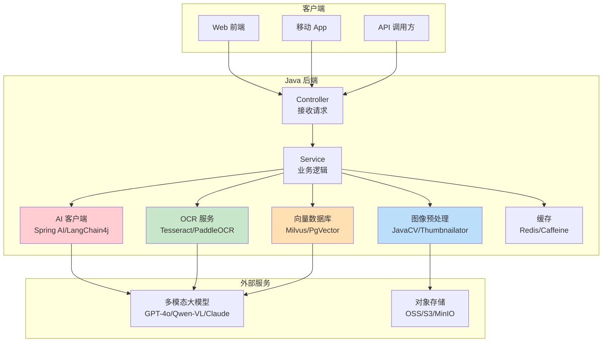

# Java-多模态AI集成

> **文档说明**：系统讲解 Java 后端的多模态 AI 集成方案，包括 Java AI 开发生态（Spring AI、LangChain4j）、多模态大模型 API 调用（GPT-4V、Qwen-VL、Claude 3、Gemini）、图像预处理（JavaCV、Thumbnailator）、OCR 集成（Tesseract、PaddleOCR）、向量数据库集成（Milvus、PgVector）、最佳实践和常见问题。
>
> **适用人群**：Java 后端开发者、全栈开发者、需要在 Java 项目中集成多模态 AI 的工程师
>
> **前置知识**：[[多模态模型原理-VLM]]、[[SpringBoot-RESTfulAPI设计]]、[[Java-大模型API集成]]

---

## 一、概述

### 1. Java AI 开发生态

```
Java AI 开发现状：
- Java 在 AI 应用开发（而非模型训练）领域生态逐渐成熟
- 主要通过调用大模型 API 实现 AI 能力
- 多模态能力：图像理解、OCR、图文检索、视觉问答
- 适合企业级应用：稳定、类型安全、与 Spring 生态无缝集成

Java AI 开发框架：

1. Spring AI（官方推荐）
   - Spring 官方 AI 集成框架
   - 类似 Spring Data 的抽象层
   - 支持 OpenAI、Azure OpenAI、Ollama、Bedrock、HuggingFace 等
   - 支持 Chat、Embedding、Image、Audio、Vector Store
   - 与 Spring Boot 无缝集成，自动配置
   - 文档：https://docs.spring.io/spring-ai/

2. LangChain4j
   - Java 版 LangChain
   - 功能丰富，社区活跃
   - 支持 30+ LLM 提供商
   - 支持 RAG、Agent、Tools、Memory、Structured Output
   - 支持多模态（图像输入）
   - 文档：https://docs.langchain4j.dev/

3. Semantic Kernel（微软）
   - 微软的 AI 编排框架
   - 支持 Java、Python、C#
   - 企业级功能强
   - 与 Azure OpenAI 集成好

4. 直接 HTTP 调用
   - 用 RestTemplate/WebClient/OkHttp 直接调用 API
   - 最灵活，无框架依赖
   - 适合简单场景或定制需求

多模态 API 提供商：
- OpenAI：GPT-4o、GPT-4V（gpt-4-vision-preview）
- Anthropic：Claude 3 Opus/Sonnet/Haiku（支持图像）
- Google：Gemini Pro Vision、Gemini 1.5 Pro
- 阿里：Qwen-VL、Qwen-VL-Plus、Qwen2-VL
- 百度：ERNIE 4.0（支持图像）
- 智谱：CogVLM、GLM-4V
- 月之暗面：Kimi（支持图像）
- 开源本地：Ollama（LLaVA、BakLLaVA 等）
```

### 2. 多模态集成架构



---

## 二、Spring AI 多模态集成

### 1. 依赖配置

```xml
<!-- pom.xml -->
<parent>
    <groupId>org.springframework.boot</groupId>
    <artifactId>spring-boot-starter-parent</artifactId>
    <version>3.2.0</version>
</parent>

<dependencies>
    <!-- Spring AI OpenAI 启动器 -->
    <dependency>
        <groupId>org.springframework.ai</groupId>
        <artifactId>spring-ai-openai-spring-boot-starter</artifactId>
    </dependency>

    <!-- Spring AI 向量存储（可选） -->
    <dependency>
        <groupId>org.springframework.ai</groupId>
        <artifactId>spring-ai-pgvector-store-spring-boot-starter</artifactId>
    </dependency>

    <!-- Web -->
    <dependency>
        <groupId>org.springframework.boot</groupId>
        <artifactId>spring-boot-starter-web</artifactId>
    </dependency>

    <!-- 图像预处理 -->
    <dependency>
        <groupId>net.coobird</groupId>
        <artifactId>thumbnailator</artifactId>
        <version>0.4.20</version>
    </dependency>
</dependencies>

<!-- Spring AI 仓库 -->
<repositories>
    <repository>
        <id>spring-milestones</id>
        <name>Spring Milestones</name>
        <url>https://repo.spring.io/milestone</url>
        <snapshots>
            <enabled>false</enabled>
        </snapshots>
    </repository>
</repositories>
```

```yaml
# application.yml
spring:
  ai:
    openai:
      api-key: ${OPENAI_API_KEY:your-api-key}
      base-url: ${OPENAI_BASE_URL:https://api.openai.com}
      chat:
        options:
          model: gpt-4o
          temperature: 0.7
          max-tokens: 2000
      embedding:
        options:
          model: text-embedding-3-small
      image:
        options:
          model: dall-e-3
          width: 1024
          height: 1024

  # 向量数据库配置（可选）
  datasource:
    url: jdbc:postgresql://localhost:5432/vectordb
    username: postgres
    password: password
  ai:
    vectorstore:
      pgvector:
        index-type: HNSW
        distance-type: COSINE_DISTANCE
        dimensions: 1536
```

### 2. 图像理解（Vision）

```java
// VisionService.java - 多模态图像理解服务
import org.springframework.ai.chat.client.ChatClient;
import org.springframework.ai.chat.messages.Media;
import org.springframework.ai.chat.messages.UserMessage;
import org.springframework.ai.chat.model.ChatResponse;
import org.springframework.ai.chat.prompt.Prompt;
import org.springframework.ai.openai.OpenAiChatModel;
import org.springframework.core.io.ClassPathResource;
import org.springframework.stereotype.Service;
import org.springframework.util.MimeTypeUtils;

import java.io.IOException;
import java.io.InputStream;
import java.net.URL;
import java.util.List;

@Service
public class VisionService {

    private final ChatClient chatClient;
    private final OpenAiChatModel chatModel;

    public VisionService(OpenAiChatModel chatModel) {
        this.chatModel = chatModel;
        this.chatClient = ChatClient.builder(chatModel).build();
    }

    /**
     * 图像描述：根据图像生成文字描述
     */
    public String describeImage(String imageUrl) {
        return chatClient.prompt()
                .user(u -> u
                        .text("请详细描述这张图片的内容，包括主体、场景、颜色、构图等。")
                        .media(MimeTypeUtils.IMAGE_PNG, imageUrl))
                .call()
                .content();
    }

    /**
     * 视觉问答：根据图像回答问题
     */
    public String visualQA(String imageUrl, String question) {
        return chatClient.prompt()
                .user(u -> u
                        .text(question)
                        .media(MimeTypeUtils.IMAGE_JPEG, imageUrl))
                .call()
                .content();
    }

    /**
     * 多图像理解：同时理解多张图像
     */
    public String compareImages(List<String> imageUrls, String question) {
        var userMessageBuilder = new StringBuilder(question);
        var mediaList = imageUrls.stream()
                .map(url -> new Media(MimeTypeUtils.IMAGE_PNG, url))
                .toList();

        return chatClient.prompt()
                .user(u -> u
                        .text(question)
                        .media(mediaList))
                .call()
                .content();
    }

    /**
     * 使用本地图像文件（byte[]）
     */
    public String analyzeLocalImage(byte[] imageData, String question) {
        // 将 byte[] 转为 Base64 Data URI
        String base64Image = java.util.Base64.getEncoder().encodeToString(imageData);
        String dataUri = "data:image/png;base64," + base64Image;

        return chatClient.prompt()
                .user(u -> u
                        .text(question)
                        .media(MimeTypeUtils.IMAGE_PNG, dataUri))
                .call()
                .content();
    }

    /**
     * 使用 Prompt 低级 API（更灵活的控制）
     */
    public ChatResponse analyzeWithPrompt(String imageUrl, String systemPrompt, String userPrompt) {
        UserMessage userMessage = new UserMessage(
                userPrompt,
                List.of(new Media(MimeTypeUtils.IMAGE_PNG, imageUrl))
        );

        Prompt prompt = new Prompt(
                List.of(
                        new org.springframework.ai.chat.messages.SystemMessage(systemPrompt),
                        userMessage
                )
        );

        return chatModel.call(prompt);
    }

    /**
     * OCR：从图像中提取文字
     */
    public String extractTextFromImage(String imageUrl) {
        return chatClient.prompt()
                .user(u -> u
                        .text("请提取这张图片中的所有文字内容，保持原始格式和结构。如果是表格，请用 Markdown 表格格式输出。")
                        .media(MimeTypeUtils.IMAGE_PNG, imageUrl))
                .call()
                .content();
    }

    /**
     * 结构化输出：返回 JSON 格式的分析结果
     */
    public ImageAnalysisResult analyzeImageStructured(String imageUrl) {
        String json = chatClient.prompt()
                .user(u -> u
                        .text("""
                                请分析这张图片，返回 JSON 格式的结果，包含以下字段：
                                - scene: 场景描述
                                - mainSubject: 主体
                                - colors: 主要颜色列表
                                - textContent: 图片中的文字（如果有）
                                - mood: 整体氛围
                                只返回 JSON，不要其他内容。
                                """)
                        .media(MimeTypeUtils.IMAGE_PNG, imageUrl))
                .call()
                .content();

        // 用 Jackson 解析 JSON
        return new com.fasterxml.jackson.databind.ObjectMapper()
                .readValue(json, ImageAnalysisResult.class);
    }

    public record ImageAnalysisResult(
            String scene,
            String mainSubject,
            List<String> colors,
            String textContent,
            String mood
    ) {}
}
```

### 3. 图像生成

```java
// ImageGenerationService.java
import org.springframework.ai.image.ImageModel;
import org.springframework.ai.image.ImagePrompt;
import org.springframework.ai.image.ImageResponse;
import org.springframework.ai.openai.OpenAiImageModel;
import org.springframework.ai.openai.OpenAiImageOptions;
import org.springframework.stereotype.Service;

@Service
public class ImageGenerationService {

    private final ImageModel imageModel;

    public ImageGenerationService(OpenAiImageModel imageModel) {
        this.imageModel = imageModel;
    }

    /**
     * 文本生成图像
     */
    public String generateImage(String prompt) {
        ImageResponse response = imageModel.call(
                new ImagePrompt(prompt,
                        OpenAiImageOptions.builder()
                                .withModel("dall-e-3")
                                .withWidth(1024)
                                .withHeight(1024)
                                .withQuality("hd")
                                .withN(1)
                                .build())
        );

        return response.getResult().getOutput().getUrl();
    }

    /**
     * 图像编辑（DALL-E 3 不支持编辑，用 DALL-E 2 或其他模型）
     */
    // 注：Spring AI 的 Image API 主要支持生成，编辑需要用 OpenAI 原生 API
}
```

---

## 三、LangChain4j 多模态集成

### 1. 依赖配置

```xml
<!-- pom.xml -->
<dependencies>
    <!-- LangChain4j 核心 -->
    <dependency>
        <groupId dev.langchain4j</groupId>
        <artifactId>langchain4j</artifactId>
        <version>0.31.0</version>
    </dependency>

    <!-- OpenAI 集成 -->
    <dependency>
        <groupId>dev.langchain4j</groupId>
        <artifactId>langchain4j-open-ai</artifactId>
        <version>0.31.0</version>
    </dependency>

    <!-- 嵌入存储（可选） -->
    <dependency>
        <groupId>dev.langchain4j</groupId>
        <artifactId>langchain4j-pgvector</artifactId>
        <version>0.31.0</version>
    </dependency>
</dependencies>
```

### 2. 多模态对话

```java
// LangChain4jVisionService.java
import dev.langchain4j.data.image.Image;
import dev.langchain4j.data.message.AiMessage;
import dev.langchain4j.data.message.ImageContent;
import dev.langchain4j.data.message.TextContent;
import dev.langchain4j.data.message.UserMessage;
import dev.langchain4j.model.chat.ChatLanguageModel;
import dev.langchain4j.model.openai.OpenAiChatModel;
import dev.langchain4j.model.output.Response;
import org.springframework.stereotype.Service;

import java.time.Duration;

@Service
public class LangChain4jVisionService {

    private final ChatLanguageModel chatModel;

    public LangChain4jVisionService() {
        this.chatModel = OpenAiChatModel.builder()
                .apiKey("your-api-key")
                .modelName("gpt-4o")
                .temperature(0.7)
                .maxTokens(2000)
                .timeout(Duration.ofSeconds(60))
                .build();
    }

    /**
     * 图像理解
     */
    public String analyzeImage(String imageUrl, String question) {
        UserMessage userMessage = UserMessage.from(
                TextContent.from(question),
                ImageContent.from(imageUrl)
        );

        Response<AiMessage> response = chatModel.generate(userMessage);
        return response.content().text();
    }

    /**
     * 多图像理解
     */
    public String analyzeMultipleImages(java.util.List<String> imageUrls, String question) {
        var contents = new java.util.ArrayList<dev.langchain4j.data.message.Content>();
        contents.add(TextContent.from(question));
        for (String url : imageUrls) {
            contents.add(ImageContent.from(url));
        }

        UserMessage userMessage = UserMessage.from(contents);
        return chatModel.generate(userMessage).content().text();
    }

    /**
     * 使用本地图像（Base64）
     */
    public String analyzeLocalImage(byte[] imageData, String question) {
        String base64 = java.util.Base64.getEncoder().encodeToString(imageData);
        String dataUri = "data:image/png;base64," + base64;

        UserMessage userMessage = UserMessage.from(
                TextContent.from(question),
                ImageContent.from(dataUri)
        );

        return chatModel.generate(userMessage).content().text();
    }
}
```

### 3. AI Service 接口（声明式）

```java
// VisionAssistant.java - 声明式 AI 服务接口
import dev.langchain4j.service.SystemMessage;
import dev.langchain4j.service.UserMessage;
import dev.langchain4j.service.V;

public interface VisionAssistant {

    @SystemMessage("你是一个专业的图像分析助手，擅长描述图像内容、提取文字和回答视觉相关问题。")
    @UserMessage("请详细描述这张图片：{{imageUrl}}")
    String describeImage(@V("imageUrl") String imageUrl);

    @SystemMessage("你是一个 OCR 专家，擅长从图像中准确提取文字。")
    @UserMessage("请提取这张图片中的所有文字，保持原始格式：{{imageUrl}}")
    String extractText(@V("imageUrl") String imageUrl);

    @SystemMessage("你是一个视觉问答专家，请根据图像准确回答问题。")
    @UserMessage("根据这张图片回答问题：{{question}}\n图片：{{imageUrl}}")
    String answerQuestion(@V("imageUrl") String imageUrl, @V("question") String question);
}

// 配置类
import dev.langchain4j.model.chat.ChatLanguageModel;
import dev.langchain4j.service.AiServices;
import org.springframework.context.annotation.Bean;
import org.springframework.context.annotation.Configuration;

@Configuration
public class AiServiceConfig {

    @Bean
    public VisionAssistant visionAssistant(ChatLanguageModel chatModel) {
        return AiServices.builder(VisionAssistant.class)
                .chatLanguageModel(chatModel)
                .build();
    }
}

// 使用
@RestController
public class VisionController {

    private final VisionAssistant visionAssistant;

    public VisionController(VisionAssistant visionAssistant) {
        this.visionAssistant = visionAssistant;
    }

    @GetMapping("/describe")
    public String describe(@RequestParam String imageUrl) {
        return visionAssistant.describeImage(imageUrl);
    }
}
```

---

## 四、其他多模态 API 集成

### 1. 通义千问 Qwen-VL（阿里）

```java
// QwenVLService.java
import org.springframework.http.*;
import org.springframework.web.client.RestTemplate;
import org.springframework.stereotype.Service;

import java.util.List;
import java.util.Map;

@Service
public class QwenVLService {

    private final RestTemplate restTemplate;
    private static final String API_URL = "https://dashscope.aliyuncs.com/compatible-mode/v1/chat/completions";
    private static final String API_KEY = "your-dashscope-api-key";

    public QwenVLService() {
        this.restTemplate = new RestTemplate();
    }

    public String analyzeImage(String imageUrl, String question) {
        Map<String, Object> requestBody = Map.of(
                "model", "qwen-vl-plus",
                "messages", List.of(
                        Map.of("role", "user", "content", List.of(
                                Map.of("type", "image", "image", imageUrl),
                                Map.of("type", "text", "text", question)
                        ))
                ),
                "temperature", 0.7
        );

        HttpHeaders headers = new HttpHeaders();
        headers.setContentType(MediaType.APPLICATION_JSON);
        headers.setBearerAuth(API_KEY);

        HttpEntity<Map<String, Object>> entity = new HttpEntity<>(requestBody, headers);
        ResponseEntity<Map> response = restTemplate.postForEntity(API_URL, entity, Map.class);

        Map<String, Object> body = response.getBody();
        List<Map<String, Object>> choices = (List<Map<String, Object>>) body.get("choices");
        Map<String, Object> message = (Map<String, Object>) choices.get(0).get("message");
        return (String) message.get("content");
    }
}
```

### 2. Claude 3（Anthropic）

```java
// ClaudeVisionService.java
import org.springframework.http.*;
import org.springframework.web.client.RestTemplate;
import org.springframework.stereotype.Service;

import java.util.List;
import java.util.Map;

@Service
public class ClaudeVisionService {

    private final RestTemplate restTemplate;
    private static final String API_URL = "https://api.anthropic.com/v1/messages";
    private static final String API_KEY = "your-anthropic-api-key";

    public ClaudeVisionService() {
        this.restTemplate = new RestTemplate();
    }

    public String analyzeImage(String imageBase64, String mediaType, String question) {
        Map<String, Object> requestBody = Map.of(
                "model", "claude-3-5-sonnet-20241022",
                "max_tokens", 2000,
                "messages", List.of(
                        Map.of("role", "user", "content", List.of(
                                Map.of(
                                        "type", "image",
                                        "source", Map.of(
                                                "type", "base64",
                                                "media_type", mediaType,
                                                "data", imageBase64
                                        )
                                ),
                                Map.of("type", "text", "text", question)
                        ))
                )
        );

        HttpHeaders headers = new HttpHeaders();
        headers.setContentType(MediaType.APPLICATION_JSON);
        headers.set("x-api-key", API_KEY);
        headers.set("anthropic-version", "2023-06-01");

        HttpEntity<Map<String, Object>> entity = new HttpEntity<>(requestBody, headers);
        ResponseEntity<Map> response = restTemplate.postForEntity(API_URL, entity, Map.class);

        Map<String, Object> body = response.getBody();
        List<Map<String, Object>> content = (List<Map<String, Object>>) body.get("content");
        return (String) content.get(0).get("text");
    }
}
```

### 3. 本地 Ollama（LLaVA）

```java
// OllamaVisionService.java
import org.springframework.ai.ollama.OllamaChatModel;
import org.springframework.ai.ollama.api.OllamaApi;
import org.springframework.ai.ollama.api.OllamaOptions;
import org.springframework.stereotype.Service;

@Service
public class OllamaVisionService {

    private final OllamaChatModel chatModel;

    public OllamaVisionService() {
        OllamaApi ollamaApi = new OllamaApi("http://localhost:11434");
        this.chatModel = OllamaChatModel.builder()
                .ollamaApi(ollamaApi)
                .defaultOptions(OllamaOptions.builder()
                        .model("llava")  // 或 bakllava、llava:13b
                        .temperature(0.7)
                        .build())
                .build();
    }

    public String analyzeImage(String imageBase64, String question) {
        // Ollama 支持 base64 图像输入
        return chatModel.call(
                new org.springframework.ai.chat.prompt.Prompt(
                        List.of(
                                new org.springframework.ai.chat.messages.UserMessage(
                                        question,
                                        List.of(new org.springframework.ai.chat.messages.Media(
                                                org.springframework.util.MimeTypeUtils.IMAGE_PNG,
                                                imageBase64))
                                )
                        )
                )
        ).getResult().getOutput().getText();
    }
}
```

---

## 五、图像预处理

### 1. Thumbnailator（简单易用）

```xml
<dependency>
    <groupId>net.coobird</groupId>
    <artifactId>thumbnailator</artifactId>
    <version>0.4.20</version>
</dependency>
```

```java
// ImagePreprocessService.java
import net.coobird.thumbnailator.Thumbnails;
import net.coobird.thumbnailator.geometry.Positions;
import org.springframework.stereotype.Service;

import javax.imageio.ImageIO;
import java.awt.image.BufferedImage;
import java.io.ByteArrayInputStream;
import java.io.ByteArrayOutputStream;
import java.io.File;
import java.io.IOException;

@Service
public class ImagePreprocessService {

    /**
     * 调整图像大小（保持宽高比）
     */
    public byte[] resize(byte[] imageData, int maxWidth, int maxHeight) throws IOException {
        ByteArrayInputStream input = new ByteArrayInputStream(imageData);
        ByteArrayOutputStream output = new ByteArrayOutputStream();

        Thumbnails.of(input)
                .size(maxWidth, maxHeight)
                .keepAspectRatio(true)
                .outputFormat("PNG")
                .toOutputStream(output);

        return output.toByteArray();
    }

    /**
     * 裁剪图像（居中裁剪为正方形）
     */
    public byte[] cropSquare(byte[] imageData, int size) throws IOException {
        ByteArrayInputStream input = new ByteArrayInputStream(imageData);
        ByteArrayOutputStream output = new ByteArrayOutputStream();

        Thumbnails.of(input)
                .size(size, size)
                .crop(Positions.CENTER)
                .keepAspectRatio(false)
                .outputFormat("PNG")
                .toOutputStream(output);

        return output.toByteArray();
    }

    /**
     * 压缩图像（降低质量）
     */
    public byte[] compress(byte[] imageData, float quality) throws IOException {
        ByteArrayInputStream input = new ByteArrayInputStream(imageData);
        ByteArrayOutputStream output = new ByteArrayOutputStream();

        Thumbnails.of(input)
                .scale(1.0)
                .outputQuality(quality)
                .outputFormat("JPEG")
                .toOutputStream(output);

        return output.toByteArray();
    }

    /**
     * 转换图像格式
     */
    public byte[] convertFormat(byte[] imageData, String format) throws IOException {
        ByteArrayInputStream input = new ByteArrayInputStream(imageData);
        ByteArrayOutputStream output = new ByteArrayOutputStream();

        Thumbnails.of(input)
                .scale(1.0)
                .outputFormat(format)
                .toOutputStream(output);

        return output.toByteArray();
    }

    /**
     * 获取图像信息
     */
    public ImageInfo getImageInfo(byte[] imageData) throws IOException {
        BufferedImage image = ImageIO.read(new ByteArrayInputStream(imageData));
        return new ImageInfo(
                image.getWidth(),
                image.getHeight(),
                image.getType()
        );
    }

    public record ImageInfo(int width, int height, int type) {}
}
```

### 2. JavaCV（功能强大）

```xml
<dependency>
    <groupId>org.bytedeco</groupId>
    <artifactId>javacv-platform</artifactId>
    <version>1.5.10</version>
</dependency>
```

```java
// JavaCVService.java - 高级图像处理
import org.bytedeco.javacv.*;
import org.bytedeco.opencv.opencv_core.*;
import static org.bytedeco.opencv.global.opencv_imgcodecs.*;
import static org.bytedeco.opencv.global.opencv_imgproc.*;
import org.springframework.stereotype.Service;

@Service
public class JavaCVService {

    /**
     * 图像增强（对比度、亮度）
     */
    public byte[] enhanceImage(byte[] imageData, double alpha, int beta) {
        Mat src = imdecode(new Mat(imageData), IMREAD_COLOR);
        Mat dst = new Mat();
        src.convertTo(dst, -1, alpha, beta);  // alpha=对比度, beta=亮度
        return imencode(".png", dst).getBytes();
    }

    /**
     * 灰度化
     */
    public byte[] toGray(byte[] imageData) {
        Mat src = imdecode(new Mat(imageData), IMREAD_COLOR);
        Mat gray = new Mat();
        cvtColor(src, gray, COLOR_BGR2GRAY);
        return imencode(".png", gray).getBytes();
    }

    /**
     * 二值化（适合 OCR 预处理）
     */
    public byte[] binarize(byte[] imageData, int threshold) {
        Mat src = imdecode(new Mat(imageData), IMREAD_GRAYSCALE);
        Mat binary = new Mat();
        threshold(src, binary, threshold, 255, THRESH_BINARY);
        return imencode(".png", binary).getBytes();
    }

    /**
     * 去噪（适合 OCR 预处理）
     */
    public byte[] denoise(byte[] imageData) {
        Mat src = imdecode(new Mat(imageData), IMREAD_COLOR);
        Mat dst = new Mat();
        fastNlMeansDenoisingColored(src, dst, 10, 10, 7, 21);
        return imencode(".png", dst).getBytes();
    }
}
```

---

## 六、OCR 集成

### 1. Tesseract（开源 OCR）

```xml
<dependency>
    <groupId>net.sourceforge.tess4j</groupId>
    <artifactId>tess4j</artifactId>
    <version>5.8.0</version>
</dependency>
```

```java
// OcrService.java
import net.sourceforge.tess4j.ITesseract;
import net.sourceforge.tess4j.Tesseract;
import net.sourceforge.tess4j.TesseractException;
import org.springframework.stereotype.Service;

import javax.imageio.ImageIO;
import java.awt.image.BufferedImage;
import java.io.ByteArrayInputStream;
import java.io.IOException;

@Service
public class OcrService {

    private final ITesseract tesseract;

    public OcrService() {
        this.tesseract = new Tesseract();
        // 设置语言包路径（需要下载 chi_sim.traineddata、eng.traineddata）
        tesseract.setDatapath("tessdata");
        // 支持中英文
        tesseract.setLanguage("chi_sim+eng");
        // OCR 引擎模式：1=LSTM 神经网络
        tesseract.setOcrEngineMode(1);
        // 页面分割模式：3=全自动页面分割
        tesseract.setPageSegMode(3);
    }

    /**
     * 提取图像中的文字
     */
    public String extractText(byte[] imageData) throws IOException, TesseractException {
        BufferedImage image = ImageIO.read(new ByteArrayInputStream(imageData));
        return tesseract.doOCR(image);
    }

    /**
     * 提取指定区域的文字
     */
    public String extractTextInRegion(byte[] imageData, int x, int y, int width, int height)
            throws IOException, TesseractException {
        BufferedImage image = ImageIO.read(new ByteArrayInputStream(imageData));
        java.awt.Rectangle rect = new java.awt.Rectangle(x, y, width, height);
        return tesseract.doOCR(image, rect);
    }
}
```

### 2. PaddleOCR（Java 调用 Python 服务）

```
PaddleOCR Java 集成方案：
- PaddleOCR 本身是 Python 库，Java 通过 HTTP 调用
- 方案1：部署 PaddleOCR HTTP 服务（FastAPI），Java 调用
- 方案2：用 Jython 或 ProcessBuilder 调用 Python 脚本
- 方案3：用 PaddleOCR 的 ONNX 模型 + Java ONNX Runtime（复杂）

推荐方案1：部署独立的 OCR 服务
```

```python
# ocr_server.py - PaddleOCR HTTP 服务
from fastapi import FastAPI, UploadFile, File
from paddleocr import PaddleOCR
import base64
import numpy as np
from PIL import Image
import io

app = FastAPI()
ocr = PaddleOCR(use_angle_cls=True, lang="ch")  # 中英文

@app.post("/ocr")
async def ocr_image(file: UploadFile = File(...)):
    contents = await file.read()
    image = Image.open(io.BytesIO(contents))
    image_array = np.array(image)

    result = ocr.ocr(image_array, cls=True)

    texts = []
    for line in result[0]:
        texts.append({
            "text": line[1][0],
            "confidence": line[1][1],
            "position": line[0]
        })

    return {"texts": texts, "full_text": "\n".join([t["text"] for t in texts])}
```

```java
// PaddleOcrClient.java
import org.springframework.http.*;
import org.springframework.util.LinkedMultiValueMap;
import org.springframework.util.MultiValueMap;
import org.springframework.web.client.RestTemplate;
import org.springframework.stereotype.Service;
import org.springframework.core.io.ByteArrayResource;

@Service
public class PaddleOcrClient {

    private final RestTemplate restTemplate;
    private static final String OCR_URL = "http://localhost:8000/ocr";

    public PaddleOcrClient() {
        this.restTemplate = new RestTemplate();
    }

    public String extractText(byte[] imageData) {
        HttpHeaders headers = new HttpHeaders();
        headers.setContentType(MediaType.MULTIPART_FORM_DATA);

        MultiValueMap<String, Object> body = new LinkedMultiValueMap<>();
        body.add("file", new ByteArrayResource(imageData) {
            @Override
            public String getFilename() {
                return "image.png";
            }
        });

        HttpEntity<MultiValueMap<String, Object>> requestEntity = new HttpEntity<>(body, headers);
        ResponseEntity<String> response = restTemplate.postForEntity(OCR_URL, requestEntity, String.class);
        return response.getBody();
    }
}
```

---

## 七、多模态 RAG 集成

```java
// MultimodalRagService.java - 多模态 RAG（图文检索）
import org.springframework.ai.document.Document;
import org.springframework.ai.embedding.EmbeddingModel;
import org.springframework.ai.vectorstore.SearchRequest;
import org.springframework.ai.vectorstore.VectorStore;
import org.springframework.stereotype.Service;

import java.util.List;
import java.util.Map;

@Service
public class MultimodalRagService {

    private final VectorStore vectorStore;
    private final EmbeddingModel embeddingModel;
    private final VisionService visionService;

    public MultimodalRagService(VectorStore vectorStore,
                                  EmbeddingModel embeddingModel,
                                  VisionService visionService) {
        this.vectorStore = vectorStore;
        this.embeddingModel = embeddingModel;
        this.visionService = visionService;
    }

    /**
     * 索引图像：先用 VLM 生成图像描述，再向量化存储
     */
    public void indexImage(String imageId, String imageUrl, String metadata) {
        // 1. 用 VLM 生成详细的图像描述
        String description = visionService.describeImage(imageUrl);

        // 2. 提取图像中的文字（OCR）
        String text = visionService.extractTextFromImage(imageUrl);

        // 3. 组合内容
        String content = String.format("""
                图像描述：%s
                图像文字：%s
                元数据：%s
                """, description, text, metadata);

        // 4. 向量化并存储
        Document document = new Document(content, Map.of(
                "image_id", imageId,
                "image_url", imageUrl,
                "type", "image"
        ));
        vectorStore.add(List.of(document));
    }

    /**
     * 图文检索：根据文本查询检索相关图像
     */
    public List<Document> searchImages(String query, int topK) {
        return vectorStore.similaritySearch(
                SearchRequest.builder()
                        .query(query)
                        .topK(topK)
                        .filterExpression("type == 'image'")
                        .build()
        );
    }

    /**
     * 多模态问答：检索相关图像 + VLM 回答
     */
    public String multimodalQA(String question) {
        // 1. 检索相关图像
        List<Document> relatedImages = searchImages(question, 3);

        if (relatedImages.isEmpty()) {
            return "未找到相关图像。";
        }

        // 2. 构建上下文
        StringBuilder context = new StringBuilder("相关图像信息：\n");
        for (int i = 0; i < relatedImages.size(); i++) {
            Document doc = relatedImages.get(i);
            context.append(String.format("图像%d：%s\n", i + 1, doc.getContent()));
        }

        // 3. 用 VLM 回答（如果有图像 URL，可以直接传入图像）
        String firstImageUrl = (String) relatedImages.get(0).getMetadata().get("image_url");
        return visionService.visualQA(firstImageUrl,
                context + "\n\n请根据以上相关图像信息回答问题：" + question);
    }
}
```

---

## 八、最佳实践

### 1. 架构设计

- [ ] **统一 AI 客户端抽象**：用 Spring AI 或 LangChain4j 抽象，避免直接绑定特定 API
- [ ] **多模型 fallback**：主模型失败时自动切换到备用模型
- [ ] **异步处理**：图像分析耗时长，用异步处理（@Async、CompletableFuture、消息队列）
- [ ] **结果缓存**：相同图像+问题的分析结果缓存（Redis/Caffeine）
- [ ] **图像存储分离**：图像存在对象存储（OSS/S3/MinIO），数据库只存 URL
- [ ] **限流与熔断**：用 Resilience4j 限流、熔断、重试，保护 API 调用
- [ ] **成本监控**：记录每次调用的 token 消耗和费用，预算告警

### 2. 图像预处理

- [ ] **合理分辨率**：根据任务选择分辨率（OCR 用高分辨率，通用理解用 1024px）
- [ ] **格式转换**：统一转为 PNG/JPEG，避免不支持的格式
- [ ] **大小限制**：压缩大图像（API 通常有大小限制，如 OpenAI 20MB）
- [ ] **EXIF 处理**：根据 EXIF 旋转图像，避免方向错误
- [ ] **OCR 预处理**：OCR 前做灰度化、二值化、去噪，提升准确率
- [ ] **批量处理**：批量图像用线程池并行处理，提高吞吐量

### 3. API 调用

- [ ] **超时设置**：设置合理的超时时间（图像分析 30-60 秒）
- [ ] **重试机制**：网络错误、限流时指数退避重试（最多 3 次）
- [ ] **错误处理**：处理内容过滤、图像不支持、配额超限等错误
- [ ] **流式输出**：长文本用流式响应（SSE），提升用户体验
- [ ] **并发控制**：限制并发请求数，避免触发 API 限流
- [ ] **日志记录**：记录请求参数、响应、耗时、错误，便于排查

### 4. 安全与隐私

- [ ] **内容安全**：对用户上传的图像做内容审核（NSFW、暴力等）
- [ ] **敏感信息过滤**：OCR 结果中过滤身份证、银行卡、手机号等敏感信息
- [ ] **数据脱敏**：上传到第三方 API 前脱敏（如打码人脸、删除敏感文字）
- [ ] **访问控制**：图像分析接口需要认证授权
- [ ] **数据保留**：设置图像和分析结果的保留期限，定期清理
- [ ] **合规性**：确保符合数据隐私法规（GDPR、个人信息保护法）

### 5. 性能优化

- [ ] **模型选择**：根据任务选择合适的模型（简单任务用小模型，复杂任务用大模型）
- [ ] **本地部署**：隐私敏感或高并发场景用本地模型（Ollama + LLaVA）
- [ ] **预计算**：常用图像的描述和嵌入预计算存储，避免重复分析
- [ ] **CDN 加速**：图像通过 CDN 分发，加快加载
- [ ] **连接池**：HTTP 客户端用连接池，减少连接建立开销
- [ ] **批量 API**：支持批量的 API 用批量调用，减少请求次数

---

## 九、常见问题与排查

| 问题 | 原因 | 解决方案 |
|------|------|---------|
| **图像上传后 API 报错** | 图像格式不支持/大小超限/分辨率过高 | 检查支持的格式（PNG/JPEG/WebP）；压缩图像到限制大小（通常 20MB）；降低分辨率；用 Thumbnailator 预处理 |
| **API 调用超时** | 图像太大/模型响应慢/网络问题 | 增加超时时间（60秒）；压缩图像；用异步处理；检查网络连接；配置重试 |
| **API 限流（429）** | 请求频率过高/配额不足 | 实现限流（Resilience4j）；指数退避重试；升级 API 套餐；用多个 API Key 轮询；缓存结果 |
| **OCR 准确率低** | 图像质量差/倾斜/字体特殊/语言包不全 | 图像预处理（去噪、二值化、对比度增强）；校正倾斜；用 PaddleOCR（中文更准）；下载对应语言包；提高分辨率 |
| **中文理解/生成差** | 模型中文能力弱 | 用中文能力强的模型（Qwen-VL、GLM-4V、ERNIE）；用中文指令数据微调；Prompt 用中文 |
| **图像描述与实际不符（幻觉）** | 模型幻觉/图像信息不足 | Prompt 要求"只根据图像回答，不确定就说不知道"；用多个模型交叉验证；选择幻觉少的模型；增加图像分辨率 |
| **Spring AI 依赖找不到** | 仓库未配置/版本不对 | 配置 spring-milestones 仓库；用与 Spring Boot 兼容的版本；检查 Maven settings.xml |
| **LangChain4j 图像不支持** | 模型不支持图像/版本旧 | 确认模型支持视觉（gpt-4o、claude-3 等）；升级 LangChain4j 版本；用 ImageContent 传图像 |
| **本地 Ollama 连接失败** | Ollama 未启动/端口不对/模型未下载 | 启动 Ollama 服务（ollama serve）；检查端口（默认 11434）；下载模型（ollama pull llava）；检查防火墙 |
| **向量存储查询慢** | 数据量大/索引未建/维度不匹配 | 建 HNSW/IVF 索引；限制 topK；用合适的距离度量；确保嵌入维度一致；分页查询 |
| **图像方向不对** | EXIF 方向未处理 | 用 ImageIO.read 后根据 EXIF 旋转；用 Thumbnailator 自动处理；用 JavaCV 的 imread（自动处理 EXIF） |
| **内存溢出（OOM）** | 图像太大/批量处理太多/未释放资源 | 压缩图像；限制批量大小；及时关闭流（try-with-resources）；设置 JVM 堆大小；用流式处理 |
| **API Key 泄露** | 硬编码在代码中/日志打印 | 用环境变量或配置中心；不要在日志中打印 API Key；用 .gitignore 排除配置文件；定期轮换 Key |
| **多模态 RAG 检索不准** | 图像描述质量差/嵌入模型不匹配/索引未更新 | 用更好的 VLM 生成描述；用多模态嵌入模型（CLIP）；定期重建索引；调整 topK 和相似度阈值 |
| **不同模型结果差异大** | 模型能力和训练数据不同 | 用标准基准评估选择模型；关键任务用多个模型 ensemble；根据具体任务选最合适的模型；建立评估集 |

---

## 十、关联笔记

### AI 与大模型
- [[多模态模型原理-VLM]] · [[大模型微调-LoRA与QLoRA]] · [[RAG检索增强生成]]
- [[多模态RAG实现]] · [[AI Agent架构设计]] · [[MCP协议与工具生态]]
- [[DPO直接偏好优化]]

### Java 后端
- [[SpringBoot-RESTfulAPI设计]] · [[Java-大模型API集成]] · [[SpringValidation-参数校验]]
- [[Java-应用性能调优实战]] · [[RabbitMQ-消息中间件]]

### Python 全栈
- [[Python-LangChain应用开发]] · [[Python-Web框架FastAPI实战]] · [[Python-异步编程asyncio]]

### 云原生与运维
- [[Sentry错误监控与追踪]] · [[K8s-核心概念与架构]] · [[Jenkins流水线实战]]

### 导航
- [[MOC-后端开发]] · [[MOC-AI与效率工具]] · [[MOC-Python全栈]] · [[全栈+AI工程双轨融合学习路线图]]

> **学习路径建议**：先掌握 [[多模态模型原理-VLM]] 多模态原理 → 学习 [[Java-大模型API集成]] Java AI 基础 → 深入本文 Java 多模态集成 → 实践 [[多模态RAG实现]] 多模态 RAG → 研究 [[Python-LangChain应用开发]] Python 侧对比 → 构建完整的企业级多模态 AI 应用。
