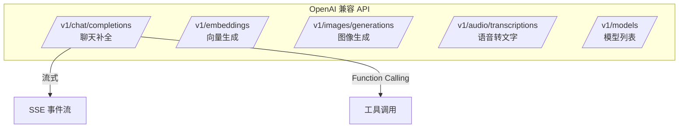

# Java 调用 OpenAI 兼容 API

> **文档说明**：系统讲解 Java 后端调用 OpenAI 兼容 API 的完整方案，包括 Chat Completions 接口、流式响应（SSE）、Function Calling、Embedding 生成、图像生成（DALL-E）、语音转文字（Whisper），含可运行的 Spring Boot 代码（含 pom.xml/application.yml/OkHttp 客户端/Controller）和错误处理。
>
> **适用人群**：Java 后端开发者、AI 应用工程师、需要集成大模型 API 的全栈工程师
>
> **前置知识**：[[SpringBoot-Web层设计]]、[[Java-语法进阶与StreamAPI]]、[[SSE-流式响应对接LLM]]

---

## 一、概述

### 1. 定义与核心价值

OpenAI API 已成为大模型服务的事实标准，许多服务商（Azure OpenAI、Anthropic、百度文心、阿里通义、Ollama、DeepSeek 等）都提供 OpenAI 兼容接口。Java 后端通过 HTTP 客户端（OkHttp/HttpClient/RestTemplate）调用这些 API，实现聊天、流式输出、函数调用、向量生成等能力。掌握 OpenAI 兼容 API 调用是 Java AI 开发的基础。

### 2. 痛点对比

| 痛点（直接 HTTP 调用） | 工程化方案 |
|-------------------|----------|
| 请求/响应 JSON 手动拼接 | 用 Record/DTO 类 + Jackson 自动序列化 |
| 流式响应解析复杂 | SSE 事件流解析，逐块处理 |
| 超时/重试未处理 | OkHttp 拦截器 + 统一超时配置 |
| API Key 硬编码 | 配置文件 + 环境变量 |
| 错误码未分类处理 | ErrorDecoder 统一异常转换 |
| Token 用量未统计 | 解析 usage 字段，记录监控 |

### 3. OpenAI API 核心端点



---

## 二、底层原理

### 1. Chat Completions 请求结构

```json
{
  "model": "gpt-4o",
  "messages": [
    {"role": "system", "content": "你是一个助手"},
    {"role": "user", "content": "你好"},
    {"role": "assistant", "content": "你好！有什么可以帮你？"}
  ],
  "temperature": 0.7,
  "max_tokens": 2000,
  "stream": false,
  "tools": [{"type": "function", "function": {...}}]
}
```

| 字段 | 说明 |
|------|------|
| `model` | 模型名称 |
| `messages` | 对话消息列表（system/user/assistant/tool） |
| `temperature` | 随机性（0-2，越低越确定） |
| `max_tokens` | 最大输出 Token 数 |
| `stream` | 是否流式输出 |
| `tools` | Function Calling 工具定义 |

### 2. 流式响应（SSE）

流式响应通过 Server-Sent Events 协议，每个事件以 `data: ` 开头，以 `data: [DONE]` 结束：

```
data: {"choices":[{"delta":{"content":"你"}}]}

data: {"choices":[{"delta":{"content":"好"}}]}

data: [DONE]
```

---

## 三、实操

### 1. 项目配置

```xml
<!-- pom.xml -->
<dependencies>
    <dependency>
        <groupId>org.springframework.boot</groupId>
        <artifactId>spring-boot-starter-web</artifactId>
    </dependency>
    <dependency>
        <groupId>com.squareup.okhttp3</groupId>
        <artifactId>okhttp</artifactId>
        <version>4.12.0</version>
    </dependency>
    <dependency>
        <groupId>com.fasterxml.jackson.core</groupId>
        <artifactId>jackson-databind</artifactId>
    </dependency>
</dependencies>
```

```yaml
# application.yml
openai:
  api-key: ${OPENAI_API_KEY:sk-your-key}
  base-url: ${OPENAI_BASE_URL:https://api.openai.com/v1}
  model: gpt-4o
  embedding-model: text-embedding-3-small
  timeout:
    connect: 10s
    read: 30s
    write: 10s
```

### 2. 配置类

```java
// OpenAiConfig.java
package com.example.openai.config;

import okhttp3.OkHttpClient;
import org.springframework.beans.factory.annotation.Value;
import org.springframework.context.annotation.Bean;
import org.springframework.context.annotation.Configuration;

import java.time.Duration;

@Configuration
public class OpenAiConfig {

    @Value("${openai.timeout.connect}")
    private Duration connectTimeout;

    @Value("${openai.timeout.read}")
    private Duration readTimeout;

    @Value("${openai.timeout.write}")
    private Duration writeTimeout;

    @Bean
    public OkHttpClient okHttpClient() {
        return new OkHttpClient.Builder()
                .connectTimeout(connectTimeout)
                .readTimeout(readTimeout)
                .writeTimeout(writeTimeout)
                .addInterceptor(chain -> {
                    // 日志拦截器
                    okhttp3.Request request = chain.request();
                    long start = System.nanoTime();
                    okhttp3.Response response = chain.proceed(request);
                    long elapsed = System.nanoTime() - start;
                    System.out.printf("API调用: %s %s -> %d (%.1fms)%n",
                            request.method(), request.url(), response.code(), elapsed / 1e6);
                    return response;
                })
                .build();
    }
}
```

### 3. DTO 定义

```java
// OpenAiDtos.java
package com.example.openai.dto;

import com.fasterxml.jackson.annotation.JsonInclude;
import com.fasterxml.jackson.annotation.JsonProperty;

import java.util.List;
import java.util.Map;

// 请求
@JsonInclude(JsonInclude.Include.NON_NULL)
public record ChatRequest(
        String model,
        List<Message> messages,
        Double temperature,
        @JsonProperty("max_tokens") Integer maxTokens,
        Boolean stream,
        List<Tool> tools
) {
    public record Message(String role, String content, String name) {
        public Message(String role, String content) {
            this(role, content, null);
        }
    }

    public record Tool(String type, Function function) {
        public record Function(String name, String description, Map<String, Object> parameters) {}
    }
}

// 响应
public record ChatResponse(
        String id,
        String object,
        Long created,
        String model,
        List<Choice> choices,
        Usage usage
) {
    public record Choice(
            int index,
            Message message,
            @JsonProperty("finish_reason") String finishReason
    ) {
        public record Message(String role, String content, List<ToolCall> tool_calls) {}
        public record ToolCall(String id, String type, Function function) {
            public record Function(String name, String arguments) {}
        }
    }

    public record Usage(
            @JsonProperty("prompt_tokens") int promptTokens,
            @JsonProperty("completion_tokens") int completionTokens,
            @JsonProperty("total_tokens") int totalTokens
    ) {}
}

// 流式响应
public record ChatChunk(
        String id,
        List<ChunkChoice> choices
) {
    public record ChunkChoice(int index, Delta delta) {
        public record Delta(String role, String content) {}
    }
}

// Embedding
public record EmbeddingRequest(String model, String input) {}
public record EmbeddingResponse(String model, List<EmbeddingData> data, Usage usage) {
    public record EmbeddingData(String object, int index, List<Float> embedding) {}
    public record Usage(int prompt_tokens, int total_tokens) {}
}
```

### 4. 聊天服务

```java
// OpenAiChatService.java
package com.example.openai.service;

import com.example.openai.dto.*;
import com.fasterxml.jackson.databind.ObjectMapper;
import lombok.RequiredArgsConstructor;
import lombok.extern.slf4j.Slf4j;
import okhttp3.*;
import org.springframework.beans.factory.annotation.Value;
import org.springframework.stereotype.Service;

import java.io.BufferedReader;
import java.io.IOException;
import java.io.InputStreamReader;
import java.util.List;
import java.util.concurrent.Flow;
import java.util.concurrent.SubmissionPublisher;

@Slf4j
@Service
@RequiredArgsConstructor
public class OpenAiChatService {

    private final OkHttpClient client;
    private final ObjectMapper objectMapper = new ObjectMapper();

    @Value("${openai.api-key}")
    private String apiKey;

    @Value("${openai.base-url}")
    private String baseUrl;

    @Value("${openai.model}")
    private String model;

    private static final MediaType JSON = MediaType.parse("application/json");

    /**
     * 同步聊天
     */
    public ChatResponse chat(List<ChatRequest.Message> messages, double temperature, int maxTokens) {
        ChatRequest request = new ChatRequest(
                model, messages, temperature, maxTokens, false, null
        );
        return executeChatRequest(request);
    }

    /**
     * 简单对话
     */
    public String simpleChat(String userMessage) {
        List<ChatRequest.Message> messages = List.of(
                new ChatRequest.Message("system", "你是一个专业的技术助手"),
                new ChatRequest.Message("user", userMessage)
        );
        ChatResponse response = chat(messages, 0.7, 2000);
        return response.choices().get(0).message().content();
    }

    private ChatResponse executeChatRequest(ChatRequest request) {
        try {
            String jsonBody = objectMapper.writeValueAsString(request);

            Request httpRequest = new Request.Builder()
                    .url(baseUrl + "/chat/completions")
                    .addHeader("Authorization", "Bearer " + apiKey)
                    .addHeader("Content-Type", "application/json")
                    .post(RequestBody.create(jsonBody, JSON))
                    .build();

            try (Response response = client.newCall(httpRequest).execute()) {
                String body = response.body() != null ? response.body().string() : "";

                if (!response.isSuccessful()) {
                    throw new OpenAiException(
                            "API 调用失败: " + response.code() + " - " + body);
                }

                return objectMapper.readValue(body, ChatResponse.class);
            }
        } catch (IOException e) {
            throw new OpenAiException("网络异常: " + e.getMessage(), e);
        }
    }

    /**
     * 流式聊天（SSE）
     */
    public Flow.Publisher<String> streamChat(String userMessage) {
        SubmissionPublisher<String> publisher = new SubmissionPublisher<>();

        new Thread(() -> {
            try {
                ChatRequest request = new ChatRequest(
                        model,
                        List.of(new ChatRequest.Message("user", userMessage)),
                        0.7, 2000, true, null
                );

                String jsonBody = objectMapper.writeValueAsString(request);
                Request httpRequest = new Request.Builder()
                        .url(baseUrl + "/chat/completions")
                        .addHeader("Authorization", "Bearer " + apiKey)
                        .addHeader("Content-Type", "application/json")
                        .addHeader("Accept", "text/event-stream")
                        .post(RequestBody.create(jsonBody, JSON))
                        .build();

                try (Response response = client.newCall(httpRequest).execute()) {
                    if (!response.isSuccessful()) {
                        throw new OpenAiException("流式请求失败: " + response.code());
                    }

                    BufferedReader reader = new BufferedReader(
                            new InputStreamReader(response.body().byteStream()));
                    String line;
                    while ((line = reader.readLine()) != null) {
                        if (line.startsWith("data: ")) {
                            String data = line.substring(6);
                            if ("[DONE]".equals(data)) break;

                            ChatChunk chunk = objectMapper.readValue(data, ChatChunk.class);
                            if (!chunk.choices().isEmpty() && chunk.choices().get(0).delta().content() != null) {
                                publisher.submit(chunk.choices().get(0).delta().content());
                            }
                        }
                    }
                }
                publisher.close();
            } catch (Exception e) {
                publisher.closeExceptionally(e);
            }
        }).start();

        return publisher;
    }

    public static class OpenAiException extends RuntimeException {
        public OpenAiException(String message) { super(message); }
        public OpenAiException(String message, Throwable cause) { super(message, cause); }
    }
}
```

### 5. Function Calling

```java
// FunctionCallingService.java
package com.example.openai.service;

import com.example.openai.dto.*;
import com.fasterxml.jackson.databind.ObjectMapper;
import lombok.RequiredArgsConstructor;
import org.springframework.stereotype.Service;

import java.util.List;
import java.util.Map;

@Service
@RequiredArgsConstructor
public class FunctionCallingService {

    private final OpenAiChatService chatService;
    private final ObjectMapper objectMapper = new ObjectMapper();

    // 定义工具
    private static final List<ChatRequest.Tool> TOOLS = List.of(
            new ChatRequest.Tool("function", new ChatRequest.Tool.Function(
                    "get_weather",
                    "获取指定城市的当前天气",
                    Map.of(
                            "type", "object",
                            "properties", Map.of(
                                    "city", Map.of("type", "string", "description", "城市名称")
                            ),
                            "required", List.of("city")
                    )
            ))
    );

    public String chatWithTools(String userMessage) {
        List<ChatRequest.Message> messages = List.of(
                new ChatRequest.Message("user", userMessage)
        );

        // 第一次调用：让模型决定是否调用工具
        ChatRequest request = new ChatRequest(
                "gpt-4o", messages, 0.7, 2000, false, TOOLS
        );
        ChatResponse response = chatService.chat(
                messages, 0.7, 2000);  // 简化：实际应传 tools

        ChatResponse.Choice choice = response.choices().get(0);

        // 如果模型要求调用工具
        if (choice.message().tool_calls() != null && !choice.message().tool_calls().isEmpty()) {
            for (ChatResponse.Choice.Message.ToolCall toolCall : choice.message().tool_calls()) {
                String functionName = toolCall.function().name();
                String arguments = toolCall.function().arguments();

                // 执行工具
                String toolResult = executeTool(functionName, arguments);

                // 将工具结果加入消息，再次调用模型
                messages = List.of(
                        new ChatRequest.Message("user", userMessage),
                        choice.message(),
                        new ChatRequest.Message("tool", toolResult, toolCall.id())
                );
            }

            // 第二次调用：基于工具结果生成最终回答
            ChatResponse finalResponse = chatService.chat(messages, 0.7, 2000);
            return finalResponse.choices().get(0).message().content();
        }

        return choice.message().content();
    }

    private String executeTool(String functionName, String arguments) {
        try {
            Map<String, Object> args = objectMapper.readValue(arguments, Map.class);
            if ("get_weather".equals(functionName)) {
                String city = (String) args.get("city");
                return String.format("{\"city\":\"%s\",\"temperature\":22,\"condition\":\"晴\"}", city);
            }
            return "{\"error\":\"未知工具\"}";
        } catch (Exception e) {
            return "{\"error\":\"工具执行失败\"}";
        }
    }
}
```

### 6. Embedding 服务

```java
// EmbeddingService.java
package com.example.openai.service;

import com.example.openai.dto.EmbeddingRequest;
import com.example.openai.dto.EmbeddingResponse;
import com.fasterxml.jackson.databind.ObjectMapper;
import lombok.RequiredArgsConstructor;
import okhttp3.*;
import org.springframework.beans.factory.annotation.Value;
import org.springframework.stereotype.Service;

import java.io.IOException;
import java.util.List;

@Service
@RequiredArgsConstructor
public class EmbeddingService {

    private final OkHttpClient client;
    private final ObjectMapper objectMapper = new ObjectMapper();

    @Value("${openai.api-key}")
    private String apiKey;

    @Value("${openai.base-url}")
    private String baseUrl;

    @Value("${openai.embedding-model}")
    private String embeddingModel;

    private static final MediaType JSON = MediaType.parse("application/json");

    /**
     * 生成文本向量
     */
    public List<Float> embed(String text) {
        try {
            EmbeddingRequest request = new EmbeddingRequest(embeddingModel, text);
            String jsonBody = objectMapper.writeValueAsString(request);

            Request httpRequest = new Request.Builder()
                    .url(baseUrl + "/embeddings")
                    .addHeader("Authorization", "Bearer " + apiKey)
                    .addHeader("Content-Type", "application/json")
                    .post(RequestBody.create(jsonBody, JSON))
                    .build();

            try (Response response = client.newCall(httpRequest).execute()) {
                String body = response.body().string();
                if (!response.isSuccessful()) {
                    throw new RuntimeException("Embedding 失败: " + response.code());
                }
                EmbeddingResponse embeddingResponse = objectMapper.readValue(body, EmbeddingResponse.class);
                return embeddingResponse.data().get(0).embedding();
            }
        } catch (IOException e) {
            throw new RuntimeException("网络异常", e);
        }
    }

    /**
     * 计算余弦相似度
     */
    public double cosineSimilarity(List<Float> vec1, List<Float> vec2) {
        double dotProduct = 0, norm1 = 0, norm2 = 0;
        for (int i = 0; i < vec1.size(); i++) {
            dotProduct += vec1.get(i) * vec2.get(i);
            norm1 += vec1.get(i) * vec1.get(i);
            norm2 += vec2.get(i) * vec2.get(i);
        }
        return dotProduct / (Math.sqrt(norm1) * Math.sqrt(norm2));
    }
}
```

### 7. Controller 层

```java
// OpenAiController.java
package com.example.openai.controller;

import com.example.openai.service.OpenAiChatService;
import com.example.openai.service.FunctionCallingService;
import com.example.openai.service.EmbeddingService;
import lombok.RequiredArgsConstructor;
import org.springframework.http.MediaType;
import org.springframework.web.bind.annotation.*;
import reactor.core.publisher.Flux;

import java.util.List;
import java.util.Map;
import java.util.concurrent.Flow;

@RestController
@RequestMapping("/api/openai")
@RequiredArgsConstructor
public class OpenAiController {

    private final OpenAiChatService chatService;
    private final FunctionCallingService functionCallingService;
    private final EmbeddingService embeddingService;

    @PostMapping("/chat")
    public Map<String, Object> chat(@RequestBody Map<String, String> body) {
        String response = chatService.simpleChat(body.get("message"));
        return Map.of("response", response);
    }

    @PostMapping(value = "/stream", produces = MediaType.TEXT_EVENT_STREAM_VALUE)
    public Flux<String> streamChat(@RequestBody Map<String, String> body) {
        Flow.Publisher<String> publisher = chatService.streamChat(body.get("message"));
        return Flux.from(publisher);
    }

    @PostMapping("/function-chat")
    public Map<String, Object> functionChat(@RequestBody Map<String, String> body) {
        String response = functionCallingService.chatWithTools(body.get("message"));
        return Map.of("response", response);
    }

    @PostMapping("/embed")
    public Map<String, Object> embed(@RequestBody Map<String, String> body) {
        List<Float> embedding = embeddingService.embed(body.get("text"));
        return Map.of(
                "embedding", embedding,
                "dimension", embedding.size()
        );
    }
}
```

---

## 四、常见问题与排查

| 问题现象 | 原因 | 解决方案 |
|---------|------|---------|
| `401 Unauthorized` | API Key 错误或过期 | 检查 `openai.api-key` 配置；确认 API Key 有效且有余额 |
| `429 Too Many Requests` | 超过速率限制或配额不足 | 降低请求频率；实现指数退避重试；检查账户配额 |
| 流式响应连接提前断开 | 读取超时设置过短，或代理关闭 SSE | 增大 `readTimeout`；确认 Nginx/网关配置 `proxy_buffering off` |
| `Connection reset` 频繁出现 | 网络不稳定，或服务端主动断开 | 实现重试机制；使用更稳定的网络；检查防火墙 |
| Function Calling 参数解析失败 | 模型返回的 JSON 不合法 | 用 `try-catch` 包裹解析；在 Prompt 中强调返回合法 JSON |
| 中文乱码 | 响应编码未指定 UTF-8 | OkHttp 默认 UTF-8；检查中间件是否修改编码；用 `response.body().string()` |
| Token 计数与预期不符 | 不同模型 Tokenizer 不同，或 max_tokens 限制 | 用 tiktoken 库精确计算；注意 max_tokens 是输出上限 |
| 模型返回内容被截断 | `max_tokens` 设置过小，或达到模型上下文上限 | 增大 `max_tokens`；检查总 Token 数不超过模型上下文窗口 |
| 本地 Ollama 调用失败 | base-url 路径不对，或模型未拉取 | Ollama 的 OpenAI 兼容端点是 `http://localhost:11434/v1`；先 `ollama pull llama3` |
| 多轮对话上下文丢失 | 每次请求只传当前消息，未传历史消息 | 维护消息列表，每次请求包含完整历史；注意控制总长度 |

---

## 五、进阶与最佳实践

### 1. 多模型兼容

```java
// 不同提供商只需修改 base-url 和 model
// OpenAI:    base-url=https://api.openai.com/v1, model=gpt-4o
// Azure:     base-url=https://xxx.openai.azure.com/openai/deployments/xxx, model=gpt-4o
// Ollama:    base-url=http://localhost:11434/v1, model=llama3
// DeepSeek:  base-url=https://api.deepseek.com/v1, model=deepseek-chat
// 通义千问:   base-url=https://dashscope.aliyuncs.com/compatible-mode/v1, model=qwen-turbo
```

### 2. 生产环境配置清单

| 配置项 | 推荐值 | 说明 |
|--------|--------|------|
| connectTimeout | 5-10s | 连接超时 |
| readTimeout | 30-60s | 读取超时（流式可更长） |
| 重试次数 | 2-3 次 | 仅网络异常和 5xx 重试 |
| 退避策略 | 指数退避 | 1s → 2s → 4s |
| max_tokens | 1000-4000 | 根据场景控制成本 |
| temperature | 0.3-0.7 | 生产环境偏低，保证稳定性 |
| 连接池 | 50-200 | OkHttp 默认 5，需调大 |

### 3. 与 Spring AI 对比

| 维度 | 手动 OkHttp | Spring AI |
|------|------------|-----------|
| 代码量 | 多（需自己处理序列化/流式） | 少（`ChatClient` 一行调用） |
| 灵活性 | 高（完全控制请求细节） | 中（框架封装） |
| 模型切换 | 需改代码 | 配置切换 |
| RAG/Function Calling | 需自己实现 | 内置支持 |
| 适用场景 | 特殊需求、深度定制 | 标准 AI 应用 |

---

## 六、关联笔记

### AI 后端集成
- [[Java-LLM接口封装与降级策略]] · [[SpringAI-框架入门与模型抽象]] · [[LangChain4j-Agent与RAG实现]]
- [[Java-向量数据库客户端]] · [[Java-AI流式响应实战]] · [[Java-多模态AI集成]]

### AI 应用
- [[大模型应用开发实战]] · [[模型服务化-OpenAI兼容API]] · [[SSE-流式响应对接LLM]]
- [[Agent工具调用FunctionCalling]] · [[Embedding模型选型]] · [[实战-SpringBoot+AI Agent平台]]

### 导航
- [[MOC-后端开发]] · [[MOC-Java全栈-四级展开]] · [[Java-全栈技术枢纽]]

> **学习路径建议**：先掌握 [[SpringBoot-Web层设计]] Web 基础 → 学习本文 OpenAI API 调用 → 深入 [[Java-LLM接口封装与降级策略]] 工程化封装 → 实践 [[SpringAI-框架入门与模型抽象]] 框架抽象 → 应用于 [[LangChain4j-Agent与RAG实现]] 完整 AI 应用。
