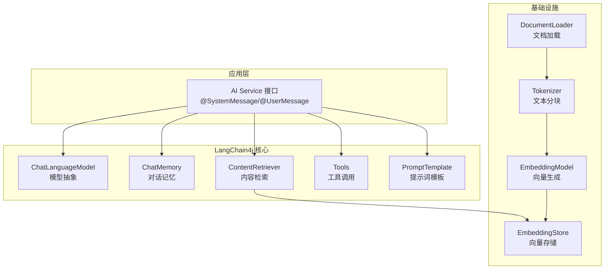

# LangChain4j Agent 与 RAG 实现

> **文档说明**：系统讲解 LangChain4j 框架的核心能力，包括 AI 服务接口、Prompt 模板、RAG 检索增强（文档加载/分块/嵌入/存储/检索）、Agent 工具调用、记忆管理、多模态支持，含可运行的 Spring Boot 代码（含 pom.xml/application.yml/服务层/工具定义）和完整的知识库问答 Agent 实现。
>
> **适用人群**：Java 后端开发者、AI 应用工程师、需要构建智能 Agent 和 RAG 系统的全栈工程师
>
> **前置知识**：[[Java调用OpenAI兼容API]]、[[RAG架构设计与流程]]、[[Agent核心概念-ReAct规划]]

---

## 一、概述

### 1. 定义与核心价值

LangChain4j 是 Java 生态的 LLM 应用开发框架，对标 Python 的 LangChain。它提供了统一的 AI 抽象（ChatLanguageModel、EmbeddingModel）、RAG 流水线（DocumentLoader/Tokenizer/EmbeddingStore/ContentRetriever）、Agent 框架（AI Services + Tools）、记忆管理（ChatMemory）等组件，让 Java 开发者能快速构建复杂的 AI 应用，而无需从零实现 LLM 调用、向量检索、工具编排等逻辑。

### 2. 痛点对比

| 痛点（手动实现） | LangChain4j 解决方式 |
|----------------|-------------------|
| 每次调用 LLM 都要写 HTTP 客户端 | `ChatLanguageModel` 统一接口，一行调用 |
| RAG 流程（加载→分块→嵌入→检索→拼接）需自己实现 | `EmbeddingStore` + `ContentRetriever` + `AiServices` 自动编排 |
| Agent 工具调用循环复杂 | `@Tool` 注解 + `AiServices` 自动 ReAct 循环 |
| 多轮对话记忆管理麻烦 | `ChatMemory` 内置，支持窗口/摘要/持久化 |
| 文档解析（PDF/Word/HTML）需自己写 | `DocumentLoader` 支持多种格式 |
| 切换模型需改代码 | 配置切换 OpenAI/Ollama/HuggingFace |

### 3. LangChain4j 核心架构



---

## 二、底层原理

### 1. AI Services 机制

`AiServices` 是 LangChain4j 的核心设计，通过动态代理为接口生成实现：

```
定义接口（@SystemMessage/@UserMessage）
    → AiServices.builder(Interface.class).build()
    → 动态代理实现
    → 调用方法时自动：组装 Prompt → 调用 LLM → 解析结果 → 工具调用循环
```

### 2. RAG 流程

```
文档加载 → 文本分块 → 生成 Embedding → 存入向量库
                                    ↓
用户问题 → 生成 Embedding → 向量检索 → 拼接上下文 → LLM 生成答案
```

---

## 三、实操

### 1. 项目配置

```xml
<!-- pom.xml -->
<dependencies>
    <dependency>
        <groupId>org.springframework.boot</groupId>
        <artifactId>spring-boot-starter-web</artifactId>
    </dependency>
    <dependency>
        <groupId>dev.langchain4j</groupId>
        <artifactId>langchain4j-open-ai-spring-boot-starter</artifactId>
        <version>0.35.0</version>
    </dependency>
    <dependency>
        <groupId>dev.langchain4j</groupId>
        <artifactId>langchain4j-embeddings-all-minilm-l6-v2</artifactId>
        <version>0.35.0</version>
    </dependency>
    <dependency>
        <groupId>dev.langchain4j</groupId>
        <artifactId>langchain4j-pgvector</artifactId>
        <version>0.35.0</version>
    </dependency>
    <dependency>
        <groupId>dev.langchain4j</groupId>
        <artifactId>langchain4j-document-parser-apache-pdfbox</artifactId>
        <version>0.35.0</version>
    </dependency>
</dependencies>
```

```yaml
# application.yml
langchain4j:
  open-ai:
    chat-model:
      api-key: ${OPENAI_API_KEY}
      base-url: ${OPENAI_BASE_URL:https://api.openai.com/v1}
      model-name: gpt-4o
      temperature: 0.7
      timeout: 30s
    embedding-model:
      api-key: ${OPENAI_API_KEY}
      model-name: text-embedding-3-small

spring:
  datasource:
    url: jdbc:postgresql://localhost:5432/rag_db
    username: postgres
    password: password
```

### 2. AI Service 接口定义

```java
// Assistant.java - AI 服务接口
package com.example.langchain4j.ai;

import dev.langchain4j.service.SystemMessage;
import dev.langchain4j.service.UserMessage;
import dev.langchain4j.service.MemoryId;
import dev.langchain4j.service.TokenStream;

public interface Assistant {

    @SystemMessage("""
            你是一个专业的知识库助手。
            请根据提供的参考资料回答用户问题。
            如果参考资料中没有答案，请明确告知用户，不要编造。
            回答使用中文，格式清晰，重点突出。
            """)
    String chat(@MemoryId Long userId, @UserMessage String userMessage);

    // 流式输出
    TokenStream streamChat(@MemoryId Long userId, @UserMessage String userMessage);
}
```

```java
// AiConfig.java - 配置 AI Service
package com.example.langchain4j.config;

import com.example.langchain4j.ai.Assistant;
import com.example.langchain4j.tools.CalculatorTools;
import com.example.langchain4j.tools.WeatherTools;
import dev.langchain4j.memory.chat.MessageWindowChatMemory;
import dev.langchain4j.model.chat.ChatLanguageModel;
import dev.langchain4j.rag.content.retriever.ContentRetriever;
import dev.langchain4j.service.AiServices;
import org.springframework.context.annotation.Bean;
import org.springframework.context.annotation.Configuration;

@Configuration
public class AiConfig {

    @Bean
    public Assistant assistant(ChatLanguageModel chatModel,
                                ContentRetriever contentRetriever,
                                CalculatorTools calculatorTools,
                                WeatherTools weatherTools) {
        return AiServices.builder(Assistant.class)
                .chatLanguageModel(chatModel)
                .chatMemoryProvider(memoryId -> MessageWindowChatMemory.builder()
                        .id(memoryId)
                        .maxMessages(20)
                        .build())
                .contentRetriever(contentRetriever)  // RAG 检索
                .tools(calculatorTools, weatherTools)  // Agent 工具
                .build();
    }
}
```

### 3. RAG 实现

```java
// RagConfig.java - RAG 配置
package com.example.langchain4j.config;

import dev.langchain4j.data.document.loader.FileSystemDocumentLoader;
import dev.langchain4j.data.document.parser.apache.pdfbox.ApachePdfBoxDocumentParser;
import dev.langchain4j.data.document.splitter.DocumentSplitters;
import dev.langchain4j.data.segment.TextSegment;
import dev.langchain4j.model.embedding.EmbeddingModel;
import dev.langchain4j.rag.content.retriever.ContentRetriever;
import dev.langchain4j.rag.content.retriever.EmbeddingStoreContentRetriever;
import dev.langchain4j.store.embedding.EmbeddingStore;
import dev.langchain4j.store.embedding.EmbeddingStoreIngestor;
import dev.langchain4j.store.embedding.pgvector.PgVectorEmbeddingStore;
import org.springframework.beans.factory.annotation.Value;
import org.springframework.context.annotation.Bean;
import org.springframework.context.annotation.Configuration;

import javax.sql.DataSource;

@Configuration
public class RagConfig {

    @Bean
    public EmbeddingStore<TextSegment> embeddingStore(DataSource dataSource) {
        return PgVectorEmbeddingStore.builder()
                .dataSource(dataSource)
                .tableName("knowledge_embeddings")
                .dimension(1536)
                .build();
    }

    @Bean
    public ContentRetriever contentRetriever(EmbeddingStore<TextSegment> embeddingStore,
                                              EmbeddingModel embeddingModel) {
        return EmbeddingStoreContentRetriever.builder()
                .embeddingStore(embeddingStore)
                .embeddingModel(embeddingModel)
                .maxResults(5)
                .minScore(0.7)  // 相似度阈值
                .build();
    }

    @Bean
    public EmbeddingStoreIngestor embeddingStoreIngestor(
            EmbeddingStore<TextSegment> embeddingStore,
            EmbeddingModel embeddingModel) {
        return EmbeddingStoreIngestor.builder()
                .documentSplitter(DocumentSplitters.recursive(500, 50))
                .embeddingModel(embeddingModel)
                .embeddingStore(embeddingStore)
                .build();
    }
}
```

```java
// KnowledgeService.java - 知识库管理
package com.example.langchain4j.service;

import dev.langchain4j.data.document.Document;
import dev.langchain4j.data.document.loader.FileSystemDocumentLoader;
import dev.langchain4j.data.document.parser.apache.pdfbox.ApachePdfBoxDocumentParser;
import dev.langchain4j.store.embedding.EmbeddingStoreIngestor;
import lombok.RequiredArgsConstructor;
import org.springframework.stereotype.Service;
import org.springframework.web.multipart.MultipartFile;

import java.io.File;
import java.nio.file.Files;
import java.nio.file.Path;

@Service
@RequiredArgsConstructor
public class KnowledgeService {

    private final EmbeddingStoreIngestor ingestor;

    /**
     * 上传 PDF 文档并加入知识库
     */
    public void ingestPdf(MultipartFile file) throws Exception {
        // 保存临时文件
        Path tempFile = Files.createTempFile("upload_", ".pdf");
        file.transferTo(tempFile.toFile());

        // 加载 PDF 文档
        Document document = FileSystemDocumentLoader.loadDocument(
                tempFile.toString(),
                new ApachePdfBoxDocumentParser()
        );

        // 分块 + 嵌入 + 存储
        ingestor.ingest(document);

        // 清理临时文件
        Files.delete(tempFile);
    }

    /**
     * 批量导入目录下的文档
     */
    public void ingestDirectory(String directoryPath) {
        var documents = FileSystemDocumentLoader.loadDocuments(
                directoryPath,
                new ApachePdfBoxDocumentParser()
        );
        ingestor.ingest(documents);
    }
}
```

### 4. Agent 工具定义

```java
// CalculatorTools.java
package com.example.langchain4j.tools;

import dev.langchain4j.agent.tool.Tool;
import org.springframework.stereotype.Component;

@Component
public class CalculatorTools {

    @Tool("计算两个数的和")
    public double add(double a, double b) {
        return a + b;
    }

    @Tool("计算两个数的乘积")
    public double multiply(double a, double b) {
        return a * b;
    }

    @Tool("计算一个数的平方根")
    public double sqrt(double n) {
        return Math.sqrt(n);
    }
}
```

```java
// WeatherTools.java
package com.example.langchain4j.tools;

import dev.langchain4j.agent.tool.Tool;
import dev.langchain4j.agent.tool.P;
import org.springframework.stereotype.Component;

import java.util.Map;
import java.util.Random;

@Component
public class WeatherTools {

    @Tool("获取指定城市的当前天气信息，包括温度、天气状况、湿度")
    public Map<String, Object> getWeather(
            @P("城市名称，如北京、上海、广州") String city) {

        String[] conditions = {"晴", "多云", "阴", "小雨", "雷阵雨"};
        return Map.of(
                "city", city,
                "temperature", new Random().nextInt(15) + 15,
                "condition", conditions[new Random().nextInt(conditions.length)],
                "humidity", new Random().nextInt(40) + 40
        );
    }

    @Tool("获取指定城市未来几天的天气预报")
    public String getForecast(
            @P("城市名称") String city,
            @P("预报天数，1-7天") int days) {
        return city + "未来" + days + "天天气良好，气温18-28度，建议出行。";
    }
}
```

```java
// DatabaseTools.java - 数据库查询工具
package com.example.langchain4j.tools;

import com.example.langchain4j.mapper.UserMapper;
import dev.langchain4j.agent.tool.Tool;
import dev.langchain4j.agent.tool.P;
import lombok.RequiredArgsConstructor;
import org.springframework.stereotype.Component;

import java.util.List;
import java.util.Map;

@Component
@RequiredArgsConstructor
public class DatabaseTools {

    private final UserMapper userMapper;

    @Tool("根据用户ID查询用户信息")
    public Map<String, Object> getUserById(@P("用户ID") Long userId) {
        return userMapper.findById(userId);
    }

    @Tool("查询指定部门的用户列表")
    public List<Map<String, Object>> getUsersByDepartment(
            @P("部门名称，如技术部、市场部") String department) {
        return userMapper.findByDepartment(department);
    }
}
```

### 5. 对话服务

```java
// ChatService.java
package com.example.langchain4j.service;

import com.example.langchain4j.ai.Assistant;
import dev.langchain4j.service.TokenStream;
import lombok.RequiredArgsConstructor;
import org.springframework.stereotype.Service;
import reactor.core.publisher.Flux;

import java.util.concurrent.Flow;

@Service
@RequiredArgsConstructor
public class ChatService {

    private final Assistant assistant;

    /**
     * 同步对话（带 RAG + 工具调用 + 记忆）
     */
    public String chat(Long userId, String message) {
        return assistant.chat(userId, message);
    }

    /**
     * 流式对话
     */
    public Flux<String> streamChat(Long userId, String message) {
        TokenStream tokenStream = assistant.streamChat(userId, message);
        return Flux.create(sink -> {
            tokenStream.onNext(sink::next)
                    .onComplete(c -> sink.complete())
                    .onError(sink::error)
                    .start();
        });
    }
}
```

```java
// ChatController.java
package com.example.langchain4j.controller;

import com.example.langchain4j.service.ChatService;
import com.example.langchain4j.service.KnowledgeService;
import lombok.RequiredArgsConstructor;
import org.springframework.http.MediaType;
import org.springframework.web.bind.annotation.*;
import org.springframework.web.multipart.MultipartFile;
import reactor.core.publisher.Flux;

import java.util.Map;

@RestController
@RequestMapping("/api/ai")
@RequiredArgsConstructor
public class ChatController {

    private final ChatService chatService;
    private final KnowledgeService knowledgeService;

    @PostMapping("/chat")
    public Map<String, String> chat(@RequestBody Map<String, Object> body) {
        Long userId = Long.valueOf(body.get("userId").toString());
        String message = body.get("message").toString();
        String response = chatService.chat(userId, message);
        return Map.of("response", response);
    }

    @PostMapping(value = "/stream", produces = MediaType.TEXT_EVENT_STREAM_VALUE)
    public Flux<String> streamChat(@RequestBody Map<String, Object> body) {
        Long userId = Long.valueOf(body.get("userId").toString());
        String message = body.get("message").toString();
        return chatService.streamChat(userId, message);
    }

    @PostMapping("/knowledge/upload")
    public Map<String, String> uploadKnowledge(@RequestParam("file") MultipartFile file) {
        try {
            knowledgeService.ingestPdf(file);
            return Map.of("status", "success", "message", "文档已加入知识库");
        } catch (Exception e) {
            return Map.of("status", "error", "message", e.getMessage());
        }
    }
}
```

### 6. 高级 Prompt 模板

```java
// PromptTemplateService.java
package com.example.langchain4j.service;

import dev.langchain4j.model.chat.ChatLanguageModel;
import dev.langchain4j.model.input.Prompt;
import dev.langchain4j.model.input.PromptTemplate;
import lombok.RequiredArgsConstructor;
import org.springframework.stereotype.Service;

import java.util.Map;

@Service
@RequiredArgsConstructor
public class PromptTemplateService {

    private final ChatLanguageModel chatModel;

    /**
     * 代码审查模板
     */
    public String reviewCode(String code, String language) {
        PromptTemplate template = PromptTemplate.from("""
                你是一位资深{{language}}开发专家，请审查以下代码：

                ```{{language}}
                {{code}}
                ```

                审查维度：
                1. 潜在 Bug 和逻辑错误
                2. 性能问题
                3. 安全漏洞
                4. 代码规范
                5. 重构建议

                输出格式：
                ## 问题列表
                - [严重程度] 问题描述 - 修复建议
                ## 优化后代码
                ```{{language}}
                优化后的代码
                ```
                """);

        Prompt prompt = template.apply(Map.of(
                "language", language,
                "code", code
        ));

        return chatModel.generate(prompt.text());
    }

    /**
     * 结构化输出模板
     */
    public String extractInfo(String text) {
        PromptTemplate template = PromptTemplate.from("""
                从以下文本中提取关键信息，以 JSON 格式输出：

                文本：{{text}}

                提取以下字段：
                - name: 人名
                - date: 日期
                - location: 地点
                - event: 事件

                只输出 JSON，不要其他内容。
                """);

        Prompt prompt = template.apply(Map.of("text", text));
        return chatModel.generate(prompt.text());
    }
}
```

### 7. 自定义记忆存储

```java
// PersistentChatMemory.java - 持久化对话记忆
package com.example.langchain4j.memory;

import dev.langchain4j.data.message.ChatMessage;
import dev.langchain4j.memory.ChatMemory;
import lombok.RequiredArgsConstructor;
import org.springframework.data.redis.core.StringRedisTemplate;
import org.springframework.stereotype.Component;

import java.util.ArrayList;
import java.util.List;

// 简化实现：生产环境可用 Redis 存储消息历史
public class RedisChatMemory implements ChatMemory {

    private final String redisKey;
    private final StringRedisTemplate redisTemplate;
    private final int maxMessages;
    private final List<ChatMessage> messages = new ArrayList<>();

    public RedisChatMemory(Object memoryId, StringRedisTemplate redisTemplate, int maxMessages) {
        this.redisKey = "chat:memory:" + memoryId;
        this.redisTemplate = redisTemplate;
        this.maxMessages = maxMessages;
        // 从 Redis 加载历史消息
        loadFromRedis();
    }

    @Override
    public Object id() {
        return redisKey;
    }

    @Override
    public void add(ChatMessage message) {
        messages.add(message);
        // 保持窗口大小
        while (messages.size() > maxMessages) {
            messages.remove(0);
        }
        saveToRedis();
    }

    @Override
    public List<ChatMessage> messages() {
        return new ArrayList<>(messages);
    }

    @Override
    public void clear() {
        messages.clear();
        redisTemplate.delete(redisKey);
    }

    private void loadFromRedis() {
        // 从 Redis 反序列化消息
    }

    private void saveToRedis() {
        // 序列化消息到 Redis
    }
}
```

---

## 四、常见问题与排查

| 问题现象 | 原因 | 解决方案 |
|---------|------|---------|
| AI Service 调用报 `NullPointerException` | 未正确配置 ChatLanguageModel 或未注入 | 确认 `langchain4j-open-ai-spring-boot-starter` 依赖和 API Key 配置 |
| RAG 检索不到相关内容 | 文档未正确 ingest，或相似度阈值过高 | 确认 `embeddingStoreIngestor.ingest()` 已执行；降低 `minScore` 阈值 |
| 工具不被调用 | 工具描述不清晰，或模型选择不支持 Function Calling | 用 `@Tool("详细描述")` 写清工具用途；使用支持工具调用的模型 |
| 流式输出不完整或中断 | TokenStream 未正确处理 onComplete/onError | 确保注册 `onComplete` 和 `onError` 回调；检查网络连接 |
| 多用户对话记忆混乱 | 未使用 `@MemoryId` 区分用户 | 在接口方法参数加 `@MemoryId Long userId`，每个用户独立记忆 |
| PDF 解析乱码 | PDF 是扫描件（图片），无文本层 | 用 OCR 预处理；或用 `DocumentParser` 支持 OCR 的实现 |
| 向量维度不匹配 | Embedding 模型输出维度与向量库配置不一致 | 确认 PgVector 表的 dimension 与模型输出维度一致（如 1536） |
| Agent 陷入工具调用死循环 | 工具返回结果不明确，模型反复调用 | 限制最大工具调用次数；工具返回值包含明确的"完成"信号 |
| 上下文溢出（Token 超限） | 对话历史过长 + RAG 内容过多 | 减小 `maxMessages`；限制检索结果数量；用摘要记忆替代完整历史 |
| 切换到 Ollama 后工具调用失效 | Ollama 模型不支持 OpenAI 格式的 Function Calling | 使用支持工具调用的模型（如 llama3.1）；或用 ReAct 提示词模式 |

---

## 五、进阶与最佳实践

### 1. LangChain4j vs Spring AI

| 维度 | LangChain4j | Spring AI |
|------|-------------|-----------|
| 成熟度 | 高（社区活跃） | 中（官方框架，快速发展） |
| AI Services | 核心特性（接口+注解） | ChatClient（Builder 模式） |
| RAG | 完整（加载/分块/存储/检索） | 完整（VectorStore/Advisor） |
| Agent | AiServices + Tools | ChatClient + ToolCallback |
| 记忆 | ChatMemory 多种实现 | MessageChatMemoryAdvisor |
| 文档解析 | 丰富（PDF/Word/HTML） | 需自行实现 |
| 生态 | 社区驱动 | Spring 官方 |

### 2. RAG 优化策略

| 优化手段 | 实现方式 |
|---------|---------|
| **查询改写** | 用 LLM 将用户问题改写为更适合检索的查询 |
| **混合检索** | 向量检索 + 关键词检索（BM25），取并集 |
| **重排序** | 用 Reranker 模型对检索结果重新排序 |
| **父文档检索** | 检索小块，返回大块（包含上下文） |
| **元数据过滤** | 先按时间/来源过滤，再向量检索 |
| **分块优化** | 按语义分块（标题/段落），重叠 10-20% |

### 3. Agent 设计模式

| 模式 | 说明 | 适用场景 |
|------|------|---------|
| **单工具调用** | 模型判断是否调用工具，一次完成 | 简单查询（天气/计算） |
| **多工具编排** | 模型按顺序调用多个工具 | 复杂任务（查用户→查订单→发通知） |
| **ReAct 循环** | 思考→行动→观察→思考循环 | 需要推理的复杂任务 |
| **子 Agent** | 主 Agent 分配任务给子 Agent | 多领域复杂任务 |

### 4. 生产环境检查清单

| 检查项 | 说明 |
|--------|------|
| 模型超时 | 配置合理的 timeout，避免请求挂起 |
| 重试机制 | 网络异常自动重试，指数退避 |
| 熔断降级 | 模型不可用时返回预设回复 |
| Token 限流 | 按用户/业务维度限制 Token 消耗 |
| 对话记忆清理 | 定期清理过期记忆，避免内存泄漏 |
| 敏感信息过滤 | 输入输出过滤敏感信息（PII） |
| 调用链追踪 | TraceId 贯穿，记录每次 LLM 调用 |
| 成本监控 | 统计 Token 消耗，超预算告警 |

---

## 六、关联笔记

### AI 后端集成
- [[Java调用OpenAI兼容API]] · [[Java-LLM接口封装与降级策略]] · [[SpringAI-框架入门与模型抽象]]
- [[Java-向量数据库客户端]] · [[Java-AI流式响应实战]] · [[Java-多模态AI集成]]

### AI 应用
- [[大模型应用开发实战]] · [[RAG架构设计与流程]] · [[Agent核心概念-ReAct规划]]
- [[多Agent协作模式]] · [[高级RAG-Hybrid检索与重排序]] · [[文本分块策略对比]]
- [[实战-SpringBoot+AI Agent平台]] · [[Java AI Agent开发知识点系统梳理_优化版]]

### 导航
- [[MOC-后端开发]] · [[MOC-Java全栈-四级展开]] · [[Java-全栈技术枢纽]]

> **学习路径建议**：先掌握 [[Java调用OpenAI兼容API]] API 基础 → 学习 [[RAG架构设计与流程]] RAG 原理 → 深入本文 LangChain4j 框架 → 实践 [[Agent核心概念-ReAct规划]] Agent 设计 → 应用于 [[实战-SpringBoot+AI Agent平台]] 完整项目。
