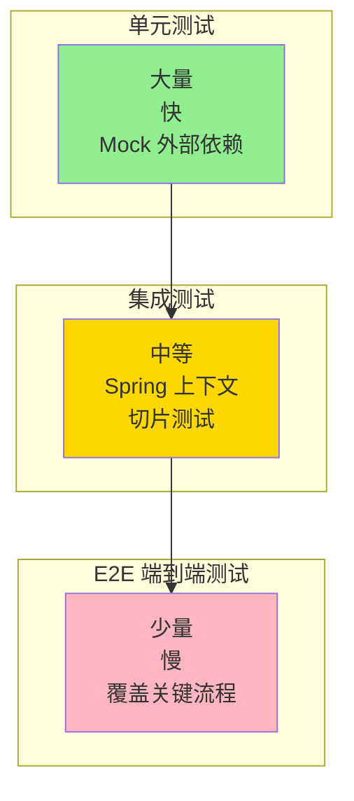

# JUnit5 与 Mockito 测试

> **文档说明**：系统讲解 JUnit5（Jupiter）测试框架与 Mockito 模拟框架的核心用法，包括测试生命周期、断言、参数化测试、Mock/Spy/InjectMocks、BDD 风格、Spring Boot 集成测试、Testcontainers、测试分层策略，含可运行的 Spring Boot 测试代码（含 pom.xml/Service 测试/Controller 测试/Repository 测试）。
>
> **适用人群**：Java 后端开发者、关注代码质量的全栈工程师、实践 TDD 的开发团队
>
> **前置知识**：[[SpringBoot-Web层设计]]、[[Java-语法进阶与StreamAPI]]、[[测试工程-TDD测试驱动开发]]

---

## 一、概述

### 1. 定义与核心价值

JUnit5 是 Java 最主流的测试框架，由 Jupiter（编程模型）、Platform（运行平台）、Vintage（兼容 JUnit4）三部分组成。Mockito 是最流行的 Mock 框架，通过创建模拟对象隔离被测代码的外部依赖。两者结合构成 Java 单元测试的标准工具链，支持测试驱动开发（TDD）、行为驱动开发（BDD），是保证代码质量和可维护性的基础。

### 2. 痛点对比

| 痛点（无测试/手动测试） | JUnit5 + Mockito 解决方式 |
|---------------------|------------------------|
| 修改代码后不知道是否破坏其他功能 | 自动化测试，一键回归验证 |
| 测试依赖数据库/外部服务，慢且不稳定 | Mock 外部依赖，测试快速且确定性 |
| 测试代码重复，维护成本高 | 参数化测试、@Nested 组织测试、复用 fixture |
| 异常场景难以复现 | Mockito.when().thenThrow() 模拟异常 |
| 无法验证方法调用次数/参数 | verify() 验证交互行为 |
| Spring 集成测试启动慢 | @WebMvcTest/@DataJpaTest 切片测试 |

### 3. 测试金字塔



**理想比例**：单元测试 70%，集成测试 20%，端到端测试 10%。

---

## 二、底层原理

### 1. JUnit5 生命周期

| 注解 | 执行时机 | 用途 |
|------|---------|------|
| `@BeforeAll` | 所有测试前执行一次（静态方法） | 初始化共享资源（数据库连接） |
| `@BeforeEach` | 每个测试前执行 | 初始化测试数据 |
| `@Test` | 测试方法 | 测试逻辑 |
| `@AfterEach` | 每个测试后执行 | 清理资源 |
| `@AfterAll` | 所有测试后执行一次（静态方法） | 释放共享资源 |

### 2. Mockito 核心概念

| 概念 | 说明 |
|------|------|
| `Mock` | 完全模拟对象，所有方法返回默认值（null/0/false） |
| `Spy` | 包装真实对象，可部分模拟（未 stub 的方法调用真实实现） |
| `Stub` | 定义方法调用的返回值（when().thenReturn()） |
| `Verify` | 验证方法是否被调用、调用次数、参数 |
| `InjectMocks` | 自动将 Mock 注入到被测对象中 |

---

## 三、实操

### 1. 项目配置

```xml
<!-- pom.xml -->
<dependencies>
    <dependency>
        <groupId>org.springframework.boot</groupId>
        <artifactId>spring-boot-starter-test</artifactId>
        <scope>test</scope>
        <!-- 包含 JUnit5 + Mockito + AssertJ -->
    </dependency>
    <dependency>
        <groupId>org.testcontainers</groupId>
        <artifactId>junit-jupiter</artifactId>
        <scope>test</scope>
    </dependency>
    <dependency>
        <groupId>org.testcontainers</groupId>
        <artifactId>postgresql</artifactId>
        <scope>test</scope>
    </dependency>
</dependencies>
```

### 2. 业务代码（被测对象）

```java
// UserService.java
package com.example.service;

import com.example.dto.UserDTO;
import com.example.entity.User;
import com.example.mapper.UserMapper;
import com.example.exception.BusinessException;
import lombok.RequiredArgsConstructor;
import org.springframework.stereotype.Service;
import org.springframework.transaction.annotation.Transactional;

@Service
@RequiredArgsConstructor
public class UserService {

    private final UserMapper userMapper;
    private final EmailService emailService;

    @Transactional
    public UserDTO createUser(UserDTO userDTO) {
        // 1. 校验邮箱是否已存在
        if (userMapper.existsByEmail(userDTO.getEmail())) {
            throw new BusinessException("邮箱已被注册");
        }

        // 2. 转换为实体并保存
        User user = new User();
        user.setName(userDTO.getName());
        user.setEmail(userDTO.getEmail());
        user.setStatus("ACTIVE");
        userMapper.insert(user);

        // 3. 发送欢迎邮件
        emailService.sendWelcomeEmail(user.getEmail(), user.getName());

        return UserDTO.from(user);
    }

    public UserDTO getUserById(Long id) {
        User user = userMapper.findById(id);
        if (user == null) {
            throw new BusinessException("用户不存在");
        }
        return UserDTO.from(user);
    }
}
```

### 3. 单元测试（纯 Mockito）

```java
// UserServiceTest.java
package com.example.service;

import com.example.dto.UserDTO;
import com.example.entity.User;
import com.example.exception.BusinessException;
import com.example.mapper.UserMapper;
import org.junit.jupiter.api.*;
import org.junit.jupiter.api.extension.ExtendWith;
import org.mockito.InjectMocks;
import org.mockito.Mock;
import org.mockito.junit.jupiter.MockitoExtension;

import static org.assertj.core.api.Assertions.*;
import static org.mockito.ArgumentMatchers.*;
import static org.mockito.Mockito.*;

@ExtendWith(MockitoExtension.class)
@DisplayName("用户服务测试")
class UserServiceTest {

    @Mock
    private UserMapper userMapper;

    @Mock
    private EmailService emailService;

    @InjectMocks
    private UserService userService;

    private UserDTO testUserDTO;

    @BeforeEach
    void setUp() {
        testUserDTO = new UserDTO();
        testUserDTO.setName("张三");
        testUserDTO.setEmail("zhangsan@example.com");
    }

    @Nested
    @DisplayName("创建用户")
    class CreateUserTests {

        @Test
        @DisplayName("正常创建用户成功")
        void shouldCreateUserSuccessfully() {
            // Given
            when(userMapper.existsByEmail("zhangsan@example.com")).thenReturn(false);
            when(userMapper.insert(any(User.class))).thenAnswer(invocation -> {
                User user = invocation.getArgument(0);
                user.setId(1L);
                return 1;
            });

            // When
            UserDTO result = userService.createUser(testUserDTO);

            // Then
            assertThat(result).isNotNull();
            assertThat(result.getName()).isEqualTo("张三");
            assertThat(result.getEmail()).isEqualTo("zhangsan@example.com");

            // 验证交互
            verify(userMapper).existsByEmail("zhangsan@example.com");
            verify(userMapper).insert(any(User.class));
            verify(emailService).sendWelcomeEmail("zhangsan@example.com", "张三");
            verifyNoMoreInteractions(userMapper);
        }

        @Test
        @DisplayName("邮箱已存在时抛出异常")
        void shouldThrowExceptionWhenEmailExists() {
            // Given
            when(userMapper.existsByEmail("zhangsan@example.com")).thenReturn(true);

            // When & Then
            assertThatThrownBy(() -> userService.createUser(testUserDTO))
                    .isInstanceOf(BusinessException.class)
                    .hasMessage("邮箱已被注册");

            // 验证后续操作未执行
            verify(userMapper, never()).insert(any());
            verify(emailService, never()).sendWelcomeEmail(anyString(), anyString());
        }

        @Test
        @DisplayName("创建用户时邮件发送失败不影响主流程")
        void shouldNotRollbackWhenEmailFails() {
            // Given
            when(userMapper.existsByEmail(anyString())).thenReturn(false);
            doThrow(new RuntimeException("邮件服务异常"))
                    .when(emailService).sendWelcomeEmail(anyString(), anyString());

            // When & Then
            // 如果业务要求邮件失败不影响，测试通过；如果要求回滚，则应抛异常
            assertThatCode(() -> userService.createUser(testUserDTO))
                    .doesNotThrowAnyException();
        }
    }

    @Nested
    @DisplayName("查询用户")
    class GetUserTests {

        @Test
        @DisplayName("根据ID查询用户成功")
        void shouldGetUserById() {
            // Given
            User user = new User();
            user.setId(1L);
            user.setName("张三");
            user.setEmail("zhangsan@example.com");
            when(userMapper.findById(1L)).thenReturn(user);

            // When
            UserDTO result = userService.getUserById(1L);

            // Then
            assertThat(result.getId()).isEqualTo(1L);
            assertThat(result.getName()).isEqualTo("张三");
        }

        @Test
        @DisplayName("用户不存在时抛出异常")
        void shouldThrowWhenUserNotFound() {
            when(userMapper.findById(999L)).thenReturn(null);

            assertThatThrownBy(() -> userService.getUserById(999L))
                    .isInstanceOf(BusinessException.class)
                    .hasMessage("用户不存在");
        }
    }

    // 参数化测试
    @ParameterizedTest
    @ValueSource(strings = {"test@test.com", "a@b.cn", "user@domain.org"})
    @DisplayName("不同邮箱格式都能正常创建")
    void shouldCreateUserWithDifferentEmails(String email) {
        testUserDTO.setEmail(email);
        when(userMapper.existsByEmail(email)).thenReturn(false);

        UserDTO result = userService.createUser(testUserDTO);

        assertThat(result.getEmail()).isEqualTo(email);
    }

    @ParameterizedTest
    @CsvSource({
            "张三, 25, 技术部",
            "李四, 30, 市场部",
            "王五, 35, 财务部"
    })
    @DisplayName("多参数测试：不同用户信息")
    void shouldHandleMultipleUsers(String name, int age, String department) {
        assertThat(name).isNotBlank();
        assertThat(age).isBetween(18, 65);
        assertThat(department).isIn("技术部", "市场部", "财务部");
    }
}
```

### 4. BDD 风格测试

```java
// UserServiceBDDTest.java
package com.example.service;

import com.example.dto.UserDTO;
import com.example.mapper.UserMapper;
import org.junit.jupiter.api.Test;
import org.junit.jupiter.api.extension.ExtendWith;
import org.mockito.InjectMocks;
import org.mockito.Mock;
import org.mockito.junit.jupiter.MockitoExtension;

import static org.assertj.core.api.Assertions.assertThat;
import static org.mockito.BDDMockito.*;

@ExtendWith(MockitoExtension.class)
class UserServiceBDDTest {

    @Mock
    private UserMapper userMapper;

    @Mock
    private EmailService emailService;

    @InjectMocks
    private UserService userService;

    @Test
    void should_create_user_when_email_not_exists() {
        // Given
        UserDTO userDTO = new UserDTO("张三", "zhangsan@example.com");
        given(userMapper.existsByEmail("zhangsan@example.com")).willReturn(false);
        given(userMapper.insert(any())).willReturn(1);

        // When
        UserDTO result = userService.createUser(userDTO);

        // Then
        assertThat(result.getName()).isEqualTo("张三");
        then(userMapper).should().insert(any());
        then(emailService).should().sendWelcomeEmail(anyString(), anyString());
    }
}
```

### 5. Controller 层测试（@WebMvcTest）

```java
// UserControllerTest.java
package com.example.controller;

import com.example.dto.UserDTO;
import com.example.service.UserService;
import com.fasterxml.jackson.databind.ObjectMapper;
import org.junit.jupiter.api.Test;
import org.springframework.beans.factory.annotation.Autowired;
import org.springframework.boot.test.autoconfigure.web.servlet.WebMvcTest;
import org.springframework.boot.test.mock.mockito.MockBean;
import org.springframework.http.MediaType;
import org.springframework.test.web.servlet.MockMvc;

import static org.mockito.ArgumentMatchers.any;
import static org.mockito.BDDMockito.given;
import static org.springframework.test.web.servlet.request.MockMvcRequestBuilders.*;
import static org.springframework.test.web.servlet.result.MockMvcResultMatchers.*;

@WebMvcTest(UserController.class)
class UserControllerTest {

    @Autowired
    private MockMvc mockMvc;

    @Autowired
    private ObjectMapper objectMapper;

    @MockBean
    private UserService userService;

    @Test
    void shouldCreateUser() throws Exception {
        // Given
        UserDTO request = new UserDTO("张三", "zhangsan@example.com");
        UserDTO response = new UserDTO(1L, "张三", "zhangsan@example.com");
        given(userService.createUser(any(UserDTO.class))).willReturn(response);

        // When & Then
        mockMvc.perform(post("/api/users")
                        .contentType(MediaType.APPLICATION_JSON)
                        .content(objectMapper.writeValueAsString(request)))
                .andExpect(status().isCreated())
                .andExpect(jsonPath("$.id").value(1))
                .andExpect(jsonPath("$.name").value("张三"))
                .andExpect(jsonPath("$.email").value("zhangsan@example.com"));
    }

    @Test
    void shouldGetUserById() throws Exception {
        UserDTO user = new UserDTO(1L, "张三", "zhangsan@example.com");
        given(userService.getUserById(1L)).willReturn(user);

        mockMvc.perform(get("/api/users/1"))
                .andExpect(status().isOk())
                .andExpect(jsonPath("$.name").value("张三"));
    }

    @Test
    void shouldReturn404WhenUserNotFound() throws Exception {
        given(userService.getUserById(999L))
                .willThrow(new com.example.exception.BusinessException("用户不存在"));

        mockMvc.perform(get("/api/users/999"))
                .andExpect(status().isNotFound());
    }
}
```

### 6. Repository 层测试（@DataJpaTest + Testcontainers）

```java
// UserRepositoryTest.java
package com.example.repository;

import com.example.entity.User;
import org.junit.jupiter.api.Test;
import org.springframework.beans.factory.annotation.Autowired;
import org.springframework.boot.test.autoconfigure.jdbc.AutoConfigureTestDatabase;
import org.springframework.boot.test.autoconfigure.orm.jpa.DataJpaTest;
import org.springframework.boot.test.autoconfigure.orm.jpa.TestEntityManager;
import org.springframework.test.context.DynamicPropertyRegistry;
import org.springframework.test.context.DynamicPropertySource;
import org.testcontainers.containers.PostgreSQLContainer;
import org.testcontainers.junit.jupiter.Container;
import org.testcontainers.junit.jupiter.Testcontainers;

import java.util.Optional;

import static org.assertj.core.api.Assertions.assertThat;

@DataJpaTest
@Testcontainers
@AutoConfigureTestDatabase(replace = AutoConfigureTestDatabase.Replace.NONE)
class UserRepositoryTest {

    @Container
    static PostgreSQLContainer<?> postgres = new PostgreSQLContainer<>("postgres:16")
            .withDatabaseName("testdb")
            .withUsername("test")
            .withPassword("test");

    @DynamicPropertySource
    static void configureProperties(DynamicPropertyRegistry registry) {
        registry.add("spring.datasource.url", postgres::getJdbcUrl);
        registry.add("spring.datasource.username", postgres::getUsername);
        registry.add("spring.datasource.password", postgres::getPassword);
    }

    @Autowired
    private TestEntityManager entityManager;

    @Autowired
    private UserRepository userRepository;

    @Test
    void shouldFindUserByEmail() {
        // Given
        User user = new User("张三", "zhangsan@example.com");
        entityManager.persistAndFlush(user);

        // When
        Optional<User> found = userRepository.findByEmail("zhangsan@example.com");

        // Then
        assertThat(found).isPresent();
        assertThat(found.get().getName()).isEqualTo("张三");
    }

    @Test
    void shouldReturnEmptyWhenEmailNotExists() {
        Optional<User> found = userRepository.findByEmail("nonexistent@example.com");
        assertThat(found).isEmpty();
    }
}
```

### 7. 集成测试（@SpringBootTest）

```java
// UserIntegrationTest.java
package com.example;

import com.example.dto.UserDTO;
import com.example.service.UserService;
import org.junit.jupiter.api.Test;
import org.springframework.beans.factory.annotation.Autowired;
import org.springframework.boot.test.context.SpringBootTest;
import org.springframework.test.context.ActiveProfiles;
import org.springframework.transaction.annotation.Transactional;

import static org.assertj.core.api.Assertions.assertThat;

@SpringBootTest
@ActiveProfiles("test")
@Transactional  // 测试后自动回滚
class UserIntegrationTest {

    @Autowired
    private UserService userService;

    @Test
    void shouldCreateAndRetrieveUser() {
        // Given
        UserDTO userDTO = new UserDTO("张三", "zhangsan@example.com");

        // When
        UserDTO created = userService.createUser(userDTO);
        UserDTO retrieved = userService.getUserById(created.getId());

        // Then
        assertThat(retrieved.getName()).isEqualTo("张三");
        assertThat(retrieved.getEmail()).isEqualTo("zhangsan@example.com");
    }
}
```

### 8. Mockito 高级用法

```java
// MockitoAdvancedTest.java
import org.mockito.ArgumentCaptor;
import org.mockito.InOrder;

import static org.mockito.Mockito.*;

class MockitoAdvancedTest {

    @Test
    void argumentCaptorExample() {
        // 参数捕获：验证传入方法的参数
        UserService service = mock(UserService.class);
        ArgumentCaptor<UserDTO> captor = ArgumentCaptor.forClass(UserDTO.class);

        service.createUser(new UserDTO("张三", "a@b.com"));

        verify(service).createUser(captor.capture());
        assertThat(captor.getValue().getName()).isEqualTo("张三");
    }

    @Test
    void inOrderExample() {
        // 验证调用顺序
        UserMapper mapper = mock(UserMapper.class);
        EmailService email = mock(EmailService.class);

        // ... 执行业务逻辑

        InOrder inOrder = inOrder(mapper, email);
        inOrder.verify(mapper).insert(any());
        inOrder.verify(email).sendWelcomeEmail(anyString(), anyString());
    }

    @Test
    void spyExample() {
        // Spy：部分模拟
        List<String> list = new ArrayList<>();
        List<String> spy = spy(list);

        // 真实方法
        spy.add("a");
        spy.add("b");

        // Stub 特定方法
        when(spy.size()).thenReturn(100);

        assertThat(spy.get(0)).isEqualTo("a");  // 真实值
        assertThat(spy.size()).isEqualTo(100);  // Stub 值
    }

    @Test
    void answerExample() {
        // 自定义返回逻辑
        when(userMapper.findById(anyLong())).thenAnswer(invocation -> {
            Long id = invocation.getArgument(0);
            User user = new User();
            user.setId(id);
            user.setName("用户" + id);
            return user;
        });
    }
}
```

---

## 四、常见问题与排查

| 问题现象 | 原因 | 解决方案 |
|---------|------|---------|
| `@Mock` 注入的对象为 null | 未加 `@ExtendWith(MockitoExtension.class)` | 在测试类上添加 `@ExtendWith(MockitoExtension.class)` |
| `@InjectMocks` 未注入 Mock | 构造器注入时 Mockito 无法匹配 | 确保字段名与构造器参数名一致；或用 `@MockBean`（Spring 环境） |
| Stub 不生效，返回 null | Mock 对象与被测对象使用的不是同一个实例 | 确认 `@InjectMocks` 的对象使用了 `@Mock` 的依赖；不要手动 new 被测对象 |
| `@WebMvcTest` 中 Service 为 null | 未用 `@MockBean` 替换 Service | Controller 依赖的 Service 用 `@MockBean` 注解 |
| Testcontainers 启动失败 | Docker 未运行，或镜像未拉取 | 启动 Docker Desktop；提前 `docker pull postgres:16` |
| 集成测试数据互相污染 | 测试数据未清理，或未加 `@Transactional` | 在测试类上加 `@Transactional`（自动回滚）；或用 `@BeforeEach` 清理 |
| 参数化测试报 `ParameterResolutionException` | 参数源与方法参数不匹配 | 检查 `@ValueSource`/`@CsvSource` 类型与方法参数一致 |
| `when()` 报 `UnnecessaryStubbingException` | Stub 了但未使用的方法 | 用 `lenient().when()` 或删除未使用的 Stub；或用 `@MockitoSettings(strictness = LENIENT)` |
| 静态方法无法 Mock | Mockito 默认不支持静态方法 | 使用 `mockStatic()`（Mockito 3.4+）或 PowerMock |
| 测试运行顺序不确定导致失败 | 测试之间有依赖，共享状态 | 每个测试独立，用 `@BeforeEach` 初始化；不要依赖测试执行顺序 |

---

## 五、进阶与最佳实践

### 1. 测试命名规范

| 风格 | 示例 |
|------|------|
| 方法名_场景_预期 | `createUser_EmailExists_ThrowsException` |
| should_预期_场景 | `should_ThrowException_WhenEmailExists` |
| 中文显示名 | `@DisplayName("邮箱已存在时抛出异常")` |

**推荐**：用 `@DisplayName` 写中文描述，方法名用英文 should 风格。

### 2. 测试分层策略

| 层级 | 注解 | 速度 | 覆盖范围 |
|------|------|------|---------|
| 单元测试 | `@ExtendWith(MockitoExtension.class)` | <10ms | 单个类，Mock 所有依赖 |
| Web 切片 | `@WebMvcTest` | ~1s | Controller 层 |
| JPA 切片 | `@DataJpaTest` | ~2s | Repository 层 |
| 集成测试 | `@SpringBootTest` | ~10s | 完整 Spring 上下文 |
| 端到端 | `@SpringBootTest(webEnvironment=RANDOM_PORT)` | ~30s | 完整 HTTP 流程 |

### 3. 测试覆盖率目标

| 类型 | 推荐覆盖率 |
|------|-----------|
| 业务逻辑（Service） | >80% |
| 工具类 | 100% |
| Controller | >60%（参数校验为主） |
| Repository | >50%（关键查询） |
| 配置类 | 不强制 |

**注意**：覆盖率不是目标，高质量的测试才是。100% 覆盖率不代表没有 bug。

### 4. TDD 循环

```
红（Red）→ 写一个失败的测试
绿（Green）→ 写最少的代码让测试通过
重构（Refactor）→ 优化代码，保持测试通过
    ↓
重复循环
```

---

## 六、关联笔记

### 测试工程
- [[测试工程-TDD测试驱动开发]] · [[测试工程-测试金字塔与分层策略]] · [[测试工程-测试覆盖率与质量度量]]
- [[测试工程-Mock与Stub实战]] · [[SonarQube-代码质量门禁]]

### 工程化
- [[Maven-多模块与依赖管理]] · [[CI-CD持续集成与部署]] · [[Jenkins流水线设计]]

### Spring
- [[SpringBoot-Web层设计]] · [[SpringBoot-自动装配原理]] · [[SpringDataJPA与MyBatis对比]]

### 导航
- [[MOC-后端开发]] · [[MOC-Java全栈-四级展开]] · [[Java-全栈技术枢纽]]

> **学习路径建议**：先掌握 [[SpringBoot-Web层设计]] 业务代码 → 学习 [[测试工程-TDD测试驱动开发]] TDD 理念 → 深入本文 JUnit5 + Mockito 实践 → 实践 [[测试工程-测试金字塔与分层策略]] 测试分层 → 应用于 [[CI-CD持续集成与部署]] 自动化测试。
