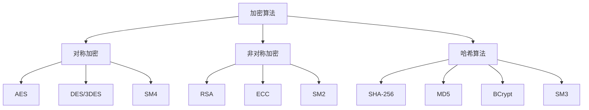

# Java-数据加密与脱敏

> **文档说明**：系统讲解 Java 数据加密与脱敏的完整方案，包括加密算法分类、JCA 加密 API、对称加密（AES）、非对称加密（RSA）、哈希算法、数字签名、数据脱敏、密钥管理，以及生产级最佳实践和常见问题。
>
> **适用人群**：后端开发工程师、全栈开发者、安全工程师、需要处理敏感数据的 Java 开发者
>
> **前置知识**：[[密码学基础与应用]]、[[Java-微服务安全架构]]、[[SpringSecurity-认证授权]]、[[认证与授权原理-OAuth2-JWT]]

---

## 一、概述

### 1. 加密与脱敏的区别

| 概念 | 说明 | 可逆性 | 适用场景 |
|------|------|--------|---------|
| **加密（Encryption）** | 用密钥将明文转为密文 | 可逆（有密钥可解密） | 需要还原的数据（存储、传输） |
| **哈希（Hash）** | 将数据转为固定长度摘要 | 不可逆 | 密码存储、完整性校验 |
| **脱敏（Masking）** | 部分隐藏敏感信息 | 不可逆（显示用） | 日志、界面展示、报表 |
| **令牌化（Tokenization）** | 用随机令牌替换真实数据 | 可逆（通过映射表） | 支付卡、第三方系统 |

### 2. 加密算法分类



| 类别 | 算法 | 密钥长度 | 速度 | 适用场景 |
|------|------|---------|------|---------|
| **对称加密** | AES-256 | 256位 | 快 | 大数据量加密 |
| **对称加密** | SM4 | 128位 | 快 | 国密合规 |
| **非对称加密** | RSA-2048 | 2048位 | 慢 | 密钥交换、数字签名 |
| **非对称加密** | ECC-256 | 256位 | 中 | 短密钥高安全 |
| **哈希** | SHA-256 | - | 快 | 完整性校验 |
| **哈希** | BCrypt | - | 慢（可调） | 密码存储 |
| **哈希** | SM3 | - | 快 | 国密合规 |

### 3. Java 加密架构（JCA）

```
JCA（Java Cryptography Architecture）核心类：
- Cipher：加密/解密
- MessageDigest：哈希摘要
- Signature：数字签名
- KeyGenerator：对称密钥生成
- KeyPairGenerator：非对称密钥对生成
- SecretKeyFactory：密钥工厂
- KeyStore：密钥存储
- SecureRandom：安全随机数
```

---

## 二、对称加密（AES）

### 1. AES 加密工具类

```java
import javax.crypto.Cipher;
import javax.crypto.KeyGenerator;
import javax.crypto.SecretKey;
import javax.crypto.spec.GCMParameterSpec;
import javax.crypto.spec.SecretKeySpec;
import java.security.SecureRandom;
import java.util.Base64;

public class AesUtil {

    private static final String ALGORITHM = "AES";
    private static final String TRANSFORMATION = "AES/GCM/NoPadding";
    private static final int GCM_TAG_LENGTH = 128;
    private static final int IV_LENGTH = 12;  // GCM 推荐 12 字节

    /**
     * 生成 AES 密钥
     */
    public static SecretKey generateKey(int keySize) throws Exception {
        KeyGenerator keyGenerator = KeyGenerator.getInstance(ALGORITHM);
        keyGenerator.init(keySize, new SecureRandom());  // 256 位
        return keyGenerator.generateKey();
    }

    /**
     * 加密（AES-GCM，推荐）
     */
    public static String encrypt(String plainText, SecretKey key) throws Exception {
        // 生成随机 IV
        byte[] iv = new byte[IV_LENGTH];
        new SecureRandom().nextBytes(iv);

        Cipher cipher = Cipher.getInstance(TRANSFORMATION);
        GCMParameterSpec spec = new GCMParameterSpec(GCM_TAG_LENGTH, iv);
        cipher.init(Cipher.ENCRYPT_MODE, key, spec);

        byte[] encrypted = cipher.doFinal(plainText.getBytes("UTF-8"));

        // IV + 密文 一起存储（IV 不需要保密）
        byte[] combined = new byte[iv.length + encrypted.length];
        System.arraycopy(iv, 0, combined, 0, iv.length);
        System.arraycopy(encrypted, 0, combined, iv.length, encrypted.length);

        return Base64.getEncoder().encodeToString(combined);
    }

    /**
     * 解密
     */
    public static String decrypt(String cipherText, SecretKey key) throws Exception {
        byte[] combined = Base64.getDecoder().decode(cipherText);

        // 分离 IV 和密文
        byte[] iv = new byte[IV_LENGTH];
        byte[] encrypted = new byte[combined.length - IV_LENGTH];
        System.arraycopy(combined, 0, iv, 0, IV_LENGTH);
        System.arraycopy(combined, IV_LENGTH, encrypted, 0, encrypted.length);

        Cipher cipher = Cipher.getInstance(TRANSFORMATION);
        GCMParameterSpec spec = new GCMParameterSpec(GCM_TAG_LENGTH, iv);
        cipher.init(Cipher.DECRYPT_MODE, key, spec);

        byte[] decrypted = cipher.doFinal(encrypted);
        return new String(decrypted, "UTF-8");
    }

    /**
     * 从 Base64 字符串恢复密钥
     */
    public static SecretKey keyFromString(String keyBase64) {
        byte[] keyBytes = Base64.getDecoder().decode(keyBase64);
        return new SecretKeySpec(keyBytes, ALGORITHM);
    }
}
```

### 2. AES 加密模式对比

| 模式 | 说明 | 安全性 | 推荐 |
|------|------|--------|------|
| **ECB** | 电子密码本，相同明文产生相同密文 | 低 | ❌ 不推荐 |
| **CBC** | 密码分组链接，需 IV | 中 | ⚠️ 需配合 HMAC |
| **CTR** | 计数器模式 | 中 | ⚠️ 需配合 HMAC |
| **GCM** | 认证加密，同时提供机密性和完整性 | 高 | ✅ 推荐 |
| **CCM** | 认证加密 | 高 | ✅ 可选 |

> **推荐使用 AES/GCM/NoPadding**：同时提供加密和完整性校验，防止篡改。

### 3. 使用示例

```java
// 生成密钥（一次生成，安全存储）
SecretKey key = AesUtil.generateKey(256);
String keyBase64 = Base64.getEncoder().encodeToString(key.getEncoded());
// 保存 keyBase64 到安全的配置中心或 Vault

// 加密
String encrypted = AesUtil.encrypt("敏感数据", key);

// 解密
SecretKey restoredKey = AesUtil.keyFromString(keyBase64);
String decrypted = AesUtil.decrypt(encrypted, restoredKey);
```

---

## 三、非对称加密（RSA）

### 1. RSA 工具类

```java
import java.security.*;
import java.security.spec.PKCS8EncodedKeySpec;
import java.security.spec.X509EncodedKeySpec;
import java.util.Base64;
import javax.crypto.Cipher;

public class RsaUtil {

    private static final String ALGORITHM = "RSA";
    private static final int KEY_SIZE = 2048;

    /**
     * 生成密钥对
     */
    public static KeyPair generateKeyPair() throws Exception {
        KeyPairGenerator generator = KeyPairGenerator.getInstance(ALGORITHM);
        generator.initialize(KEY_SIZE, new SecureRandom());
        return generator.generateKeyPair();
    }

    /**
     * 公钥加密
     */
    public static String encrypt(String plainText, PublicKey publicKey) throws Exception {
        Cipher cipher = Cipher.getInstance("RSA/ECB/OAEPWithSHA-256AndMGF1Padding");
        cipher.init(Cipher.ENCRYPT_MODE, publicKey);
        byte[] encrypted = cipher.doFinal(plainText.getBytes("UTF-8"));
        return Base64.getEncoder().encodeToString(encrypted);
    }

    /**
     * 私钥解密
     */
    public static String decrypt(String cipherText, PrivateKey privateKey) throws Exception {
        Cipher cipher = Cipher.getInstance("RSA/ECB/OAEPWithSHA-256AndMGF1Padding");
        cipher.init(Cipher.DECRYPT_MODE, privateKey);
        byte[] decrypted = cipher.doFinal(Base64.getDecoder().decode(cipherText));
        return new String(decrypted, "UTF-8");
    }

    /**
     * 密钥序列化
     */
    public static String publicKeyToString(PublicKey key) {
        return Base64.getEncoder().encodeToString(key.getEncoded());
    }

    public static String privateKeyToString(PrivateKey key) {
        return Base64.getEncoder().encodeToString(key.getEncoded());
    }

    public static PublicKey publicKeyFromString(String keyBase64) throws Exception {
        byte[] keyBytes = Base64.getDecoder().decode(keyBase64);
        X509EncodedKeySpec spec = new X509EncodedKeySpec(keyBytes);
        return KeyFactory.getInstance(ALGORITHM).generatePublic(spec);
    }

    public static PrivateKey privateKeyFromString(String keyBase64) throws Exception {
        byte[] keyBytes = Base64.getDecoder().decode(keyBase64);
        PKCS8EncodedKeySpec spec = new PKCS8EncodedKeySpec(keyBytes);
        return KeyFactory.getInstance(ALGORITHM).generatePrivate(spec);
    }
}
```

### 2. 混合加密（推荐）

RSA 加密速度慢且有长度限制（2048位密钥最多加密245字节），实际应用中使用**混合加密**：

```java
/**
 * 混合加密：RSA 加密 AES 密钥，AES 加密数据
 */
public class HybridEncryption {

    public static class EncryptedData {
        public String encryptedKey;   // RSA 加密的 AES 密钥
        public String encryptedData;  // AES 加密的数据
    }

    public static EncryptedData encrypt(String plainText, PublicKey publicKey) throws Exception {
        // 1. 生成随机 AES 密钥
        SecretKey aesKey = AesUtil.generateKey(256);

        // 2. AES 加密数据
        String encryptedData = AesUtil.encrypt(plainText, aesKey);

        // 3. RSA 加密 AES 密钥
        String keyBase64 = Base64.getEncoder().encodeToString(aesKey.getEncoded());
        String encryptedKey = RsaUtil.encrypt(keyBase64, publicKey);

        EncryptedData result = new EncryptedData();
        result.encryptedKey = encryptedKey;
        result.encryptedData = encryptedData;
        return result;
    }

    public static String decrypt(EncryptedData data, PrivateKey privateKey) throws Exception {
        // 1. RSA 解密 AES 密钥
        String keyBase64 = RsaUtil.decrypt(data.encryptedKey, privateKey);
        SecretKey aesKey = AesUtil.keyFromString(keyBase64);

        // 2. AES 解密数据
        return AesUtil.decrypt(data.encryptedData, aesKey);
    }
}
```

---

## 四、哈希算法

### 1. 通用哈希

```java
import java.security.MessageDigest;

public class HashUtil {

    /**
     * SHA-256 哈希
     */
    public static String sha256(String input) throws Exception {
        MessageDigest digest = MessageDigest.getInstance("SHA-256");
        byte[] hash = digest.digest(input.getBytes("UTF-8"));
        return bytesToHex(hash);
    }

    /**
     * 带盐值的哈希
     */
    public static String sha256WithSalt(String input, String salt) throws Exception {
        MessageDigest digest = MessageDigest.getInstance("SHA-256");
        digest.update(salt.getBytes("UTF-8"));
        byte[] hash = digest.digest(input.getBytes("UTF-8"));
        return bytesToHex(hash);
    }

    private static String bytesToHex(byte[] bytes) {
        StringBuilder sb = new StringBuilder();
        for (byte b : bytes) {
            sb.append(String.format("%02x", b));
        }
        return sb.toString();
    }
}
```

### 2. 密码哈希（BCrypt）

```java
// 使用 Spring Security 的 BCrypt
import org.springframework.security.crypto.bcrypt.BCryptPasswordEncoder;

public class PasswordUtil {

    private static final BCryptPasswordEncoder encoder = new BCryptPasswordEncoder(12);  // 强度 12

    /**
     * 加密密码（自动加盐）
     */
    public static String hashPassword(String password) {
        return encoder.encode(password);
        // 输出格式：$2a$12$xxxxxxxxxxxxxxxxxxxxxxxxxxxxxxxxxxxxxxxxxxxxxxxxxxxx
        // 包含算法、强度、盐值、哈希值
    }

    /**
     * 验证密码
     */
    public static boolean verifyPassword(String rawPassword, String encodedPassword) {
        return encoder.matches(rawPassword, encodedPassword);
    }
}

// 使用示例
String hashed = PasswordUtil.hashPassword("myPassword123");
boolean valid = PasswordUtil.verifyPassword("myPassword123", hashed);  // true
```

> **密码存储绝对不能用 MD5/SHA 不加盐**，必须用 BCrypt/Argon2/PBKDF2 等慢哈希算法。

### 3. 密码算法对比

| 算法 | 速度 | 加盐 | 抗暴力破解 | 推荐 |
|------|------|------|-----------|------|
| **MD5** | 极快 | 需手动 | 弱 | ❌ 不推荐 |
| **SHA-256** | 快 | 需手动 | 中 | ⚠️ 不适合密码 |
| **BCrypt** | 慢（可调） | 自动 | 强 | ✅ 推荐 |
| **Argon2** | 慢（可调） | 自动 | 最强 | ✅ 首选（如支持） |
| **PBKDF2** | 慢（可调） | 自动 | 强 | ✅ 可选 |

---

## 五、数字签名

### 1. RSA 数字签名

```java
import java.security.Signature;

public class SignatureUtil {

    /**
     * 私钥签名
     */
    public static String sign(String data, PrivateKey privateKey) throws Exception {
        Signature signature = Signature.getInstance("SHA256withRSA");
        signature.initSign(privateKey);
        signature.update(data.getBytes("UTF-8"));
        byte[] signed = signature.sign();
        return Base64.getEncoder().encodeToString(signed);
    }

    /**
     * 公钥验签
     */
    public static boolean verify(String data, String signatureStr, PublicKey publicKey) throws Exception {
        Signature signature = Signature.getInstance("SHA256withRSA");
        signature.initVerify(publicKey);
        signature.update(data.getBytes("UTF-8"));
        return signature.verify(Base64.getDecoder().decode(signatureStr));
    }
}
```

### 2. 签名流程

```
发送方：
1. 对数据计算哈希（SHA-256）
2. 用私钥加密哈希值（签名）
3. 发送 数据 + 签名

接收方：
1. 对收到的数据计算哈希
2. 用公钥解密签名，得到发送方的哈希
3. 比较两个哈希是否一致
4. 一致则数据完整且来源可信
```

---

## 六、数据脱敏

### 1. 脱敏工具类

```java
import java.util.regex.Pattern;

public class DataMaskUtil {

    /**
     * 手机号脱敏：138****8888
     */
    public static String maskPhone(String phone) {
        if (phone == null || phone.length() < 7) return "***";
        return phone.substring(0, 3) + "****" + phone.substring(phone.length() - 4);
    }

    /**
     * 身份证脱敏：110***********1234
     */
    public static String maskIdCard(String idCard) {
        if (idCard == null || idCard.length() < 10) return "***";
        return idCard.substring(0, 3) + "*".repeat(idCard.length() - 7) + idCard.substring(idCard.length() - 4);
    }

    /**
     * 邮箱脱敏：z***@example.com
     */
    public static String maskEmail(String email) {
        if (email == null || !email.contains("@")) return "***";
        int atIndex = email.indexOf("@");
        String name = email.substring(0, atIndex);
        String domain = email.substring(atIndex);
        if (name.length() <= 1) return name + "***" + domain;
        return name.charAt(0) + "***" + domain;
    }

    /**
     * 银行卡号脱敏：**** **** **** 1234
     */
    public static String maskBankCard(String card) {
        if (card == null || card.length() < 4) return "***";
        return "**** **** **** " + card.substring(card.length() - 4);
    }

    /**
     * 姓名脱敏：张* / 张*三
     */
    public static String maskName(String name) {
        if (name == null || name.isEmpty()) return "***";
        if (name.length() == 1) return name;
        if (name.length() == 2) return name.charAt(0) + "*";
        return name.charAt(0) + "*".repeat(name.length() - 2) + name.charAt(name.length() - 1);
    }

    /**
     * 地址脱敏：北京市朝阳区***
     */
    public static String maskAddress(String address) {
        if (address == null || address.length() < 6) return "***";
        return address.substring(0, 6) + "***";
    }

    /**
     * 通用脱敏（保留前 N 位和后 M 位）
     */
    public static String mask(String data, int keepStart, int keepEnd) {
        if (data == null) return null;
        if (data.length() <= keepStart + keepEnd) return "*".repeat(data.length());
        return data.substring(0, keepStart) + "*".repeat(data.length() - keepStart - keepEnd) + data.substring(data.length() - keepEnd);
    }
}
```

### 2. 日志脱敏

```java
// Logback 脱敏 Pattern（通过自定义 Converter）
public class SensitiveDataConverter extends ClassicConverter {

    private static final Pattern PHONE_PATTERN = Pattern.compile("1[3-9]\\d{9}");
    private static final Pattern ID_CARD_PATTERN = Pattern.compile("\\d{17}[\\dXx]");

    @Override
    public String convert(ILoggingEvent event) {
        String message = event.getFormattedMessage();
        // 手机号脱敏
        message = PHONE_PATTERN.matcher(message).replaceAll(
            m -> m.group().substring(0, 3) + "****" + m.group().substring(7));
        // 身份证脱敏
        message = ID_CARD_PATTERN.matcher(message).replaceAll(
            m -> m.group().substring(0, 6) + "********" + m.group().substring(14));
        return message;
    }
}

// logback-spring.xml 配置
// <conversionRule conversionWord="msg" converterClass="com.example.SensitiveDataConverter" />
```

### 3. Jackson 序列化脱敏

```java
// 自定义脱敏注解
@Target(ElementType.FIELD)
@Retention(RetentionPolicy.RUNTIME)
public @interface Sensitive {
    SensitiveType type();
}

public enum SensitiveType {
    PHONE, ID_CARD, EMAIL, BANK_CARD, NAME, ADDRESS
}

// Jackson 序列化器
public class SensitiveSerializer extends JsonSerializer<String>
        implements ContextualSerializer {

    private SensitiveType type;

    @Override
    public void serialize(String value, JsonGenerator gen,
                          SerializerProvider serializers) throws IOException {
        if (value == null) {
            gen.writeNull();
            return;
        }
        switch (type) {
            case PHONE -> gen.writeString(DataMaskUtil.maskPhone(value));
            case ID_CARD -> gen.writeString(DataMaskUtil.maskIdCard(value));
            case EMAIL -> gen.writeString(DataMaskUtil.maskEmail(value));
            default -> gen.writeString("***");
        }
    }

    @Override
    public JsonSerializer<?> createContextual(SerializerProvider prov,
                                              BeanProperty property) {
        Sensitive annotation = property.getAnnotation(Sensitive.class);
        if (annotation != null) {
            this.type = annotation.type();
            return this;
        }
        return prov.findValueSerializer(property.getType(), property);
    }
}

// 使用
public class UserVO {
    private Long id;
    private String name;

    @Sensitive(type = SensitiveType.PHONE)
    private String phone;

    @Sensitive(type = SensitiveType.ID_CARD)
    private String idCard;

    @Sensitive(type = SensitiveType.EMAIL)
    private String email;
}
```

### 4. 数据库字段加密（JPA）

```java
// JPA AttributeConverter 自动加密解密
@Converter
public class EncryptedConverter implements AttributeConverter<String, String> {

    @Autowired
    private EncryptionService encryptionService;

    @Override
    public String convertToDatabaseColumn(String attribute) {
        if (attribute == null) return null;
        return encryptionService.encrypt(attribute);
    }

    @Override
    public String convertToEntityAttribute(String dbData) {
        if (dbData == null) return null;
        return encryptionService.decrypt(dbData);
    }
}

// 使用
@Entity
public class User {
    @Id
    private Long id;

    @Convert(converter = EncryptedConverter.class)
    private String idCard;  // 数据库加密存储

    @Convert(converter = EncryptedConverter.class)
    private String phone;
}
```

---

## 七、密钥管理

### 1. 密钥存储方案

| 方案 | 说明 | 安全性 | 适用场景 |
|------|------|--------|---------|
| **配置文件** | 密钥存在 application.yml | 低 | 开发测试 |
| **环境变量** | 密钥存在环境变量 | 中 | 简单部署 |
| **配置中心** | Nacos/Apollo 加密存储 | 中高 | 微服务 |
| **Vault** | HashiCorp Vault 专用密钥管理 | 高 | 生产级 |
| **KMS** | 云厂商密钥管理服务 | 高 | 云原生 |
| **HSM** | 硬件安全模块 | 最高 | 金融/政府 |

### 2. Spring Boot 加密配置

```yaml
# application.yml（使用 jasypt 加密）
jasypt:
  encryptor:
    password: ${JASYPT_PASSWORD}  # 主密码从环境变量读取
    algorithm: PBEWithMD5AndDES

spring:
  datasource:
    password: ENC(加密后的密码)  # jasypt 自动解密
```

```java
// 启动时指定主密码
// java -jar app.jar -Djasypt.encryptor.password=your-master-password
```

### 3. 密钥轮换

```
密钥轮换策略：
1. 定期轮换：如每 90 天轮换一次加密密钥
2. 双密钥过渡期：新旧密钥同时支持解密
3. 数据重加密：轮换后逐步重新加密历史数据
4. 版本标识：密文中包含密钥版本号，便于识别
```

---

## 八、最佳实践

### 1. 加密规范

- [ ] **使用 AES-GCM**：对称加密首选 AES/GCM/NoPadding
- [ ] **使用 RSA-OAEP**：非对称加密用 RSA/ECB/OAEPWithSHA-256AndMGF1Padding
- [ ] **密码用 BCrypt/Argon2**：密码存储不用 MD5/SHA
- [ ] **每次加密用随机 IV**：IV 不需要保密，但必须随机
- [ ] **密钥长度足够**：AES-256、RSA-2048+、ECC-256+
- [ ] **使用 SecureRandom**：密钥和 IV 生成用 SecureRandom，不用 Random
- [ ] **混合加密**：大数据用 AES，密钥用 RSA 加密
- [ ] **国密合规**：国内合规场景用 SM2/SM3/SM4

### 2. 脱敏规范

- [ ] **日志脱敏**：所有日志输出必须脱敏
- [ ] **界面脱敏**：前端展示敏感信息脱敏
- [ ] **接口脱敏**：API 返回敏感信息脱敏（按权限）
- [ ] **数据库加密**：高敏感字段数据库加密存储
- [ ] **传输加密**：HTTPS/TLS 加密传输
- [ ] **最小展示**：只展示必要的信息

### 3. 密钥管理规范

- [ ] **密钥不硬编码**：不将密钥写在代码中
- [ ] **密钥不入库**：不将密钥提交到 Git
- [ ] **使用密钥管理服务**：Vault/KMS/HSM
- [ ] **密钥轮换**：定期轮换密钥
- [ ] **权限控制**：密钥访问最小权限
- [ ] **审计日志**：密钥使用可审计

### 4. 安全编码

- [ ] **异常处理**：加密异常不泄露密钥信息
- [ ] **内存清理**：敏感数据使用后清理内存
- [ ] **防侧信道**：避免时间侧信道攻击
- [ ] **依赖更新**：加密库及时更新安全补丁
- [ ] **不自己造轮子**：使用标准库，不自行实现加密算法

---

## 九、常见问题与排查

| 问题 | 原因 | 解决方案 |
|------|------|---------|
| **解密失败 BadPadding** | 密钥错误 / IV 错误 / 数据被篡改 | 检查密钥、IV 提取、数据完整性 |
| **AES 密钥长度无效** | JCE 策略限制 256 位 | 安装无限制策略文件 / Java 8u161+ 默认支持 |
| **RSA 加密数据过长** | RSA 有长度限制 | 使用混合加密（RSA+AES） |
| **密码验证慢** | BCrypt 强度设置过高 | 调整强度（10-12 合适） |
| **MD5 碰撞** | MD5 不安全 | 改用 SHA-256 或 BCrypt |
| **IV 重复** | IV 未随机生成 | 每次加密生成新的随机 IV |
| **加密后数据变长** | Base64 编码 / IV+密文 | 数据库字段预留足够长度 |
| **密钥泄露** | 密钥硬编码 / 提交 Git | 使用 Vault/环境变量、清理 Git 历史 |
| **跨语言加解密不一致** | 算法/模式/填充不匹配 | 统一算法参数（AES/GCM/NoPadding） |
| **脱敏不彻底** | 日志/缓存/备份未脱敏 | 全链路脱敏检查、备份加密 |
| **数据库加密后无法查询** | 加密后字段不能模糊查询 | 使用确定性加密 / 单独建索引字段 |
| **国密算法不可用** | 未引入国密库 | 使用 BouncyCastle 或 Hutool 国密支持 |
| **性能瓶颈** | 加密操作耗时 | 缓存加密结果、异步加密、硬件加速 |
| **密钥轮换数据丢失** | 旧数据无法解密 | 双密钥过渡期、数据重加密 |
| **HTTPS 不生效** | 证书配置错误 | 检查证书、端口、重定向配置 |

---

## 十、关联笔记

### 安全相关
- [[密码学基础与应用]] · [[Java-微服务安全架构]] · [[SpringSecurity-认证授权]]
- [[认证与授权原理-OAuth2-JWT]] · [[API安全最佳实践]] · [[前端敏感数据保护]]

### 后端
- [[SpringBoot-Web层设计]] · [[Java-SQL注入与XSS防护]] · [[Java问题排查手册]]
- [[JVM-调优工具实战-Arthas]]

### AI 安全
- [[AI安全与对齐基础]] · [[Prompt注入攻击与防护]] · [[RAG安全与防注入]]

### 导航
- [[MOC-后端开发]] · [[MOC-计算机基础]] · [[全栈+AI工程双轨融合学习路线图]]

> **学习路径建议**：先掌握 [[密码学基础与应用]] 密码学基础 → 深入本文 Java 数据加密与脱敏 → 学习 [[SpringSecurity-认证授权]] 框架集成 → 实践 [[Java-微服务安全架构]] 微服务安全 → 研究 [[认证与授权原理-OAuth2-JWT]] 认证体系 → 构建完整的 Java 应用数据安全体系。
