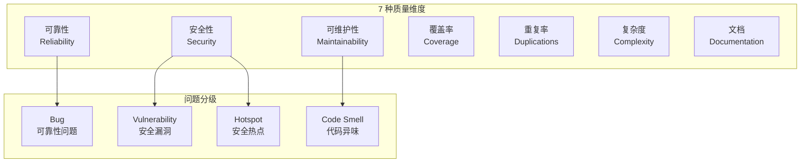

# SonarQube 代码质量门禁

> **文档说明**：系统讲解 SonarQube 代码质量平台的部署与使用，包括静态代码分析、质量门禁（Quality Gate）配置、规则管理、技术债务管理、CI/CD 集成、Maven/Gradle 扫描配置、常见问题修复指南，含可运行的 Docker 部署、sonar-project.properties 配置、Jenkins Pipeline 集成和质量门禁最佳实践。
>
> **适用人群**：Java 后端开发者、DevOps 工程师、关注代码质量的技术负责人、需要建立团队质量体系的架构师
>
> **前置知识**：[[JUnit5与Mockito测试]]、[[Maven-多模块与依赖管理]]、[[CI-CD持续集成与部署]]

---

## 一、概述

### 1. 定义与核心价值

SonarQube 是开源的代码质量管理平台，通过静态分析检测代码中的 Bug、漏洞、代码异味（Code Smell）、重复代码、测试覆盖率等问题，并通过**质量门禁（Quality Gate）** 设定可量化的质量标准，不达标则阻止合并/发布。它是 DevOps 流水线中质量保障的核心环节，帮助团队从"代码能跑"升级到"代码可维护"。

### 2. 痛点对比

| 痛点（无代码质量管控） | SonarQube 解决方式 |
|-------------------|------------------|
| Code Review 只看逻辑，忽略潜在 Bug | 静态分析自动检测 600+ 种代码问题 |
| 技术债务越积越多，无人关注 | 量化技术债务（修复时间估算），可视化趋势 |
| 安全漏洞（SQL 注入/XSS）上线后才发现 | 内置安全规则，检测 OWASP Top 10 |
| 代码重复严重，维护成本高 | 重复代码检测，标记重复块 |
| 测试覆盖率低，回归风险大 | 集成 JaCoCo 覆盖率报告，门禁卡覆盖率 |
| 质量标准不统一，因人而异 | 质量门禁量化标准，CI 自动卡点 |

### 3. SonarQube 质量模型



---

## 二、底层原理

### 1. 静态分析流程

```
源代码 → 词法分析 → 语法分析(AST) → 语义分析 → 规则匹配 → 问题报告
```

SonarQube 使用不同语言的分析器（Java Analyzer、JS Analyzer 等），将代码解析为抽象语法树（AST），然后应用数百条规则检测问题。

### 2. 质量门禁判定

质量门禁基于**新代码**和**整体代码**两个维度，默认门禁（Sonar way）要求：

| 指标 | 新代码阈值 | 说明 |
|------|----------|------|
| 覆盖率 | ≥ 80% | 新代码测试覆盖率 |
| 重复率 | ≤ 3% | 新代码重复行占比 |
| Bug | 0 | 新代码无 Bug |
| 漏洞 | 0 | 新代码无安全漏洞 |
| 代码异味 | 0 | 新代码无代码异味 |
| 安全评级 | A | 新代码安全评级 |

---

## 三、实操

### 1. Docker 部署 SonarQube

```yaml
# docker-compose.yml
version: "3.8"

services:
  sonarqube:
    image: sonarqube:10.4-community
    container_name: sonarqube
    ports:
      - "9000:9000"
    environment:
      - SONAR_JDBC_URL=jdbc:postgresql://db:5432/sonar
      - SONAR_JDBC_USERNAME=sonar
      - SONAR_JDBC_PASSWORD=sonar
    volumes:
      - sonarqube_data:/opt/sonarqube/data
      - sonarqube_extensions:/opt/sonarqube/extensions
      - sonarqube_logs:/opt/sonarqube/logs
    depends_on:
      - db
    restart: unless-stopped

  db:
    image: postgres:16
    container_name: sonarqube-db
    environment:
      - POSTGRES_USER=sonar
      - POSTGRES_PASSWORD=sonar
      - POSTGRES_DB=sonar
    volumes:
      - postgresql_data:/var/lib/postgresql/data
    restart: unless-stopped

volumes:
  sonarqube_data:
  sonarqube_extensions:
  sonarqube_logs:
  postgresql_data:
```

```bash
# 启动
docker-compose up -d

# 访问 http://localhost:9000
# 默认账号: admin / admin（首次登录需修改密码）
```

### 2. Maven 项目扫描配置

```xml
<!-- pom.xml 中添加 SonarQube 插件 -->
<build>
    <plugins>
        <plugin>
            <groupId>org.sonarsource.scanner.maven</groupId>
            <artifactId>sonar-maven-plugin</artifactId>
            <version>3.11.0.3922</version>
        </plugin>
        <!-- JaCoCo 覆盖率插件 -->
        <plugin>
            <groupId>org.jacoco</groupId>
            <artifactId>jacoco-maven-plugin</artifactId>
            <version>0.8.11</version>
            <executions>
                <execution>
                    <goals>
                        <goal>prepare-agent</goal>
                    </goals>
                </execution>
                <execution>
                    <id>report</id>
                    <phase>test</phase>
                    <goals>
                        <goal>report</goal>
                    </goals>
                </execution>
            </executions>
        </plugin>
    </plugins>
</build>
```

```properties
# sonar-project.properties（或在 pom.xml 中配置）
sonar.projectKey=my-project
sonar.projectName=My Project
sonar.projectVersion=1.0.0

# 源码路径
sonar.sources=src/main/java
sonar.tests=src/test/java

# 编码
sonar.sourceEncoding=UTF-8

# Java 版本
sonar.java.source=17
sonar.java.target=17

# 覆盖率报告（JaCoCo 生成）
sonar.coverage.jacoco.xmlReportPaths=target/site/jacoco/jacoco.xml

# 排除文件
sonar.exclusions=**/generated/**, **/dto/**, **/config/**
sonar.test.exclusions=**/integration/**

# 重复代码检测
sonar.cpd.exclusions=**/entity/**
```

```bash
# 本地扫描（需要 SonarQube 运行中）
mvn clean verify sonar:sonar \
  -Dsonar.projectKey=my-project \
  -Dsonar.host.url=http://localhost:9000 \
  -Dsonar.token=your-token

# 多模块项目
mvn clean verify sonar:sonar -Dsonar.projectKey=my-parent
```

### 3. 生成 SonarQube Token

```
1. 登录 SonarQube → My Account → Security
2. Generate Token → 选择类型（User/Project/Global）
3. 复制 Token（只显示一次）
4. 配置到环境变量或 Maven settings.xml
```

```xml
<!-- ~/.m2/settings.xml 中配置 Token -->
<settings>
    <profiles>
        <profile>
            <id>sonar</id>
            <properties>
                <sonar.host.url>http://sonarqube.example.com:9000</sonar.host.url>
                <sonar.token>your-token-here</sonar.token>
            </properties>
        </profile>
    </profiles>
    <activeProfiles>
        <activeProfile>sonar</activeProfile>
    </activeProfiles>
</settings>
```

### 4. Jenkins Pipeline 集成

```groovy
// Jenkinsfile
pipeline {
    agent any

    environment {
        SONAR_HOST_URL = 'http://sonarqube.example.com:9000'
        SONAR_TOKEN = credentials('sonar-token')  // Jenkins 凭据
    }

    stages {
        stage('Checkout') {
            steps {
                git branch: 'main', url: 'https://github.com/example/my-project.git'
            }
        }

        stage('Build & Test') {
            steps {
                sh 'mvn clean verify -DskipITs'
            }
        }

        stage('SonarQube Analysis') {
            steps {
                withSonarQubeEnv('SonarQube Server') {
                    sh 'mvn sonar:sonar'
                }
            }
        }

        stage('Quality Gate') {
            steps {
                // 等待 SonarQube 分析完成并检查门禁
                timeout(time: 5, unit: 'MINUTES') {
                    waitForQualityGate abortPipeline: true
                }
            }
        }

        stage('Deploy') {
            when {
                branch 'main'
            }
            steps {
                echo '部署到生产环境'
            }
        }
    }

    post {
        always {
            // 发布覆盖率报告
            publishHTML(target: [
                reportDir: 'target/site/jacoco',
                reportFiles: 'index.html',
                reportName: 'JaCoCo Coverage'
            ])
        }
    }
}
```

### 5. GitHub Actions 集成

```yaml
# .github/workflows/sonar.yml
name: SonarQube Analysis

on:
  push:
    branches: [main, develop]
  pull_request:
    branches: [main]

jobs:
  sonar:
    runs-on: ubuntu-latest
    steps:
      - uses: actions/checkout@v4
        with:
          fetch-depth: 0  # 完整历史用于差异分析

      - uses: actions/setup-java@v4
        with:
          java-version: '17'
          distribution: 'temurin'

      - name: Cache Maven
        uses: actions/cache@v4
        with:
          path: ~/.m2
          key: ${{ runner.os }}-m2-${{ hashFiles('**/pom.xml') }}

      - name: Build & Test
        run: mvn clean verify

      - name: SonarQube Scan
        env:
          SONAR_TOKEN: ${{ secrets.SONAR_TOKEN }}
          SONAR_HOST_URL: ${{ secrets.SONAR_HOST_URL }}
        run: |
          mvn sonar:sonar \
            -Dsonar.projectKey=my-project \
            -Dsonar.qualitygate.wait=true
```

### 6. 质量门禁配置

```
# SonarQube 界面操作路径
Quality Gates → Create → 设置条件

# 推荐的团队质量门禁
新代码:
  - 覆盖率 ≥ 80%
  - 重复行 ≤ 3%
  - Bug = 0
  - 漏洞 = 0
  - 代码异味 = 0
  - 安全评级 = A
  - 可靠性评级 = A
  - 可维护性评级 = A

整体代码:
  - 覆盖率 ≥ 60%
  - 重复行 ≤ 5%
  - 安全评级 ≥ B
  - 可靠性评级 ≥ B
```

### 7. 自定义规则集（Quality Profile）

```
# SonarQube 界面操作
Quality Profiles → Create → 选择语言（Java）
→ 激活/停用规则
→ 设置为默认 Profile

# 常用规则分类
- Bug: 空指针、资源未关闭、equals 方法错误
- Vulnerability: SQL 注入、硬编码密码、路径遍历
- Code Smell: 方法过长、圈复杂度过高、重复代码
- Security Hotspot: 加密算法、文件权限、正则注入
```

### 8. 常见问题修复指南

```java
// 问题 1：空指针风险（java:S2259）
// 修复前
public String getUserName(User user) {
    return user.getName();  // user 可能为 null
}

// 修复后
public String getUserName(User user) {
    if (user == null) {
        return "未知用户";
    }
    return user.getName();
}

// 问题 2：资源未关闭（java:S2095）
// 修复前
public String readFile(String path) throws IOException {
    FileReader reader = new FileReader(path);
    BufferedReader br = new BufferedReader(reader);
    return br.readLine();  // reader 未关闭
}

// 修复后
public String readFile(String path) throws IOException {
    try (BufferedReader br = new BufferedReader(new FileReader(path))) {
        return br.readLine();
    }  // try-with-resources 自动关闭
}

// 问题 3：硬编码密码（java:S2068）
// 修复前
String password = "admin123";
connection = DriverManager.getConnection(url, "root", "root");

// 修复后
@Value("${db.password}")
private String password;
connection = DriverManager.getConnection(url, username, password);

// 问题 4：方法过长（java:S138）
// 修复前：一个方法 100 行
// 修复后：拆分为多个小方法，每个 < 50 行

// 问题 5：圈复杂度过高（java:S1541）
// 修复前：嵌套 5 层 if-else
// 修复后：提前返回、策略模式、卫语句

// 问题 6：SQL 注入（java:S3649）
// 修复前
String sql = "SELECT * FROM users WHERE name = '" + name + "'";
Statement stmt = conn.createStatement();
ResultSet rs = stmt.executeQuery(sql);

// 修复后
String sql = "SELECT * FROM users WHERE name = ?";
PreparedStatement pstmt = conn.prepareStatement(sql);
pstmt.setString(1, name);
ResultSet rs = pstmt.executeQuery();

// 问题 7：重复代码（java:S1192）
// 修复前：多个类中相同的字符串常量
// 修复后：提取到常量类或枚举

// 问题 8：未使用的导入（java:S1128）
// 修复后：删除未使用的 import（IDE 自动优化）
```

### 9. 多模块项目配置

```xml
<!-- 父 POM 统一配置 -->
<properties>
    <sonar.projectKey>com.example:my-parent</sonar.projectKey>
    <sonar.projectName>My Parent Project</sonar.projectName>
    <sonar.java.source>17</sonar.java.source>
    <sonar.coverage.jacoco.xmlReportPaths>${project.basedir}/target/site/jacoco/jacoco.xml</sonar.coverage.jacoco.xmlReportPaths>
</properties>

<!-- 子模块可单独排除 -->
<!-- common/pom.xml -->
<properties>
    <sonar.exclusions>**/util/Constant.java</sonar.exclusions>
</properties>
```

```bash
# 多模块聚合扫描
mvn clean verify sonar:sonar

# 只扫描某个模块
mvn sonar:sonar -pl user-service -am
```

---

## 四、常见问题与排查

| 问题现象 | 原因 | 解决方案 |
|---------|------|---------|
| 扫描报 `Not authorized. Analyzing not allowed` | Token 无效或无权限 | 检查 Token 是否正确；确认 Token 有项目分析权限 |
| 覆盖率显示为 0% | JaCoCo 报告路径配置错误，或未运行测试 | 先运行 `mvn test` 生成报告；检查 `sonar.coverage.jacoco.xmlReportPaths` 路径 |
| 质量门禁一直显示 Pending | Webhook 未配置，CI 未等待结果 | 在 SonarQube 配置 Webhook 指向 Jenkins；用 `waitForQualityGate` 等待 |
| 扫描慢（大项目 >10 分钟） | 全量扫描、未排除生成代码 | 排除 `generated/`、`target/`；用增量扫描；增加分析器内存 |
| `Java heap space` OOM | 分析大项目时内存不足 | 设置 `SONAR_SCANNER_OPTS="-Xmx4g"`；或 `mvn sonar:sonar -Dsonar.scanner.opts=-Xmx4g` |
| 误报太多，不想修 | 规则过于严格，或特定场景不适用 | 标记为 `Won't Fix`/`False Positive`；或在 Quality Profile 中停用规则 |
| 新代码覆盖率计算不对 | 未配置新代码周期（New Code Period） | 在项目设置中配置 New Code：参考版本/天数/分支 |
| Docker 部署 SonarQube 启动失败 | `vm.max_map_count` 太小（Elasticsearch 要求） | `sysctl -w vm.max_map_count=262144`；持久化到 `/etc/sysctl.conf` |
| 中文乱码 | 未指定 UTF-8 编码 | 配置 `sonar.sourceEncoding=UTF-8`；确保源码文件为 UTF-8 |
| 分支分析不显示 | Community 版不支持分支分析 | Community 版只分析主分支；分支分析需要 Developer 版以上，或用 sonar-branch 插件 |

---

## 五、进阶与最佳实践

### 1. 质量门禁成熟度模型

| 阶段 | 门禁标准 | 目标 |
|------|---------|------|
| L1 初始 | 仅扫描，不卡点 | 了解代码质量现状 |
| L2 基础 | 新代码 Bug=0，漏洞=0 | 阻止新 Bug 引入 |
| L3 标准 | + 覆盖率≥60%，重复率≤5% | 保证基本可维护性 |
| L4 严格 | + 覆盖率≥80%，代码异味=0 | 高质量交付 |
| L5 卓越 | + 整体代码评级 A，技术债务<5天 | 卓越工程文化 |

### 2. 技术债务管理

```
技术债务 = 代码异味数量 × 平均修复时间（分钟）

SonarQube 自动估算：
- 每个 Code Smell 有预计修复时间
- 总技术债务 = 所有问题修复时间之和
- 可维护性评级 = 技术债务 / 代码规模
  A: <5%, B: 5-10%, C: 10-20%, D: 20-50%, E: >50%
```

**管理策略**：
- 新代码零债务（门禁卡点）
- 存量债务按优先级逐步偿还
- 每个迭代预留 10-20% 时间偿还技术债务
- 高优先级（Bug/漏洞）立即修复

### 3. IDE 集成

```
# SonarLint 插件（IDE 实时检测）
- IntelliJ IDEA: Settings → Plugins → SonarLint
- VS Code: 安装 SonarLint 扩展
- Eclipse: Marketplace 安装 SonarLint

# 连接 SonarQube 服务器（同步规则）
SonarLint → Settings → Connect to SonarQube
→ 输入 URL + Token → 绑定项目
→ 实时显示与服务器一致的问题
```

### 4. 与其他工具集成

| 工具 | 集成方式 | 用途 |
|------|---------|------|
| JaCoCo | Maven/Gradle 插件 | 测试覆盖率 |
| SpotBugs | Maven 插件 | Bug 检测（补充 SonarQube） |
| Checkstyle | Maven 插件 | 代码风格 |
| OWASP Dependency-Check | Maven 插件 | 依赖漏洞扫描 |
| GitLab CI | `.gitlab-ci.yml` | CI 集成 |
| Jenkins | Pipeline 插件 | CI/CD 集成 |

---

## 六、关联笔记

### 工程化
- [[JUnit5与Mockito测试]] · [[Maven-多模块与依赖管理]] · [[CI-CD持续集成与部署]]
- [[Jenkins流水线设计]] · [[Docker容器化部署]] · [[技术债务管理]]

### 代码质量
- [[代码评审规范]] · [[Ruff与Black-代码规范]] · [[测试工程-测试覆盖率与质量度量]]
- [[Java-应用性能调优实战]]

### 安全
- [[OWASP-Top10安全风险]] · [[安全编码规范]] · [[依赖漏洞扫描]]

### 导航
- [[MOC-后端开发]] · [[MOC-Java全栈-四级展开]] · [[Java-全栈技术枢纽]]

> **学习路径建议**：先掌握 [[JUnit5与Mockito测试]] 测试基础 → 学习 [[Maven-多模块与依赖管理]] 构建配置 → 深入本文 SonarQube 质量门禁 → 实践 [[CI-CD持续集成与部署]] CI 集成 → 建立 [[代码评审规范]] 团队质量文化。
