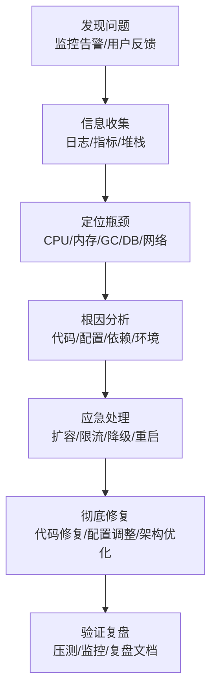

# Java问题排查手册

> **文档说明**：系统讲解 Java 应用线上问题排查的完整方法论，包括 JVM 问题（OOM/GC/死锁/CPU高）、常用排查工具（jstack/jmap/jstat/jcmd/Arthas）、内存问题、线程问题、性能问题、数据库问题的排查思路，以及线上应急流程和常见问题案例。
>
> **适用人群**：后端开发工程师、全栈开发者、SRE/运维工程师、需要处理线上问题的开发者
>
> **前置知识**：[[JVM-内存模型与GC调优]]、[[Java-并发编程JUC]]、[[后端性能优化实战]]、[[数据库性能优化实战]]

---

## 一、排查方法论

### 1. 问题分类

| 问题类型 | 典型现象 | 排查方向 |
|---------|---------|---------|
| **CPU 高** | CPU 使用率 100%、响应慢 | 死循环、频繁 GC、正则回溯、计算密集 |
| **内存高/OOM** | 内存持续增长、OutOfMemoryError | 内存泄漏、缓存无上限、大对象 |
| **频繁 GC** | GC 次数多、停顿长、STW | 内存不足、对象创建过多、大对象 |
| **死锁** | 线程阻塞、接口超时、无响应 | 循环锁、资源顺序不一致 |
| **线程数高** | 线程数持续增长、资源耗尽 | 线程池配置不当、线程阻塞未释放 |
| **接口慢** | P99 延迟高、超时 | DB 慢、下游慢、锁竞争、缓存失效 |
| **连接池满** | 获取连接超时、请求排队 | 慢查询占用、连接泄漏 |
| **服务不可用** | 502/503、进程退出 | OOM 崩溃、死循环、被 kill |

### 2. 排查流程



### 3. 排查原则

- [ ] **先保存现场**：dump 堆栈/内存，再重启或修复
- [ ] **先止血再根治**：先恢复服务，再深入分析根因
- [ ] **数据驱动**：用日志和指标说话，不凭猜测
- [ ] **分层排查**：应用→JVM→OS→网络→依赖，逐层排除
- [ ] **最小变更**：一次只改一个变量，验证效果
- [ ] **可复现**：尽量在测试环境复现，避免线上调试

---

## 二、常用排查工具

### 1. JDK 自带工具

| 工具 | 说明 | 常用命令 |
|------|------|---------|
| **jps** | 查看 Java 进程 | `jps -l` |
| **jstack** | 线程堆栈 | `jstack <pid> > thread.txt` |
| **jmap** | 内存映射/堆 dump | `jmap -dump:live,format=b,file=heap.hprof <pid>` |
| **jstat** | JVM 统计信息 | `jstat -gcutil <pid> 1000 10` |
| **jcmd** | 综合诊断工具 | `jcmd <pid> GC.heap_dump heap.hprof` |
| **jinfo** | JVM 参数 | `jinfo -flags <pid>` |
| **jhat** | 堆分析（已过时） | 用 MAT/VisualVM 替代 |
| **javap** | 反编译 | `javap -c -p ClassName` |

### 2. jstack 线程分析

```bash
# 导出线程堆栈（连续导出 3 次，间隔 5 秒，对比线程状态变化）
jstack 12345 > thread1.txt
sleep 5
jstack 12345 > thread2.txt
sleep 5
jstack 12345 > thread3.txt

# 统计线程状态
jstack 12345 | grep "java.lang.Thread.State" | sort | uniq -c | sort -rn
# RUNNABLE: 正在运行
# BLOCKED: 等待锁
# WAITING: 无限等待
# TIMED_WAITING: 限时等待
```

```
线程堆栈分析要点：
1. 查找死锁：jstack 末尾会显示 "Found one Java-level deadlock"
2. 查找 BLOCKED 线程：看等待哪个锁，被哪个线程持有
3. 查找 RUNNABLE 线程：看正在执行什么方法（可能是死循环）
4. 查找 WAITING 线程：看在等待什么条件
5. 对比多次堆栈：线程状态不变可能是阻塞，变化可能是正常处理
```

### 3. jmap 内存分析

```bash
# 查看堆内存使用情况
jmap -heap 12345

# 查看对象统计（按大小排序）
jmap -histo:live 12345 | head -30
# 输出：序号 实例数 字节数 类名

# 导出堆 dump（live 只 dump 存活对象，文件较小）
jmap -dump:live,format=b,file=heap.hprof 12345

# 用 jcmd 导出（推荐）
jcmd 12345 GC.heap_dump heap.hprof
```

### 4. jstat GC 监控

```bash
# GC 统计（每 1 秒输出一次，共 10 次）
jstat -gcutil 12345 1000 10

# 输出列说明：
# S0: Survivor0 使用率
# S1: Survivor1 使用率
# E: Eden 使用率
# O: 老年代使用率
# M: 元空间使用率
# YGC: Young GC 次数
# YGCT: Young GC 总耗时
# FGC: Full GC 次数
# FGCT: Full GC 总耗时
# GCT: GC 总耗时

# 关注：
# - O 持续增长 → 可能内存泄漏
# - FGC 频繁 → 老年代满，需要调优
# - YGCT 占比高 → Young GC 耗时多
```

### 5. Arthas（推荐）

**Arthas** 是 Alibaba 开源的 Java 诊断工具，功能强大，线上排查首选。

```bash
# 启动 Arthas
curl -O https://arthas.aliyun.com/arthas-boot.jar
java -jar arthas-boot.jar

# 常用命令：
dashboard                    # 实时监控面板（CPU/内存/GC/线程）
thread                       # 查看线程列表
thread -n 3                  # 查看 CPU 最高的 3 个线程
thread -b                    # 查看阻塞线程（死锁）
thread <thread_id>           # 查看指定线程堆栈

jvm                          # 查看 JVM 信息
memory                       # 查看内存使用
gc                           # 查看 GC 信息

heapdump heap.hprof          # 导出堆 dump
jad com.example.UserService  # 反编译类
watch com.example.UserService getUser '{params,returnObj,throwExp}' -x 3  # 观察方法调用
trace com.example.UserService getUser  # 追踪方法调用链和耗时
monitor com.example.UserService getUser -c 5  # 监控方法调用统计
tt -t com.example.UserService getUser     # 时间隧道，记录方法调用
```

### 6. 其他工具

| 工具 | 说明 |
|------|------|
| **VisualVM** | 图形化 JVM 监控和分析 |
| **MAT** | Eclipse Memory Analyzer，堆 dump 分析 |
| **GCViewer** | GC 日志可视化分析 |
| **async-profiler** | 低开销 CPU/内存 profiler，生成火焰图 |
| **Btrace** | 动态字节码注入，无侵入排查 |
| **Prometheus + Grafana** | 指标监控和可视化 |
| **SkyWalking** | 分布式链路追踪 |

---

## 三、CPU 高排查

### 1. 排查步骤

```bash
# 1. 找到 CPU 高的 Java 进程
top -c
# 或
ps aux | grep java | sort -k3 -rn | head

# 2. 找到进程内 CPU 高的线程
top -Hp <pid>
# 或
ps -mp <pid> -o THREAD,tid,time | sort -rn | head

# 3. 将线程 ID 转为 16 进制
printf "%x\n" <tid>
# 例如 tid=12345 → 0x3039

# 4. 导出线程堆栈，查找对应线程
jstack <pid> | grep -A 20 "0x3039"
# 查看该线程正在执行的方法
```

### 2. 常见原因

| 原因 | 现象 | 解决方案 |
|------|------|---------|
| **死循环** | 线程 RUNNABLE，堆栈停在循环代码 | 修复循环条件、添加退出条件 |
| **频繁 GC** | GC 线程 CPU 高，jstat 显示 GC 频繁 | 优化内存、减少对象创建 |
| **正则回溯** | 线程卡在正则匹配 | 优化正则、限制输入长度 |
| **计算密集** | 大量数学运算/加密 | 异步处理、缓存结果、优化算法 |
| **序列化/反序列化** | 大对象 JSON 序列化 | 精简对象、使用更快的序列化库 |
| **自旋锁** | CAS 自旋等待 | 减少锁竞争、使用合适的锁 |

### 3. Arthas 快速定位

```bash
# Arthas 一键定位 CPU 高的线程
thread -n 5
# 显示 CPU 最高的 5 个线程及其堆栈

# 生成 CPU 火焰图（async-profiler）
profiler start
# 等待一段时间
profiler stop --format html --file cpu.html
```

---

## 四、内存问题排查

### 1. OOM 类型

| OOM 类型 | 说明 | 原因 |
|---------|------|------|
| **Java heap space** | 堆内存溢出 | 对象太多、内存泄漏、堆太小 |
| **GC overhead limit** | GC 耗时超过 98% | 内存不足、频繁 GC |
| **Metaspace** | 元空间溢出 | 类太多、动态生成类、元空间太小 |
| **Direct buffer memory** | 直接内存溢出 | NIO 直接内存未释放 |
| **unable to create new native thread** | 无法创建线程 | 线程数太多、系统限制 |
| **Requested array size exceeds VM limit** | 数组太大 | 创建了超大数组 |

### 2. 内存泄漏排查

```bash
# 1. 导出堆 dump
jcmd <pid> GC.heap_dump heap.hprof
# 或配置 OOM 自动 dump
# -XX:+HeapDumpOnOutOfMemoryError -XX:HeapDumpPath=/logs/

# 2. 用 MAT 分析
# - Leak Suspects Report：自动检测泄漏嫌疑
# - Dominator Tree：查看占用内存最大的对象
# - Histogram：按类统计实例数和大小
# - Path to GC Roots：查看对象被谁引用

# 3. 对比多个 dump
# 间隔一段时间导出两个 dump，对比对象增长
# 持续增长的对象可能是泄漏源
```

### 3. 常见内存泄漏场景

| 场景 | 说明 | 解决方案 |
|------|------|---------|
| **静态集合** | static Map/List 只加不删 | 使用弱引用、限制大小、定期清理 |
| **ThreadLocal** | 线程池复用，ThreadLocal 未 remove | finally 中 remove、使用 TransmittableThreadLocal |
| **连接/流未关闭** | DB 连接、文件流、网络连接 | try-with-resources |
| **监听器/回调** | 注册后未注销 | 生命周期结束时注销 |
| **缓存无上限** | 缓存持续增长不淘汰 | 设置最大容量、过期时间、LRU 淘汰 |
| **内部类引用** | 非静态内部类持有外部类引用 | 改为静态内部类、弱引用 |
| **大对象** | 大数组、大字符串 | 流式处理、分批处理 |

### 3. 直接内存排查

```bash
# 查看直接内存使用
jcmd <pid> VM.native_memory summary
# 需要启动参数：-XX:NativeMemoryTracking=summary

# Arthas 查看
memory
# 查看 direct 内存使用
```

---

## 五、GC 问题排查

### 1. GC 日志分析

```bash
# 启用 GC 日志（JDK9+）
java -Xlog:gc*:file=gc.log:time,uptime,level,tags:filecount=10,filesize=100m -jar app.jar

# JDK8
java -XX:+PrintGCDetails -XX:+PrintGCDateStamps -Xloggc:gc.log -jar app.jar

# 分析工具
# GCViewer：可视化 GC 日志
# gceasy.io：在线 GC 分析工具
```

### 2. 常见 GC 问题

| 问题 | 现象 | 解决方案 |
|------|------|---------|
| **频繁 Young GC** | Eden 小、对象创建多 | 增大新生代、减少临时对象 |
| **频繁 Full GC** | 老年代满、大对象、内存泄漏 | 增大堆、排查泄漏、优化大对象 |
| **GC 停顿长** | 堆太大、对象太多 | G1/ZGC、调整 MaxGCPauseMillis |
| **元空间 OOM** | 类太多、动态代理 | 增大 MaxMetaspaceSize、排查类泄漏 |
| **GC 后老年代不降** | 内存泄漏 | 堆 dump 分析泄漏 |

---

## 六、死锁排查

### 1. 死锁检测

```bash
# jstack 自动检测死锁
jstack <pid> | grep -A 50 "deadlock"
# 输出会显示：
# Found one Java-level deadlock:
# "thread-1":
#   waiting to lock <0x000000076ac00000> (a java.lang.Object)
#   which is held by "thread-2"
# "thread-2":
#   waiting to lock <0x000000076ac00010> (a java.lang.Object)
#   which is held by "thread-1"

# Arthas 检测死锁
thread -b
# 直接显示阻塞线程和锁信息
```

### 2. 死锁解决方案

- [ ] **统一加锁顺序**：所有线程按相同顺序获取锁
- [ ] **缩小锁范围**：只在必要时加锁，减少锁持有时间
- [ ] **使用 tryLock**：ReentrantLock.tryLock(timeout) 避免无限等待
- [ ] **避免嵌套锁**：一个锁内不获取另一个锁
- [ ] **使用并发工具**：ConcurrentHashMap、AtomicInteger 等替代手动锁
- [ ] **死锁检测**：ThreadMXBean 定期检测，发现死锁告警

---

## 七、数据库问题排查

### 1. 慢查询排查

```sql
-- 开启慢查询日志
SET GLOBAL slow_query_log = 'ON';
SET GLOBAL long_query_time = 1;

-- 查看当前查询
SHOW PROCESSLIST;
SHOW FULL PROCESSLIST;

-- 分析执行计划
EXPLAIN SELECT * FROM users WHERE name = '张三';

-- 查看 InnoDB 状态（锁、事务）
SHOW ENGINE INNODB STATUS;

-- 查看锁等待
SELECT * FROM information_schema.INNODB_LOCK_WAITS;
SELECT * FROM information_schema.INNODB_TRX;
```

### 2. 连接池满排查

```bash
# Arthas 查看数据库连接
# 查看当前活跃连接和等待线程
thread | grep BLOCKED

# 查看连接池状态（HikariCP）
# HikariCP 默认注册 JMX，可通过 JMX 查看
# 或配置监控指标暴露到 Prometheus
```

详细参考 [[数据库性能优化实战]]。

---

## 八、线上应急流程

### 1. 应急步骤

```
1. 确认问题：影响范围、严重程度
2. 保存现场：
   - jstack 导出线程堆栈（连续 3 次）
   - jmap 导出堆 dump（如内存问题）
   - 保存 GC 日志、应用日志
3. 止血操作（按优先级）：
   - 扩容：增加实例分担流量
   - 限流：限制入口流量，保护系统
   - 降级：关闭非核心功能
   - 熔断：熔断异常下游
   - 重启：最后手段，重启异常实例
4. 根因分析：
   - 分析堆栈/dump/日志
   - 复现问题（测试环境）
   - 定位根因
5. 修复上线：
   - 代码修复/配置调整
   - 灰度发布
   - 监控验证
6. 复盘总结：
   - 问题时间线
   - 根因和修复
   - 改进措施
   - 更新排查手册
```

### 2. 应急命令速查

```bash
# 进程信息
jps -l                          # Java 进程列表
top -Hp <pid>                   # 进程内线程 CPU
ps aux | grep java              # 进程资源使用

# 线程
jstack <pid> > thread.txt       # 线程堆栈
jstack <pid> | grep BLOCKED     # 阻塞线程
jstack <pid> | grep deadlock    # 死锁检测

# 内存
jmap -heap <pid>                # 堆信息
jmap -histo:live <pid> | head -20  # 对象统计
jcmd <pid> GC.heap_dump heap.hprof  # 堆 dump

# GC
jstat -gcutil <pid> 1000 10     # GC 统计
jstat -gccause <pid>            # GC 原因

# Arthas（一键诊断）
java -jar arthas-boot.jar       # 启动
dashboard                       # 总览
thread -n 3                     # CPU 最高线程
thread -b                       # 死锁检测
heapdump heap.hprof             # 堆 dump
```

---

## 九、常见问题案例

### 案例1：CPU 100%

```
现象：服务 CPU 持续 100%，响应超时
排查：
1. top 找到 Java 进程 CPU 100%
2. top -Hp 找到线程 tid=12345
3. printf "%x" 12345 → 0x3039
4. jstack 找到线程在执行正则匹配
5. 代码分析：用户输入未校验长度，恶意长字符串导致正则回溯
修复：
- 限制输入长度
- 优化正则（避免嵌套量词）
- 使用正则超时机制
```

### 案例2：频繁 Full GC

```
现象：服务间歇性卡顿，GC 日志显示频繁 Full GC
排查：
1. jstat -gcutil 显示老年代使用率 99%，Full GC 频繁
2. jmap -histo 发现 HashMap$Node 实例数异常多
3. 堆 dump 分析：静态 Map 缓存只加不删
4. 代码：static Map cache = new HashMap()，无大小限制
修复：
- 改用 Caffeine 缓存，设置 maximumSize
- 添加过期时间
- 监控缓存命中率
```

### 案例3：死锁

```
现象：部分接口超时，线程数增长
排查：
1. jstack 发现 "Found one Java-level deadlock"
2. 线程 A 持有锁1等待锁2，线程 B 持有锁2等待锁1
3. 代码：两个方法加锁顺序相反
修复：
- 统一加锁顺序（按 ID 排序）
- 使用 ReentrantLock.tryLock
- 减少锁粒度
```

### 案例4：OOM 直接内存

```
现象：堆内存正常但进程被 kill，dmesg 显示 OOM
排查：
1. jmap -heap 堆使用正常
2. jcmd VM.native_memory 显示直接内存高
3. 代码：Netty 直接内存未释放，堆外内存泄漏
修复：
- 检查 ByteBuf release
- 使用 ResourceLeakDetector
- 限制最大直接内存 -XX:MaxDirectMemorySize
```

---

## 十、最佳实践

### 1. 预防措施

- [ ] **JVM 参数配置**：OOM 自动 dump、GC 日志、合理内存
- [ ] **健康检查**：存活探针+就绪探针，自动摘除异常实例
- [ ] **监控告警**：CPU/内存/GC/线程/连接池全监控
- [ ] **限流降级**：Sentinel/Hystrix 保护系统
- [ ] **压测**：发布前压测，了解性能瓶颈
- [ ] **灰度发布**：小流量验证，降低故障影响
- [ ] **应急预案**：制定应急预案，定期演练

### 2. 排查规范

- [ ] **先保存现场**：dump 后再操作
- [ ] **记录时间线**：问题发生、操作、恢复时间点
- [ ] **最小化操作**：线上避免频繁重启和变更
- [ ] **变更可回滚**：任何变更都要有回滚方案
- [ ] **多人协作**：复杂问题多人排查，避免单点失误
- [ ] **文档沉淀**：每个问题复盘后更新排查手册

### 3. 必备配置

```bash
# 推荐 JVM 启动参数
java -Xms4g -Xmx4g \
     -XX:+UseG1GC \
     -XX:MaxGCPauseMillis=200 \
     -XX:+HeapDumpOnOutOfMemoryError \
     -XX:HeapDumpPath=/logs/ \
     -XX:+PrintGCDetails \
     -Xlog:gc*:file=/logs/gc.log:time,uptime:filecount=10,filesize=100m \
     -XX:NativeMemoryTracking=summary \
     -Dcom.sun.management.jmxremote \
     -jar app.jar
```

---

## 十一、关联笔记

### JVM 与并发
- [[JVM-内存模型与GC调优]] · [[Java-并发编程JUC]] · [[Java-线程池原理与调优]]

### 性能优化
- [[后端性能优化实战]] · [[数据库性能优化实战]] · [[前端性能优化实战]]

### 运维与监控
- [[Prometheus监控体系]] · [[SkyWalking-分布式链路追踪]] · [[K8s-核心概念与架构]]
- [[CI-CD持续集成与部署]]

### 微服务
- [[Sentinel-流量控制与熔断]] · [[SpringBoot-Web层设计]] · [[分布式系统-高可用架构设计]]

### 导航
- [[MOC-后端开发]] · [[MOC-云原生与运维]] · [[全栈+AI工程双轨融合学习路线图]]

> **学习路径建议**：先掌握 [[JVM-内存模型与GC调优]] JVM 原理 → 学习 [[Java-并发编程JUC]] 并发编程 → 深入本文 Java 问题排查手册 → 实践 Arthas 和 jstack 等工具 → 研究 [[后端性能优化实战]] 性能优化 → 建立线上问题快速响应能力。
