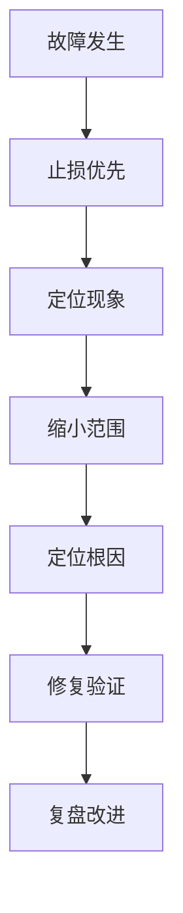
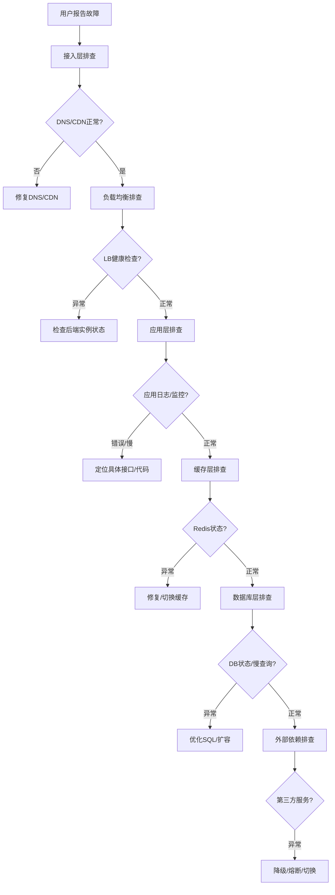

# 线上故障排查手册

> **文档说明**：线上故障排查是高级工程师的核心能力。本文档提供系统化的故障排查方法论、常见故障场景（CPU高/内存泄漏/慢SQL/服务不可用）的排查流程、工具使用、应急处理预案。
>
> **适用人群**：高级后端工程师、运维、SRE、技术负责人
>
> **前置知识**：JVM、Linux、MySQL、微服务架构

---

## 一、故障排查方法论

### 1.1 排查总原则



| 原则 | 说明 |
|------|------|
| **先止损后定位** | 先恢复服务，再查根因（回滚/降级/扩容） |
| **由外到内** | 先看监控/日志，再看代码 |
| **由上到下** | 先看应用层，再看JVM，再看OS |
| **假设验证** | 提出假设→验证→排除/确认 |
| **保留现场** | 排查前先保存日志/堆栈/监控快照 |

### 1.2 排查信息收集清单

| 信息 | 获取方式 | 用途 |
|------|---------|------|
| 故障时间线 | 监控告警、日志时间 | 确定故障开始时间 |
| 影响范围 | 错误率、受影响用户 | 评估严重程度 |
| 变更记录 | 发布记录、配置变更 | 排查是否变更引起 |
| 系统指标 | CPU/内存/磁盘/网络 | 判断资源瓶颈 |
| 应用指标 | QPS/响应时间/错误率 | 判断应用层问题 |
| JVM指标 | GC/线程/堆内存 | JVM层问题 |
| 日志 | 应用日志/GC日志/系统日志 | 错误详情 |
| 链路追踪 | TraceId调用链 | 定位故障服务 |

---

## 二、常见故障排查流程

### 2.1 CPU使用率高

**排查流程**：

```bash
# 1. 查看CPU高的进程
top -c
# 按P排序（CPU），找到高CPU进程PID

# 2. 查看进程内高CPU线程
top -Hp <PID>
# 找到高CPU线程ID（TID）

# 3. 将线程ID转为16进制
printf "%x\n" <TID>
# 例如 12345 → 0x3039

# 4. 查看线程堆栈
jstack <PID> | grep -A 20 <16进制TID>
# 查看线程在做什么

# 5. 或使用Arthas（推荐）
arthas-boot.jar
# 进入后：
thread -n 3          # 查看CPU最高的3个线程
thread <线程ID>       # 查看线程堆栈
profiler start        # 启动CPU火焰图
profiler stop         # 停止并生成火焰图
```

**常见原因**：
- 死循环/递归过深
- 频繁GC（内存泄漏→Full GC）
- 大量正则表达式回溯
- 序列化/反序列化
- 加密/解密计算
- 死锁（线程阻塞不占CPU，但上下文切换高）

### 2.2 内存泄漏 / OOM

**排查流程**：

```bash
# 1. 查看堆内存使用
jmap -heap <PID>
# 查看各代内存使用情况

# 2. 导出堆转储（OOM时自动导出更佳）
jmap -dump:format=b,file=heap.hprof <PID>
# 或启动时加参数：-XX:+HeapDumpOnOutOfMemoryError

# 3. 分析堆转储
# 使用MAT(Memory Analyzer Tool)或VisualVM
# 重点看：Dominator Tree、Leak Suspects、Histogram

# 4. Arthas在线分析
dashboard               # 查看内存概览
heapdump /tmp/heap.hprof # 导出堆
memory                  # 查看内存使用

# 5. 查看GC日志
# 启动参数：-Xlog:gc*:file=gc.log
grep "Full GC" gc.log | tail -20
# 分析GC频率、耗时、回收效果
```

**常见原因**：
- 静态集合不断添加元素
- 缓存未设置过期/上限
- 连接/流未关闭
- 监听器/回调未注销
- ThreadLocal未remove
- 大对象频繁创建

### 2.3 慢SQL / 数据库CPU高

**排查流程**：

```sql
-- 1. 查看正在执行的SQL
SHOW PROCESSLIST;
-- 找到State为"Sending data"、"Copying to tmp table"的慢查询

-- 2. 查看慢查询日志
SHOW VARIABLES LIKE 'slow_query_log';
-- 分析慢查询日志：mysqldumpslow -s t -t 10 slow.log

-- 3. 查看执行计划
EXPLAIN SELECT * FROM orders WHERE user_id = 123;
-- 关注：type(ALL=全表扫描)、rows(扫描行数)、Extra(Using filesort/Using temporary)

-- 4. 查看锁等待
SHOW ENGINE INNODB STATUS;
-- 查看LATEST DETECTED DEADLOCK、TRANSACTIONS

-- 5. 查看索引使用
SHOW INDEX FROM orders;
SELECT * FROM sys.schema_unused_indexes;  -- 未使用的索引
SELECT * FROM sys.schema_redundant_indexes; -- 冗余索引
```

**常见原因**：
- 缺少索引 / 索引失效（函数操作、隐式转换、LIKE前缀%）
- 大表深分页（LIMIT 1000000, 20）
- 锁等待 / 死锁
- 连接池耗尽
- 大事务 / 长事务

### 2.4 服务不可用 / 503

**排查流程**：

```bash
# 1. 确认服务状态
curl -v http://localhost:8080/actuator/health
# 检查健康检查端点

# 2. 查看进程是否存活
ps -ef | grep java
jps -l

# 3. 查看端口是否监听
netstat -tlnp | grep 8080
ss -tlnp | grep 8080

# 4. 查看线程状态
jstack <PID> | grep "java.lang.Thread.State" | sort | uniq -c | sort -rn
# 关注：BLOCKED、WAITING数量

# 5. 查看是否OOM被kill
dmesg | grep -i "killed process"
# Linux OOM Killer日志

# 6. Arthas排查
thread -b              # 查看阻塞其他线程的线程
thread --state BLOCKED # 查看所有阻塞线程
```

**常见原因**：
- 线程池满（请求堆积）
- 数据库连接池耗尽
- 死锁
- OOM被系统kill
- 下游服务不可用导致级联失败
- 磁盘满（无法写日志/临时文件）

### 2.5 接口响应慢

**排查流程**：

```bash
# 1. 链路追踪定位慢环节
# 通过SkyWalking/Jaeger查看Trace，找到耗时最大的Span

# 2. Arthas方法耗时分析
trace com.example.service.OrderService createOrder
# 追踪方法调用链和各环节耗时

# 3. 监控方法调用
monitor -c 5 com.example.service.OrderService createOrder
# 每5秒统计一次方法调用耗时

# 4. 观察方法参数和返回值
watch com.example.service.OrderService createOrder '{params, returnObj}' -x 2
```

---

## 三、Arthas实战命令

### 3.1 常用命令速查

| 命令 | 说明 | 示例 |
|------|------|------|
| `dashboard` | 实时监控面板（线程/内存/GC） | `dashboard` |
| `thread` | 线程分析 | `thread -n 3`（CPU最高3线程） |
| `heapdump` | 导出堆转储 | `heapdump /tmp/heap.hprof` |
| `trace` | 方法调用链追踪 | `trace *Service method` |
| `watch` | 方法参数/返回值观察 | `watch *Service method '{params,returnObj}'` |
| `monitor` | 方法调用统计 | `monitor -c 5 *Service method` |
| `jad` | 反编译类 | `jad com.example.UserService` |
| `redefine` | 热更新类 | `redefine /tmp/UserService.class` |
| `ognl` | 执行OGNL表达式 | `ognl '@System@out@println("hello")'` |
| `profiler` | 火焰图分析 | `profiler start` / `profiler stop` |

### 3.2 排查场景组合

```bash
# 场景1：CPU突然升高
thread -n 5                    # 看高CPU线程
profiler start --duration 60   # 采集60秒火焰图

# 场景2：接口偶发超时
trace *OrderService createOrder '#cost > 1000'  # 只追踪耗时>1s的调用

# 场景3：怀疑某方法参数异常
watch *OrderService createOrder '{params, throwExp}' -e -x 2  # 异常时打印参数

# 场景4：热修复（无需重启）
jad --source-only com.example.UserService > /tmp/UserService.java
# 修改后编译
mc /tmp/UserService.java -d /tmp
redefine /tmp/com/example/UserService.class
```

---

## 四、应急处理预案

### 4.1 止损手段优先级

| 优先级 | 手段 | 适用场景 | 影响 |
|--------|------|---------|------|
| P0 | 回滚版本 | 发布后故障 | 功能回退 |
| P0 | 服务扩容 | 流量突增 | 增加成本 |
| P1 | 服务降级 | 非核心功能故障 | 部分功能不可用 |
| P1 | 熔断限流 | 下游不可用/过载 | 部分请求失败 |
| P2 | 切换流量 | 单机房故障 | 跨机房延迟 |
| P2 | 重启服务 | 内存泄漏/死锁 | 短暂不可用 |
| P3 | 清理数据 | 磁盘满/缓存膨胀 | 数据丢失风险 |

### 4.2 降级开关设计

```java
// 基于配置中心的动态降级
@Service
public class RecommendService {
    @Value("${recommend.enabled:true}")
    private boolean recommendEnabled;

    public List<Product> recommend(Long userId) {
        if (!recommendEnabled) {
            // 降级：返回热门商品
            return hotProductService.getHotProducts();
        }
        try {
            return aiRecommendService.recommend(userId);
        } catch (Exception e) {
            // 异常降级
            return hotProductService.getHotProducts();
        }
    }
}
```

---

## 五、故障复盘模板

```markdown
## 故障复盘报告

### 基本信息
- 故障时间：2024-01-01 14:30 - 15:15（45分钟）
- 影响范围：订单服务，约30%用户下单失败
- 严重等级：P1

### 故障时间线
- 14:30 监控告警：订单服务错误率飙升至40%
- 14:35 值班人员确认故障，开始排查
- 14:45 定位到数据库连接池耗尽
- 14:50 执行止损：扩容数据库连接池+重启服务
- 15:00 服务恢复，错误率降至0.1%
- 15:15 完全恢复，持续观察

### 根因分析
- 直接原因：慢SQL导致连接占用时间过长，连接池耗尽
- 根本原因：新上线的统计查询缺少索引，且未做SQL审核

### 改进措施
1. 【短期】添加缺失索引（已完成）
2. 【中期】上线SQL审核平台，发布前自动检测慢SQL
3. 【长期】数据库连接池增加监控告警，连接使用率>80%告警

### 经验教训
- 发布前SQL审核流程缺失
- 连接池监控告警阈值设置过高
```

---

## 关联文档

- [[Java问题排查手册]] — Java排查
- [[MySQL问题排查手册]] — MySQL排查
- [[性能调优案例集]] — 性能优化案例
- [[JVM 知识点系统梳理_优化版]] — JVM深度
- [[高可用架构设计]] — 高可用
- [[分布式链路追踪实战]] — 链路追踪

---

> 💡 **排查心得**：1. 线上故障先止损，不要纠结根因；2. 监控和日志是排查的眼睛，没有监控就是盲人摸象；3. Arthas是Java排查神器，必须熟练掌握；4. 每次故障都要复盘，建立故障知识库；5. 建立应急预案，故障时按预案执行而不是临时想办法。高级工程师和普通工程师的差距，往往就在故障排查能力上。


## 补充：概述

线上故障排查是后端工程师的核心能力之一。当生产环境出现服务不可用、响应变慢、数据异常等问题时，需要快速定位根因并恢复服务。故障排查不是靠运气，而是有方法论的：**先恢复后定位、由外到内、由上到下、分层排查、保留现场**。

| 故障类型 | 典型表现 | 优先级 |
|---------|---------|--------|
| **服务不可用** | 502/503、连接超时、页面白屏 | P0 紧急 |
| **性能下降** | 响应时间变长、接口超时、CPU/内存高 | P1 高 |
| **数据异常** | 数据丢失、数据不一致、错误数据 | P1 高 |
| **资源耗尽** | 磁盘满、连接池满、内存溢出 | P1 高 |
| **安全事件** | 异常访问、数据泄露、攻击 | P0 紧急 |
| **依赖故障** | 第三方服务不可用、数据库宕机 | P1 高 |

**排查黄金法则**：
1. **先恢复服务**：能重启就重启、能回滚就回滚、能切流量就切流量，恢复优先于定位
2. **保留现场**：恢复前保存日志、堆栈、监控快照，便于事后分析
3. **分层排查**：网络 → 负载均衡 → 应用 → 缓存 → 数据库 → 外部依赖
4. **变更优先**：最近是否有发布、配置变更、流量突增？80% 的故障由变更引起
5. **不要猜测**：用数据和日志说话，避免盲目修改导致问题扩大

---

## 补充：底层原理

### 故障排查方法论：USE 方法与 RED 方法

**USE 方法**（Utilization/Saturation/Errors）—— 适用于资源类排查：
| 维度 | 含义 | 检查项 |
|------|------|--------|
| **Utilization（利用率）** | 资源忙的时间比例 | CPU 利用率、磁盘 IO 利用率、网络带宽利用率 |
| **Saturation（饱和度）** | 资源排队/过载程度 | 运行队列长度、磁盘等待队列、连接池等待数 |
| **Errors（错误）** | 错误事件数量 | 错误率、超时数、重试数、丢包数 |

**RED 方法**（Rate/Errors/Duration）—— 适用于服务类排查：
| 维度 | 含义 | 检查项 |
|------|------|--------|
| **Rate（请求率）** | 每秒请求数 | QPS/TPS、流量是否突增 |
| **Errors（错误率）** | 失败请求比例 | 5xx 比例、4xx 比例、超时比例 |
| **Duration（耗时）** | 请求响应时间 | P50/P95/P99 延迟、是否变慢 |

### 分层排查模型



### 常见故障根因分类

| 根因类别 | 占比（经验值） | 典型场景 |
|---------|--------------|---------|
| **变更引起** | ~50% | 代码发布、配置变更、依赖升级 |
| **资源耗尽** | ~20% | 内存泄漏、连接池满、磁盘满、CPU 打满 |
| **流量突增** | ~10% | 活动促销、爬虫攻击、热点数据 |
| **依赖故障** | ~10% | 数据库宕机、第三方服务不可用、网络分区 |
| **数据问题** | ~5% | 数据不一致、脏数据、误操作删除 |
| **其他** | ~5% | 硬件故障、安全攻击、未知 Bug |

---

## 补充：进阶与最佳实践

### 1. 故障排查工具箱

| 类别 | 工具 | 用途 |
|------|------|------|
| **网络** | `curl`/`telnet`/`dig`/`traceroute`/`tcpdump`/`Wireshark` | 网络连通性、DNS、抓包分析 |
| **进程** | `ps`/`top`/`htop`/`pidstat`/`lsof` | 进程状态、资源占用、文件句柄 |
| **内存** | `free`/`vmstat`/`pmap`/`jmap`/`gcore` | 内存使用、堆转储、内存泄漏 |
| **CPU** | `top`/`mpstat`/`perf`/`async-profiler` | CPU 占用、火焰图、热点分析 |
| **磁盘** | `df`/`du`/`iostat`/`iotop`/`smartctl` | 磁盘空间、IO 性能、硬件健康 |
| **日志** | `tail`/`grep`/`awk`/`sed`/`less`/`jq` | 日志查看、过滤、分析 |
| **数据库** | `SHOW PROCESSLIST`/`EXPLAIN`/`pg_stat_activity` | 慢查询、锁等待、连接数 |
| **JVM** | `jstack`/`jmap`/`jstat`/`arthas`/`async-profiler` | 线程堆栈、堆分析、GC 分析 |
| **容器** | `docker stats`/`docker logs`/`kubectl`/`crictl` | 容器状态、日志、K8s 排查 |

### 2. 故障复盘模板（5 Whys + 时间线）

```
## 故障基本信息
- 故障时间：YYYY-MM-DD HH:MM ~ HH:MM（持续 X 分钟）
- 影响范围：XX 用户 / XX 订单 / XX 功能不可用
- 故障等级：P0/P1/P2
- 负责人：XXX

## 时间线
| 时间 | 事件 | 操作人 |
|------|------|--------|
| HH:MM | 监控告警触发 | 系统 |
| HH:MM | 运维确认故障 | XXX |
| HH:MM | 执行回滚/重启 | XXX |
| HH:MM | 服务恢复 | XXX |

## 根因分析（5 Whys）
1. 为什么服务不可用？→ 因为数据库连接池满
2. 为什么连接池满？→ 因为慢查询占用连接不释放
3. 为什么有慢查询？→ 因为新上线的查询缺少索引
4. 为什么缺少索引？→ 因为代码评审未关注 SQL 性能
5. 为什么评审未关注？→ 因为没有 SQL 评审 checklist

**根本原因**：缺少 SQL 性能评审机制

## 改进措施
| 措施 | 负责人 | 截止时间 | 状态 |
|------|--------|---------|------|
| 添加缺失索引 | XXX | YYYY-MM-DD | ✅ |
| 建立 SQL 评审 checklist | XXX | YYYY-MM-DD | 🟡 |
| 增加慢查询告警 | XXX | YYYY-MM-DD | ⬜ |
| 连接池监控优化 | XXX | YYYY-MM-DD | ⬜ |
```

### 3. 故障预防体系

| 层级 | 措施 | 说明 |
|------|------|------|
| **编码层** | Code Review、单元测试、静态分析 | 提前发现代码缺陷 |
| **测试层** | 集成测试、压测、混沌工程 | 验证系统稳定性 |
| **发布层** | 灰度发布、蓝绿部署、快速回滚 | 降低发布风险 |
| **监控层** | 全链路监控、告警、日志聚合 | 快速发现故障 |
| **预案层** | 应急预案、故障演练、Runbook | 快速响应故障 |
| **架构层** | 限流熔断、降级、多活、冗余 | 系统级容错 |

### 4. 排查中的禁忌

- ❌ **盲目重启**：重启可能丢失现场，且不一定解决根因（先保存现场再重启）
- ❌ **同时多处修改**：改了代码+配置+重启，不知道哪个起作用，也可能引入新问题
- ❌ **忽略监控数据**：只看日志不看监控，可能漏掉资源瓶颈
- ❌ **不通知相关方**：故障扩大后才通知，影响沟通和协作
- ❌ **跳过变更检查**：不查最近的发布/配置变更，直接从代码层面排查
- ❌ **在生产环境调试**：直接在生产加日志/改代码，可能引入新问题
- ❌ **不做复盘**：故障恢复后不分析根因，同样的问题会再次发生
