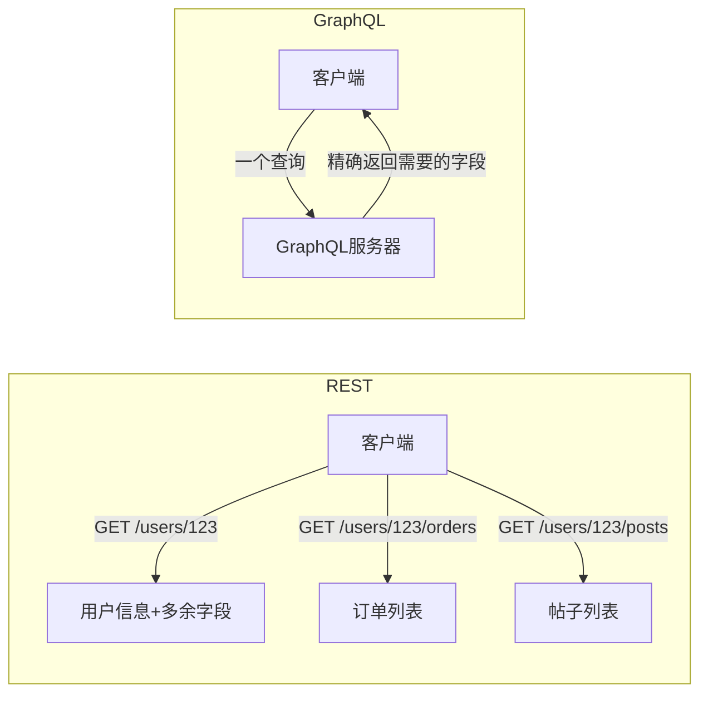
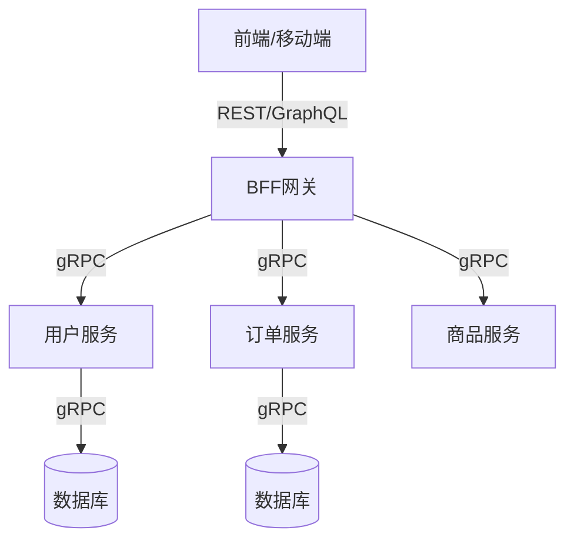

# API设计规范与选型

> **文档说明**：API是系统间通信的契约，好的API设计能大幅提升开发效率和系统可维护性。本文档覆盖RESTful/GraphQL/gRPC三大API范式的原理、规范、对比与选型，以及统一的API设计最佳实践。
>
> **适用人群**：全栈工程师、后端工程师、架构师
>
> **前置知识**：HTTP协议、后端开发基础

---

## 一、API范式总览

| 范式 | 核心思想 | 协议 | 数据格式 | 适用场景 |
|------|---------|------|---------|---------|
| **RESTful** | 资源导向，HTTP动词操作 | HTTP/1.1 | JSON | 通用Web API、CRUD |
| **GraphQL** | 查询导向，客户端按需取数 | HTTP/1.1 | JSON | 复杂查询、移动端、BFF |
| **gRPC** | 服务导向，IDL定义契约 | HTTP/2 | Protobuf（二进制） | 微服务内部通信、高性能 |

---

## 二、RESTful API设计规范

### 2.1 核心原则

REST（Representational State Transfer）是一种架构风格，核心是**资源导向**：

| 原则 | 说明 |
|------|------|
| **资源为中心** | URL用名词表示资源，不用动词 |
| **HTTP动词** | GET/POST/PUT/DELETE/PATCH表示操作 |
| **无状态** | 每个请求包含所有信息，不依赖服务器会话 |
| **统一接口** | 标准HTTP方法和状态码 |
| **可缓存** | 响应可被缓存 |
| **分层系统** | 客户端无法感知中间层 |

### 2.2 URL命名规范

```
# 正确：名词复数，资源导向
GET    /api/users              # 获取用户列表
GET    /api/users/123          # 获取单个用户
POST   /api/users              # 创建用户
PUT    /api/users/123          # 全量更新用户
PATCH  /api/users/123          # 部分更新用户
DELETE /api/users/123          # 删除用户

# 嵌套资源
GET    /api/users/123/orders   # 获取用户123的订单
POST   /api/users/123/orders   # 为用户123创建订单

# 过滤/排序/分页
GET    /api/users?page=1&size=20&sort=created_at,desc&role=admin

# 错误：动词在URL中
GET    /api/getUsers           # ❌ 动词
POST   /api/createUser         # ❌ 动词
GET    /api/users/delete/123   # ❌ 用HTTP方法
```

### 2.3 HTTP方法语义

| 方法 | 语义 | 幂等 | 安全 | 示例 |
|------|------|------|------|------|
| **GET** | 获取资源 | ✅ | ✅ | GET /users/123 |
| **POST** | 创建资源 | ❌ | ❌ | POST /users |
| **PUT** | 全量替换 | ✅ | ❌ | PUT /users/123 |
| **PATCH** | 部分更新 | ❌ | ❌ | PATCH /users/123 |
| **DELETE** | 删除资源 | ✅ | ❌ | DELETE /users/123 |
| **HEAD** | 获取头部 | ✅ | ✅ | HEAD /users/123 |
| **OPTIONS** | 获取支持的方法 | ✅ | ✅ | OPTIONS /users |

### 2.4 HTTP状态码

| 状态码 | 含义 | 使用场景 |
|--------|------|---------|
| **200 OK** | 成功 | GET/PUT/PATCH成功 |
| **201 Created** | 创建成功 | POST创建资源 |
| **204 No Content** | 成功无返回体 | DELETE成功 |
| **206 Partial Content** | 部分内容 | 分页/范围请求 |
| **400 Bad Request** | 请求参数错误 | 参数校验失败 |
| **401 Unauthorized** | 未认证 | 未登录/Token无效 |
| **403 Forbidden** | 无权限 | 已登录但无操作权限 |
| **404 Not Found** | 资源不存在 | ID不存在 |
| **409 Conflict** | 冲突 | 唯一键重复/乐观锁冲突 |
| **422 Unprocessable** | 语义错误 | 参数格式对但业务不合法 |
| **429 Too Many Requests** | 限流 | 请求过于频繁 |
| **500 Internal Server Error** | 服务器错误 | 未捕获异常 |
| **502 Bad Gateway** | 网关错误 | 上游服务不可用 |
| **503 Service Unavailable** | 服务不可用 | 维护/过载 |

### 2.5 统一响应格式

```json
// 成功响应
{
  "code": 0,
  "message": "success",
  "data": {
    "id": 123,
    "username": "zhangsan",
    "email": "zhangsan@example.com"
  },
  "timestamp": 1704067200000
}

// 列表响应（分页）
{
  "code": 0,
  "message": "success",
  "data": {
    "list": [...],
    "pagination": {
      "page": 1,
      "size": 20,
      "total": 156,
      "totalPages": 8
    }
  }
}

// 错误响应
{
  "code": 40001,
  "message": "参数校验失败",
  "errors": [
    { "field": "email", "message": "邮箱格式不正确" },
    { "field": "age", "message": "年龄必须大于0" }
  ],
  "timestamp": 1704067200000
}
```

### 2.6 版本管理

```
# URL路径版本（推荐，最直观）
/api/v1/users
/api/v2/users

# Header版本
Accept: application/vnd.company.v1+json
Accept: application/vnd.company.v2+json

# 查询参数版本
/api/users?version=1
```

### 2.7 API文档（OpenAPI/Swagger）

```yaml
# openapi.yaml 示例
openapi: "3.0.0"
info:
  title: 用户服务API
  version: "1.0.0"
paths:
  /api/users:
    get:
      summary: 获取用户列表
      parameters:
        - name: page
          in: query
          schema: { type: integer, default: 1 }
        - name: size
          in: query
          schema: { type: integer, default: 20 }
      responses:
        '200':
          description: 成功
          content:
            application/json:
              schema:
                $ref: '#/components/schemas/UserListResponse'
    post:
      summary: 创建用户
      requestBody:
        content:
          application/json:
            schema:
              $ref: '#/components/schemas/CreateUserRequest'
      responses:
        '201':
          description: 创建成功
```

---

## 三、GraphQL

### 3.1 核心思想

GraphQL是Facebook开源的查询语言，核心是**客户端按需获取数据**，避免REST的过度获取（Over-fetching）和获取不足（Under-fetching）。



### 3.2 Schema定义

```graphql
# 类型定义
type User {
  id: ID!
  username: String!
  email: String!
  age: Int
  orders: [Order!]!    # 关联查询
  posts: [Post!]!
}

type Order {
  id: ID!
  amount: Float!
  status: OrderStatus!
  createdAt: String!
}

enum OrderStatus {
  PENDING
  PAID
  SHIPPED
  COMPLETED
}

# 查询入口
type Query {
  user(id: ID!): User
  users(page: Int = 1, size: Int = 20): [User!]!
}

# 变更入口
type Mutation {
  createUser(input: CreateUserInput!): User!
  updateUser(id: ID!, input: UpdateUserInput!): User!
  deleteUser(id: ID!): Boolean!
}

input CreateUserInput {
  username: String!
  email: String!
  password: String!
}
```

### 3.3 查询示例

```graphql
# 客户端查询：只需要用户名和订单金额
query GetUserWithOrders($id: ID!) {
  user(id: $id) {
    id
    username
    orders {
      id
      amount
      status
    }
  }
}

# 响应（精确返回，无多余字段）
{
  "data": {
    "user": {
      "id": "123",
      "username": "zhangsan",
      "orders": [
        { "id": "O001", "amount": 99.9, "status": "PAID" },
        { "id": "O002", "amount": 199.0, "status": "PENDING" }
      ]
    }
  }
}
```

### 3.4 变更（Mutation）

```graphql
mutation CreateUser($input: CreateUserInput!) {
  createUser(input: $input) {
    id
    username
    email
  }
}
```

### 3.5 GraphQL vs REST

| 维度 | REST | GraphQL |
|------|------|---------|
| 数据获取 | 固定结构，可能过度/不足获取 | 按需获取，精确返回 |
| 请求次数 | 复杂数据需多次请求 | 一次请求获取所有 |
| 缓存 | HTTP缓存天然支持 | 需客户端缓存（Apollo Client） |
| 版本管理 | URL/Header版本 | 字段级演进，无需版本号 |
| 学习曲线 | 低 | 中（Schema+Resolver） |
| 性能 | 简单请求快 | 复杂查询可能N+1 |
| 安全 | 成熟（鉴权+限流） | 需防深度查询/复杂度攻击 |
| 适用 | 通用CRUD、简单API | 复杂查询、移动端、BFF |

---

## 四、gRPC

### 4.1 核心思想

gRPC是Google开源的高性能RPC框架，基于HTTP/2和Protobuf，核心是**IDL定义契约，强类型，高性能**。

### 4.2 Protobuf定义（.proto）

```protobuf
syntax = "proto3";

package user;
option java_package = "com.example.user";
option java_multiple_files = true;

// 服务定义
service UserService {
  rpc GetUser(GetUserRequest) returns (User);
  rpc ListUsers(ListUsersRequest) returns (ListUsersResponse);
  rpc CreateUser(CreateUserRequest) returns (User);
  // 服务端流式
  rpc StreamOrders(StreamOrdersRequest) returns (stream Order);
  // 双向流式
  rpc Chat(stream ChatMessage) returns (stream ChatMessage);
}

// 消息定义
message User {
  int64 id = 1;
  string username = 2;
  string email = 3;
  int32 age = 4;
}

message GetUserRequest {
  int64 id = 1;
}

message ListUsersRequest {
  int32 page = 1;
  int32 size = 2;
}

message ListUsersResponse {
  repeated User users = 1;
  int32 total = 2;
}
```

### 4.3 四种通信模式

| 模式 | 说明 | 适用 |
|------|------|------|
| **Unary** | 一元调用，一问一答 | 普通RPC |
| **Server Streaming** | 客户端发一次，服务端流式返回 | 大文件下载、实时推送 |
| **Client Streaming** | 客户端流式发送，服务端一次返回 | 大文件上传 |
| **Bidirectional Streaming** | 双向流式 | 实时聊天、协同编辑 |

### 4.4 gRPC vs REST

| 维度 | gRPC | REST |
|------|------|------|
| 协议 | HTTP/2（二进制） | HTTP/1.1（文本） |
| 数据格式 | Protobuf（二进制，小） | JSON（文本，大） |
| 性能 | 极高（5-10倍于REST） | 高 |
| 类型安全 | 强类型（IDL生成代码） | 弱类型（运行时解析） |
| 浏览器支持 | 需gRPC-Web代理 | 原生支持 |
| 流式通信 | 原生支持四种模式 | 需SSE/WebSocket |
| 调试 | 需专用工具（grpcurl） | curl/Postman即可 |
| 适用 | 微服务内部通信 | 对外API、Web前端 |

---

## 五、API选型决策

### 5.1 决策树

```
API用途？
├── 对外公开API（第三方/前端）→ RESTful（标准、易调试、缓存好）
├── 微服务内部通信 → gRPC（高性能、强类型、流式）
├── 复杂查询/移动端BFF → GraphQL（按需获取、减少请求）
└── 实时通信 → WebSocket / gRPC双向流
```

### 5.2 场景推荐

| 场景 | 推荐 | 原因 |
|------|------|------|
| 开放平台API | RESTful | 标准化、生态成熟 |
| 管理后台CRUD | RESTful | 简单直接 |
| 移动端API | GraphQL / REST | GraphQL减少请求，REST简单 |
| 微服务间调用 | gRPC | 高性能、强类型 |
| 实时推送 | WebSocket / SSE / gRPC流 | 长连接 |
| 聚合网关（BFF） | GraphQL | 按需聚合多服务数据 |
| 文件上传下载 | gRPC流 / REST Multipart | 流式处理 |
| 低延迟交易 | gRPC | 二进制+HTTP/2 |

### 5.3 混合架构（推荐）



- **对外**：RESTful/GraphQL（标准化，前端友好）
- **对内**：gRPC（高性能，强类型）
- **BFF层**：聚合后端服务，对外提供优化后的API

---

## 六、API设计最佳实践

### 6.1 通用规范

1. **命名一致**：全库统一使用kebab-case或snake_case，不要混用
2. **时间格式**：统一ISO 8601（`2024-01-01T12:00:00Z`）
3. **ID类型**：对外用字符串，避免大整数精度丢失
4. **分页统一**：page/size或cursor，全库统一
5. **错误码规范**：统一错误码表，避免随意定义
6. **幂等设计**：写操作支持幂等键（Idempotency-Key）
7. **限流标识**：响应头返回限流信息（X-RateLimit-Remaining）
8. **CORS配置**：跨域API正确配置CORS

### 6.2 安全规范

- 认证：OAuth2.0 / JWT / API Key
- 传输：HTTPS强制
- 输入校验：所有入参校验，防止注入
- 限流：防止滥用和DDoS
- 敏感数据：不返回密码、密钥等敏感信息
- 审计：关键操作记录审计日志

### 6.3 版本演进

```
不兼容变更 → 新版本（v1 → v2）
兼容变更 → 同版本内演进：
  - 新增字段（可选）
  - 新增接口
  - 新增枚举值
不兼容变更示例：
  - 删除字段
  - 修改字段类型
  - 修改接口语义
```

---

## 关联文档

- [[微服务核心组件知识点系统梳理_优化版]] — 微服务通信
- [[API网关实战]] — API网关
- [[SpringBoot项目模板与最佳实践]] — 后端模板
- [[技术选型决策指南]] — 技术选型
- [[全栈+AI端到端实战]] — API设计实战

---

> 💡 **选型建议**：对外API用RESTful（标准化、生态好），微服务内部用gRPC（高性能、强类型），复杂查询场景用GraphQL（按需获取）。大多数项目采用混合架构：BFF层REST/GraphQL对外，内部gRPC通信。API设计的核心是"契约先行"——先定义接口，再实现代码，用OpenAPI/Protobuf/Schema作为团队协作的契约。


## 补充：概述

API（Application Programming Interface，应用程序编程接口）是软件系统之间交互的契约，是后端开发的核心工作之一。好的 API 设计应该**直观、一致、可扩展、易于调试**，让调用方不需要看文档就能猜到用法。当前主流的 API 架构风格包括 RESTful、GraphQL、gRPC、WebSocket 等，各有适用场景，需要根据业务需求合理选型。

| API 风格 | 数据格式 | 传输协议 | 性能 | 适用场景 |
|---------|---------|---------|------|---------|
| **RESTful** | JSON | HTTP/1.1 | 中 | 通用 Web API、CRUD 操作、公开 API |
| **GraphQL** | JSON | HTTP | 中 | 前端灵活查询、多数据源聚合、移动端 |
| **gRPC** | Protobuf | HTTP/2 | 高 | 微服务间通信、高性能内部服务 |
| **WebSocket** | JSON/二进制 | WebSocket | 高 | 实时通信、聊天、推送、协同编辑 |
| **Webhook** | JSON | HTTP | - | 事件通知、回调、第三方集成 |
| **SOAP** | XML | HTTP/SMTP | 低 | 传统企业系统、金融、强事务场景 |

**API 设计的核心原则**：
1. **一致性**：命名、路径、参数、错误码全系统统一
2. **直观性**：看 URL 就知道操作什么资源，看 HTTP 方法就知道做什么
3. **可扩展性**：版本化设计，新增字段不破坏旧客户端
4. **可调试性**：返回清晰的错误信息，支持请求 ID 追踪
5. **安全性**：认证、授权、限流、输入校验、敏感数据脱敏

---

## 补充：常见问题与排查

| 问题 | 原因 | 解决方案 |
|------|------|---------|
| API 响应慢 | N+1 查询、未分页、缺少缓存 | 用 JOIN/批量查询替代循环查询、强制分页、热点数据缓存 |
| 版本升级破坏旧客户端 | 未做版本化，直接修改字段 | URL 版本化（`/v1/`）、只增不改、废弃字段标记 `deprecation` |
| 错误信息不统一 | 各接口返回不同的错误格式 | 统一错误响应体 `{code, message, request_id, details}` |
| 分页数据不一致 | 用 offset 分页，数据在翻页时变化 | 用游标分页（`cursor`）或快照 ID，避免 offset 漂移 |
| 接口被滥用/爬虫 | 未做限流 | 实现令牌桶/滑动窗口限流，按 IP/用户/接口维度限流 |
| 大查询拖垮服务 | 未限制查询范围和返回量 | 强制 `page_size` 上限、查询时间范围限制、慢查询熔断 |
| 跨域问题 | CORS 配置错误 | 正确配置 `Access-Control-Allow-Origin`，避免 `*` + 凭证 |
| 上传文件失败 | 未配置文件大小限制或超时 | 配置 `multipart` 大小限制、大文件用分片上传 |
| 幂等性问题 | 重复提交导致重复数据 | 用幂等键（`Idempotency-Key`）、唯一约束、状态机控制 |
| 文档与实际不一致 | 代码变更后未更新文档 | 用 OpenAPI/Swagger 从代码自动生成文档，CI 校验 |

### API 调试工具与方法

```bash
# curl 调试（最常用）
curl -v -X POST https://api.example.com/v1/users   -H "Content-Type: application/json"   -H "Authorization: Bearer token"   -d '{"name":"张三","email":"zhang@example.com"}'

# 查看响应头和状态码
curl -I https://api.example.com/v1/users

# 查看请求耗时
curl -w "DNS: %{time_namelookup}s
Connect: %{time_connect}s
Total: %{time_total}s
"   -o /dev/null https://api.example.com/v1/users

# 用 httpie（更友好）
http POST api.example.com/v1/users name=张三 email=zhang@example.com
http GET api.example.com/v1/users page==2 size==20
```

**调试流程**：
1. 确认请求 URL、方法、Header、Body 是否正确
2. 查看 HTTP 状态码（4xx 客户端错，5xx 服务端错）
3. 查看响应体中的错误信息和 `request_id`
4. 用 `request_id` 在服务端日志中定位具体错误
5. 检查数据库/缓存/外部依赖是否正常
