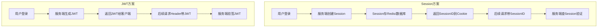
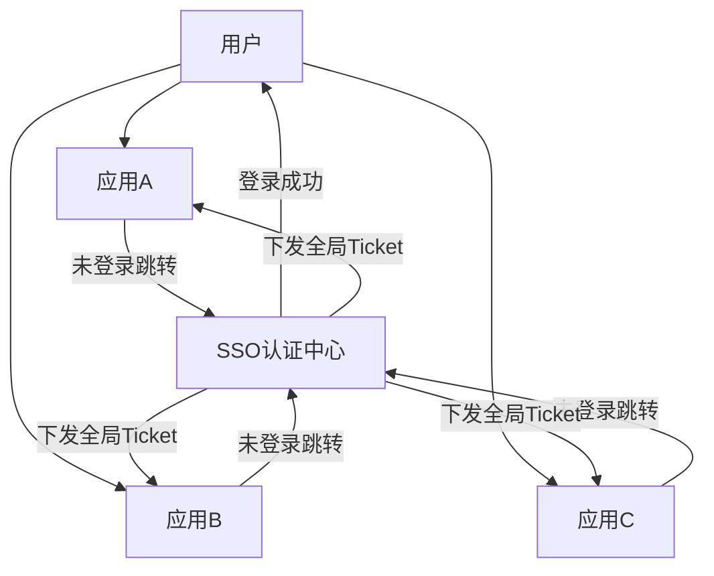
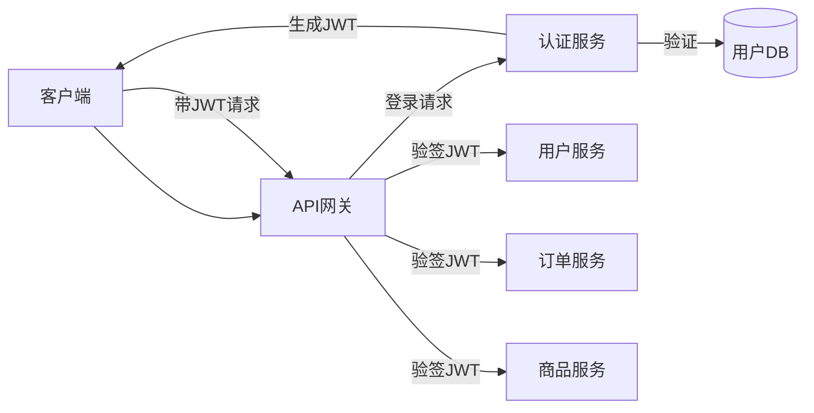

# SSO单点登录与分布式会话

> **文档说明**：微服务架构下的认证授权是核心难题。本文档覆盖Session与JWT对比、SSO单点登录原理、OAuth2.0协议、分布式会话方案、Spring Security实战、微服务鉴权架构。
>
> **适用人群**：后端高级工程师、需要构建认证体系的开发者
>
> **前置知识**：HTTP协议、Cookie/Session、微服务架构

---

## 一、认证基础

### 1.1 认证 vs 授权

| 概念 | 说明 | 示例 |
|------|------|------|
| **认证（Authentication）** | 你是谁 | 验证用户名密码 |
| **授权（Authorization）** | 你能做什么 | 验证是否有权限访问资源 |
| **凭证（Credential）** | 证明身份的东西 | 密码、Token、证书 |
| **会话（Session）** | 登录后的状态 | 服务端存储的登录状态 |

### 1.2 Session vs JWT



| 维度 | Session | JWT |
|------|---------|-----|
| 存储位置 | 服务端（Redis/DB） | 客户端 |
| 服务端状态 | 有状态 | 无状态 |
| 扩展性 | 需共享Session存储 | 天然支持分布式 |
| 注销 | 删除Session即可 | 需黑名单/短有效期 |
| 数据量 | SessionID小 | JWT较大（Header+Payload+签名） |
| 安全性 | 高（服务端可控） | 中（签发后无法撤回） |
| 适用 | 传统Web应用 | 微服务/前后端分离/移动App |

---

## 二、JWT详解

### 2.1 JWT结构

```
JWT = Header.Payload.Signature

Header（头部）：
{
  "alg": "HS256",    // 签名算法
  "typ": "JWT"
}

Payload（载荷）：
{
  "sub": "123",               // 主题（用户ID）
  "name": "张三",             // 自定义字段
  "role": "admin",            // 角色
  "iat": 1704067200,          // 签发时间
  "exp": 1704070800           // 过期时间（1小时后）
}

Signature（签名）：
HMACSHA256(base64UrlEncode(header) + "." + base64UrlEncode(payload), secret)
```

### 2.2 JWT使用流程

```java
// 1. 登录生成Token
@PostMapping("/login")
public LoginResponse login(@RequestBody LoginRequest req) {
    User user = userService.authenticate(req.getUsername(), req.getPassword());
    String token = Jwts.builder()
        .setSubject(user.getId().toString())
        .claim("role", user.getRole())
        .setIssuedAt(new Date())
        .setExpiration(new Date(System.currentTimeMillis() + 3600000)) // 1小时
        .signWith(Keys.hmacShaKeyFor(secret.getBytes()))
        .compact();
    return new LoginResponse(token);
}

// 2. 验证Token（过滤器）
public class JwtFilter extends OncePerRequestFilter {
    protected void doFilterInternal(HttpServletRequest req, HttpServletResponse res, FilterChain chain) {
        String token = req.getHeader("Authorization").replace("Bearer ", "");
        try {
            Claims claims = Jwts.parserBuilder()
                .setSigningKey(Keys.hmacShaKeyFor(secret.getBytes()))
                .build().parseClaimsJws(token).getBody();
            // 将用户信息放入SecurityContext
            SecurityContextHolder.getContext().setAuthentication(authentication);
        } catch (Exception e) {
            res.sendError(401, "Token无效");
            return;
        }
        chain.doFilter(req, res);
    }
}
```

### 2.3 JWT安全问题与方案

| 问题 | 方案 |
|------|------|
| **Token泄露** | HTTPS传输、短有效期、存储在httpOnly Cookie |
| **无法注销** | 短有效期+Refresh Token、Redis黑名单 |
| **Token过大** | Payload只存必要信息（ID/角色），不存大对象 |
| **密钥泄露** | 密钥存在配置中心/密钥管理服务，定期轮换 |
| **重放攻击** | 加jti（唯一ID）+ nonce + 时间戳校验 |

### 2.4 Refresh Token机制

```
登录 → 返回 Access Token（15分钟）+ Refresh Token（7天）
Access Token过期 → 用Refresh Token换新Access Token
Refresh Token过期 → 重新登录
注销 → 将Refresh Token加入黑名单
```

```java
// Refresh Token轮换
@PostMapping("/refresh")
public TokenResponse refresh(@RequestBody RefreshRequest req) {
    // 验证Refresh Token
    Claims claims = parseToken(req.getRefreshToken());
    String userId = claims.getSubject();

    // 检查黑名单（是否已注销）
    if (redis.hasKey("blacklist:" + req.getRefreshToken())) {
        throw new UnauthorizedException("Token已失效");
    }

    // 旧Refresh Token加入黑名单
    redis.set("blacklist:" + req.getRefreshToken(), "1", 7, TimeUnit.DAYS);

    // 生成新Token对
    String newAccess = generateToken(userId, 15, TimeUnit.MINUTES);
    String newRefresh = generateToken(userId, 7, TimeUnit.DAYS);
    return new TokenResponse(newAccess, newRefresh);
}
```

---

## 三、SSO单点登录

### 3.1 什么是SSO

SSO（Single Sign-On）：在多个应用系统中，用户只需登录一次，就可以访问所有相互信任的应用系统。



### 3.2 SSO核心流程（CAS协议）

```
1. 用户访问应用A → 应用A检测未登录 → 重定向到SSO认证中心
2. SSO认证中心检测未登录 → 显示登录页 → 用户输入密码
3. 登录成功 → SSO创建全局会话（Cookie写入SSO域）→ 生成Ticket
4. 重定向回应用A（带Ticket）→ 应用A用Ticket向SSO验证
5. SSO验证Ticket有效 → 返回用户信息 → 应用A创建局部会话
6. 用户访问应用B → 重定向到SSO → SSO检测已有全局会话 → 直接生成Ticket
7. 重定向回应用B（带Ticket）→ 应用B验证 → 创建局部会话
   （用户无需再次输入密码，实现单点登录）
```

### 3.3 SSO实现方案

| 方案 | 说明 | 适用 |
|------|------|------|
| **CAS** | Yale大学开源，经典SSO协议 | 企业内部系统 |
| **OAuth2.0** | 授权框架，可实现SSO | 开放平台/第三方登录 |
| **SAML** | 基于XML的企业级SSO | 大型企业/政府 |
| **JWT共享** | 共享JWT密钥，各服务独立验证 | 微服务架构 |
| **Session共享** | Redis共享Session，Cookie域共享 | 同域多应用 |

### 3.4 微服务SSO架构



- 认证服务统一处理登录/注册/Token签发
- API网关统一验证JWT（网关层鉴权）
- 各业务服务信任网关传递的用户信息
- 服务间调用传递用户上下文（Feign拦截器）

---

## 四、OAuth2.0

### 4.1 四种授权模式

| 模式 | 说明 | 适用 |
|------|------|------|
| **授权码模式** | 最安全，通过授权码换Token | Web应用（最常用） |
| **隐式模式** | 直接返回Token，无授权码 | 纯前端SPA（不推荐） |
| **密码模式** | 直接用密码换Token | 内部可信应用 |
| **客户端模式** | 应用自己的身份，无用户 | 服务间调用 |

### 4.2 授权码模式流程

```
1. 用户点击"微信登录" → 跳转到微信授权页
2. 用户同意授权 → 微信重定向回应用（带code授权码）
3. 应用后端用code向微信请求Token
4. 微信返回Access Token + 用户信息
5. 应用创建/更新用户 → 生成本系统Token → 返回前端
```

### 4.3 Spring Security OAuth2

```java
// OAuth2登录配置
@Configuration
@EnableWebSecurity
public class SecurityConfig {
    @Bean
    SecurityFilterChain filterChain(HttpSecurity http) throws Exception {
        http
            .authorizeRequests(auth -> auth
                .antMatchers("/login", "/oauth2/**").permitAll()
                .anyRequest().authenticated()
            )
            .oauth2Login(oauth2 -> oauth2
                .loginPage("/login")
                .defaultSuccessUrl("/dashboard")
            )
            .logout(logout -> logout.logoutSuccessUrl("/login"));
        return http.build();
    }
}

// application.yml
spring:
  security:
    oauth2:
      client:
        registration:
          github:
            client-id: your-client-id
            client-secret: your-client-secret
            scope: read:user,user:email
          google:
            client-id: your-client-id
            client-secret: your-client-secret
```

---

## 五、分布式会话方案

### 5.1 Session共享（Redis）

```java
// Spring Session + Redis（透明共享Session）
@Configuration
@EnableRedisHttpSession(maxInactiveIntervalInSeconds = 1800)
public class SessionConfig {
    @Bean
    public RedisConnectionFactory connectionFactory() {
        return new LettuceConnectionFactory("redis", 6379);
    }
}
// 配置后，HttpSession自动存储到Redis
// 多实例共享Session，无需额外代码
```

### 5.2 Token方案（JWT）

- 无状态，服务端不存储会话
- 每个服务独立验证Token签名
- 适合微服务架构

### 5.3 方案选型

| 场景 | 推荐方案 |
|------|---------|
| 传统单体Web应用 | Session（Tomcat内置） |
| 多实例部署 | Session共享（Spring Session+Redis） |
| 前后端分离/移动App | JWT |
| 微服务架构 | JWT + 网关鉴权 |
| 多系统SSO | OAuth2.0 / CAS |

---

## 六、Spring Security实战

### 6.1 核心组件

| 组件 | 说明 |
|------|------|
| **Authentication** | 认证信息（用户+权限） |
| **SecurityContext** | 安全上下文，存储Authentication |
| **Filter链** | 一系列过滤器处理认证授权 |
| **UserDetailsService** | 加载用户信息 |
| **PasswordEncoder** | 密码加密 |
| **AccessDecisionManager** | 授权决策 |

### 6.2 权限控制

```java
// 方法级权限控制
@RestController
@RequestMapping("/api")
public class OrderController {

    @PreAuthorize("hasRole('USER')")
    @GetMapping("/orders")
    public List<Order> myOrders() {
        // 只有USER角色可访问
    }

    @PreAuthorize("hasRole('ADMIN')")
    @DeleteMapping("/orders/{id}")
    public void deleteOrder(@PathVariable Long id) {
        // 只有ADMIN角色可删除
    }

    @PreAuthorize("@orderSecurity.isOwner(#id, authentication.name)")
    @PutMapping("/orders/{id}")
    public void updateOrder(@PathVariable Long id) {
        // 自定义权限：只能修改自己的订单
    }
}

// 自定义权限校验
@Component("orderSecurity")
public class OrderSecurity {
    public boolean isOwner(Long orderId, String username) {
        Order order = orderRepository.findById(orderId).orElse(null);
        return order != null && order.getUsername().equals(username);
    }
}
```

### 6.3 RBAC权限模型

```
用户(User) → 角色(Role) → 权限(Permission)
  张三  → 管理员 → 用户管理、订单管理、系统配置
  李四  → 普通用户 → 查看订单、创建订单
```

```sql
-- 五表模型
user（用户表）
role（角色表）
permission（权限表）
user_role（用户-角色关联）
role_permission（角色-权限关联）

-- 查询用户权限
SELECT p.code FROM permission p
JOIN role_permission rp ON p.id = rp.permission_id
JOIN user_role ur ON rp.role_id = ur.role_id
WHERE ur.user_id = ?;
```

---

## 七、微服务鉴权最佳实践

### 7.1 网关层统一鉴权

```java
// Gateway全局过滤器
@Component
public class AuthFilter implements GlobalFilter {
    public Mono<Void> filter(ServerWebExchange exchange, GatewayFilterChain chain) {
        String token = exchange.getRequest().getHeaders().getFirst("Authorization");
        // 白名单路径直接放行
        if (isWhitelist(exchange.getRequest().getPath())) {
            return chain.filter(exchange);
        }
        // 验证Token
        try {
            Claims claims = jwtUtil.parseToken(token);
            // 将用户信息写入Header传递给下游服务
            ServerHttpRequest request = exchange.getRequest().mutate()
                .header("X-User-Id", claims.getSubject())
                .header("X-User-Role", claims.get("role", String.class))
                .build();
            return chain.filter(exchange.mutate().request(request).build());
        } catch (Exception e) {
            exchange.getResponse().setStatusCode(HttpStatus.UNAUTHORIZED);
            return exchange.getResponse().setComplete();
        }
    }
}
```

### 7.2 服务间鉴权

```java
// Feign拦截器：传递用户上下文
@Component
public class FeignUserInterceptor implements RequestInterceptor {
    public void apply(RequestTemplate template) {
        Authentication auth = SecurityContextHolder.getContext().getAuthentication();
        if (auth != null) {
            template.header("X-User-Id", auth.getName());
            template.header("X-User-Role", auth.getAuthorities().toString());
        }
    }
}

// 服务间调用也可用客户端凭证模式（无用户上下文）
// 服务A → 服务B：用Service Account Token
```

---

## 关联文档

- [[Spring Boot 知识点系统梳理_优化版]] — Spring Boot基础
- [[微服务核心组件知识点系统梳理_优化版]] — 微服务架构
- [[API网关实战]] — 网关鉴权
- [[数据库安全与审计实战]] — 数据安全
- [[技术选型决策指南]] — 认证方案选型

---

> 💡 **选型建议**：1. 单体应用用Session（简单）；2. 多实例用Spring Session+Redis；3. 前后端分离/微服务用JWT（无状态）；4. 多系统统一登录用OAuth2.0/CAS；5. 第三方登录用OAuth2.0授权码模式。JWT是微服务时代的主流方案，但要注意短有效期+Refresh Token+黑名单机制。安全是体系工程：认证+授权+加密+审计缺一不可。
