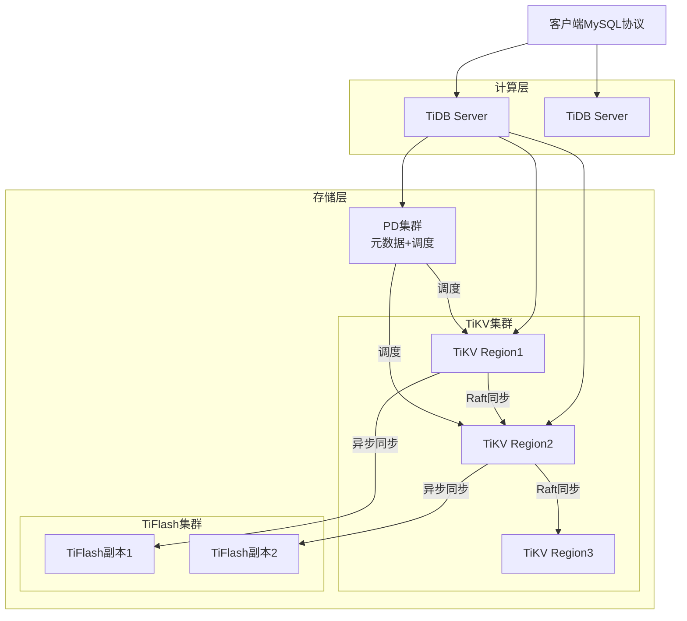
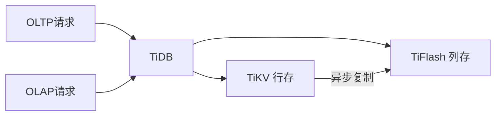
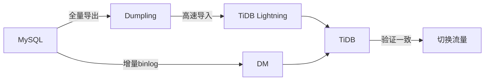

# TiDB NewSQL数据库入门

> **文档说明**：TiDB是国产开源分布式NewSQL数据库，兼容MySQL协议，支持HTAP（混合事务/分析处理），是分库分表的替代方案。本文档覆盖架构原理、核心特性、部署运维、与MySQL/分库分表对比、迁移方案。
>
> **适用人群**：后端高级工程师、DBA、架构师、需要解决分库分表痛点的开发者
>
> **前置知识**：MySQL、分布式系统、Raft协议

---

## 一、NewSQL与TiDB概述

### 1.1 什么是NewSQL

NewSQL是一类兼具**NoSQL的水平扩展能力**和**传统关系型数据库的ACID事务和SQL支持**的新型数据库。

| 类别 | 代表 | 扩展能力 | ACID | SQL |
|------|------|---------|------|-----|
| 关系型 | MySQL/PostgreSQL | 弱（分库分表复杂） | ✅ | ✅ |
| NoSQL | MongoDB/Cassandra | 强 | ❌/弱 | ❌/类SQL |
| **NewSQL** | **TiDB/CockroachDB** | **强** | **✅** | **✅** |

### 1.2 TiDB核心特性

| 特性 | 说明 |
|------|------|
| **MySQL兼容** | 绝大多数MySQL语法和协议，应用几乎无需修改 |
| **水平扩展** | 添加节点即可扩展存储和计算能力 |
| **分布式事务** | 支持ACID，乐观/悲观事务 |
| **HTAP** | 行存（OLTP）+ 列存（OLAP）混合处理 |
| **高可用** | Raft多副本，自动故障转移，RPO=0 |
| **云原生** | 存算分离，K8s部署（TiDB Operator） |
| **实时HTAP** | TiFlash列存副本，分析查询不影响事务 |

### 1.3 TiDB解决什么痛点

```text
MySQL分库分表的痛点：
  - 分库分表规则复杂，业务侵入
  - 跨分片JOIN/聚合困难
  - 分布式事务需自己实现
  - 扩容需要数据迁移（rehash）
  - 运维复杂度高

TiDB的解决方案：
  - 自动分片，业务无感知
  - 原生支持分布式JOIN/聚合
  - 内置分布式事务
  - 在线弹性扩缩容
  - 统一运维管理
```

---

## 二、TiDB架构

### 2.1 整体架构



### 2.2 核心组件

| 组件 | 角色 | 说明 |
|------|------|------|
| **TiDB Server** | 计算层 | 无状态SQL层，解析SQL、生成执行计划、聚合结果 |
| **TiKV** | 行存储 | 分布式KV存储，Raft多副本，负责OLTP |
| **TiFlash** | 列存储 | 列存副本，异步同步，负责OLAP分析 |
| **PD** | 调度层 | 元数据管理、集群调度、时间戳分配（TSO） |
| **TiCDC** | 数据同步 | 监听变更，同步到下游（MySQL/Kafka/ES） |

### 2.3 关键概念

| 概念 | 说明 |
|------|------|
| **Region** | 数据分片，默认96MB，自动分裂和迁移 |
| **Raft Group** | 每个Region多副本组成Raft组，保证一致性 |
| **TSO** | 全局时间戳，由PD分配，用于事务排序 |
| **MVCC** | 多版本并发控制，通过时间戳实现快照隔离 |
| **调度** | PD自动调度Region，均衡负载和副本分布 |

---

## 三、TiDB核心特性

### 3.1 分布式事务

TiDB支持两种事务模式：

| 模式 | 说明 | 适用 |
|------|------|------|
| **乐观事务** | 提交时检测冲突，冲突回滚 | 冲突少的场景 |
| **悲观事务** | 写时加锁，类似MySQL InnoDB | 冲突多的场景（默认） |

```sql
-- 悲观事务（默认，与MySQL行为一致）
BEGIN;
UPDATE accounts SET balance = balance - 100 WHERE id = 1;
UPDATE accounts SET balance = balance + 100 WHERE id = 2;
COMMIT;

-- 乐观事务（需手动开启）
SET tidb_txn_mode = 'optimistic';
BEGIN;
-- ...
COMMIT;
```

### 3.2 HTAP混合负载



- OLTP查询走TiKV行存（点查、写入快）
- OLAP查询走TiFlash列存（聚合分析快）
- TiDB优化器自动选择最优副本
- 分析查询不影响事务性能（资源隔离）

```sql
-- 强制使用TiFlash
SELECT /*+ READ_FROM_STORAGE(TIFLASH[t1]) */ COUNT(*) FROM orders t1;

-- 创建TiFlash副本
ALTER TABLE orders SET TIFLASH REPLICA 2;
```

### 3.3 水平扩展

- TiDB Server：无状态，直接加节点
- TiKV：加节点后PD自动调度Region到新节点
- TiFlash：加节点后自动同步列存副本
- 扩容过程在线，业务无感知

---

## 四、部署与运维

### 4.1 部署方式

| 方式 | 说明 | 适用 |
|------|------|------|
| **TiUP** | 官方命令行工具，物理机部署 | 生产环境推荐 |
| **TiDB Operator** | K8s Operator，云原生部署 | K8s环境 |
| **Docker Compose** | 单机体验 | 开发测试 |
| **TiDB Cloud** | 全托管云服务 | 不想运维 |

### 4.2 TiUP部署

```bash
# 安装TiUP
curl --proto '=https' --tlsv1.2 -sSf https://tiup-mirrors.pingcap.com/install.sh | sh

# 启动本地测试集群
tiup playground

# 生产环境部署（需要拓扑文件）
tiup cluster deploy tidb-prod v7.5.0 ./topology.yaml --user tidb
tiup cluster start tidb-prod
tiup cluster display tidb-prod
```

### 4.3 拓扑示例（topology.yaml）

```yaml
global:
  user: "tidb"
  ssh_port: 22

pd_servers:
  - host: 10.0.0.1
  - host: 10.0.0.2
  - host: 10.0.0.3

tidb_servers:
  - host: 10.0.0.4
  - host: 10.0.0.5

tikv_servers:
  - host: 10.0.0.6
  - host: 10.0.0.7
  - host: 10.0.0.8

tiflash_servers:
  - host: 10.0.0.9
  - host: 10.0.0.10

monitoring_servers:
  - host: 10.0.0.11

grafana_servers:
  - host: 10.0.0.11
```

### 4.4 常用运维命令

```bash
# 集群管理
tiup cluster list                    # 列出集群
tiup cluster display tidb-prod      # 查看集群状态
tiup cluster start tidb-prod        # 启动
tiup cluster stop tidb-prod         # 停止
tiup cluster scale-out tidb-prod scale.yaml  # 扩容
tiup cluster scale-in tidb-prod --node 10.0.0.8:20160  # 缩容
tiup cluster upgrade tidb-prod v7.5.0  # 升级

# 性能诊断
tiup cluster dashboard tidb-prod    # 打开Grafana
tiup ctl:v7.5.0 pd -u http://pd:2379 cluster-status  # PD状态
```

---

## 五、从MySQL迁移到TiDB

### 5.1 迁移工具

| 工具 | 说明 |
|------|------|
| **Dumpling** | 从MySQL/ TiDB导出数据 |
| **TiDB Lightning** | 高速导入数据到TiDB |
| **DM（Data Migration）** | 全量+增量同步MySQL→TiDB |
| **TiCDC** | TiDB→下游同步（MySQL/Kafka/ES） |

### 5.2 迁移流程



```bash
# 1. 全量导出
tiup dumpling -h mysql-host -P 3306 -u root -p password \
  -o /data/export -B mydb

# 2. 导入TiDB
tiup tidb-lightning --config tidb-lightning.toml

# 3. 增量同步（DM）
tiup dm start dm-master
# 配置同步任务，持续同步binlog
```

### 5.3 兼容性注意事项

| MySQL功能 | TiDB支持 | 说明 |
|-----------|---------|------|
| 绝大多数SQL | ✅ | 兼容MySQL 5.7/8.0协议 |
| 存储过程 | ❌ | 不支持存储过程/触发器 |
| 外键约束 | ⚠️ | 语法支持但不强制检查 |
| FULLTEXT索引 | ❌ | 不支持全文索引 |
| 空间函数 | ⚠️ | 部分支持 |
| 自增ID | ✅ | AUTO_INCREMENT，但不保证连续 |
| JSON | ✅ | 支持JSON类型和函数 |

---

## 六、TiDB vs MySQL分库分表

| 维度 | TiDB | MySQL分库分表 |
|------|------|--------------|
| 业务侵入 | 无（MySQL兼容） | 高（分片规则/中间件） |
| 跨分片JOIN | 原生支持 | 困难（需中间件/应用层） |
| 分布式事务 | 原生ACID | 需自己实现（最终一致） |
| 扩容 | 在线自动 | 数据迁移（rehash） |
| 运维复杂度 | 中（集群运维） | 高（多实例管理） |
| 写入延迟 | 略高（Raft复制） | 低 |
| 点查性能 | 接近MySQL | 等于MySQL |
| 分析查询 | 强（TiFlash列存） | 弱（跨分片聚合） |
| 成本 | 高（多副本+集群） | 中 |
| 适用 | 大数据量+复杂查询 | 简单场景+已有MySQL经验 |

### 6.1 选型建议

```text
数据量？
├── <500GB → MySQL单库足够
├── 500GB-2TB → MySQL读写分离 + 垂直分表
├── 2TB-10TB → 评估TiDB或分库分表
│   ├── 查询复杂（多表JOIN/聚合）→ TiDB
│   └── 查询简单（点查为主）→ 分库分表（成本低）
└── >10TB → TiDB（分库分表运维成本太高）

是否需要HTAP？
├── 是 → TiDB（TiFlash原生支持）
└── 否 → 继续评估
```

---

## 七、性能优化

### 7.1 SQL优化

```sql
-- 查看执行计划
EXPLAIN SELECT * FROM orders WHERE user_id = 123;

-- 查看分布式执行计划（含TiKV/TiFlash）
EXPLAIN ANALYZE SELECT * FROM orders WHERE user_id = 123;

-- 索引优化（与MySQL类似）
CREATE INDEX idx_user_status ON orders(user_id, status);

-- 避免：
-- SELECT *（只查需要的列）
-- 大表深分页（用游标分页）
-- 高基数GROUP BY（消耗内存）
```

### 7.2 集群调优

| 优化 | 说明 |
|------|------|
| **Region大小** | 默认96MB，热点表可调小 |
| **Raft副本数** | 3副本（标准），5副本（高可用） |
| **TiKV内存** | 建议32GB+，block cache占50% |
| **并发控制** | 调整scheduler-concurrency |
| **热点调度** | PD自动打散热点Region |
| **TiFlash副本** | 分析场景至少2副本 |

---

## 关联文档

- [[MySQL 知识点系统梳理_优化版]] — MySQL基础
- [[数据库知识点完整整合大全_优化版]] — 数据库全景
- [[分库分表实战指南]] — 分库分表对比
- [[ClickHouse OLAP引擎实战]] — OLAP对比
- [[CDC数据同步实战]] — 数据同步
- [[技术选型决策指南]] — 数据库选型

---

> 💡 **选型建议**：TiDB是分库分表的最佳替代方案，尤其适合数据量大（TB级）、查询复杂（多表JOIN/聚合）、需要HTAP的场景。国产数据库，社区活跃，PingCAP提供商业支持。注意：1. 小数据量（<500GB）不要用TiDB，MySQL更简单；2. 写入延迟比MySQL略高（Raft复制），极致写入场景需评估；3. 不支持存储过程和触发器，迁移前需评估；4. 运维需要学习新的集群管理工具。云原生时代，TiDB是分布式关系型数据库的首选之一。


## 补充：常见问题与排查

| 问题 | 原因 | 解决方案 |
|------|------|---------|
| 写入延迟高 | TiKV 节点负载不均、Region 热点 | 检查 Region 分布，用 `SHARD_ROW_ID_BITS` 打散热点，打散索引 |
| 查询慢 | 统计信息过期、选错索引、TiFlash 未命中 | `ANALYZE TABLE` 更新统计信息，用 `EXPLAIN` 检查执行计划，强制索引 |
| OOM（内存溢出） | 大查询/大事务占用过多内存 | 限制 `mem-quota-query`，大查询用 TiFlash，拆分大事务 |
| 事务过大 | 单个事务修改超过 100MB 或 30 万行 | TiDB 限制大事务，拆分为小事务批量提交 |
| Region 调度频繁 | 节点增减、负载不均、热点迁移 | 调整 PD 调度参数，均衡节点负载，观察 `pd-ctl` 调度状态 |
| 复制延迟 | TiKV 节点慢、网络延迟、Raft 选举 | 检查 TiKV 磁盘 IO（用 SSD）、网络延迟，增加副本数 |
| 索引创建慢 | 大表加索引耗时久 | 用 `ADMIN CHECK INDEX` 验证，低峰期执行，可调整 `ddl-workers` |
| 兼容性问题 | 部分 MySQL 语法不支持 | 查阅 TiDB 兼容性文档，避免使用不支持的语法（如存储过程、触发器） |

### 常用排查命令

```sql
-- 查看集群信息
SELECT * FROM information_schema.cluster_info;

-- 查看当前慢查询
SELECT * FROM information_schema.slow_query
WHERE query_time > 1.0
ORDER BY query_time DESC LIMIT 10;

-- 查看表的 Region 分布
SHOW TABLE REGIONS orders;

-- 查看索引使用情况
SELECT * FROM information_schema.schema_unused_indexes
WHERE table_schema = 'mydb';

-- 分析执行计划
EXPLAIN ANALYZE SELECT * FROM orders WHERE user_id = 123;

-- 查看存储引擎统计
SELECT * FROM information_schema.tikv_store_status;
```

---

## 补充：进阶与最佳实践

### 1. TiDB 架构深度理解

TiDB 是**计算存储分离**的分布式 NewSQL 数据库：

| 组件 | 角色 | 说明 |
|------|------|------|
| **TiDB Server** | 计算层 | 无状态 SQL 节点，负责 SQL 解析、优化、执行，水平扩展 |
| **TiKV** | 存储层 | 分布式 KV 存储，Raft 协议保证一致性，自动分片（Region） |
| **PD（Placement Driver）** | 调度层 | 元数据管理、Region 调度、负载均衡、时间戳分配（TSO） |
| **TiFlash** | 列存扩展 | 列式存储副本，加速 OLAP 查询，与 TiKV 实时同步 |
| **TiCDC** | 数据同步 | 变更数据捕获，同步到下游（MySQL/Kafka/其他 TiDB） |

**Region 分片机制**：
- 数据按 Key 范围切分为 Region（默认 96MB）
- 每个 Region 有 3 个副本（Raft Group），分布在不同 TiKV 节点
- Region 过大自动分裂，过小自动合并
- PD 根据负载自动调度 Region，实现负载均衡

### 2. 最佳实践

```sql
-- 1. 主键设计：避免自增主键导致写入热点
-- ❌ 自增主键（所有写入打到同一个 Region）
CREATE TABLE orders (id BIGINT PRIMARY KEY AUTO_INCREMENT, ...);

-- ✅ 使用 SHARD_ROW_ID_BITS 打散
CREATE TABLE orders (
    id BIGINT PRIMARY KEY AUTO_RANDOM,  -- 自动随机主键
    user_id BIGINT NOT NULL,
    ...
) ENGINE=InnoDB DEFAULT CHARSET=utf8mb4;

-- ✅ 或用业务主键 + 分片
CREATE TABLE orders (
    order_id VARCHAR(32) PRIMARY KEY,
    ...
) /*T![auto_rand] AUTO_RANDOM_BASE=1000000 */;

-- 2. 索引设计
CREATE INDEX idx_orders_user_time ON orders (user_id, created_at DESC);
-- 复合索引遵循最左前缀，等值在前，范围在后

-- 3. 分页优化（深分页）
-- ❌ OFFSET 深分页慢
SELECT * FROM orders ORDER BY id LIMIT 100000, 20;

-- ✅ 游标分页
SELECT * FROM orders WHERE id > 100000 ORDER BY id LIMIT 20;

-- 4. 读写分离（HTAP）
-- 分析查询走 TiFlash 列存
SELECT /*+ READ_FROM_STORAGE(TIFLASH[orders]) */
       user_id, COUNT(*), SUM(amount)
FROM orders
WHERE created_at >= '2026-01-01'
GROUP BY user_id;

-- 5. 批量写入
-- 单条 INSERT 改成批量，每批 100-500 行
INSERT INTO orders (id, user_id, amount) VALUES
(1, 100, 99.5), (2, 101, 199.0), ...;
```

### 3. TiDB vs MySQL vs PostgreSQL

| 维度 | TiDB | MySQL | PostgreSQL |
|------|------|-------|-----------|
| **架构** | 分布式（计算存储分离） | 单机主从 | 单机主从 |
| **水平扩展** | ✅ 原生支持 | ❌ 需要分库分表 | ❌ 需要分区/中间件 |
| **HTAP** | ✅ TiFlash 列存 | ❌ | ❌ |
| **强一致性** | ✅ Raft 协议 | ✅（主从异步可能延迟） | ✅ |
| **MySQL 兼容** | ✅ 高度兼容 | - | 部分兼容 |
| **事务** | ✅ 分布式事务（2PC） | ✅ 单机事务 | ✅ 单机事务 |
| **大事务限制** | ⚠️ 100MB/30万行 | 无明确限制 | 无明确限制 |
| **存储引擎** | TiKV（KV） | InnoDB | 堆表 |
| **适用场景** | 海量数据、高并发、HTAP | 通用 OLTP | 复杂查询、数据分析 |
| **运维复杂度** | 高（多组件） | 低 | 低 |

### 4. 迁移到 TiDB 的注意事项

1. **兼容性检查**：用 `TiDB Data Migration (DM)` 工具检查兼容性，不支持的语法（存储过程、触发器、自定义函数）需要改造
2. **数据迁移**：全量用 `Dumpling` + `TiDB Lightning`，增量用 `DM` 或 `TiCDC`
3. **主键改造**：自增主键改为 `AUTO_RANDOM` 或业务主键，避免写入热点
4. **大事务拆分**：TiDB 限制大事务，批处理任务需要调整批次大小
5. **索引验证**：迁移后用 `ADMIN CHECK TABLE` 验证数据一致性，对比执行计划
6. **灰度切换**：先双写验证，再切读流量，最后切写流量，保留回滚方案
