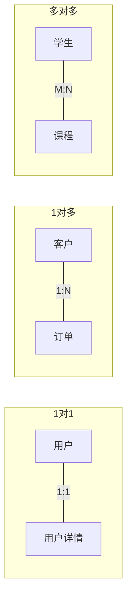
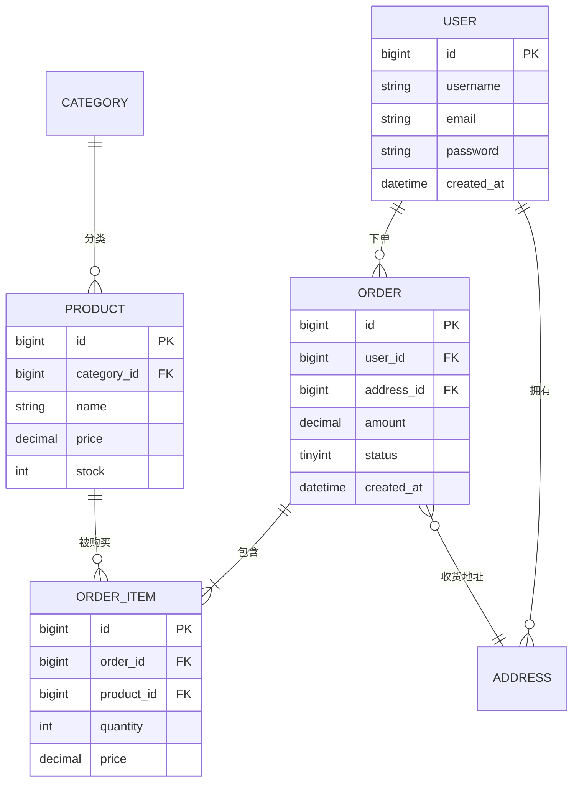

# 数据库设计范式与ER建模

> **文档说明**：数据库设计是后端开发的基本功，好的设计能避免数据冗余、更新异常、查询复杂。本文档覆盖三大范式、ER图建模、表设计原则、反范式优化、命名规范、实战案例。
>
> **适用人群**：后端工程师、数据库设计者、全栈开发者
>
> **前置知识**：SQL基础、关系型数据库概念

---

## 一、为什么需要数据库设计

### 1.1 设计不良的后果

| 问题 | 说明 |
|------|------|
| **数据冗余** | 同一信息存储多处，浪费空间，更新不一致 |
| **插入异常** | 无法单独插入某些信息（必须依赖其他信息） |
| **更新异常** | 修改一处需修改多处，容易遗漏 |
| **删除异常** | 删除某信息时误删其他有用信息 |
| **查询复杂** | 关联过多，JOIN性能差 |
| **扩展性差** | 业务变化时表结构难以调整 |

### 1.2 设计流程


| 阶段 | 产出 | 说明 |
|------|------|------|
| 需求分析 | 数据需求清单 | 明确实体、属性、关系 |
| 概念设计 | ER图 | 实体-关系模型，与具体DB无关 |
| 逻辑设计 | 关系模式 | 转为表结构，范式规范化 |
| 物理设计 | DDL语句 | 具体数据库实现，索引/分区 |

---

## 二、ER图建模

### 2.1 核心元素

| 元素 | 表示 | 说明 |
|------|------|------|
| **实体（Entity）** | 矩形 | 现实世界中的对象（用户、订单、商品） |
| **属性（Attribute）** | 椭圆 | 实体的特征（姓名、价格、时间） |
| **关系（Relationship）** | 菱形 | 实体间的联系（下单、购买、属于） |
| **主键** | 下划线 | 唯一标识实体的属性 |
| **基数** | 1:1 / 1:N / M:N | 实体间的数量关系 |

### 2.2 关系类型



| 关系 | 说明 | 表设计 |
|------|------|--------|
| **1:1** | 一个A对应一个B | 外键放任一方，或合并表 |
| **1:N** | 一个A对应多个B | 外键放在N方（B表存A的ID） |
| **M:N** | A和B互相对应多个 | 中间关联表（A_ID, B_ID） |

### 2.3 电商ER图示例



---

## 三、范式理论

### 3.1 第一范式（1NF）

**定义**：属性不可再分，每个字段都是原子值。

```text
❌ 违反1NF：
| 用户ID | 姓名 | 联系方式          |
|--------|------|-------------------|
| 1      | 张三 | 手机:138...,邮箱:a@b.com |

✅ 符合1NF：
| 用户ID | 姓名 | 手机    | 邮箱      |
|--------|------|---------|-----------|
| 1      | 张三 | 138xxxx | a@b.com   |
```

### 3.2 第二范式（2NF）

**定义**：满足1NF，且非主键属性完全依赖于整个主键（消除部分依赖）。

适用于复合主键的情况：

```text
❌ 违反2NF（部分依赖）：
订单商品表(order_id, product_id, product_name, quantity)
  - product_name只依赖product_id，不依赖整个主键

✅ 符合2NF：
订单商品表(order_id, product_id, quantity)
商品表(product_id, product_name, price)
```

### 3.3 第三范式（3NF）

**定义**：满足2NF，且非主键属性不传递依赖于主键（消除传递依赖）。

```text
❌ 违反3NF（传递依赖）：
订单表(order_id, user_id, user_name, user_email, amount)
  - user_name/email依赖user_id，user_id依赖order_id（传递依赖）

✅ 符合3NF：
订单表(order_id, user_id, amount)
用户表(user_id, user_name, user_email)
```

### 3.4 范式总结

| 范式 | 消除 | 目标 |
|------|------|------|
| 1NF | 非原子属性 | 字段原子性 |
| 2NF | 部分依赖 | 非主键完全依赖主键 |
| 3NF | 传递依赖 | 非主键直接依赖主键 |
| BCNF | 主属性部分/传递依赖 | 每个决定因素都是候选键 |

> 实际开发中，通常做到3NF即可满足绝大多数需求。BCNF在特殊场景（多候选键）才需要考虑。

---

## 四、反范式设计

### 4.1 为什么需要反范式

范式化减少冗余，但查询时需要多表JOIN，性能差。反范式通过**适度冗余**减少JOIN，提升查询性能。

| 维度 | 范式化 | 反范式 |
|------|--------|--------|
| 数据冗余 | 低 | 高（适度） |
| 查询性能 | 多表JOIN，慢 | 单表查询，快 |
| 写入性能 | 快（只写一处） | 慢（需更新多处） |
| 数据一致性 | 高 | 需维护一致性 |
| 适用 | 写多读少 | 读多写少 |

### 4.2 反范式常用手段

| 手段 | 说明 | 示例 |
|------|------|------|
| **冗余字段** | 在从表冗余主表字段 | 订单表冗余user_name |
| **汇总表** | 预计算聚合数据 | 每日订单统计表 |
| **宽表** | 多表合并为一张大表 | 商品详情宽表 |
| **数组/JSON** | 一对多用数组存储 | 用户标签用JSON数组 |

### 4.3 反范式示例

```sql
-- 范式化：需要3表JOIN
SELECT o.id, u.name, p.name, oi.quantity
FROM orders o
JOIN users u ON o.user_id = u.id
JOIN order_items oi ON o.id = oi.order_id
JOIN products p ON oi.product_id = p.id;

-- 反范式：订单表冗余用户名，订单详情冗余商品名
-- 查询只需2表JOIN
SELECT o.id, o.user_name, oi.product_name, oi.quantity
FROM orders o
JOIN order_items oi ON o.id = oi.order_id;
```

### 4.4 反范式一致性维护

反范式的代价是需要维护冗余数据的一致性：

| 方案 | 说明 |
|------|------|
| **应用层双写** | 更新主表时同步更新冗余字段 |
| **定时同步** | 定时任务校对冗余数据 |
| **触发器** | 数据库触发器自动更新 |
| **CDC监听** | Canal监听binlog更新冗余 |
| **最终一致** | 允许短暂不一致，异步同步 |

---

## 五、表设计最佳实践

### 5.1 字段设计规范

| 规范 | 说明 |
|------|------|
| **主键** | 用BIGINT自增或雪花ID，不用UUID（索引性能差） |
| **字符串** | 用VARCHAR(n)，长度按实际需求，不要都用VARCHAR(255) |
| **金额** | 用DECIMAL(10,2)，不用FLOAT/DOUBLE（精度丢失） |
| **时间** | 用DATETIME/TIMESTAMP，不用字符串存时间 |
| **布尔** | 用TINYINT(1)，0/1表示 |
| **状态** | 用TINYINT，不用ENUM（修改需DDL） |
| **必加字段** | id, created_at, updated_at, is_deleted（逻辑删除） |
| **注释** | 每个字段加COMMENT注释 |

### 5.2 命名规范

```text
表名：小写+下划线，复数形式，业务前缀
  ✅ user_info, order_main, product_category
  ❌ UserInfo, ORDER, t_user

字段名：小写+下划线，见名知意
  ✅ user_name, order_amount, created_at
  ❌ userName, orderAmount, createTime

索引名：idx_字段名 / uk_字段名 / uniq_字段名
  ✅ idx_user_name, uk_email, uniq_mobile

外键：表名_id
  ✅ user_id, order_id, product_id
```

### 5.3 索引设计原则

| 原则 | 说明 |
|------|------|
| **高频查询字段建索引** | WHERE/JOIN/ORDER BY/GROUP BY字段 |
| **联合索引最左前缀** | 等值查询在前，范围查询在后 |
| **区分度高的字段优先** | 性别（男/女）不适合单独建索引 |
| **避免过多索引** | 每个索引都增加写入开销，一般<5个 |
| **覆盖索引** | 索引包含查询所有字段，避免回表 |
| **避免索引失效** | 不在索引列用函数/运算/隐式转换 |

### 5.4 表设计模板

```sql
CREATE TABLE `order_main` (
  `id` BIGINT NOT NULL AUTO_INCREMENT COMMENT '主键ID',
  `order_no` VARCHAR(32) NOT NULL COMMENT '订单号',
  `user_id` BIGINT NOT NULL COMMENT '用户ID',
  `amount` DECIMAL(10,2) NOT NULL DEFAULT '0.00' COMMENT '订单金额',
  `status` TINYINT NOT NULL DEFAULT '0' COMMENT '状态：0待支付1已支付2已发货3已完成4已取消',
  `remark` VARCHAR(500) DEFAULT NULL COMMENT '备注',
  `created_at` DATETIME NOT NULL DEFAULT CURRENT_TIMESTAMP COMMENT '创建时间',
  `updated_at` DATETIME NOT NULL DEFAULT CURRENT_TIMESTAMP ON UPDATE CURRENT_TIMESTAMP COMMENT '更新时间',
  `is_deleted` TINYINT NOT NULL DEFAULT '0' COMMENT '是否删除：0否1是',
  PRIMARY KEY (`id`),
  UNIQUE KEY `uk_order_no` (`order_no`),
  KEY `idx_user_id` (`user_id`),
  KEY `idx_status_created` (`status`, `created_at`)
) ENGINE=InnoDB DEFAULT CHARSET=utf8mb4 COMMENT='订单主表';
```

---

## 六、实战案例：电商系统设计

### 6.1 核心表设计

```text
用户模块：
  user（用户主表）
  user_address（用户收货地址）
  user_auth（用户认证信息）

商品模块：
  category（商品分类）
  product（商品主表）
  product_sku（商品SKU）
  product_stock（商品库存）

订单模块：
  order_main（订单主表）
  order_item（订单明细）
  order_payment（订单支付）

支付模块：
  payment_record（支付记录）
  refund_record（退款记录）
```

### 6.2 设计要点

1. **订单号**：用业务前缀+时间+序列号，不用自增ID（防爬虫）
2. **库存**：独立库存表，用乐观锁/Redis扣减，避免超卖
3. **价格**：订单明细冗余商品价格（历史价格，商品改价不影响历史订单）
4. **状态机**：订单状态用状态机管理，非法状态转移拒绝
5. **逻辑删除**：用is_deleted，不物理删除（保留历史）
6. **分库分表**：订单表按user_id分库分表（量大时）

---

## 关联文档

- [[MySQL 知识点系统梳理_优化版]] — MySQL基础
- [[数据库知识点完整整合大全_优化版]] — 数据库全景
- [[SQL速查表]] — SQL语法
- [[分库分表实战指南]] — 分库分表
- [[数据库迁移工具实战]] — 迁移工具
- [[技术选型决策指南]] — 选型

---

> 💡 **设计心得**：1. 先做ER图，再写DDL，不要上来就建表；2. 三范式是基础，但不要教条，读多写少的场景适度反范式；3. 字段设计留有余量（VARCHAR长度、状态枚举），但不要过度设计；4. 索引设计是关键，建表时就规划好查询场景；5. 命名规范统一，注释必须写（半年后你会感谢自己）；6. 大表提前规划分库分表策略。数据库设计是"一开始省事，后面费事；一开始费事，后面省事"。


## 补充：概述

数据库设计是软件系统的基石，好的数据库设计能保证数据完整性、减少冗余、提升查询效率、降低维护成本。数据库设计的核心理论是**关系范式（Normalization）**和**ER 建模（Entity-Relationship Modeling）**。范式理论指导如何减少数据冗余和更新异常，ER 建模指导如何从业务需求抽象出实体、属性和关系。

| 设计阶段 | 产出 | 关键活动 |
|---------|------|---------|
| **需求分析** | 需求文档 | 收集业务需求、数据需求、性能需求 |
| **概念设计** | ER 图 | 识别实体、属性、关系，画 ER 图 |
| **逻辑设计** | 关系模式 | ER 图转关系表，范式化设计，定义主键外键 |
| **物理设计** | DDL 脚本 | 选择索引、分区、存储引擎，定义字段类型和约束 |
| **实施验证** | 数据库实例 | 建表、导入测试数据、验证查询性能 |

**核心权衡**：范式化程度不是越高越好。高范式（3NF/BCNF）减少冗余但增加 JOIN，低范式（反范式）减少 JOIN 但增加冗余和更新成本。**OLTP 系统通常用 3NF，OLAP/数仓系统通常用反范式（星型/雪花模型）**。

---

## 补充：底层原理

### 范式理论详解

| 范式 | 全称 | 核心要求 | 解决的问题 |
|------|------|---------|-----------|
| **1NF** | 第一范式 | 每个字段都是原子值，不可再分 | 消除多值字段、重复组 |
| **2NF** | 第二范式 | 在 1NF 基础上，非主键字段完全依赖整个主键（不能只依赖主键的一部分） | 消除部分依赖，适用于复合主键 |
| **3NF** | 第三范式 | 在 2NF 基础上，非主键字段不传递依赖于主键（非主键字段只能依赖主键） | 消除传递依赖 |
| **BCNF** | 巴斯-科德范式 | 在 3NF 基础上，任何字段的决定因子必须是候选键（消除主属性对候选键的部分/传递依赖） | 消除主属性依赖异常 |
| **4NF** | 第四范式 | 在 BCNF 基础上，消除多值依赖 | 一个表不存两个独立的多值属性 |

**范式化示例**（用户订单场景）：

❌ 违反 1NF（字段非原子）：
| 订单ID | 商品 |
|--------|------|
| 1 | 苹果,香蕉,橙子 |

✅ 符合 1NF：
| 订单ID | 商品 |
|--------|------|
| 1 | 苹果 |
| 1 | 香蕉 |
| 1 | 橙子 |

❌ 违反 2NF（复合主键中部分依赖）：
| 订单ID | 商品ID | 商品名称 | 数量 |
|--------|--------|---------|------|
| 1 | 101 | iPhone | 2 |
（商品名称只依赖商品ID，不依赖订单ID）

✅ 符合 2NF（拆表）：
订单明细表：| 订单ID | 商品ID | 数量 |
商品表：| 商品ID | 商品名称 |

❌ 违反 3NF（传递依赖）：
| 员工ID | 姓名 | 部门ID | 部门名称 |
|--------|------|--------|---------|
（部门名称依赖部门ID，部门ID依赖员工ID，传递依赖）

✅ 符合 3NF（拆表）：
员工表：| 员工ID | 姓名 | 部门ID |
部门表：| 部门ID | 部门名称 |

### ER 建模原理

ER 模型的三个核心要素：

| 要素 | 表示 | 说明 | 示例 |
|------|------|------|------|
| **实体（Entity）** | 矩形 | 业务中可区分的对象 | 用户、订单、商品 |
| **属性（Attribute）** | 椭圆 | 实体的特征 | 用户ID、姓名、邮箱 |
| **关系（Relationship）** | 菱形 | 实体之间的关联 | 用户-下单-订单 |

**关系基数（Cardinality）**：
| 关系类型 | 表示 | 示例 | 外键位置 |
|---------|------|------|---------|
| **一对一（1:1）** | 1—1 | 用户 ↔ 用户详情 | 任意一方（通常放从表） |
| **一对多（1:N）** | 1—N | 用户 ↔ 订单 | 多方（订单表存 user_id） |
| **多对多（M:N）** | M—N | 学生 ↔ 课程 | 中间表（选课表） |

**ER 图转关系表规则**：
1. 每个实体转一张表，实体属性转表字段，主键标识
2. 1:1 关系：外键放任意一方（通常放从属实体），加唯一约束
3. 1:N 关系：外键放多方（N 端）
4. M:N 关系：创建中间表，包含双方外键作为联合主键

### 反范式化（Denormalization）

当查询性能成为瓶颈时，有意识地增加冗余来减少 JOIN：

| 反范式技术 | 说明 | 示例 |
|-----------|------|------|
| **冗余字段** | 在主表中存储关联表的常用字段 | 订单表冗余 `user_name`（避免 JOIN 用户表） |
| **派生字段** | 存储计算结果而非实时计算 | 用户表存 `order_count`、`total_amount` |
| **合并表** | 将 1:1 关系的表合并 | 用户表 + 用户详情表合并 |
| **重复分组** | 在明细表中冗余分组信息 | 订单项冗余 `order_date` |

**代价**：增加存储空间、更新时需要维护冗余数据的一致性（用触发器、应用层双写、定时任务同步）。
