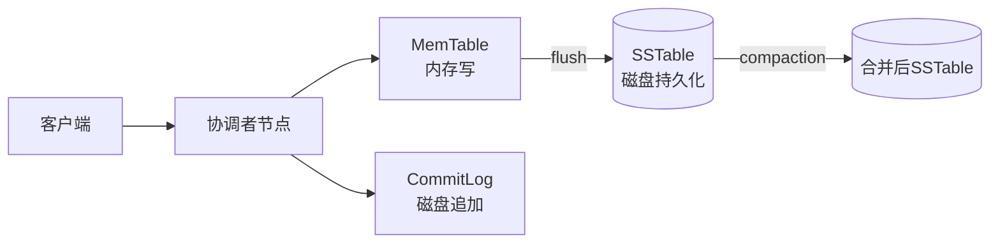

# Cassandra列式数据库实战

> **文档说明**：Apache Cassandra是高可用、高性能、分布式列式数据库，专为海量数据和高并发写入设计，无单点故障，线性扩展。本文档覆盖架构原理、数据模型、CQL语法、读写流程、一致性级别、部署运维、与HBase对比。
>
> **适用人群**：后端工程师、DBA、需要处理海量数据的开发者
>
> **前置知识**：分布式系统、NoSQL概念、SQL基础

---

## 一、Cassandra概述

### 1.1 什么是Cassandra

Cassandra是Apache开源的分布式NoSQL数据库，最初由Facebook开发，用于收件箱搜索功能。它结合了Google Bigtable的数据模型和Amazon Dynamo的分布式架构。

| 特性 | 说明 |
|------|------|
| **分布式** | 无主架构（P2P），所有节点平等 |
| **高可用** | 无单点故障，多副本，跨数据中心复制 |
| **高性能** | 写入极快（追加写），读性能优秀 |
| **线性扩展** | 添加节点线性提升吞吐量 |
| **列式存储** | 按列存储，适合分析和特定查询 |
| **最终一致性** | 可调一致性，AP系统（CAP中选AP） |
| **跨数据中心** | 原生支持多数据中心部署 |

### 1.2 适用场景

| 适合 | 不适合 |
|------|--------|
| 海量数据写入（IoT/日志/监控） | 需要复杂事务（银行转账） |
| 高并发读写（社交/游戏） | 需要JOIN和复杂查询 |
| 时间序列数据（指标/事件） | 小数据集（<100GB用MySQL） |
| 多数据中心部署 | 需要强一致性 |
| 不需要JOIN的简单查询 | 需要即席查询（用ES/ClickHouse） |

### 1.3 典型应用

| 公司 | 用途 |
|------|------|
| **Netflix** | 用户观看历史、推荐数据 |
| **Apple** | iCloud、Siri数据存储 |
| **Uber** | 行程数据、位置信息 |
| **Instagram** | 用户feed、消息 |
| **eBay** | 商品数据、交易记录 |

---

## 二、架构原理

### 2.1 无主架构（P2P）

```mermaid
flowchart TB
    subgraph Cassandra集群
        N1[节点1] <--> N2[节点2]
        N2 <--> N3[节点3]
        N3 <--> N4[节点4]
        N4 <--> N1
        N1 <--> N3
        N2 <--> N4
    end
    C[客户端] -->|写入| N1
    C -->|读取| N3
    note: 任何节点都可处理读写请求，无主节点
```

- **无主节点**：所有节点平等，任何节点可处理任何请求
- **Gossip协议**：节点间通过Gossip交换状态信息
- **数据分区**：数据按Partition Key哈希分布到各节点
- **副本机制**：每行数据复制到N个节点（副本因子）

### 2.2 数据分区

```text
一致性哈希环（Consistent Hashing Ring）

节点A (token 0)
     ↓ 数据范围: 0-25%
节点B (token 25%)
     ↓ 数据范围: 25%-50%
节点C (token 50%)
     ↓ 数据范围: 50%-75%
节点D (token 75%)
     ↓ 数据范围: 75%-100%

Partition Key → MD5哈希 → Token → 对应节点
```

### 2.3 读写流程

**写入流程（极快）**

```text
1. 客户端连接任意节点（协调者节点）
2. 协调者根据Partition Key计算目标节点
3. 写入目标节点 + 副本节点
4. 写入MemTable（内存）+ CommitLog（磁盘追加）
5. 达到阈值后MemTable flush到SSTable（磁盘）
6. 后台Compaction合并SSTable
```



| 写入步骤 | 说明 | 性能 |
|---------|------|------|
| CommitLog | 顺序追加写，保证持久性 | 极快 |
| MemTable | 内存写入，按主键排序 | 极快 |
| SSTable | 批量flush，顺序写 | 快 |
| Compaction | 后台合并，不影响写入 | 异步 |

**读取流程**

```text
1. 客户端连接任意节点
2. 协调者请求目标节点+副本节点
3. 从MemTable（最新）+ SSTable（可能多个）读取
4. 合并结果（按时间戳取最新）
5. 后台Read Repair修复不一致副本
```

### 2.4 一致性级别（Consistency Level）

Cassandra是最终一致性系统，可通过一致性级别在可用性和一致性间权衡。

| 级别 | 说明 | 可用性 | 一致性 |
|------|------|--------|--------|
| **ANY** | 任一节点响应（含Hinted Handoff） | 最高 | 最低 |
| **ONE** | 1个副本响应 | 高 | 低 |
| **QUORUM** | 多数副本响应（N/2+1） | 中 | 中 |
| **ALL** | 所有副本响应 | 低 | 最高 |

```text
副本因子 N=3
  ONE:     1/3节点响应 → 高可用，可能读到旧数据
  QUORUM:  2/3节点响应 → 平衡，读写都用QUORUM可保证强一致
  ALL:     3/3节点响应 → 强一致，一个节点挂了就不可用

强一致配置：读QUORUM + 写QUORUM（R+W > N）
```

---

## 三、数据模型

### 3.1 核心概念

| 概念 | 说明 | 类比 |
|------|------|------|
| **Keyspace** | 数据库命名空间，类似MySQL的Database | Database |
| **Table** | 表，数据存储单元 | Table |
| **Partition Key** | 分区键，决定数据存在哪个节点 | 分片键 |
| **Clustering Key** | 聚簇键，分区内数据排序 | 索引+排序 |
| **Column** | 列，数据字段 | Column |
| **Primary Key** | 主键 = Partition Key + Clustering Key | 主键 |

### 3.2 表设计

```sql
-- 创建Keyspace
CREATE KEYSPACE IF NOT EXISTS iot_data
WITH replication = {
    'class': 'NetworkTopologyStrategy',
    'datacenter1': 3  -- 副本因子3
};

-- 使用Keyspace
USE iot_data;

-- 创建设备数据表
CREATE TABLE IF NOT EXISTS device_metrics (
    device_id    TEXT,           -- Partition Key：按设备分区
    metric_time  TIMESTAMP,      -- Clustering Key：按时间排序
    metric_name  TEXT,           -- Clustering Key：按指标名排序
    value        DOUBLE,
    unit         TEXT,
    PRIMARY KEY ((device_id), metric_time, metric_name)
) WITH CLUSTERING ORDER BY (metric_time DESC, metric_name ASC);
-- 分区内按时间倒序、指标名正序排列
```

### 3.3 分区键 vs 聚簇键

```sql
-- 主键结构：((partition_key), clustering_key1, clustering_key2)

-- 例1：单分区键
PRIMARY KEY (user_id)
-- 所有user_id相同的数据在同一分区，无排序

-- 例2：分区键+聚簇键
PRIMARY KEY ((user_id), created_at)
-- 按user_id分区，分区内按created_at排序
-- 查询：WHERE user_id = ? ORDER BY created_at DESC ✅

-- 例3：复合分区键
PRIMARY KEY ((user_id, year), created_at)
-- 按user_id+year联合分区（避免单分区过大）
-- 查询必须同时指定user_id和year ❌不能只指定user_id
```

### 3.4 数据建模原则

| 原则 | 说明 | 反例 |
|------|------|------|
| **查询驱动建模** | 先确定查询模式，再设计表 | 先设计表再想怎么查 |
| **一个查询一张表** | 不同查询模式建不同表（数据冗余） | 试图用一张表满足所有查询 |
| **Partition Key均匀** | 避免热点分区 | 用日期做Partition Key（当天数据集中） |
| **分区大小控制** | 单分区建议<100MB | 无限制增长的分区 |
| **Clustering Key排序** | 利用排序避免ORDER BY | 分区内无序导致全分区扫描 |

### 3.5 建模示例：时间序列

```sql
-- 场景：IoT设备指标，按设备查询最近数据
CREATE TABLE device_metrics (
    device_id   TEXT,
    day         DATE,           -- 复合分区键，按天分桶
    ts          TIMESTAMP,      -- 聚簇键，时间排序
    temperature DOUBLE,
    humidity    DOUBLE,
    PRIMARY KEY ((device_id, day), ts)
) WITH CLUSTERING ORDER BY (ts DESC);

-- 查询：某设备某天的指标
SELECT * FROM device_metrics
WHERE device_id = 'sensor-001' AND day = '2026-08-27';
-- 高效：定位到单个分区，按时间排序读取

-- 为什么用(device_id, day)复合分区？
-- 如果只用device_id，一个设备几年的数据全在一个分区（可能GB级）
-- 加day分桶后，每天一个分区，控制分区大小
```

---

## 四、CQL语法

### 4.1 基本操作

```sql
-- 插入（UPSERT语义：存在则更新，不存在则插入）
INSERT INTO device_metrics (device_id, day, ts, temperature, humidity)
VALUES ('sensor-001', '2026-08-27', '2026-08-27 10:00:00', 25.5, 60.0);

-- 查询（必须指定Partition Key）
SELECT * FROM device_metrics
WHERE device_id = 'sensor-001' AND day = '2026-08-27'
LIMIT 100;

-- 条件查询（Clustering Key支持范围）
SELECT * FROM device_metrics
WHERE device_id = 'sensor-001' AND day = '2026-08-27'
  AND ts >= '2026-08-27 09:00:00' AND ts < '2026-08-27 10:00:00';

-- 更新（也是UPSERT）
UPDATE device_metrics
SET temperature = 26.0
WHERE device_id = 'sensor-001' AND day = '2026-08-27' AND ts = '...';

-- 删除
DELETE FROM device_metrics
WHERE device_id = 'sensor-001' AND day = '2026-08-27' AND ts = '...';

-- TTL（数据自动过期）
INSERT INTO device_metrics (...) VALUES (...) USING TTL 86400;  -- 1天后过期
```

### 4.2 批量操作

```sql
-- 批量写入（原子性：同分区的批量是原子的）
BEGIN BATCH
    INSERT INTO device_metrics (...) VALUES ('sensor-001', ...);
    INSERT INTO device_metrics (...) VALUES ('sensor-002', ...);
APPLY BATCH;

-- 注意：跨分区批量不是原子的，且可能影响性能
```

### 4.3 二级索引（谨慎使用）

```sql
-- 创建二级索引
CREATE INDEX idx_metric_name ON device_metrics(metric_name);

-- 使用二级索引查询
SELECT * FROM device_metrics WHERE metric_name = 'temperature';

-- ⚠️ 二级索引的问题：
-- 1. 性能差（需要扫描所有节点）
-- 2. 不适合高基数字段（如user_id）
-- 3. 建议：用物化视图或新建表替代
```

### 4.4 物化视图

```sql
-- 物化视图：自动维护的反规范化表
CREATE MATERIALIZED VIEW metrics_by_name AS
    SELECT device_id, day, ts, metric_name, value
    FROM device_metrics
    WHERE device_id IS NOT NULL AND day IS NOT NULL
      AND ts IS NOT NULL AND metric_name IS NOT NULL
    PRIMARY KEY ((metric_name), day, device_id, ts);

-- 查询：按指标名查询（原表不支持）
SELECT * FROM metrics_by_name WHERE metric_name = 'temperature';
-- 物化视图自动同步原表数据，无需手动维护
```

---

## 五、部署运维

### 5.1 集群部署

```yaml
# cassandra.yaml 关键配置
cluster_name: 'iot-cluster'
num_tokens: 256                    # 虚拟节点数
seed_provider:
  - class_name: SimpleSeedProvider
    parameters:
      - seeds: "10.0.0.1,10.0.0.2"  # 种子节点
listen_address: 10.0.0.3            # 本机IP
rpc_address: 0.0.0.0                # 客户端监听
endpoint_snitch: GossipingPropertyFileSnitch
data_file_directories:
  - /var/lib/cassandra/data
commitlog_directory: /var/lib/cassandra/commitlog
saved_caches_directory: /var/lib/cassandra/saved_caches
```

### 5.2 硬件建议

| 组件 | 建议 |
|------|------|
| **CPU** | 8核+（Cassandra是CPU密集型，压缩+Compaction） |
| **内存** | 16GB+（8GB堆内+8GB堆外/系统缓存） |
| **磁盘** | SSD（Compaction和读取需要高IOPS） |
| **网络** | 万兆网卡（副本复制+跨数据中心） |
| **节点数** | 最少3节点（副本因子3），生产建议6+ |

### 5.3 常用运维命令

```bash
# 查看集群状态
nodetool status

# 查看节点信息
nodetool info

# 手动触发Compaction
nodetool compact

# 查看Compaction状态
nodetool compactionstats

# 修复数据（节点恢复后）
nodetool repair

# 查看集群环分布
nodetool ring

# 添加节点
# 1. 配置新节点cassandra.yaml（seeds指向现有集群）
# 2. 启动新节点，自动加入集群
# 3. 运行nodetool cleanup（清理不属于该节点的数据）

# 移除节点
nodetool decommission  # 优雅下线（数据迁移到其他节点）
```

### 5.4 备份与恢复

```bash
# 快照备份
nodetool snapshot -t backup_20260827

# 查看快照
nodetool listsnapshots

# 恢复：停止节点 → 复制SSTable到data目录 → 启动节点 → nodetool refresh

# 增量备份（在cassandra.yaml中开启）
incremental_backups: true
```

---

## 六、Cassandra vs HBase vs MySQL

| 维度 | Cassandra | HBase | MySQL |
|------|-----------|-------|-------|
| 架构 | 无主P2P | 主从（HMaster+RegionServer） | 主从 |
| 一致性 | 最终一致（可调） | 强一致 | 强一致 |
| 写入 | 极快（追加写） | 快（LSM树） | 中等 |
| 读取 | 快（需按主键） | 快（按行键） | 快（有索引） |
| 复杂查询 | 不支持 | 不支持 | 支持（SQL） |
| 事务 | 无（仅分区内原子批量） | 行级事务 | ACID |
| 运维复杂度 | 中（无主，简单） | 高（依赖HDFS+ZooKeeper） | 低 |
| 生态 | CQL、Spark集成 | Hadoop生态、Phoenix SQL | 成熟生态 |
| 适用 | 高写入、多数据中心、简单查询 | Hadoop生态、海量存储 | 事务、复杂查询 |

---

## 七、性能优化

| 优化项 | 方法 |
|--------|------|
| **分区设计** | 均匀分布，避免热点，控制分区大小 |
| **写入优化** | 批量写入、异步写入、CommitLog放在SSD |
| **读取优化** | 合理设置一致性级别、使用缓存、避免全表扫描 |
| **Compaction** | 选择合适策略（SizeTiered/Leveled/TimeWindow） |
| **JVM调优** | 堆内存8-16GB、G1垃圾回收、避免Full GC |
| **监控** | 关注Pending Compactions、读写延迟、磁盘使用率 |

---

## 关联文档

- [[数据库知识点完整整合大全_优化版]] — 数据库全景
- [[Redis核心知识点系统梳理_优化版]] — 缓存数据库
- [[Elasticsearch搜索引擎实战]] — 搜索引擎
- [[ClickHouse OLAP引擎实战]] — 列式分析数据库
- [[高可用架构设计]] — 高可用
- [[技术选型决策指南]] — 数据库选型

---

> 💡 **选型建议**：Cassandra的核心优势是"无主架构+极高写入性能+多数据中心"，适合IoT、监控、日志、社交Feed等高写入场景。但它不适合需要复杂查询、事务、JOIN的场景。数据建模是Cassandra的关键——必须查询驱动，一个查询一张表，用好Partition Key和Clustering Key。生产环境至少3节点副本因子3，SSD磁盘，做好监控和定期repair。如果你的场景是分析查询（聚合/即席查询），选ClickHouse；如果是全文搜索，选Elasticsearch；如果是简单KV+高写入，选Cassandra。
