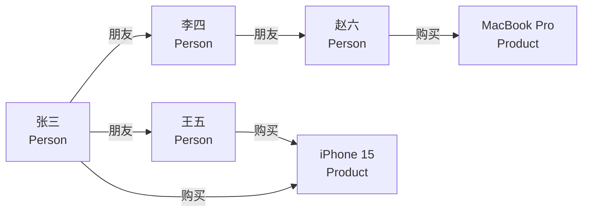

# Neo4j图数据库实战

> **文档说明**：Neo4j是最流行的图数据库，以节点和关系存储数据，擅长处理复杂关联查询。本文档覆盖图数据模型、Cypher查询语言、索引优化、知识图谱构建、推荐系统应用、与关系型数据库对比。
>
> **适用人群**：后端高级工程师、需要构建知识图谱/推荐系统/社交网络的开发者
>
> **前置知识**：数据库基础、SQL、图论基础概念

---

## 一、图数据库基础

### 1.1 为什么需要图数据库

关系型数据库处理关联查询的痛点：

```sql
-- 查询"张三的朋友的朋友的朋友"（3度关系）
-- 关系型数据库需要3次JOIN，数据量大时性能极差
SELECT DISTINCT u4.name
FROM users u1
JOIN friends f1 ON u1.id = f1.user_id
JOIN users u2 ON f1.friend_id = u2.id
JOIN friends f2 ON u2.id = f2.user_id
JOIN users u3 ON f2.friend_id = u3.id
JOIN friends f3 ON u3.id = f3.user_id
JOIN users u4 ON f3.friend_id = u4.id
WHERE u1.name = '张三' AND u4.name != '张三';
-- 4度、5度关系？JOIN爆炸，基本不可用
```

图数据库将关系作为一等公民，遍历关联是O(1)操作，深度查询性能稳定。

### 1.2 图数据模型



| 概念 | 说明 | 类比关系型 |
|------|------|-----------|
| **节点（Node）** | 实体，如人、商品、地点 | 表中的行 |
| **关系（Relationship）** | 节点间的连接，有方向和类型 | 外键/关联表 |
| **属性（Property）** | 节点和关系的键值对 | 列 |
| **标签（Label）** | 节点的类型分组 | 表名 |
| **路径（Path）** | 节点和关系组成的序列 | JOIN链 |

### 1.3 适用场景

| 场景 | 说明 | 典型案例 |
|------|------|---------|
| **知识图谱** | 实体与关系网络 | 医疗知识图谱、企业知识图谱 |
| **推荐系统** | 基于关联的推荐 | 电商"买了又买"、好友推荐 |
| **社交网络** | 人际关系查询 | 好友推荐、影响力分析 |
| **金融风控** | 资金链路追踪 | 反欺诈、团伙识别 |
| **网络运维** | 依赖关系分析 | 故障根因分析、影响面评估 |
| **AI RAG** | 知识图谱检索 | 结构化知识增强生成 |

---

## 二、Cypher查询语言

### 2.1 基本语法

Cypher是Neo4j的声明式查询语言，使用ASCII艺术表示图模式：

```cypher
-- 节点表示：(变量:标签 {属性})
(p:Person {name: '张三'})

-- 关系表示：-[变量:关系类型 {属性}]->
-[r:朋友 {since: 2020}]->

-- 完整模式
(p:Person {name: '张三'})-[:朋友]->(f:Person)
```

### 2.2 创建数据

```cypher
-- 创建节点
CREATE (p:Person {name: '张三', age: 28, city: '上海'})
RETURN p;

-- 创建关系（先匹配再创建）
MATCH (a:Person {name: '张三'}), (b:Person {name: '李四'})
CREATE (a)-[r:朋友 {since: 2020, level: 'close'}]->(b)
RETURN r;

-- 批量创建（电影知识图谱示例）
CREATE
  (matrix:Movie {title: '黑客帝国', year: 1999}),
  (keanu:Person {name: '基努·里维斯', born: 1964}),
  (lana:Director {name: '拉娜·沃卓斯基'}),
  (keanu)-[:出演 {role: 'Neo'}]->(matrix),
  (lana)-[:导演]->(matrix);
```

### 2.3 查询数据

```cypher
-- 匹配所有Person节点
MATCH (p:Person) RETURN p.name, p.age LIMIT 10;

-- 匹配张三的朋友（1度关系）
MATCH (p:Person {name: '张三'})-[:朋友]->(f:Person)
RETURN f.name;

-- 匹配张三的朋友的朋友（2度关系）
MATCH (p:Person {name: '张三'})-[:朋友*2]->(fof:Person)
WHERE fof.name <> '张三'
RETURN DISTINCT fof.name;

-- 可变长度路径（1-3度朋友）
MATCH (p:Person {name: '张三'})-[:朋友*1..3]->(f)
RETURN DISTINCT f.name;

-- 最短路径
MATCH path = shortestPath(
  (p1:Person {name: '张三'})-[:朋友*]-(p2:Person {name: '赵六'})
)
RETURN path, length(path) AS degrees;

-- 全路径
MATCH path = allShortestPaths(
  (p1:Person {name: '张三'})-[:朋友*]-(p2:Person {name: '赵六'})
)
RETURN path;
```

### 2.4 更新与删除

```cypher
-- 更新属性
MATCH (p:Person {name: '张三'})
SET p.age = 29, p.city = '北京'
RETURN p;

-- 添加标签
MATCH (p:Person {name: '张三'})
SET p:Developer
RETURN labels(p);

-- 删除关系
MATCH (p:Person {name: '张三'})-[r:朋友]->(f:Person {name: '李四'})
DELETE r;

-- 删除节点（必须先删除关系）
MATCH (p:Person {name: '张三'})
DETACH DELETE p;  -- DETACH自动删除关联关系
```

### 2.5 聚合与排序

```cypher
-- 统计每个人的朋友数
MATCH (p:Person)-[:朋友]->(f)
RETURN p.name, count(f) AS friendCount
ORDER BY friendCount DESC
LIMIT 10;

-- 统计商品被多少人购买
MATCH (u:Person)-[:购买]->(p:Product)
RETURN p.name, count(DISTINCT u) AS buyerCount
ORDER BY buyerCount DESC;

-- 分组统计
MATCH (p:Person)
RETURN p.city, count(*) AS personCount
ORDER BY personCount DESC;
```

---

## 三、高级查询模式

### 3.1 推荐查询

```cypher
-- 基于协同过滤的商品推荐
-- "购买了张三购买的商品的人，还购买了什么"
MATCH (p:Person {name: '张三'})-[:购买]->(product)<-[:购买]-(other:Person)-[:购买]->(rec:Product)
WHERE NOT (p)-[:购买]->(rec)
RETURN rec.name, count(DISTINCT other) AS score
ORDER BY score DESC
LIMIT 10;

-- 基于社交关系的推荐
-- "朋友购买的商品，我还没买的"
MATCH (p:Person {name: '张三'})-[:朋友]->(f)-[:购买]->(rec:Product)
WHERE NOT (p)-[:购买]->(rec)
RETURN rec.name, count(f) AS friendCount
ORDER BY friendCount DESC
LIMIT 10;
```

### 3.2 社区发现

```cypher
-- 使用GDS（Graph Data Science）库进行社区检测
CALL gds.graph.project('myGraph', 'Person', '朋友');

-- Louvain社区检测
CALL gds.louvain.stream('myGraph')
YIELD nodeId, communityId
RETURN gds.util.asNode(nodeId).name AS name, communityId
ORDER BY communityId;

-- 中心性分析（PageRank）
CALL gds.pageRank.stream('myGraph')
YIELD nodeId, score
RETURN gds.util.asNode(nodeId).name AS name, score
ORDER BY score DESC
LIMIT 10;
```

### 3.3 知识图谱推理

```cypher
-- 知识图谱：查询"治疗感冒的药物有哪些副作用"
MATCH (d:Disease {name: '感冒'})<-[:治疗]-(m:Medicine)-[:有副作用]->(s:SideEffect)
RETURN m.name AS medicine, collect(s.name) AS sideEffects;

-- 多跳推理："A药和B药能否同时服用"
MATCH (a:Medicine {name: 'A药'})-[:冲突]->(b:Medicine {name: 'B药'})
RETURN '不能同时服用' AS result;
```

---

## 四、索引与性能优化

### 4.1 索引

```cypher
-- 创建索引
CREATE INDEX person_name_idx FOR (p:Person) ON (p.name);

-- 复合索引
CREATE INDEX person_city_age_idx FOR (p:Person) ON (p.city, p.age);

-- 唯一约束
CREATE CONSTRAINT person_name_unique FOR (p:Person) REQUIRE p.name IS UNIQUE;

-- 查看索引
SHOW INDEXES;

-- 删除索引
DROP INDEX person_name_idx;
```

### 4.2 性能优化技巧

| 优化 | 说明 |
|------|------|
| **索引** | 频繁查询的属性必须建索引 |
| **标签过滤** | 查询时始终指定标签，避免全图扫描 |
| **限制深度** | 可变长度路径设置最大深度，避免遍历全图 |
| **WITH管道** | 提前过滤减少后续处理数据量 |
| **避免笛卡尔积** | 注意MATCH模式中的笛卡尔积 |
| **PROFILE** | 使用PROFILE分析执行计划 |
| **批量导入** | 大数据量用neo4j-admin import或LOAD CSV |

```cypher
-- 分析执行计划
PROFILE MATCH (p:Person {name: '张三'})-[:朋友*1..3]->(f)
RETURN DISTINCT f.name;

-- 优化：提前过滤
MATCH (p:Person {name: '张三'})-[:朋友]->(f)
WHERE f.age > 20
WITH f
MATCH (f)-[:朋友]->(fof)
RETURN DISTINCT fof.name;
```

---

## 五、Spring Boot集成

```xml
<dependency>
    <groupId>org.springframework.boot</groupId>
    <artifactId>spring-boot-starter-data-neo4j</artifactId>
</dependency>
```

```yaml
spring:
  neo4j:
    uri: bolt://localhost:7687
    authentication:
      username: neo4j
      password: password
```

```java
// 节点实体
@Node("Person")
@Data
public class Person {
    @Id
    @GeneratedValue
    private Long id;

    private String name;
    private Integer age;
    private String city;

    @Relationship(type = "朋友", direction = Relationship.Direction.OUTGOING)
    private List<Person> friends = new ArrayList<>();
}

// Repository
public interface PersonRepository extends Neo4jRepository<Person, Long> {
    Optional<Person> findByName(String name);

    @Query("MATCH (p:Person {name: $name})-[:朋友*1..2]->(f) RETURN DISTINCT f")
    List<Person> findFriendsOfFriends(String name);
}

// Service
@Service
public class GraphService {
    @Autowired
    private PersonRepository personRepository;

    public List<Person> recommendFriends(String name) {
        return personRepository.findFriendsOfFriends(name);
    }
}
```

---

## 六、图数据库 vs 关系型数据库

| 维度 | Neo4j（图） | MySQL（关系型） |
|------|------------|----------------|
| 数据模型 | 节点+关系+属性 | 表+行+列+外键 |
| 关联查询 | 遍历O(1)，深度不影响性能 | JOIN，深度增加性能指数下降 |
| 模式灵活 | Schema可选，动态添加属性 | DDL修改，相对固定 |
| 事务 | ACID | ACID |
| 聚合分析 | 较弱（GDS扩展） | 强大（SQL GROUP BY） |
| 水平扩展 | 企业版支持集群 | 分库分表成熟 |
| 适用 | 复杂关联、深度查询 | 结构化数据、聚合分析 |
| 不适用 | 大量简单CRUD、报表统计 | 社交网络、知识图谱 |

---

## 七、部署与运维

```bash
# Docker部署
docker run -d \
  --name neo4j \
  -p 7474:7474 -p 7687:7687 \
  -e NEO4J_AUTH=neo4j/password \
  -e NEO4J_PLUGINS='["graph-data-science","apoc"]' \
  -v neo4j_data:/data \
  neo4j:5.15

# 访问 http://localhost:7474 进入浏览器界面
# Bolt协议端口 7687
```

### 7.1 备份恢复

```bash
# 备份（需停止数据库或使用--online）
neo4j-admin database dump neo4j --to-path=/backup/

# 恢复
neo4j-admin database load neo4j --from-path=/backup/
```

---

## 关联文档

- [[数据库知识点完整整合大全_优化版]] — 数据库全景
- [[向量数据库选型与实战]] — AI检索对比
- [[Elasticsearch深度实战]] — 搜索引擎对比
- [[MongoDB实战指南]] — NoSQL对比
- [[RAG检索增强生成]] — 知识图谱在RAG中的应用
- [[技术选型决策指南]] — 数据库选型

---

> 💡 **选型建议**：当查询涉及3度以上关联、需要路径分析、社区发现、推荐计算时，Neo4j远超关系型数据库。典型应用：知识图谱、社交推荐、金融风控、网络运维。但不要用图数据库做简单CRUD和报表统计，那是关系型数据库的强项。AI时代知识图谱+RAG是Neo4j的新兴增长点。


## 补充：概述

Neo4j 是最流行的**原生图数据库**，以节点（Node）、关系（Relationship）、属性（Property）为核心数据模型，专为处理高度关联的数据而设计。与关系型数据库通过 JOIN 处理关联不同，图数据库将关系作为一等公民，遍历关系的时间复杂度为 O(1)（无需扫描全表），在社交网络、推荐系统、知识图谱、欺诈检测、网络拓扑等场景具有显著优势。

| 特性 | 说明 |
|------|------|
| **原生图存储** | 节点和关系以原生图结构存储，免索引邻接 |
| **Cypher 查询语言** | 声明式图查询语言，语法直观（`(a)-[:KNOWS]->(b)`） |
| **ACID 事务** | 完整的 ACID 事务支持 |
| **高可用** | 因果集群（Causal Cluster），支持读写分离和自动故障转移 |
| **丰富算法** | 内置图算法库（GDS）：最短路径、社区发现、中心性、PageRank 等 |
| **可视化** | Neo4j Browser / Bloom 提供图可视化探索 |

**适用场景**：社交网络（好友关系）、推荐引擎（商品/内容关联）、知识图谱（实体关系）、欺诈检测（资金链路）、网络拓扑（设备连接）、身份与访问管理（角色权限）。
**不适用场景**：简单的 CRUD 应用、大量批量数据处理、对查询语言有 SQL 强依赖的团队。

---

## 补充：底层原理

### 免索引邻接（Index-Free Adjacency）

Neo4j 的核心性能优势来自**免索引邻接**：每个节点直接存储其关系的物理指针，遍历关系时不需要查找索引，直接通过指针跳转，时间复杂度为 O(1)。

```text
关系型数据库：查找 A 的朋友 → 扫描 friends 表 → JOIN users 表 → O(n)
图数据库：查找 A 的朋友 → A 节点直接指向关系 → 关系直接指向朋友节点 → O(1)
```

**存储结构**：
- 节点存储：节点 ID、第一个关系指针、第一个属性指针、标签指针
- 关系存储：关系 ID、起点节点、终点节点、关系类型、上一个/下一个关系指针（起点和终点各一组）、属性指针
- 属性存储：属性 ID、属性键、属性值、下一个属性指针

这种设计使得无论数据量多大，从一个节点遍历其邻居的速度都是恒定的。

### Cypher 查询执行原理

Cypher 是声明式查询语言，执行流程：
```text
Cypher 语句 → 解析器 → 逻辑计划 → 成本优化器 → 物理计划 → 执行引擎 → 结果
```

**模式匹配**：Cypher 的核心是模式（Pattern），如 `(a:Person)-[:KNOWS]->(b:Person)`。执行引擎从某个节点出发，通过关系指针遍历匹配模式。

**常用子句**：
| 子句 | 作用 | 示例 |
|------|------|------|
| `MATCH` | 模式匹配 | `MATCH (n:Person) RETURN n` |
| `WHERE` | 过滤 | `WHERE n.age > 18` |
| `CREATE` | 创建节点/关系 | `CREATE (a:Person {name:'Alice'})` |
| `MERGE` | 创建或匹配 | `MERGE (n:Person {name:'Alice'})` |
| `RETURN` | 返回结果 | `RETURN n.name, n.age` |
| `WITH` | 管道传递 | `WITH n, count(*) AS c` |
| `OPTIONAL MATCH` | 可选匹配 | 类似 LEFT JOIN |

### 图算法原理（GDS）

Neo4j Graph Data Science 库提供 50+ 图算法：

| 算法类别 | 代表算法 | 用途 |
|---------|---------|------|
| **路径查找** | Dijkstra、A*、最短路径 | 导航、网络路由 |
| **中心性** | PageRank、Betweenness、Degree | 影响力分析、关键节点识别 |
| **社区发现** | Louvain、Label Propagation、LPA | 社群划分、聚类 |
| **相似度** | Jaccard、Cosine、Node2Vec | 推荐、去重 |
| **链接预测** | Adamic Adar、Common Neighbors | 好友推荐、关系预测 |

---

## 补充：常见问题与排查

| 问题 | 原因 | 解决方案 |
|------|------|---------|
| 查询超时 | 未限制遍历深度，导致全图扫描 | 加 `LIMIT`，用 `WHERE` 限制起点，设置 `dbms.transaction.timeout` |
| 内存溢出（OOM） | 结果集太大或算法处理全图 | 分批处理，用 `CALL {} IN TRANSACTIONS`，增加堆内存 |
| 关系遍历慢 | 缺少索引或从错误节点出发 | 用 `EXPLAIN`/`PROFILE` 分析，创建索引/唯一约束 |
| 死锁 | 多事务同时修改相同节点/关系 | 统一加锁顺序，减小事务粒度，重试机制 |
| 磁盘空间不足 | 事务日志或数据文件增长 | 配置 `dbms.tx_log.rotation.retention_policy`，归档历史数据 |
| 集群同步延迟 | 网络慢或从节点性能不足 | 优化网络，检查 `dbms.cluster.routing`，升级硬件 |
| 导入数据慢 | 单线程逐行 CREATE | 使用 `neo4j-admin import` 批量导入，或 `apoc.periodic.iterate` |

### 查询性能分析

```cypher
-- 查看执行计划（不执行）
EXPLAIN MATCH (n:Person)-[:KNOWS]->(m) WHERE n.name = 'Alice' RETURN m

-- 查看执行计划和统计（执行）
PROFILE MATCH (n:Person)-[:KNOWS]->(m) WHERE n.name = 'Alice' RETURN m

-- 查看当前运行的查询
CALL dbms.listQueries() YIELD queryId, query, elapsedTime
WHERE elapsedTime > 10000  -- 超过10秒
RETURN queryId, query, elapsedTime

-- 杀掉慢查询
CALL dbms.killQuery('query-id')
```

---

## 补充：进阶与最佳实践

### 1. 图建模原则

| 原则 | 说明 | 反模式 |
|------|------|--------|
| **用关系表示关联** | 关联应该是关系，不是属性 | ❌ 在节点属性中存 ID 列表 |
| **节点标签=实体类型** | 标签用于分类，不是状态 | ❌ 用 `:Active`/`:Inactive` 标签表示状态 |
| **关系类型=关联语义** | 关系类型应该是动词 | ❌ 用 `:RELATED_TO` 这种无意义类型 |
| **属性=标量值** | 属性存标量，不存复杂结构 | ❌ 在属性中存 JSON 数组 |
| **查询驱动建模** | 根据查询模式设计图 | ❌ 先建模再想怎么查 |

### 2. 索引与约束

```cypher
-- 创建索引（加速查询）
CREATE INDEX person_name IF NOT EXISTS FOR (n:Person) ON (n.name)
CREATE INDEX person_age IF NOT EXISTS FOR (n:Person) ON (n.age)

-- 复合索引
CREATE INDEX person_name_age IF NOT EXISTS FOR (n:Person) ON (n.name, n.age)

-- 唯一约束（同时创建唯一索引）
CREATE CONSTRAINT user_email IF NOT EXISTS FOR (u:User) REQUIRE u.email IS UNIQUE

-- 存在性约束
CREATE CONSTRAINT person_name_exists IF NOT EXISTS FOR (n:Person) REQUIRE n.name IS NOT NULL

-- 查看索引
SHOW INDEXES

-- 查看约束
SHOW CONSTRAINTS
```

### 3. 批量导入最佳实践

```cypher
-- 使用 APOC 批量导入（适合中等数据量）
CALL apoc.periodic.iterate(
  'LOAD CSV WITH HEADERS FROM "file:///users.csv" AS row RETURN row',
  'MERGE (u:User {id: row.id}) SET u.name = row.name, u.email = row.email',
  {batchSize: 1000, parallel: true}
)

-- 大规模导入用 neo4j-admin import（离线，最快）
-- bin/neo4j-admin database import full --nodes=users.csv --relationships=friends.csv neo4j
```

### 4. 常用图算法示例

```cypher
-- PageRank：计算节点影响力
CALL gds.pageRank.stream('myGraph')
YIELD nodeId, score
RETURN gds.util.asNode(nodeId).name AS name, score
ORDER BY score DESC LIMIT 10

-- Louvain 社区发现
CALL gds.louvain.stream('myGraph')
YIELD nodeId, communityId
RETURN communityId, count(*) AS size
ORDER BY size DESC

-- 最短路径
MATCH (start:City {name: '北京'}), (end:City {name: '上海'})
CALL gds.shortestPath.dijkstra.stream('myGraph', {
  sourceNode: start,
  targetNode: end,
  relationshipWeightProperty: 'distance'
})
YIELD totalCost, nodeIds
RETURN totalCost, [id IN nodeIds | gds.util.asNode(id).name] AS path
```
