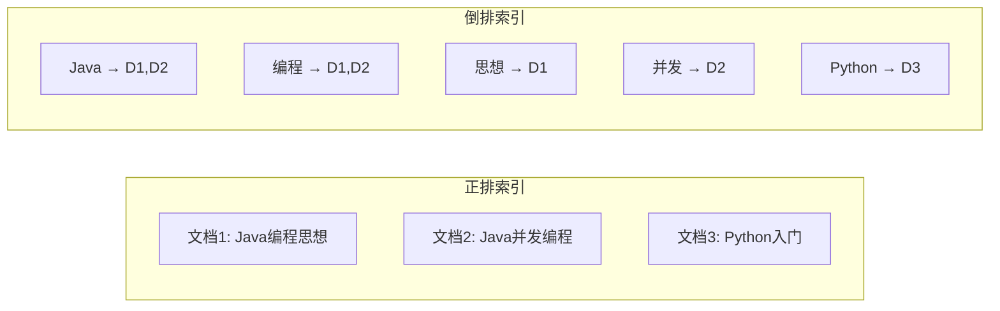
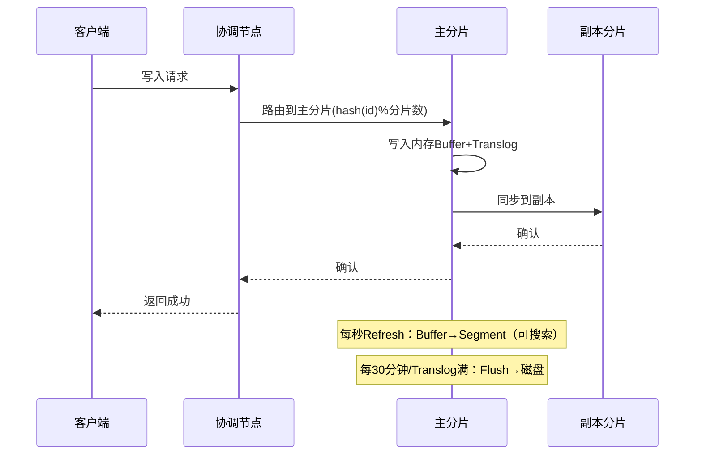

# Elasticsearch深度实战

> **文档说明**：Elasticsearch是分布式搜索和分析引擎，本文档覆盖倒排索引原理、DSL查询、聚合分析、性能调优、集群运维、与MySQL同步。
>
> **适用人群**：后端高级工程师、需要构建搜索和分析系统的开发者
>
> **前置知识**：RESTful API、JSON、分布式概念

---

## 一、核心原理

### 1.1 倒排索引



- **正排索引**：文档→关键词（适合按文档查内容）
- **倒排索引**：关键词→文档列表（适合按关键词查文档）
- **Term**：分词后的词项
- **Posting List**：包含该Term的文档ID列表
- **Term Dictionary**：Term字典，B+树结构，快速查找Term
- **Term Index**：Term索引，FST结构，内存中快速定位

### 1.2 分片与副本

```text
Index: products (3主分片, 2副本)
  P0 (主) → R0 (副本1) → R0 (副本2)
  P1 (主) → R1 (副本1) → R1 (副本2)
  P2 (主) → R2 (副本1) → R2 (副本2)
```

- **主分片（Primary Shard）**：数据写入的分片，索引创建后不可修改数量
- **副本分片（Replica Shard）**：主分片的副本，可动态调整
- 分片数决定并行度上限，副本数决定读吞吐量和高可用

### 1.3 写入流程



---

## 二、索引管理

### 2.1 创建索引

```json
PUT /products
{
  "settings": {
    "number_of_shards": 3,
    "number_of_replicas": 2,
    "refresh_interval": "1s",
    "analysis": {
      "analyzer": {
        "ik_max_word_analyzer": {
          "type": "custom",
          "tokenizer": "ik_max_word"
        }
      }
    }
  },
  "mappings": {
    "properties": {
      "title": { "type": "text", "analyzer": "ik_max_word", "fields": { "keyword": { "type": "keyword" } } },
      "category": { "type": "keyword" },
      "price": { "type": "scaled_float", "scaling_factor": 100 },
      "stock": { "type": "integer" },
      "tags": { "type": "keyword" },
      "created_at": { "type": "date", "format": "yyyy-MM-dd HH:mm:ss" },
      "location": { "type": "geo_point" },
      "description": { "type": "text", "analyzer": "ik_smart" }
    }
  }
}
```

### 2.2 字段类型

| 类型 | 说明 | 适用 |
|------|------|------|
| **text** | 全文索引，分词 | 标题、内容、描述 |
| **keyword** | 不分词，精确匹配 | 分类、标签、ID |
| **integer/long** | 整数 | 数量、年龄 |
| **float/double** | 浮点数 | 价格、评分 |
| **scaled_float** | 缩放浮点（存整数） | 金额（推荐） |
| **date** | 日期 | 时间戳 |
| **boolean** | 布尔 | 状态 |
| **geo_point** | 经纬度 | 地理位置 |
| **nested** | 嵌套对象 | 数组对象（保持关联） |
| **object** | 对象 | 简单嵌套（扁平化） |

### 2.3 分词器

| 分词器 | 说明 | 适用 |
|--------|------|------|
| **standard** | 默认，按空格+标点 | 英文 |
| **ik_max_word** | 最细粒度切分 | 中文搜索（召回率高） |
| **ik_smart** | 智能切分 | 中文搜索（准确率高） |
| **pinyin** | 拼音分词 | 拼音搜索 |
| **ngram** | n元语法 | 模糊搜索、自动补全 |

---

## 三、DSL查询

### 3.1 查询类型

```json
// 全文搜索
GET /products/_search
{
  "query": {
    "bool": {
      "must": [
        { "match": { "title": "Java编程" } }
      ],
      "filter": [
        { "term": { "category": "books" } },
        { "range": { "price": { "gte": 10, "lte": 100 } } }
      ],
      "should": [
        { "term": { "tags": "畅销" } }
      ],
      "minimum_should_match": 1,
      "must_not": [
        { "term": { "stock": 0 } }
      ]
    }
  },
  "sort": [
    { "price": { "order": "asc" } },
    "_score"
  ],
  "from": 0,
  "size": 20,
  "_source": ["title", "price", "category"]
}
```

### 3.2 常用查询

| 查询 | 说明 | 示例 |
|------|------|------|
| **match** | 全文搜索，分词匹配 | `{"match": {"title": "Java"}}` |
| **match_phrase** | 短语匹配，词序一致 | `{"match_phrase": {"title": "Java编程"}}` |
| **term** | 精确匹配（不分词） | `{"term": {"category": "books"}}` |
| **terms** | 多值匹配 | `{"terms": {"tags": ["A","B"]}}` |
| **range** | 范围查询 | `{"range": {"price": {"gte":10}}}` |
| **exists** | 字段存在 | `{"exists": {"field": "description"}}` |
| **prefix** | 前缀匹配 | `{"prefix": {"title.keyword": "Java"}}` |
| **wildcard** | 通配符 | `{"wildcard": {"title.keyword": "Java*"}}` |
| **fuzzy** | 模糊匹配（拼写纠错） | `{"fuzzy": {"title": "javv"}}` |
| **nested** | 嵌套对象查询 | `{"nested": {"path": "items", "query": {...}}}` |

### 3.3 查询 vs 过滤

| 维度 | Query（查询上下文） | Filter（过滤上下文） |
|------|---------------------|---------------------|
| 评分 | 计算相关性评分 | 不计算评分 |
| 缓存 | 不缓存 | 自动缓存（BitSet） |
| 性能 | 较慢 | 快 |
| 适用 | 需要相关性排序 | 精确过滤条件 |

> 原则：能用filter就不用query，filter不计算评分且可缓存。

---

## 四、聚合分析

### 4.1 聚合类型

| 类型 | 说明 | 示例 |
|------|------|------|
| **Metric** | 指标聚合（sum/avg/min/max） | 平均价格 |
| **Bucket** | 分桶聚合（terms/date_histogram/range） | 按分类分组 |
| **Pipeline** | 管道聚合（对聚合结果再聚合） | 月环比 |

### 4.2 综合聚合示例

```json
GET /orders/_search
{
  "size": 0,
  "query": {
    "range": { "created_at": { "gte": "2024-01-01" } }
  },
  "aggs": {
    "by_category": {
      "terms": { "field": "category", "size": 10 },
      "aggs": {
        "total_sales": { "sum": { "field": "amount" } },
        "avg_price": { "avg": { "field": "price" } },
        "by_month": {
          "date_histogram": {
            "field": "created_at",
            "calendar_interval": "month",
            "format": "yyyy-MM"
          },
          "aggs": {
            "monthly_sales": { "sum": { "field": "amount" } }
          }
        }
      }
    }
  }
}
```

### 4.3 常用聚合

```json
// 统计各分类商品数量和平均价格
"aggs": {
  "categories": {
    "terms": { "field": "category", "size": 20, "order": { "avg_price": "desc" } },
    "aggs": {
      "avg_price": { "avg": { "field": "price" } },
      "max_price": { "max": { "field": "price" } }
    }
  }
}

// 按天统计销售额（时间直方图）
"aggs": {
  "sales_by_day": {
    "date_histogram": {
      "field": "created_at",
      "calendar_interval": "day",
      "format": "yyyy-MM-dd",
      "min_doc_count": 0
    },
    "aggs": {
      "total": { "sum": { "field": "amount" } }
    }
  }
}

// 价格区间统计
"aggs": {
  "price_ranges": {
    "range": {
      "field": "price",
      "ranges": [
        { "to": 50 },
        { "from": 50, "to": 200 },
        { "from": 200 }
      ]
    }
  }
}
```

---

## 五、性能调优

### 5.1 写入优化

| 优化 | 说明 | 效果 |
|------|------|------|
| 批量写入 | Bulk API批量提交 | 提升5-10倍 |
| 增加refresh_interval | 从1s改为30s | 减少Segment生成 |
| 关闭副本 | 写入时number_of_replicas=0 | 写入完成后恢复 |
| 使用自动生成ID | 避免版本检查 | 提升写入速度 |
| 增大索引缓冲区 | indices.memory.index_buffer_size | 更多内存缓冲 |
| 异步刷新 | flush_threshold | 减少磁盘IO |

```bash
# 批量写入
POST /_bulk
{ "index": { "_index": "products", "_id": "1" } }
{ "title": "Java编程思想", "price": 99 }
{ "index": { "_index": "products", "_id": "2" } }
{ "title": "Python入门", "price": 59 }
```

### 5.2 查询优化

| 优化 | 说明 |
|------|------|
| 避免深分页 | 使用search_after替代from+size |
| 使用filter | 不计算评分，可缓存 |
| 只取需要字段 | _source过滤减少数据传输 |
| 避免wildcard前缀 | `*abc`无法利用索引 |
| 合理设置分片数 | 单分片20-50GB，分片数=节点数×2-3 |
| 路由优化 | 使用routing将相关数据放同分片 |
| 字段类型合理 | text vs keyword选择正确 |

### 5.3 深分页优化

```json
// 错误：from=10000（性能差，需排序所有分片）
{ "from": 10000, "size": 20 }

// 正确：search_after（游标分页）
{
  "size": 20,
  "search_after": [1690000000000, "1001"],
  "sort": [
    { "created_at": "desc" },
    { "_id": "asc" }
  ]
}
```

---

## 六、集群运维

### 6.1 集群状态

```bash
# 集群健康
GET /_cluster/health
# status: green(全部正常) / yellow(副本缺失) / red(主分片缺失)

# 节点信息
GET /_cat/nodes?v

# 分片分布
GET /_cat/shards?v

# 索引状态
GET /_cat/indices?v&s=store.size:desc

# 挂起任务
GET /_cluster/pending_tasks
```

### 6.2 常见问题

| 问题 | 原因 | 解决方案 |
|------|------|---------|
| 集群red | 主分片不可用 | 检查节点/恢复数据 |
| 集群yellow | 副本未分配 | 节点数不足/分配策略 |
| 写入慢 | refresh太频繁/副本多 | 增大refresh_interval/临时关副本 |
| 查询慢 | 分片过大/查询不合理 | 拆分片/优化DSL |
| OOM | 聚合数据量太大/fielddata | 限制聚合/使用doc_values |
| 磁盘满 | 数据增长 | 扩容/清理旧索引/ILM |

### 6.3 索引生命周期管理（ILM）

```json
PUT _ilm/policy/product_policy
{
  "policy": {
    "phases": {
      "hot": { "actions": { "rollover": { "max_size": "50gb", "max_age": "30d" } } },
      "warm": { "min_age": "30d", "actions": { "shrink": { "number_of_shards": 1 }, "forcemerge": { "max_num_segments": 1 } } },
      "cold": { "min_age": "90d", "actions": { "freeze": {} } },
      "delete": { "min_age": "180d", "actions": { "delete": {} } }
    }
  }
}
```

---

## 七、MySQL同步ES

### 7.1 方案对比

| 方案 | 说明 | 适用 |
|------|------|------|
| 双写 | 写MySQL同时写ES | 简单，一致性差 |
| 定时同步 | 定时任务全量/增量同步 | 非实时 |
| Canal监听binlog | 订阅MySQL binlog实时同步 | 推荐，准实时 |
| Logstash JDBC | Logstash定时拉取 | 简单，延迟较高 |

### 7.2 Canal同步架构


---

## 关联文档

- [[Elasticsearch 知识点系统梳理_优化版]] — ES基础
- [[数据库知识点完整整合大全_优化版]] — 数据库全景
- [[Kafka深度实战]] — 数据管道
- [[高并发系统设计案例]] — 搜索在高并发中的应用
- [[多级缓存架构设计]] — 缓存架构

---

> 💡 **实战建议**：ES的核心是"倒排索引+分片"。生产环境注意：1. 字段类型设计是关键（text vs keyword）；2. 分片数创建后不可改，提前规划；3. 写入用Bulk+关副本+大refresh；4. 查询用filter+search_after；5. 监控集群状态和分片大小。中文搜索必须安装IK分词器。


## 补充：概述

Elasticsearch 是基于 Lucene 的分布式**搜索与分析引擎**，提供近实时的全文搜索、结构化搜索、聚合分析能力。它是 ELK/Elastic Stack 的核心组件，广泛应用于日志分析、全文检索、指标监控、安全分析、应用搜索等场景。

| 特性 | 说明 |
|------|------|
| **分布式** | 自动分片、副本，水平扩展，PB 级数据 |
| **近实时** | 写入后 1 秒内可搜索（refresh_interval） |
| **全文搜索** | 倒排索引、分词器、相关性评分（BM25） |
| **聚合分析** | Bucket/Avg/Max/Min/Sum/Stats/Percentiles 等 50+ 聚合 |
| **RESTful API** | JSON over HTTP，易于使用和集成 |
| **高可用** | 副本机制、自动故障转移、跨集群复制 |
| **生态丰富** | Kibana（可视化）、Logstash/Beats（数据采集）、APM |

**适用场景**：日志检索与分析（ELK）、电商商品搜索、站内全文搜索、指标监控与告警、安全事件分析（SIEM）、APM 应用性能监控。
**不适用场景**：事务性强的系统（不支持 ACID 多文档事务，7.x+ 有限支持）、需要复杂 JOIN 的场景、作为主数据存储（建议作为搜索引擎，主数据存数据库）。

---

## 补充：实操

### 1. 索引管理

```bash
# 创建索引（指定分片和映射）
curl -X PUT "localhost:9200/products" -H 'Content-Type: application/json' -d'
{
  "settings": {
    "number_of_shards": 3,
    "number_of_replicas": 1,
    "analysis": {
      "analyzer": {
        "ik_max_word": { "type": "ik_max_word" },
        "ik_smart": { "type": "ik_smart" }
      }
    }
  },
  "mappings": {
    "properties": {
      "title": { "type": "text", "analyzer": "ik_max_word", "fields": { "keyword": { "type": "keyword" } } },
      "price": { "type": "scaled_float", "scaling_factor": 100 },
      "category": { "type": "keyword" },
      "tags": { "type": "keyword" },
      "created_at": { "type": "date" },
      "description": { "type": "text", "analyzer": "ik_smart" }
    }
  }
}'

# 查看索引映射
curl -X GET "localhost:9200/products/_mapping"

# 修改索引设置（只能改部分动态设置）
curl -X PUT "localhost:9200/products/_settings" -d'{"number_of_replicas": 2}'

# 删除索引
curl -X DELETE "localhost:9200/products"

# 索引别名（零停机切换）
curl -X POST "localhost:9200/_aliases" -d'
{
  "actions": [
    { "remove": { "index": "products_v1", "alias": "products" } },
    { "add": { "index": "products_v2", "alias": "products" } }
  ]
}'
```

### 2. 文档 CRUD

```bash
# 写入文档（指定 ID）
curl -X PUT "localhost:9200/products/_doc/1" -d'
{"title": "iPhone 15 Pro", "price": 8999.00, "category": "手机", "tags": ["苹果","5G"], "created_at": "2026-01-15"}'

# 写入文档（自动生成 ID）
curl -X POST "localhost:9200/products/_doc" -d'{"title": "MacBook Pro", "price": 14999}'

# 批量写入（Bulk API，性能比单条高 10-100 倍）
curl -X POST "localhost:9200/_bulk" -H 'Content-Type: application/x-ndjson' --data-binary @data.jsonl
# data.jsonl 格式：
# {"index": {"_index": "products", "_id": "1"}}
# {"title": "商品1", "price": 100}
# {"index": {"_index": "products", "_id": "2"}}
# {"title": "商品2", "price": 200}

# 查询文档
curl -X GET "localhost:9200/products/_doc/1"

# 更新文档（部分更新）
curl -X POST "localhost:9200/products/_update/1" -d'
{"doc": {"price": 8499.00}}'

# 删除文档
curl -X DELETE "localhost:9200/products/_doc/1"
```

### 3. 搜索查询

```bash
# 全文搜索（match query）
curl -X GET "localhost:9200/products/_search" -d'
{
  "query": { "match": { "title": "iPhone 手机" } },
  "from": 0, "size": 20,
  "sort": [{ "price": "asc" }]
}'

# 布尔组合查询（bool query）
curl -X GET "localhost:9200/products/_search" -d'
{
  "query": {
    "bool": {
      "must": [{ "match": { "title": "手机" } }],
      "filter": [
        { "term": { "category": "手机" } },
        { "range": { "price": { "gte": 3000, "lte": 10000 } } }
      ],
      "should": [{ "term": { "tags": "5G" } }],
      "must_not": [{ "term": { "tags": "翻新" } }]
    }
  }
}'

# 聚合分析
curl -X GET "localhost:9200/products/_search" -d'
{
  "size": 0,
  "aggs": {
    "by_category": {
      "terms": { "field": "category", "size": 10 },
      "aggs": {
        "avg_price": { "avg": { "field": "price" } },
        "price_stats": { "stats": { "field": "price" } }
      }
    },
    "price_histogram": {
      "histogram": { "field": "price", "interval": 1000 }
    }
  }
}'
```

---

## 补充：进阶与最佳实践

### 1. 性能优化

| 优化方向 | 具体措施 | 效果 |
|---------|---------|------|
| **写入优化** | Bulk 批量写入（5-15MB/批）、增加 refresh_interval（30s）、关闭副本写入后再开启、使用 SSD | 写入吞吐量提升 3-10 倍 |
| **查询优化** | 避免 `*` 通配符查询、用 filter 替代 must（不计算评分）、避免深度分页（用 search_after）、合理设置 size | 查询延迟降低 50-80% |
| **索引设计** | 合理设置分片数（单分片 20-50GB）、使用索引模板、按时间滚动索引（ILM）、冷热分层 | 资源利用率提升 |
| **映射优化** | 不需要分词的字段用 keyword、数字用合适类型、禁用不需要的 `_all`、设置 `doc_values` | 存储减少 30-50% |
| **JVM 优化** | 堆内存设为物理内存 50%（不超过 31GB）、关闭 swap、使用 G1GC | GC 停顿减少 |
| **操作系统** | 增加文件描述符限制（65535）、关闭 swap、设置 `vm.max_map_count=262144` | 避免各种奇怪问题 |

### 2. 索引生命周期管理（ILM）

```bash
# 创建 ILM 策略（日志场景：热→温→冷→删除）
curl -X PUT "localhost:9200/_ilm/policy/logs-policy" -d'
{
  "policy": {
    "phases": {
      "hot": { "actions": { "rollover": { "max_age": "1d", "max_size": "50gb" } } },
      "warm": { "min_age": "7d", "actions": { "forcemerge": { "max_num_segments": 1 }, "shrink": { "number_of_shards": 1 } } },
      "cold": { "min_age": "30d", "actions": { "freeze": {} } },
      "delete": { "min_age": "90d", "actions": { "delete": {} } }
    }
  }
}'
```

### 3. 集群健康检查

```bash
# 集群健康状态
curl -X GET "localhost:9200/_cluster/health?pretty"

# 节点状态
curl -X GET "localhost:9200/_cat/nodes?v&h=name,ip,heap.percent,ram.percent,cpu,load_1m"

# 索引状态
curl -X GET "localhost:9200/_cat/indices?v&s=store.size:desc"

# 分片状态（排查 unassigned shards）
curl -X GET "localhost:9200/_cat/shards?v&h=index,shard,prirep,state,unassigned.reason"

# 慢查询日志
curl -X PUT "localhost:9200/products/_settings" -d'
{"index.search.slowlog.threshold.query.warn": "5s", "index.search.slowlog.threshold.fetch.warn": "1s"}'
```

### 4. 常见坑点

- ❌ **分片数设置过多**：每个分片都是一个 Lucene 索引，占用资源，建议单分片 20-50GB
- ❌ **动态映射导致类型错误**：数字被映射为 text，日期格式不一致，建议显式定义 mapping
- ❌ **使用 `_source` 存储大字段**：`_source` 会存储原始文档，大字段（如全文）会占用大量空间，可用 `excludes` 排除
- ❌ **深度分页 `from+size`**：超过 10000 条会报错且性能差，用 `search_after` 或 `scroll`
- ❌ **在 filter 中用 match**：filter 应该用 term/range 等不需要评分的查询，match 放 must
- ❌ **频繁更新文档**：ES 的更新是标记删除+重新写入，频繁更新会产生大量段碎片，用 update_by_query 批量更新
