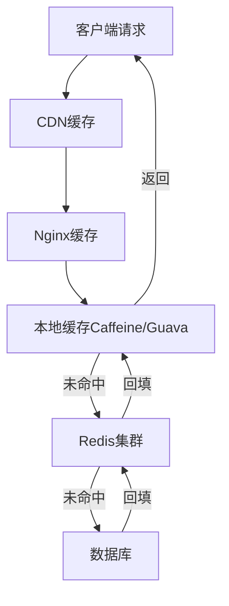
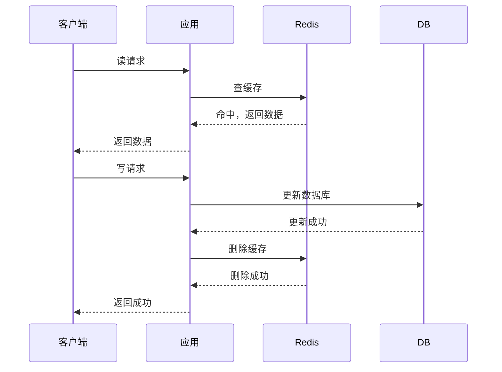
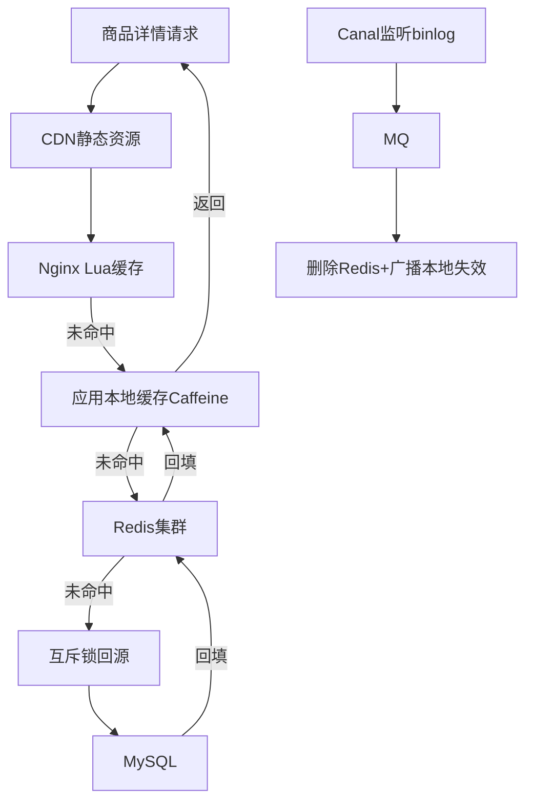
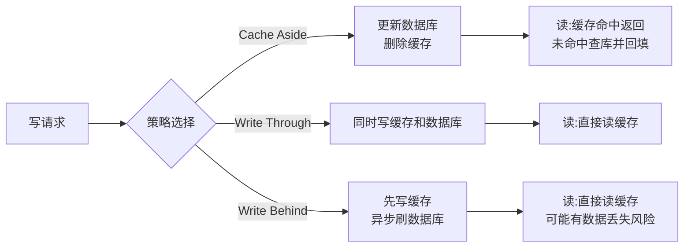

# 多级缓存架构设计

> **文档说明**：多级缓存是高并发系统的核心架构，通过本地缓存+分布式缓存+数据库的分层设计，大幅提升系统吞吐量和响应速度。本文档系统讲解多级缓存的架构设计、一致性保障、缓存策略和实战案例。
>
> **适用人群**：后端高级工程师、架构师
>
> **前置知识**：Redis基础、缓存穿透击穿雪崩

---

## 一、为什么需要多级缓存

### 1.1 单级缓存的问题

| 问题 | 说明 |
|------|------|
| Redis网络开销 | 每次缓存查询都有网络RTT（约0.5-1ms） |
| Redis单点压力 | 热点key集中访问，Redis可能成为瓶颈 |
| Redis宕机 | 缓存全部失效，请求打到DB |
| 大key/热key | 单个key QPS过高，Redis分片无法解决 |

### 1.2 多级缓存架构



| 层级 | 缓存介质 | 访问速度 | 容量 | 一致性 |
|------|---------|---------|------|--------|
| L1 浏览器缓存 | 浏览器 | 极快(本地) | 小 | 弱 |
| L2 CDN缓存 | CDN节点 | 快(就近) | 大 | 弱 |
| L3 Nginx缓存 | Nginx | 快(本地) | 中 | 中 |
| L4 应用本地缓存 | JVM内存(Caffeine) | 极快(无网络) | 小 | 中 |
| L5 分布式缓存 | Redis集群 | 快(网络) | 大 | 强 |
| L6 数据库 | MySQL | 慢(磁盘) | 极大 | 最强 |

---

## 二、本地缓存

### 2.1 Caffeine（推荐）

Caffeine是Java高性能本地缓存库，基于W-TinyLFU算法，是Guava Cache的升级替代。

```java
// 基础配置
LoadingCache<Long, Product> productCache = Caffeine.newBuilder()
    .maximumSize(10000)              // 最大条目数
    .expireAfterWrite(5, TimeUnit.MINUTES)  // 写入后过期
    .expireAfterAccess(3, TimeUnit.MINUTES) // 访问后过期
    .refreshAfterWrite(4, TimeUnit.MINUTES) // 异步刷新
    .recordStats()                    // 记录统计
    .build(id -> productMapper.selectById(id));  // 缓存未命中时加载

// 使用
Product product = productCache.get(123L);  // 自动处理未命中

// 统计
CacheStats stats = productCache.stats();
System.out.println("命中率: " + stats.hitRate());
System.out.println("平均加载时间: " + stats.averageLoadPenalty());
```

### 2.2 本地缓存策略对比

| 策略 | 说明 | 适用 |
|------|------|------|
| expireAfterWrite | 写入后固定时间过期 | 数据更新频率固定 |
| expireAfterAccess | 访问后重置过期时间 | 热点数据，访问即续期 |
| refreshAfterWrite | 异步刷新，不阻塞请求 | 允许短暂旧数据，高可用 |
| maximumSize | 基于容量淘汰（W-TinyLFU） | 内存有限 |
| weakKeys/softValues | 基于GC引用 | 内存敏感场景 |

### 2.3 本地缓存的问题

| 问题 | 说明 | 解决方案 |
|------|------|---------|
| 数据不一致 | 多节点本地缓存数据不同步 | 消息广播失效/短TTL |
| 内存溢出 | 缓存占用过多JVM内存 | 限制maximumSize+监控 |
| GC压力 | 大对象缓存导致Full GC | 使用堆外缓存/限制大小 |
| 启动预热 | 服务启动时缓存为空 | 启动预热/懒加载 |

---

## 三、缓存一致性

### 3.1 缓存更新策略

| 策略 | 操作顺序 | 一致性 | 性能 | 适用 |
|------|---------|--------|------|------|
| Cache Aside | 先更新DB，再删缓存 | 中 | 高 | 最常用 |
| Read Through | 缓存层负责读DB | 中 | 中 | 本地缓存 |
| Write Through | 先写缓存，缓存同步写DB | 高 | 低 | 强一致 |
| Write Behind | 先写缓存，异步写DB | 低 | 极高 | 日志/统计 |

### 3.2 Cache Aside详解



**为什么是删缓存而不是更新缓存？**
- 更新缓存可能导致并发写时数据覆盖
- 删除缓存更简单，下次读取时自动加载最新数据
- 避免写多读少场景下的无效更新

### 3.3 延时双删

解决"先更新DB再删缓存"的并发问题：

```java
public void updateProduct(Product product) {
    // 1. 先删缓存
    redisTemplate.delete("product:" + product.getId());
    
    // 2. 更新数据库
    productMapper.updateById(product);
    
    // 3. 延迟再删一次（解决并发读导致的脏数据）
    threadPool.schedule(() -> {
        redisTemplate.delete("product:" + product.getId());
    }, 500, TimeUnit.MILLISECONDS);
}
```

### 3.4 基于Canal的最终一致性


```java
// Canal监听binlog，异步删除缓存
@CanalEventListener
public class ProductCacheHandler {
    @ListenPoint(table = "product")
    public void onProductChange(CanalEntry.Entry entry) {
        Long productId = extractId(entry);
        // 删除Redis缓存
        redisTemplate.delete("product:" + productId);
        // 广播本地缓存失效（Redis Pub/Sub）
        redisTemplate.convertAndSend("cache:invalidate", "product:" + productId);
    }
}

// 各节点订阅失效消息
@RedisListener(channel = "cache:invalidate")
public void onInvalidate(String key) {
    localCache.invalidate(key);
}
```

---

## 四、热点key处理

### 4.1 热点key发现

- Redis监控：`redis-cli --hotkeys`（需要maxmemory-policy为LFU）
- 应用层统计：记录访问频率
- 流量分析：CDN/Nginx日志分析

### 4.2 热点key解决方案

| 方案 | 说明 | 适用 |
|------|------|------|
| 本地缓存 | 热点key缓存到JVM本地 | 读多写少 |
| 多副本 | 热点key复制为多个key（key_0,key_1...） | 读极多 |
| 互斥锁 | 缓存击穿时加锁回源 | 写少读多 |
| 逻辑过期 | 不设物理过期，异步刷新 | 允许旧数据 |

### 4.3 本地缓存+Redis双写

```java
public Product getProduct(Long id) {
    String key = "product:" + id;
    
    // 1. 先查本地缓存
    Product local = localCache.getIfPresent(key);
    if (local != null) return local;
    
    // 2. 查Redis
    Product redis = redisTemplate.opsForValue().get(key);
    if (redis != null) {
        localCache.put(key, redis);  // 回填本地缓存
        return redis;
    }
    
    // 3. 互斥锁查DB
    String lockKey = "lock:" + key;
    boolean locked = redisTemplate.opsForValue().setIfAbsent(lockKey, "1", 10, TimeUnit.SECONDS);
    if (locked) {
        try {
            // 双重检查
            redis = redisTemplate.opsForValue().get(key);
            if (redis != null) {
                localCache.put(key, redis);
                return redis;
            }
            Product db = productMapper.selectById(id);
            if (db != null) {
                redisTemplate.opsForValue().set(key, db, 30, TimeUnit.MINUTES);
                localCache.put(key, db);
            }
            return db;
        } finally {
            redisTemplate.delete(lockKey);
        }
    } else {
        Thread.sleep(50);
        return getProduct(id);  // 重试
    }
}
```

---

## 五、缓存预热

### 5.1 为什么需要预热

- 服务重启后本地缓存为空
- 大量请求同时回源导致DB压力
- 冷启动期间响应慢

### 5.2 预热方案

```java
// 启动时预热热点数据
@Component
public class CacheWarmer implements ApplicationRunner {
    @Override
    public void run(ApplicationArguments args) {
        // 预热Top100热门商品
        List<Long> hotIds = productMapper.selectHotProductIds(100);
        for (Long id : hotIds) {
            productCache.get(id);  // 触发加载
        }
    }
}

// 定时刷新热点缓存
@Scheduled(fixedRate = 60000)
public void refreshHotCache() {
    List<Long> hotIds = getHotProductIds();
    hotIds.forEach(id -> productCache.refresh(id));
}
```

---

## 六、缓存监控

### 6.1 关键指标

| 指标 | 说明 | 告警阈值 |
|------|------|---------|
| 缓存命中率 | 命中次数/总请求 | <90%告警 |
| 平均响应时间 | 缓存查询耗时 | >5ms告警 |
| Redis内存使用率 | used_memory/maxmemory | >80%告警 |
| 大key数量 | value>10KB的key | 定期扫描 |
| 本地缓存大小 | JVM缓存占用 | >512MB告警 |

### 6.2 Caffeine统计

```java
CacheStats stats = cache.stats();
stats.hitRate();           // 命中率
stats.missRate();          // 未命中率
stats.evictionCount();     // 淘汰次数
stats.averageLoadPenalty(); // 平均加载耗时
```

---

## 七、实战架构：电商商品详情



**缓存策略**：
- 商品基本信息：本地缓存5分钟 + Redis 30分钟
- 商品库存：Redis实时（不本地缓存）
- 商品价格：Redis 1分钟 + 本地缓存10秒
- 商品评论：Redis分页缓存 + 本地缓存热门

---

## 关联文档

- [[缓存穿透击穿雪崩解决方案]] — 缓存三大问题
- [[Redis 知识点系统梳理_优化版]] — Redis基础
- [[Redis-分布式锁与缓存穿透]] — Redis分布式锁
- [[高并发系统设计案例]] — 高并发架构
- [[秒杀系统架构设计]] — 秒杀缓存实战

---

> 💡 **实战建议**：多级缓存的核心是"分层+一致性"。本地缓存解决性能，Redis解决容量和共享，数据库是最终一致源。一致性保障用Canal+消息广播是最可靠的方案。热点key一定要加本地缓存，这是抗住大促流量的关键。


## 补充：概述

多级缓存是高并发系统的核心架构模式，通过在不同层级部署缓存（浏览器缓存 → CDN 缓存 → 反向代理缓存 → 应用本地缓存 → 分布式缓存 → 数据库），将热点数据尽可能留在离用户最近的地方，从而大幅降低数据库压力、提升响应速度、提高系统吞吐量。

| 缓存层级 | 位置 | 缓存介质 | 容量 | 速度 | 适用场景 |
|---------|------|---------|------|------|---------|
| **浏览器缓存** | 客户端 | 内存/磁盘 | MB 级 | 极快（本地） | 静态资源、不变数据 |
| **CDN 缓存** | 边缘节点 | 内存/SSD | TB 级 | 快（就近） | 静态资源、热点页面 |
| **反向代理缓存** | Nginx/Varnish | 内存 | GB 级 | 快 | 页面缓存、API 响应 |
| **应用本地缓存** | 应用进程内 | 堆内存 | MB-GB 级 | 极快（无网络） | 热点配置、字典数据 |
| **分布式缓存** | Redis/Memcached | 内存 | GB-TB 级 | 快（网络 IO） | 会话、热点数据、计数器 |
| **数据库缓存** | MySQL Buffer Pool | 内存 | GB 级 | 中 | 热点数据页 |

**多级缓存的核心原则**：
1. **就近原则**：数据越靠近用户，访问越快，成本越低
2. **分层过滤**：每一层缓存过滤掉一部分请求，最终到达数据库的请求极少
3. **一致性权衡**：缓存层数越多，数据一致性越难保证，需要根据业务容忍度设计
4. **热点保护**：热点数据用本地缓存，非热点用分布式缓存，避免缓存击穿

---

## 补充：底层原理

### 缓存命中率与延迟模型

多级缓存的性能取决于**各层命中率**和**各层延迟**：

```text
平均延迟 = (1 - L1命中率) × L1延迟 + (1 - L2命中率) × L2延迟 + ... + 数据库延迟
```

| 层级 | 典型延迟 | 典型命中率 | 贡献 |
|------|---------|-----------|------|
| 本地缓存 | 0.01ms | 30-50% | 最快，过滤热点 |
| Redis | 0.5-2ms | 70-90% | 主力缓存 |
| 数据库 | 5-50ms | - | 最后兜底 |

**示例计算**：本地缓存命中率 40%（0.01ms），Redis 命中率 80%（1ms），数据库 10ms：
- 平均延迟 = 0.4×0.01 + 0.6×0.8×1 + 0.6×0.2×10 = 0.004 + 0.48 + 1.2 = **1.684ms**
- 对比无缓存：10ms → 性能提升约 6 倍

### 缓存三大问题及解决方案

| 问题 | 原因 | 解决方案 |
|------|------|---------|
| **缓存穿透** | 查询不存在的数据，请求直达数据库 | 布隆过滤器、缓存空值（短 TTL）、参数校验 |
| **缓存击穿** | 热点 key 过期瞬间，大量请求同时打到数据库 | 互斥锁（setnx）、永不过期+异步更新、热点数据预热 |
| **缓存雪崩** | 大量 key 同时过期，或 Redis 宕机 | TTL 加随机值、多级缓存、Redis 高可用（哨兵/集群）、熔断降级 |

### 缓存一致性策略



| 策略 | 写操作 | 一致性 | 性能 | 适用场景 |
|------|--------|--------|------|---------|
| **Cache Aside**（最常用） | 先更数据库，再删缓存 | 最终一致 | 写一般，读快 | 绝大多数业务 |
| **Write Through** | 同时写缓存和数据库 | 强一致 | 写慢 | 一致性要求高 |
| **Write Behind** | 只写缓存，异步刷库 | 弱一致 | 写极快 | 写多读少、可容忍丢失 |

**Cache Aside 的并发问题**：读请求未命中查库时，写请求更新数据库并删除缓存，读请求将旧值回填缓存 → 导致脏数据。解决方案：延迟双删（更新数据库后删缓存，延迟 500ms 再删一次）、分布式锁。

---

## 补充：进阶与最佳实践

### 1. 本地缓存实现（Caffeine）

```java
// Java：Caffeine 本地缓存（Guava Cache 的进化版，性能最优）
LoadingCache<String, User> userCache = Caffeine.newBuilder()
    .maximumSize(10_000)           // 最大条目数
    .expireAfterWrite(5, TimeUnit.MINUTES)  // 写入后过期
    .expireAfterAccess(2, TimeUnit.MINUTES) // 访问后过期
    .refreshAfterWrite(1, TimeUnit.MINUTES)  // 异步刷新（不阻塞）
    .recordStats()                   // 记录统计
    .build(key -> userRepository.findById(key));  // 自动加载

// 使用
User user = userCache.get("user_123");  // 未命中自动加载
userCache.invalidate("user_123");       // 手动失效
CacheStats stats = userCache.stats();   // 查看命中率
```

```python
# Python：cachetools 或 functools.lru_cache
from cachetools import TTLCache, cached

cache = TTLCache(maxsize=1000, ttl=300)  # 5分钟过期

@cached(cache)
def get_user(user_id):
    return db.query(User).filter(User.id == user_id).first()
```

### 2. 分布式缓存最佳实践（Redis）

```python
# 1. 缓存空值防穿透
def get_product(product_id):
    cache_key = f"product:{product_id}"
    data = redis.get(cache_key)
    if data is not None:
        return None if data == "__NULL__" else json.loads(data)
    
    product = db.query(Product).get(product_id)
    if product is None:
        redis.setex(cache_key, 60, "__NULL__")  # 空值缓存1分钟
        return None
    
    redis.setex(cache_key, 3600, json.dumps(product.to_dict()))
    return product

# 2. 互斥锁防击穿
def get_hot_data(key):
    data = redis.get(key)
    if data:
        return json.loads(data)
    
    # 尝试获取锁
    lock_key = f"lock:{key}"
    if redis.set(lock_key, "1", nx=True, ex=10):
        try:
            # 双重检查
            data = redis.get(key)
            if data:
                return json.loads(data)
            # 查数据库并回填
            data = query_from_db(key)
            redis.setex(key, 3600, json.dumps(data))
            return data
        finally:
            redis.delete(lock_key)
    else:
        # 等待后重试
        time.sleep(0.1)
        return get_hot_data(key)

# 3. TTL 随机化防雪崩
def set_with_jitter(key, value, base_ttl=3600):
    jitter = random.randint(0, 300)  # 0-5分钟随机偏移
    redis.setex(key, base_ttl + jitter, value)
```

### 3. 缓存监控指标

| 指标 | 说明 | 告警阈值 |
|------|------|---------|
| **缓存命中率** | 命中数 / 总请求数 | < 80% 告警 |
| **缓存大小** | 已用内存 / 最大内存 | > 80% 告警 |
| **QPS** | 每秒请求数 | 突增 50% 告警 |
| **慢查询** | 执行时间 > 阈值的命令数 | > 10ms 记录 |
| **连接数** | 当前连接数 / 最大连接数 | > 80% 告警 |
| **驱逐数** | 因内存不足被驱逐的 key 数 | 持续 > 0 告警 |
| **过期数** | 每秒过期的 key 数 | 突增告警（雪崩前兆） |

### 4. 缓存设计检查清单

- [ ] 是否识别了热点数据？热点数据是否用了本地缓存？
- [ ] 缓存 key 命名是否规范？（`业务:实体:ID`）
- [ ] 是否设置了合理的 TTL？是否加了随机偏移防雪崩？
- [ ] 是否处理了缓存穿透？（布隆过滤器/空值缓存）
- [ ] 是否处理了缓存击穿？（互斥锁/永不过期）
- [ ] 缓存更新策略是否明确？（Cache Aside/Write Through）
- [ ] 是否有缓存降级方案？（Redis 不可用时直接查库）
- [ ] 是否监控了缓存命中率和内存使用？
- [ ] 大 key（>10KB）是否拆分？热 key 是否本地缓存？
- [ ] 是否避免了缓存和数据库的双写不一致？（延迟双删/消息队列）
