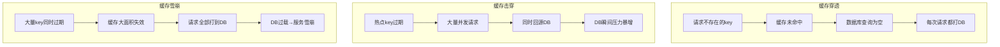
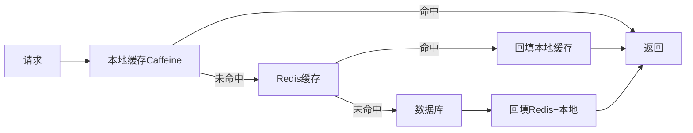

# 缓存穿透、击穿、雪崩解决方案

> **文档说明**：缓存三大问题是高并发系统的经典面试题和实战难点。本文档系统讲解穿透、击穿、雪崩的产生原因、识别方法和完整解决方案，配合代码示例和架构图。
>
> **适用人群**：后端开发者、架构师、面试备考者
>
> **前置知识**：Redis基础、缓存基本概念

---

## 一、三大问题对比

| 问题 | 产生原因 | 现象 | 危害 |
|------|---------|------|------|
| **缓存穿透** | 查询不存在的数据，缓存和DB都没有 | 请求直接打到DB | DB压力增大，可能被恶意攻击 |
| **缓存击穿** | 热点key过期，大量并发请求同时回源 | 瞬间DB请求暴增 | DB可能被打垮 |
| **缓存雪崩** | 大量key同时过期，或Redis宕机 | 大面积缓存失效，请求全部到DB | DB压力剧增，可能服务雪崩 |



---

## 二、缓存穿透

### 2.1 产生场景

- 用户查询不存在的用户ID（如ID=-1或超大值）
- 恶意攻击，用不存在的key高频请求
- 业务逻辑漏洞，生成了无效查询参数

### 2.2 解决方案

#### 方案一：缓存空值

```java
public User getUserById(Long id) {
    String key = "user:" + id;
    User user = redisTemplate.opsForValue().get(key);
    
    if (user != null) {
        // 缓存命中（包括空值标记）
        if (NULL_PLACEHOLDER.equals(user)) {
            return null;
        }
        return user;
    }
    
    // 缓存未命中，查DB
    User dbUser = userMapper.selectById(id);
    
    if (dbUser == null) {
        // 缓存空值，设置较短过期时间
        redisTemplate.opsForValue().set(key, NULL_PLACEHOLDER, 5, TimeUnit.MINUTES);
    } else {
        redisTemplate.opsForValue().set(key, dbUser, 30, TimeUnit.MINUTES);
    }
    return dbUser;
}
```

**优点**：实现简单，效果直接
**缺点**：占用缓存空间，可能缓存大量无效key
**适用**：无效key种类有限的场景

#### 方案二：布隆过滤器（Bloom Filter）

```java
// 初始化布隆过滤器，将所有合法ID预加载
BloomFilter<Long> idFilter = BloomFilter.create(Funnels.longFunnel(), 1000000, 0.01);

// 预加载所有合法ID
for (Long id : allValidIds) {
    idFilter.put(id);
}

public User getUserById(Long id) {
    // 布隆过滤器判断：不存在则一定不存在，存在则可能存在
    if (!idFilter.mightContain(id)) {
        return null;  // 直接返回，不查缓存和DB
    }
    
    String key = "user:" + id;
    User user = redisTemplate.opsForValue().get(key);
    if (user != null) return user;
    
    User dbUser = userMapper.selectById(id);
    if (dbUser != null) {
        redisTemplate.opsForValue().set(key, dbUser, 30, TimeUnit.MINUTES);
    }
    return dbUser;
}
```

**优点**：节省空间，100万数据只需约1MB内存
**缺点**：有误判率（存在的可能误判为不存在），不支持删除
**适用**：数据量巨大、查询key范围明确的场景

#### 方案三：参数校验

```java
public User getUserById(Long id) {
    // 基础参数校验，拦截明显非法请求
    if (id == null || id <= 0 || id > MAX_VALID_ID) {
        throw new IllegalArgumentException("无效的用户ID");
    }
    // ... 后续逻辑
}
```

### 2.3 方案对比

| 方案 | 实现复杂度 | 内存占用 | 误判 | 适用场景 |
|------|-----------|---------|------|---------|
| 缓存空值 | 低 | 高 | 无 | 无效key少 |
| 布隆过滤器 | 中 | 低 | 有（可调） | 大数据量 |
| 参数校验 | 低 | 无 | 无 | 可预判非法值 |

> 💡 **最佳实践**：参数校验 + 布隆过滤器 + 缓存空值，三层防护。

---

## 三、缓存击穿

### 3.1 产生场景

- 秒杀商品信息缓存过期，瞬间上万请求同时回源
- 热门文章/视频缓存过期
- 配置信息缓存过期，所有服务同时刷新

### 3.2 解决方案

#### 方案一：互斥锁（Mutex Lock）

```java
public Product getProductWithLock(Long id) {
    String key = "product:" + id;
    String lockKey = "lock:product:" + id;
    
    Product product = redisTemplate.opsForValue().get(key);
    if (product != null) return product;
    
    // 尝试获取分布式锁
    boolean locked = redisTemplate.opsForValue()
        .setIfAbsent(lockKey, "1", 10, TimeUnit.SECONDS);
    
    if (locked) {
        try {
            // 双重检查：获取锁后再查一次缓存
            product = redisTemplate.opsForValue().get(key);
            if (product != null) return product;
            
            // 回源查DB
            product = productMapper.selectById(id);
            if (product != null) {
                redisTemplate.opsForValue().set(key, product, 30, TimeUnit.MINUTES);
            }
            return product;
        } finally {
            // 释放锁
            redisTemplate.delete(lockKey);
        }
    } else {
        // 未获取到锁，等待后重试
        Thread.sleep(50);
        return getProductWithLock(id);  // 递归重试，建议加最大重试次数
    }
}
```

**优点**：保证只有一个请求回源，DB压力小
**缺点**：其他请求需要等待，有阻塞
**适用**：一致性要求高、并发量大的热点key

#### 方案二：逻辑过期

```java
// 缓存值封装逻辑过期时间
@Data
@AllArgsConstructor
public class CacheData<T> implements Serializable {
    private T data;
    private LocalDateTime expireTime;  // 逻辑过期时间
}

public Product getProductWithLogicalExpire(Long id) {
    String key = "product:" + id;
    CacheData<Product> cacheData = redisTemplate.opsForValue().get(key);
    
    if (cacheData == null) return null;  // 预热数据，正常不会为null
    
    Product product = cacheData.getData();
    
    // 未过期，直接返回
    if (cacheData.getExpireTime().isAfter(LocalDateTime.now())) {
        return product;
    }
    
    // 已过期，尝试获取锁异步重建
    String lockKey = "lock:product:" + id;
    boolean locked = redisTemplate.opsForValue()
        .setIfAbsent(lockKey, "1", 10, TimeUnit.SECONDS);
    
    if (locked) {
        // 异步线程重建缓存
        threadPool.execute(() -> {
            try {
                Product dbProduct = productMapper.selectById(id);
                CacheData<Product> newData = new CacheData<>(
                    dbProduct, LocalDateTime.now().plusMinutes(30)
                );
                redisTemplate.opsForValue().set(key, newData);  // 不设物理过期
            } finally {
                redisTemplate.delete(lockKey);
            }
        });
    }
    
    // 返回旧数据（不阻塞）
    return product;
}
```

**优点**：不阻塞请求，始终返回数据（可能是旧数据）
**缺点**：数据有短暂不一致，需要缓存预热
**适用**：对一致性要求不高、要求高可用的场景

#### 方案三：热点key永不过期

```java
// 对极少数热点key设置永不过期，通过后台任务主动更新
redisTemplate.opsForValue().set(key, product);  // 不设过期时间

// 后台定时任务更新热点数据
@Scheduled(fixedRate = 60000)
public void refreshHotProducts() {
    List<Long> hotIds = getHotProductIds();
    for (Long id : hotIds) {
        Product product = productMapper.selectById(id);
        redisTemplate.opsForValue().set("product:" + id, product);
    }
}
```

### 3.3 方案对比

| 方案 | 一致性 | 可用性 | 实现复杂度 | 适用场景 |
|------|--------|--------|-----------|---------|
| 互斥锁 | 高 | 中（有阻塞） | 中 | 强一致性 |
| 逻辑过期 | 中（短暂旧数据） | 高 | 高 | 高可用优先 |
| 永不过期 | 取决于更新频率 | 高 | 低 | 极少数热点 |

---

## 四、缓存雪崩

### 4.1 产生场景

- 大量key设置了相同的过期时间
- Redis服务宕机或网络分区
- 缓存服务重启，缓存全部丢失

### 4.2 解决方案

#### 方案一：过期时间加随机值

```java
// 基础过期时间 + 随机偏移，避免同时过期
int baseTTL = 1800;  // 30分钟
int randomTTL = ThreadLocalRandom.current().nextInt(300);  // 0-5分钟随机
int ttl = baseTTL + randomTTL;

redisTemplate.opsForValue().set(key, value, ttl, TimeUnit.SECONDS);
```

#### 方案二：多级缓存



```java
// Caffeine本地缓存 + Redis二级缓存
LoadingCache<Long, Product> localCache = Caffeine.newBuilder()
    .maximumSize(10000)
    .expireAfterWrite(5, TimeUnit.MINUTES)
    .build(id -> {
        // 本地未命中，查Redis
        Product p = redisTemplate.opsForValue().get("product:" + id);
        if (p != null) return p;
        // Redis未命中，查DB
        return productMapper.selectById(id);
    });

public Product getProduct(Long id) {
    return localCache.get(id);  // 自动处理多级缓存
}
```

#### 方案三：Redis高可用集群

```text
Redis Sentinel（哨兵）：主从+自动故障转移
Redis Cluster：分片+高可用，支持横向扩展
```

#### 方案四：服务降级与限流

```java
// Hystrix/Sentinel限流降级
@SentinelResource(value = "getProduct", blockHandler = "handleBlock")
public Product getProduct(Long id) {
    // 正常逻辑
}

// 限流降级处理
public Product handleBlock(Long id, BlockException ex) {
    // 返回默认值或缓存中的旧数据
    return Product.getDefault();
}
```

### 4.3 综合防护体系

```mermaid
flowchart TB
    A[请求] --> B[限流Sentinel]
    B -->|通过| C[本地缓存Caffeine]
    C -->|未命中| D[Redis集群]
    D -->|未命中| E[互斥锁回源]
    E --> F[数据库]
    F --> G[回填缓存+随机过期]
    D -->|Redis宕机| H[降级返回默认值]
```

---

## 五、面试高频问答

**Q1: 缓存穿透和缓存击穿的区别？**
A：穿透是查询不存在的数据，缓存和DB都没有；击穿是热点key过期，大量并发同时回源。

**Q2: 布隆过滤器的原理和缺点？**
A：通过多个哈希函数将元素映射到位数组，查询时所有位都为1则可能存在。缺点是有误判率且不支持删除。

**Q3: 如何保证缓存和数据库一致性？**
A：常见方案有Cache Aside（先更新DB再删缓存）、延时双删、Canal订阅binlog异步更新缓存。强一致性需用分布式锁。

**Q4: Redis宕机了怎么办？**
A：1. Redis高可用集群（Sentinel/Cluster）；2. 本地缓存兜底；3. 服务降级限流；4. 快速重启+缓存预热。

---

## 关联文档

- [[Redis 知识点系统梳理_优化版]] — Redis基础
- [[Redis-分布式锁与缓存穿透]] — Redis分布式锁
- [[分布式锁知识点系统梳理_优化版]] — 分布式锁详解
- [[高并发系统设计案例]] — 高并发架构
- [[秒杀系统架构设计]] — 秒杀场景缓存实战

---

> 💡 **实战建议**：缓存三大问题不是孤立的，生产环境通常需要组合使用。推荐方案：参数校验+布隆过滤器防穿透，互斥锁防击穿，随机过期+多级缓存+高可用集群防雪崩，配合Sentinel限流降级作为最后防线。
