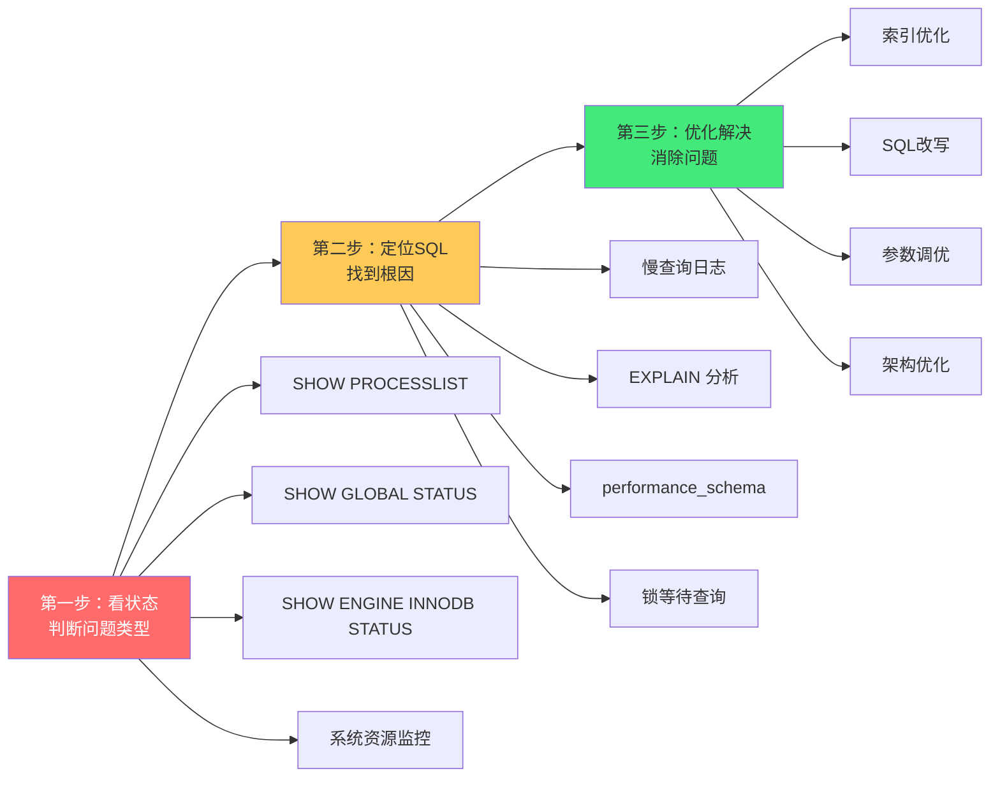

# 🔧 MySQL 问题排查手册

> **文档说明**：MySQL 线上问题排查实战手册，系统覆盖数据库运维中最常见的高频问题排查与解决，包括排查方法论与总览（先看状态→再定位 SQL→最后优化的三步法 / 排查思维框架 / 应急处理原则）、必备命令大全（状态查看 / 进程列表 / InnoDB 状态 / 变量配置 / 事务查看 / 锁信息 / 主从状态 / 性能_schema）、慢 SQL 排查与优化（慢查询日志开启与分析 / EXPLAIN 执行计划详解 / 索引失效场景 / SQL 改写技巧 / 分页优化 / 关联查询优化 / 聚合查询优化）、死锁排查与解决（死锁产生条件 / 死锁日志分析 / 常见死锁场景 / 死锁预防策略 / 死锁应急处理）、连接数满与连接泄漏（max_connections 调优 / 连接泄漏排查 / 等待连接排查 / 连接池配置 / 长连接短连接选择）、主从延迟排查（延迟原因分析 / 排查步骤 / 并行复制 / 大事务优化 / 网络问题 / 无主键表影响）、CPU 高负载排查（CPU 高的常见原因 / 定位消耗 CPU 的 SQL / 优化方案 / 并发控制）、磁盘 IO 高排查（IO 高的原因 / 定位 IO 消耗 / redo log / binlog / 临时表 / 优化方案）、内存使用问题（OOM 排查 / buffer pool 配置 / 内存泄漏 / 临时表内存 / 优化方案）、锁等待与事务问题（行锁等待 / 表锁 / 元数据锁 MDL / 长事务 / 事务隔离级别 / 排查与解决）、性能监控与告警体系（关键监控指标 / 告警阈值 / 监控工具 / 性能基线）、应急处理预案（数据库不可用 / 主库宕机 / 数据误删 / 慢查询风暴 / 连接数满的应急步骤）、常见错误码与解决方案（1040/1205/1213/2006/2013/1062/1451 等）、排查工具与实用脚本（pt-query-digest / innotop / mysqltuner / 自定义排查脚本）、最佳实践与预防措施（配置规范 / SQL 审核 / 变更流程 / 容量规划 / 定期巡检）。
>
> **适用人群**：后端工程师、DBA、运维工程师、技术负责人
>
> **核心思路**：先看状态 → 再定位 SQL → 最后优化
>
> **前置知识**：[[MySQL索引优化实战]] · [[MySQL事务与锁机制]] · [[MySQL主从复制与高可用]]

---

## 一、排查方法论与总览

### 1.1 三步排查法



### 1.2 常见问题分类与快速判断

| 现象 | 可能问题 | 快速判断命令 |
|------|---------|-------------|
| **应用响应慢** | 慢 SQL / 锁等待 / 连接数满 | `SHOW PROCESSLIST` |
| **数据库 CPU 高** | 慢 SQL / 排序 / 临时表 | `SHOW PROCESSLIST` + 慢查询日志 |
| **数据库 IO 高** | 全表扫描 / 大量写入 / 临时表 | `iostat` + `SHOW ENGINE INNODB STATUS` |
| **连接数满报错 1040** | 连接泄漏 / 慢 SQL 占连接 | `SHOW PROCESSLIST` + `SHOW STATUS LIKE 'Threads%'` |
| **死锁报错 1213** | 事务并发冲突 | `SHOW ENGINE INNODB STATUS` 查看 LATEST DETECTED DEADLOCK |
| **锁等待超时 1205** | 长事务持锁 / 索引不当 | `SELECT * FROM information_schema.INNODB_TRX` |
| **主从延迟大** | 大事务 / 无主键 / 网络 / 单线程复制 | `SHOW SLAVE STATUS` 查看 Seconds_Behind_Master |
| **内存不足 OOM** | buffer pool 过大 / 临时表 / 连接数多 | `free -h` + `SHOW VARIABLES LIKE '%buffer%'` |
| **数据丢失/误删** | 误操作 / 程序 bug | binlog 恢复 + 备份 |

### 1.3 应急处理原则

1. **先止血再优化**：紧急情况下先恢复服务（kill 慢 SQL / 重启 / 切换主从），再分析根因
2. **保留现场**：排查前先导出 `SHOW PROCESSLIST`、`SHOW ENGINE INNODB STATUS`、慢查询日志，避免现场丢失
3. **最小影响操作**：优先选择不影响业务的操作（如添加索引用 `ALGORITHM=INPLACE`）
4. **变更可回滚**：任何参数变更、SQL 变更都要有回滚方案
5. **事后复盘**：问题解决后必须做根因分析（RCA），制定预防措施

---

## 二、必备命令大全

### 2.1 状态查看

```sql
-- 查看全局状态（关键指标）
SHOW GLOBAL STATUS LIKE 'Threads_connected';      -- 当前连接数
SHOW GLOBAL STATUS LIKE 'Threads_running';         -- 正在运行的线程数
SHOW GLOBAL STATUS LIKE 'Threads_created';         -- 累计创建的线程数
SHOW GLOBAL STATUS LIKE 'Connections';             -- 累计连接数
SHOW GLOBAL STATUS LIKE 'Max_used_connections';    -- 历史最大连接数
SHOW GLOBAL STATUS LIKE 'Slow_queries';            -- 慢查询累计数
SHOW GLOBAL STATUS LIKE 'Questions';               -- 累计查询数
SHOW GLOBAL STATUS LIKE 'Uptime';                  -- 运行时长（秒）
SHOW GLOBAL STATUS LIKE 'Innodb_row_lock_waits';   -- 行锁等待次数
SHOW GLOBAL STATUS LIKE 'Innodb_row_lock_time';    -- 行锁等待总时间（ms）
SHOW GLOBAL STATUS LIKE 'Innodb_deadlocks';        -- 死锁次数
SHOW GLOBAL STATUS LIKE 'Aborted_connects';        -- 失败连接数
SHOW GLOBAL STATUS LIKE 'Aborted_clients';         -- 异常断开连接数
SHOW GLOBAL STATUS LIKE 'Created_tmp_tables';      -- 创建临时表数
SHOW GLOBAL STATUS LIKE 'Created_tmp_disk_tables'; -- 创建磁盘临时表数
SHOW GLOBAL STATUS LIKE 'Select_full_join';        -- 全表连接数（无索引连接）
SHOW GLOBAL STATUS LIKE 'Select_scan';             -- 全表扫描数
SHOW GLOBAL STATUS LIKE 'Sort_merge_passes';       -- 排序合并次数
SHOW GLOBAL STATUS LIKE 'Table_locks_waited';      -- 表锁等待次数
SHOW GLOBAL STATUS LIKE 'Opened_tables';           -- 打开表数
SHOW GLOBAL STATUS LIKE 'Open_tables';             -- 当前打开表数
```

### 2.2 进程列表

```sql
-- 查看当前所有连接（最常用）
SHOW PROCESSLIST;

-- 查看完整 SQL（不截断）
SHOW FULL PROCESSLIST;

-- 查看正在运行的查询（排除 Sleep）
SELECT * FROM information_schema.PROCESSLIST 
WHERE COMMAND != 'Sleep' 
ORDER BY TIME DESC;

-- 查看执行时间超过 10 秒的查询
SELECT * FROM information_schema.PROCESSLIST 
WHERE COMMAND != 'Sleep' AND TIME > 10 
ORDER BY TIME DESC;

-- 按用户统计连接数
SELECT USER, COUNT(*) as cnt 
FROM information_schema.PROCESSLIST 
GROUP BY USER 
ORDER BY cnt DESC;

-- 按状态统计
SELECT STATE, COUNT(*) as cnt 
FROM information_schema.PROCESSLIST 
WHERE COMMAND != 'Sleep'
GROUP BY STATE 
ORDER BY cnt DESC;

-- Kill 某个连接
KILL <thread_id>;

-- 批量 Kill 长时间运行的查询（谨慎使用）
SELECT CONCAT('KILL ', ID, ';') 
FROM information_schema.PROCESSLIST 
WHERE COMMAND != 'Sleep' AND TIME > 60;
```

### 2.3 InnoDB 状态

```sql
-- 查看 InnoDB 详细状态（包含死锁、事务、锁、IO 等）
SHOW ENGINE INNODB STATUS\G

-- 关键部分说明：
-- 1. LATEST DETECTED DEADLOCK：最近一次死锁详情
-- 2. TRANSACTIONS：当前事务列表（含长事务、锁等待）
-- 3. FILE I/O：IO 线程状态
-- 4. INSERT BUFFER AND ADAPTIVE HASH INDEX：插入缓冲和自适应哈希
-- 5. LOG：redo log 状态（含未刷新的日志量）
-- 6. BUFFER POOL AND MEMORY：缓冲池状态（命中率、脏页等）
-- 7. ROW OPERATIONS：行操作统计
```

### 2.4 事务与锁信息

```sql
-- 查看当前所有事务
SELECT * FROM information_schema.INNODB_TRX\G

-- 查看正在等待锁的事务
SELECT * FROM information_schema.INNODB_LOCK_WAITS\G

-- 查看当前持有的锁
SELECT * FROM information_schema.INNODB_LOCKS\G

-- 查看锁等待详情（谁阻塞了谁）
SELECT 
  r.trx_id waiting_trx_id,
  r.trx_mysql_thread_id waiting_thread,
  r.trx_query waiting_query,
  b.trx_id blocking_trx_id,
  b.trx_mysql_thread_id blocking_thread,
  b.trx_query blocking_query,
  b.trx_started blocking_started,
  TIMESTAMPDIFF(SECOND, b.trx_started, NOW()) as blocking_seconds
FROM information_schema.INNODB_LOCK_WAITS w
JOIN information_schema.INNODB_TRX b ON b.trx_id = w.blocking_trx_id
JOIN information_schema.INNODB_TRX r ON r.trx_id = w.requesting_trx_id;

-- 查看长事务（超过 60 秒）
SELECT 
  trx_id, trx_started, trx_mysql_thread_id, trx_query,
  TIMESTAMPDIFF(SECOND, trx_started, NOW()) as duration
FROM information_schema.INNODB_TRX
WHERE TIMESTAMPDIFF(SECOND, trx_started, NOW()) > 60
ORDER BY duration DESC;

-- 查看元数据锁 MDL（MySQL 5.7+）
SELECT * FROM performance_schema.metadata_locks;
```

### 2.5 主从状态

```sql
-- 主库：查看主库状态
SHOW MASTER STATUS;

-- 从库：查看从库状态（最常用）
SHOW SLAVE STATUS\G

-- 关键指标：
-- Slave_IO_Running: IO 线程是否运行（应为 Yes）
-- Slave_SQL_Running: SQL 线程是否运行（应为 Yes）
-- Seconds_Behind_Master: 延迟秒数（应为 0）
-- Last_Error: 最近错误（应为空）
-- Master_Log_File / Read_Master_Log_Pos: IO 线程读取位置
-- Relay_Master_Log_File / Exec_Master_Log_Pos: SQL 线程执行位置

-- 查看从库延迟（IO 和 SQL 的位置差）
SHOW SLAVE STATUS\G
-- 计算：Read_Master_Log_Pos - Exec_Master_Log_Pos（同一日志文件时）

-- 主库：查看连接的从库
SHOW SLAVE HOSTS;

-- 主库：查看二进制日志
SHOW BINARY LOGS;
SHOW MASTER LOGS;

-- 查看 binlog 事件
SHOW BINLOG EVENTS IN 'mysql-bin.000001' LIMIT 10;
```

### 2.6 性能 Schema（performance_schema）

```sql
-- 查看消耗时间最多的 SQL（MySQL 5.6+）
SELECT 
  DIGEST_TEXT, COUNT_STAR, SUM_TIMER_WAIT/1000000000 as total_ms,
  AVG_TIMER_WAIT/1000000000 as avg_ms,
  SUM_ROWS_EXAMINED, SUM_ROWS_SENT
FROM performance_schema.events_statements_summary_by_digest
WHERE SCHEMA_NAME = 'your_database'
ORDER BY SUM_TIMER_WAIT DESC
LIMIT 20;

-- 查看当前正在执行的语句
SELECT * FROM performance_schema.events_statements_current;

-- 查看等待事件（IO/锁/条件等）
SELECT 
  EVENT_NAME, COUNT_STAR, SUM_TIMER_WAIT/1000000000 as total_ms
FROM performance_schema.events_waits_summary_global_by_event_name
WHERE SUM_TIMER_WAIT > 0
ORDER BY SUM_TIMER_WAIT DESC
LIMIT 20;

-- 查看文件 IO 统计
SELECT 
  FILE_NAME, COUNT_READ, COUNT_WRITE,
  SUM_NUMBER_OF_BYTES_READ, SUM_NUMBER_OF_BYTES_WRITE
FROM performance_schema.file_summary_by_instance
ORDER BY SUM_NUMBER_OF_BYTES_READ + SUM_NUMBER_OF_BYTES_WRITE DESC
LIMIT 20;

-- 查看内存使用
SELECT 
  EVENT_NAME, CURRENT_COUNT_USED, CURRENT_NUMBER_OF_BYTES_USED
FROM performance_schema.memory_summary_global_by_event_name
WHERE CURRENT_NUMBER_OF_BYTES_USED > 0
ORDER BY CURRENT_NUMBER_OF_BYTES_USED DESC
LIMIT 20;
```

---

## 三、慢 SQL 排查与优化

### 3.1 开启慢查询日志

```sql
-- 查看慢查询配置
SHOW VARIABLES LIKE '%slow_query%';
SHOW VARIABLES LIKE '%long_query_time%';

-- 临时开启（重启失效）
SET GLOBAL slow_query_log = 'ON';
SET GLOBAL long_query_time = 1;  -- 超过 1 秒记录
SET GLOBAL log_queries_not_using_indexes = 'ON';  -- 记录未使用索引的查询

-- 永久配置（my.cnf / my.ini）
[mysqld]
slow_query_log = ON
slow_query_log_file = /var/log/mysql/slow.log
long_query_time = 1
log_queries_not_using_indexes = ON
```

### 3.2 分析慢查询日志

```bash
# 方法1：直接查看慢查询日志
tail -f /var/log/mysql/slow.log

# 方法2：mysqldumpslow（MySQL 自带）
# 按总时间排序，取前 20
mysqldumpslow -s t -t 20 /var/log/mysql/slow.log

# 按平均时间排序
mysqldumpslow -s at -t 20 /var/log/mysql/slow.log

# 按访问次数排序
mysqldumpslow -s c -t 20 /var/log/mysql/slow.log

# 方法3：pt-query-digest（Percona Toolkit，更强大）
pt-query-digest /var/log/mysql/slow.log > slow_report.txt

# 分析指定时间段
pt-query-digest --since '2026-08-28 00:00:00' --until '2026-08-28 23:59:59' slow.log

# 按用户过滤
pt-query-digest --filter '$event->{user} =~ /app_user/' slow.log
```

### 3.3 EXPLAIN 执行计划详解

```sql
-- 查看执行计划
EXPLAIN SELECT * FROM orders WHERE user_id = 123 AND status = 'paid';

-- 查看更详细的执行计划（MySQL 8.0+）
EXPLAIN ANALYZE SELECT * FROM orders WHERE user_id = 123;

-- 关键列说明：
-- id: 查询序号，id 越大越先执行
-- select_type: 查询类型（SIMPLE/PRIMARY/SUBQUERY/DERIVED/UNION）
-- table: 操作的表
-- type: 访问类型（性能从好到差）：
--   system > const > eq_ref > ref > range > index > ALL
--   ALL = 全表扫描（最差，必须优化）
--   index = 全索引扫描
--   range = 索引范围扫描
--   ref = 非唯一索引查找
--   eq_ref = 唯一索引查找
--   const = 常量查询（主键/唯一索引等值查询）
-- possible_keys: 可能使用的索引
-- key: 实际使用的索引
-- key_len: 使用的索引长度（越短越好）
-- ref: 索引比较的列或常量
-- rows: 预估扫描的行数（越少越好）
-- filtered: 过滤后行数占比（越高越好）
-- Extra: 额外信息
--   Using index: 覆盖索引（好）
--   Using where: 使用 WHERE 过滤
--   Using temporary: 使用临时表（差，需优化）
--   Using filesort: 文件排序（差，需优化）
--   Using join buffer: 连接缓冲（差，需加索引）
--   Impossible WHERE: WHERE 条件不可能成立
```

### 3.4 索引失效场景

| 场景 | 示例 | 原因 | 解决方案 |
|------|------|------|---------|
| **函数操作** | `WHERE YEAR(create_time) = 2026` | 索引列上用函数 | 改为范围查询 `WHERE create_time >= '2026-01-01' AND create_time < '2027-01-01'` |
| **隐式类型转换** | `WHERE phone = 13800138000`（phone 是 varchar） | 字符串列用数字查询 | `WHERE phone = '13800138000'` |
| **模糊查询前缀 %** | `WHERE name LIKE '%张%'` | 前缀 % 无法用索引 | 改为 `LIKE '张%'` 或用全文索引 |
| **OR 条件** | `WHERE a = 1 OR b = 2`（a,b 都有索引） | OR 可能导致索引失效 | 改为 UNION ALL 或建联合索引 |
| **联合索引不满足最左前缀** | 索引(a,b,c)，查询 `WHERE b = 2` | 不满足最左前缀原则 | 查询条件包含 a，或调整索引顺序 |
| **!= / NOT IN / <>** | `WHERE status != 'deleted'` | 负向查询可能不走索引 | 改为正向枚举，或覆盖索引 |
| **IS NOT NULL** | `WHERE name IS NOT NULL` | 可能导致索引失效 | 业务上避免，或用覆盖索引 |
| **字符集不一致** | 关联查询两表字符集不同 | 隐式转换导致索引失效 | 统一字符集（utf8mb4） |

### 3.5 常见 SQL 优化技巧

#### 分页优化

```sql
-- ❌ 深分页问题（越翻越慢）
SELECT * FROM orders ORDER BY id LIMIT 1000000, 10;

-- ✅ 方法1：基于主键游标分页
SELECT * FROM orders WHERE id > 1000000 ORDER BY id LIMIT 10;

-- ✅ 方法2：延迟关联（先查主键再关联）
SELECT o.* FROM orders o
INNER JOIN (SELECT id FROM orders ORDER BY id LIMIT 1000000, 10) t
ON o.id = t.id;

-- ✅ 方法3：业务限制最大翻页数（如最多 100 页）
```

#### 关联查询优化

```sql
-- 小表驱动大表（MySQL 会自动选择，但可以确认）
-- 确保关联字段都有索引
-- 避免超过 3 张表的 JOIN
-- 用 EXISTS 替代 IN（大数据量时）

-- ❌ 子查询（可能性能差）
SELECT * FROM orders WHERE user_id IN (SELECT id FROM users WHERE status = 1);

-- ✅ 改为 JOIN
SELECT o.* FROM orders o
INNER JOIN users u ON o.user_id = u.id
WHERE u.status = 1;
```

#### 聚合查询优化

```sql
-- 确保 GROUP BY 的列有索引
-- 避免 SELECT 非聚合列且不在 GROUP BY 中（ONLY_FULL_GROUP_BY）
-- 用覆盖索引优化 COUNT

-- ❌ 全表扫描 COUNT
SELECT COUNT(*) FROM orders WHERE status = 'paid';

-- ✅ 加索引后走索引扫描
ALTER TABLE orders ADD INDEX idx_status (status);

-- 近似计数（大数据量时，不需要精确值）
SELECT table_rows FROM information_schema.TABLES 
WHERE table_schema = 'db' AND table_name = 'orders';
```

---

## 四、死锁排查与解决

### 4.1 死锁产生的四个必要条件

1. **互斥**：资源不能被多个事务同时持有
2. **持有并等待**：持有一个资源的同时等待另一个
3. **不可剥夺**：资源不能被强制释放，只能主动释放
4. **循环等待**：事务 A 等 B，B 等 A，形成循环

### 4.2 死锁日志分析

```sql
-- 查看最近一次死锁
SHOW ENGINE INNODB STATUS\G

-- 关注 LATEST DETECTED DEADLOCK 部分：
-- 1. 死锁发生时间
-- 2. 事务1：持有的锁 + 等待的锁 + 执行的 SQL
-- 3. 事务2：持有的锁 + 等待的锁 + 执行的 SQL
-- 4. 回滚的事务（InnoDB 自动回滚代价小的事务）
```

### 4.3 常见死锁场景

| 场景 | 说明 | 解决方案 |
|------|------|---------|
| **不同顺序访问相同行** | 事务1 先锁 A 再锁 B，事务2 先锁 B 再锁 A | 统一访问顺序（如都按主键升序） |
| **范围查询加锁** | `UPDATE ... WHERE id BETWEEN 1 AND 10` 加间隙锁 | 缩小范围，或降低隔离级别为 READ COMMITTED |
| **唯一键冲突** | 并发插入相同唯一键值 | 应用层重试，或用 INSERT ... ON DUPLICATE KEY UPDATE |
| **外键级联** | 父表删除时子表级联加锁 | 避免外键，应用层维护一致性 |
| **大事务** | 事务持有锁时间过长，增加死锁概率 | 拆分大事务，缩短事务时间 |
| **索引不当导致全表扫描** | UPDATE 无索引导致全表锁 | 确保 WHERE 条件有索引 |

### 4.4 死锁预防策略

1. **统一访问顺序**：所有事务按相同顺序访问资源（如按主键升序）
2. **缩短事务时间**：避免大事务，事务内不做远程调用、不等待用户输入
3. **合理使用索引**：确保 UPDATE/DELETE 的 WHERE 条件有索引，避免全表锁
4. **降低隔离级别**：业务允许时用 READ COMMITTED（减少间隙锁）
5. **避免长事务**：监控长事务，及时告警
6. **应用层重试**：捕获死锁异常（1213），自动重试
7. **批量操作分批**：大量更新分批提交，每批 100-500 条

### 4.5 死锁应急处理

```sql
-- 1. 查看当前锁等待
SELECT * FROM information_schema.INNODB_LOCK_WAITS;

-- 2. 找到阻塞事务
SELECT 
  b.trx_id, b.trx_mysql_thread_id, b.trx_query,
  b.trx_started, TIMESTAMPDIFF(SECOND, b.trx_started, NOW()) as duration
FROM information_schema.INNODB_LOCK_WAITS w
JOIN information_schema.INNODB_TRX b ON b.trx_id = w.blocking_trx_id;

-- 3. Kill 阻塞事务（谨慎）
KILL <thread_id>;

-- 4. 事后分析死锁日志，找到根因
```

---

## 五、连接数满与连接泄漏

### 5.1 连接数满（错误 1040）

```sql
-- 错误信息：ERROR 1040 (HY000): Too many connections

-- 查看当前连接数和最大连接数
SHOW VARIABLES LIKE 'max_connections';
SHOW GLOBAL STATUS LIKE 'Threads_connected';
SHOW GLOBAL STATUS LIKE 'Max_used_connections';

-- 查看连接分布
SELECT USER, HOST, DB, COMMAND, STATE, COUNT(*) as cnt
FROM information_schema.PROCESSLIST
GROUP BY USER, HOST, DB, COMMAND, STATE
ORDER BY cnt DESC;
```

### 5.2 原因分析与解决

| 原因 | 现象 | 解决方案 |
|------|------|---------|
| **慢 SQL 占连接** | 大量连接处于 Query/Sending data 状态 | 优化慢 SQL，见第三章 |
| **连接泄漏** | 应用连接池连接不释放，Sleep 连接多 | 检查应用代码，确保连接关闭；配置连接池回收 |
| **max_connections 过小** | 正常业务峰值连接数超过配置 | 适当调大 max_connections（需评估内存） |
| **突发流量** | 短时间内连接数暴增 | 限流 / 熔断 / 扩容 / 读写分离 |
| **连接攻击** | 大量来自未知 IP 的连接 | 防火墙 / 限制 max_user_connections |
| **长事务** | 事务长时间不提交，连接被占用 | 监控长事务，优化事务逻辑 |

### 5.3 连接池配置建议

```properties
# HikariCP 推荐配置（Spring Boot 默认）
spring.datasource.hikari.maximum-pool-size=20        # 最大连接数
spring.datasource.hikari.minimum-idle=5               # 最小空闲连接
spring.datasource.hikari.connection-timeout=30000     # 连接超时 30s
spring.datasource.hikari.idle-timeout=600000          # 空闲连接超时 10min
spring.datasource.hikari.max-lifetime=1800000         # 连接最大存活 30min
spring.datasource.hikari.leak-detection-threshold=60000  # 连接泄漏检测 60s

# 连接数计算公式：连接数 = ((核心数 * 2) + 有效磁盘数)
# 通常前端应用每个实例 10-30 个连接足够
# 总连接数 = 应用实例数 * 每实例连接数 < max_connections * 0.8
```

### 5.4 应急处理

```sql
-- 1. 紧急：查看谁占了最多连接
SELECT USER, HOST, COUNT(*) as cnt 
FROM information_schema.PROCESSLIST 
GROUP BY USER, HOST 
ORDER BY cnt DESC;

-- 2. Kill 长时间 Sleep 的连接（谨慎，可能是连接池正常连接）
SELECT CONCAT('KILL ', ID, ';') 
FROM information_schema.PROCESSLIST 
WHERE COMMAND = 'Sleep' AND TIME > 300;

-- 3. 临时调大 max_connections（需评估内存）
SET GLOBAL max_connections = 500;

-- 4. 限制某个用户的最大连接数
ALTER USER 'app_user'@'%' WITH MAX_USER_CONNECTIONS 100;
```

---

## 六、主从延迟排查

### 6.1 查看延迟

```sql
-- 在从库执行
SHOW SLAVE STATUS\G

-- 关键指标：
-- Seconds_Behind_Master: 延迟秒数（最直观，但可能不准确）
-- 更准确的方法：在主库写入时间戳，从库读取计算差值
```

### 6.2 延迟原因分析

| 原因 | 说明 | 排查方法 | 解决方案 |
|------|------|---------|---------|
| **大事务** | 主库执行大事务，从库重放也慢 | 查看 binlog 中是否有大事务 | 拆分大事务，分批提交 |
| **无主键表** | 从库无主键时全表扫描定位行 | 检查无主键表 `SELECT * FROM tables WHERE table_rows > 0 AND ...` | 所有表加主键 |
| **单线程复制** | MySQL 5.6 前从库单线程 SQL 重放 | 版本确认 | 升级到 5.7+，开启并行复制 |
| **网络延迟** | 主从之间网络慢 | `ping` / `traceroute` | 优化网络，同机房部署 |
| **从库性能差** | 从库硬件比主库差 | 对比 CPU/内存/磁盘 | 从库配置不低于主库 |
| **从库负载高** | 从库跑大量查询/备份 | 查看从库进程列表 | 读写分离负载均衡，备份用专用从库 |
| **锁等待** | 从库查询阻塞 SQL 线程 | `SHOW PROCESSLIST` | 优化从库查询，或用读写分离中间件 |
| **binlog 写入慢** | 从库 relay log 写入慢 | 磁盘 IO 监控 | 优化磁盘，使用 SSD |

### 6.3 并行复制配置

```ini
# MySQL 5.7 基于组提交的并行复制（推荐）
[mysqld]
slave_parallel_type = LOGICAL_CLOCK    # 基于组提交的并行复制
slave_parallel_workers = 8             # 并行复制线程数（根据 CPU 核数）
slave_preserve_commit_order = ON       # 保持提交顺序（避免主从不一致）

# MySQL 8.0 增强并行复制
slave_parallel_type = LOGICAL_CLOCK
slave_parallel_workers = 16
binlog_transaction_dependency_tracking = WRITESET  # 基于写集合的并行（更优）
```

### 6.4 无主键表检查与修复

```sql
-- 查找无主键的表
SELECT TABLE_SCHEMA, TABLE_NAME 
FROM information_schema.TABLES 
WHERE TABLE_SCHEMA NOT IN ('mysql', 'information_schema', 'performance_schema', 'sys')
AND TABLE_NAME NOT IN (
  SELECT TABLE_NAME FROM information_schema.KEY_COLUMN_USAGE 
  WHERE CONSTRAINT_NAME = 'PRIMARY'
);

-- 为无主键表添加自增主键
ALTER TABLE table_name ADD COLUMN id BIGINT UNSIGNED NOT NULL AUTO_INCREMENT PRIMARY KEY FIRST;
```

### 6.5 应急处理

```sql
-- 1. 确认延迟原因
SHOW SLAVE STATUS\G
-- 查看 IO 线程还是 SQL 线程慢
-- 如果 Master_Log_File = Relay_Master_Log_File 且 Read_Master_Log_Pos = Exec_Master_Log_Pos，说明已追平

-- 2. 如果是大事务导致，等待完成（不要随意重启从库）

-- 3. 如果是从库查询阻塞，Kill 阻塞查询
SELECT * FROM information_schema.PROCESSLIST WHERE STATE LIKE '%Waiting for table%';

-- 4. 极端情况：重建从库（从主库备份恢复）
```

---

## 七、CPU 高负载排查

### 7.1 排查步骤

```bash
# 1. 确认是 MySQL 进程消耗 CPU
top -c
# 或
ps aux | grep mysqld | grep -v grep

# 2. 查看 MySQL 内部正在运行什么
mysql -e "SHOW FULL PROCESSLIST" | grep -v Sleep

# 3. 查看是否有大量排序/临时表
mysql -e "SHOW GLOBAL STATUS LIKE '%Sort%'"
mysql -e "SHOW GLOBAL STATUS LIKE '%tmp%'"
```

### 7.2 CPU 高的常见原因

| 原因 | 说明 | 排查 | 解决 |
|------|------|------|------|
| **慢 SQL** | 大量全表扫描、复杂计算 | 慢查询日志 + PROCESSLIST | 加索引 / SQL 改写 |
| **大量排序** | ORDER BY/GROUP BY 无索引 | `Sort_merge_passes` 高 | 加索引 / 减少排序 |
| **大量临时表** | 复杂查询创建临时表 | `Created_tmp_disk_tables` 高 | 优化 SQL / 调大 tmp_table_size |
| **高并发** | QPS 突增 | `Questions` 增长快 | 限流 / 缓存 / 扩容 |
| **死循环/异常** | 应用 bug 导致重复查询 | 查看相同 SQL 高频执行 | 修复应用 / 加缓存 |
| **MySQL bug** | 特定版本 bug | 查 bug 列表 | 升级版本 |

### 7.3 定位消耗 CPU 的 SQL

```sql
-- 方法1：查看当前运行时间最长的 SQL
SELECT ID, USER, HOST, DB, COMMAND, TIME, STATE, LEFT(INFO, 200) as SQL
FROM information_schema.PROCESSLIST
WHERE COMMAND != 'Sleep'
ORDER BY TIME DESC
LIMIT 10;

-- 方法2：performance_schema 查看历史消耗
SELECT 
  DIGEST_TEXT, COUNT_STAR,
  SUM_TIMER_WAIT/1000000000 as total_ms,
  AVG_TIMER_WAIT/1000000000 as avg_ms,
  SUM_ROWS_EXAMINED, SUM_ROWS_SENT,
  SUM_CREATED_TMP_TABLES, SUM_SORT_MERGE_PASSES
FROM performance_schema.events_statements_summary_by_digest
ORDER BY SUM_TIMER_WAIT DESC
LIMIT 10;

-- 方法3：开启慢查询日志，分析 TOP SQL
```

### 7.4 优化方案

1. **加索引**：最常见有效的方法，确保 WHERE/ORDER BY/GROUP BY/JOIN 字段有索引
2. **SQL 改写**：避免 SELECT *、减少子查询、用 JOIN 替代 IN、限制结果集
3. **加缓存**：Redis 缓存热点数据，减少数据库查询
4. **读写分离**：读请求走从库，减轻主库压力
5. **分库分表**：单表数据量过大时（>5000万行）考虑分表
6. **限流降级**：突发流量时限流，保护数据库
7. **参数调优**：`innodb_buffer_pool_size`、`tmp_table_size`、`sort_buffer_size`

---

## 八、磁盘 IO 高排查

### 8.1 排查步骤

```bash
# 1. 查看系统 IO 情况
iostat -x 1 5
# 关注：%util（磁盘使用率）、await（IO 等待时间）、r/s w/s（读写次数）

# 2. 查看哪个进程消耗 IO
iotop
# 或
pidstat -d 1

# 3. 查看 MySQL IO 相关状态
mysql -e "SHOW ENGINE INNODB STATUS\G" | grep -A 20 "FILE I/O"
mysql -e "SHOW GLOBAL STATUS LIKE '%Innodb_data%'"
mysql -e "SHOW GLOBAL STATUS LIKE '%Innodb_log%'"
```

### 8.2 IO 高的常见原因

| 原因 | 说明 | 排查 | 解决 |
|------|------|------|------|
| **全表扫描** | 大量数据页读入内存 | `Select_scan` 高 / 慢查询 | 加索引 |
| **大量写入** | 高并发 INSERT/UPDATE/DELETE | `Innodb_rows_inserted/updated/deleted` | 批量写入 / 异步化 |
| **redo log 刷新频繁** | `innodb_flush_log_at_trx_commit=1` 每次提交刷盘 | 查看配置 | 业务允许时改为 2 |
| **binlog 写入** | sync_binlog=1 每次提交刷 binlog | 查看配置 | 业务允许时改为 100 |
| **临时表写磁盘** | 内存临时表不够用，写磁盘 | `Created_tmp_disk_tables` 高 | 调大 `tmp_table_size` / `max_heap_table_size` |
| **buffer pool 命中率低** | 频繁从磁盘读数据页 | `Innodb_buffer_pool_reads` 高 | 调大 `innodb_buffer_pool_size` |
| **checkpoint 频繁** | 脏页太多，频繁刷盘 | `Innodb_buffer_pool_pages_dirty` 高 | 调大 buffer pool / 优化写入 |
| **备份/导出** | mysqldump/xtrabackup 消耗 IO | 查看定时任务 | 备份在从库 / 低峰期 |

### 8.3 关键参数调优

```ini
[mysqld]
# Buffer Pool（最重要，建议物理内存的 50-70%）
innodb_buffer_pool_size = 8G
innodb_buffer_pool_instances = 8  # 多实例，减少锁竞争（每个实例至少 1G）

# Redo Log
innodb_log_file_size = 1G          # redo log 大小（大事务多则调大）
innodb_log_files_in_group = 2       # redo log 文件数
innodb_flush_log_at_trx_commit = 1  # 1=最安全，2=性能好（崩溃可能丢1秒）

# Binlog
sync_binlog = 1                      # 1=最安全，100=性能好
binlog_cache_size = 1M
max_binlog_cache_size = 4G

# 临时表
tmp_table_size = 64M
max_heap_table_size = 64M

# 排序
sort_buffer_size = 2M
join_buffer_size = 2M

# IO 调度（Linux）
# 建议使用 deadline 或 noop 调度器
# echo deadline > /sys/block/sda/queue/scheduler
```

---

## 九、内存使用问题

### 9.1 OOM（Out of Memory）排查

```bash
# 1. 查看系统内存
free -h

# 2. 查看 MySQL 内存占用
ps aux | grep mysqld | grep -v grep
# RSS 列是实际物理内存占用

# 3. 查看 dmesg 确认 OOM
dmesg | grep -i "out of memory"
dmesg | grep -i "killed process"

# 4. 查看 MySQL 内存相关配置
mysql -e "SHOW VARIABLES LIKE '%buffer%'"
mysql -e "SHOW VARIABLES LIKE '%cache%'"
mysql -e "SHOW VARIABLES LIKE '%tmp%'"
mysql -e "SHOW VARIABLES LIKE '%heap%'"
```

### 9.2 MySQL 内存计算

```text
MySQL 总内存 ≈ 全局内存 + 会话内存 × 最大连接数

全局内存（所有连接共享）：
- innodb_buffer_pool_size（最大头，通常占 60-80%）
- innodb_log_buffer_size
- key_buffer_size（MyISAM）
- query_cache_size（8.0 已移除）
- innodb_additional_mem_pool_size（已废弃）

会话内存（每个连接独立）：
- sort_buffer_size
- join_buffer_size
- read_buffer_size
- read_rnd_buffer_size
- tmp_table_size / max_heap_table_size
- thread_stack
- binlog_cache_size

经验公式：
innodb_buffer_pool_size = 物理内存 × 60%（专用数据库服务器）
最大连接数 × 会话内存总和 < 物理内存 × 20%
预留 20% 给操作系统和其他进程
```

### 9.3 常见内存问题

| 问题 | 原因 | 解决 |
|------|------|------|
| **buffer pool 过大** | `innodb_buffer_pool_size` 超过物理内存 80% | 调小到 60-70% |
| **连接数过多** | 每个连接占用会话内存，连接数多则总内存大 | 限制 max_connections，优化连接池 |
| **临时表过大** | 复杂查询创建大临时表 | 调小 `tmp_table_size`，优化 SQL |
| **内存泄漏** | MySQL bug 或插件导致内存不释放 | 升级 MySQL 版本，排查插件 |
| **大结果集** | 查询返回大量数据，客户端未及时消费 | 限制 LIMIT，分批处理 |
| **prepared statement** | 大量预编译语句未释放 | 应用层关闭 prepared statement |

---

## 十、锁等待与事务问题

### 10.1 行锁等待

```sql
-- 错误：ERROR 1205 (HY000): Lock wait timeout exceeded

-- 查看锁等待
SELECT * FROM information_schema.INNODB_LOCK_WAITS;

-- 查看谁阻塞了谁
SELECT 
  r.trx_id waiting_trx_id,
  r.trx_mysql_thread_id waiting_thread,
  r.trx_query waiting_query,
  b.trx_id blocking_trx_id,
  b.trx_mysql_thread_id blocking_thread,
  b.trx_query blocking_query,
  TIMESTAMPDIFF(SECOND, b.trx_started, NOW()) as blocking_seconds
FROM information_schema.INNODB_LOCK_WAITS w
JOIN information_schema.INNODB_TRX b ON b.trx_id = w.blocking_trx_id
JOIN information_schema.INNODB_TRX r ON r.trx_id = w.requesting_trx_id;

-- 查看锁等待超时配置
SHOW VARIABLES LIKE 'innodb_lock_wait_timeout';
-- 默认 50 秒，可根据业务调整
SET GLOBAL innodb_lock_wait_timeout = 30;
```

### 10.2 元数据锁（MDL）

```sql
-- 现象：ALTER TABLE 被阻塞，所有查询都卡住
-- 原因：有长事务持有表的 MDL 读锁，ALTER 需要 MDL 写锁

-- 查看 MDL 锁（MySQL 5.7+）
SELECT * FROM performance_schema.metadata_locks;

-- 查看持有 MDL 的长事务
SELECT 
  trx_id, trx_started, trx_mysql_thread_id, trx_query,
  TIMESTAMPDIFF(SECOND, trx_started, NOW()) as duration
FROM information_schema.INNODB_TRX
ORDER BY duration DESC;

-- 解决：Kill 持有 MDL 的长事务
KILL <thread_id>;

-- 预防：
-- 1. 避免长事务
-- 2. DDL 在低峰期执行
-- 3. 使用 pt-online-schema-change 或 gh-ost 做在线 DDL
-- 4. 设置 lock_wait_timeout
SET SESSION lock_wait_timeout = 30;
```

### 10.3 长事务

```sql
-- 查看长事务（超过 60 秒）
SELECT 
  trx_id, trx_state, trx_started, trx_mysql_thread_id,
  trx_query, trx_rows_locked, trx_rows_modified,
  TIMESTAMPDIFF(SECOND, trx_started, NOW()) as duration
FROM information_schema.INNODB_TRX
WHERE TIMESTAMPDIFF(SECOND, trx_started, NOW()) > 60
ORDER BY duration DESC;

-- 长事务的危害：
-- 1. 持有锁时间长，导致其他事务等待
-- 2. undo log 无法清理，导致表空间膨胀
-- 3. 主从延迟（从库重放大事务）
-- 4. 增加死锁概率

-- 解决：
-- 1. 应用层确保事务尽快提交
-- 2. 事务内不做远程调用、不等待用户输入
-- 3. 批量操作分批提交
-- 4. 监控长事务，及时告警和 Kill
```

### 10.4 事务隔离级别

```sql
-- 查看隔离级别
SHOW VARIABLES LIKE '%isolation%';
SELECT @@transaction_isolation;

-- 设置隔离级别
SET SESSION TRANSACTION ISOLATION LEVEL READ COMMITTED;
SET GLOBAL TRANSACTION ISOLATION LEVEL READ COMMITTED;

-- 四种隔离级别对比：
-- READ UNCOMMITTED：可读未提交（脏读），几乎不用
-- READ COMMITTED：只能读已提交（不可重复读），Oracle 默认，推荐
-- REPEATABLE READ：可重复读（MySQL 默认，通过 MVCC + 间隙锁实现）
-- SERIALIZABLE：串行化（最高隔离，性能最差）

-- 建议：
-- 互联网业务推荐 READ COMMITTED（减少锁等待、减少间隙锁、提升并发）
-- 金融等强一致业务用 REPEATABLE READ 或 SERIALIZABLE
```

---

## 十一、常见错误码与解决方案

| 错误码 | 错误信息 | 原因 | 解决方案 |
|--------|---------|------|---------|
| **1040** | Too many connections | 连接数满 | 见第五章 |
| **1045** | Access denied for user | 用户名/密码错误或无权限 | 检查用户名密码、host 授权 |
| **1062** | Duplicate entry for key | 唯一键冲突 | 检查数据，应用层处理重复 |
| **1205** | Lock wait timeout exceeded | 行锁等待超时 | 见第十章，优化事务/索引 |
| **1213** | Deadlock found when trying to get lock | 死锁 | 见第四章，应用层重试 |
| **1227** | Access denied; need SUPER privilege | 权限不足 | 授权或用高权限账号 |
| **1451** | Cannot delete or update a parent row | 外键约束 | 先删子表数据，或删除外键 |
| **1452** | Cannot add or update a child row | 外键约束（子表数据无对应父表） | 先插入父表数据，或检查数据 |
| **2006** | MySQL server has gone away | 连接断开（超时/大报文/OOM） | 调大 wait_timeout / max_allowed_packet |
| **2013** | Lost connection to MySQL server during query | 查询过程中连接断开 | 大查询优化 / 网络问题 / 服务器崩溃 |
| **2019** | Can't initialize character set | 字符集问题 | 检查字符集配置，统一 utf8mb4 |
| **2026** | SSL connection error | SSL 连接问题 | 检查 SSL 配置，或禁用 SSL |
| **3024** | Query execution was interrupted, max_execution_time exceeded | 查询超时 | 优化 SQL，或调大 max_execution_time |

---

## 十二、排查工具与实用脚本

### 12.1 Percona Toolkit

```bash
# 安装
yum install percona-toolkit
# 或
apt-get install percona-toolkit

# 常用工具：
# pt-query-digest：分析慢查询日志
pt-query-digest slow.log > report.txt

# pt-online-schema-change：在线 DDL（不锁表）
pt-online-schema-change --alter "ADD COLUMN age INT" D=db,t=users --execute

# pt-deadlock-logger：记录死锁日志
pt-deadlock-logger h=localhost,u=root,p=password --create-dest-table --dest D=db,t=deadlocks

# pt-stalk：发生问题时自动收集诊断信息
pt-stalk --threshold=50 --function=status --variable=Threads_running --dest=/tmp/diag

# pt-mysql-summary：MySQL 状态摘要
pt-mysql-summary --user=root --password=password

# pt-variable-advisor：参数建议
pt-variable-advisor --user=root
```

### 12.2 innotop

```bash
# 安装
yum install innotop

# 运行
innotop -u root -p password

# 常用快捷键：
# Q：查询列表（类似 SHOW PROCESSLIST）
# D：InnoDB 状态
# L：锁等待
# T：事务列表
# C：命令统计
# M：主从状态
# R：行操作统计
# F：文件 IO 统计
```

### 12.3 实用排查脚本

```bash
#!/bin/bash
# mysql_diag.sh - MySQL 快速诊断脚本

MYSQL_USER="root"
MYSQL_PASS="password"
MYSQL_CMD="mysql -u$MYSQL_USER -p$MYSQL_PASS"

echo "========== 1. 基本信息 =========="
$MYSQL_CMD -e "SELECT VERSION(), @@hostname, @@port, NOW();"

echo "========== 2. 连接状态 =========="
$MYSQL_CMD -e "SHOW GLOBAL STATUS LIKE 'Threads%';"
$MYSQL_CMD -e "SHOW VARIABLES LIKE 'max_connections';"
$MYSQL_CMD -e "SELECT USER, HOST, DB, COMMAND, STATE, COUNT(*) as cnt FROM information_schema.PROCESSLIST GROUP BY USER, HOST, DB, COMMAND, STATE ORDER BY cnt DESC LIMIT 10;"

echo "========== 3. 慢查询 TOP 10 =========="
$MYSQL_CMD -e "SELECT ID, USER, TIME, STATE, LEFT(INFO, 100) as SQL FROM information_schema.PROCESSLIST WHERE COMMAND != 'Sleep' ORDER BY TIME DESC LIMIT 10;"

echo "========== 4. 锁等待 =========="
$MYSQL_CMD -e "SELECT * FROM information_schema.INNODB_LOCK_WAITS\G" 2>/dev/null || echo "无锁等待"

echo "========== 5. 长事务 =========="
$MYSQL_CMD -e "SELECT trx_id, trx_started, trx_mysql_thread_id, LEFT(trx_query, 100) as query, TIMESTAMPDIFF(SECOND, trx_started, NOW()) as duration FROM information_schema.INNODB_TRX ORDER BY duration DESC LIMIT 5;"

echo "========== 6. 关键性能指标 =========="
$MYSQL_CMD -e "SHOW GLOBAL STATUS WHERE Variable_name IN ('Slow_queries','Questions','Uptime','Innodb_row_lock_waits','Innodb_deadlocks','Created_tmp_disk_tables','Select_full_join','Select_scan','Sort_merge_passes');"

echo "========== 7. InnoDB 状态摘要 =========="
$MYSQL_CMD -e "SHOW ENGINE INNODB STATUS\G" | grep -A 5 "LATEST DETECTED DEADLOCK" | head -20

echo "========== 诊断完成 =========="
```

---

## 十三、应急处理预案

### 13.1 数据库不可用

```text
1. 确认现象：应用报错连接失败 / 数据库无响应
2. 检查进程：ps aux | grep mysqld / systemctl status mysqld
3. 检查端口：telnet localhost 3306 / netstat -tlnp | grep 3306
4. 检查错误日志：tail -100 /var/log/mysql/error.log
5. 如果进程挂了：尝试重启 systemctl restart mysqld
6. 如果重启失败：查看错误日志定位原因（配置错误/磁盘满/数据损坏）
7. 如果主库无法恢复：切换到从库（修改应用配置/中间件切换）
8. 事后：分析根因，制定预防措施
```

### 13.2 慢查询风暴

```text
1. 确认：SHOW PROCESSLIST 大量查询在执行，CPU 高
2. 止血：Kill 执行时间最长的查询（KILL <id>）
3. 定位：查看慢查询日志，找到 TOP SQL
4. 临时解决：
   - 加索引（ALTER TABLE ... ADD INDEX，用 INPLACE）
   - 应用层降级/限流
   - 热点数据加缓存
5. 根本解决：优化 SQL，加索引，架构优化（读写分离/分库分表）
```

### 13.3 连接数满

```text
1. 确认：SHOW STATUS LIKE 'Threads_connected' 接近 max_connections
2. 查看连接分布：按用户/主机/状态分组
3. 止血：
   - Kill 长时间 Sleep 的连接
   - 临时调大 max_connections
   - 限制某个用户的连接数
4. 根因：慢 SQL 占连接 / 连接泄漏 / 突发流量
5. 解决：优化慢 SQL / 修复连接泄漏 / 限流扩容
```

### 13.4 数据误删

```text
1. 立即停止应用写入（避免覆盖 binlog）
2. 确认误删时间点和操作
3. 恢复方案：
   a. 从最近备份恢复到临时库
   b. 用 binlog 恢复到误删前的时间点
   c. 导出误删的数据，恢复到生产库
4. 工具：mysqlbinlog / binlog2sql / MyFlash
5. 预防：
   - 操作前备份
   - 开启 binlog
   - 限制 DELETE 权限
   - 用软删除（is_deleted 字段）
   - 定期演练恢复流程
```

---

## 十四、最佳实践与预防

### 14.1 配置规范

```ini
# my.cnf 推荐配置（8G 内存专用服务器示例）
[mysqld]
# 基础
port = 3306
character-set-server = utf8mb4
collation-server = utf8mb4_unicode_ci
default-storage-engine = InnoDB

# 连接
max_connections = 300
max_user_connections = 200
wait_timeout = 600
interactive_timeout = 600

# InnoDB
innodb_buffer_pool_size = 5G
innodb_buffer_pool_instances = 5
innodb_log_file_size = 1G
innodb_log_files_in_group = 2
innodb_flush_log_at_trx_commit = 1
innodb_file_per_table = ON
innodb_flush_method = O_DIRECT
innodb_lock_wait_timeout = 30

# Binlog
server-id = 1
log_bin = mysql-bin
binlog_format = ROW
sync_binlog = 1
expire_logs_days = 7
max_binlog_size = 1G

# 安全
sql_mode = STRICT_TRANS_TABLES,NO_ENGINE_SUBSTITUTION,ONLY_FULL_GROUP_BY
lower_case_table_names = 1

# 慢查询
slow_query_log = ON
slow_query_log_file = slow.log
long_query_time = 1
log_queries_not_using_indexes = ON
```

### 14.2 SQL 审核规范

1. **必须有主键**：所有表必须有自增主键或业务主键
2. **禁止 SELECT ***：只查询需要的列
3. **WHERE 必须有索引**：UPDATE/DELETE 的 WHERE 条件必须有索引
4. **避免大事务**：单事务操作不超过 1000 行
5. **避免深分页**：LIMIT 偏移量不超过 10000
6. **禁止在索引列上用函数**：如 `WHERE DATE(create_time) = ...`
7. **字符集统一**：所有表和连接都用 utf8mb4
8. **禁止负向查询**：`!=`、`NOT IN`、`NOT LIKE` 可能导致全表扫描
9. **JOIN 不超过 3 张表**：超过则考虑拆分或冗余
10. **ORDER BY/GROUP BY 必须有索引**：避免 filesort 和临时表

### 14.3 变更流程

```text
1. 开发环境：开发并测试 SQL
2. 测试环境：在测试环境验证性能（EXPLAIN + 实际执行）
3. SQL 审核：DBA 或工具审核 SQL（如 Yearning、Archery）
4. 备份：变更前备份相关表
5. 低峰期执行：在业务低峰期执行变更
6. 在线 DDL：大表变更用 pt-online-schema-change 或 gh-ost
7. 监控：变更后监控性能指标（慢查询、CPU、IO）
8. 回滚方案：每个变更都有回滚 SQL
```

### 14.4 容量规划

| 指标 | 预警阈值 | 告警阈值 | 处理 |
|------|---------|---------|------|
| 连接数 | > max_connections × 70% | > max_connections × 85% | 排查连接泄漏 / 扩容 |
| 慢查询 | > 10 条/分钟 | > 50 条/分钟 | 优化慢 SQL |
| CPU 使用率 | > 70% | > 85% | 排查慢 SQL / 扩容 |
| 磁盘 IO %util | > 70% | > 85% | 优化写入 / 升级磁盘 |
| 磁盘使用率 | > 70% | > 85% | 清理数据 / 扩容 |
| 主从延迟 | > 10 秒 | > 60 秒 | 排查延迟原因 |
| 内存使用率 | > 80% | > 90% | 调优参数 / 扩容 |
| 表数据量 | > 2000 万行 | > 5000 万行 | 考虑分表 / 归档 |

### 14.5 定期巡检清单

```text
每日：
- [ ] 检查数据库进程状态
- [ ] 检查慢查询日志（TOP 10）
- [ ] 检查连接数和活跃连接
- [ ] 检查主从延迟
- [ ] 检查磁盘空间
- [ ] 检查错误日志

每周：
- [ ] 分析一周慢查询趋势
- [ ] 检查无主键表
- [ ] 检查大表（>2000万行）
- [ ] 检查索引使用情况（未使用的索引）
- [ ] 检查备份是否成功
- [ ] 检查长事务历史

每月：
- [ ] 容量评估（数据增长趋势）
- [ ] 性能基线对比
- [ ] 参数配置审查
- [ ] 安全审计（用户权限、弱密码）
- [ ] 备份恢复演练
- [ ] 版本升级评估
```

---

## 十五、关联笔记

### 数据库核心
- [[MySQL索引优化实战]] · [[MySQL事务与锁机制]] · [[MySQL主从复制与高可用]]
- [[MySQL问题排查手册]] · [[PostgreSQL实战]] · [[Redis缓存实战]]

### 数据库进阶
- [[分库分表实战指南]] · [[数据库连接池原理]] · [[SQL注入与防护]]
- [[数据库设计规范]] · [[ETL数据同步]]

### 运维与监控
- [[Linux性能调优]] · [[Docker容器化]] · [[Kubernetes入门与实践]]
- [[Prometheus监控体系]] · [[日志收集与分析]]

### 全栈技术
- [[SpringBoot实战]] · [[MyBatis-Plus实战]] · [[API设计最佳实践]]
- [[CI-CD持续集成与部署]]

### 导航
- [[MOC-数据库与缓存]] · [[MOC-后端开发]] · [[MOC-项目实战]] · [[Home]] · [[学习路线总览]]

> 🔍 **核心认知深度解析**
>
> **作用**：MySQL 问题排查手册解决的是「数据库线上出现性能问题、连接问题、锁问题、主从问题、资源耗尽问题时，如何系统化地定位根因并快速解决，同时建立预防机制避免问题复发」的核心问题——这是后端工程师和 DBA 的核心能力，数据库是应用的命脉，数据库出问题往往意味着整个应用不可用。
>
> **底层原理**：①「先看状态→再定位 SQL→最后优化」的三步排查法是数据库问题排查的黄金法则——绝大多数数据库问题最终都可以归因到 SQL（慢 SQL、锁、连接占用），所以第一步用 `SHOW PROCESSLIST`、`SHOW GLOBAL STATUS`、`SHOW ENGINE INNODB STATUS` 快速判断问题类型（是慢 SQL 还是锁等待还是连接数满），第二步用慢查询日志、EXPLAIN、performance_schema 精确定位到具体的 SQL 和根因（是索引失效还是全表扫描还是排序临时表），第三步针对性优化（加索引、SQL 改写、参数调优、架构优化）。这个方法论的核心是「数据驱动」——不要凭猜测，用命令和日志说话，每一步都有数据支撑。②EXPLAIN 执行计划是 SQL 优化的「透视镜」——`type` 列告诉你访问类型（ALL 全表扫描最差，const 最优），`key` 列告诉你实际用了哪个索引，`rows` 列告诉你预估扫描多少行，`Extra` 列告诉你有没有用临时表（Using temporary）或文件排序（Using filesort）。读懂 EXPLAIN 是 SQL 优化的基础——90% 的慢 SQL 问题都可以通过 EXPLAIN 找到原因（全表扫描、索引失效、临时表、文件排序），然后针对性解决（加索引、改写 SQL、调整参数）。③索引失效是慢 SQL 最常见的原因——索引不是加了就一定能用，函数操作（`YEAR(create_time)`）、隐式类型转换（varchar 列用数字查）、前缀模糊查询（`%张%`）、OR 条件、联合索引不满足最左前缀、负向查询（!= / NOT IN）都会导致索引失效。理解索引失效的原理（B+ 树索引需要有序的等值或范围查找才能高效定位），才能写出真正能命中索引的 SQL。最常见的错误是在索引列上用函数——比如 `WHERE DATE(create_time) = '2026-08-28'`，MySQL 需要对每一行的 create_time 都执行 DATE 函数，无法直接用索引定位，改成范围查询 `WHERE create_time >= '2026-08-28' AND create_time < '2026-08-29'` 就能命中索引。④死锁的本质是「循环等待」——四个必要条件（互斥、持有并等待、不可剥夺、循环等待）缺一不可，预防死锁就是打破其中一个条件。最有效的方法是「统一访问顺序」——所有事务按相同顺序（如主键升序）访问资源，就不会形成循环等待；其次是「缩短事务时间」——事务持有锁的时间越短，死锁概率越低；再次是「降低隔离级别」——READ COMMITTED 比 REPEATABLE READ 的间隙锁少，死锁概率低。即使做了所有预防，死锁仍然可能发生，所以应用层必须捕获死锁异常（1213）并自动重试——这是处理死锁的标准做法。⑤连接数满的根因往往不是 max_connections 太小，而是「连接被慢 SQL 或连接泄漏占用」——慢 SQL 执行时间长，连接长时间不释放，正常请求获取不到连接就报 1040。所以解决连接数满的第一步不是调大 max_connections，而是 `SHOW PROCESSLIST` 看连接在干什么——如果大量连接在执行慢 SQL，优化 SQL 才是根本；如果大量连接在 Sleep 状态且时间很长，可能是连接泄漏，需要检查应用代码。盲目调大 max_connections 只会让问题更严重（更多连接消耗更多内存，可能导致 OOM）。⑥主从延迟的本质是「从库重放速度跟不上主库写入速度」——MySQL 5.6 之前从库是单线程 SQL 重放，主库并发写入但从库串行执行，延迟不可避免；5.7 之后的基于组提交的并行复制（LOGICAL_CLOCK）和 8.0 的写集合并行（WRITESET）大幅提升了从库重放速度。除了复制机制，大事务（主库执行 10 分钟的事务，从库也要重放 10 分钟）、无主键表（从库无主键时全表扫描定位行，极慢）、从库性能差、网络延迟都是常见原因。无主键表是最容易被忽视但影响极大的因素——从库重放 UPDATE/DELETE 时，如果表没有主键，只能全表扫描找到要修改的行，数据量大时极慢，所以「所有表必须有主键」是铁律。⑦应急处理的核心原则是「先止血再优化」——数据库出问题时，第一目标是恢复服务，而不是分析根因。慢查询风暴就先 Kill 慢 SQL，连接数满就先 Kill 空闲连接或调大连接数，主库宕机就先切换到从库。止血之后再保留现场（导出 PROCESSLIST、InnoDB STATUS、慢查询日志），然后分析根因，最后制定预防措施。很多人犯的错误是出问题时先去分析原因，结果分析了半小时服务也不可用了半小时——正确的做法是先恢复服务，再慢慢分析。⑧预防比排查更重要——建立监控告警体系（连接数、慢查询、CPU、IO、主从延迟、磁盘空间）、SQL 审核流程（上线前审核 SQL）、变更流程（低峰期、备份、回滚方案）、定期巡检（每日/每周/每月）、容量规划（数据增长趋势、性能基线），这些预防措施能避免 80% 的数据库问题。一个成熟的团队不是出问题后能快速解决，而是不出问题或少出问题。
>
> **用法要点**：① 三步排查法：先看状态(SHOW PROCESSLIST/SHOW GLOBAL STATUS/SHOW ENGINE INNODB STATUS)→再定位SQL(慢查询日志/EXPLAIN/performance_schema/锁等待查询)→最后优化(索引/SQL改写/参数/架构) ② 必备命令：状态查看(Threads_connected/Threads_running/Slow_queries/Innodb_row_lock_waits/Innodb_deadlocks/Created_tmp_disk_tables/Select_full_join/Select_scan)、进程列表(SHOW FULL PROCESSLIST/按时间/用户/状态分组查询/Kill连接)、InnoDB状态(SHOW ENGINE INNODB STATUS\G关注死锁/事务/IO/缓冲池)、事务锁(INNODB_TRX/INNODB_LOCK_WAITS/INNODB_LOCKS/阻塞查询SQL)、主从(SHOW SLAVE STATUS\G关注Seconds_Behind_Master/IO和SQL线程)、performance_schema(events_statements_summary_by_digest找TOP SQL/events_waits_summary/文件IO/内存) ③ 慢SQL优化：开启慢查询日志(long_query_time=1/log_queries_not_using_indexes)、用mysqldumpslow或pt-query-digest分析、EXPLAIN解读(type/key/rows/Extra)、索引失效场景(函数/隐式转换/前缀%/OR/最左前缀/负向查询)、分页优化(游标分页/延迟关联)、JOIN优化(小表驱动/索引/不超3表)、聚合优化(索引/覆盖索引) ④ 死锁：四条件(互斥/持有等待/不可剥夺/循环等待)、查看SHOW ENGINE INNODB STATUS的LATEST DETECTED DEADLOCK、常见场景(不同顺序/范围锁/唯一键冲突/外键/大事务/无索引)、预防(统一顺序/缩短事务/索引/READ COMMITTED/应用重试)、应急(Kill阻塞事务) ⑤ 连接数满：错误1040、查看Threads_connected/max_connections/Max_used_connections、原因(慢SQL占连接/连接泄漏/配置小/突发流量/攻击/长事务)、连接池配置(HikariCP max=20/leak-detection)、应急(Kill Sleep连接/临时调大/限制用户连接) ⑥ 主从延迟：SHOW SLAVE STATUS\G、原因(大事务/无主键/单线程复制/网络/从库性能差/从库负载高/锁等待/binlog慢)、并行复制(5.7 LOGICAL_CLOCK/8.0 WRITESET)、无主键表检查与修复、应急(等待/重建从库) ⑦ CPU高：top确认MySQL进程/PROCESSLIST找长SQL/Sort和tmp指标、原因(慢SQL/排序/临时表/高并发/死循环)、定位(performance_schema events_statements_summary)、优化(索引/SQL/缓存/读写分离/分库分表/限流) ⑧ IO高：iostat看%util/await/iotop找进程/InnoDB FILE I/O、原因(全表扫描/大量写入/redo刷新/binlog/磁盘临时表/buffer命中率低/checkpoint/备份)、参数调优(innodb_buffer_pool_size=内存60-70%/innodb_flush_log_at_trx_commit/sync_binlog/tmp_table_size) ⑨ 内存：OOM排查(dmesg/free/ps RSS)、内存计算(全局buffer pool+会话内存×连接数)、问题(buffer过大/连接过多/临时表/泄漏/大结果集) ⑩ 锁与事务：行锁等待1205(INNODB_LOCK_WAITS/阻塞查询/innodb_lock_wait_timeout)、MDL元数据锁(performance_schema.metadata_locks/长事务阻塞DDL/pt-osc)、长事务(超60秒/危害锁+undo膨胀+主从延迟/解决缩短事务)、隔离级别(推荐READ COMMITTED) ⑪ 错误码：1040连接满/1045权限/1062唯一冲突/1205锁超时/1213死锁/1451外键/2006 gone away/2013查询中断 ⑫ 工具：Percona Toolkit(pt-query-digest/pt-online-schema-change/pt-deadlock-logger/pt-stalk)、innotop(实时监控)、自定义诊断脚本 ⑬ 应急预案：不可用(查进程/端口/日志/重启/切从库)、慢查询风暴(Kill SQL/加索引/降级限流)、连接数满(Kill/调大/限流)、数据误删(停写/binlog恢复/备份) ⑭ 最佳实践：配置规范(utf8mb4/InnoDB/buffer pool/binlog ROW/慢查询)、SQL审核(必须主键/禁SELECT*/WHERE有索引/避免大事务/深分页/JOIN不超3)、变更流程(测试→审核→备份→低峰→在线DDL→监控→回滚)、容量规划(阈值告警)、定期巡检(每日/每周/每月)。

> 💡 **深度讲解**：MySQL 问题排查最核心的智慧是「数据驱动的三步排查法 + 先止血再优化的应急原则 + 预防重于排查的长期思维」——数据库问题往往紧急且影响大，慌乱中凭猜测操作只会让问题更严重，必须用命令和日志说话，系统化地定位和解决。三步排查法（先看状态→再定位 SQL→最后优化）是无数 DBA 经验的结晶——绝大多数数据库问题最终都归因到 SQL，所以第一步快速判断问题类型，第二步精确定位根因，第三步针对性解决，每一步都有数据支撑，不做无用功。EXPLAIN 执行计划是 SQL 优化的透视镜——读懂 type（访问类型）、key（实际索引）、rows（扫描行数）、Extra（临时表/文件排序）这几列，90% 的慢 SQL 问题都能找到原因。索引失效是慢 SQL 最常见的原因——函数操作、隐式类型转换、前缀模糊查询、OR 条件、不满足最左前缀、负向查询都会让索引失效，理解 B+ 树索引的原理才能写出真正命中索引的 SQL。死锁的本质是循环等待，统一访问顺序、缩短事务时间、降低隔离级别是最有效的预防手段，即使做了所有预防应用层也必须捕获死锁异常并自动重试。连接数满的根因往往不是 max_connections 太小而是连接被慢 SQL 或连接泄漏占用，盲目调大连接数只会让问题更严重（更多连接消耗更多内存可能导致 OOM），正确的做法是先看 PROCESSLIST 找到连接在干什么再针对性解决。主从延迟的本质是从库重放速度跟不上主库写入，并行复制（5.7 LOGICAL_CLOCK / 8.0 WRITESET）、无主键表修复、大事务拆分是最有效的解决手段，「所有表必须有主键」是铁律——无主键表在从库重放时全表扫描定位行，数据量大时极慢。应急处理的核心是先止血再优化——出问题时第一目标是恢复服务（Kill 慢 SQL、切换从库、限流降级），而不是分析根因，止血之后保留现场再慢慢分析，很多人犯的错误是出问题时先分析原因结果服务不可用了半小时。预防比排查更重要——监控告警、SQL 审核、变更流程、定期巡检、容量规划这些预防措施能避免 80% 的数据库问题，一个成熟的团队不是出问题后能快速解决而是不出问题或少出问题。如果你是后端工程师，强烈建议把这份手册放在手边，遇到数据库问题时按步骤排查，你会发现大多数问题都有章可循，不需要慌。

> 📝 **精简总结**：MySQL问题排查=三步法(看状态→定位SQL→优化)+应急(先止血)+预防(监控/审核/巡检)。核心命令：SHOW PROCESSLIST(当前连接)/SHOW GLOBAL STATUS(指标)/SHOW ENGINE INNODB STATUS(死锁事务IO)/EXPLAIN(执行计划)/INNODB_TRX+LOCK_WAITS(锁)/SHOW SLAVE STATUS(主从)。常见问题：慢SQL(索引失效/全表扫描/临时表/排序→加索引/改写)、死锁(循环等待→统一顺序/缩短事务/重试)、连接满(慢SQL/泄漏→Kill/优化)、主从延迟(大事务/无主键/单线程→并行复制/加主键)、CPU高(慢SQL/排序→优化)、IO高(全表扫描/大量写入→索引/参数)、内存OOM(buffer过大/连接多→调优)、锁等待(长事务/MDL→Kill/优化)。工具：pt-query-digest/pt-online-schema-change/innotop。最佳实践：配置规范/SQL审核/变更流程/容量规划/定期巡检。

> **学习路径建议**：先学习 [[MySQL索引优化实战]] 掌握索引原理和 SQL 优化 → 学习 [[MySQL事务与锁机制]] 理解事务隔离级别和锁机制 → 学习本文档掌握问题排查方法论和常用命令 → 实践：在测试环境模拟各种问题（慢 SQL、死锁、连接数满）并练习排查 → 学习 [[MySQL主从复制与高可用]] 掌握主从架构和高可用方案 → 学习 [[PostgreSQL实战]] 对比不同数据库的排查方法 → 学习 [[Linux性能调优]] 掌握系统层面的性能分析工具 → 学习 [[Prometheus监控体系]] 建立数据库监控告警 → 在实际工作中积累排查经验，形成自己的排查手册。

---

> **MySQL 问题排查最核心的智慧是「数据驱动的三步排查法 + 先止血再优化的应急原则 + 预防重于排查的长期思维」——数据库问题往往紧急且影响大，慌乱中凭猜测操作只会让问题更严重，必须用命令和日志说话系统化地定位和解决。三步排查法（先看状态→再定位SQL→最后优化）是无数 DBA 经验的结晶——绝大多数数据库问题最终都归因到 SQL，第一步用 SHOW PROCESSLIST/GLOBAL STATUS/INNODB STATUS 快速判断问题类型，第二步用慢查询日志/EXPLAIN/performance_schema 精确定位根因，第三步针对性优化（加索引/SQL改写/参数调优/架构优化），每一步都有数据支撑不做无用功。EXPLAIN 执行计划是 SQL 优化的透视镜——读懂 type（访问类型 ALL 最差 const 最优）、key（实际索引）、rows（扫描行数）、Extra（临时表/文件排序）这几列，90% 的慢 SQL 问题都能找到原因。索引失效是慢 SQL 最常见的原因——函数操作、隐式类型转换、前缀模糊查询、OR 条件、不满足最左前缀、负向查询都会让索引失效，理解 B+ 树索引原理才能写出真正命中索引的 SQL，最常见的错误是在索引列上用函数（改成范围查询就能命中）。死锁的本质是循环等待（四条件缺一不可），统一访问顺序、缩短事务时间、降低隔离级别是最有效的预防手段，即使做了所有预防应用层也必须捕获死锁异常（1213）并自动重试。连接数满的根因往往不是 max_connections 太小而是连接被慢 SQL 或连接泄漏占用，盲目调大连接数只会让问题更严重（更多连接消耗更多内存可能导致 OOM），正确做法是先看 PROCESSLIST 找到连接在干什么再针对性解决。主从延迟的本质是从库重放速度跟不上主库写入，并行复制（5.7 LOGICAL_CLOCK / 8.0 WRITESET）、无主键表修复、大事务拆分是最有效手段，「所有表必须有主键」是铁律——无主键表在从库重放时全表扫描定位行数据量大时极慢。应急处理的核心是先止血再优化——出问题时第一目标是恢复服务（Kill 慢 SQL、切换从库、限流降级）而不是分析根因，止血之后保留现场（导出 PROCESSLIST/INNODB STATUS/慢查询日志）再慢慢分析，很多人犯的错误是出问题时先分析原因结果服务不可用了半小时。预防比排查更重要——监控告警、SQL 审核、变更流程、定期巡检、容量规划这些预防措施能避免 80% 的数据库问题，一个成熟的团队不是出问题后能快速解决而是不出问题或少出问题。如果你是后端工程师强烈建议把这份手册放在手边，遇到数据库问题时按步骤排查，你会发现大多数问题都有章可循不需要慌。**
