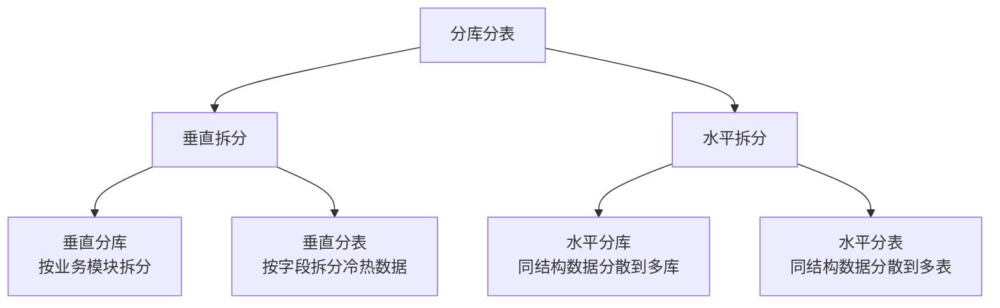
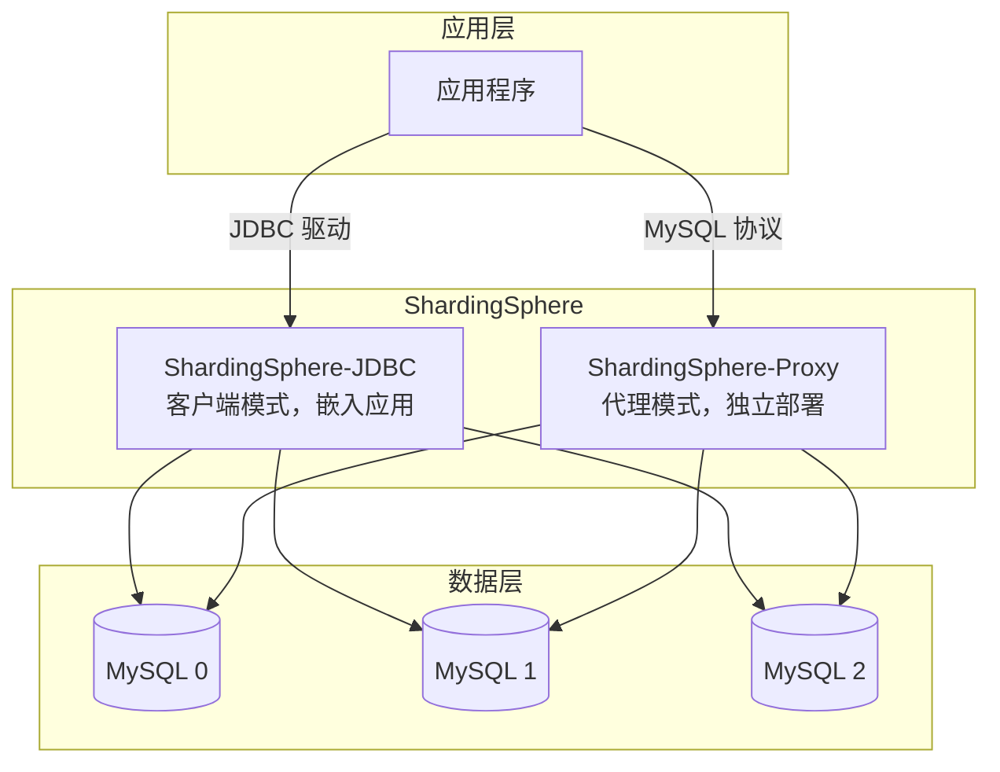
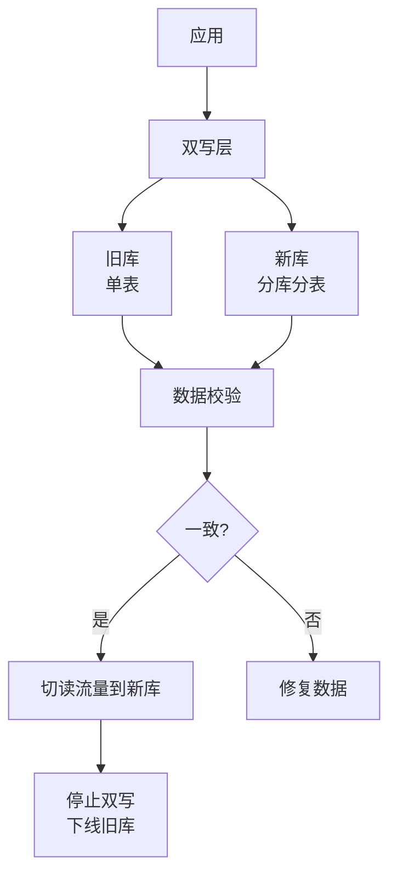

# 分库分表实战指南

> **文档说明**：系统讲解分库分表的完整实战体系，包括分库分表的触发时机、分片策略（垂直/水平、Range/Hash/一致性Hash）、分片键选择、中间件对比（ShardingSphere/MyCat/Vitess）、ShardingSphere 配置实战、跨分片查询优化（广播表/绑定表）、分布式主键（雪花算法）、分布式事务、数据迁移方案（双写/灰度），以及生产级最佳实践和常见问题排查。
>
> **适用人群**：Java 后端开发工程师、全栈开发者、数据库架构师、需要处理海量数据的工程师
>
> **前置知识**：[[数据库优化知识点系统梳理_优化版]]、[[MySQL-事务与锁机制]]、[[分布式ID生成方案]]

---

## 一、概述

### 1. 为什么需要分库分表

随着业务增长，单库单表面临以下瓶颈：

| 瓶颈 | 说明 | 阈值参考 |
|------|------|---------|
| **数据量过大** | 单表数据量过大，查询性能下降 | 单表 > 1000 万行（InnoDB） |
| **并发过高** | 单库连接数有限，高并发下响应慢 | 单库 QPS > 5000 |
| **磁盘空间** | 单库磁盘空间不足 | 单库 > 500GB |
| **IO 瓶颈** | 单库磁盘 IO 打满 | IO 利用率 > 80% |
| **锁竞争** | 热点数据行锁/表锁竞争严重 | 锁等待时间 > 100ms |

### 2. 什么时候需要分库分表

| 阶段 | 数据量 | 方案 |
|------|--------|------|
| **初期** | < 100 万 | 单库单表，索引优化 |
| **增长期** | 100 万 - 1000 万 | 读写分离、缓存、索引优化 |
| **瓶颈期** | 1000 万 - 5000 万 | 分表（水平分表） |
| **海量期** | > 5000 万 / QPS > 5000 | 分库分表 |

> **注意**：分库分表是最后手段，优先考虑索引优化、读写分离、缓存、冷热数据分离等方案。

### 3. 分库分表分类



| 类型 | 说明 | 示例 |
|------|------|------|
| **垂直分库** | 按业务模块拆分到不同数据库 | 用户库、订单库、商品库 |
| **垂直分表** | 按字段冷热拆分到不同表 | user 基础信息表 + user_info 扩展信息表 |
| **水平分库** | 同结构数据按分片键分散到多库 | order_db_0、order_db_1 |
| **水平分表** | 同结构数据按分片键分散到多表 | order_0、order_1、...、order_15 |

---

## 二、分片策略

### 1. 水平分片策略

| 策略 | 说明 | 优点 | 缺点 | 适用场景 |
|------|------|------|------|---------|
| **Range（范围）** | 按分片键范围分片，如 ID 1-1000万→表0 | 范围查询高效、扩容简单 | 数据不均匀（热点问题） | 按时间、ID 范围分片 |
| **Hash（哈希）** | 按分片键取模，如 user_id % 16 | 数据均匀分布 | 扩容需数据迁移、范围查询需扫描多表 | 用户ID、订单ID 等均匀字段 |
| **一致性Hash** | 一致性哈希环，虚拟节点 | 扩容只迁移部分数据 | 实现复杂、数据可能不均匀 | 动态扩缩容场景 |
| **时间分片** | 按时间分片，如按月/按年 | 历史数据归档方便、冷热分离 | 时间热点（当前表压力大） | 日志、流水、历史数据 |
| **枚举分片** | 按枚举值分片，如地区、类型 | 业务明确、查询高效 | 分片数固定、不均匀 | 地区、业务类型等枚举字段 |
| **复合分片** | 多个分片键组合 | 更灵活 | 实现复杂 | 复杂业务场景 |

### 2. Range 分片示例

```css
按用户 ID 范围分表：
user_0: id 1 - 10000000
user_1: id 10000001 - 20000000
user_2: id 20000001 - 30000000
...

按时间范围分表：
order_202601: 2026年1月
order_202602: 2026年2月
order_202603: 2026年3月
```

### 3. Hash 分片示例

```css
按用户 ID 取模分 16 张表：
table_index = user_id % 16

user_id = 1  → user_1
user_id = 16 → user_0
user_id = 17 → user_1
...
```

### 4. 一致性 Hash

```text
一致性哈希环（0 - 2^32）：
  节点A ──── 节点B ──── 节点C ──── 节点D
     │         │         │         │
  数据1,5   数据2,6   数据3,7   数据4,8

新增节点E（在B和C之间）：
  只需迁移 B→E 之间的数据，其他数据不受影响
```

### 5. 分片键选择原则

- [ ] **均匀分布**：分片键的值应均匀分布，避免热点
- [ ] **查询维度**：分片键应是最常用的查询条件
- [ ] **不可变**：分片键的值不应变更
- [ ] **关联性**：有关联的表使用相同的分片键（如订单和订单项都用 user_id）
- [ ] **数据类型**：整数类型（Long/Integer）比字符串哈希效率高

**常见分片键**：
| 业务 | 分片键 | 原因 |
|------|--------|------|
| 用户系统 | user_id | 查询通常按用户ID |
| 订单系统 | user_id 或 order_id | 按用户查询订单多 |
| 商品系统 | product_id 或 category_id | 按商品/分类查询 |
| 日志系统 | 时间 | 按时间范围查询和归档 |
| 消息系统 | receiver_id | 按接收者查询 |

---

## 三、中间件对比

| 中间件 | 类型 | 语言 | 特点 | 推荐度 |
|--------|------|------|------|--------|
| **ShardingSphere** | Client/Proxy | Java | 功能最全、社区活跃、Apache 顶级项目 | ⭐⭐⭐⭐⭐ |
| **MyCat** | Proxy | Java | 老牌中间件、社区不活跃 | ⭐⭐⭐ |
| **Vitess** | Proxy | Go | YouTube 开源、云原生、K8s 友好 | ⭐⭐⭐⭐ |
| **Cobar** | Proxy | Java | 阿里开源、已停止维护 | ⭐⭐ |
| **TDDL** | Client | Java | 阿里内部、未开源 | - |

### ShardingSphere 架构



| 模式 | 说明 | 优点 | 缺点 |
|------|------|------|------|
| **JDBC 客户端** | 嵌入应用，作为 JDBC 驱动 | 无额外部署、性能好、支持多语言少 | 与应用耦合、升级需重启应用 |
| **Proxy 代理** | 独立部署，模拟 MySQL 服务 | 对应用透明、支持多语言、集中管理 | 额外网络开销、需高可用部署 |

---

## 四、ShardingSphere 实战

### 1. Maven 依赖

```xml
<!-- ShardingSphere-JDBC -->
<dependency>
    <groupId>org.apache.shardingsphere</groupId>
    <artifactId>shardingsphere-jdbc-core</artifactId>
    <version>5.4.1</version>
</dependency>

<!-- Spring Boot Starter -->
<dependency>
    <groupId>org.apache.shardingsphere</groupId>
    <artifactId>shardingsphere-jdbc-core-spring-boot-starter</artifactId>
    <version>5.4.1</version>
</dependency>
```

### 2. 水平分表配置

```yaml
# application.yml
spring:
  shardingsphere:
    datasource:
      names: ds0
      ds0:
        type: com.zaxxer.hikari.HikariDataSource
        driver-class-name: com.mysql.cj.jdbc.Driver
        jdbc-url: jdbc:mysql://localhost:3306/order_db?useUnicode=true&characterEncoding=utf8
        username: root
        password: root

    rules:
      sharding:
        tables:
          # 订单表：按 order_id 取模分 16 张表
          t_order:
            actual-data-nodes: ds0.t_order_$->{0..15}
            table-strategy:
              standard:
                sharding-column: order_id
                sharding-algorithm-name: order-inline
            key-generate-strategy:
              column: order_id
              key-generator-name: snowflake

        sharding-algorithms:
          order-inline:
            type: INLINE
            props:
              algorithm-expression: t_order_$->{order_id % 16}

        key-generators:
          snowflake:
            type: SNOWFLAKE
            props:
              worker-id: 1

    props:
      sql-show: true  # 显示 SQL 日志
```

### 3. 分库分表配置

```yaml
spring:
  shardingsphere:
    datasource:
      names: ds0,ds1
      ds0:
        type: com.zaxxer.hikari.HikariDataSource
        jdbc-url: jdbc:mysql://db0:3306/order_db
        username: root
        password: root
      ds1:
        type: com.zaxxer.hikari.HikariDataSource
        jdbc-url: jdbc:mysql://db1:3306/order_db
        username: root
        password: root

    rules:
      sharding:
        tables:
          t_order:
            # 2库 * 8表 = 16张表
            actual-data-nodes: ds$->{0..1}.t_order_$->{0..7}
            database-strategy:
              standard:
                sharding-column: user_id
                sharding-algorithm-name: database-inline
            table-strategy:
              standard:
                sharding-column: order_id
                sharding-algorithm-name: table-inline
            key-generate-strategy:
              column: order_id
              key-generator-name: snowflake

        sharding-algorithms:
          database-inline:
            type: INLINE
            props:
              algorithm-expression: ds$->{user_id % 2}
          table-inline:
            type: INLINE
            props:
              algorithm-expression: t_order_$->{order_id % 8}

        key-generators:
          snowflake:
            type: SNOWFLAKE
            props:
              worker-id: 1
```

### 4. 自定义分片算法

```java
// 自定义标准分片算法
public class OrderTimeShardingAlgorithm implements StandardShardingAlgorithm<LocalDateTime> {

    @Override
    public String doSharding(Collection<String> availableTargetNames,
                             PreciseShardingValue<LocalDateTime> shardingValue) {
        // 按月份分表：t_order_202608
        LocalDateTime date = shardingValue.getValue();
        String tableName = "t_order_" + date.format(DateTimeFormatter.ofPattern("yyyyMM"));
        if (availableTargetNames.contains(tableName)) {
            return tableName;
        }
        throw new IllegalArgumentException("表不存在: " + tableName);
    }

    @Override
    public Collection<String> doSharding(Collection<String> availableTargetNames,
                                         RangeShardingValue<LocalDateTime> shardingValue) {
        // 范围查询：返回范围内的所有表
        // ...
    }

    @Override
    public void init(Properties props) {
        // 初始化
    }

    @Override
    public String getType() {
        return "ORDER_TIME";
    }
}
```

---

## 五、跨分片查询优化

### 1. 广播表

广播表在所有库中都存在相同的数据，适用于数据量小、变更少、需要与大表关联查询的表（如字典表、配置表）。

```yaml
rules:
  sharding:
    broadcast-tables:
      - t_dict
      - t_config
      - t_region
```

### 2. 绑定表

绑定表使用相同的分片键和分片算法，关联查询时不会产生笛卡尔积。

```yaml
rules:
  sharding:
    tables:
      t_order:
        actual-data-nodes: ds$->{0..1}.t_order_$->{0..7}
        database-strategy: { standard: { sharding-column: user_id, sharding-algorithm-name: db-inline } }
        table-strategy: { standard: { sharding-column: order_id, sharding-algorithm-name: tbl-inline } }
      t_order_item:
        actual-data-nodes: ds$->{0..1}.t_order_item_$->{0..7}
        database-strategy: { standard: { sharding-column: user_id, sharding-algorithm-name: db-inline } }
        table-strategy: { standard: { sharding-column: order_id, sharding-algorithm-name: tbl-inline } }
    binding-tables:
      - t_order,t_order_item  # 绑定表，关联查询优化
```

### 3. 跨分片查询注意事项

| 问题 | 说明 | 解决方案 |
|------|------|---------|
| **分页查询** | LIMIT 需在各分片执行后归并排序 | 业务上避免深分页，使用游标分页 |
| **排序查询** | ORDER BY 需各分片排序后归并 | 尽量按分片键排序，减少归并开销 |
| **聚合查询** | COUNT/SUM/AVG 需各分片计算后合并 | 异步统计、预计算、搜索引擎 |
| **JOIN 查询** | 非绑定表 JOIN 会产生笛卡尔积 | 使用绑定表、广播表、或应用层组装 |
| **分布式事务** | 跨库事务一致性问题 | 柔性事务（Seata AT/TCC）、最终一致 |

---

## 六、分布式主键

### 1. 雪花算法（Snowflake）

```text
64位 Long 类型 ID：
0 ─ 0000000000 0000000000 0000000000 0000000000 0 ─ 00000 ─ 00000 ─ 000000000000
│   └───────────── 41位时间戳 ─────────────┘   └ 5位 ┘ └ 5位 ┘ └── 12位序列号 ──┘
│                    (毫秒级，可用69年)         机器ID  数据中心   (每毫秒4096个ID)
└─ 符号位（固定0）
```

**优点**：
- 趋势递增，索引性能好
- 不依赖数据库，高性能
- 包含时间戳，可反解生成时间

**缺点**：
- 依赖机器时钟，时钟回拨会导致重复 ID
- 机器 ID 需手动分配

### 2. ShardingSphere 分布式主键

```yaml
rules:
  sharding:
    key-generators:
      snowflake:
        type: SNOWFLAKE
        props:
          worker-id: 1          # 工作节点 ID
          max-tolerate-time-difference-milliseconds: 10  # 时钟回拨最大容忍
      uuid:
        type: UUID
      leaf:
        type: LEAF
        props:
          server-list: http://leaf-server:8080
```

### 3. 其他方案

| 方案 | 说明 | 优点 | 缺点 |
|------|------|------|------|
| **UUID** | 128位随机字符串 | 简单、无中心 | 无序、索引性能差、占用空间大 |
| **数据库自增** | 单独的自增ID表 | 简单、有序 | 单点瓶颈、性能差 |
| **号段模式** | 一次获取一批ID，本地分配 | 高性能、有序 | 依赖号段服务 |
| **Leaf** | 美团开源，支持号段+雪花 | 功能全、高可用 | 需额外部署 |

---

## 七、分布式事务

分库分表后，跨库事务需要分布式事务方案：

| 方案 | 一致性 | 性能 | 侵入性 | 适用场景 |
|------|--------|------|--------|---------|
| **2PC/XA** | 强一致 | 低 | 低 | 短事务、强一致要求 |
| **TCC** | 最终一致 | 高 | 高 | 资金类、高性能 |
| **Saga** | 最终一致 | 中 | 中 | 长事务、多步骤 |
| **本地消息表** | 最终一致 | 高 | 中 | 异步场景 |
| **事务消息** | 最终一致 | 高 | 中 | MQ 场景 |

详见 [[Seata-分布式事务]] 和 [[分布式事务 知识点系统梳理_优化版]]。

---

## 八、数据迁移方案

### 1. 双写迁移法



**步骤**：
1. **历史数据迁移**：使用工具（如 DataX）将旧库数据全量迁移到新库
2. **双写**：应用同时写旧库和新库，以旧库为准
3. **增量同步**：监听 binlog，将旧库变更同步到新库
4. **数据校验**：对比新旧库数据，确保一致
5. **切读**：将读流量逐步切换到新库（灰度）
6. **切写**：将写流量切换到新库
7. **下线旧库**：停止双写，下线旧库

### 2. 工具推荐

| 工具 | 说明 |
|------|------|
| **DataX** | 阿里开源数据同步工具，支持多种数据源 |
| **Canal** | 阿里开源 MySQL binlog 增量订阅&消费组件 |
| **Debezium** | 开源 CDC 工具，支持多种数据库 |
| **ShardingSphere-Scaling** | ShardingSphere 官方数据迁移工具 |
| **pt-online-schema-change** | Percona 工具，在线 DDL 变更 |

---

## 九、生产最佳实践

### 1. 分片数量规划

- [ ] **提前规划**：根据业务增长预估，一次分够，避免频繁扩容
- [ ] **2的幂次**：分表数建议 2 的幂次（4/8/16/32/64），方便扩容
- [ ] **预留空间**：单表控制在 500-1000 万行以内
- [ ] **分库数**：根据并发量，单库 QPS 控制在 3000-5000

### 2. 索引设计

- [ ] **分片键必建索引**：分片键必须有索引
- [ ] **联合索引**：常用查询条件建立联合索引
- [ ] **避免跨分片排序**：ORDER BY 字段尽量包含分片键
- [ ] **唯一索引**：全局唯一需使用分布式 ID，不能依赖数据库唯一索引

### 3. SQL 规范

- [ ] **必须带分片键**：查询尽量带分片键，避免全分片扫描
- [ ] **避免 SELECT ***：只查询需要的字段
- [ ] **避免深分页**：使用游标分页或子查询优化
- [ ] **避免大事务**：跨库事务尽量短，或使用最终一致
- [ ] **批量操作**：批量插入/更新时注意分片路由

### 4. 运维监控

- [ ] **慢查询监控**：监控跨分片慢查询
- [ ] **数据分布监控**：监控各分片数据量是否均匀
- [ ] **连接池监控**：监控各库连接池使用情况
- [ ] **主从延迟**：监控读写分离的主从延迟
- [ ] **磁盘空间**：监控各库磁盘使用率

---

## 十、常见问题与排查

| 问题 | 原因 | 解决方案 |
|------|------|---------|
| **跨分片查询慢** | 未带分片键，全分片扫描 | 查询必须带分片键，或使用搜索引擎 |
| **数据不均匀** | 分片键选择不当 / Hash 不均匀 | 更换分片键、使用一致性 Hash、监控数据分布 |
| **分布式ID重复** | 雪花算法时钟回拨 / worker-id 冲突 | 使用时钟回拨保护、统一分配 worker-id |
| **跨库事务失败** | 未使用分布式事务 / 事务超时 | 使用 Seata AT/TCC、合理设置超时 |
| **扩容数据迁移难** | Hash 取模扩容需全量迁移 | 使用一致性 Hash、提前规划分片数、使用 Scaling 工具 |
| **JOIN 查询报错** | 非绑定表跨库 JOIN | 使用绑定表、广播表、应用层组装 |
| **分页结果不准** | 跨分片 LIMIT 归并问题 | 避免深分页、使用游标分页、业务优化 |
| **唯一约束失效** | 分库分表后数据库唯一索引只在单表有效 | 使用分布式 ID、应用层校验、唯一索引表 |
| **广播表不一致** | 广播表更新不同步 | 使用分布式事务、定期校验、配置中心管理 |
| **连接数过多** | 分库多导致连接池总数过大 | 合理设置连接池大小、使用 Proxy 模式 |
| **DDL 变更困难** | 多库多表 DDL 耗时长 | 使用在线 DDL 工具、灰度变更、停机窗口 |
| **数据迁移不一致** | 双写延迟 / 迁移工具 bug | 增量同步 + 全量校验、多次校验、灰度切流 |
| **SQL 路由错误** | 分片算法配置错误 / 分片键类型不匹配 | 检查分片算法、分片键类型、开启 sql-show 调试 |
| **性能不升反降** | 分片过多 / 跨分片操作多 / 网络开销 | 合理规划分片数、优化 SQL、减少跨分片操作 |

---

## 十一、关联笔记

### 数据库
- [[数据库优化知识点系统梳理_优化版]] · [[MySQL-事务与锁机制]] · [[MySQL-索引原理与优化]]
- [[Redis缓存设计与优化]] · [[Redis高级数据结构实战]] · [[MongoDB-文档数据库入门]]
- [[Elasticsearch-全文检索引擎]]

### 分布式
- [[分布式ID生成方案]] · [[分布式事务 知识点系统梳理_优化版]] · [[分布式锁知识点系统梳理_优化版]]
- [[Seata-分布式事务]] · [[Raft共识算法详解]] · [[ZooKeeper核心原理与实战]]

### 后端
- [[高并发系统设计案例]] · [[高可用架构设计]] · [[秒杀系统设计与实现]]
- [[SpringBoot-自动装配原理]] · [[MyBatis-核心原理与插件]]

### 微服务
- [[SpringCloud-Alibaba组件体系]] · [[Nacos-注册中心与配置中心]] · [[Sentinel-流量控制与熔断]]
- [[微服务核心组件知识点系统梳理_优化版]]

### 导航
- [[MOC-数据库与缓存]] · [[MOC-后端开发]] · [[全栈+AI工程双轨融合学习路线图]]

> **学习路径建议**：先掌握 [[数据库优化知识点系统梳理_优化版]] 数据库优化基础 → 学习 [[MySQL-事务与锁机制]] MySQL 深入 → 深入本文分库分表实战 → 实践 [[分布式ID生成方案]] 分布式主键 → 研究 [[Seata-分布式事务]] 分布式事务 → 应用于 [[高并发系统设计案例]] 海量数据架构。
