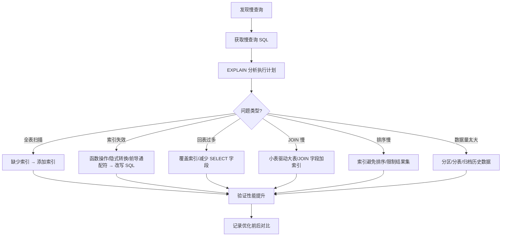

# 🗄️ 数据库设计模板与排查手册（优化版）

> 本手册补齐「维度二：数据库模板」与「维度三：数据库排查」两块缺口——提供 Schema 设计、迁移脚本、慢查询巡检等可复用模板，以及死锁、Redis 雪崩/击穿/穿透、连接池耗尽等「报错→根因→修复」实战手册。
> **格式标准**：模板/场景 → 代码或步骤 → 要点（💡 + 📝 + 🔍）→ 全文总结。

---

## 目录

1. Schema 设计规范与模板
2. 迁移(Migration)脚本模板
3. 慢查询巡检清单
4. MySQL 死锁定位与修复
5. Redis 缓存雪崩 / 击穿 / 穿透
6. 连接池耗尽排查

---

## 一、Schema 设计规范与模板

### 1.1 模板（订单表）
```sql
CREATE TABLE `orders` (
  `id`          BIGINT UNSIGNED NOT NULL AUTO_INCREMENT,
  `order_no`    VARCHAR(32)  NOT NULL COMMENT '业务订单号',
  `user_id`     BIGINT UNSIGNED NOT NULL,
  `status`      TINYINT      NOT NULL DEFAULT 0 COMMENT '0待付 1已付',
  `amount`      DECIMAL(12,2) NOT NULL DEFAULT 0.00,
  `created_at`  DATETIME     NOT NULL DEFAULT CURRENT_TIMESTAMP,
  PRIMARY KEY (`id`),
  UNIQUE KEY `uk_order_no` (`order_no`),
  KEY `idx_user_status` (`user_id`, `status`)
) ENGINE=InnoDB DEFAULT CHARSET=utf8mb4 COMMENT='订单表';
```

### 1.2 设计规范
| 项 | 规范 | 理由 |
|----|------|------|
| 主键 | 自增 BIGINT | 聚簇索引顺序写 |
| 字符集 | utf8mb4 | 支持 emoji/生僻字 |
| 金额 | DECIMAL | 避免浮点误差 |
| 时间 | DATETIME + 默认 | 审计可追溯 |
| 索引 | 联合索引最左前缀 | 减少冗余 |

💡 **深度讲解**：联合索引 `(user_id, status)` 能覆盖「按用户查状态」又能用于「仅 user_id」，但**不能**用于「仅 status」——最左前缀决定。
📝 **精简总结**：主键自增、金额 DECIMAL、字符集 utf8mb4、索引按查询走最左前缀；禁用 `SELECT *`。
🔍 **知识点深度解析**：作用=可维护 + 高性能；原理=InnoDB 聚簇/二级索引；要点=索引选择性低则失效。

---

## 二、迁移(Migration)脚本模板

```text
### 2.1 模板（Flask-Migrate/Alembic 风格）
```
```sql
-- @before: 2026-08-25T00:00
-- @desc: 订单表增加 refund 字段
ALTER TABLE `orders`
  ADD COLUMN `refund_amount` DECIMAL(12,2) NOT NULL DEFAULT 0.00 COMMENT '退款金额' AFTER `amount`;
-- 大表加字段：MySQL 8.0 INSTANT 算法秒级
ALTER TABLE `orders` ADD COLUMN `remark` VARCHAR(255), ALGORITHM=INSTANT;
```

### 2.2 要点
💡 **深度讲解**：大表 DDL 在 5.6/5.7 会锁表；MySQL 8.0 的 `ALGORITHM=INSTANT` 可秒级加列，否则需用 pt-osc 在线变更。
📝 **精简总结**：迁移带版本注释与回滚脚本；大表用 INSTANT 或 gh-ost/pt-osc；先在从库演练。
🔍 **知识点深度解析**：作用=安全演进结构；原理= Online DDL；要点=永远准备 down 脚本。

---

## 三、慢查询巡检清单

### 3.1 步骤
```sql
-- 1) 开慢日志
SET long_query_time = 1;       -- 超 1s 记录
-- 2) 抓当前慢 SQL
SELECT * FROM mysql.slow_log ORDER BY start_time DESC LIMIT 10;
-- 3) 看执行计划
EXPLAIN FORMAT=JSON SELECT * FROM orders WHERE user_id=123 AND status=1;
-- 4) 关注 type 列：ALL(全表) > index > range > ref > const
```

| 信号 | 含义 | 处理 |
|------|------|------|
| `type=ALL` | 全表扫描 | 加索引 |
| `rows` 巨大 | 扫描行多 | 优化 WHERE/索引 |
| `Using filesort` | 文件排序 | 索引覆盖排序 |
| `Using temporary` | 用临时表 | 避免 GROUP BY 大字段 |

💡 **深度讲解**：`EXPLAIN` 的 `rows` 是「估算扫描行数」，与实际返回行差距大说明索引选错或统计信息过期，需 `ANALYZE TABLE`。
📝 **精简总结**：慢日志定位 + EXPLAIN 看 type/rows/Extra；目标 `type≥range`；覆盖索引避免回表。
🔍 **知识点深度解析**：作用=性能根因；原理=优化器成本模型；要点=定期 `ANALYZE` 更新统计。

---

## 四、MySQL 死锁定位与修复

### 4.1 现象与排查
```sql
-- 报错: ERROR 1213 (40001): Deadlock found, try restarting transaction
-- 查最近死锁
SHOW ENGINE INNODB STATUS\G      -- 看 LATEST DETECTED DEADLOCK
-- 事务等待图
SELECT * FROM information_schema.INNODB_TRX;
```

### 4.2 根因与修复
| 根因 | 修复 |
|------|------|
| 加锁顺序不一致 | 统一事务内加锁顺序 |
| 大事务持锁久 | 拆小事务、缩短持锁 |
| 间隙锁冲突 | 降低隔离级到 RC（业务允许） |

💡 **深度讲解**：死锁是「两个事务互相等待对方持有的锁」。InnoDB 选代价小的事务回滚。根治靠「统一资源加锁顺序」。
📝 **精简总结**：应用层捕获 1213 重试；统一加锁顺序；事务尽量短；监控 `innodb_row_lock_waits`。
🔍 **知识点深度解析**：作用=消除互锁；原理=两阶段锁 + 等待图；要点=重试 + 顺序一致。

---

## 五、Redis 缓存雪崩 / 击穿 / 穿透

### 5.1 三件套对照
| 问题 | 现象 | 根因 | 解法 |
|------|------|------|------|
| 雪崩 | 大量 key 同时失效 | 集中过期 | 过期时间加随机抖动 |
| 击穿 | 单热点 key 失效 | 高并发打 DB | 互斥锁/逻辑过期重建 |
| 穿透 | 查不存在的数据 | 恶意/脏 key | 布隆过滤器 + 空值缓存 |

### 5.2 代码模板（防击穿互斥重建）
```python
import redis, threading
r = redis.Redis()
def get_user(uid):
    val = r.get(f"u:{uid}")
    if val is not None: return val
    # 用 setnx 抢锁，只放一个线程回源
    if r.set(f"lock:u:{uid}", "1", nx=True, ex=3):
        try:
            data = db_query(uid)            # 回源
            r.set(f"u:{uid}", data, ex=300)  # 基础 300s + 随机防雪崩
        finally:
            r.delete(f"lock:u:{uid}")
    else:
        time.sleep(0.05); return get_user(uid)   # 其他线程稍后重试
    return data
```

💡 **深度讲解**：雪崩=批量失效压垮 DB；击穿=单热点失效瞬压 DB；穿透=查无此物反复打 DB。三者解法不同，布隆过滤器专治穿透。
📝 **精简总结**：过期加随机防雪崩；互斥锁/逻辑过期防击穿；布隆过滤器 + 空值缓存防穿透；热点 key 永不过期 + 异步刷新。
🔍 **知识点深度解析**：作用=保护 DB；原理=缓存与 DB 一致性边界；要点=cache-aside 模式 + 锁。

---

## 六、连接池耗尽排查

### 6.1 现象与排查
```sql
-- MySQL 侧看连接
SHOW PROCESSLIST;                  -- 看大量 Sleep/Query
SHOW STATUS LIKE 'Threads_connected';
SHOW VARIABLES LIKE 'max_connections';
```

### 6.2 根因与修复
| 根因 | 修复 |
|------|------|
| 连接未归还(漏 close) | try-with-resources / 上下文管理器 |
| 慢查询占连接 | 优化 SQL 降占用时长 |
| 池过小 | 调大 max_connections + 应用池 |

💡 **深度讲解**：连接池耗尽常是「借了不还会」——事务/查询异常路径漏关连接。用 `with`/try-with-resources 确保归还。
📝 **精简总结**：监控 `Threads_connected` 接近上限即告急；保证连接必还；慢 SQL 是隐形占用；合理设池大小。
🔍 **知识点深度解析**：作用=防服务不可用；原理=池上限 + 借还模型；要点=超时 + 归还 + 监控。

---

## 📎 原子笔记纵向下钻

> 以下为 `10-四级知识框架` 中对应的数据库 / 缓存原子笔记，按本篇章节骨架归类。

### 一、Schema 设计规范与模板
- [[关系型数据库索引原理|关系型数据库索引原理]]
- [[事务隔离级别与MVCC|事务隔离级别与 MVCC]]
- [[数据库分库分表策略|数据库分库分表策略]]
- [[数据库执行计划分析|数据库执行计划分析]]
- [[NoSQL数据模型对比|NoSQL 数据模型对比]]
- [[哈希表与一致性哈希|哈希表与一致性哈希]]

### 二、迁移(Migration)脚本模板
- [[Alembic-数据库迁移|Alembic 数据库迁移]]
- [[SpringDataJPA与MyBatis对比|SpringData JPA 与 MyBatis 对比]]

### 三、慢查询巡检清单
- [[数据库执行计划分析|数据库执行计划分析]]
- [[SonarQube-代码质量门禁|SonarQube 代码质量门禁]]

### 四、MySQL 死锁定位与修复
- [[事务隔离级别与MVCC|事务隔离级别与 MVCC]]
- [[锁机制与并发原语|锁机制与并发原语]]

### 五、Redis 缓存雪崩 / 击穿 / 穿透
- [[Redis-分布式锁与缓存穿透|Redis 分布式锁与缓存穿透]]
- [[Redis-Python客户端与缓存策略|Redis Python 客户端与缓存策略]]

### 六、连接池耗尽排查
- [[SQLAlchemy-ORM核心原理|SQLAlchemy ORM 核心原理]]
- [[PostgreSQL-Python高级用法|PostgreSQL Python 高级用法]]
- [[MongoDB-异步驱动Motor|MongoDB 异步驱动 Motor]]
- [[Java-向量数据库客户端|Java 向量数据库客户端]]

### 🗂 相关 MOC
- [[MOC-CS基础-四级展开|CS 基础 MOC]]
- [[CS-基础原理枢纽|CS 基础原理枢纽]]

## 全文精简总结

数据库「设计」决定上限，「排查」决定可用性：模板让新表一次写对，手册让事故分钟级定位。本手册补齐全库最薄弱的「数据库排查」维度，建议与 `03-数据库知识点完整整合大全` 互补阅读——大全讲原理，本手册讲落地与救火。

[[知识库学习适配性评估与优化报告|← 六维度评估报告]] | [[MOC-数据库与缓存|🗂 数据库 MOC]] | [[Home|🏠 返回首页]]


## 补充：概述

数据库设计是软件系统的根基，直接影响系统的性能、可维护性和可扩展性。一份好的数据库设计模板能帮助团队统一设计规范、减少低级错误、提升评审效率；而排查手册则能在出现性能问题、数据异常时提供系统化的排查思路和解决方案。本文档将设计模板与排查手册结合，覆盖从需求分析、概念设计、逻辑设计、物理设计到性能优化、问题排查的完整流程。

| 设计阶段 | 核心产出 | 关键检查点 |
|---------|---------|-----------|
| **需求分析** | 数据需求清单、性能需求 | 数据量估算、QPS 估算、读写比例 |
| **概念设计** | ER 图、实体关系 | 实体识别、属性定义、关系基数 |
| **逻辑设计** | 关系模式、字段定义 | 范式化、主键外键、约束定义 |
| **物理设计** | DDL、索引、分区 | 索引设计、字段类型、存储引擎、分区策略 |
| **实施验证** | 数据库实例、测试报告 | 性能测试、数据一致性验证 |

**设计原则**：
1. **需求驱动**：根据业务需求和查询模式设计，而非凭空设计
2. **适度范式**：OLTP 用 3NF，OLAP 适当反范式，不要过度设计
3. **性能优先**：设计时考虑查询性能，索引和分区提前规划
4. **可扩展性**：预留扩展空间，避免大表 JOIN，考虑分库分表
5. **数据安全**：敏感字段加密，权限最小化，审计可追溯
6. **命名规范**：表名/字段名统一规范（小写+下划线，见名知意）

---

## 补充：进阶与最佳实践

### 1. 数据库设计评审检查清单

#### 表设计
- [ ] 表名是否规范（小写+下划线，复数形式，如 `user_orders`）
- [ ] 是否有明确的主键（推荐自增 ID 或业务主键，不推荐复合主键）
- [ ] 字段是否有注释（COMMENT）
- [ ] 是否有 `created_at` / `updated_at` 时间戳字段
- [ ] 是否有 `is_deleted` 逻辑删除字段（如需要）
- [ ] 字段类型是否合适（VARCHAR 长度合理，金额用 DECIMAL，时间用 DATETIME/TIMESTAMP）
- [ ] 是否避免了保留字作为字段名（如 `order`、`user`、`key`）
- [ ] 是否有过多的 NULL 字段（尽量用 NOT NULL + 默认值）
- [ ] 大字段（TEXT/BLOB）是否单独拆表

#### 索引设计
- [ ] 主键索引是否合理
- [ ] 高频查询字段是否有索引
- [ ] 复合索引是否遵循最左前缀原则
- [ ] ORDER BY / GROUP BY 字段是否在索引中
- [ ] 是否有冗余索引（可被其他索引覆盖）
- [ ] 索引数量是否合理（单表不超过 5-6 个）
- [ ] 低基数字段是否建了索引（性别/状态等低基数不适合单独建索引）
- [ ] 是否有唯一索引保证数据唯一性
- [ ] 索引是否考虑了覆盖索引（INCLUDE 字段）

#### 性能设计
- [ ] 是否预估了数据量和增长速度
- [ ] 大表是否考虑了分区（按时间/范围）
- [ ] 是否避免了深度分页（用游标分页）
- [ ] 读写比例是否考虑了读写分离
- [ ] 是否考虑了分库分表的时机和方案
- [ ] 热点数据是否有缓存方案
- [ ] 是否有慢查询监控和告警

#### 安全设计
- [ ] 敏感字段（密码、身份证、手机号）是否加密/脱敏
- [ ] 应用账号权限是否最小化
- [ ] 是否有审计日志
- [ ] 是否有备份和恢复方案
- [ ] 是否有 SQL 注入防护（参数化查询）

### 2. 慢查询排查流程



### 3. 常见数据库问题速查

| 现象 | 可能原因 | 排查命令/方法 |
|------|---------|--------------|
| CPU 100% | 慢查询、锁等待、连接数过多 | `SHOW PROCESSLIST`、`EXPLAIN`、查看慢查询日志 |
| 内存不足 | 连接数过多、排序/临时表大、Buffer Pool 小 | 调整 `sort_buffer_size`、增加内存、优化查询 |
| 磁盘 IO 高 | 全表扫描、索引缺失、刷盘频繁 | `iostat`、`EXPLAIN`、检查 innodb_flush_log_at_trx_commit |
| 连接数满 | 应用未释放连接、慢查询占用连接 | `SHOW PROCESSLIST`、检查连接池配置、`max_connections` |
| 主从延迟 | 大事务、DDL、从库性能差、网络慢 | `SHOW SLAVE STATUS`、检查 Seconds_Behind_Master |
| 死锁 | 事务加锁顺序不一致、大事务 | `SHOW ENGINE INNODB STATUS`、统一加锁顺序、减小事务 |
| 数据不一致 | 主从延迟、应用 Bug、并发更新 | 对比主从数据、检查应用逻辑、加乐观锁/唯一约束 |
| 表损坏 | 异常断电、磁盘故障 | `CHECK TABLE`、`REPAIR TABLE`、从备份恢复 |

### 4. 数据库性能基准测试

```bash
# sysbench 测试（MySQL 基准测试工具）
# 准备测试数据
sysbench oltp_read_write --mysql-host=localhost --mysql-user=root   --mysql-password=xxx --mysql-db=sbtest --tables=10 --table-size=1000000 prepare

# 运行读写混合测试
sysbench oltp_read_write --mysql-host=localhost --mysql-user=root   --mysql-password=xxx --mysql-db=sbtest --tables=10 --table-size=1000000   --threads=16 --time=60 run

# 清理
sysbench oltp_read_write --mysql-host=localhost --mysql-user=root   --mysql-password=xxx --mysql-db=sbtest cleanup

# 关键指标：QPS、TPS、延迟（p95/p99）、错误数
```
