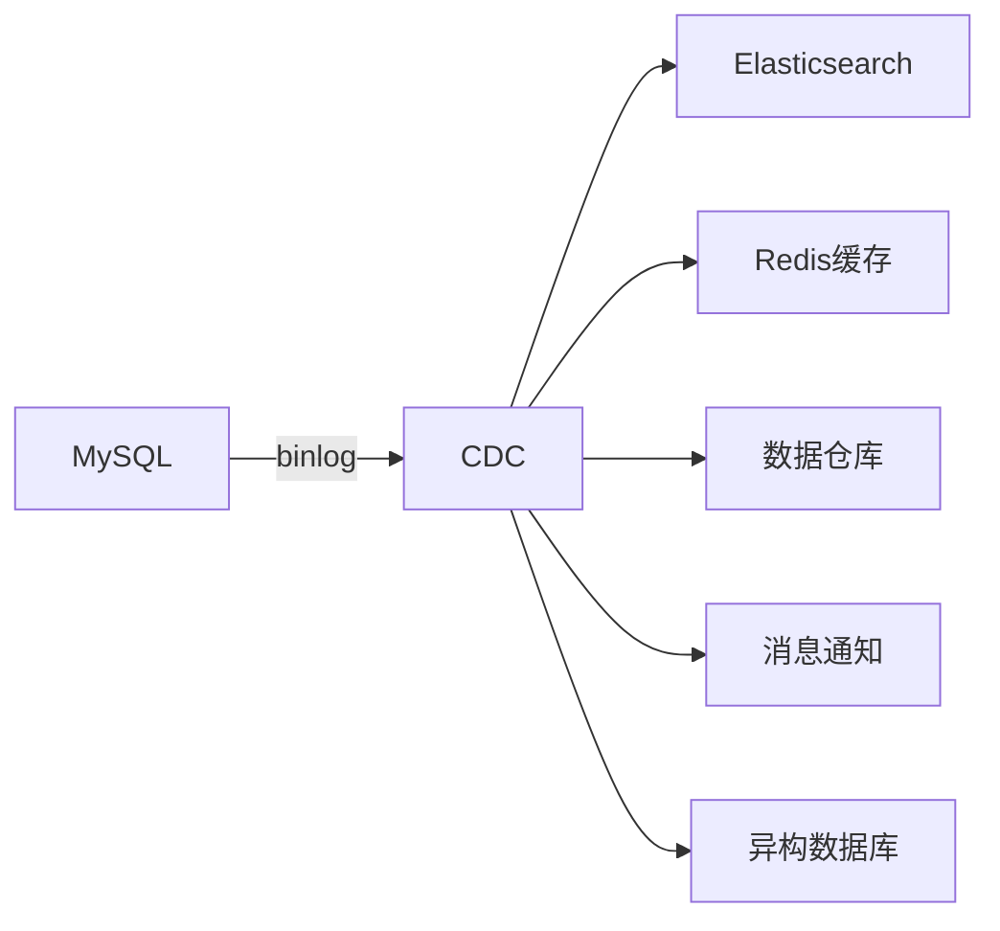
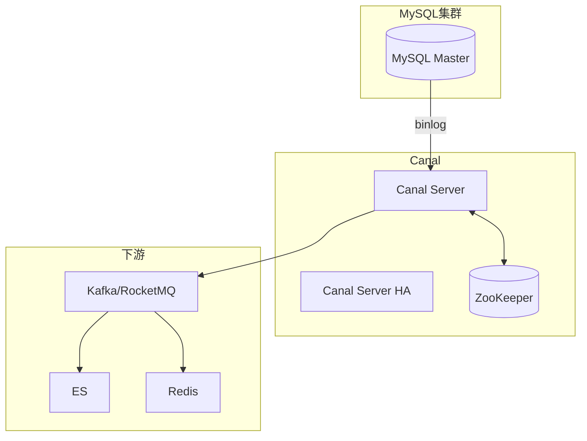

# CDC数据同步实战

> **文档说明**：CDC（Change Data Capture，变更数据捕获）通过监听数据库binlog实现实时数据同步，是构建数据管道、搜索同步、缓存更新的核心技术。本文档覆盖Canal和Debezium两大工具的架构、部署、配置、实战案例。
>
> **适用人群**：后端高级工程师、数据工程师、需要构建实时数据管道的开发者
>
> **前置知识**：MySQL binlog、消息队列、分布式系统

---

## 一、CDC概述

### 1.1 什么是CDC

CDC（Change Data Capture）是一种监控并捕获数据库数据变更的技术，能够实时获取INSERT/UPDATE/DELETE操作，并将变更事件传递给下游系统。

### 1.2 为什么需要CDC

| 传统方案问题 | CDC解决方案 |
|-------------|------------|
| 双写不一致（写DB+写ES） | 监听binlog，保证顺序和一致性 |
| 定时同步延迟高 | 实时捕获，秒级延迟 |
| 全量同步性能差 | 增量同步，只处理变更 |
| 业务侵入性强 | 无侵入，独立部署 |

### 1.3 应用场景



| 场景 | 说明 |
|------|------|
| 搜索同步 | MySQL→ES，实时更新搜索索引 |
| 缓存更新 | 数据变更时自动更新/失效缓存 |
| 数据仓库 | 业务数据实时同步到数仓 |
| 异构迁移 | MySQL→PostgreSQL/MongoDB |
| 事件驱动 | 数据变更触发业务事件 |
| 审计日志 | 记录所有数据变更历史 |

---

## 二、MySQL binlog基础

### 2.1 binlog格式

| 格式 | 说明 | 适用 |
|------|------|------|
| **STATEMENT** | 记录执行的SQL语句 | 简单，可能不一致 |
| **ROW**（推荐） | 记录每行数据的变更前后值 | 精确，数据量大 |
| **MIXED** | 混合模式，自动选择 | 一般 |

### 2.2 开启binlog

```ini
# my.cnf
[mysqld]
server-id = 1
log_bin = /var/log/mysql/mysql-bin.log
binlog_format = ROW          # 必须ROW格式
binlog_row_image = FULL      # 记录完整前后镜像
expire_logs_days = 7         # 保留7天
max_binlog_size = 1G
```

```sql
-- 查看binlog状态
SHOW VARIABLES LIKE 'log_bin';
SHOW VARIABLES LIKE 'binlog_format';
SHOW MASTER STATUS;  -- 当前binlog文件和位置

-- 创建同步用户
CREATE USER 'canal'@'%' IDENTIFIED BY 'canal_password';
GRANT SELECT, REPLICATION SLAVE, REPLICATION CLIENT ON *.* TO 'canal'@'%';
FLUSH PRIVILEGES;
```

---

## 三、Canal实战

### 3.1 架构



| 组件 | 说明 |
|------|------|
| **Canal Server** | 模拟MySQL从库，接收binlog，解析后投递 |
| **Canal Client** | 连接Canal Server，获取变更数据 |
| **ZooKeeper** | HA协调、位点管理 |
| **Instance** | 一个数据通道，对应一个MySQL实例 |

### 3.2 部署Canal

```bash
# 下载
wget https://github.com/alibaba/canal/releases/download/canal-1.1.7/canal.deployer-1.1.7.tar.gz
tar -xzf canal.deployer-1.1.7.tar.gz -C /opt/canal

# 配置instance
vim /opt/canal/conf/example/instance.properties
```

```properties
# instance.properties
canal.instance.master.address=mysql-host:3306
canal.instance.dbUsername=canal
canal.instance.dbPassword=canal_password
canal.instance.connectionCharset=UTF-8
canal.instance.filter.regex=.*\\..*  # 同步所有库表
# canal.instance.filter.regex=order_db\\..*,user_db\\.user  # 只同步指定表

# 投递到Kafka（可选）
canal.mq.topic=canal-topic
canal.mq.partition=0
```

```bash
# 启动
/opt/canal/bin/startup.sh

# 查看日志
tail -f /opt/canal/logs/example/example.log
```

### 3.3 Canal Client消费

```java
// Canal Client消费变更数据
public class CanalConsumer {
    public static void main(String[] args) {
        CanalConnector connector = CanalConnectors.newSingleConnector(
            new InetSocketAddress("canal-server", 11111),
            "example", "", "");

        connector.connect();
        connector.subscribe(".*\\..*");
        connector.rollback();

        while (true) {
            Message message = connector.getWithoutAck(100);  // 批量获取
            long batchId = message.getId();
            List<CanalEntry.Entry> entries = message.getEntries();

            if (batchId == -1 || entries.isEmpty()) {
                try { Thread.sleep(1000); } catch (InterruptedException e) {}
                continue;
            }

            for (CanalEntry.Entry entry : entries) {
                if (entry.getEntryType() == CanalEntry.EntryType.ROWDATA) {
                    CanalEntry.RowChange rowChange = CanalEntry.RowChange.parseFrom(entry.getStoreValue());
                    CanalEntry.EventType eventType = rowChange.getEventType();

                    for (CanalEntry.RowData rowData : rowChange.getRowDatasList()) {
                        if (eventType == CanalEntry.EventType.INSERT) {
                            handleInsert(rowData.getAfterColumnsList());
                        } else if (eventType == CanalEntry.EventType.UPDATE) {
                            handleUpdate(rowData.getBeforeColumnsList(), rowData.getAfterColumnsList());
                        } else if (eventType == CanalEntry.EventType.DELETE) {
                            handleDelete(rowData.getBeforeColumnsList());
                        }
                    }
                }
            }
            connector.ack(batchId);  // 确认
        }
    }
}
```

### 3.4 投递到Kafka

Canal 1.1.x支持直接投递到Kafka/RocketMQ，无需自己写Client：

```properties
# canal.properties
canal.serverMode = kafka  # tcp/kafka/rocketMQ
canal.mq.servers = kafka1:9092,kafka2:9092
canal.mq.producerGroup = canal-producer
```

---

## 四、Debezium实战

### 4.1 架构

- Debezium是基于Kafka Connect的CDC工具
- 支持MySQL/PostgreSQL/MongoDB/SQL Server/Oracle
- 变更事件自动写入Kafka Topic
- 配合Kafka Connect生态，可直接同步到ES/数据仓库

### 4.2 部署

```yaml
# docker-compose.yml
version: '3'
services:
  zookeeper:
    image: confluentinc/cp-zookeeper:7.4.0
  kafka:
    image: confluentinc/cp-kafka:7.4.0
    depends_on: [zookeeper]
  connect:
    image: debezium/connect:2.4
    ports: ["8083:8083"]
    environment:
      BOOTSTRAP_SERVERS: kafka:9092
      GROUP_ID: debezium-group
      CONFIG_STORAGE_TOPIC: debezium_configs
      OFFSET_STORAGE_TOPIC: debezium_offsets
```

### 4.3 创建Connector

```bash
# 注册MySQL Connector
curl -X POST http://localhost:8083/connectors -H "Content-Type: application/json" -d '{
  "name": "mysql-connector",
  "config": {
    "connector.class": "io.debezium.connector.mysql.MySqlConnector",
    "database.hostname": "mysql-host",
    "database.port": "3306",
    "database.user": "debezium",
    "database.password": "password",
    "database.server.id": "184054",
    "database.server.name": "mysql-server",
    "database.include.list": "order_db,user_db",
    "table.include.list": "order_db.orders,user_db.users",
    "database.history.kafka.bootstrap.servers": "kafka:9092",
    "database.history.kafka.topic": "schema-changes.mysql",
    "snapshot.mode": "initial"
  }
}'
```

### 4.4 消费变更事件

```java
// Kafka消费Debezium事件
Properties props = new Properties();
props.put("bootstrap.servers", "kafka:9092");
props.put("group.id", "es-sync-group");
props.put("key.deserializer", "org.apache.kafka.common.serialization.StringDeserializer");
props.put("value.deserializer", "org.apache.kafka.common.serialization.StringDeserializer");

KafkaConsumer<String, String> consumer = new KafkaConsumer<>(props);
consumer.subscribe(Collections.singletonList("mysql-server.order_db.orders"));

while (true) {
    ConsumerRecords<String, String> records = consumer.poll(Duration.ofMillis(100));
    for (ConsumerRecord<String, String> record : records) {
        JSONObject event = JSON.parseObject(record.value());
        String op = event.getJSONObject("payload").getString("op");  // c/u/d
        JSONObject after = event.getJSONObject("payload").getJSONObject("after");
        // 同步到ES/Redis
    }
}
```

---

## 五、Canal vs Debezium

| 维度 | Canal | Debezium |
|------|-------|-----------|
| 开发公司 | 阿里巴巴 | RedHat |
| 语言 | Java | Java |
| 支持数据库 | MySQL为主 | MySQL/PG/Mongo/SQLServer/Oracle |
| 部署 | 独立Server | Kafka Connect |
| 下游投递 | TCP/Kafka/RocketMQ | Kafka（标准） |
| 国内流行度 | 高 | 中 |
| 生态 | 国内生态好 | 国际/Kafka生态好 |
| 适用 | 国内项目、定制化 | 云原生、多数据库 |

---

## 六、实战：MySQL→ES实时同步


```java
// 消费程序核心逻辑
public class EsSyncConsumer {
    private final RestHighLevelClient esClient;

    public void handle(CanalEntry.EventType type, List<CanalEntry.Column> columns) {
        String id = getColumnValue(columns, "id");
        Map<String, Object> doc = columnsToMap(columns);

        switch (type) {
            case INSERT:
            case UPDATE:
                IndexRequest request = new IndexRequest("products")
                    .id(id).source(doc);
                esClient.index(request, RequestOptions.DEFAULT);
                break;
            case DELETE:
                DeleteRequest deleteRequest = new DeleteRequest("products", id);
                esClient.delete(deleteRequest, RequestOptions.DEFAULT);
                break;
        }
    }
}
```

---

## 七、最佳实践

1. **全量+增量**：首次全量同步（snapshot），后续增量同步
2. **幂等消费**：下游消费保证幂等，避免重复消费导致数据错误
3. **顺序保证**：同一行数据的变更必须按顺序处理（按主键分区）
4. **位点管理**：定期保存消费位点，重启后从位点继续
5. **监控告警**：监控同步延迟、消费堆积、错误率
6. **数据校验**：定期全量校验MySQL和ES数据一致性
7. **DDL处理**：表结构变更时需要同步更新ES Mapping
8. **限流保护**：全量同步时限流，避免影响线上数据库

---

## 关联文档

- [[MySQL 知识点系统梳理_优化版]] — MySQL基础
- [[Kafka深度实战]] — Kafka消费
- [[Elasticsearch深度实战]] — ES写入
- [[数据库知识点完整整合大全_优化版]] — 数据库全景
- [[高并发系统设计案例]] — 数据管道应用

---

> 💡 **选型建议**：国内Java项目首选Canal，部署简单、社区资源丰富；云原生/多数据库/Kafka生态选Debezium。CDC的核心价值是"解耦+实时+一致"，替代双写方案。生产环境务必：监控同步延迟+保证消费幂等+定期数据校验。
