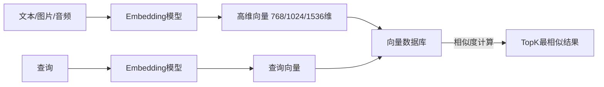
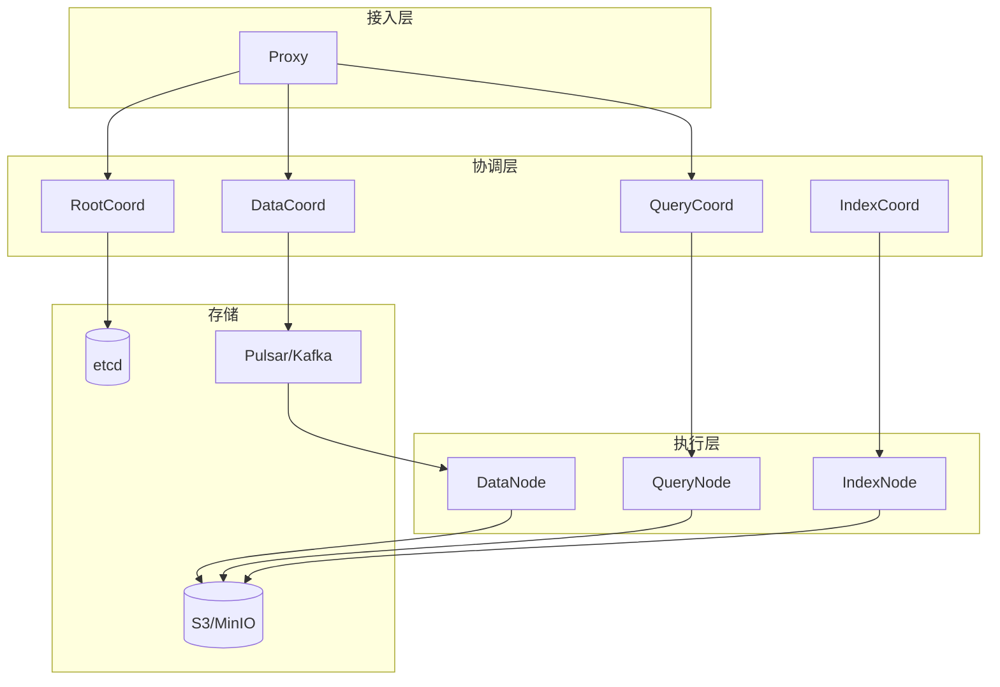
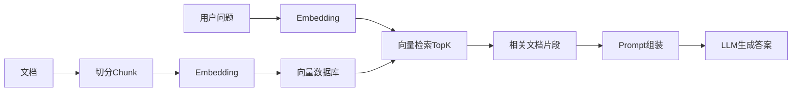

# 向量数据库选型与实战

> **文档说明**：向量数据库专门存储和检索高维向量，是RAG、语义搜索、推荐系统的核心基础设施。本文档覆盖向量检索原理、主流向量数据库对比、Milvus实战、索引算法选型。
>
> **适用人群**：AI工程师、后端工程师、需要构建语义搜索/RAG的开发者
>
> **前置知识**：Embedding、相似度计算、数据库基础

---

## 一、向量检索基础

### 1.1 什么是向量检索



- 将非结构化数据（文本/图片/音频）通过Embedding模型转为高维向量
- 查询时将查询也转为向量，计算与库中向量的相似度
- 返回最相似的TopK结果

### 1.2 相似度度量

| 度量 | 公式 | 适用 |
|------|------|------|
| **余弦相似度** | cos(A,B) = A·B / (|A|×|B|) | 文本语义（最常用） |
| **欧氏距离** | L2 = √Σ(Ai-Bi)² | 图像、数值向量 |
| **内积** | IP = A·B | 已归一化向量（等价余弦） |
| **Jaccard** | 交集/并集 | 集合相似度 |

### 1.3 为什么需要向量数据库

| 问题 | 暴力计算 | 向量数据库 |
|------|---------|-----------|
| 100万条768维向量 | 每次查询7.68亿次运算 | 毫秒级（索引加速） |
| 内存占用 | 约3GB（float32） | 支持量化压缩 |
| 持久化 | 需自己实现 | 内置持久化 |
| 元数据过滤 | 需自己实现 | 支持标量过滤 |
| 分布式 | 需自己实现 | 支持分片集群 |

---

## 二、近似最近邻（ANN）索引

### 2.1 为什么需要ANN

- 精确最近邻（KNN）复杂度O(n×d)，大数据量不可行
- 近似最近邻（ANN）牺牲少量精度换取百倍性能提升
- 召回率通常>95%，查询延迟毫秒级

### 2.2 主流索引算法

| 算法 | 原理 | 优点 | 缺点 | 适用 |
|------|------|------|------|------|
| **HNSW** | 分层导航小世界图 | 查询快、召回高、支持增量 | 内存占用大 | 通用（最流行） |
| **IVF** | 倒排文件，聚类分桶 | 内存小、构建快 | 查询需调参 | 大规模 |
| **IVF-PQ** | IVF+乘积量化 | 内存极小 | 精度损失较大 | 超大规模 |
| **Flat** | 暴力搜索 | 100%召回 | 慢 | 小数据量 |
| **Annoy** | 随机投影树 | 内存小、静态数据 | 不支持增量 | 推荐系统 |

### 2.3 HNSW原理

```mermaid
graph TB
    subgraph 上层（稀疏）
        A1 --- A2
    end
    subgraph 中层
        B1 --- B2 --- B3
        B2 --- B4
    end
    subgraph 下层（稠密）
        C1 --- C2 --- C3 --- C4 --- C5
        C3 --- C6 --- C7
    end
    A1 --> B1
    A2 --> B3
    B1 --> C1
    B2 --> C3
    B3 --> C5
    B4 --> C6
```

- 多层图结构，上层稀疏下层稠密
- 查询时从上层入口开始，贪心搜索到最近节点
- 进入下层继续搜索，直到最底层找到TopK

### 2.4 索引选型建议

| 数据量 | 推荐索引 | 参数 |
|--------|---------|------|
| <10万 | Flat | 精确搜索 |
| 10万-1000万 | HNSW | M=16, efConstruction=200 |
| 1000万-1亿 | IVF_PQ | nlist=1024, m=16 |
| >1亿 | IVF_PQ + 分布式分片 | 按需求调整 |

---

## 三、主流向量数据库对比

| 维度 | Milvus | Pinecone | Weaviate | Qdrant | pgvector | Chroma |
|------|--------|----------|----------|--------|----------|--------|
| 类型 | 开源 | 云服务 | 开源 | 开源 | PG扩展 | 开源 |
| 语言 | Go/C++ | - | Go | Rust | C | Python |
| 分布式 | 支持 | 托管 | 支持 | 支持 | 基于PG | 单机 |
| 索引 | HNSW/IVF/PQ | 自研 | HNSW | HNSW | IVFFlat/HNSW | HNSW |
| 标量过滤 | 支持 | 支持 | 支持 | 支持 | 支持 | 支持 |
| 混合搜索 | 支持 | 支持 | 支持 | 支持 | 支持 | 有限 |
| 部署复杂度 | 高（分布式） | 零（SaaS） | 中 | 低 | 低（已有PG） | 极低 |
| 性能 | 极高 | 高 | 高 | 高 | 中 | 中 |
| 适用 | 大规模生产 | 快速上线 | 通用 | 轻量生产 | PG生态 | 原型/小型 |

---

## 四、Milvus实战

### 4.1 架构



### 4.2 快速开始（Docker）

```yaml
# docker-compose.yml
version: '3.5'
services:
  etcd:
    image: quay.io/coreos/etcd:v3.5.5
  minio:
    image: minio/minio:RELEASE.2023-03-20T20-16-18Z
  standalone:
    image: milvusdb/milvus:v2.3.4
    ports: ["19530:19530", "9091:9091"]
    depends_on: [etcd, minio]
  attu:
    image: zilliz/attu:v2.3.4
    ports: ["8000:3000"]
```

### 4.3 Python客户端

```python
from pymilvus import connections, Collection, FieldSchema, CollectionSchema, DataType

# 连接
connections.connect(host="localhost", port="19530")

# 定义Collection
fields = [
    FieldSchema(name="id", dtype=DataType.INT64, is_primary=True),
    FieldSchema(name="embedding", dtype=DataType.FLOAT_VECTOR, dim=768),
    FieldSchema(name="title", dtype=DataType.VARCHAR, max_length=500),
    FieldSchema(name="category", dtype=DataType.VARCHAR, max_length=100),
]
schema = CollectionSchema(fields, "文档向量库")
collection = Collection("documents", schema)

# 创建索引
index_params = {
    "index_type": "HNSW",
    "metric_type": "COSINE",
    "params": {"M": 16, "efConstruction": 200}
}
collection.create_index("embedding", index_params)
collection.load()

# 插入数据
import numpy as np
embeddings = np.random.rand(1000, 768).astype(np.float32)
data = [
    list(range(1000)),
    embeddings.tolist(),
    [f"文档{i}" for i in range(1000)],
    ["技术"] * 1000
]
collection.insert(data)

# 向量检索
query_embedding = np.random.rand(1, 768).astype(np.float32)
search_params = {"metric_type": "COSINE", "params": {"ef": 128}}
results = collection.search(
    data=query_embedding.tolist(),
    anns_field="embedding",
    param=search_params,
    limit=10,
    expr='category == "技术"',  # 标量过滤
    output_fields=["title", "category"]
)

for hits in results:
    for hit in hits:
        print(f"ID: {hit.id}, 标题: {hit.entity.get('title')}, 相似度: {hit.score}")
```

---

## 五、RAG中的向量数据库

### 5.1 RAG流程



### 5.2 最佳实践

1. **Chunk大小**：256-512 token，重叠50-100 token
2. **Embedding模型**：中文用bge-large-zh/m3e，英文用text-embedding-3
3. **索引选择**：HNSW（通用），数据量大用IVF_PQ
4. **TopK**：3-5个片段，太多引入噪声
5. **元数据**：存储文档来源、页码、章节，便于引用
6. **混合搜索**：向量检索+关键词检索（BM25），提升召回
7. **重排序**：检索后用CrossEncoder重排序，提升精度

---

## 六、选型决策

```text
是否已有PostgreSQL？
├── 是 → pgvector（快速集成，数据量<1000万）
└── 否 → 数据量？
    ├── <100万 → Chroma/Qdrant（轻量）
    ├── 100万-1亿 → Qdrant/Weaviate/Milvus单机
    ├── >1亿 → Milvus分布式
    └── 不想运维 → Pinecone（SaaS）
```

| 场景 | 推荐 |
|------|------|
| 快速原型/学习 | Chroma |
| 已有PG，中小规模 | pgvector |
| 轻量生产 | Qdrant |
| 大规模生产 | Milvus |
| 零运维 | Pinecone |
| 语义搜索+图关系 | Neo4j+向量 |

---

## 关联文档

- [[RAG检索增强生成]] — RAG完整流程
- [[Embedding模型选型]] — 向量生成
- [[MCP协议实战指南]] — AI工程化
- [[数据库知识点完整整合大全_优化版]] — 数据库全景
- [[Elasticsearch深度实战]] — 混合搜索

---

> 💡 **选型建议**：原型用Chroma，已有PG用pgvector，生产环境中小规模用Qdrant（Rust高性能，部署简单），大规模用Milvus（分布式，性能最强）。核心是"Embedding质量决定上限，向量数据库决定下限"，先选好Embedding模型再选数据库。HNSW是目前最均衡的索引算法。
