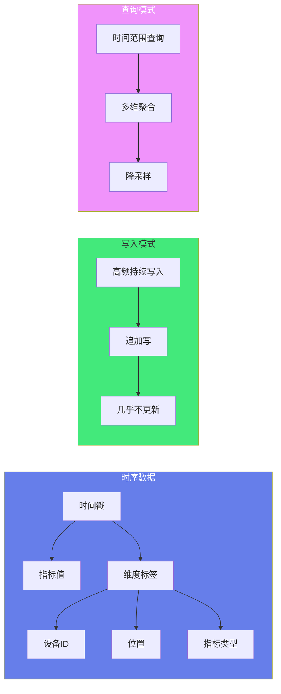
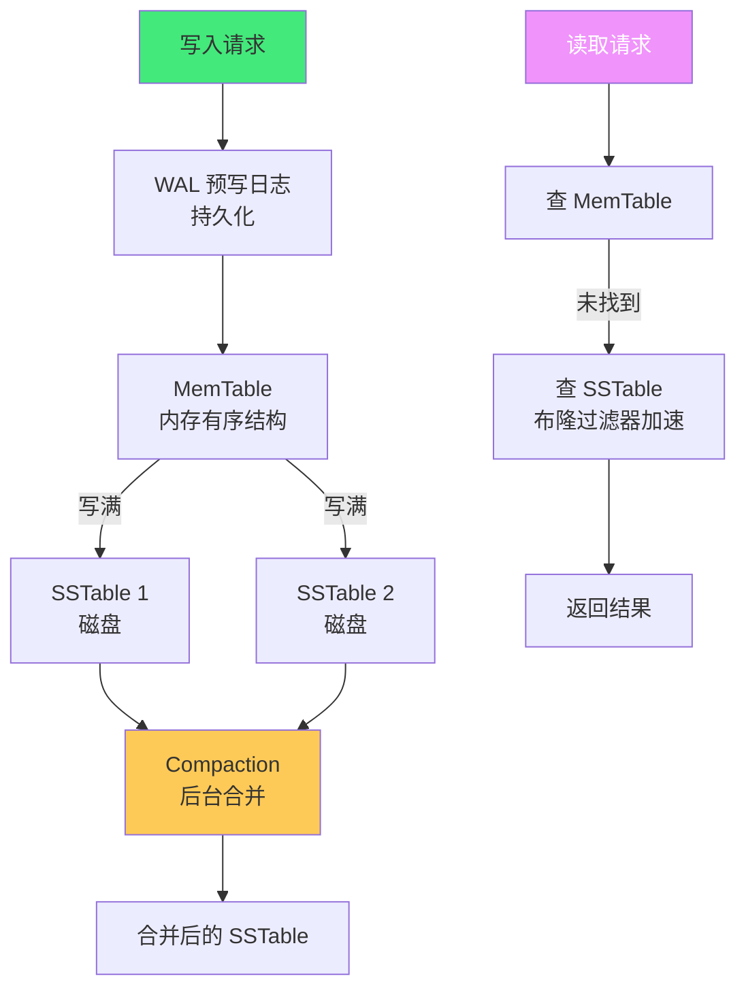

# 📈 时序数据库入门与实战

> **文档说明**：系统讲解时序数据库（Time Series Database, TSDB）的完整知识体系，涵盖时序数据特征与核心概念、为什么需要时序数据库（vs 关系型数据库）、时序数据库核心技术（列式存储、LSM Tree、时间分区、高压缩比、降采样、数据保留）、主流时序数据库深度对比（InfluxDB/Prometheus/TDengine/TimescaleDB/OpenTSDB/Druid）、InfluxDB 实战（数据模型/Line Protocol/InfluxQL/Flux/连续查询/保留策略）、Prometheus 实战（数据模型/PromQL/告警/远程存储）、TDengine 实战（超级表/子表/SQL/流式计算）、数据建模最佳实践、降采样与数据生命周期管理、性能调优、部署与高可用、常见问题与最佳实践。
>
> **适用人群**：后端工程师、运维/SRE、IoT 开发者、监控系统搭建者、数据库学习者
>
> **前置知识**：[[MySQL基础与SQL实战]] · [[NoSQL数据模型对比]] · [[Prometheus-指标采集]]

---

## 一、概述

### 1.1 什么是时序数据

时序数据（Time Series Data）是带有时间戳、按时间顺序记录的数据点序列。每条数据都包含一个时间戳，表示该数据点产生的时间。

**时序数据的典型示例**：
- 服务器 CPU/内存/磁盘使用率（每 10 秒采集一次）
- IoT 传感器温度/湿度/压力数据（每秒采集一次）
- 股票/期货/加密货币的价格和成交量（逐笔/Tick）
- 应用性能指标（QPS、延迟、错误率）
- 网络流量（入站/出站字节数）
- 工业设备遥测数据（电机转速、振动、温度）

**时序数据的核心特征**：

| 特征 | 说明 | 影响 |
|------|------|------|
| **时间为核心** | 每条数据都有时间戳，几乎所有查询都带时间范围 | 存储和索引按时间优化 |
| **写入频繁** | 高频持续写入，每秒可达百万级数据点 | 写入性能是核心指标 |
| **追加写入** | 几乎不更新和删除旧数据，只追加新数据 | 可以用追加写优化（LSM Tree） |
| **时间范围查询** | 查询几乎总是指定时间范围（最近 1 小时、今天、上周） | 按时间分区，快速定位 |
| **数据降采样** | 旧数据精度要求降低，可以聚合为更粗粒度 | 内置连续查询/降采样 |
| **高压缩比** | 数据规律性强（相邻时间点值变化小），压缩比可达 10:1 甚至更高 | 列式存储 + 专用压缩算法 |
| **多维度标签** | 数据通常带有多个维度标签（设备 ID、位置、指标类型） | 标签索引，支持多维聚合 |
| **数据量巨大** | 单设备每天可能产生百万级数据点，百万设备就是万亿级 | 水平扩展、分层存储 |



### 1.2 为什么不用关系型数据库

关系型数据库（MySQL/PostgreSQL）可以存储时序数据，但在时序场景下存在严重的性能和成本问题。

| 维度 | 关系型数据库（MySQL） | 时序数据库（InfluxDB/TDengine） |
|------|---------------------|-------------------------------|
| **写入性能** | 万级/秒（行存储、B+树索引、事务开销） | 百万级/秒（列式存储、LSM Tree、无事务） |
| **存储成本** | 高（行存储、索引占用大、压缩比低） | 低（列式存储、专用压缩、压缩比 10:1+） |
| **时间查询** | 需建时间索引，大数据量下范围扫描慢 | 原生按时间分区，毫秒级时间范围查询 |
| **降采样** | 需手动实现（定时任务+聚合表） | 内置连续查询/流式计算，自动降采样 |
| **数据保留** | 需手动 DELETE（慢且产生碎片） | 内置保留策略（Retention Policy），自动过期删除 |
| **多维聚合** | GROUP BY 性能随数据量下降 | 标签索引+列式聚合，高性能多维分析 |
| **水平扩展** | 分库分表复杂，跨库聚合难 | 原生分布式架构，水平扩展简单 |
| **数据压缩** | InnoDB 压缩比约 2:1 | 专用时序压缩，10:1 甚至 50:1 |

**实际对比案例**：
- 1000 台设备，每台每秒 10 个数据点 = 每秒 10000 数据点 = 每天 8.64 亿数据点
- MySQL：需要分库分表，写入压力大，查询最近 1 小时数据可能需要数秒
- InfluxDB/TDengine：单机轻松承载，查询毫秒级响应，存储占用仅为 MySQL 的 1/5-1/10

> **核心结论**：时序数据有独特的特征（高频写入、追加写、时间范围查询、降采样、自动过期），关系型数据库的设计目标（事务、随机读写、复杂 JOIN）与时序场景不匹配。时序数据库针对时序场景做了专门优化，在写入性能、存储成本、查询速度上有数量级的优势。

### 1.3 应用场景

| 场景 | 说明 | 典型指标 | 推荐数据库 |
|------|------|---------|-----------|
| **系统监控** | 服务器 CPU/内存/磁盘/网络、容器资源 | CPU 使用率、内存占用、磁盘 IO、网络流量 | Prometheus + Grafana |
| **应用性能监控（APM）** | 应用 QPS、延迟、错误率、JVM 指标 | 请求延迟、错误率、GC 次数、线程数 | Prometheus / InfluxDB |
| **IoT 设备监控** | 传感器数据、设备状态、遥测数据 | 温度、湿度、压力、振动、设备状态 | TDengine / InfluxDB |
| **工业互联网** | 生产线监控、设备遥测、质量检测 | 电机转速、温度、振动、产量、不良率 | TDengine / InfluxDB |
| **金融行情** | 股票/期货/外汇/加密货币行情 | 价格、成交量、买卖盘、Tick 数据 | InfluxDB / TDengine / TimescaleDB |
| **日志时序分析** | 系统日志、访问日志的时序聚合 | 日志量、错误数、响应时间分布 | Loki / Elasticsearch |
| **网络监控** | 网络流量、带宽、延迟、丢包 | 入站/出站流量、RTT、丢包率 | Prometheus / InfluxDB |
| **能源监控** | 电力、水、气的用量监控 | 用电量、功率、电压、电流 | TDengine / InfluxDB |
| **车联网** | 车辆位置、速度、状态数据 | GPS 位置、速度、油量、故障码 | TDengine / InfluxDB |
| **可观测性** | Metrics + Logs + Traces 的时序存储 | 指标、日志、链路追踪 | Prometheus + Loki + Jaeger |

---

## 二、时序数据库核心技术

### 2.1 列式存储（Columnar Storage）

时序数据库普遍采用列式存储——同一列的数据连续存储，而不是按行存储。

**行存储 vs 列存储**：
```json
行存储（MySQL InnoDB）：
[行1: ts=1, device=A, temp=25, hum=60]
[行2: ts=2, device=A, temp=26, hum=61]
[行3: ts=3, device=B, temp=24, hum=59]

列存储（时序数据库）：
[ts列: 1, 2, 3, ...]
[device列: A, A, B, ...]
[temp列: 25, 26, 24, ...]
[hum列: 60, 61, 59, ...]
```

| 维度 | 行存储 | 列存储 |
|------|--------|--------|
| 写入 | 一次写入整行，写入快 | 需写入多列，写入相对慢（但时序 DB 用批量写优化） |
| 读取 | 读取几列也要读整行，IO 多 | 只读取需要的列，IO 少 |
| 压缩 | 同一行数据类型不同，压缩比低 | 同一列数据类型相同且规律性强，压缩比极高 |
| 聚合 | 需扫描整行数据 | 只扫描相关列，聚合快 |
| 适用场景 | OLTP（事务、随机读写） | OLAP（分析、聚合查询） |

> 时序查询通常只查询少数几个指标列（如只查温度），列式存储只读取需要的列，大大减少 IO。且同一列的数据类型相同、相邻时间点的值变化小（如温度从 25→25.1→25.2），压缩比极高。

```text
### 2.2 LSM Tree（Log-Structured Merge Tree）
```

时序数据库普遍使用 LSM Tree 作为存储引擎，针对追加写入做了优化。

**LSM Tree 核心思想**：
1. 写入先写入内存中的 MemTable（有序结构，如跳表）
2. MemTable 写满后转为不可变的 SSTable（Sorted String Table），刷写到磁盘
3. 后台定期将多个 SSTable 合并（Compaction），减少文件数量，删除过期/重复数据
4. 读取时先查 MemTable，再查各个 SSTable（用布隆过滤器快速判断）



**LSM Tree 的优势**：
- 写入都是追加写（MemTable + SSTable），随机写转为顺序写，写入性能极高
- SSTable 是有序的，范围查询快
- Compaction 可以合并数据、删除过期数据、优化存储
- 适合写多读少的时序场景

**LSM Tree 的代价**：
- 读取需要查多个 SSTable，读放大（Read Amplification）
- Compaction 占用 CPU 和 IO，可能影响性能
- 空间放大（多个 SSTable 可能有重复数据，Compaction 前占用更多空间）

### 2.3 时间分区与分片

时序数据库按时间对数据进行分区，每个分区包含一段时间范围内的数据。

**时间分区的优势**：
- 查询指定时间范围时，只需扫描相关分区，避免全表扫描
- 过期数据可以直接删除整个分区，效率极高（不需要 DELETE 逐行删除）
- 可以按分区做冷热数据分层（热数据在 SSD，冷数据在对象存储）

**分区策略**：
| 分区粒度 | 适用场景 |
|---------|---------|
| 按小时分区 | 高频写入、短时间范围查询（监控） |
| 按天分区 | 通用场景，大多数时序数据库默认 |
| 按周/月分区 | 低频写入、长时间范围查询（金融历史数据） |

**分片（Sharding）**：
- 按标签（如设备 ID）分片，将不同设备的数据分布到不同节点
- 按时间分片，不同时间段的数据在不同节点
- 分布式时序数据库（TDengine/InfluxDB Enterprise/ClickHouse）支持自动分片和复制

### 2.4 高压缩比算法

时序数据的高压缩比是时序数据库的核心优势之一，主要来自：
1. **列式存储**：同一列数据类型相同，规律性强
2. **时间序列的规律性**：相邻时间点的值变化小（delta encoding）
3. **专用压缩算法**：针对时序数据优化的压缩算法

**常见压缩算法**：
| 算法 | 说明 | 压缩比 |
|------|------|--------|
| **Delta Encoding** | 存储相邻值的差值（差值小，占用少） | 高 |
| **Delta-of-Delta** | 存储差值的差值（适合匀速变化的数据，如时间戳） | 极高 |
| **Gorilla** | Facebook 提出的时序压缩算法，delta-of-delta + XOR | 12:1（Facebook 生产数据） |
| **Snappy** | 谷歌的快速压缩算法，压缩比中等，速度快 | 3:1-5:1 |
| **LZ4** | 极快的压缩算法，压缩比中等 | 3:1-5:1 |
| **ZSTD** | Facebook 提出，压缩比高且速度快 | 5:1-10:1 |
| **Run-Length Encoding** | 连续相同值只存一次+计数 | 极高（适合状态数据） |

> **Gorilla 压缩**：Facebook 在 2015 年发表的论文中提出，针对时序数据做了专门优化——时间戳用 delta-of-delta 编码（大多数时间戳间隔固定，差值的差值为 0，只需 1 位），值用 XOR 编码（相邻值差异小，XOR 结果高位为 0，只需存储低位）。Facebook 生产环境达到 1.37 bytes/数据点，压缩比约 12:1。

### 2.5 降采样与连续查询

降采样（Downsampling）是将高精度数据聚合为低精度数据，减少存储占用，加速长时间范围查询。

```text
原始数据（1秒精度，保留7天）：
25.1, 25.2, 25.0, 25.3, 25.1, ...

↓ 降采样（1分钟平均值，保留30天）：
25.15, 25.20, 25.10, ...

↓ 降采样（1小时平均值，保留1年）：
25.18, 25.22, 25.15, ...
```

**连续查询（Continuous Query, CQ）**：
时序数据库内置的自动降采样机制——定时运行聚合查询，将结果写入另一个 measurement/表。

```sql
-- InfluxDB 连续查询示例
CREATE CONTINUOUS QUERY cq_cpu_1m ON metrics BEGIN
  SELECT mean(usage) AS usage_mean
  INTO cpu_1m
  FROM cpu
  GROUP BY time(1m), host
END
```

**降采样策略建议**：
| 数据精度 | 保留时间 | 用途 |
|---------|---------|------|
| 原始精度（1s-10s） | 7-30 天 | 实时监控、故障排查 |
| 1分钟聚合 | 30-90 天 | 短期趋势分析 |
| 5分钟聚合 | 90天-1年 | 中期趋势、容量规划 |
| 1小时聚合 | 1-3年 | 长期趋势、年度对比 |
| 1天聚合 | 永久 | 历史归档、年度报告 |

### 2.6 数据保留策略（Retention Policy, RP）

时序数据通常不需要永久保留——越旧的数据价值越低，精度要求越低。保留策略自动删除过期数据。

```sql
-- InfluxDB 保留策略
CREATE RETENTION POLICY "rp_7d" ON metrics DURATION 7d REPLICATION 1 DEFAULT
CREATE RETENTION POLICY "rp_30d" ON metrics DURATION 30d REPLICATION 1
CREATE RETENTION POLICY "rp_1y" ON metrics DURATION 365d REPLICATION 1
```

**保留策略的实现**：
- 按时间分区存储，过期数据直接删除整个分区（高效，不产生碎片）
- 后台定期检查，删除过期分区
- 不需要 DELETE（DELETE 慢且产生碎片，时序 DB 几乎不用 DELETE）

---

## 三、主流时序数据库对比

### 3.1 综合对比

| 维度 | InfluxDB | Prometheus | TDengine | TimescaleDB | OpenTSDB |
|------|----------|------------|----------|-------------|----------|
| **开发公司** | InfluxData | CNCF（SoundCloud 起源） | 涛思数据（中国） | Timescale | Yahoo（开源） |
| **开发语言** | Go | Go | C | C（PostgreSQL 扩展） | Java |
| **数据模型** | Measurement+Tag+Field | Metric+Label（多维） | 超级表+子表+标签 | 关系表+Hypertable | Metric+Tag |
| **查询语言** | Flux / InfluxQL | PromQL | SQL | SQL | 查询 API |
| **写入性能** | 高（百万级/秒） | 中（十万级/秒） | 极高（千万级/秒） | 中高 | 中 |
| **查询性能** | 高 | 高（短时间范围） | 高 | 高（SQL 生态） | 中（依赖 HBase） |
| **集群版** | 企业版（开源版无集群） | 联邦/Thanos/Cortex（外部） | 开源集群（免费） | 基于 PG 复制 | 基于 HBase 集群 |
| **存储引擎** | TSM（类 LSM） | TSDB（自研，本地文件） | 自研（类 LSM+列式） | PostgreSQL（堆表+索引） | HBase |
| **压缩比** | 高（Gorilla 类） | 中高 | 极高 | 中（PG 压缩） | 中（HBase） |
| **可视化** | Chronograf（自带） | Grafana（生态标准） | 自带 + Grafana | Grafana | Grafana |
| **告警** | Kapacitor（自带） | AlertManager（生态标准） | 自带 | 需外部 | 需外部 |
| **连续查询** | 支持（CQ） | 不支持（需 recording rule） | 支持（流式计算） | 支持（continuous aggregate） | 不支持 |
| **保留策略** | 支持（RP） | 支持（本地 retention） | 支持 | 支持（drop chunks） | 支持（TTL） |
| **SQL 支持** | 部分（InfluxQL 类 SQL） | 否（PromQL） | 是（标准 SQL） | 是（标准 SQL） | 否 |
| **适用场景** | 通用时序、IoT、监控 | 系统/应用监控告警（首选） | IoT/工业/车联网（海量设备） | 需要 SQL 生态、PG 用户 | Hadoop 生态、大规模监控 |
| **国内流行度** | 高 | 极高 | 中（增长快） | 中 | 低 |
| **开源协议** | MIT（单机） | Apache 2.0 | AGPL（社区版） | Apache 2.0（Timescale License） | LGPL |

### 3.2 InfluxDB

**核心特点**：
- 最流行的通用时序数据库之一，生态成熟
- 自研 TSM 存储引擎，高性能写入和查询
- 支持 InfluxQL（类 SQL）和 Flux（新的数据流查询语言）
- 丰富的客户端库和 Telegraf 采集插件生态（200+ 插件）
- 单机版开源免费，集群版需企业版授权

**适用场景**：通用时序数据存储、IoT 设备监控、应用性能监控、DevOps 监控、金融行情

**局限**：
- 开源版无集群（高可用需企业版或用其他方案）
- Flux 学习曲线较陡
- 不支持标准 SQL（InfluxQL 是类 SQL 方言）

### 3.3 Prometheus

**核心特点**：
- CNCF 毕业项目，云原生监控的事实标准
- 拉模型（Pull），主动从目标拉取指标
- 多维数据模型（Metric + Label），强大的 PromQL 查询语言
- 内置告警规则，配合 AlertManager 实现告警路由/分组/抑制
- 本地时序存储，支持远程写入（Thanos/Cortex/M3DB 实现长期存储和高可用）
- 庞大的 Exporter 生态（Node Exporter/cAdvisor/Blackbox 等）

**适用场景**：系统/应用/容器监控告警（首选）、Kubernetes 监控、云原生可观测性

**局限**：
- 不适合长期存储（默认本地存储，需配合 Thanos/Cortex）
- 不适合非监控类时序数据（如 IoT 传感器、金融行情）
- PromQL 学习曲线较陡
- 不支持更新和删除（时序特性，符合监控场景）

> 详见 [[Prometheus-指标采集]] 深度文档。

### 3.4 TDengine

**核心特点**：
- 国产开源时序数据库，写入性能极高（官方称单机千万级/秒）
- 标准 SQL 支持，学习成本低
- 「一个数据采集点一张表」的超级表（STable）+ 子表模型，针对 IoT 优化
- 内置缓存、流式计算、数据订阅、消息队列等功能（「一体化」设计）
- 社区版开源集群（AGPL 协议），支持水平扩展和高可用
- 高压缩比（列式存储 + 专用压缩）

**适用场景**：IoT 设备监控、工业互联网、车联网、能源监控、海量设备时序数据

**局限**：
- AGPL 协议（商用需注意）
- 生态相对较新（不如 InfluxDB/Prometheus 成熟）
- 超级表模型需要适应（与传统关系模型不同）

### 3.5 TimescaleDB

**核心特点**：
- PostgreSQL 扩展，完全兼容 SQL 和 PG 生态
- 自动按时间分区（Hypertable），对用户透明
- 支持连续聚合（Continuous Aggregate）自动降采样
- 支持 PG 的所有功能（JSON、GIS、全文搜索、PL/pgSQL 等）
- 兼容 PG 工具链（pgAdmin、psql、ORM 等）

**适用场景**：已有 PostgreSQL 技术栈、需要 SQL 能力的时序场景、金融/分析类时序数据

**局限**：
- 写入性能不如专用时序数据库（受 PG 架构限制）
- 压缩比不如专用时序数据库
- 时序专用功能（如连续查询）不如 InfluxDB/TDengine 丰富

### 3.6 其他时序数据库

| 数据库 | 特点 | 适用场景 |
|--------|------|---------|
| **ClickHouse** | 列式 OLAP 数据库，查询性能极强，也可用于时序 | 大规模时序分析、日志分析、BI |
| **Druid** | 分布式 OLAP 数据存储，支持实时摄入和快速查询 | 实时分析、大规模时序聚合 |
| **OpenTSDB** | 基于 HBase 的分布式时序数据库，Hadoop 生态 | Hadoop 生态、大规模监控（早期） |
| **Graphite** | 老牌时序数据库，Whisper 存储，简单易用 | 简单监控场景、Carbon 采集 |
| **VictoriaMetrics** | 高性能、低成本的 Prometheus 兼容时序数据库 | Prometheus 替代、长期存储、高可用 |
| **M3DB** | Uber 开源的分布式时序数据库，Prometheus 兼容 | 大规模监控、长期存储 |
| **Loki** | Grafana 出品的日志聚合系统，也有时序特性 | 日志时序、可观测性日志 |
| **QuestDB** | 高性能时序数据库，SQL 支持，列存 | 金融行情、低延迟时序 |
| **Apache IoTDB** | Apache 顶级项目，物联网时序数据库 | IoT、工业互联网 |

---

## 四、InfluxDB 实战

### 4.1 核心概念

| 概念 | 说明 | 类比 |
|------|------|------|
| **Measurement** | 度量，数据的类别，类似表名 | MySQL 表名 |
| **Tag** | 标签，索引维度，用于过滤和分组 | MySQL 索引列（字符串类型） |
| **Field** | 字段，指标值，不索引 | MySQL 普通列（数值/字符串/布尔） |
| **Timestamp** | 时间戳，纳秒精度，数据的主键之一 | MySQL 时间列（主键） |
| **Series** | 序列，Measurement + Tag 集合的唯一组合 | 唯一时间线 |
| **Point** | 数据点，一个时间戳的一条数据 | MySQL 一行 |
| **Bucket** | 存储桶（2.x），包含数据和保留策略 | 数据库 + 保留策略 |
| **Retention Policy（RP）** | 保留策略，数据过期时间 | — |
| **Continuous Query（CQ）** | 连续查询，自动降采样 | 定时聚合任务 |
| **Line Protocol** | 行协议，InfluxDB 的文本写入格式 | — |

**数据点结构（Line Protocol）**：
```text
weather,city=上海,district=浦东 temperature=25.5,humidity=60,rain=false 1690000000000000000
  │         │                    │                                      │
Measurement  Tag(索引)            Field(值)                              Timestamp(纳秒)
```

> **Tag vs Field 的关键区别**：Tag 是索引的（用于 WHERE 过滤和 GROUP BY 分组，字符串类型），Field 是不索引的（指标值，可以是数值/字符串/布尔）。设计时应该将用于过滤和分组的维度设为 Tag，将指标值设为 Field。Tag 的基数（不同值的数量）不宜过高（如设备 ID 可以，用户 ID 不建议）。

### 4.2 安装与启动

```bash
# Docker 安装 InfluxDB 2.x
docker run -d \
  --name influxdb2 \
  -p 8086:8086 \
  -v influxdb2-data:/var/lib/influxdb2 \
  -v influxdb2-config:/etc/influxdb2 \
  influxdb:2.7

# 访问 http://localhost:8086 进行初始设置
# 设置用户名、密码、组织名、初始 Bucket

# InfluxDB 1.x（兼容 InfluxQL）
docker run -d \
  --name influxdb1 \
  -p 8086:8086 \
  -v influxdb1-data:/var/lib/influxdb \
  influxdb:1.8
```

### 4.3 写入数据（Line Protocol）

```bash
# 单条写入
curl -i -XPOST 'http://localhost:8086/write?db=metrics' \
  --data-binary 'weather,city=上海,district=浦东 temperature=25.5,humidity=60'

# 批量写入（多条数据用换行分隔，性能更好）
curl -i -XPOST 'http://localhost:8086/write?db=metrics' \
  --data-binary 'weather,city=上海 temperature=25.5
weather,city=北京 temperature=30.2
weather,city=广州 temperature=28.1'

# 指定时间戳（纳秒）
curl -i -XPOST 'http://localhost:8086/write?db=metrics' \
  --data-binary 'weather,city=上海 temperature=25.5 1690000000000000000'
```

**Python 客户端写入**：
```python
from influxdb import InfluxDBClient

client = InfluxDBClient(host='localhost', port=8086, database='metrics')

# 写入数据
json_body = [
    {
        "measurement": "weather",
        "tags": {"city": "上海", "district": "浦东"},
        "time": "2024-01-01T00:00:00Z",
        "fields": {"temperature": 25.5, "humidity": 60}
    }
]
client.write_points(json_body)
```

### 4.4 查询数据（InfluxQL）

```sql
-- 基本查询
SELECT * FROM weather
SELECT temperature, humidity FROM weather

-- 时间范围查询
SELECT * FROM weather WHERE time > now() - 1h
SELECT * FROM weather WHERE time > '2024-01-01' AND time < '2024-01-02'

-- Tag 过滤
SELECT * FROM weather WHERE city = '上海' AND district = '浦东'

-- 聚合查询
SELECT mean(temperature) FROM weather WHERE time > now() - 1d
SELECT max(temperature), min(temperature), mean(temperature) FROM weather

-- 按时间分组（降采样）
SELECT mean(temperature) FROM weather
WHERE time > now() - 1d
GROUP BY time(5m)

-- 按 Tag + 时间分组
SELECT mean(temperature) FROM weather
WHERE time > now() - 1d
GROUP BY time(1h), city

-- 常用函数
COUNT(field)     -- 计数
SUM(field)       -- 求和
MEAN(field)      -- 平均值
MEDIAN(field)    -- 中位数
MODE(field)      -- 众数
STDDEV(field)    -- 标准差
FIRST(field)     -- 第一个值
LAST(field)      -- 最后一个值
MAX(field)       -- 最大值
MIN(field)       -- 最小值
PERCENTILE(field, N)  -- 百分位数
DERIVATIVE(field)     -- 导数（变化率）
NON_NEGATIVE_DERIVATIVE(field)  -- 非负导数
SPREAD(field)     -- 最大值-最小值

-- 查看元数据
SHOW DATABASES
SHOW MEASUREMENTS
SHOW TAG KEYS FROM weather
SHOW TAG VALUES FROM weather WITH KEY = city
SHOW FIELD KEYS FROM weather
SHOW SERIES FROM weather
SHOW RETENTION POLICIES ON metrics
SHOW CONTINUOUS QUERIES
```

### 4.5 保留策略与连续查询

```sql
-- 创建保留策略
CREATE RETENTION POLICY "rp_7d" ON metrics DURATION 7d REPLICATION 1 DEFAULT
CREATE RETENTION POLICY "rp_30d" ON metrics DURATION 30d REPLICATION 1
CREATE RETENTION POLICY "rp_1y" ON metrics DERATION 365d REPLICATION 1

-- 修改保留策略
ALTER RETENTION POLICY "rp_7d" ON metrics DURATION 14d

-- 删除保留策略
DROP RETENTION POLICY "rp_7d" ON metrics

-- 创建连续查询（自动降采样：1秒原始数据 → 5分钟聚合）
CREATE CONTINUOUS QUERY cq_weather_5m ON metrics BEGIN
  SELECT mean(temperature) AS temp_mean,
         max(temperature) AS temp_max,
         min(temperature) AS temp_min,
         mean(humidity) AS hum_mean
  INTO rp_30d.weather_5m
  FROM weather
  GROUP BY time(5m), city, district
END

-- 查看连续查询
SHOW CONTINUOUS QUERIES

-- 删除连续查询
DROP CONTINUOUS QUERY cq_weather_5m ON metrics
```

### 4.6 Flux 查询语言（2.x）

Flux 是 InfluxDB 2.x 推出的新查询语言，采用数据流管道（pipe-forward `|>`）的方式，更灵活强大。

```flux
// 基础查询
from(bucket: "metrics")
  |> range(start: -1h)
  |> filter(fn: (r) => r._measurement == "weather" and r.city == "上海")
  |> yield(name: "raw")

// 聚合降采样
from(bucket: "metrics")
  |> range(start: -1d)
  |> filter(fn: (r) => r._measurement == "weather")
  |> aggregateWindow(every: 5m, fn: mean)
  |> yield(name: "5m_mean")

// 多字段处理
from(bucket: "metrics")
  |> range(start: -1h)
  |> filter(fn: (r) => r._measurement == "weather")
  |> pivot(rowKey: ["_time"], columnKey: ["_field"], valueColumn: "_value")
  |> yield(name: "pivoted")

// 数学运算
from(bucket: "metrics")
  |> range(start: -1h)
  |> filter(fn: (r) => r._measurement == "cpu" and r._field == "usage")
  |> map(fn: (r) => ({r with usage_percent: r._value * 100}))
  |> yield(name: "percent")
```

---

## 五、TDengine 实战

### 5.1 核心概念

| 概念 | 说明 |
|------|------|
| **超级表（STable）** | 一类设备的模板，定义了 Schema（字段）和 Tag（标签） |
| **子表（Table）** | 每个设备一个子表，继承超级表的 Schema，有自己的 Tag 值 |
| **Tag（标签）** | 设备静态属性（设备 ID、位置、型号），用于过滤和分组 |
| **Field（字段）** | 动态采集的指标值（温度、湿度、状态） |
| **Timestamp** | 时间戳，毫秒/微秒/纳秒精度 |

**核心设计思想：一个数据采集点一张表**
- 每个设备（采集点）对应一个子表
- 同一类设备共享一个超级表（Schema 模板）
- 子表自动按时间分区，写入是追加写，性能极高

### 5.2 安装与启动

```bash
# Docker 安装 TDengine
docker run -d \
  --name tdengine \
  -p 6030-6049:6030-6049 \
  -v tdengine-data:/var/lib/taos \
  tdengine/tdengine:3.0

# 进入容器，使用 taos CLI
docker exec -it tdengine taos
```

### 5.3 基本操作

```sql
-- 创建数据库
CREATE DATABASE weather_db KEEP 365 DURATION 10 BUFFER 16;

-- 使用数据库
USE weather_db;

-- 创建超级表（一类设备的模板）
CREATE STABLE weather (
    ts TIMESTAMP,
    temperature FLOAT,
    humidity INT,
    pressure FLOAT,
    status BOOL
) TAGS (
    city NCHAR(20),
    district NCHAR(20),
    device_id NCHAR(50),
    model NCHAR(30)
);

-- 为每个设备创建子表（自动创建）
-- 语法：INSERT INTO 子表名 USING 超级表名 TAGS(标签值) VALUES(字段值)
INSERT INTO weather_shanghai_pudong_001
USING weather TAGS("上海", "浦东", "DEV001", "ModelA")
VALUES (now, 25.5, 60, 1013.2, true);

-- 批量写入（一个子表多条数据）
INSERT INTO weather_shanghai_pudong_001
USING weather TAGS("上海", "浦东", "DEV001", "ModelA")
VALUES
    (now-1s, 25.4, 60, 1013.1, true),
    (now, 25.5, 60, 1013.2, true),
    (now+1s, 25.6, 61, 1013.2, true);

-- 多表批量写入
INSERT INTO
    weather_shanghai_001 USING weather TAGS("上海", "浦东", "DEV001", "ModelA") VALUES (now, 25.5, 60, 1013.2, true)
    weather_beijing_001 USING weather TAGS("北京", "海淀", "DEV002", "ModelB") VALUES (now, 30.2, 45, 1010.5, true);

-- 查询
SELECT * FROM weather;
SELECT * FROM weather WHERE city = '上海';
SELECT * FROM weather WHERE ts > now - 1h;

-- 聚合查询
SELECT AVG(temperature), MAX(temperature), MIN(temperature)
FROM weather
WHERE city = '上海';

-- 时间窗口聚合（降采样）
SELECT AVG(temperature), MAX(temperature), MIN(temperature)
FROM weather
WHERE city = '上海'
INTERVAL(5m);

-- 按标签分组聚合
SELECT city, AVG(temperature) AS avg_temp
FROM weather
INTERVAL(1h)
GROUP BY city;

-- 查看超级表和子表
SHOW STABLES;
SHOW TABLES;
SHOW TABLES LIKE 'weather_%';
DESCRIBE weather;
```

### 5.4 流式计算

TDengine 内置流式计算功能，可以实时对数据进行聚合、降采样、告警。

```sql
-- 创建流：将原始数据降采样为 1 分钟聚合
CREATE STREAM stream_weather_1m
INTO weather_1m
AS
SELECT
    AVG(temperature) AS temp_mean,
    MAX(temperature) AS temp_max,
    MIN(temperature) AS temp_min,
    AVG(humidity) AS hum_mean
FROM weather
INTERVAL(1m);

-- 创建告警流：温度超过 35 度触发告警
CREATE STREAM stream_high_temp_alert
INTO temperature_alerts
AS
SELECT device_id, city, temperature, ts
FROM weather
WHERE temperature > 35;
```

---

## 六、数据建模最佳实践

### 6.1 Tag 设计原则

| 原则 | 说明 | 反例 | 正例 |
|------|------|------|------|
| **Tag 用于过滤和分组** | 只有需要 WHERE 过滤和 GROUP BY 分组的维度才设为 Tag | 把温度值设为 Tag | 把城市、设备类型设为 Tag |
| **Tag 基数不宜过高** | Tag 值的数量不宜过多（一般 < 10万），高基数 Tag 导致内存膨胀 | user_id（百万用户） | device_type（有限型号） |
| **Tag 是静态属性** | Tag 应该是设备/数据的静态属性，不随时间频繁变化 | 把当前温度设为 Tag | 把设备型号、安装位置设为 Tag |
| **Field 是动态值** | 随时间变化的指标值设为 Field | 把设备 ID 设为 Field | 把温度、湿度、压力设为 Field |
| **避免过多 Tag** | 每个 measurement 的 Tag 数控制在 5-10 个 | 20+ 个 Tag | 核心维度 3-5 个 Tag |

**InfluxDB Tag 设计示例**：
```css
# 好的设计
cpu,host=server01,region=us-east,env=production usage=85.5,system=20.1

# Tag: host, region, env（用于过滤和分组，基数可控）
# Field: usage, system（指标值，随时间变化）

# 不好的设计
cpu,host=server01,user_id=123456,temp=85.5 usage=85.5
# user_id 基数过高（百万用户），temp 是指标值不应设为 Tag
```

### 6.2 Measurement 设计

| 原则 | 说明 |
|------|------|
| **一个 Measurement 一类指标** | 相关的 Field 放在同一个 Measurement，不相关的分开 |
| **Field 类型一致** | 同一个 Field  across 数据点应该是相同类型（不要有时是 int 有时是 string） |
| **避免过宽的 Measurement** | 一个 Measurement 不要有太多 Field（>20 个），考虑拆分 |
| **命名规范** | 用 snake_case，见名知意，如 `cpu_usage`、`http_requests_total` |

**Measurement 拆分示例**：
```css
# 不好：所有指标混在一个 Measurement
metrics,host=server01 cpu=85.5,mem=70.2,disk=60.1,net_in=100,net_out=50

# 好：按指标类别拆分
cpu,host=server01 usage=85.5,system=20.1,user=60.3
memory,host=server01 used=70.2,available=29.8,cached=40.5
disk,host=server01 usage=60.1,read=100,write=50
network,host=server01 in=100,out=50,errors=0
```

### 6.3 时间精度选择

| 精度 | 适用场景 | 存储影响 |
|------|---------|---------|
| 纳秒（ns） | 金融高频交易、极低延迟监控 | 存储占用大 |
| 微秒（μs） | 高性能计算、精密测量 | 存储占用中等 |
| 毫秒（ms） | 大多数监控、IoT 场景（推荐默认） | 存储占用较小 |
| 秒（s） | 低频采集、长期趋势 | 存储占用最小 |

> **建议**：大多数场景用毫秒精度即可。纳秒精度只在金融高频交易等极少数场景需要。精度越高，存储占用越大，查询越慢。InfluxDB 默认纳秒，但写入时可以指定精度（`precision=s`/`ms`/`u`/`ns`）。

---

## 七、性能调优

### 7.1 写入性能优化

| 优化 | 说明 |
|------|------|
| **批量写入** | 每次写入 1000-10000 条数据，减少 HTTP 请求开销 |
| **使用客户端库** | 用官方客户端库（自动批量、重试、连接池） |
| **合理 Tag 基数** | 避免高基数 Tag（如 user_id），控制 Series 数量 |
| **合适时间精度** | 用毫秒而非纳秒，减少存储和计算 |
| **避免频繁 Schema 变更** | 保持 Field 类型一致，避免动态增加 Field |
| **水平扩展** | 分布式版本（TDengine/InfluxDB Enterprise）按标签分片 |
| **写入端并发** | 多客户端并发写入，充分利用服务端能力 |
| **禁用不必要的功能** | 如不需要查询日志、连续查询，可以关闭 |

**批量写入示例（Python）**：
```python
from influxdb import InfluxDBClient

client = InfluxDBClient(host='localhost', port=8086, database='metrics')

# 批量写入 5000 条
batch = []
for i in range(5000):
    batch.append({
        "measurement": "cpu",
        "tags": {"host": f"server{i%100}"},
        "fields": {"usage": float(i % 100)},
    })
    if len(batch) >= 1000:
        client.write_points(batch, batch_size=1000)
        batch = []
```

### 7.2 查询性能优化

| 优化 | 说明 |
|------|------|
| **总是指定时间范围** | 避免全表扫描，用 `WHERE time > now() - 1h` |
| **用 Tag 过滤** | WHERE 条件优先用 Tag（索引），少用 Field 过滤 |
| **降采样查询** | 长时间范围查询用降采样后的数据（5分钟聚合而非原始1秒） |
| **避免 SELECT *** | 只查询需要的 Field，减少数据传输和计算 |
| **合理 GROUP BY** | GROUP BY time + Tag，避免高基数 Tag 分组 |
| **用 LIMIT** | 探索性查询加 LIMIT，避免返回过多数据 |
| **连续查询预聚合** | 常用的聚合用连续查询预计算，查询时直接用结果 |
| **冷热分离** | 热数据（最近7天）在 SSD，冷数据在对象存储/廉价磁盘 |

### 7.3 存储优化

| 优化 | 说明 |
|------|------|
| **合理保留策略** | 不需要永久保留的数据设置 RP，自动过期删除 |
| **降采样** | 旧数据降采样后删除原始数据，大幅减少存储 |
| **高压缩比** | 用列式存储+专用压缩（Gorilla/ZSTD），压缩比 10:1+ |
| **冷热分层** | 热数据 SSD，温数据 HDD，冷数据对象存储 |
| **控制 Series 数量** | 高基数 Tag 导致 Series 爆炸，内存和存储膨胀 |
| **定期 Compaction** | LSM Tree 的 Compaction 合并 SSTable，减少空间放大 |

---

## 八、部署与高可用

### 8.1 单机部署

适用于开发测试、小规模生产（单机能承载百万级/秒写入、数十亿数据点）。

```yaml
# docker-compose.yml
version: '3.8'
services:
  influxdb:
    image: influxdb:2.7
    ports:
      - "8086:8086"
    volumes:
      - influxdb-data:/var/lib/influxdb2
    environment:
      - DOCKER_INFLUXDB_INIT_MODE=setup
      - DOCKER_INFLUXDB_INIT_USERNAME=admin
      - DOCKER_INFLUXDB_INIT_PASSWORD=admin123456
      - DOCKER_INFLUXDB_INIT_ORG=myorg
      - DOCKER_INFLUXDB_INIT_BUCKET=metrics
      - DOCKER_INFLUXDB_INIT_RETENTION=30d
    restart: unless-stopped

  telegraf:
    image: telegraf:1.28
    volumes:
      - ./telegraf.conf:/etc/telegraf/telegraf.conf:ro
    depends_on:
      - influxdb
    restart: unless-stopped

  grafana:
    image: grafana/grafana:10.2
    ports:
      - "3000:3000"
    volumes:
      - grafana-data:/var/lib/grafana
    restart: unless-stopped

volumes:
  influxdb-data:
  grafana-data:
```

### 8.2 高可用方案

| 方案 | 说明 | 适用 |
|------|------|------|
| **InfluxDB Enterprise** | 官方企业版，支持集群、复制、分片 | 企业级，付费 |
| **TDengine 集群** | 开源社区版支持集群，原生分布式 | IoT/工业，免费 |
| **Prometheus + Thanos** | Prometheus + Thanos 实现长期存储和高可用 | 监控场景，开源 |
| **Prometheus + Cortex/Mimir** | 水平扩展的 Prometheus 长期存储 | 大规模监控，开源 |
| **VictoriaMetrics 集群** | 高性能 Prometheus 兼容集群 | 监控替代，开源 |
| **TimescaleDB 多节点** | PostgreSQL 流复制+分布式超表 | SQL 生态，开源/商业 |

**TDengine 集群部署**：
```bash
# TDengine 社区版支持集群部署，至少 3 个节点
# 每个节点配置 taos.cfg
# firstEp 指向第一个节点的 endpoint
# fqdn 设置节点域名
# 启动后用 CREATE DNODE 加入集群
```

---

## 九、常见问题与最佳实践

### 9.1 常见问题

| 问题 | 原因 | 解决方案 |
|------|------|---------|
| **写入慢/超时** | 单条写入、网络延迟、服务端过载 | 批量写入（1000+条/批）、用客户端库、检查服务端资源 |
| **查询慢** | 未指定时间范围、用 Field 过滤、查询原始精度长时间范围 | 总是指定时间范围、用 Tag 过滤、用降采样数据 |
| **内存占用高** | Series 数量过多（高基数 Tag）、缓存过大 | 控制 Tag 基数、减少 Series 数量、调整缓存配置 |
| **磁盘占用增长快** | 保留策略太长、未降采样、压缩比低 | 设置合理 RP、配置连续查询降采样、用高压缩算法 |
| **数据点丢失** | 写入失败未重试、时间戳精度不匹配 | 客户端自动重试、确认时间精度、监控写入成功率 |
| **Field 类型冲突** | 同一 Field 有时写 int 有时写 float/string | 保持 Field 类型一致，写入前校验 |
| **Tag 过滤不生效** | 把值设为了 Field 而非 Tag | 需要过滤/分组的维度必须设为 Tag |
| **删除数据慢** | 用 DELETE 逐行删除 | 时序 DB 用保留策略自动过期，避免 DELETE |
| **Prometheus 内存爆** | 高基数指标（如 user_id 标签）、长时间保留 | 减少高基数标签、缩短保留时间、用 Thanos/Cortex 长期存储 |
| **Grafana 图表空** | 时间范围不对、查询语句错误、数据源配置错误 | 检查时间范围、在 Explore 测试查询、检查数据源连接 |
| **降采样数据不准** | 连续查询配置错误、时间窗口不对 | 检查 CQ 的 GROUP BY time、确认聚合函数正确 |
| **集群数据不一致** | 复制延迟、节点故障 | 检查复制状态、修复故障节点、等待同步 |

### 9.2 最佳实践

1. **选择合适的数据库**：监控选 Prometheus，通用时序选 InfluxDB，IoT 海量设备选 TDengine，SQL 生态选 TimescaleDB
2. **合理设计 Tag**：Tag 用于过滤和分组，基数可控，静态属性；Field 是动态指标值
3. **批量写入**：每次写入 1000-10000 条，用官方客户端库（自动批量+重试）
4. **总是指定时间范围**：所有查询都带时间范围，避免全表扫描
5. **降采样+保留策略**：热数据原始精度短期保留，温/冷数据降采样长期保留，自动过期
6. **用 Grafana 可视化**：Grafana 是时序数据可视化的事实标准，支持所有主流时序数据库
7. **监控数据库本身**：监控时序数据库的写入速率、查询延迟、磁盘使用、Series 数量
8. **备份策略**：定期备份数据和配置，重要数据不可只存一份
9. **避免高基数**：不要用 user_id/request_id 等高基数维度做 Tag，会导致内存和存储爆炸
10. **先单机后集群**：先从单机部署开始，性能不够再考虑集群，避免过早复杂化
11. **数据建模先行**：写入前先设计好 Measurement/Tag/Field 结构，避免后期改结构困难
12. **用连续查询预聚合**：常用的聚合查询用连续查询预计算，查询时直接用结果
13. **冷热分层存储**：热数据 SSD，冷数据对象存储，平衡性能和成本
14. **文档化数据模型**：记录每个 Measurement 的 Tag/Field 含义、保留策略、降采样规则
15. **定期审查 Series 数量**：Series 数量是时序数据库的核心指标，异常增长说明有高基数 Tag

---

## 十、关联笔记

### 数据库
- [[MySQL基础与SQL实战]] · [[NoSQL数据模型对比]] · [[Redis核心原理与实战]]
- [[数据库索引与查询优化]] · [[分布式数据库原理]]

### 监控与可观测
- [[Prometheus-指标采集]] · [[Grafana-可视化看板_backup_skeleton]] · [[AlertManager告警]]
- [[ELK-日志聚合]] · [[可观测性三支柱]]

### 云原生与运维
- [[K8s-核心概念与架构]] · [[K8s-监控与日志]] · [[Linux性能调优]]
- [[CI-CD流水线]]

### IoT 与大数据
- [[IoT架构设计]] · [[消息队列与异步架构]] · [[Kafka核心原理]]
- [[ClickHouse分析引擎]]

### 导航
- [[MOC-数据库与缓存]] · [[MOC-云原生与运维]] · [[MOC-综合导航]] · [[Home]]

> 🔍 **知识点深度解析**
>
> **作用**：时序数据库解决的是「高频写入、时间范围查询、降采样、自动过期的时序数据存储与分析」问题——传统关系型数据库在时序场景下存在写入性能不足（万级/秒）、存储成本高（行存储+索引）、时间查询慢（需建索引）、降采样和数据保留需手动实现等问题。时序数据库针对时序数据的特征（时间为核心、高频追加写、时间范围查询、高压缩比、降采样、自动过期）做了专门优化，在写入性能（百万级/秒甚至千万级/秒）、存储成本（压缩比 10:1+）、查询速度（毫秒级时间范围查询）上有数量级的优势，是监控、IoT、金融行情等场景的核心基础设施。
>
> **底层原理**：时序数据库的高性能来自多个核心技术的结合：①**列式存储**——同一列数据连续存储，只读取需要的列减少 IO，同一列数据类型相同且规律性强，压缩比极高；②**LSM Tree**——写入先写内存 MemTable，写满后转为 SSTable 刷盘，随机写转为顺序写，写入性能极高，后台 Compaction 合并 SSTable 并删除过期数据；③**时间分区**——按时间分区存储，查询指定时间范围只需扫描相关分区，过期数据直接删除整个分区（高效不产生碎片）；④**高压缩比算法**——针对时序数据优化的压缩算法（Gorilla 的 delta-of-delta + XOR，压缩比 12:1）；⑤**降采样与连续查询**——内置自动降采样机制，将高精度数据聚合为低精度数据，减少存储并加速长时间查询；⑥**保留策略**——内置数据过期机制，自动删除过期分区；⑦**标签索引**——多维标签（Tag）建立索引，支持高性能多维过滤和聚合；⑧**分片与复制**——分布式时序数据库按标签或时间分片，多副本保证高可用。这些技术共同实现了「高写入+高压缩+快查询+自动降采样+自动过期」的时序数据管理能力。
>
> **用法要点**：① 选型：监控告警首选 Prometheus+Grafana（生态最成熟），通用时序数据选 InfluxDB，IoT/工业海量设备选 TDengine（写入性能最强），需要 SQL 生态选 TimescaleDB，大规模分析选 ClickHouse ② 数据建模：Tag（索引维度，用于过滤分组，基数可控，静态属性）vs Field（指标值，不索引，动态变化），一个 Measurement 一类指标，命名用 snake_case ③ 写入：批量写入（1000-10000条/批），用官方客户端库（自动批量+重试+连接池），合适时间精度（大多数场景毫秒），避免高基数 Tag ④ 查询：总是指定时间范围，用 Tag 过滤（不用 Field 过滤），长时间范围用降采样数据，避免 SELECT *，合理 GROUP BY，探索性查询加 LIMIT ⑤ 存储：合理保留策略（热数据7-30天原始精度，温数据30-90天5分钟聚合，冷数据1年1小时聚合），连续查询自动降采样，高压缩比，冷热分层 ⑥ 性能调优：写入端批量+并发，查询端时间范围+Tag过滤+降采样，存储端降采样+保留策略+压缩，控制 Series 数量（高基数 Tag 是最大杀手） ⑦ 部署：先单机后集群，监控数据库本身（写入速率/查询延迟/磁盘/Series数），备份策略，Grafana 可视化 ⑧ 常见坑：写入慢（单条写入→批量）、查询慢（无时间范围→加时间范围）、内存高（高基数 Tag→控制基数）、磁盘增长快（无降采样无RP→配置降采样+RP）、Field类型冲突（保持类型一致）、删除慢（用 RP 不用 DELETE） ⑨ 最佳实践：数据建模先行、文档化数据模型、定期审查 Series 数量、先单机后集群、用 Grafana 可视化、监控数据库本身、避免高基数、降采样+保留策略。

> 💡 **深度讲解**：时序数据库最核心的智慧是「针对时序数据的特征做垂直优化」，而不是用通用数据库「什么都能做但什么都不精」。时序数据有五个独特特征：时间为核心（几乎所有查询都带时间范围）、高频追加写（每秒百万级，几乎不更新删除）、规律性强（相邻时间点值变化小，压缩比高）、降采样需求（旧数据精度要求降低）、自动过期（越旧的数据价值越低）。通用关系型数据库的设计目标是「事务+随机读写+复杂 JOIN」，与时序场景完全不匹配——B+树索引对追加写不友好（随机 IO），行存储压缩比低，DELETE 逐行删除慢且产生碎片，降采样和保留策略需手动实现。时序数据库放弃了事务和随机更新（时序场景不需要），针对时序特征做了垂直优化——LSM Tree 把随机写转为顺序写（写入性能提升 100 倍），列式存储+Gorilla 压缩把存储成本降低 10 倍，时间分区让时间范围查询和过期删除变得高效，连续查询让降采样自动化。这种「放弃不需要的，优化需要的」的垂直优化思路，是时序数据库性能远超通用数据库的根本原因。另一个关键点是「Tag vs Field 的设计哲学」。Tag 是索引的维度（用于 WHERE 过滤和 GROUP BY 分组），Field 是指标值（不索引）。这个设计的核心是「索引什么、不索引什么」——索引所有东西会导致写入慢、存储大（像关系型数据库的索引），只索引需要过滤和分组的维度（Tag），不索引指标值（Field），在查询性能和写入/存储成本之间取得了最佳平衡。这也是为什么高基数 Tag 是时序数据库的「最大杀手」——Tag 是索引的，高基数 Tag（如 user_id 百万级）会导致索引爆炸，内存和存储急剧膨胀，查询性能下降。所以设计时必须控制 Tag 基数，把高基数维度（如果确实需要）设为 Field 而非 Tag，或者用其他方式处理。「降采样+保留策略」是时序数据库另一个核心创新。时序数据的价值随时间递减——最近 1 小时的数据需要 1 秒精度（故障排查），最近 1 个月的数据需要 5 分钟精度（趋势分析），1 年前的数据需要 1 小时精度（年度对比）。如果所有数据都保留原始精度，存储成本会线性增长且不可持续。降采样+保留策略实现了「数据生命周期管理」——热数据原始精度短期保留，温数据降采样中期保留，冷数据进一步降采样长期保留，过期自动删除。这不仅大幅降低了存储成本（可能 10 倍以上），还加速了长时间范围查询（查询降采样后的数据而非原始数据）。这种「数据价值随时间递减，存储精度也随时间递减」的设计，是时序数据管理的核心智慧。

> 📝 **精简总结**：时序数据库（TSDB）= 针对时序数据（时间戳+高频追加写+时间范围查询+高压缩比+降采样+自动过期）优化的专用数据库。核心技术：列式存储（高压缩+少IO）、LSM Tree（顺序写+高写入）、时间分区（快查询+快删除）、Gorilla压缩（12:1）、降采样+连续查询、保留策略（自动过期）、Tag索引（多维过滤分组）。主流对比：Prometheus（监控首选，CNCF，PromQL）、InfluxDB（通用时序，Flux/InfluxQL）、TDengine（IoT/工业，SQL，写入最强）、TimescaleDB（PG扩展，SQL生态）、ClickHouse（OLAP分析）。建模：Tag（索引维度，过滤分组，基数可控）vs Field（指标值，不索引）。写入：批量（1000+/批）+客户端库+毫秒精度。查询：总是时间范围+Tag过滤+降采样数据。存储：降采样+保留策略（热7天原始/温30天5分钟/冷1年1小时）+高压缩+冷热分层。性能：控制Series数量（高基数Tag是杀手）。选型：监控→Prometheus，通用→InfluxDB，IoT→TDengine，SQL→TimescaleDB，分析→ClickHouse。坑：单条写入、无时间范围查询、高基数Tag、无降采样、Field类型冲突、用DELETE删除。

> **学习路径建议**：先学习 [[MySQL基础与SQL实战]] 掌握关系型数据库基础 → 学习 [[NoSQL数据模型对比]] 理解不同数据模型 → 学习本文档掌握时序数据库原理和选型 → 学习 [[Prometheus-指标采集]] 深入监控场景最常用的时序数据库 → 学习 [[Grafana-可视化看板_backup_skeleton]] 掌握时序数据可视化 → 实践：部署 Prometheus+Grafana+Node Exporter 搭建监控系统 → 学习 InfluxDB 或 TDengine 实践 IoT 场景 → 学习 [[ClickHouse分析引擎]] 深入大规模时序分析 → 阅读《Designing Data-Intensive Applications》（数据密集型应用系统设计）深入理解存储引擎。

---

> **时序数据库的本质是「用垂直优化换取数量级的性能提升」——通用数据库追求「什么都能做」，但在特定场景下往往「什么都不精」。时序数据库放弃了通用数据库的事务、随机更新、复杂 JOIN 等时序场景不需要的能力，针对时序数据的独特特征（时间为核心、高频追加写、规律性强、降采样需求、自动过期）做了深度垂直优化——LSM Tree 让写入从随机 IO 变为顺序 IO（100 倍提升），列式存储+Gorilla 压缩让存储成本降低 10 倍，时间分区让时间范围查询和过期删除从全表扫描变为分区操作（1000 倍提升），降采样+保留策略让数据生命周期管理自动化。这种「有所为有所不为」的垂直优化思路，不仅适用于时序数据库，也适用于所有专用系统——向量数据库（针对向量相似度搜索优化）、图数据库（针对图遍历优化）、文档数据库（针对 JSON 文档优化）、搜索引擎（针对全文搜索优化），都是同样的思路。理解了时序数据库的垂直优化哲学，你就理解了现代数据库生态的核心逻辑——不是「一个数据库打天下」，而是「不同场景用不同的专用数据库，各取所长」。这就是为什么现代系统架构往往是「多语言持久化（Polyglot Persistence）」——MySQL 存事务数据，Redis 做缓存，Elasticsearch 做搜索，Prometheus 做监控，ClickHouse 做分析，每个数据库在自己擅长的场景发挥最大价值。**
