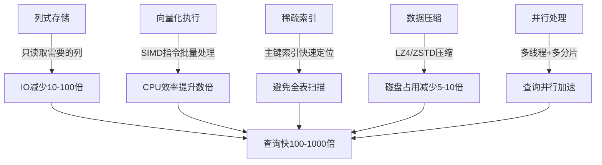

# ClickHouse OLAP引擎实战

> **文档说明**：ClickHouse是俄罗斯Yandex开源的列式存储OLAP引擎，查询性能比传统数据库快100-1000倍，适用于实时数据分析、BI报表、日志分析。本文档覆盖架构原理、表引擎、SQL优化、数据导入、与MySQL/ES对比。
>
> **适用人群**：后端高级工程师、数据工程师、需要构建实时分析系统的开发者
>
> **前置知识**：SQL、数据库基础、数据仓库概念

---

## 一、OLAP与ClickHouse概述

### 1.1 OLTP vs OLAP

| 维度 | OLTP（事务型） | OLAP（分析型） |
|------|---------------|---------------|
| 代表 | MySQL、PostgreSQL | ClickHouse、Doris、Druid |
| 操作 | 增删改查，单条记录 | 聚合查询，大批量读取 |
| 数据量 | GB-TB | TB-PB |
| 查询 | 简单、高频 | 复杂、低频 |
| 响应 | 毫秒级 | 亚秒-秒级 |
| 存储 | 行式存储 | 列式存储 |
| 事务 | ACID | 不支持/弱支持 |
| 典型场景 | 订单、用户管理 | 报表、统计、日志分析 |

### 1.2 为什么ClickHouse这么快



| 特性 | 说明 |
|------|------|
| **列式存储** | 只读取查询涉及的列，聚合查询IO极少 |
| **向量化执行** | 使用CPU SIMD指令批量处理数据 |
| **稀疏主键索引** | 按主键排序存储，索引极小但定位快 |
| **数据压缩** | 列式数据规律性强，压缩比极高 |
| **并行处理** | 查询自动并行，利用多核 |
| **预聚合** | 物化视图预计算，查询直接读结果 |

### 1.3 适用场景

| 适合 | 不适合 |
|------|--------|
| 实时数据分析/BI报表 | 高频单行更新（OLTP） |
| 日志/事件分析 | 需要完整ACID事务 |
| 用户行为分析 | 频繁删除数据 |
| 时序数据聚合 | 小数据量（<1000万行） |
| 监控指标分析 | 点查为主的场景 |
| 广告/流量统计 | 需要外键约束 |

---

## 二、核心概念与表引擎

### 2.1 表引擎体系

ClickHouse有多种表引擎，MergeTree家族是核心：

```text
MergeTree（最常用）
  ├── ReplacingMergeTree（去重）
  ├── SummingMergeTree（预聚合求和）
  ├── AggregatingMergeTree（预聚合）
  ├── CollapsingMergeTree（折叠删除）
  └── VersionedCollapsingMergeTree（版本折叠）
```

### 2.2 MergeTree（核心引擎）

```sql
CREATE TABLE events (
    event_date Date DEFAULT toDate(now()),
    event_time DateTime DEFAULT now(),
    user_id UInt64,
    event_type String,
    page_url String,
    duration UInt32,
    properties String
)
ENGINE = MergeTree()
PARTITION BY toYYYYMM(event_date)       -- 按月分区
ORDER BY (user_id, event_time)          -- 排序键（也是稀疏索引键）
PRIMARY KEY (user_id)                   -- 主键（前缀必须是ORDER BY的前缀）
TTL event_date + INTERVAL 90 DAY        -- 90天后自动删除
SETTINGS index_granularity = 8192;      -- 索引粒度（每8192行一个索引点）
```

| 参数 | 说明 |
|------|------|
| **PARTITION BY** | 分区，数据按分区存储，查询时自动裁剪 |
| **ORDER BY** | 排序键，数据物理排序，决定稀疏索引 |
| **PRIMARY KEY** | 主键，必须是ORDER BY的前缀，用于稀疏索引 |
| **TTL** | 数据生命周期，自动过期删除 |
| **index_granularity** | 索引粒度，默认8192行一个索引点 |

### 2.3 ReplacingMergeTree（去重）

```sql
-- 相同主键的数据保留最新版本（按version字段）
CREATE TABLE users (
    user_id UInt64,
    name String,
    version UInt64 DEFAULT toUnixTimestamp(now())
)
ENGINE = ReplacingMergeTree(version)
ORDER BY user_id;

-- 插入重复数据，后台合并时自动去重（保留version最大的）
-- 查询时加FINAL关键字强制去重
SELECT * FROM users FINAL WHERE user_id = 123;
```

### 2.4 SummingMergeTree（预聚合）

```sql
-- 相同维度的数据自动求和
CREATE TABLE daily_sales (
    sale_date Date,
    product_id UInt64,
    amount Decimal(10,2),
    quantity UInt32
)
ENGINE = SummingMergeTree()
PARTITION BY toYYYYMM(sale_date)
ORDER BY (sale_date, product_id);
-- 合并时相同(sale_date, product_id)的amount和quantity自动求和
```

### 2.5 分布式表

```sql
-- 本地表（每个节点存储一部分数据）
CREATE TABLE events_local ON CLUSTER cluster1 (
    event_date Date,
    user_id UInt64,
    event_type String
)
ENGINE = ReplicatedMergeTree('/clickhouse/tables/{shard}/events', '{replica}')
PARTITION BY toYYYYMM(event_date)
ORDER BY (user_id, event_date);

-- 分布式表（逻辑表，自动路由到各分片）
CREATE TABLE events ON CLUSTER cluster1 AS events_local
ENGINE = Distributed(cluster1, default, events_local, rand());
-- 分布式表本身不存数据，查询时自动分发到各分片并聚合结果
```

---

## 三、SQL查询实战

### 3.1 基础查询

```sql
-- 统计每日PV/UV
SELECT
    event_date,
    count() AS pv,
    uniq(user_id) AS uv
FROM events
WHERE event_date >= '2024-01-01'
GROUP BY event_date
ORDER BY event_date;

-- 漏斗分析
SELECT
    count(DISTINCT user_id) AS step1_visit,
    count(DISTINCT if(event_type = 'view', user_id, NULL)) AS step2_view,
    count(DISTINCT if(event_type = 'cart', user_id, NULL)) AS step3_cart,
    count(DISTINCT if(event_type = 'pay', user_id, NULL)) AS step4_pay
FROM events
WHERE event_date = today();

-- 留存分析（次日留存）
SELECT
    d1.event_date AS register_date,
    uniq(d1.user_id) AS new_users,
    uniq(d2.user_id) AS retained_users,
    retained_users / new_users AS retention_rate
FROM (
    SELECT user_id, min(event_date) AS event_date
    FROM events
    GROUP BY user_id
) d1
LEFT JOIN events d2 ON d1.user_id = d2.user_id AND d2.event_date = d1.event_date + 1
GROUP BY d1.event_date
ORDER BY d1.event_date;
```

### 3.2 高级函数

```sql
-- 近似去重（比uniq快，误差<1%）
SELECT uniqHLL12(user_id) FROM events;  -- HyperLogLog

-- 分位数
SELECT quantile(0.99)(duration) AS p99 FROM events;
SELECT quantiles(0.5, 0.9, 0.99)(duration) FROM events;

-- TopK
SELECT topK(10)(page_url) FROM events;

-- 数组操作
SELECT
    groupArray(event_type) AS events,
    groupUniqArray(page_url) AS pages
FROM events
GROUP BY user_id;

-- 条件聚合
SELECT
    countIf(event_type = 'view') AS views,
    countIf(event_type = 'click') AS clicks,
    sumIf(duration, event_type = 'view') AS total_duration
FROM events;

-- 时间序列填充（缺失日期补0）
SELECT event_date, count() AS pv
FROM events
GROUP BY event_date
ORDER BY event_date
WITH FILL;  -- 自动填充缺失日期
```

### 3.3 物化视图（预聚合）

```sql
-- 创建物化视图：实时预聚合每日统计
CREATE MATERIALIZED VIEW daily_stats_mv
ENGINE = SummingMergeTree()
PARTITION BY toYYYYMM(date)
ORDER BY (date, event_type)
AS SELECT
    event_date AS date,
    event_type,
    count() AS cnt,
    sum(duration) AS total_duration
FROM events
GROUP BY event_date, event_type;

-- 查询直接读物化视图，毫秒级响应
SELECT date, sum(cnt) AS total
FROM daily_stats_mv
WHERE date >= '2024-01-01'
GROUP BY date
ORDER BY date;
```

---

## 四、数据导入

### 4.1 导入方式

| 方式 | 说明 | 适用 |
|------|------|------|
| **INSERT** | SQL插入 | 小批量、测试 |
| **clickhouse-client** | 命令行导入 | 批量文件导入 |
| **Kafka引擎** | 实时消费Kafka | 实时数据流 |
| **JDBC/HTTP** | 程序写入 | 应用集成 |
| **Materialized MySQL** | 同步MySQL binlog | MySQL→ClickHouse |

### 4.2 Kafka实时导入

```sql
-- 创建Kafka引擎表（消费Kafka数据）
CREATE TABLE events_kafka (
    event_time DateTime,
    user_id UInt64,
    event_type String,
    properties String
)
ENGINE = Kafka()
SETTINGS
    kafka_broker_list = 'kafka1:9092,kafka2:9092',
    kafka_topic_list = 'events',
    kafka_group_name = 'clickhouse-group',
    kafka_format = 'JSONEachRow',
    kafka_num_consumers = 2;

-- 创建物化视图，将Kafka数据自动写入MergeTree
CREATE MATERIALIZED VIEW events_mv TO events AS
SELECT * FROM events_kafka;
-- Kafka数据→events_kafka（消费）→events_mv（物化视图）→events（存储）
```

### 4.3 批量导入

```bash
# 从CSV文件导入
clickhouse-client --query="INSERT INTO events FORMAT CSV" < events.csv

# 从TSV导入（Tab分隔，默认格式）
clickhouse-client --query="INSERT INTO events FORMAT TSV" < events.tsv

# 从JSON导入
cat events.json | clickhouse-client --query="INSERT INTO events FORMAT JSONEachRow"

# 远程导入
curl 'http://clickhouse:8123/?query=INSERT+INTO+events+FORMAT+JSONEachRow' \
  --data-binary @events.json
```

---

## 五、性能优化

### 5.1 查询优化

| 优化 | 说明 |
|------|------|
| **只查需要的列** | 列式存储，SELECT * 会读取所有列 |
| **利用分区裁剪** | WHERE条件包含分区键，自动跳过无关分区 |
| **利用主键索引** | WHERE条件包含ORDER BY前缀，走稀疏索引 |
| **避免FINAL** | ReplacingMergeTree的FINAL会强制合并，性能差 |
| **使用近似函数** | uniqHLL代替uniq，quantile代替精确分位数 |
| **物化视图** | 高频聚合查询建物化视图预计算 |
| **LIMIT优化** | 尽量加LIMIT，减少数据传输 |
| **避免高基数字符串GROUP BY** | 高基数GROUP BY内存消耗大 |

### 5.2 表设计优化

```sql
-- 好的设计：分区+排序键合理
CREATE TABLE events (
    event_date Date,
    user_id UInt64,
    event_time DateTime,
    event_type LowCardinality(String),  -- 低基数字符串用LowCardinality
    page_url String
)
ENGINE = MergeTree()
PARTITION BY toYYYYMM(event_date)    -- 按月分区（不要按天，分区太多）
ORDER BY (user_id, event_time)       -- 排序键匹配查询模式
PRIMARY KEY user_id;

-- 避免：分区粒度过细（按天甚至按小时）
-- 避免：ORDER BY选择高基数唯一键（如id），索引无效
-- 避免：字符串类型的分区键（性能差）
```

### 5.3 执行计划分析

```sql
-- 查看执行计划
EXPLAIN SELECT user_id, count() FROM events GROUP BY user_id;

-- 查看详细执行计划（含索引使用、分区裁剪）
EXPLAIN indexes=1 SELECT * FROM events
WHERE event_date = '2024-01-01' AND user_id = 123;
-- 检查：Selected parts（选中的分区数）、Marks（索引标记数）
```

---

## 六、ClickHouse vs 其他OLAP引擎

| 维度 | ClickHouse | Apache Doris | Apache Druid |
|------|-----------|-------------|-------------|
| 开发公司 | Yandex | 百度（开源） | 社区 |
| 语言 | C++ | Java | Java |
| 存储 | 列式+本地 | 列式+HDFS | 列式+深存储 |
| 查询性能 | 极高（亚秒级） | 高 | 高 |
| 实时写入 | 支持（批量） | 支持（实时） | 支持（实时） |
| 并发 | 低（百级） | 中（千级） | 中 |
| SQL支持 | 丰富 | 标准SQL | 类SQL |
| 运维复杂度 | 中 | 中 | 高 |
| 国内流行度 | 高 | 高（增长快） | 中 |
| 适用 | 海量数据分析、日志 | 实时数仓、BI | 实时指标、时序 |

---

## 七、部署

```bash
# Docker单机部署
docker run -d \
  --name clickhouse \
  -p 8123:8123 -p 9000:9000 \
  -v clickhouse_data:/var/lib/clickhouse \
  clickhouse/clickhouse-server:23.8

# 客户端连接
docker exec -it clickhouse clickhouse-client

# HTTP接口
curl 'http://localhost:8123/?query=SELECT+1'
```

---

## 关联文档

- [[数据库知识点完整整合大全_优化版]] — 数据库全景
- [[Elasticsearch深度实战]] — 搜索/日志分析对比
- [[时序数据库入门与实战]] — 时序数据对比
- [[Kafka深度实战]] — 数据管道
- [[CDC数据同步实战]] — MySQL→ClickHouse同步
- [[技术选型决策指南]] — 数据库选型

---

> 💡 **选型建议**：需要亚秒级聚合查询、数据量亿级以上、以读为主的分析场景，ClickHouse是性能之王。国内互联网公司广泛使用。注意：1. 不适合高频更新和点查；2. 并发能力有限（百级QPS），高并发需加缓存；3. 表设计（分区+排序键）决定性能上限；4. 物化视图是提升查询性能的杀手锏。Doris在实时写入和高并发方面更优，可作为备选。


## 补充：常见问题与排查

| 问题 | 原因 | 解决方案 |
|------|------|---------|
| 查询慢 | 未用分区键过滤、缺少索引、SELECT * | 用分区键过滤（WHERE date = ...）、只查需要的列、用 PREWHERE |
| 内存溢出（OOM） | 大 GROUP BY / JOIN 占用过多内存 | 增加 max_memory_usage、用外部排序（GROUP BY ... SETTINGS max_bytes_before_external_group_by）、优化查询 |
| 写入慢 | 单条 INSERT、小批量频繁写入 | 批量写入（每批 10000-100000 行），控制写入频率（每秒 1 次） |
| 副本同步延迟 | 网络慢、写入压力大、zk 性能差 | 优化网络、增加批量、用专用 zk 集群、监控 replication_queue |
| 数据重复 | ReplicatedMergeTree 网络重试导致重复 | 用 ReplacingMergeTree（按主键去重）或 CollapsingMergeTree |
| 磁盘空间不足 | 数据增长快、未设置 TTL | 配置 TTL 自动过期、增加磁盘、用冷热分层存储 |
| Zookeeper 压力大 | 表太多/分区太多/副本操作频繁 | 减少分区数（按月不按天）、合并小表、用 ClickHouse Keeper 替代 ZK |
| 分布式查询慢 | 分片键选择不当、数据倾斜 | 选择高基数字段做分片键、检查分片数据量均衡 |

### 常用排查命令

```sql
-- 查看当前查询
SELECT query_id, user, query, elapsed, memory_usage, read_rows
FROM system.processes
ORDER BY elapsed DESC;

-- 杀掉慢查询
KILL QUERY WHERE query_id = 'xxx';

-- 查看表大小和分区
SELECT table, partition, rows, bytes_on_disk
FROM system.parts
WHERE active AND database = 'mydb'
ORDER BY bytes_on_disk DESC;

-- 查看合并任务
SELECT database, table, elapsed, progress, rows_read, rows_written
FROM system.merges;

-- 查看复制队列
SELECT database, table, parts_to_throw, parts_to_check, is_leader
FROM system.replicas;

-- 查看执行计划
EXPLAIN SELECT count(*) FROM orders WHERE date = '2026-01-01';
```

---

## 补充：进阶与最佳实践

### 1. 表引擎选择

| 引擎 | 特点 | 适用场景 |
|------|------|---------|
| **MergeTree** | 基础引擎，支持分区、索引、副本 | 绝大多数场景 |
| **ReplacingMergeTree** | 按主键去重（合并时保留最新版本） | 需要去重的场景（如同步 MySQL 数据） |
| **CollapsingMergeTree** | 用 Sign 列折叠行（1/-1） | 需要更新/删除的场景（如变更数据捕获） |
| **SummingMergeTree** | 合并时对数值列求和 | 预聚合场景（如按天汇总） |
| **AggregatingMergeTree** | 合并时聚合（用 aggregateFunction 类型） | 物化视图、预聚合 |
| **Replicated*** | 带副本的引擎（数据冗余、高可用） | 生产环境必须用 Replicated 系列 |
| **Distributed** | 分布式引擎（逻辑表，路由到分片） | 跨分片查询 |
| **Memory** | 内存表，重启丢失 | 临时数据、小表字典 |
| **Buffer** | 内存缓冲，定期刷到目标表 | 高写入吞吐缓冲 |

### 2. 建表最佳实践

```sql
-- 标准建表模板（ReplicatedMergeTree + 分区 + 排序键 + TTL）
CREATE TABLE IF NOT EXISTS orders_local ON CLUSTER '{cluster}' (
    id UUID DEFAULT generateUUIDv4(),
    order_id String,
    user_id UInt64,
    amount Decimal(12, 2),
    status LowCardinality(String),  -- 低基数字符串用 LowCardinality 节省空间
    created_at DateTime,
    date Date DEFAULT toDate(created_at),  -- 分区键单独存 Date 类型
    INDEX idx_user_id user_id TYPE bloom_filter(0.01) GRANULARITY 64  -- 跳数索引
)
ENGINE = ReplicatedMergeTree('/clickhouse/tables/{shard}/orders_local', '{replica}')
PARTITION BY toYYYYMM(date)  -- 按月分区（不要按天，分区太多有问题）
ORDER BY (user_id, created_at)  -- 排序键=稀疏索引，按查询模式设计
PRIMARY KEY (user_id)  -- 主键是排序键的前缀
TTL date + INTERVAL 90 DAY  -- 90天后自动删除
SETTINGS index_granularity = 8192;  -- 索引粒度（默认8192，大表可调大）

-- 分布式表（查询入口）
CREATE TABLE IF NOT EXISTS orders ON CLUSTER '{cluster}' AS orders_local
ENGINE = Distributed('{cluster}', 'mydb', 'orders_local', rand());
```

### 3. 查询优化

```sql
-- 1. 用 PREWHERE 替代 WHERE（先读过滤列，减少 IO）
SELECT * FROM orders PREWHERE date = '2026-01-01' WHERE amount > 1000;

-- 2. 避免 SELECT *，只查需要的列（列存数据库，列越少越快）
SELECT order_id, amount FROM orders WHERE date = '2026-01-01';

-- 3. 用 WITH 子句复用子查询
WITH top_users AS (
    SELECT user_id FROM orders WHERE date = '2026-01-01'
    GROUP BY user_id ORDER BY sum(amount) DESC LIMIT 100
)
SELECT * FROM users WHERE id IN (SELECT user_id FROM top_users);

-- 4. 用 LIMIT BY 替代 ROW_NUMBER（更高效）
SELECT user_id, order_id, amount
FROM orders
WHERE date = '2026-01-01'
ORDER BY amount DESC
LIMIT 10 BY user_id;  -- 每个用户取金额最高的10条

-- 5. 物化视图预聚合（加速常用查询）
CREATE MATERIALIZED VIEW orders_daily_mv
ENGINE = SummingMergeTree
PARTITION BY toYYYYMM(date)
ORDER BY (date, user_id)
AS SELECT date, user_id, count() AS order_count, sum(amount) AS total_amount
FROM orders_local
GROUP BY date, user_id;

-- 6. 字典表（小表 JOIN 优化）
CREATE DICTIONARY user_dict (
    id UInt64,
    name String,
    level String
)
PRIMARY KEY id
SOURCE(CLICKHOUSE(host 'localhost' port 9000 user 'default' db 'mydb' table 'users'))
LIFETIME(3600)
LAYOUT(HASHED());

-- 查询时用 dictGet 替代 JOIN
SELECT order_id, dictGetString('user_dict', 'name', user_id) AS user_name
FROM orders WHERE date = '2026-01-01';
```

### 4. ClickHouse vs 其他 OLAP

| 维度 | ClickHouse | Druid | Doris/StarRocks | Presto/Trino |
|------|-----------|-------|----------------|-------------|
| 存储 | 本地列存 | 列存 + 倒排 | 列存（MPP） | 不存数据（查询引擎） |
| 查询性能 | 极快（单表） | 快（时序） | 快（MPP） | 中等（多源） |
| 写入 | 批量高吞吐 | 实时摄入 | 实时+批量 | 依赖数据源 |
| JOIN | 弱（大 JOIN 慢） | 弱 | 强（MPP） | 强 |
| 更新/删除 | 弱（异步合并） | 弱 | 强 | 依赖数据源 |
| 运维复杂度 | 中 | 高 | 中 | 低（无状态） |
| 适用场景 | 单表大宽表分析、日志、时序 | 时序指标、实时聚合 | 企业数仓、Ad-hoc 查询 | 多数据源联邦查询 |
