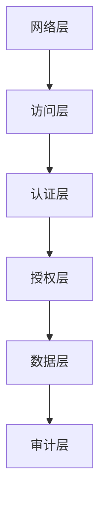

# 数据库安全与审计实战

> **文档说明**：数据库安全是生产系统的底线，涵盖访问控制、数据加密、敏感数据脱敏、审计日志、合规要求。本文档覆盖MySQL/PostgreSQL/Redis的安全配置、权限管理、数据加密、审计方案、等保合规。
>
> **适用人群**：后端工程师、DBA、安全工程师
>
> **前置知识**：MySQL/Redis基础、网络安全概念

---

## 一、数据库安全体系

### 1.1 安全分层模型



| 层级 | 措施 | 说明 |
|------|------|------|
| **网络层** | 防火墙/VPC/白名单 | 限制可访问数据库的IP |
| **访问层** | 连接加密/SSL | 防止数据传输被窃听 |
| **认证层** | 强密码/双因子 | 验证用户身份 |
| **授权层** | 最小权限/角色 | 限制用户可执行的操作 |
| **数据层** | 加密/脱敏 | 保护敏感数据 |
| **审计层** | 操作日志/监控 | 记录所有操作，可追溯 |

### 1.2 常见安全威胁

| 威胁 | 说明 | 防护 |
|------|------|------|
| **SQL注入** | 恶意SQL拼接 | 参数化查询/ORM/输入校验 |
| **越权访问** | 低权限用户访问高权限数据 | 行级权限/列级权限 |
| **数据泄露** | 敏感数据明文存储 | 加密存储/脱敏展示 |
| **暴力破解** | 密码被暴力猜解 | 强密码/登录限制/双因子 |
| **权限滥用** | DBA权限过大 | 最小权限/职责分离 |
| **备份泄露** | 备份文件未加密 | 加密备份/安全存储 |
| **日志缺失** | 操作无法追溯 | 开启审计日志 |

---

## 二、MySQL安全配置

### 2.1 网络安全

```ini
# my.cnf
[mysqld]
# 绑定内网IP，不监听公网
bind-address = 10.0.0.100

# 端口修改（非默认）
port = 3307

# 跳过域名解析（提升性能+安全）
skip-name-resolve = 1

# 禁用LOAD DATA LOCAL（防止文件读取）
local-infile = 0

# 允许的最大连接数
max_connections = 500

# 连接超时
connect_timeout = 10
wait_timeout = 600
```

### 2.2 用户与权限管理

```sql
-- 创建用户（限制来源IP）
CREATE USER 'app_user'@'10.0.0.%' IDENTIFIED BY 'StrongP@ssw0rd!';

-- 最小权限：只给需要的权限
GRANT SELECT, INSERT, UPDATE ON app_db.* TO 'app_user'@'10.0.0.%';

-- 只读用户
CREATE USER 'read_user'@'10.0.0.%' IDENTIFIED BY '...';
GRANT SELECT ON app_db.* TO 'read_user'@'10.0.0.%';

-- 列级权限（敏感列禁止查询）
GRANT SELECT(id, name, email) ON app_db.users TO 'app_user'@'10.0.0.%';

-- 查看用户权限
SHOW GRANTS FOR 'app_user'@'10.0.0.%';

-- 撤销权限
REVOKE DELETE ON app_db.* FROM 'app_user'@'10.0.0.%';

-- 删除无用用户
DROP USER ''@'localhost';
DROP USER 'root'@'%';  -- 禁止root远程登录

-- 密码过期策略
ALTER USER 'app_user'@'10.0.0.%' PASSWORD EXPIRE INTERVAL 90 DAY;

-- 密码复杂度（MySQL 8.0）
INSTALL COMPONENT 'file://component_validate_password';
SET GLOBAL validate_password.policy = STRONG;
SET GLOBAL validate_password.length = 12;
```

### 2.3 传输加密（SSL）

```sql
-- 查看SSL状态
SHOW VARIABLES LIKE '%ssl%';

-- 强制用户使用SSL连接
ALTER USER 'app_user'@'10.0.0.%' REQUIRE SSL;

-- 连接时使用SSL
mysql -u app_user -p --ssl-mode=REQUIRED
```

### 2.4 数据加密

```sql
-- 透明数据加密TDE（MySQL企业版/Percona）
-- 表级加密
CREATE TABLE users (
    id BIGINT PRIMARY KEY,
    name VARCHAR(50),
    id_card VARCHAR(18) ENCRYPTED  -- 加密列
) ENGINE=InnoDB ENCRYPTION='Y';

-- 应用层加密（推荐，跨数据库通用）
-- 敏感字段在应用层加密后存储
CREATE TABLE users (
    id BIGINT PRIMARY KEY,
    name VARCHAR(50),
    phone_encrypted VARBINARY(255),  -- 加密存储
    phone_hash CHAR(64)              -- 哈希索引（用于查询）
);
```

### 2.5 审计日志

```sql
-- MySQL Enterprise Audit（企业版）
-- 或使用MariaDB Audit Plugin / Percona Audit Log

-- 查看审计配置
SHOW VARIABLES LIKE 'audit%';

-- 审计日志内容：
-- 谁在什么时间从哪个IP执行了什么SQL
-- 包含：时间、用户、来源IP、数据库、SQL语句、执行结果
```

---

## 三、Redis安全配置

### 3.1 基础安全

```conf
# redis.conf
# 绑定内网IP
bind 10.0.0.100

# 修改端口（非默认6379）
port 6380

# 设置密码（必须）
requirepass StrongP@ssw0rd!

# 禁用危险命令
rename-command FLUSHDB ""
rename-command FLUSHALL ""
rename-command CONFIG ""
rename-command KEYS ""
rename-command DEBUG ""

# 禁用持久化（纯缓存场景，防止RDB文件泄露）
# save ""

# 最大内存
maxmemory 4gb
maxmemory-policy allkeys-lru

# 客户端连接超时
timeout 300
```

### 3.2 ACL权限控制（Redis 6.0+）

```bash
# 创建只读用户
ACL SETUSER read_user on >password ~* +get +llen +lrange

# 创建应用用户（限制可访问的key前缀）
ACL SETUSER app_user on >password ~app:* +@all -@dangerous

# 查看用户列表
ACL LIST

# 保存ACL配置
ACL SAVE
```

### 3.3 传输加密

```conf
# Redis 6+支持TLS
tls-port 6380
tls-cert-file /etc/redis/redis.crt
tls-key-file /etc/redis/redis.key
tls-ca-cert-file /etc/redis/ca.crt
```

---

## 四、敏感数据脱敏

### 4.1 脱敏规则

| 数据类型 | 脱敏方式 | 示例 |
|---------|---------|------|
| 手机号 | 中间4位星号 | 138****1234 |
| 身份证 | 中间10位星号 | 310***********1234 |
| 邮箱 | 用户名部分星号 | z***@example.com |
| 姓名 | 保留姓 | 张* |
| 银行卡 | 保留后4位 | **** **** **** 1234 |
| 地址 | 保留省市 | 上海市浦东新区*** |

### 4.2 应用层脱敏

```java
// 脱敏工具类
public class DataMaskUtils {
    // 手机号脱敏
    public static String maskPhone(String phone) {
        if (phone == null || phone.length() < 7) return "****";
        return phone.substring(0, 3) + "****" + phone.substring(7);
    }

    // 身份证脱敏
    public static String maskIdCard(String idCard) {
        if (idCard == null || idCard.length() < 10) return "****";
        return idCard.substring(0, 3) + "**********" + idCard.substring(13);
    }

    // 邮箱脱敏
    public static String maskEmail(String email) {
        if (email == null || !email.contains("@")) return "****";
        int at = email.indexOf("@");
        String username = email.substring(0, at);
        String domain = email.substring(at);
        if (username.length() <= 2) return username.charAt(0) + "***" + domain;
        return username.charAt(0) + "***" + username.charAt(username.length()-1) + domain;
    }
}

// 使用Jackson序列化时自动脱敏
@JacksonAnnotationsInside
@JsonSerialize(using = PhoneMaskSerializer.class)
@Target(ElementType.FIELD)
@Retention(RetentionPolicy.RUNTIME)
public @interface PhoneMask {}

// DTO中使用
public class UserVO {
    private String name;
    @PhoneMask
    private String phone;
    @EmailMask
    private String email;
}
```

### 4.3 数据库层脱敏（视图）

```sql
-- 创建脱敏视图，应用查询视图而非原表
CREATE VIEW users_safe AS
SELECT
    id,
    name,
    CONCAT(LEFT(phone, 3), '****', RIGHT(phone, 4)) AS phone,
    CONCAT(LEFT(id_card, 3), '**********', RIGHT(id_card, 4)) AS id_card
FROM users;
-- 应用只授权访问users_safe视图，不授权原表
```

---

## 五、SQL注入防护

### 5.1 注入示例与防护

```java
// ❌ 危险：字符串拼接（SQL注入）
String sql = "SELECT * FROM users WHERE name = '" + name + "'";
Statement stmt = conn.createStatement();
ResultSet rs = stmt.executeQuery(sql);
// 输入: ' OR '1'='1 → 变成永真条件

// ✅ 安全：参数化查询
String sql = "SELECT * FROM users WHERE name = ?";
PreparedStatement pstmt = conn.prepareStatement(sql);
pstmt.setString(1, name);  // 参数自动转义
ResultSet rs = pstmt.executeQuery();

// ✅ 安全：MyBatis #{}（参数化）
@Select("SELECT * FROM users WHERE name = #{name}")
User findByName(@Param("name") String name);

// ⚠️ 注意：MyBatis ${}是字符串拼接，有注入风险
@Select("SELECT * FROM users ORDER BY ${sortField}")  // ${}有风险
// 排序字段用白名单校验
```

### 5.2 防护清单

- [ ] 所有SQL使用参数化查询（PreparedStatement/#{}）
- [ ] 禁止字符串拼接SQL
- [ ] 输入校验（类型、长度、格式）
- [ ] 最小权限（应用账户不给DROP/ALTER权限）
- [ ] ORM框架（MyBatis/JPA）优先
- [ ] 动态排序/表名用白名单
- [ ] 数据库错误信息不暴露给前端

---

## 六、审计与合规

### 6.1 等保2.0数据库要求

| 等级 | 要求 |
|------|------|
| **二级** | 身份鉴别、访问控制、安全审计、入侵防范 |
| **三级** | 二级+数据完整性、数据保密性、备份恢复、剩余信息保护 |
| **四级** | 三级+更严格的加密和审计 |

### 6.2 审计内容

| 审计项 | 说明 |
|--------|------|
| 登录审计 | 谁在什么时间登录，成功/失败 |
| 操作审计 | 执行了什么SQL，影响多少行 |
| 权限变更 | 谁修改了权限 |
| 数据导出 | 谁导出了敏感数据 |
| 异常行为 | 非工作时间访问、大量数据查询 |

### 6.3 审计工具

| 工具 | 说明 |
|------|------|
| **MySQL Enterprise Audit** | 官方企业版审计插件 |
| **MariaDB Audit Plugin** | 开源审计插件 |
| **ProxySQL** | 代理层审计（拦截所有SQL） |
| **ShardingSphere** | 数据中间件，支持审计 |
| **应用层AOP** | 自定义切面记录数据库操作 |

---

## 七、安全检查清单

```json
部署前：
  [ ] 数据库不暴露公网，VPC内网部署
  [ ] 修改默认端口
  [ ] 设置强密码，root禁止远程登录
  [ ] 开启SSL/TLS传输加密
  [ ] 防火墙限制访问IP

权限：
  [ ] 应用账户最小权限（SELECT/INSERT/UPDATE）
  [ ] 禁止应用账户DROP/TRUNCATE/ALTER
  [ ] 敏感列列级权限控制
  [ ] 定期清理无用账户
  [ ] 密码90天过期策略

数据：
  [ ] 敏感字段加密存储
  [ ] 接口返回脱敏数据
  [ ] 备份文件加密
  [ ] 测试环境数据脱敏

审计：
  [ ] 开启审计日志
  [ ] 审计日志独立存储（不与数据库同机）
  [ ] 审计日志保留6个月以上
  [ ] 定期审计异常行为

运维：
  [ ] 定期安全补丁更新
  [ ] 定期漏洞扫描
  [ ] 定期备份恢复演练
  [ ] 变更操作双人复核
```

---

## 关联文档

- [[MySQL 知识点系统梳理_优化版]] — MySQL基础
- [[数据库知识点完整整合大全_优化版]] — 数据库全景
- [[线上故障排查手册]] — 故障排查
- [[高可用架构设计]] — 高可用
- [[技术选型决策指南]] — 安全选型

---

> 💡 **核心原则**：数据库安全遵循"最小权限+纵深防御+可审计"三原则。1. 网络层隔离（不暴露公网）；2. 强认证（密码+IP白名单）；3. 最小权限（应用账户不给管理权限）；4. 数据加密（传输SSL+存储加密）；5. 敏感脱敏（展示层脱敏）；6. 全量审计（操作可追溯）。安全不是一次性配置，而是持续的过程——定期审计、定期更新、定期演练。


## 补充：概述

数据库安全是信息安全的核心环节，数据库存储着企业最敏感的数据（用户信息、交易记录、商业机密），一旦泄露或被篡改，将造成严重的法律风险和声誉损失。数据库安全涵盖**访问控制、数据加密、审计追踪、漏洞防护、数据脱敏、备份恢复**等多个维度，需要从技术、流程、人员三个层面综合防护。

| 安全维度 | 核心措施 | 目标 |
|---------|---------|------|
| **身份认证** | 强密码、多因素认证（MFA）、LDAP/SSO 集成 | 确认"你是谁" |
| **访问控制** | 最小权限原则、角色权限（RBAC）、行级/列级权限 | 控制"你能做什么" |
| **数据加密** | 传输加密（TLS）、存储加密（TDE）、字段级加密 | 防止数据泄露 |
| **审计追踪** | 操作日志、登录日志、数据变更日志、异常告警 | 记录"谁做了什么" |
| **漏洞防护** | 定期补丁、漏洞扫描、SQL 注入防护、WAF | 防止被攻击 |
| **数据脱敏** | 静态脱敏（存储）、动态脱敏（查询）、开发环境脱敏 | 防止敏感数据暴露 |
| **备份恢复** | 定期备份、异地容灾、恢复演练 | 防止数据丢失 |
| **合规要求** | GDPR、等保2.0、PCI-DSS、HIPAA、个人信息保护法 | 满足法律法规 |

**核心原则——最小权限**：每个用户/应用只拥有完成其工作所必需的最小权限。开发人员不应该有生产数据库的写权限，应用账号不应该有 DROP/ALTER 权限，报表账号只应该有 SELECT 权限且只能访问指定表。

---

## 补充：底层原理

### 权限管理原理（RBAC）

基于角色的访问控制（Role-Based Access Control）是数据库权限管理的标准模型：

```text
用户（User）→ 角色（Role）→ 权限（Permission）→ 资源（Resource）
```

| 层级 | 说明 | 示例 |
|------|------|------|
| **用户** | 实际使用数据库的人/应用 | alice、bob、app_user |
| **角色** | 一组权限的集合 | read_only、dba、app_writer、auditor |
| **权限** | 对资源的操作许可 | SELECT ON users、INSERT ON orders |
| **资源** | 数据库对象 | 表、视图、列、存储过程、Schema |

**MySQL 权限层级**：
```text
全局权限（*.*）→ 数据库权限（db.*）→ 表权限（db.table）→ 列权限（column）
```

**PostgreSQL 权限体系**：
- 角色（ROLE）可以是用户或组
- `GRANT SELECT ON TABLE users TO reader;`
- 行级安全（RLS）：`CREATE POLICY user_isolation ON users USING (user_id = current_setting('app.user_id')::int);`
- 列级权限：`GRANT SELECT (id, name) ON users TO reader;`（不允许查 password 列）

### 审计原理

数据库审计通过**钩子/触发器**机制记录所有操作：

| 审计方式 | 原理 | 性能影响 |
|---------|------|---------|
| **通用查询日志** | 记录所有 SQL（MySQL general_log） | 高（50%+） |
| **Binlog/WAL** | 记录数据变更（DML/DDL） | 低（已开启） |
| **审计插件** | MySQL Audit / pgAudit，可配置记录范围 | 中（10-30%） |
| **触发器审计** | 在表上建触发器记录变更 | 高（逐行触发） |
| **应用层审计** | 应用代码记录操作日志 | 无（应用开销） |
| **数据库防火墙** | 代理层拦截和记录所有 SQL | 中（代理开销） |

**审计日志应记录**：时间、用户、来源 IP、操作类型（SELECT/INSERT/UPDATE/DELETE/DROP）、操作对象（库.表）、SQL 语句、执行结果（成功/失败）、影响行数、执行耗时。

### 加密原理

| 加密层级 | 说明 | 实现 |
|---------|------|------|
| **传输加密** | 客户端与数据库之间的通信加密 | TLS/SSL（MySQL `require_secure_transport`，PG `ssl=on`） |
| **存储加密（TDE）** | 数据文件落盘时加密，读取时解密 | MySQL Keyring、PostgreSQL 透明加密（需插件）、文件系统加密 |
| **字段级加密** | 敏感字段（密码、身份证）单独加密 | 应用层加密（AES）、数据库加密函数（AES_ENCRYPT） |
| **哈希** | 不可逆，用于密码存储 | bcrypt/Argon2（密码）、SHA-256（校验） |
| **脱敏** | 查询时替换敏感数据为掩码 | 动态脱敏视图、代理层脱敏 |

**密码存储原则**：永远不要明文存储密码，用 bcrypt/Argon2 等慢哈希算法（加盐），不要用 MD5/SHA-1（已被破解），不要用可逆加密（密码应该只验证不还原）。

---

## 补充：进阶与最佳实践

### 1. 安全配置基线

```sql
-- MySQL 安全配置
-- 1. 删除匿名用户和测试库
DELETE FROM mysql.user WHERE User='';
DROP DATABASE IF EXISTS test;

-- 2. 禁止 root 远程登录
UPDATE mysql.user SET Host='localhost' WHERE User='root';

-- 3. 密码策略（validate_password 插件）
SET GLOBAL validate_password.policy = STRONG;  -- 长度+大小写+数字+特殊字符
SET GLOBAL validate_password.length = 12;

-- 4. 开启审计
INSTALL PLUGIN audit_log SONAME 'audit_log.so';
SET GLOBAL audit_log_policy = LOGINS;  -- 只记录登录（ALL 记录所有查询）

-- 5. 连接超时和最大连接数
SET GLOBAL wait_timeout = 600;  -- 10分钟无活动断开
SET GLOBAL max_connect_errors = 5;  -- 5次失败后封禁

-- PostgreSQL 安全配置
-- 1. 强制 SSL
-- postgresql.conf: ssl = on, ssl_cert_file, ssl_key_file
-- pg_hba.conf: hostssl all all 0.0.0.0/0 scram-sha-256

-- 2. 密码加密方式
SET password_encryption = 'scram-sha-256';  -- 不要用 md5

-- 3. 行级安全（RLS）
ALTER TABLE users ENABLE ROW LEVEL SECURITY;
CREATE POLICY tenant_isolation ON users
    USING (tenant_id = current_setting('app.tenant_id')::uuid);

-- 4. 列级权限（敏感列不授权）
GRANT SELECT (id, name, email) ON users TO reader_role;
-- reader_role 不能查 password_hash、phone、id_card 列
```

### 2. 应用层安全最佳实践

| 措施 | 说明 | 示例 |
|------|------|------|
| **参数化查询** | 永远不要拼接 SQL，防止 SQL 注入 | `cursor.execute("SELECT * FROM users WHERE id = %s", (user_id,))` |
| **ORM 安全** | 使用 ORM 的查询 API，避免 raw SQL | `User.objects.filter(id=user_id).first()` |
| **最小权限账号** | 应用账号只有必要权限 | 应用账号只有 SELECT/INSERT/UPDATE，没有 DROP/ALTER |
| **连接串安全** | 数据库密码不硬编码在代码里 | 用环境变量/配置中心/Vault 管理密钥 |
| **敏感数据加密** | 密码、身份证、手机号加密存储 | `password = bcrypt.hashpw(password, bcrypt.gensalt())` |
| **动态脱敏** | 查询结果中敏感数据脱敏 | 用视图：`CREATE VIEW users_masked AS SELECT id, name, CONCAT(LEFT(phone,3),'****',RIGHT(phone,4)) AS phone FROM users` |
| **操作审计** | 应用层记录谁做了什么 | 记录 user_id、action、target、timestamp、ip |
| **异常监控** | 监控异常 SQL 和访问模式 | 告警：短时间内大量查询、非工作时间 DDL、异常 IP 登录 |

### 3. SQL 注入防护

```python
# ❌ 危险：字符串拼接（SQL 注入）
def get_user(user_id):
    query = f"SELECT * FROM users WHERE id = {user_id}"
    cursor.execute(query)

# ✅ 安全：参数化查询
def get_user(user_id):
    query = "SELECT * FROM users WHERE id = %s"
    cursor.execute(query, (user_id,))

# ❌ 危险：LIKE 拼接
def search_users(keyword):
    query = f"SELECT * FROM users WHERE name LIKE '%{keyword}%'"
    cursor.execute(query)

# ✅ 安全：参数化 LIKE
def search_users(keyword):
    query = "SELECT * FROM users WHERE name LIKE %s"
    cursor.execute(query, (f"%{keyword}%",))

# ❌ 危险：ORDER BY 不能参数化时直接拼接
def get_users(sort_by):
    query = f"SELECT * FROM users ORDER BY {sort_by}"
    cursor.execute(query)

# ✅ 安全：白名单校验
ALLOWED_SORT_FIELDS = {'id', 'name', 'created_at'}
def get_users(sort_by):
    if sort_by not in ALLOWED_SORT_FIELDS:
        raise ValueError("Invalid sort field")
    query = f"SELECT * FROM users ORDER BY {sort_by}"
    cursor.execute(query)
```

### 4. 安全检查清单

- [ ] 数据库是否开启 TLS 传输加密？
- [ ] 是否删除了默认账号（root 远程、匿名用户、test 库）？
- [ ] 密码策略是否强制（长度、复杂度、定期更换）？
- [ ] 是否遵循最小权限原则（应用账号无 DDL 权限）？
- [ ] 敏感字段（密码、身份证、手机号）是否加密/哈希存储？
- [ ] 是否开启审计日志（登录、DDL、敏感表 DML）？
- [ ] 开发/测试环境是否使用脱敏数据（不用生产真实数据）？
- [ ] 数据库是否有定期备份和恢复演练？
- [ ] 是否有数据库防火墙/WAF 防护 SQL 注入？
- [ ] 是否定期进行漏洞扫描和补丁更新？
- [ ] 是否有异常访问告警（异地登录、非工作时间操作、大量数据导出）？
- [ ] 离职人员是否及时回收数据库权限？
- [ ] 是否满足合规要求（等保/GDPR/个人信息保护法）？
