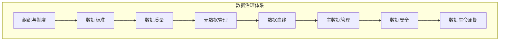
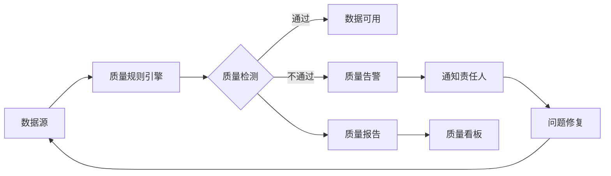
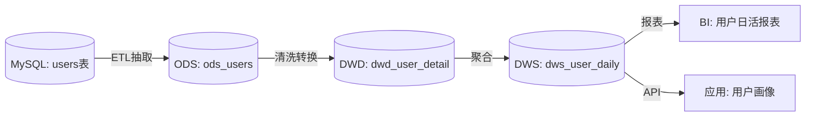

# 数据治理与数据质量

> **文档说明**：数据治理是确保数据准确、一致、安全、可用的体系化管理方法。本文档覆盖数据治理框架、数据质量维度、元数据管理、数据血缘、数据标准、主数据管理、治理工具、落地实践。
>
> **适用人群**：数据工程师、DBA、数据架构师、需要管理数据资产的开发者
>
> **前置知识**：数据库基础、数据仓库概念

---

## 一、数据治理概述

### 1.1 什么是数据治理

数据治理（Data Governance）是对数据资产的**可用性、完整性、一致性、安全性、合规性**进行体系化管理的过程，确保数据在整个生命周期中满足业务需求和法规要求。



### 1.2 为什么需要数据治理

| 痛点 | 治理后 |
|------|--------|
| 同一个指标多个口径（"日活"定义不一致） | 统一指标定义，一个口径 |
| 数据质量差，报表数据对不上 | 质量监控+告警，数据可信 |
| 不知道数据从哪来、经过了什么处理 | 数据血缘可视化，全链路可追溯 |
| 敏感数据泄露风险 | 数据分类分级+权限管控 |
| 数据孤岛，各部门数据不互通 | 主数据统一，数据共享 |
| 合规风险（GDPR/个人信息保护法） | 数据合规审计，满足法规 |
| 元数据缺失，不知道有哪些数据 | 元数据目录，数据可发现 |

### 1.3 数据治理核心领域

| 领域 | 说明 | 关键产出 |
|------|------|---------|
| **数据标准** | 统一命名、格式、编码、指标定义 | 数据标准文档、字典 |
| **数据质量** | 数据的准确性、完整性、一致性等 | 质量规则、质量报告 |
| **元数据管理** | 数据的描述信息（表结构、字段含义） | 元数据目录、数据字典 |
| **数据血缘** | 数据的来源和流向 | 血缘图谱、影响分析 |
| **主数据管理** | 核心业务数据的统一管理 | 主数据平台、黄金记录 |
| **数据安全** | 分类分级、权限、脱敏、加密 | 安全策略、审计日志 |
| **数据生命周期** | 数据从产生到销毁的管理 | 生命周期策略、归档策略 |

---

## 二、数据质量

### 2.1 数据质量六大维度

| 维度 | 定义 | 检查方法 | 示例 |
|------|------|---------|------|
| **准确性** | 数据是否正确反映真实世界 | 与权威源比对、抽样校验 | 用户年龄=200岁 → 不准确 |
| **完整性** | 数据是否缺失 | 空值率、必填项检查 | 手机号字段30%为空 → 不完整 |
| **一致性** | 同一数据在不同地方是否一致 | 跨系统比对、交叉校验 | 订单表用户ID在用户表不存在 → 不一致 |
| **及时性** | 数据是否按时更新 | 更新时间监控、延迟检测 | T+1报表延迟到T+3 → 不及时 |
| **唯一性** | 数据是否有重复 | 重复值检测 | 同一订单号出现2次 → 不唯一 |
| **有效性** | 数据是否符合格式/范围约束 | 格式校验、范围校验 | 邮箱格式错误、状态值不在枚举内 → 无效 |

### 2.2 质量规则示例

```sql
-- 完整性检查：手机号非空率
SELECT
    COUNT(*) AS total,
    SUM(CASE WHEN phone IS NULL OR phone = '' THEN 1 ELSE 0 END) AS missing,
    ROUND(SUM(CASE WHEN phone IS NULL OR phone = '' THEN 1 ELSE 0 END) * 100.0 / COUNT(*), 2) AS missing_rate
FROM users;
-- 缺失率 > 5% 触发告警

-- 唯一性检查：订单号无重复
SELECT order_no, COUNT(*) AS cnt
FROM orders
GROUP BY order_no
HAVING COUNT(*) > 1;
-- 有结果则说明有重复

-- 有效性检查：邮箱格式
SELECT * FROM users
WHERE email NOT REGEXP '^[A-Za-z0-9._%+-]+@[A-Za-z0-9.-]+\\.[A-Za-z]{2,}$';

-- 一致性检查：订单用户ID必须存在于用户表
SELECT o.* FROM orders o
LEFT JOIN users u ON o.user_id = u.id
WHERE u.id IS NULL;

-- 及时性检查：数据更新延迟
SELECT MAX(updated_at) AS last_update,
       TIMESTAMPDIFF(HOUR, MAX(updated_at), NOW()) AS delay_hours
FROM orders;
-- delay_hours > 24 触发告警
```

### 2.3 质量监控体系



```python
# 数据质量检查框架（简化版）
class DataQualityChecker:
    def __init__(self, db_connection):
        self.db = db_connection
        self.rules = []

    def add_rule(self, name, sql, threshold, severity='warning'):
        self.rules.append({'name': name, 'sql': sql, 'threshold': threshold, 'severity': severity})

    def run_checks(self):
        results = []
        for rule in self.rules:
            value = self.db.execute(rule['sql'])
            passed = value <= rule['threshold'] if isinstance(value, (int, float)) else not value
            results.append({
                'rule': rule['name'],
                'value': value,
                'threshold': rule['threshold'],
                'passed': passed,
                'severity': rule['severity']
            })
            if not passed:
                self._alert(rule, value)
        return results

    def _alert(self, rule, value):
        # 发送告警：钉钉/飞书/邮件
        print(f"[{rule['severity']}] {rule['name']} 检查失败: 值={value}, 阈值={rule['threshold']}")
```

---

## 三、元数据管理

### 3.1 元数据分类

| 类型 | 说明 | 示例 |
|------|------|------|
| **业务元数据** | 业务含义、指标定义、数据owner | "日活=每日登录去重用户数" |
| **技术元数据** | 表结构、字段类型、存储信息 | users表：id BIGINT, name VARCHAR |
| **操作元数据** | 数据更新时间、访问频率、质量状态 | 最后更新：2026-08-27，日访问1000次 |
| **社会元数据** | 数据评论、评分、使用记录 | 用户评论："这个表数据准确" |

### 3.2 元数据目录

```text
数据资产目录示例：

📁 业务域：用户中心
  📄 表：users（用户主表）
    📋 描述：存储系统所有注册用户信息
    👤 Owner：张三（用户中心团队）
    📊 行数：1,200,000
    🕐 最后更新：2026-08-27 03:00
    📈 质量评分：95分
    🏷️ 标签：核心表、PII数据
    📝 字段：
      - id (BIGINT)：用户ID，主键
      - name (VARCHAR)：用户姓名
      - phone (VARCHAR)：手机号，加密存储，敏感等级：高
      - email (VARCHAR)：邮箱，敏感等级：中
      - created_at (TIMESTAMP)：注册时间
```

### 3.3 元数据采集

```python
# 自动采集MySQL元数据
def collect_mysql_metadata(connection, database):
    # 1. 采集表信息
    tables = connection.execute("""
        SELECT table_name, table_comment, table_rows, create_time, update_time
        FROM information_schema.tables
        WHERE table_schema = %s
    """, [database])

    # 2. 采集字段信息
    for table in tables:
        columns = connection.execute("""
            SELECT column_name, data_type, column_comment, is_nullable, column_key
            FROM information_schema.columns
            WHERE table_schema = %s AND table_name = %s
        """, [database, table['table_name']])

        # 3. 存入元数据仓库
        metadata_repo.save_table(database, table, columns)
```

---

## 四、数据血缘

### 4.1 什么是数据血缘

数据血缘（Data Lineage）描述数据从产生到消费的完整链路，包括数据的来源、转换过程、流向和依赖关系。



### 4.2 血缘的价值

| 场景 | 价值 |
|------|------|
| **影响分析** | 改了上游表结构，哪些下游报表会受影响？ |
| **根因定位** | 报表数据错了，是哪一步处理出的问题？ |
| **数据溯源** | 这个指标的数据从哪来？经过了哪些转换？ |
| **合规审计** | 敏感数据流向了哪里？谁访问了？ |
| **冗余识别** | 哪些表/字段没人用，可以下线？ |

### 4.3 血缘采集方式

| 方式 | 说明 | 工具 |
|------|------|------|
| **SQL解析** | 解析SQL中的表依赖关系 | Apache Atlas、DataHub |
| **任务调度** | 从调度系统获取任务依赖 | Airflow、DolphinScheduler |
| **ETL工具** | 从ETL工具元数据获取 | DataX、SeaTunnel |
| **手动维护** | 人工录入血缘关系 | 适合复杂逻辑 |

---

## 五、数据标准

### 5.1 数据标准内容

| 标准类型 | 说明 | 示例 |
|---------|------|------|
| **命名标准** | 表名、字段名统一命名规范 | 表名：业务域_主题_粒度，如 dwd_user_detail |
| **格式标准** | 数据格式统一 | 日期：YYYY-MM-DD，手机号：11位数字 |
| **编码标准** | 枚举值统一编码 | 性别：1=男，2=女，0=未知 |
| **指标标准** | 业务指标统一定义 | 日活=每日0点-24点登录去重用户数 |
| **数据类型标准** | 字段类型统一 | 金额用DECIMAL(18,2)，ID用BIGINT |

### 5.2 命名规范示例

```text
表命名规范：
  分层前缀_业务域_主题_粒度
  例：dwd_user_order_detail（明细层-用户域-订单-明细）
  例：dws_user_order_daily（汇总层-用户域-订单-日粒度）

分层前缀：
  ODS：操作数据层（原始数据）
  DWD：明细数据层（清洗后明细）
  DWS：汇总数据层（聚合汇总）
  ADS：应用数据层（面向应用）

字段命名规范：
  小写下划线：user_id, order_amount, created_at
  时间字段：xxx_at（时间戳）, xxx_date（日期）
  状态字段：xxx_status
  标识字段：is_xxx（布尔）, has_xxx
```

### 5.3 指标标准示例

```text
指标名称：日活跃用户数（DAU）
指标定义：统计周期内（自然日00:00-23:59:59），
         至少登录一次的去重用户数
计算公式：COUNT(DISTINCT user_id)
数据来源：dwd_user_login_detail
统计维度：按日、按平台、按渠道
更新频率：T+1，每日凌晨3点更新
负责人：张三（数据团队）
版本：v2.0（2026-01-01更新，排除测试账号）
```

---

## 六、主数据管理（MDM）

### 6.1 什么是主数据

主数据（Master Data）是企业中核心的、共享的、相对稳定的业务实体数据，如用户、商品、组织、供应商等。

| 主数据域 | 说明 | 典型字段 |
|---------|------|---------|
| **用户主数据** | 统一的用户信息 | 用户ID、姓名、手机号、标签 |
| **商品主数据** | 统一的商品信息 | 商品ID、名称、分类、价格 |
| **组织主数据** | 统一的组织架构 | 部门ID、名称、层级 |
| **供应商主数据** | 统一的供应商信息 | 供应商ID、名称、资质 |

### 6.2 主数据管理目标

```text
问题：各系统各自维护用户数据
  系统A：用户表（100字段）
  系统B：用户表（80字段，部分与A不一致）
  系统C：用户表（50字段，手机号格式不同）
  → 用户数据不一致，无法跨系统分析

治理后：主数据平台统一管理
  主数据平台：用户黄金记录（权威源）
  系统A/B/C从主数据平台同步
  → 一个用户，一个版本，全系统一致
```

### 6.3 主数据建设步骤

```text
1. 识别主数据域 → 哪些数据需要统一管理
2. 定义数据模型 → 主数据包含哪些字段
3. 确定权威源 → 哪个系统的数据最准确
4. 数据清洗 → 合并重复、补全缺失、修正错误
5. 建设主数据平台 → 集中存储、管理、分发
6. 数据同步 → 主数据分发到各业务系统
7. 持续维护 → 变更管理、质量监控
```

---

## 七、数据安全与合规

### 7.1 数据分类分级

| 等级 | 定义 | 示例 | 保护措施 |
|------|------|------|---------|
| **L1 公开** | 可公开的数据 | 产品介绍、公开API | 无特殊 |
| **L2 内部** | 内部使用数据 | 内部报表、运营数据 | 访问控制 |
| **L3 敏感** | 敏感业务数据 | 交易数据、用户行为 | 加密+审计 |
| **L4 机密** | 个人隐私/核心机密 | 身份证、手机号、密码 | 加密+脱敏+严格权限+审计 |

### 7.2 合规要求

| 法规 | 适用 | 核心要求 |
|------|------|---------|
| **个人信息保护法** | 中国 | 个人信息收集需同意、最小必要、可删除 |
| **GDPR** | 欧盟 | 数据主体权利、被遗忘权、数据泄露通知 |
| **等保2.0** | 中国 | 数据安全、审计、备份恢复 |
| **数据安全法** | 中国 | 数据分类分级、风险评估、跨境传输 |

### 7.3 数据脱敏

```sql
-- 静态脱敏：数据出库时脱敏（用于测试/分析环境）
CREATE TABLE users_masked AS
SELECT
    id,
    name,
    CONCAT(LEFT(phone, 3), '****', RIGHT(phone, 4)) AS phone,
    CONCAT(LEFT(id_card, 3), '**********', RIGHT(id_card, 4)) AS id_card
FROM users;

-- 动态脱敏：查询时实时脱敏（生产环境）
-- MySQL 8.0 Enterprise / Oracle / PostgreSQL支持
-- 创建脱敏策略，不同角色看到不同数据
```

---

## 八、数据治理工具

| 工具 | 类型 | 特点 |
|------|------|------|
| **Apache Atlas** | 元数据+血缘 | Hadoop生态，开源 |
| **DataHub** | 元数据平台 | LinkedIn开源，现代架构 |
| **OpenMetadata** | 元数据+治理 | 开源，UI友好 |
| **Apache Griffin** | 数据质量 | 开源，批量质量检测 |
| **Great Expectations** | 数据质量 | Python生态，测试驱动 |
| **DataWorks** | 数据治理平台 | 阿里云，一站式 |
| **Amundsen** | 数据发现 | Lyft开源，搜索体验好 |

---

## 九、落地实践

### 9.1 治理成熟度模型

| 级别 | 特征 |
|------|------|
| **L1 初始级** | 无治理，数据混乱，各系统独立 |
| **L2 可重复级** | 有基本规范，部分数据标准化 |
| **L3 已定义级** | 治理体系建立，元数据+质量+血缘 |
| **L4 已管理级** | 质量量化管理，持续改进 |
| **L5 优化级** | 自动化治理，数据驱动决策 |

### 9.2 落地路线图

```text
阶段1（1-3月）：基础建设
  → 成立数据治理组织（数据Owner、治理委员会）
  → 制定数据标准（命名、格式、编码）
  → 建设元数据目录（核心表先接入）

阶段2（3-6月）：质量建设
  → 定义核心表质量规则
  → 建设质量监控+告警
  → 数据质量评分体系

阶段3（6-12月）：血缘+主数据
  → 建设数据血缘（核心链路）
  → 主数据管理（用户/商品）
  → 数据分类分级+安全管控

阶段4（12月+）：持续运营
  → 治理自动化（规则自动发现）
  → 数据资产运营（数据价值评估）
  → 数据文化建设（全员数据意识）
```

### 9.3 治理组织

| 角色 | 职责 |
|------|------|
| **数据治理委员会** | 制定治理战略、决策重大问题 |
| **数据Owner** | 对业务域数据质量负责（业务方） |
| **数据管家** | 日常治理执行（数据团队） |
| **数据使用者** | 遵守规范、反馈问题（全员） |

---

## 关联文档

- [[数据库知识点完整整合大全_优化版]] — 数据库全景
- [[数据库安全与审计实战]] — 数据安全
- [[ClickHouse OLAP引擎实战]] — 数据仓库
- [[高可用架构设计]] — 架构设计
- [[技术选型决策指南]] — 工具选型

---

> 💡 **核心建议**：数据治理不是技术项目，而是"技术+组织+流程"的系统工程。1. 先从最痛的问题入手（如指标口径不一致），不要追求大而全；2. 数据Owner必须是业务方，技术团队只做赋能；3. 自动化是关键——元数据自动采集、质量自动检测、血缘自动解析；4. 治理效果要量化（质量评分、问题修复率、数据使用率）；5. 持续运营比一次性建设更重要。数据治理的终极目标是让数据"找得到、看得懂、信得过、用得好"。


## 补充：底层原理

### 数据治理框架（DAMA-DMBOK）

数据治理（Data Governance）是对数据资产管理的**决策权和职责分配体系**，确保数据在整个生命周期中满足质量、安全、合规、可用性要求。DAMA（国际数据管理协会）提出的 DMBOK 框架包含 11 个知识领域：

| 知识领域 | 核心内容 |
|---------|---------|
| **数据治理** | 组织、制度、流程、标准的顶层设计 |
| **数据架构** | 数据模型、数据流、数据分布、元数据架构 |
| **数据建模与设计** | 概念模型、逻辑模型、物理模型、范式化 |
| **数据存储与操作** | 数据库选型、存储管理、数据生命周期 |
| **数据安全** | 访问控制、加密、脱敏、审计、合规 |
| **数据集成与互操作** | ETL/ELT、数据同步、API、主数据管理 |
| **文档与内容管理** | 非结构化数据管理、文档管理 |
| **参考数据与主数据** | 主数据管理（MDM）、参考数据管理 |
| **数据仓库与商务智能** | 数仓建模、OLAP、报表、数据集市 |
| **元数据管理** | 业务元数据、技术元数据、操作元数据、数据血缘 |
| **数据质量** | 质量评估、清洗、监控、改进 |

### 数据质量六大维度

数据质量不是抽象的"好"或"差"，而是可以量化的六个维度：

| 维度 | 定义 | 衡量指标 | 示例 |
|------|------|---------|------|
| **完整性（Completeness）** | 必需数据是否缺失 | 非空率、必填字段填充率 | 用户表中 email 字段 95% 有值 |
| **准确性（Accuracy）** | 数据是否正确反映真实世界 | 准确率、与权威源比对一致率 | 用户年龄字段 99% 在合理范围（0-120） |
| **一致性（Consistency）** | 同一数据在不同位置是否一致 | 跨系统一致率、重复率 | 用户表和订单表中的 user_id 100% 匹配 |
| **及时性（Timeliness）** | 数据是否在需要时可用 | 更新延迟、数据新鲜度 | 订单数据 T+1 小时内同步到数仓 |
| **唯一性（Uniqueness）** | 是否有重复数据 | 重复率、主键冲突率 | 用户表中按身份证号去重后重复率 < 0.1% |
| **有效性（Validity）** | 数据是否符合格式/业务规则 | 格式合规率、规则通过率 | 手机号字段 99% 符合 11 位数字格式 |

**数据质量问题的根因分类**：
| 根因 | 占比（经验值） | 示例 |
|------|--------------|------|
| **源头录入错误** | ~40% | 用户填写错误、手动录入失误 |
| **系统设计缺陷** | ~25% | 缺少校验、字段设计不合理、无唯一约束 |
| **数据集成问题** | ~20% | ETL 逻辑错误、同步延迟、格式转换丢失 |
| **业务变更未同步** | ~10% | 业务规则变化但数据模型未更新 |
| **其他** | ~5% | 硬件故障、网络问题、恶意操作 |

### 元数据与数据血缘

元数据（Metadata）是"关于数据的数据"，分为三类：

| 元数据类型 | 说明 | 示例 |
|-----------|------|------|
| **业务元数据** | 业务含义、定义、规则 | 字段业务含义、指标计算公式、数据 owner |
| **技术元数据** | 技术属性、存储、结构 | 表结构、字段类型、索引、存储位置、ETL 任务 |
| **操作元数据** | 运行状态、质量、使用情况 | 数据更新时间、质量评分、访问频率、血缘关系 |

**数据血缘（Data Lineage）** 追踪数据从源头到消费端的完整流转路径：

```text
源系统（MySQL 订单表）→ ETL 抽取 → 数据清洗 → ODS 层 → DWD 层 → DWS 层 → ADS 层 → 报表/BI
```

血缘的价值：
- **影响分析**：修改上游字段时，知道哪些下游报表会受影响
- **根因分析**：报表数据错误时，能追溯到哪个环节出了问题
- **合规审计**：满足 GDPR 等法规对数据可追溯性的要求
- **数据发现**：知道数据从哪里来、到哪里去、谁在使用

---

## 补充：进阶与最佳实践

### 1. 数据治理组织架构

| 角色 | 职责 | 参与度 |
|------|------|--------|
| **数据治理委员会** | 顶层决策、制定战略、审批标准、资源协调 | 高层领导，月度会议 |
| **数据治理办公室（DGO）** | 日常运营、推动落地、监控进度、培训 | 专职团队，日常工作 |
| **数据 Owner** | 对特定领域数据质量负责（如用户数据 Owner） | 业务部门负责人 |
| **数据 Steward** | 具体执行数据标准、处理数据问题、维护元数据 | 业务/技术骨干 |
| **数据架构师** | 设计数据架构、制定技术标准、评审数据模型 | 技术团队 |
| **数据工程师** | 建设数据平台、开发 ETL、保障数据管道 | 技术团队 |
| **数据分析师** | 使用数据、反馈数据质量问题、提出需求 | 业务团队 |

### 2. 数据质量监控实践

```python
# 数据质量检查脚本示例（Great Expectations 风格）
import great_expectations as ge

# 加载数据
df = ge.read_csv("users.csv")

# 定义期望（数据质量规则）
df.expect_column_to_exist("user_id")
df.expect_column_values_to_be_unique("user_id")
df.expect_column_values_to_not_be_null("email")
df.expect_column_values_to_match_regex("email", r"^[^@]+@[^@]+\.[^@]+$")
df.expect_column_values_to_be_between("age", min_value=0, max_value=120)
df.expect_column_values_to_be_in_set("status", ["active", "inactive", "banned"])
df.expect_table_row_count_to_be_between(min_value=1000, max_value=1000000)

# 执行验证
results = df.validate()
print(f"成功率: {results.success_percent:.1f}%")
for result in results.results:
    if not result.success:
        print(f"❌ {result.expectation_config.expectation_type}: {result.result}")

# 输出数据质量报告
# Great Expectations 会生成 HTML 数据文档
```

**数据质量规则分类**：
| 规则类型 | 示例 | 检查频率 |
|---------|------|---------|
| **空值检查** | 必填字段非空率 > 99% | 每次 ETL 后 |
| **唯一性检查** | 主键无重复 | 每次 ETL 后 |
| **范围检查** | 数值在合理范围（年龄 0-120） | 每次 ETL 后 |
| **格式检查** | 邮箱/手机号/身份证格式正确 | 每次 ETL 后 |
| **枚举检查** | 状态字段在允许值列表内 | 每次 ETL 后 |
| **一致性检查** | 跨系统数据一致（订单金额=支付金额） | 每日 |
| **及时性检查** | 数据在 SLA 时间内更新 | 每日 |
| **趋势检查** | 数据量/指标在预期范围内（无突增突降） | 每日 |
| **血缘检查** | 上游数据质量达标后才下游处理 | 每次 ETL |

### 3. 主数据管理（MDM）

主数据（Master Data）是企业中共享的、高价值的、相对稳定的核心数据，如用户、商品、组织、供应商。主数据管理的目标是**确保主数据在全企业范围内唯一、准确、一致**。

| MDM 实现模式 | 说明 | 适用场景 |
|-------------|------|---------|
| **注册表模式** | 主数据存在各系统，MDM 只记录映射关系 | 数据量大、变更频繁 |
| **共存模式** | MDM 和各系统都存主数据，双向同步 | 渐进式实施 |
| **集中模式** | MDM 是主数据唯一来源，各系统从 MDM 获取 | 强一致性要求 |
| **合并模式** | 从各系统收集主数据，合并去重后下发 | 数据整合阶段 |

**主数据治理关键活动**：
1. 识别主数据域（用户、商品、组织...）
2. 定义主数据模型（字段、属性、关系）
3. 建立匹配/合并规则（如何识别重复数据、如何合并）
4. 制定数据质量规则和标准
5. 明确数据 Owner 和 Steward
6. 建设 MDM 平台（或用开源工具如 Apache Atlas、DataHub）
7. 持续监控和改进

### 4. 数据治理成熟度评估

| 级别 | 特征 | 关键指标 |
|------|------|---------|
| **L1 初始级** | 无治理，数据混乱，各系统各自为政 | 数据质量问题频发，无标准 |
| **L2 可重复级** | 有基本流程，部分领域有标准 | 关键报表数据准确，有基本监控 |
| **L3 已定义级** | 治理体系建立，标准全面推行 | 数据质量可量化，有 Owner 制度 |
| **L4 已管理级** | 数据质量持续监控，主动改进 | 数据质量 SLA 达标率 > 95%，自动化监控 |
| **L5 优化级** | 数据驱动决策，治理持续优化 | 数据资产化，数据价值可衡量，自优化 |

**从 L1 到 L3 的关键步骤**：
1. 成立数据治理组织（委员会 + 办公室）
2. 制定数据治理战略和路线图
3. 选择 1-2 个高价值领域试点（如用户数据、订单数据）
4. 建立数据标准和质量规则
5. 建设数据质量监控和元数据管理平台
6. 推广到其他领域，持续运营
