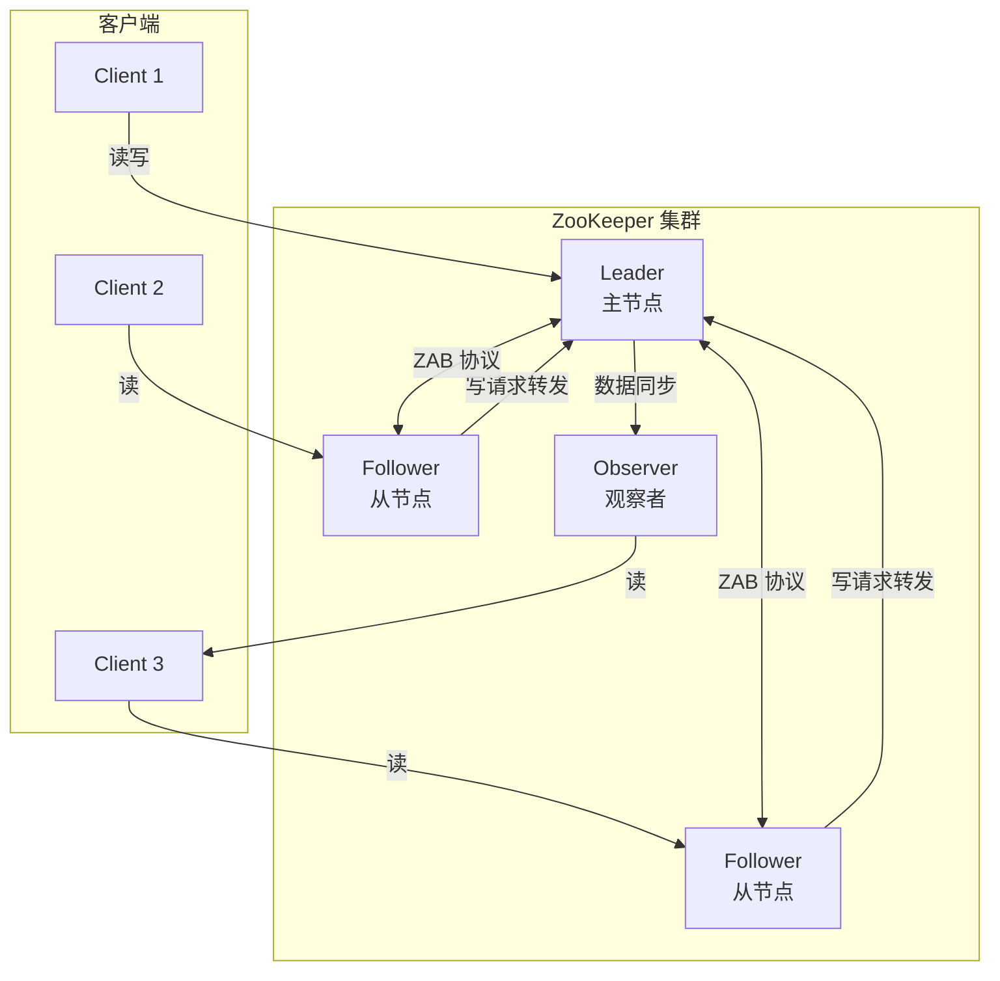
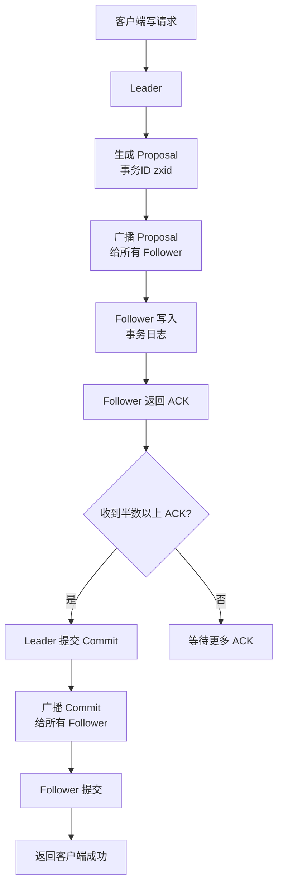

# ZooKeeper 核心原理与实战

> **文档说明**：系统讲解 ZooKeeper 的核心架构、数据模型（ZNode）、Watcher 监听机制、ZAB 一致性协议、部署方式（单机/集群）、典型应用场景（分布式锁、服务注册发现、配置管理、Master 选举、分布式队列）、Curator 客户端实战，以及生产级最佳实践和常见问题排查。
>
> **适用人群**：Java 后端开发工程师、全栈开发者、分布式系统架构师
>
> **前置知识**：[[分布式锁知识点系统梳理_优化版]]、[[Raft共识算法详解]]、[[分布式ID生成方案]]

---

## 一、概述

### 1. 什么是 ZooKeeper

**ZooKeeper** 是 Apache 软件基金会的一个分布式协调服务，为分布式应用提供一致性服务，包括配置维护、域名服务、分布式同步、组服务等。它是 Hadoop、HBase、Kafka、Dubbo 等众多分布式系统的核心组件。

### 2. 核心特性

| 特性 | 说明 |
|------|------|
| **顺序一致性** | 客户端的更新请求按发送顺序应用 |
| **原子性** | 更新要么成功要么失败，没有中间状态 |
| **单一视图** | 客户端连接到任何服务器，看到的都是相同的视图 |
| **可靠性** | 更新一旦应用，将一直保持，直到被覆盖 |
| **实时性** | 客户端在一定时间内能看到最新数据 |
| **高可用** | 集群部署，半数以上节点存活即可服务 |
| **Watcher 机制** | 数据变更时主动通知客户端 |

### 3. 架构



### 4. 角色

| 角色 | 说明 |
|------|------|
| **Leader** | 主节点，处理所有写请求，负责投票发起和决议 |
| **Follower** | 从节点，处理读请求，写请求转发给 Leader，参与投票 |
| **Observer** | 观察者，处理读请求，不参与投票，用于提升读性能 |
| **Client** | 客户端，连接 ZooKeeper 集群，发起读写请求 |

---

## 二、数据模型

### 1. ZNode

ZooKeeper 的数据模型是一个树形结构，每个节点称为 **ZNode**，类似文件系统的目录/文件。

```text
/
├── zookeeper/          # 系统节点
│   └── quota/
├── services/           # 服务注册
│   ├── user-service/
│   │   ├── 192.168.1.10:8080
│   │   └── 192.168.1.11:8080
│   └── order-service/
├── config/             # 配置管理
│   ├── app.yml
│   └── db.yml
├── locks/              # 分布式锁
│   └── order-lock/
└── masters/            # Master 选举
    └── master-0000000001
```

### 2. ZNode 类型

| 类型 | 说明 | 生命周期 |
|------|------|---------|
| **持久节点（PERSISTENT）** | 创建后一直存在，除非主动删除 | 永久 |
| **持久顺序节点（PERSISTENT_SEQUENTIAL）** | 持久节点，名称后自动追加递增序号 | 永久 |
| **临时节点（EPHEMERAL）** | 客户端会话断开后自动删除 | 会话级 |
| **临时顺序节点（EPHEMERAL_SEQUENTIAL）** | 临时节点，名称后自动追加递增序号 | 会话级 |
| **容器节点（CONTAINER）** | 容器节点，子节点全部删除后自动删除 | 子节点为空时 |
| **TTL 节点** | 带过期时间的持久节点 | 指定时间后 |

### 3. ZNode 结构

每个 ZNode 包含：
- **data**：节点存储的数据（默认 1MB 限制）
- **ACL**：访问控制列表
- **stat**：元数据（版本号、时间戳、子节点数等）

```text
ZNode stat 结构：
- czxid: 创建时的事务 ID
- mzxid: 最后修改时的事务 ID
- ctime: 创建时间
- mtime: 最后修改时间
- version: 数据版本号（每次修改 +1）
- cversion: 子节点版本号
- aversion: ACL 版本号
- ephemeralOwner: 临时节点的会话 ID（持久节点为 0）
- dataLength: 数据长度
- numChildren: 子节点数量
```

---

## 三、Watcher 机制

### 1. Watcher 概述

Watcher 是 ZooKeeper 的核心机制，客户端可以在 ZNode 上注册监听器，当节点状态变化时（数据变更、子节点变更、节点删除），ZooKeeper 会异步通知客户端。

### 2. Watcher 类型

| 事件类型 | 触发条件 |
|---------|---------|
| **NodeCreated** | 节点被创建 |
| **NodeDeleted** | 节点被删除 |
| **NodeDataChanged** | 节点数据变更 |
| **NodeChildrenChanged** | 子节点列表变更 |
| **None** | 会话状态变更（连接断开、连接建立、认证失败） |

### 3. Watcher 特点

- [ ] **一次性触发**：Watcher 触发一次后自动移除，需重新注册
- [ ] **异步通知**：Watcher 通知是异步的，不保证实时
- [ ] **轻量级**：通知只包含事件类型和路径，不包含变更内容
- [ ] **顺序保证**：客户端先收到 Watcher 通知，再看到新数据

### 4. 注册 Watcher 的方法

| 方法 | 监听内容 |
|------|---------|
| `getData(path, watch)` | 节点数据变更（NodeDataChanged） |
| `exists(path, watch)` | 节点创建/删除/数据变更 |
| `getChildren(path, watch)` | 子节点列表变更（NodeChildrenChanged） |

---

## 四、ZAB 协议

### 1. ZAB 概述

**ZAB（ZooKeeper Atomic Broadcast）** 是 ZooKeeper 的原子广播协议，基于 Paxos 算法简化而来，保证集群数据的一致性。

### 2. ZAB 两种模式

| 模式 | 说明 |
|------|------|
| **崩溃恢复（Recovery）** | Leader 宕机或集群启动时，选举新 Leader 并同步数据 |
| **消息广播（Broadcast）** | 正常运行时，Leader 处理写请求并广播给 Follower |

### 3. 消息广播流程



**关键概念**：
- **zxid（事务 ID）**：64位，高32位是 epoch（Leader 周期），低32位是事务序号
- **半数原则**：收到半数以上 Follower 的 ACK 即可提交
- **顺序保证**：所有事务按 zxid 顺序应用

### 4. Leader 选举

```text
选举触发条件：
1. 集群启动时
2. Leader 宕机时
3. Leader 与半数以上节点失去连接时

选举流程：
1. 每个节点投票给自己，广播选票
2. 收到其他节点选票后，比较 zxid（大者优先），相同则比较 myid
3. 更新选票并重新广播
4. 收到半数以上相同选票的节点成为 Leader
5. Leader 与 Follower 同步数据
```

---

## 五、部署

### 1. 单机部署

```bash
# 1. 下载
wget https://archive.apache.org/dist/zookeeper/zookeeper-3.8.0/apache-zookeeper-3.8.0-bin.tar.gz
tar -xzf apache-zookeeper-3.8.0-bin.tar.gz
cd apache-zookeeper-3.8.0-bin

# 2. 配置
cp conf/zoo_sample.cfg conf/zoo.cfg
# conf/zoo.cfg
# tickTime=2000          # 心跳间隔（毫秒）
# initLimit=10           # Follower 同步 Leader 的最大心跳数
# syncLimit=5            # Follower 与 Leader 同步的最大心跳数
# dataDir=/data/zookeeper  # 数据目录
# clientPort=2181        # 客户端端口
# admin.enableServer=true # 管理控制台

# 3. 启动
bin/zkServer.sh start

# 4. 客户端连接
bin/zkCli.sh -server localhost:2181
```

### 2. 集群部署

```bash
# 3 节点集群（奇数节点，至少 3 个）

# 每台服务器的 zoo.cfg
# tickTime=2000
# initLimit=10
# syncLimit=5
# dataDir=/data/zookeeper
# clientPort=2181
# server.1=192.168.1.10:2888:3888  # 2888=数据同步端口，3888=选举端口
# server.2=192.168.1.11:2888:3888
# server.3=192.168.1.12:2888:3888

# 每台服务器创建 myid 文件（内容为服务器 ID）
echo "1" > /data/zookeeper/myid  # 第1台
echo "2" > /data/zookeeper/myid  # 第2台
echo "3" > /data/zookeeper/myid  # 第3台

# 依次启动
bin/zkServer.sh start

# 查看状态
bin/zkServer.sh status
# Mode: leader / follower
```

### 3. 集群节点数选择

| 节点数 | 可容忍宕机数 | 说明 |
|--------|-------------|------|
| 1 | 0 | 单机，无高可用 |
| 2 | 0 | 2 节点需全部存活，不推荐 |
| 3 | 1 | 最小高可用集群，推荐 |
| 5 | 2 | 更高可用性，生产推荐 |
| 7 | 3 | 极高可用性 |

> **注意**：节点数必须为奇数，偶数节点没有额外收益（4节点和3节点都只能容忍1个宕机）。

---

## 六、典型应用场景

### 1. 分布式锁

使用临时顺序节点实现分布式锁：

```text
获取锁流程：
1. 在 /locks/lock 下创建临时顺序节点 /locks/lock/lock-0000000001
2. 获取 /locks/lock 下所有子节点
3. 判断自己的节点是否是序号最小的
4. 是最小的 → 获取锁成功
5. 不是最小的 → 监听前一个节点的删除事件（Watcher）
6. 前一个节点删除（释放锁）→ 收到通知 → 回到步骤2

释放锁：
- 客户端断开连接 → 临时节点自动删除
- 或主动删除节点
```

```java
// Curator 实现分布式锁
InterProcessMutex lock = new InterProcessMutex(client, "/locks/order");
try {
    // 获取锁（最多等待 10 秒）
    if (lock.acquire(10, TimeUnit.SECONDS)) {
        try {
            // 执行业务逻辑
            processOrder();
        } finally {
            lock.release();  // 释放锁
        }
    }
} catch (Exception e) {
    e.printStackTrace();
}
```

### 2. 服务注册发现

```text
服务提供者：
1. 启动时在 /services/user-service 下创建临时节点
   /services/user-service/192.168.1.10:8080（数据为服务元数据）
2. 服务宕机 → 临时节点自动删除

服务消费者：
1. 订阅 /services/user-service 的子节点变更（Watcher）
2. 获取所有服务节点列表
3. 节点变更时自动更新本地缓存
```

```java
// 服务注册
client.create()
    .creatingParentsIfNeeded()
    .withMode(CreateMode.EPHEMERAL)
    .forPath("/services/user-service/192.168.1.10:8080",
        "{\"weight\":1,\"status\":\"UP\"}".getBytes());

// 服务发现（监听子节点变化）
PathChildrenCache cache = new PathChildrenCache(client, "/services/user-service", true);
cache.getListenable().addListener((client, event) -> {
    // 子节点变更，更新服务列表
    List<String> servers = client.getChildren().forPath("/services/user-service");
    updateServiceList(servers);
});
cache.start();
```

### 3. 配置管理

```text
配置发布：
1. 将配置写入 /config/app.yml 节点
2. 客户端注册 Watcher 监听该节点

配置变更：
1. 修改 /config/app.yml 数据
2. Watcher 触发 NodeDataChanged 事件
3. 客户端收到通知，重新拉取配置
```

```java
// 监听配置变更
client.getData()
    .usingWatcher((WatchedEvent event) -> {
        if (event.getType() == Watcher.Event.EventType.NodeDataChanged) {
            // 配置变更，重新拉取
            byte[] data = client.getData().forPath("/config/app.yml");
            updateConfig(new String(data));
        }
    })
    .forPath("/config/app.yml");
```

### 4. Master 选举

```text
1. 所有节点在 /masters 下创建临时顺序节点
2. 序号最小的节点成为 Master
3. Master 宕机 → 临时节点删除 → 下一个节点成为新 Master
4. 其他节点监听前一个节点的删除事件
```

```java
// Curator LeaderSelector
LeaderSelectorListener listener = new LeaderSelectorListenerAdapter() {
    @Override
    public void takeLeadership(CuratorFramework client) throws Exception {
        // 获取 Leader 身份，执行主节点任务
        System.out.println("成为 Master，开始执行任务");
        // 此方法返回后会释放 Leader 身份
        while (running) {
            doMasterWork();
            Thread.sleep(1000);
        }
    }
};

LeaderSelector selector = new LeaderSelector(client, "/masters", listener);
selector.autoRequeue();  // 释放后自动重新参与选举
selector.start();
```

### 5. 分布式队列

```text
入队：在 /queue 下创建持久顺序节点 /queue/queue-0000000001
出队：获取序号最小的节点，处理后删除
```

---

## 七、Curator 客户端

### 1. Maven 依赖

```xml
<dependency>
    <groupId>org.apache.curator</groupId>
    <artifactId>curator-framework</artifactId>
    <version>5.5.0</version>
</dependency>
<dependency>
    <groupId>org.apache.curator</groupId>
    <artifactId>curator-recipes</artifactId>
    <version>5.5.0</version>
</dependency>
```

### 2. 客户端创建

```java
// 创建 Curator 客户端
CuratorFramework client = CuratorFrameworkFactory.builder()
    .connectString("192.168.1.10:2181,192.168.1.11:2181,192.168.1.12:2181")
    .sessionTimeoutMs(30000)     // 会话超时
    .connectionTimeoutMs(10000)  // 连接超时
    .retryPolicy(new ExponentialBackoffRetry(1000, 3))  // 重试策略
    .namespace("myapp")          // 命名空间（所有路径自动加前缀）
    .build();

client.start();  // 启动客户端
```

### 3. 常用操作

```java
// 创建节点
client.create()
    .creatingParentsIfNeeded()          // 自动创建父节点
    .withMode(CreateMode.PERSISTENT)    // 持久节点
    .forPath("/config/key", "value".getBytes());

// 读取数据
byte[] data = client.getData().forPath("/config/key");
String value = new String(data);

// 更新数据
client.setData().forPath("/config/key", "newValue".getBytes());

// 删除节点
client.delete()
    .deletingChildrenIfNeeded()  // 递归删除子节点
    .forPath("/config/key");

// 检查节点是否存在
Stat stat = client.checkExists().forPath("/config/key");
boolean exists = stat != null;

// 获取子节点
List<String> children = client.getChildren().forPath("/services");
```

### 4. Curator  Recipes（开箱即用方案）

| Recipe | 说明 |
|--------|------|
| **InterProcessMutex** | 分布式可重入锁 |
| **InterProcessReadWriteLock** | 分布式读写锁 |
| **InterProcessSemaphore** | 分布式信号量 |
| **LeaderSelector** | Master 选举 |
| **PathChildrenCache** | 子节点监听 |
| **NodeCache** | 节点数据监听 |
| **TreeCache** | 整棵树监听 |
| **DistributedQueue** | 分布式队列 |
| **DistributedPriorityQueue** | 分布式优先队列 |
| **AtomicInteger** | 分布式原子整数 |

---

## 八、生产最佳实践

### 1. 部署规范

- [ ] **奇数节点**：集群节点数为奇数（3/5/7），至少 3 节点
- [ ] **独立部署**：ZooKeeper 独立部署，不与其他服务混部
- [ ] **磁盘性能**：使用 SSD，事务日志和数据快照分盘存储
- [ ] **内存充足**：JVM 堆内存建议 4-8GB，避免频繁 GC
- [ ] **网络稳定**：节点间网络延迟低，避免跨机房部署
- [ ] **监控告警**：监控延迟、连接数、Watch 数、临时节点数

### 2. 使用规范

- [ ] **节点数据小**：单个 ZNode 数据不超过 1MB，建议 < 1KB
- [ ] **子节点数控制**：单个节点子节点数不超过 10 万
- [ ] **临时节点用于会话**：服务注册、分布式锁使用临时节点
- [ ] **Watcher 及时重注册**：Watcher 一次性触发，需在回调中重新注册
- [ ] **避免羊群效应**：大量客户端监听同一节点会导致通知风暴
- [ ] **使用 Curator**：优先使用 Curator 而非原生 API，封装更完善
- [ ] **合理设置超时**：sessionTimeout 不要太短（建议 30s），避免频繁会话过期

### 3. 性能优化

| 优化项 | 说明 |
|--------|------|
| **事务日志磁盘** | dataLogDir 单独挂载高速磁盘 |
| **快照间隔** | 合理设置 autopurge.snapRetainCount 和 purgeInterval |
| **直接内存** | 使用堆外内存减少 GC 影响 |
| **读均衡** | 客户端连接到不同 Follower，均衡读负载 |
| **批量操作** | 使用 multi() 批量提交，减少网络往返 |
| **减少 Watcher** | 避免大量客户端监听同一节点 |

---

## 九、常见问题与排查

| 问题 | 原因 | 解决方案 |
|------|------|---------|
| **连接超时** | 网络不通 / 集群不可用 / 连接数满 | 检查网络、集群状态、客户端连接数 |
| **会话过期** | 客户端 GC 停顿 / 网络抖动 / 超时设置过短 | 优化 JVM、检查网络、调大 sessionTimeout |
| **Leader 频繁切换** | 网络不稳定 / 节点负载高 / 磁盘 IO 慢 | 检查网络、优化节点性能、使用 SSD |
| **数据不一致** | 集群脑裂 / 节点恢复后未同步 | 检查集群状态、确保半数以上节点存活、手动同步 |
| **Watcher 不触发** | Watcher 已触发未重注册 / 路径错误 / 会话过期 | 重新注册 Watcher、检查路径、检查会话状态 |
| **临时节点未删除** | 会话未真正关闭 / 客户端异常退出 | 检查会话状态、等待会话超时自动清理 |
| **分布式锁死锁** | 获取锁后未释放 / 会话过期但业务未感知 | 使用 try-finally 释放锁、监听会话状态 |
| **羊群效应** | 大量客户端监听同一节点 | 使用顺序节点只监听前一个节点、使用 Curator |
| **性能下降** | 节点数据过大 / 子节点过多 / Watcher 过多 | 控制数据大小、拆分节点、优化 Watcher |
| **磁盘满** | 事务日志和快照未清理 | 配置自动清理 autopurge.purgeInterval、定期清理 |
| **脑裂** | 网络分区导致多 Leader | 确保集群节点数奇数、网络稳定、半数原则 |
| **ACL 权限问题** | 节点 ACL 配置错误 / 客户端未认证 | 检查 ACL 配置、使用正确的认证信息 |
| **顺序节点序号异常** | 时钟回拨 / 会话恢复 | 使用事务 ID 而非时间戳、检查系统时钟 |
| **Observer 不生效** | 配置错误 / 未正确启动 | 检查 peerType=observer 配置、节点状态 |

---

## 十、关联笔记

### 分布式
- [[分布式锁知识点系统梳理_优化版]] · [[分布式事务 知识点系统梳理_优化版]] · [[分布式ID生成方案]]
- [[Raft共识算法详解]] · [[ZooKeeper核心原理与实战]] · [[分布式任务调度实战]]
- [[分布式缓存架构设计]]

### 微服务
- [[SpringCloud-Alibaba组件体系]] · [[Nacos-注册中心与配置中心]] · [[微服务核心组件知识点系统梳理_优化版]]
- [[Gateway-网关路由与鉴权]] · [[Sentinel-流量控制与熔断]]

### 消息队列
- [[Kafka-消息队列与消费模型]] · [[RabbitMQ核心原理与实战]] · [[RocketMQ-事务消息与顺序消息]]

### 后端
- [[高可用架构设计]] · [[高并发系统设计案例]] · [[SpringBoot-自动装配原理]]
- [[Seata-分布式事务]] · [[XXL-Job-分布式任务调度]]

### 导航
- [[MOC-分布式与中间件]] · [[MOC-后端开发]] · [[全栈+AI工程双轨融合学习路线图]]

> **学习路径建议**：先掌握 [[分布式锁知识点系统梳理_优化版]] 分布式锁理论 → 学习 [[Raft共识算法详解]] 一致性协议 → 深入本文 ZooKeeper 核心原理与实战 → 实践 Curator 客户端和分布式锁 → 研究 [[Nacos-注册中心与配置中心]] 服务注册发现 → 应用于 [[高可用架构设计]] 分布式协调。

---

## 💡 全文深度讲解

本文系统梳理了ZooKeeper 核心原理与实战的核心知识体系，从概述入手，深入数据模型的底层机制，再通过Watcher 机制掌握实战应用，最后涵盖常见问题与排查与关联笔记。学习时建议先建立整体认知，再动手实践，最后结合常见问题深化理解。

## 📝 全文精简总结

- **概述**：掌握本模块的核心概念与关键要点
- **数据模型**：掌握本模块的核心概念与关键要点
- **Watcher 机制**：掌握本模块的核心概念与关键要点
- **ZAB 协议**：掌握本模块的核心概念与关键要点
- **部署**：掌握本模块的核心概念与关键要点
- **典型应用场景**：掌握本模块的核心概念与关键要点
- **Curator 客户端**：掌握本模块的核心概念与关键要点
- **生产最佳实践**：掌握本模块的核心概念与关键要点
- 其余2个模块涵盖进阶主题与拓展内容

