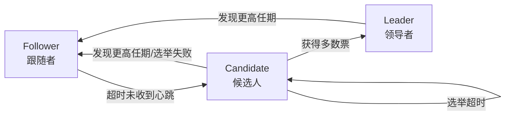
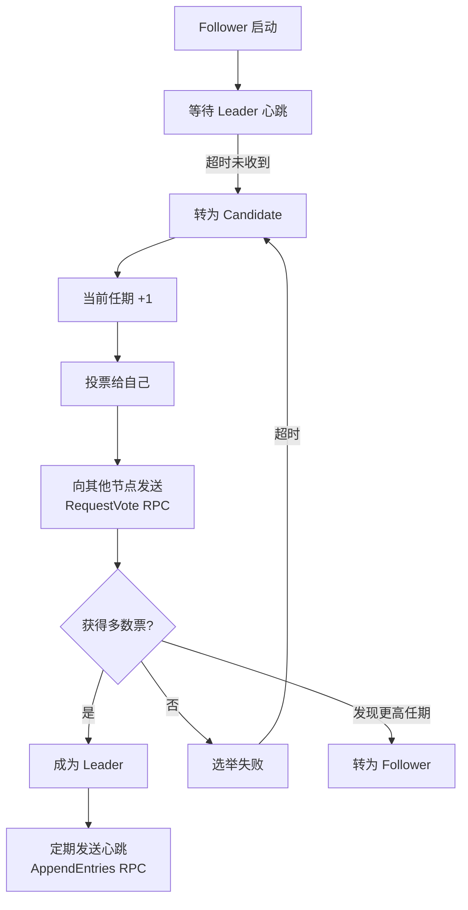
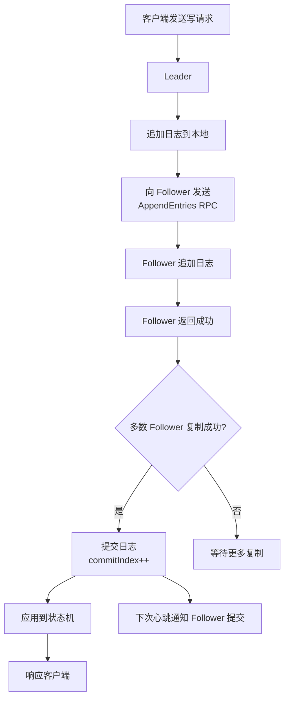

# Raft 共识算法详解

> **文档说明**：系统讲解 Raft 共识算法的核心原理，包括 Raft 的设计目标、核心概念（角色/任期/日志）、Leader 选举机制、日志复制流程、安全性保证（选举限制/日志匹配属性）、成员变更（联合共识/单节点变更）、日志压缩（快照）、与 Paxos/ZAB 的对比，以及典型实现（etcd/Consul/TiKV）和常见问题。
>
> **适用人群**：Java 后端开发工程师、全栈开发者、分布式系统架构师、需要理解分布式一致性原理的工程师
>
> **前置知识**：[[分布式事务 知识点系统梳理_优化版]]、[[ZooKeeper核心原理与实战]]、[[分布式ID生成方案]]

---

## 一、概述

### 1. 什么是共识算法

**共识算法**是分布式系统中多个节点就某个值达成一致的算法。在分布式系统中，节点可能宕机、网络可能分区、消息可能延迟或丢失，共识算法保证在这些异常情况下系统仍能达成一致。

### 2. 为什么需要 Raft

Paxos 是经典的共识算法，但难以理解和实现。Raft 由 Diego Ongaro 和 John Ousterhout 于 2013 年提出，设计目标是**可理解性**（Understandability），通过将共识问题分解为三个独立的子问题（Leader 选举、日志复制、安全性），使其更容易理解和实现。

### 3. Raft vs Paxos vs ZAB

| 维度 | Raft | Paxos | ZAB |
|------|------|-------|-----|
| **设计目标** | 可理解性 | 正确性 | 高可用 |
| **角色** | Leader/Follower/Candidate | Proposer/Acceptor/Learner | Leader/Follower/Observer |
| **选举** | 随机超时 + 多数投票 | 提案投票 | 恢复模式选举 |
| **日志复制** | Leader 强一致性 | 多 Proposer 并发 | Leader 广播 |
| **成员变更** | 联合共识/单节点变更 | 复杂 | 动态配置 |
| **可理解性** | ⭐⭐⭐⭐⭐ 高 | ⭐ 低 | ⭐⭐⭐ 中 |
| **实现复杂度** | 低 | 高 | 中 |
| **典型应用** | etcd、Consul、TiKV | Google Chubby | ZooKeeper |

### 4. Raft 核心特性

- [ ] **强一致性**：保证线性一致性（Linearizability）
- [ ] **高可用** | 半数以上节点存活即可服务
- [ ] **容错性** | 容忍少数节点宕机
- [ ] **Leader 机制** | 唯一 Leader 处理所有写请求
- [ ] **日志复制** | Leader 将日志复制到 Follower
- [ ] **成员变更** | 支持集群节点动态增减

---

## 二、核心概念

### 1. 节点角色



| 角色 | 说明 |
|------|------|
| **Follower（跟随者）** | 被动接收 Leader 的日志，响应 Candidate 的投票请求 |
| **Candidate（候选人）** | Follower 超时未收到 Leader 心跳后转为 Candidate，发起选举 |
| **Leader（领导者）** | 处理所有客户端写请求，将日志复制到 Follower，定期发送心跳 |

### 2. 任期（Term）

**任期（Term）** 是一个单调递增的整数，相当于 Raft 中的"逻辑时钟"。

```text
时间线：
Term 1 ──── Term 2 ──── Term 3 ──── ...
  │          │          │
Leader A   Leader B   Leader C
```

- 每个任期最多有一个 Leader
- 任期号在选举时自增
- 节点通过任期号判断信息是否过时
- 发现更高任期的节点时，自动转为 Follower

### 3. 日志（Log）

Raft 使用日志保证一致性，每个日志条目包含：

| 字段 | 说明 |
|------|------|
| **index** | 日志在日志序列中的位置（从 1 开始） |
| **term** | 该日志被创建时的任期号 |
| **command** | 状态机执行的命令（如 set key=value） |

```text
日志结构：
┌───────┬───────┬───────┬───────┬───────┐
│ index │   1   │   2   │   3   │   4   │
├───────┼───────┼───────┼───────┼───────┤
│ term  │   1   │   1   │   2   │   2   │
├───────┼───────┼───────┼───────┼───────┤
│command│ set x │ set y │ set z │ set w │
└───────┴───────┴───────┴───────┴───────┘
         ↑               ↑
      commitIndex     lastApplied
```

**关键索引**：
| 索引 | 说明 |
|------|------|
| **commitIndex** | 已知已提交的最高日志条目的索引 |
| **lastApplied** | 已应用到状态机的最高日志条目的索引 |
| **nextIndex** | Leader 为每个 Follower 维护的下一条要发送的日志索引 |
| **matchIndex** | Leader 为每个 Follower 维护的已知复制成功的最高日志索引 |

---

## 三、Leader 选举

### 1. 选举流程



### 2. 选举超时

- **选举超时（Election Timeout）**：Follower 等待 Leader 心跳的时间，随机化在 150ms-300ms 之间
- **随机化**：避免多个节点同时发起选举导致选票瓜分
- **心跳间隔（Heartbeat Interval）**：Leader 定期发送空的 AppendEntries RPC，通常 50ms-100ms

### 3. RequestVote RPC

Candidate 向其他节点发送投票请求：

```text
RequestVote RPC 参数：
- term: Candidate 的任期号
- candidateId: Candidate 的 ID
- lastLogIndex: Candidate 最后一条日志的索引
- lastLogTerm: Candidate 最后一条日志的任期号

返回值：
- term: 节点当前任期（用于 Candidate 更新自己）
- voteGranted: 是否投票给 Candidate
```

**投票规则**：
1. 每个任期每个节点最多投一票
2. 先到先得（先来的 Candidate 获得票）
3. Candidate 的日志必须至少和投票者一样新（通过 lastLogIndex 和 lastLogTerm 判断）
4. 投票者当前任期 < Candidate 任期时，先更新任期再投票

### 4. 选举安全性

Raft 通过**日志完整性检查**保证选举安全：只有日志最新的 Candidate 才能当选 Leader。

```text
日志比较规则：
1. 比较最后一条日志的任期号（lastLogTerm），任期号大的更新
2. 任期号相同，比较日志索引（lastLogIndex），索引大的更新
```

这保证了已提交的日志不会丢失，因为已提交的日志一定存在于多数节点中，而新 Leader 必须获得多数票，所以新 Leader 一定包含所有已提交的日志。

---

## 四、日志复制

### 1. 复制流程



### 2. AppendEntries RPC

```text
AppendEntries RPC 参数：
- term: Leader 的任期号
- leaderId: Leader 的 ID
- prevLogIndex: 前一条日志的索引
- prevLogTerm: 前一条日志的任期号
- entries[]: 要复制的日志条目（空表示心跳）
- leaderCommit: Leader 的 commitIndex

返回值：
- term: 节点当前任期（用于 Leader 更新自己）
- success: 是否成功复制（prevLogIndex/prevLogTerm 匹配）
```

### 3. 日志匹配属性

Raft 保证以下属性：

> 如果两个不同日志中的条目具有相同的索引和任期号，那么它们存储相同的命令，并且在所有前面的日志条目上也完全一致。

**实现机制**：
- Leader 发送 AppendEntries 时携带 prevLogIndex 和 prevLogTerm
- Follower 检查前一条日志是否匹配，不匹配则拒绝
- Leader 收到拒绝后，递减 nextIndex 重试，直到找到匹配点
- 匹配后，Follower 删除不匹配的后续日志，追加新日志

### 4. 提交规则

- Leader 只提交当前任期的日志（通过多数复制）
- 当前任期的日志提交后，之前任期的日志也间接提交
- 已提交的日志保证不会丢失

```text
提交条件：
1. 日志被复制到多数节点
2. 日志是当前任期创建的（或当前任期已有日志提交后，之前的日志也提交）
```

---

## 五、安全性保证

### 1. Raft 安全性定理

> 如果某个 Leader 在某个任期提交了一条日志，那么这条日志将出现在所有更高任期的 Leader 的日志中。

### 2. 五个安全属性

| 属性 | 说明 |
|------|------|
| **选举安全** | 每个任期最多一个 Leader |
| **Leader 只追加** | Leader 只追加日志，不删除或修改 |
| **日志匹配** | 相同 index+term 的日志内容相同，且前面的日志也相同 |
| **Leader 完整性** | 已提交的日志会出现在所有更高任期的 Leader 中 |
| **状态机安全** | 如果某个节点应用了某条日志，其他节点不会在相同索引应用不同的日志 |

### 3. 如何保证安全性

1. **选举限制**：只有日志最新的 Candidate 才能当选（保证 Leader 完整性）
2. **日志匹配检查**：AppendEntries 携带 prevLogIndex/prevLogTerm（保证日志匹配）
3. **提交限制**：Leader 只提交当前任期日志（避免之前任期日志的提交歧义）
4. **任期检查**：所有 RPC 都携带任期，发现更高任期则降级（保证选举安全）

---

## 六、成员变更

### 1. 为什么需要成员变更

集群运行过程中可能需要增加或减少节点（扩容、缩容、故障替换），Raft 支持动态成员变更。

### 2. 单节点变更（推荐）

每次只增加或减少一个节点，保证集群在变更过程中始终有多数派重叠。

```text
变更流程（从 3 节点到 5 节点）：
1. 当前配置 C_old = {A, B, C}
2. Leader 创建配置变更日志 C_new = {A, B, C, D}（增加 D）
3. C_new 复制到多数节点后提交
4. 配置切换为 C_new
5. 重复步骤 2-4，增加 E
6. 最终配置 = {A, B, C, D, E}
```

**安全性**：每次只变一个节点，旧配置和新配置的多数派一定有交集，不会出现两个独立的多数派。

### 3. 联合共识（Joint Consensus）

同时变更多个节点时，使用两阶段的联合共识：

```text
阶段1：联合配置 C_old,new = C_old ∪ C_new
- 需要 C_old 的多数派和 C_new 的多数派都同意
- 日志复制需要两个多数派都成功

阶段2：新配置 C_new
- 联合配置提交后，切换到 C_new
- 只需要 C_new 的多数派
```

> **注意**：Raft 论文提出联合共识，但实际实现（如 etcd）通常使用单节点变更，因为更简单且安全。

---

## 七、日志压缩（快照）

### 1. 为什么需要快照

随着运行时间增长，日志会越来越大，占用大量磁盘空间，重启时重放日志也很慢。Raft 通过**快照（Snapshot）**压缩日志。

### 2. 快照原理

```text
快照前：
日志: [1][2][3][4][5][6][7][8][9][10]
状态机: 执行了 1-10 条命令

快照后：
快照: 包含状态机在 index=5 时的完整状态
日志: [6][7][8][9][10]（只保留快照后的日志）
状态机: 快照状态 + 执行 6-10 条命令
```

### 3. 快照内容

| 内容 | 说明 |
|------|------|
| **lastIncludedIndex** | 快照包含的最后一条日志索引 |
| **lastIncludedTerm** | 快照包含的最后一条日志任期 |
| **状态机数据** | 状态机在该索引时的完整状态 |
| **集群配置** | 最后一条日志时的集群配置 |

### 4. InstallSnapshot RPC

当 Follower 落后太多（Leader 已删除对应日志），Leader 发送快照：

```text
InstallSnapshot RPC 参数：
- term: Leader 任期
- leaderId: Leader ID
- lastIncludedIndex: 快照最后日志索引
- lastIncludedTerm: 快照最后日志任期
- offset: 数据块偏移
- data[]: 快照数据块
- done: 是否是最后一块

Follower 处理：
1. 丢弃现有日志（如果快照更新）
2. 保存快照数据
3. 用快照重置状态机
4. 保留快照之后的日志
```

---

## 八、典型实现

### 1. etcd

- **用途**：Kubernetes 的默认存储，分布式键值存储
- **Raft 实现**：Go 语言，基于 Raft 论文实现
- **特点**：支持事务、租约、Watch、MVCC
- **集群**：通常 3 或 5 节点

### 2. Consul

- **用途**：服务发现、配置管理、健康检查
- **Raft 实现**：Go 语言，使用 hashicorp/raft 库
- **特点**：多数据中心、Gossip 协议、健康检查
- **集群**：每个数据中心 3 或 5 节点

### 3. TiKV

- **用途**：分布式事务型 Key-Value 数据库（TiDB 的存储层）
- **Raft 实现**：Rust 语言，优化的 Raft 实现
- **特点**：Multi-Raft（多个 Raft 组）、Region 自动分裂/合并
- **集群**：每个 Region 一个 Raft 组，通常 3 副本

### 4. 其他实现

| 实现 | 语言 | 应用 |
|------|------|------|
| **hashicorp/raft** | Go | Consul、Nomad |
| **etcd/raft** | Go | etcd、CockroachDB |
| **tikv/raft-rs** | Rust | TiKV |
| **Apache Ratis** | Java | HDFS、Ozone |
| **sofa-jraft** | Java | SOFAStack |

---

## 九、生产最佳实践

### 1. 集群部署

- [ ] **奇数节点**：3/5/7 节点，容忍少数宕机
- [ ] **独立部署**：Raft 节点独立部署，避免资源争抢
- [ ] **低延迟网络**：节点间网络延迟 < 10ms
- [ ] **SSD 磁盘**：日志持久化需要低延迟写入
- [ ] **时钟同步**：使用 NTP 同步节点时钟（虽然 Raft 不依赖时钟，但有助于排查）
- [ ] **监控告警**：监控 Leader 切换频率、日志复制延迟、提交延迟

### 2. 性能优化

| 优化项 | 说明 |
|--------|------|
| **批量提交** | 批量处理客户端请求，减少 RPC 次数 |
| **流水线复制** | Leader 连续发送日志，不等前一个确认 |
| **快照节流** | 快照生成时限制 IO，不影响正常请求 |
| **读写分离** | Follower 提供读（可能有延迟），Leader 处理写 |
| **Learner 角色** | 新节点先作为 Learner 同步数据，不参与投票 |
| **预投票** | PreVote 机制，避免网络分区恢复后不必要的选举 |

### 3. 常见配置参数

| 参数 | 说明 | 推荐值 |
|------|------|--------|
| **election-timeout** | 选举超时 | 1000-3000ms |
| **heartbeat-interval** | 心跳间隔 | 100-500ms |
| **snapshot-count** | 多少条日志触发快照 | 10000-100000 |
| **max-snapshot-files** | 保留快照文件数 | 3-5 |
| **max-entry-size** | 单条日志最大大小 | 1MB |
| **max-inflight-msgs** | 最大在途消息数 | 1024 |

---

## 十、常见问题与排查

| 问题 | 原因 | 解决方案 |
|------|------|---------|
| **Leader 频繁切换** | 网络不稳定 / 节点负载高 / 选举超时太短 | 检查网络、优化节点性能、调大选举超时 |
| **日志复制延迟** | 网络带宽不足 / Follower 磁盘慢 / 日志量过大 | 检查网络、使用 SSD、优化快照 |
| **无法选举 Leader** | 多数节点宕机 / 网络分区 / 日志不一致 | 恢复多数节点、检查网络、查看日志 |
| **数据不一致** | 实现 bug / 快照恢复错误 / 成员变更异常 | 使用成熟实现、检查快照、重新同步 |
| **写请求超时** | Leader 复制慢 / 多数节点响应慢 / 网络延迟 | 检查 Follower 状态、优化网络、增加节点 |
| **读请求脏读** | 从 Follower 读且未校验 Leader 任期 | 使用 Leader 读 / Follower 读带 ReadIndex |
| **成员变更失败** | 变更过程中节点宕机 / 配置错误 | 使用单节点变更、回滚到旧配置 |
| **快照恢复慢** | 快照文件过大 / 网络传输慢 / 磁盘 IO 慢 | 优化快照大小、压缩快照、使用 SSD |
| **网络分区脑裂** | 网络分区导致少数派自选举 | Raft 保证少数派无法选出 Leader，自动恢复 |
| **日志膨胀** | 快照间隔太长 / 快照失败 | 调小 snapshot-count、检查快照进程 |
| **PreVote 未生效** | 实现未开启 / 配置错误 | 开启 PreVote，避免不必要的选举 |
| **Learner 不提升** | 数据未同步完成 / 配置错误 | 等待同步完成、手动提升 |
| **时钟偏移影响** | 节点时钟差异大（Raft 不依赖时钟，但影响日志时间戳） | 使用 NTP 同步时钟 |
| **性能瓶颈** | 单 Leader 写瓶颈 / 日志同步慢 | 使用 Multi-Raft 分片、批量提交、流水线复制 |

---

## 十一、关联笔记

### 分布式
- [[分布式事务 知识点系统梳理_优化版]] · [[分布式锁知识点系统梳理_优化版]] · [[分布式ID生成方案]]
- [[ZooKeeper核心原理与实战]] · [[Raft共识算法详解]] · [[分布式任务调度实战]]
- [[分布式缓存架构设计]] · [[高可用架构设计]]

### 微服务
- [[SpringCloud-Alibaba组件体系]] · [[Nacos-注册中心与配置中心]] · [[微服务核心组件知识点系统梳理_优化版]]
- [[Gateway-网关路由与鉴权]] · [[Sentinel-流量控制与熔断]]

### 数据库
- [[分库分表实战指南]] · [[数据库优化知识点系统梳理_优化版]] · [[MySQL-事务与锁机制]]
- [[Redis持久化与高可用]] · [[Redis集群架构与运维]]

### 云原生
- [[K8s-核心概念与架构]] · [[Docker-核心原理与镜像优化]] · [[CI-CD持续集成与部署]]
- [[Prometheus监控体系]]

### 导航
- [[MOC-分布式与中间件]] · [[MOC-后端开发]] · [[全栈+AI工程双轨融合学习路线图]]

> **学习路径建议**：先掌握 [[分布式事务 知识点系统梳理_优化版]] 分布式一致性理论 → 学习 [[ZooKeeper核心原理与实战]] ZAB 协议 → 深入本文 Raft 共识算法详解 → 实践 etcd/Consul 等 Raft 实现 → 研究 [[高可用架构设计]] 分布式系统设计 → 应用于分布式存储和协调服务。

---

## 💡 全文深度讲解

本文系统梳理了Raft 共识算法详解的核心知识体系，从概述入手，深入核心概念的底层机制，再通过Leader 选举掌握实战应用，最后涵盖常见问题与排查与关联笔记。学习时建议先建立整体认知，再动手实践，最后结合常见问题深化理解。

## 📝 全文精简总结

- **概述**：掌握本模块的核心概念与关键要点
- **核心概念**：掌握本模块的核心概念与关键要点
- **Leader 选举**：掌握本模块的核心概念与关键要点
- **日志复制**：掌握本模块的核心概念与关键要点
- **安全性保证**：掌握本模块的核心概念与关键要点
- **成员变更**：掌握本模块的核心概念与关键要点
- **日志压缩（快照）**：掌握本模块的核心概念与关键要点
- **典型实现**：掌握本模块的核心概念与关键要点
- 其余3个模块涵盖进阶主题与拓展内容

