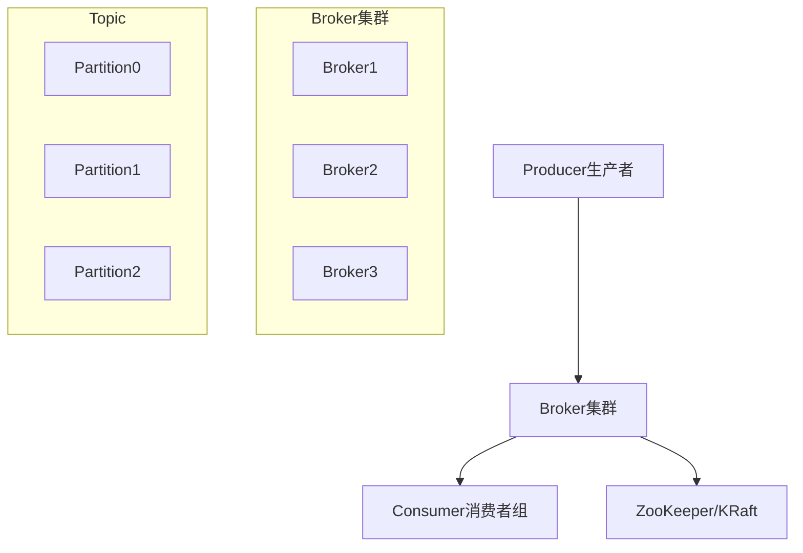

# Kafka深度实战

> **文档说明**：Apache Kafka是分布式流处理平台，以高吞吐、低延迟、可持久化著称。本文档从架构原理到生产实战，覆盖分区策略、消费者组、Exactly-Once、性能调优、运维监控。
>
> **适用人群**：后端高级工程师、大数据工程师、需要构建高吞吐消息系统的开发者
>
> **前置知识**：消息队列基础、分布式系统概念

---

## 一、Kafka架构与核心概念

### 1.1 整体架构



| 概念 | 说明 |
|------|------|
| **Broker** | Kafka服务节点，一个集群由多个Broker组成 |
| **Topic** | 消息主题，逻辑分类 |
| **Partition** | 分区，Topic的物理分片，并行度基本单位 |
| **Replica** | 副本，每个分区有多个副本（Leader/Follower） |
| **Producer** | 生产者，向Topic发送消息 |
| **Consumer** | 消费者，从Topic拉取消息 |
| **Consumer Group** | 消费者组，组内消费者分摊分区 |
| **Offset** | 消息在分区内的偏移量，唯一标识 |

### 1.2 分区与副本机制

```text
Topic: orders (3分区, 2副本)
Partition0: Leader=Broker1, Follower=Broker2
Partition1: Leader=Broker2, Follower=Broker3
Partition2: Leader=Broker3, Follower=Broker1
```

- **Leader副本**：处理所有读写请求
- **Follower副本**：被动同步Leader数据，不处理请求
- **ISR（In-Sync Replicas）**：与Leader保持同步的副本集合
- Leader宕机时，从ISR中选举新Leader

### 1.3 KRaft模式（Kafka 2.8+）

- 移除ZooKeeper依赖，使用Raft协议管理元数据
- Controller节点负责分区Leader选举和元数据管理
- 更简单的架构、更好的扩展性、更低的延迟

---

## 二、生产者实战

### 2.1 生产者配置

```java
Properties props = new Properties();
props.put("bootstrap.servers", "kafka1:9092,kafka2:9092");
props.put("key.serializer", "org.apache.kafka.common.serialization.StringSerializer");
props.put("value.serializer", "org.apache.kafka.common.serialization.StringSerializer");
props.put("acks", "all");                    // 确认机制：0/1/all
props.put("retries", 3);                     // 重试次数
props.put("batch.size", 16384);              // 批量大小（字节）
props.put("linger.ms", 5);                   // 等待时间（毫秒）
props.put("buffer.memory", 33554432);        // 缓冲区大小
props.put("compression.type", "snappy");     // 压缩：none/gzip/snappy/lz4/zstd
props.put("max.in.flight.requests.per.connection", 5); // 单连接最大未确认请求
props.put("enable.idempotence", true);       // 幂等生产者

KafkaProducer<String, String> producer = new KafkaProducer<>(props);
```

### 2.2 acks确认机制

| acks | 说明 | 可靠性 | 性能 |
|------|------|--------|------|
| 0 | 发出去就不管，不等确认 | 最低 | 最高 |
| 1 | Leader写入成功即确认（默认） | 中 | 中 |
| all/-1 | Leader+所有ISR副本写入成功 | 最高 | 最低 |

### 2.3 分区策略

```java
// 默认分区策略
// 1. 指定partition → 直接使用
// 2. 指定key但不指定partition → hash(key) % partition数
// 3. 都不指定 → 轮询（Sticky Partition策略，粘性分区）

// 自定义分区器
public class OrderPartitioner implements Partitioner {
    @Override
    public int partition(String topic, Object key, byte[] keyBytes,
                         Object value, byte[] valueBytes, Cluster cluster) {
        int partitions = cluster.partitionCountForTopic(topic);
        String orderType = key.toString();
        // VIP订单走0分区，普通订单轮询
        if ("VIP".equals(orderType)) return 0;
        return (Math.abs(key.hashCode()) % (partitions - 1)) + 1;
    }
}
```

### 2.4 消息发送方式

```java
// 1. 异步发送（推荐，高吞吐）
producer.send(new ProducerRecord<>("orders", "key", "value"),
    (metadata, exception) -> {
        if (exception != null) {
            log.error("发送失败", exception);
        } else {
            log.info("发送成功: topic={}, partition={}, offset={}",
                metadata.topic(), metadata.partition(), metadata.offset());
        }
    });

// 2. 同步发送（低吞吐，强可靠）
try {
    RecordMetadata metadata = producer.send(record).get();
} catch (Exception e) {
    log.error("发送失败", e);
}

// 3. 幂等生产者（去重，配合enable.idempotence=true）
// 生产者为每个分区维护序列号，Broker去重
```

---

## 三、消费者实战

### 3.1 消费者配置

```java
Properties props = new Properties();
props.put("bootstrap.servers", "kafka1:9092");
props.put("group.id", "order-consumer-group");
props.put("key.deserializer", "org.apache.kafka.common.serialization.StringDeserializer");
props.put("value.deserializer", "org.apache.kafka.common.serialization.StringDeserializer");
props.put("enable.auto.commit", false);          // 关闭自动提交
props.put("auto.offset.reset", "earliest");      // 无偏移量时：earliest/latest/none
props.put("max.poll.records", 500);              // 每次拉取最大条数
props.put("max.poll.interval.ms", 300000);       // 两次poll最大间隔（5分钟）
props.put("session.timeout.ms", 10000);          // 会话超时
props.put("heartbeat.interval.ms", 3000);         // 心跳间隔
props.put("fetch.min.bytes", 1);                  // 最小拉取字节
props.put("fetch.max.wait.ms", 500);              // 最大等待时间

KafkaConsumer<String, String> consumer = new KafkaConsumer<>(props);
consumer.subscribe(Arrays.asList("orders"));
```

### 3.2 消费者组与分区分配

```text
Topic: orders (3分区)
Consumer Group: order-group (3个消费者)
  Consumer1 → Partition0
  Consumer2 → Partition1
  Consumer3 → Partition2

消费者数 > 分区数 → 多余消费者空闲
消费者数 < 分区数 → 部分消费者消费多个分区
```

**分区分配策略**：
| 策略 | 说明 |
|------|------|
| Range | 按主题范围分配（默认） |
| RoundRobin | 轮询分配，更均匀 |
| Sticky | 粘性分配，减少重平衡时的分区移动 |
| CooperativeSticky | 协作式粘性，增量重平衡（推荐） |

### 3.3 手动提交Offset

```java
// 1. 每处理一条提交一次（最安全，性能差）
while (true) {
    ConsumerRecords<String, String> records = consumer.poll(Duration.ofMillis(100));
    for (ConsumerRecord<String, String> record : records) {
        process(record);
        consumer.commitSync();  // 同步提交
    }
}

// 2. 批量处理后提交（推荐，平衡性能与可靠性）
while (true) {
    ConsumerRecords<String, String> records = consumer.poll(Duration.ofMillis(100));
    for (ConsumerRecord<String, String> record : records) {
        process(record);
    }
    consumer.commitAsync((offsets, exception) -> {
        if (exception != null) log.error("提交失败", exception);
    });
}

// 3. 精确提交到特定offset
Map<TopicPartition, OffsetAndMetadata> offsets = new HashMap<>();
offsets.put(new TopicPartition("orders", 0), new OffsetAndMetadata(record.offset() + 1));
consumer.commitSync(offsets);
```

### 3.4 重平衡（Rebalance）

- 触发条件：消费者加入/退出组、订阅主题变化、分区数增加
- 影响：重平衡期间消费者暂停消费，所有分区重新分配
- 优化：使用CooperativeSticky策略减少暂停时间；增大max.poll.interval.ms避免误判

---

```text
## 四、Exactly-Once语义
```

### 4.1 消息传递语义

| 语义 | 说明 | 实现 |
|------|------|------|
| At Most Once | 最多一次，可能丢消息 | acks=0，不重试 |
| At Least Once | 至少一次，可能重复 | acks=all，重试，手动提交 |
| Exactly Once | 精确一次，不丢不重 | 幂等生产者+事务 |

### 4.2 幂等生产者

```text
开启：enable.idempotence=true
原理：生产者为每个<Topic, Partition>维护序列号(PID+Seq)
Broker去重：相同PID+Seq的消息只处理一次
限制：单会话内、单分区内有效
```

### 4.3 Kafka事务

```java
// 事务生产者
props.put("transactional.id", "order-tx-001");
producer.initTransactions();

try {
    producer.beginTransaction();
    // 发送业务消息
    producer.send(record1);
    producer.send(record2);
    // 提交消费者offset（消费-处理-生产模式）
    producer.sendOffsetsToTransaction(offsets, "consumer-group-id");
    producer.commitTransaction();
} catch (Exception e) {
    producer.abortTransaction();
}
```

**事务保障**：
- 原子性：多个消息发送要么全部成功要么全部失败
- 消费者需配置`isolation.level=read_committed`才能读取已提交消息

---

## 五、性能调优

### 5.1 生产者调优

| 参数 | 推荐值 | 说明 |
|------|--------|------|
| batch.size | 32KB-64KB | 增大批量提升吞吐 |
| linger.ms | 5-20ms | 等待更多消息凑批 |
| compression.type | lz4/zstd | 压缩减少网络IO |
| acks | 1 | 平衡可靠与性能 |
| buffer.memory | 64MB+ | 增大缓冲区 |

### 5.2 消费者调优

| 参数 | 推荐值 | 说明 |
|------|--------|------|
| max.poll.records | 500-1000 | 批量处理 |
| fetch.min.bytes | 10KB+ | 减少请求次数 |
| fetch.max.wait.ms | 500ms | 等待更多数据 |
| 消费者数 | =分区数 | 最大并行度 |

### 5.3 Broker调优

| 参数 | 推荐值 | 说明 |
|------|--------|------|
| num.partitions | 6-12 | 分区数=并行度上限 |
| default.replication.factor | 3 | 副本数保证高可用 |
| log.segment.bytes | 1GB | 日志段大小 |
| log.retention.hours | 168 | 保留7天 |
| num.io.threads | 8 | IO线程数 |
| num.network.threads | 3 | 网络线程数 |
| socket.send.buffer.bytes | 100KB | 发送缓冲区 |

### 5.4 硬件建议

- **磁盘**：SSD，Kafka是顺序写，SSD优势明显
- **内存**：32GB+，页缓存是Kafka性能关键
- **网络**：万兆网卡，高吞吐场景
- **CPU**：多核，压缩解压消耗CPU

---

## 六、运维与监控

### 6.1 常用运维命令

```bash
# 创建Topic
kafka-topics.sh --create --topic orders --partitions 6 --replication-factor 3 --bootstrap-server localhost:9092

# 查看Topic列表
kafka-topics.sh --list --bootstrap-server localhost:9092

# 查看Topic详情
kafka-topics.sh --describe --topic orders --bootstrap-server localhost:9092

# 增加分区
kafka-topics.sh --alter --topic orders --partitions 12 --bootstrap-server localhost:9092

# 查看消费者组
kafka-consumer-groups.sh --list --bootstrap-server localhost:9092

# 查看消费进度（Lag）
kafka-consumer-groups.sh --describe --group order-group --bootstrap-server localhost:9092

# 重置Offset
kafka-consumer-groups.sh --reset-offsets --group order-group --topic orders --to-earliest --execute --bootstrap-server localhost:9092

# 生产消息测试
kafka-console-producer.sh --topic orders --bootstrap-server localhost:9092

# 消费消息测试
kafka-console-consumer.sh --topic orders --from-beginning --bootstrap-server localhost:9092
```

### 6.2 关键监控指标

| 指标 | 说明 | 告警阈值 |
|------|------|---------|
| UnderReplicatedPartitions | 副本不足的分区数 | >0告警 |
| OfflinePartitionsCount | 离线分区数 | >0立即告警 |
| ActiveControllerCount | 活跃Controller数 | 应为1 |
| MessagesInPerSec | 消息入站速率 | 突增/突降告警 |
| BytesInPerSec | 字节入站速率 | 接近带宽告警 |
| ConsumerLag | 消费者积压 | >10000告警 |
| RequestHandlerAvgIdlePercent | 请求处理线程空闲率 | <0.3告警 |
| LogFlushLatency | 日志刷盘延迟 | P99>100ms告警 |

### 6.3 常见问题排查

| 问题 | 原因 | 解决方案 |
|------|------|---------|
| 消息丢失 | acks=0/1，Broker宕机 | acks=all，副本数≥3 |
| 消息重复 | 重试+自动提交 | 幂等生产者+手动提交 |
| 消费积压 | 消费慢/消费者少 | 增加消费者/优化消费逻辑/扩分区 |
| 分区不均衡 | 分区策略/key分布不均 | 调整分区策略/均匀key |
| 重平衡频繁 | 消费超时/心跳超时 | 增大max.poll.interval.ms |
| 延迟高 | 批量太小/压缩未开 | 增大batch.size/开启压缩 |
| Leader频繁切换 | Broker不稳定/网络抖动 | 检查Broker健康/网络 |

---

## 七、典型应用场景

| 场景 | 说明 |
|------|------|
| 日志收集 | 应用日志→Kafka→ELK/ClickHouse |
| 事件驱动架构 | 订单事件→库存/支付/通知服务消费 |
| 流处理 | Kafka Streams/Flink实时计算 |
| 数据管道 | MySQL binlog→Kafka→数据仓库 |
| 指标采集 | 监控指标→Kafka→时序数据库 |
| 异步解耦 | 前端请求→Kafka→后端异步处理 |

---

## 关联文档

- [[消息队列深度 知识点系统梳理_优化版]] — 消息队列全景
- [[RabbitMQ实战指南]] — RabbitMQ对比
- [[分布式事务 知识点系统梳理_优化版]] — 事务消息
- [[Raft共识算法详解]] — KRaft底层协议
- [[高并发系统设计案例]] — Kafka在高并发中的应用

---

> 💡 **实战建议**：Kafka的核心是"分区=并行度"，分区数决定了最大消费并行度。生产环境分区数建议6的倍数（方便扩缩容），副本数3。开启幂等生产者+手动提交Offset是保证数据不丢不重的标准配置。监控ConsumerLag是运维的重中之重。


## 补充：概述

Apache Kafka 是分布式**事件流平台**（Event Streaming Platform），最初由 LinkedIn 开发，用于处理海量实时数据。Kafka 兼具**消息队列**（解耦、异步、削峰）和**事件存储**（持久化、可重放）的能力，是现代大数据和微服务架构的核心基础设施，广泛应用于日志收集、指标监控、事件驱动架构、流处理、数据管道等场景。

| 特性 | 说明 |
|------|------|
| **高吞吐** | 单机每秒百万级消息，集群水平扩展 |
| **低延迟** | 端到端延迟毫秒级（p99 < 10ms） |
| **持久化** | 消息写入磁盘，可配置保留时间（永久/按时间/按大小） |
| **高可用** | 多副本（Replica），Leader/Follower 机制，自动故障转移 |
| **可重放** | 消费者可以重置 offset，重新消费历史消息 |
| **多消费者** | 发布-订阅模式，一条消息可被多个消费组消费 |
| ** Exactly-Once** | 支持精确一次语义（事务 + 幂等生产者） |
| **生态丰富** | Kafka Connect（数据集成）、Kafka Streams（流处理）、Schema Registry |

**核心概念**：
| 概念 | 说明 |
|------|------|
| **Producer** | 消息生产者，向 Topic 发送消息 |
| **Consumer** | 消息消费者，从 Topic 拉取消息 |
| **Broker** | Kafka 服务节点，一个 Kafka 集群由多个 Broker 组成 |
| **Topic** | 消息主题，逻辑分类，类似数据库的表 |
| **Partition** | 分区，Topic 分为多个 Partition，是并行和有序的基本单位 |
| **Replica** | 副本，每个 Partition 有多个副本（1 Leader + N Follower） |
| **Offset** | 消息在 Partition 中的唯一编号 |
| **Consumer Group** | 消费组，一组消费者共同消费一个 Topic，每条消息只被组内一个消费者消费 |
| **ZooKeeper / KRaft** | 集群元数据管理（新版本用 KRaft 替代 ZooKeeper） |

**适用场景**：日志聚合（ELK 替代）、指标监控、事件驱动微服务、流处理（实时数仓）、数据管道（CDC 同步）、异步解耦、削峰填谷。
**不适用场景**：需要复杂路由的消息（用 RabbitMQ）、需要消息延迟/优先级的场景、小数据量简单异步任务（用 Redis 队列更轻量）。

---

## 补充：进阶与最佳实践

### 1. 生产者配置优化

```java
// 高吞吐生产者配置
Properties props = new Properties();
props.put("bootstrap.servers", "kafka1:9092,kafka2:9092,kafka3:9092");
props.put("key.serializer", "org.apache.kafka.common.serialization.StringSerializer");
props.put("value.serializer", "org.apache.kafka.common.serialization.StringSerializer");

// 可靠性配置
props.put("acks", "all");  // 所有 ISR 副本确认后才返回（最可靠，延迟略高）
props.put("retries", 3);   // 重试次数
props.put("enable.idempotence", true);  // 幂等生产者，防止重试导致重复

// 高吞吐配置
props.put("batch.size", 16384);  // 批量大小（16KB），攒够一批再发
props.put("linger.ms", 10);       // 等待时间（10ms），攒不够也发
props.put("compression.type", "lz4");  // 压缩（lz4 速度快、压缩率好）
props.put("buffer.memory", 33554432);  // 生产者缓冲区（32MB）

// 创建生产者
KafkaProducer<String, String> producer = new KafkaProducer<>(props);

// 异步发送（带回调）
producer.send(new ProducerRecord<>("orders", key, value), (metadata, exception) -> {
    if (exception != null) {
        log.error("发送失败", exception);
    } else {
        log.debug("发送成功: topic={}, partition={}, offset={}",
            metadata.topic(), metadata.partition(), metadata.offset());
    }
});

// 同步发送（少用，会阻塞）
producer.send(record).get();

// 关闭生产者（flush 所有缓冲消息）
producer.flush();
producer.close();
```

### 2. 消费者配置优化

```java
Properties props = new Properties();
props.put("bootstrap.servers", "kafka1:9092,kafka2:9092,kafka3:9092");
props.put("group.id", "order-service");  // 消费组 ID
props.put("key.deserializer", "org.apache.kafka.common.serialization.StringDeserializer");
props.put("value.deserializer", "org.apache.kafka.common.serialization.StringDeserializer");

// 提交 offset 配置
props.put("enable.auto.commit", false);  // 关闭自动提交，手动控制（更可靠）
props.put("auto.offset.reset", "earliest");  // 新消费组从最早开始消费

// 拉取配置
props.put("max.poll.records", 500);  // 每次 poll 最多拉取 500 条
props.put("max.poll.interval.ms", 300000);  // 两次 poll 最大间隔（5分钟），超时会被踢出组
props.put("fetch.min.bytes", 1024);  // 最少拉取 1KB（攒够再返回，减少请求）
props.put("fetch.max.wait.ms", 500);  // 最多等 500ms

KafkaConsumer<String, String> consumer = new KafkaConsumer<>(props);
consumer.subscribe(Arrays.asList("orders"));

try {
    while (true) {
        ConsumerRecords<String, String> records = consumer.poll(Duration.ofMillis(100));
        for (ConsumerRecord<String, String> record : records) {
            try {
                // 处理消息
                processMessage(record.value());
            } catch (Exception e) {
                log.error("处理消息失败: offset={}", record.offset(), e);
                // 写入死信队列（DLQ），不要阻塞消费
                sendToDLQ(record);
            }
        }
        // 批量处理完成后手动提交 offset
        consumer.commitSync();
    }
} finally {
    consumer.close();
}
```

### 3. 分区与副本设计

| 设计决策 | 建议 | 说明 |
|---------|------|------|
| **分区数** | 吞吐目标 / 单分区吞吐（10MB/s） | 分区数决定并行度，太少瓶颈，太多 overhead |
| **副本数** | 生产环境 3（1 Leader + 2 Follower） | 副本数=容错数+1，3副本可容忍2节点故障 |
| **分区键** | 高基数、均匀分布的字段（user_id/order_id） | 避免低基数字段（如 status）导致数据倾斜 |
| **保留时间** | 根据业务需求，日志 7-30 天，事件永久或按大小 | `retention.ms` / `retention.bytes` |
| **压缩策略** | `delete`（删除）或 `compact`（按 key 保留最新） | 日志用 delete，状态同步用 compact |

```text
**分区数计算示例**：目标吞吐 100MB/s，单分区约 10MB/s → 需要 10 个分区。考虑未来增长，设为 12（分区数只能增加不能减少，提前规划）。

### 4.  Exactly-Once 语义
```

Kafka 支持三种投递语义：
| 语义 | 说明 | 实现方式 |
|------|------|---------|
| **At Most Once** | 最多一次，可能丢消息 | 先提交 offset 再处理 |
| **At Least Once** | 至少一次，可能重复（默认） | 先处理再提交 offset + 重试 |
| **Exactly Once** | 精确一次，不丢不重 | 幂等生产者 + 事务 + 消费者幂等处理 |

**Exactly-Once 实现**：
1. **生产者端**：开启幂等（`enable.idempotence=true`），每个 PID+Sequence 唯一，Broker 去重
2. **Broker 端**：事务协调器，原子写入多个 Partition
3. **消费者端**：`isolation.level=read_committed`，只读取已提交的事务消息
4. **应用端**：消费者处理逻辑也要幂等（如用唯一键去重），因为重启后可能重复消费

```java
// 事务生产者
props.put("transactional.id", "order-tx-001");
KafkaProducer<String, String> producer = new KafkaProducer<>(props);
producer.initTransactions();

try {
    producer.beginTransaction();
    producer.send(new ProducerRecord<>("orders", key, value1));
    producer.send(new ProducerRecord<>("order-events", key, value2));
    producer.commitTransaction();  // 原子提交
} catch (Exception e) {
    producer.abortTransaction();   // 回滚
}
```

### 5. 监控关键指标

| 指标 | 说明 | 告警阈值 |
|------|------|---------|
| **Under Replicated Partitions** | 副本不足的分区数 | > 0 告警（说明有 Broker 故障或同步延迟） |
| **Consumer Lag** | 消费者延迟（最新 offset - 已提交 offset） | 持续增长告警（消费速度跟不上生产） |
| **Request Latency** | 请求延迟（p99） | > 100ms 告警 |
| **Broker 磁盘使用率** | 磁盘空间 | > 80% 告警 |
| **消息流入/流出速率** | 吞吐量 | 突增/突降告警 |
| **ISR Shrink/Expand** | ISR 收缩/扩张频率 | 频繁收缩告警（副本不稳定） |
| **Leader Election Rate** | Leader 选举频率 | 频繁选举告警（Broker 不稳定） |
