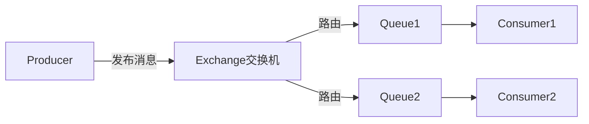

# RabbitMQ实战指南

> **文档说明**：RabbitMQ是基于AMQP协议的开源消息代理，以可靠性、灵活路由、易管理著称。本文档覆盖交换机类型、消息可靠性、死信队列、延迟队列、集群部署、性能调优。
>
> **适用人群**：后端工程师、需要构建可靠消息系统的开发者
>
> **前置知识**：消息队列基础、AMQP概念

---

## 一、核心概念与架构

### 1.1 AMQP模型



| 概念 | 说明 |
|------|------|
| **Virtual Host** | 虚拟主机，资源隔离单位，类似数据库的schema |
| **Exchange** | 交换机，接收消息并路由到队列 |
| **Queue** | 队列，存储消息，消费者从中获取 |
| **Binding** | 绑定，交换机与队列之间的路由规则 |
| **Routing Key** | 路由键，交换机根据此键路由消息 |
| **Message** | 消息，包含属性（headers）和 payload |

### 1.2 四种交换机类型

| 交换机 | 路由规则 | 适用场景 |
|--------|---------|---------|
| **Direct** | Routing Key完全匹配Binding Key | 精确路由，如任务分发 |
| **Fanout** | 广播到所有绑定队列 | 发布订阅，如全局通知 |
| **Topic** | 通配符匹配（*匹配一个词，#匹配零或多个词） | 分类订阅，如日志分级 |
| **Headers** | 根据消息headers属性匹配 | 复杂路由规则 |

```java
// Direct交换机：Routing Key精确匹配
channel.exchangeDeclare("direct-exchange", "direct");
channel.queueBind("queue1", "direct-exchange", "order.create");
// 只有routingKey="order.create"的消息才到queue1

// Topic交换机：通配符匹配
channel.exchangeDeclare("topic-exchange", "topic");
channel.queueBind("queue1", "topic-exchange", "order.*");      // order.create / order.cancel
channel.queueBind("queue2", "topic-exchange", "#.payment");    // 任何以.payment结尾

// Fanout交换机：广播
channel.exchangeDeclare("fanout-exchange", "fanout");
channel.queueBind("queue1", "fanout-exchange", "");  // routingKey忽略
channel.queueBind("queue2", "fanout-exchange", "");  // 所有绑定队列都收到
```

---

## 二、消息可靠性保障

### 2.1 生产者确认（Publisher Confirm）

```java
// 开启Confirm模式
channel.confirmSelect();

// 同步确认（简单但慢）
channel.basicPublish("exchange", "routingKey", null, message.getBytes());
if (channel.waitForConfirms()) {
    System.out.println("消息已到达Broker");
} else {
    System.out.println("消息丢失，需要重发");
}

// 异步确认（推荐，高吞吐）
channel.addConfirmListener((deliveryTag, multiple) -> {
    // 消息成功到达Broker
    System.out.println("确认: " + deliveryTag);
}, (deliveryTag, multiple) -> {
    // 消息被Broker拒绝（可能丢失）
    System.out.println("拒绝: " + deliveryTag);
});

// 消息不可路由时返回（Return机制）
channel.addReturnListener(returnMessage -> {
    System.out.println("消息不可路由: " + new String(returnMessage.getBody()));
    // 处理：记录日志/重发/存入备用队列
});
channel.basicPublish("exchange", "routingKey", true, null, message.getBytes());
// mandatory=true：不可路由时返回给生产者
```

### 2.2 消息持久化

```java
// 1. 交换机持久化
channel.exchangeDeclare("exchange", "direct", true);  // durable=true

// 2. 队列持久化
channel.queueDeclare("queue", true, false, false, null);  // durable=true

// 3. 消息持久化
AMQP.BasicProperties props = new AMQP.BasicProperties.Builder()
    .deliveryMode(2)  // 2=持久化，1=非持久化
    .contentType("application/json")
    .messageId(UUID.randomUUID().toString())
    .timestamp(new Date())
    .build();
channel.basicPublish("exchange", "routingKey", props, message.getBytes());
```

> 三者都持久化才能保证Broker重启后消息不丢失。

### 2.3 消费者手动ACK

```java
// 关闭自动ACK
channel.basicConsume("queue", false, "consumerTag", new DefaultConsumer(channel) {
    @Override
    public void handleDelivery(String consumerTag, Envelope envelope,
                               AMQP.BasicProperties properties, byte[] body) throws IOException {
        try {
            processMessage(new String(body));
            // 手动确认
            channel.basicAck(envelope.getDeliveryTag(), false);
        } catch (Exception e) {
            // 处理失败，拒绝消息
            // requeue=true：重新入队；false：丢弃/进死信队列
            channel.basicNack(envelope.getDeliveryTag(), false, true);
        }
    }
});

// 批量ACK（multiple=true确认所有小于等于deliveryTag的消息）
channel.basicAck(deliveryTag, true);

// 拒绝单条消息
channel.basicReject(deliveryTag, true);  // requeue=true
```

### 2.4 可靠性总结

```text
生产者 → [Confirm确认] → Broker → [持久化] → 队列 → [手动ACK] → 消费者
         ↑                                          ↑
    消息不可路由Return                           消费失败Nack重入队
```

---

## 三、死信队列（DLX）

### 3.1 死信场景

消息变成死信的三种情况：
1. 消费者使用`basicNack`/`basicReject`且`requeue=false`
2. 消息TTL过期
3. 队列达到最大长度

### 3.2 死信队列配置

```java
// 1. 声明死信交换机
channel.exchangeDeclare("dlx-exchange", "direct", true);

// 2. 声明死信队列
channel.queueDeclare("dlx-queue", true, false, false, null);
channel.queueBind("dlx-queue", "dlx-exchange", "dlx-routing-key");

// 3. 业务队列绑定死信交换机
Map<String, Object> args = new HashMap<>();
args.put("x-dead-letter-exchange", "dlx-exchange");
args.put("x-dead-letter-routing-key", "dlx-routing-key");
channel.queueDeclare("business-queue", true, false, false, args);

// 4. 消费死信队列（人工处理/告警/重试）
channel.basicConsume("dlx-queue", true, (consumerTag, delivery) -> {
    String msg = new String(delivery.getBody());
    log.error("死信消息: {}", msg);
    // 存入数据库人工审核 / 告警通知 / 延迟重试
});
```

---

## 四、延迟队列

### 4.1 TTL+死信实现延迟队列


```java
// 延迟队列（消息到期后进入死信）
Map<String, Object> delayArgs = new HashMap<>();
delayArgs.put("x-dead-letter-exchange", "dlx-exchange");
delayArgs.put("x-dead-letter-routing-key", "delay-process");
delayArgs.put("x-message-ttl", 30000);  // 队列级TTL：30秒
channel.queueDeclare("delay-queue", true, false, false, delayArgs);

// 消息级TTL（更灵活，每条消息可不同延迟）
AMQP.BasicProperties props = new AMQP.BasicProperties.Builder()
    .expiration("60000")  // 60秒后过期
    .deliveryMode(2)
    .build();
channel.basicPublish("", "delay-queue", props, message.getBytes());

// 实际消费队列（绑定到死信交换机）
channel.queueDeclare("process-queue", true, false, false, null);
channel.queueBind("process-queue", "dlx-exchange", "delay-process");
```

### 4.2 延迟队列插件（推荐）

RabbitMQ Delayed Message Plugin支持更灵活的延迟：

```bash
# 安装插件
rabbitmq-plugins enable rabbitmq_delayed_message_exchange
```

```java
// 声明延迟交换机
Map<String, Object> args = new HashMap<>();
args.put("x-delayed-type", "direct");
channel.exchangeDeclare("delayed-exchange", "x-delayed-message", true, false, args);

// 发送延迟消息（header中指定延迟毫秒数）
AMQP.BasicProperties props = new AMQP.BasicProperties.Builder()
    .header("x-delay", 5000)  // 延迟5秒
    .deliveryMode(2)
    .build();
channel.basicPublish("delayed-exchange", "routingKey", props, message.getBytes());
```

---

## 五、集群与高可用

### 5.1 集群模式

| 模式 | 说明 | 适用 |
|------|------|------|
| 普通集群 | 队列只在一个节点，其他节点保存元数据 | 非关键业务 |
| 镜像队列 | 队列在多个节点有副本 | 生产环境，高可用 |
| Quorum队列 | Raft协议，多副本，强一致 | RabbitMQ 3.8+推荐 |

### 5.2 镜像队列配置

```bash
# 设置镜像队列策略（所有队列镜像到所有节点）
rabbitmqctl set_policy ha-all "^" '{"ha-mode":"all"}'

# 镜像到2个节点
rabbitmqctl set_policy ha-two "^" '{"ha-mode":"exactly","ha-params":2,"ha-sync-mode":"automatic"}'

# 按名称匹配
rabbitmqctl set_policy ha-orders "^orders\." '{"ha-mode":"all"}'
```

### 5.3 Quorum队列（推荐）

```java
// 声明Quorum队列
Map<String, Object> args = new HashMap<>();
args.put("x-queue-type", "quorum");
channel.queueDeclare("quorum-queue", true, false, false, args);
```

- 基于Raft共识算法
- 至少3个节点，多数确认才成功
- 比镜像队列更可靠，支持更高的吞吐量
- 不支持TTL/优先级等部分特性

---

## 六、Spring Boot集成

### 6.1 配置

```yaml
spring:
  rabbitmq:
    host: localhost
    port: 5672
    username: guest
    password: guest
    virtual-host: /
    publisher-confirm-type: correlated  # 生产者确认
    publisher-returns: true             # 消息返回
    listener:
      type: simple
      simple:
        acknowledge-mode: manual        # 手动ACK
        prefetch: 10                    # 预取数量
        retry:
          enabled: true
          max-attempts: 3
```

### 6.2 生产者

```java
@Service
@RequiredArgsConstructor
public class OrderProducer {
    private final RabbitTemplate rabbitTemplate;

    public void sendOrder(Order order) {
        rabbitTemplate.convertAndSend("order-exchange", "order.create", order,
            message -> {
                message.getMessageProperties().setDeliveryMode(MessageDeliveryMode.PERSISTENT);
                message.getMessageProperties().setMessageId(UUID.randomUUID().toString());
                return message;
            });
    }
}

// 确认回调
@Configuration
public class RabbitConfig {
    @Bean
    public RabbitTemplate rabbitTemplate(ConnectionFactory factory) {
        RabbitTemplate template = new RabbitTemplate(factory);
        template.setConfirmCallback((correlationData, ack, cause) -> {
            if (!ack) log.error("消息确认失败: {}", cause);
        });
        template.setReturnsCallback(returned -> {
            log.error("消息不可路由: {}", new String(returned.getMessage().getBody()));
        });
        return template;
    }
}
```

### 6.3 消费者

```java
@Component
@RabbitListener(queues = "order-queue")
public class OrderConsumer {

    @RabbitHandler
    public void handleOrder(Order order, Channel channel,
                            @Header(AmqpHeaders.DELIVERY_TAG) long deliveryTag) throws IOException {
        try {
            processOrder(order);
            channel.basicAck(deliveryTag, false);
        } catch (Exception e) {
            channel.basicNack(deliveryTag, false, false);  // 进死信队列
        }
    }
}
```

---

## 七、性能调优

| 优化点 | 说明 |
|--------|------|
| **Prefetch** | 设置basicQos，避免单消费者积压，默认无限大 |
| **批量ACK** | multiple=true批量确认，减少网络开销 |
| **消息大小** | 大消息压缩或拆分，RabbitMQ适合小消息 |
| **队列数量** | 单节点队列数过多影响性能，建议<1000 |
| **持久化** | 非关键消息关闭持久化提升性能 |
| **镜像同步** | ha-sync-mode=automatic避免手动同步阻塞 |
| **连接复用** | 复用Connection，每个线程用独立Channel |

```java
// Prefetch设置（重要！）
channel.basicQos(10);  // 每次最多预取10条未确认消息
```

---

## 八、Kafka vs RabbitMQ

| 维度 | RabbitMQ | Kafka |
|------|----------|-------|
| 协议 | AMQP | 自定义TCP |
| 模型 | Exchange→Queue | Topic→Partition |
| 吞吐量 | 万级/秒 | 百万级/秒 |
| 延迟 | 微秒级 | 毫秒级 |
| 可靠性 | 极高（手动ACK+死信） | 高（副本+Offset） |
| 路由灵活性 | 高（4种交换机） | 低（按key哈希） |
| 消息回溯 | 不支持（消费即删） | 支持（按Offset重置） |
| 顺序消息 | 单队列有序 | 单分区有序 |
| 适用 | 业务消息、路由复杂、低延迟 | 日志、大数据、高吞吐 |

---

## 关联文档

- [[消息队列深度 知识点系统梳理_优化版]] — 消息队列全景
- [[Kafka深度实战]] — Kafka对比
- [[分布式事务 知识点系统梳理_优化版]] — 事务消息
- [[高并发系统设计案例]] — 消息队列应用

---

> 💡 **选型建议**：业务消息（订单、通知、任务）优先RabbitMQ，路由灵活、可靠性高、运维简单；日志/大数据/高吞吐场景优先Kafka。生产环境务必开启：持久化+手动ACK+死信队列+镜像/Quorum队列。


## 补充：概述

RabbitMQ 是最流行的开源**消息代理（Message Broker）**，基于 AMQP（Advanced Message Queuing Protocol）协议实现，由 Erlang 编写，具有高并发、高可用、灵活路由等特点。与 Kafka 偏向高吞吐日志/事件流不同，RabbitMQ 更适合**业务消息**场景，支持复杂的路由规则、消息确认、死信队列、延迟队列、优先级队列等企业级特性。

| 特性 | 说明 |
|------|------|
| **AMQP 协议** | 标准化消息协议，支持多种客户端语言 |
| **灵活路由** | Exchange 四种类型（direct/topic/fanout/headers），复杂路由规则 |
| **消息确认** | Producer Confirm + Consumer ACK，保证消息不丢 |
| **持久化** | Exchange/Queue/Message 均可持久化，Broker 重启不丢 |
| **死信队列** | 消息被拒绝/过期/队列满时转发到 DLX，便于异常处理 |
| **延迟队列** | 通过 TTL + DLX 实现延迟消息（如订单超时取消） |
| **优先级队列** | 支持消息优先级，高优先级消息先消费 |
| **高可用** | 镜像队列（Mirrored Queue），多副本同步 |
| **管理界面** | 内置 Web 管理界面，可视化监控和管理 |
| **插件丰富** | Shovel、Federation、Stomp、MQTT 等插件 |

**核心概念**：
| 概念 | 说明 |
|------|------|
| **Producer** | 消息生产者，发送消息到 Exchange |
| **Consumer** | 消息消费者，从 Queue 拉取/接收消息 |
| **Broker** | RabbitMQ 服务节点 |
| **Virtual Host** | 虚拟主机，资源隔离和权限控制的基本单位 |
| **Exchange** | 交换机，接收生产者消息并路由到 Queue |
| **Binding** | 绑定，Exchange 与 Queue 之间的路由规则 |
| **Queue** | 队列，存储消息，消费者从队列取消息 |
| **Routing Key** | 路由键，Exchange 根据路由键决定消息去向 |

**Exchange 四种类型**：
| 类型 | 路由规则 | 适用场景 |
|------|---------|---------|
| **direct** | 精确匹配 Routing Key | 单播、点对点消息 |
| **topic** | 通配符匹配（`*` 一个词，`#` 零个或多个词） | 发布订阅、多条件路由 |
| **fanout** | 广播到所有绑定的 Queue | 广播、通知 |
| **headers** | 匹配消息 Header 属性 | 复杂多条件路由 |

**适用场景**：业务异步解耦（下单后发短信/邮件）、延迟任务（订单超时取消）、任务分发（工作队列）、广播通知、RPC 调用、优先级任务。
**不适用场景**：海量日志/事件流（用 Kafka）、需要消息可重放（Kafka 更适合）、超大规模吞吐（Kafka 更高）。

---

## 补充：常见问题与排查

| 问题 | 原因 | 解决方案 |
|------|------|---------|
| 消息丢失 | 未开启持久化/确认机制 | Exchange/Queue/Message 持久化 + Producer Confirm + Consumer ACK |
| 消息重复 | 网络重试、消费者处理后 ACK 失败 | 消费者幂等处理（唯一键去重） |
| 消息堆积 | 消费者处理慢、消费者宕机 | 增加消费者、优化处理逻辑、扩容、监控队列长度 |
| 消费顺序乱 | 多消费者并发消费、消息重入队 | 单队列单消费者保证顺序，或用消息分组 |
| 死信队列堆积 | 消息处理失败被拒绝到 DLX | 排查失败原因，修复后从 DLQ 重新投递，告警监控 |
| 连接断开 | 网络波动、Broker 重启、心跳超时 | 客户端自动重连、配置心跳、连接池 |
| 内存/磁盘告警 | 消息堆积过多、未及时消费 | 限流生产者、增加消费者、设置队列最大长度/溢出策略 |
| 集群脑裂 | 网络分区导致多 Master | 配置 `cluster_partition_handling=pause_minority` |
| 镜像队列同步慢 | 消息量大、从节点性能差 | 优化网络、增加从节点资源、减少镜像队列数量 |

### 排查命令

```bash
# 查看队列状态（消息数、消费者数）
rabbitmqctl list_queues name messages consumers memory

# 查看 Exchange
rabbitmqctl list_exchanges name type

# 查看连接
rabbitmqctl list_connections name state channels

# 查看消费者
rabbitmqctl list_consumers queue consumer_tag ack_required

# 查看集群状态
rabbitmqctl cluster_status

# 查看节点状态
rabbitmqctl status

# 强制同步镜像队列
rabbitmqctl sync_queue name

# 清除队列（危险！）
rabbitmqctl purge_queue name
```

---

## 补充：进阶与最佳实践

### 1. 消息可靠性保证（三阶段确认）

```text
Producer → [Confirm] → Broker → [持久化] → Queue → [ACK] → Consumer
```

| 阶段 | 机制 | 配置 |
|------|------|------|
| **Producer → Broker** | Publisher Confirm | `channel.confirm_select()`，消息到达 Exchange 后回调 |
| **Broker 持久化** | 消息持久化 | `delivery_mode=2`（持久化），Exchange 和 Queue 也要持久化 |
| **Broker → Consumer** | Consumer ACK | 手动 ACK（`auto_ack=False`），处理成功后 `ack`，失败 `nack`/`reject` |

```python
# Python pika 可靠消息示例
import pika

# 生产者：开启 Confirm
connection = pika.BlockingConnection(pika.ConnectionParameters('localhost'))
channel = connection.channel()
channel.confirm_delivery()  # 开启发布确认

# 声明持久化 Exchange 和 Queue
channel.exchange_declare(exchange='orders', exchange_type='direct', durable=True)
channel.queue_declare(queue='order_queue', durable=True)
channel.queue_bind(queue='order_queue', exchange='orders', routing_key='order.create')

# 发送持久化消息
try:
    channel.basic_publish(
        exchange='orders',
        routing_key='order.create',
        body='order data',
        properties=pika.BasicProperties(
            delivery_mode=2,  # 持久化
            content_type='application/json',
            message_id=str(uuid.uuid4()),  # 幂等键
        ),
        mandatory=True  # 无法路由时返回给生产者
    )
    print("消息已确认到达 Broker")
except pika.exceptions.UnroutableError:
    print("消息无法路由")

# 消费者：手动 ACK
def callback(ch, method, properties, body):
    try:
        process_order(body)
        ch.basic_ack(delivery_tag=method.delivery_tag)  # 确认
    except Exception as e:
        # 失败时不重新入队（避免无限循环），进入死信队列
        ch.basic_nack(delivery_tag=method.delivery_tag, requeue=False)

channel.basic_qos(prefetch_count=10)  # 预取 10 条，避免单消费者过载
channel.basic_consume(queue='order_queue', on_message_callback=callback, auto_ack=False)
channel.start_consuming()
```

### 2. 延迟队列实现（TTL + DLX）

```python
# 延迟队列原理：消息设置 TTL，过期后通过 DLX 转发到目标队列
# 1. 声明死信 Exchange
channel.exchange_declare(exchange='dlx', exchange_type='direct', durable=True)

# 2. 声明延迟队列（消息过期后转发到 dlx）
channel.queue_declare(
    queue='delay_queue',
    durable=True,
    arguments={
        'x-dead-letter-exchange': 'dlx',
        'x-dead-letter-routing-key': 'order.timeout',
    }
)

# 3. 声明目标队列（接收过期消息）
channel.queue_declare(queue='order_timeout_queue', durable=True)
channel.queue_bind(queue='order_timeout_queue', exchange='dlx', routing_key='order.timeout')

# 4. 发送延迟消息（设置 TTL，如 30 分钟）
channel.basic_publish(
    exchange='',
    routing_key='delay_queue',
    body=order_id,
    properties=pika.BasicProperties(
        delivery_mode=2,
        expiration=str(30 * 60 * 1000),  # 30分钟 TTL（毫秒）
    )
)
# 30分钟后消息自动转发到 order_timeout_queue，消费者处理订单超时取消
```

### 3. 死信队列（DLX）最佳实践

| 进入 DLX 的情况 | 说明 |
|----------------|------|
| 消息被 `reject`/`nack` 且 `requeue=False` | 消费者处理失败，不重新入队 |
| 消息 TTL 过期 | 消息在队列中存活时间超过 TTL |
| 队列达到最大长度 | `x-max-length` 限制，新消息被丢弃或进入 DLX |

**DLQ 处理流程**：
1. 监控 DLQ 消息数量，超过阈值告警
2. 分析 DLQ 中消息的失败原因（查看错误日志）
3. 修复问题后，将 DLQ 消息重新投递到原队列（或手动处理）
4. 定期清理 DLQ 中无法修复的消息

### 4. 集群与高可用

| 集群模式 | 说明 | 适用场景 |
|---------|------|---------|
| **普通集群** | 队列只存在一个节点，其他节点只保存元数据 | 非关键业务，可接受单点故障 |
| **镜像队列** | 队列在多个节点有镜像副本，主节点写入同步到从节点 | 生产环境，高可用要求 |
| **Quorum Queue** | 基于 Raft 协议的仲裁队列，3.8+ 推荐 | 新一代高可用队列，替代镜像队列 |
| **Federation** | 跨机房/跨集群消息转发 | 异地多活、跨区域 |
| **Shovel** | 消息转发插件，在 Broker 间移动消息 | 数据迁移、跨集群 |

**Quorum Queue（推荐）**：
```python
channel.queue_declare(
    queue='order_queue',
    durable=True,
    arguments={'x-queue-type': 'quorum'}  # 仲裁队列
)
```
Quorum Queue 基于 Raft 共识算法，比镜像队列更可靠、性能更好，支持 N/2+1 节点存活即可提供服务。

### 5. 监控关键指标

| 指标 | 说明 | 告警阈值 |
|------|------|---------|
| **队列消息数** | Ready + Unacked | 持续增长告警（堆积） |
| **消费者数量** | 在线消费者数 | 为 0 告警（无消费者） |
| **消息确认率** | ACK / 总投递 | 持续下降告警（消费失败多） |
| **连接数** | 当前连接数 | 突增告警（可能有连接泄漏） |
| **内存使用率** | 节点内存 | > 80% 告警 |
| **磁盘使用率** | 节点磁盘 | > 80% 告警 |
| **镜像同步状态** | 未同步镜像数 | > 0 告警 |
