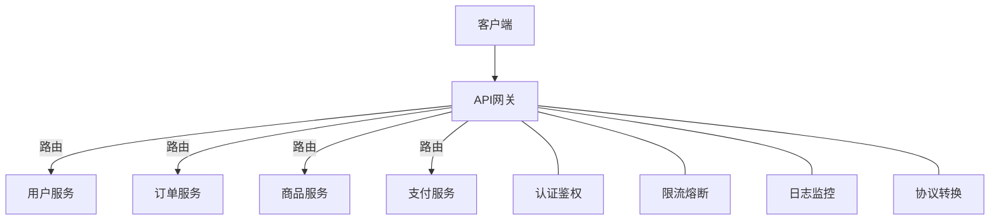
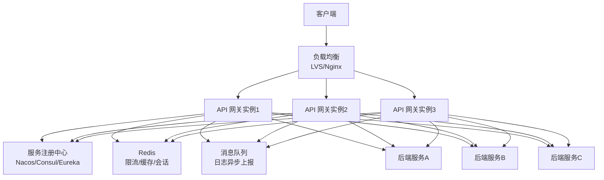

# API网关实战

> **文档说明**：API网关是微服务架构的统一入口，负责路由转发、认证鉴权、限流熔断、日志监控。本文档覆盖Spring Cloud Gateway核心概念、路由配置、过滤器、限流、鉴权、与Kong/APISIX对比。
>
> **适用人群**：后端高级工程师、架构师
>
> **前置知识**：微服务架构、Spring Boot、WebFlux

---

## 一、网关核心职责



| 职责 | 说明 |
|------|------|
| **路由转发** | 根据路径/规则转发到后端服务 |
| **认证鉴权** | 统一登录验证、JWT校验、权限控制 |
| **限流熔断** | 保护后端服务，QPS限制、熔断降级 |
| **日志监控** | 访问日志、链路追踪、指标采集 |
| **协议转换** | HTTP→gRPC、WebSocket、HTTPS卸载 |
| **缓存** | 缓存热点接口响应 |
| **灰度发布** | 按比例/规则路由到不同版本 |

---

## 二、Spring Cloud Gateway核心概念

### 2.1 三大核心

| 概念 | 说明 |
|------|------|
| **Route** | 路由，网关的基本单元，包含ID、目标URI、断言、过滤器 |
| **Predicate** | 断言，匹配请求条件（路径/方法/Header/Cookie等） |
| **Filter** | 过滤器，请求/响应的预处理和后处理 |

### 2.2 路由配置

```yaml
spring:
  cloud:
    gateway:
      routes:
        - id: user-service
          uri: lb://user-service          # 负载均衡到服务名
          predicates:
            - Path=/api/user/**           # 路径匹配
            - Method=GET,POST             # 方法匹配
          filters:
            - StripPrefix=1               # 去掉第一层路径
            - AddRequestHeader=X-Gateway, true

        - id: order-service
          uri: lb://order-service
          predicates:
            - Path=/api/order/**
            - Header=X-Version, v2       # Header匹配v2版本
          filters:
            - StripPrefix=1
            - name: RequestRateLimiter   # 限流
              args:
                redis-rate-limiter.replenishRate: 100
                redis-rate-limiter.burstCapacity: 200

        - id: pay-service
          uri: https://pay.example.com   # 直接转发到HTTP
          predicates:
            - Path=/api/pay/**
          filters:
            - StripPrefix=1
            - PrefixPath=/internal       # 添加前缀
```

### 2.3 常用断言

| 断言 | 说明 | 示例 |
|------|------|------|
| Path | 路径匹配 | `Path=/api/**` |
| Method | HTTP方法 | `Method=GET,POST` |
| Header | Header匹配 | `Header=X-Token, \d+` |
| Cookie | Cookie匹配 | `Cookie=session, \w+` |
| Query | 查询参数 | `Query=version, v1` |
| Host | 主机匹配 | `Host=**.example.com` |
| RemoteAddr | 客户端IP | `RemoteAddr=192.168.1.0/24` |
| Weight | 权重路由 | `Weight=group, 80` |
| Between | 时间范围 | `Between=2024-01-01T00:00:00,2024-12-31T23:59:59` |

### 2.4 常用过滤器

| 过滤器 | 说明 |
|--------|------|
| StripPrefix | 去掉N层路径前缀 |
| PrefixPath | 添加路径前缀 |
| AddRequestHeader | 添加请求Header |
| AddResponseHeader | 添加响应Header |
| RemoveRequestHeader | 移除请求Header |
| RewritePath | 路径重写 |
| SetPath | 设置路径 |
| RedirectTo | 重定向 |
| Retry | 重试 |
| CircuitBreaker | 熔断（Resilience4j） |
| RequestRateLimiter | 限流（Redis） |
| JwtAuthentication | 自定义JWT鉴权 |

---

## 三、自定义过滤器

### 3.1 全局过滤器（鉴权）

```java
@Component
@Order(-100)  // 优先级，数字越小越先执行
public class AuthGlobalFilter implements GlobalFilter {

    @Override
    public Mono<Void> filter(ServerWebExchange exchange, GatewayFilterChain chain) {
        ServerHttpRequest request = exchange.getRequest();
        String path = request.getURI().getPath();

        // 白名单放行
        if (path.startsWith("/api/auth/login") || path.startsWith("/api/auth/register")) {
            return chain.filter(exchange);
        }

        // 校验Token
        String token = request.getHeaders().getFirst("Authorization");
        if (token == null || !token.startsWith("Bearer ")) {
            return unauthorized(exchange, "缺少Token");
        }

        try {
            Claims claims = JwtUtil.parseToken(token.substring(7));
            // 将用户信息传递给下游
            ServerHttpRequest modifiedRequest = request.mutate()
                .header("X-User-Id", claims.getSubject())
                .header("X-User-Role", claims.get("role", String.class))
                .build();
            return chain.filter(exchange.mutate().request(modifiedRequest).build());
        } catch (Exception e) {
            return unauthorized(exchange, "Token无效或已过期");
        }
    }

    private Mono<Void> unauthorized(ServerWebExchange exchange, String msg) {
        exchange.getResponse().setStatusCode(HttpStatus.UNAUTHORIZED);
        exchange.getResponse().getHeaders().setContentType(MediaType.APPLICATION_JSON);
        String body = "{\"code\":401,\"message\":\"" + msg + "\"}";
        DataBuffer buffer = exchange.getResponse().bufferFactory().wrap(body.getBytes());
        return exchange.getResponse().writeWith(Mono.just(buffer));
    }
}
```

### 3.2 网关过滤器工厂（日志）

```java
@Component
public class LogGatewayFilterFactory extends AbstractGatewayFilterFactory<LogGatewayFilterFactory.Config> {

    public LogGatewayFilterFactory() {
        super(Config.class);
    }

    @Override
    public GatewayFilter apply(Config config) {
        return (exchange, chain) -> {
            long start = System.currentTimeMillis();
            String path = exchange.getRequest().getURI().getPath();
            log.info("请求开始: method={}, path={}", exchange.getRequest().getMethod(), path);

            return chain.filter(exchange).then(Mono.fromRunnable(() -> {
                long duration = System.currentTimeMillis() - start;
                int status = exchange.getResponse().getStatusCode().value();
                log.info("请求结束: path={}, status={}, duration={}ms", path, status, duration);
            }));
        };
    }

    public static class Config {
        private boolean enabled = true;
        // getter/setter
    }
}
```

---

## 四、限流实现

### 4.1 Redis限流（内置）

```yaml
spring:
  cloud:
    gateway:
      routes:
        - id: order-service
          uri: lb://order-service
          predicates:
            - Path=/api/order/**
          filters:
            - name: RequestRateLimiter
              args:
                redis-rate-limiter.replenishRate: 100   # 每秒补充令牌数
                redis-rate-limiter.burstCapacity: 200    # 桶容量
                redis-rate-limiter.requestedTokens: 1    # 每次请求消耗令牌
                key-resolver: "#{@ipKeyResolver}"        # 按IP限流
```

```java
@Bean
public KeyResolver ipKeyResolver() {
    return exchange -> Mono.just(exchange.getRequest().getRemoteAddress().getAddress().getHostAddress());
}

// 按用户ID限流
@Bean
public KeyResolver userKeyResolver() {
    return exchange -> Mono.just(exchange.getRequest().getHeaders().getFirst("X-User-Id"));
}
```

### 4.2 熔断降级（Resilience4j）

```yaml
spring:
  cloud:
    gateway:
      routes:
        - id: user-service
          uri: lb://user-service
          predicates:
            - Path=/api/user/**
          filters:
            - name: CircuitBreaker
              args:
                name: userServiceCircuitBreaker
                fallbackUri: forward:/fallback/user  # 降级地址

resilience4j:
  circuitbreaker:
    instances:
      userServiceCircuitBreaker:
        sliding-window-size: 100          # 滑动窗口大小
        failure-rate-threshold: 50        # 失败率阈值50%
        wait-duration-in-open-state: 30s  # 熔断打开等待时间
        permitted-number-of-calls-in-half-open-state: 10  # 半开状态允许请求数
```

```java
@RestController
public class FallbackController {
    @GetMapping("/fallback/user")
    public Map<String, Object> userFallback() {
        return Map.of("code", 503, "message", "用户服务暂时不可用，请稍后重试");
    }
}
```

---

## 五、灰度发布

### 5.1 按Header灰度

```yaml
spring:
  cloud:
    gateway:
      routes:
        - id: order-v2
          uri: lb://order-service-v2
          predicates:
            - Path=/api/order/**
            - Header=X-Gray, true    # 灰度用户走v2
        - id: order-v1
          uri: lb://order-service-v1
          predicates:
            - Path=/api/order/**     # 其他走v1
```

### 5.2 按权重灰度

```yaml
spring:
  cloud:
    gateway:
      routes:
        - id: order-v1
          uri: lb://order-service-v1
          predicates:
            - Path=/api/order/**
            - Weight=order-group, 90   # 90%流量
        - id: order-v2
          uri: lb://order-service-v2
          predicates:
            - Path=/api/order/**
            - Weight=order-group, 10   # 10%流量
```

---

## 六、网关选型对比

| 维度 | Spring Cloud Gateway | Kong | APISIX | Nginx+Lua |
|------|---------------------|------|--------|-----------|
| 语言 | Java(WebFlux) | Lua/OpenResty | Lua/OpenResty | Lua |
| 性能 | 中 | 高 | 极高 | 极高 |
| 生态 | Spring体系 | 插件丰富 | 插件丰富 | 需自研 |
| 配置 | YAML/代码 | 数据库/声明式 | etcd/声明式 | 配置文件 |
| 动态路由 | 需配合Nacos | 支持 | 支持（热更新） | 需reload |
| 服务发现 | Eureka/Nacos | 需插件 | 内置支持 | 需自研 |
| 限流 | Redis/Resilience4j | 插件 | 内置（多种算法） | 需自研 |
| 可观测 | Actuator/Micrometer | 插件 | 内置Prometheus | 需自研 |
| 适用 | Java技术栈微服务 | 通用/多语言 | 云原生/高性能 | 已有Nginx体系 |

---

## 七、生产最佳实践

1. **网关集群部署**：至少2节点，前置负载均衡（Nginx/LB）
2. **超时设置**：全局超时+路由级超时，避免请求挂死
3. **CORS配置**：网关统一处理跨域
4. **HTTPS卸载**：网关处理SSL，后端HTTP
5. **请求大小限制**：防止大请求攻击
6. **黑白名单**：IP黑白名单控制访问
7. **全链路追踪**：网关生成TraceId，传递到下游
8. **健康检查**：网关健康端点+后端服务健康检查

```yaml
spring:
  cloud:
    gateway:
      httpclient:
        connect-timeout: 1000       # 连接超时1秒
        response-timeout: 5s        # 响应超时5秒
      globalcors:
        cors-configurations:
          '[/**]':
            allowedOrigins: "https://example.com"
            allowedMethods: "*"
            allowedHeaders: "*"
            allowCredentials: true
```

---

## 关联文档

- [[微服务核心组件知识点系统梳理_优化版]] — 微服务全景
- [[Sentinel限流熔断实战]] — 限流熔断
- [[分布式锁知识点系统梳理_优化版]] — 分布式锁
- [[高可用架构设计]] — 高可用
- [[高并发系统设计案例]] — 网关在高并发中的应用

---

> 💡 **选型建议**：Java微服务技术栈首选Spring Cloud Gateway，与Spring生态无缝集成；多语言/高性能场景选APISIX或Kong。网关是系统的第一道防线，限流+熔断+鉴权三件套必须配置。生产环境务必集群部署，避免单点。


## 补充：概述

API 网关（API Gateway）是微服务架构中的**统一入口**，所有客户端请求先经过网关，再由网关路由到后端服务。API 网关承担了**路由转发、认证授权、限流熔断、日志监控、协议转换、缓存、灰度发布**等横切关注点，让后端服务专注于业务逻辑。它是微服务架构的"守门人"和"交通枢纽"。

| 功能 | 说明 |
|------|------|
| **路由转发** | 根据 URL/Header/Host 将请求路由到后端服务 |
| **负载均衡** | 在多个服务实例间分发请求（轮询/权重/一致性哈希） |
| **认证授权** | JWT/OAuth2/API Key 验证，统一鉴权 |
| **限流熔断** | 令牌桶/漏桶限流，熔断降级保护后端 |
| **协议转换** | HTTP ↔ gRPC、REST ↔ GraphQL、WebSocket 代理 |
| **请求改写** | 修改请求/响应 Header、Path、Body |
| **缓存** | 缓存 GET 请求响应，减少后端压力 |
| **日志监控** | 访问日志、指标采集、链路追踪（Trace ID 透传） |
| **灰度发布** | 按 Header/权重/用户分组路由到不同版本 |
| **WAF** | Web 应用防火墙，SQL 注入/XSS/CC 攻击防护 |
| **API 文档** | 聚合后端 Swagger/OpenAPI 文档 |

**主流 API 网关对比**：
| 网关 | 语言 | 性能 | 特点 | 适用场景 |
|------|------|------|------|---------|
| **Kong** | Lua/OpenResty | 高 | 插件丰富、社区活跃、企业版功能强 | 中大型团队、需要丰富插件 |
| **Nginx + Lua** | Lua | 极高 | 灵活、高性能、需要自己开发 | 有自研能力的团队 |
| **Spring Cloud Gateway** | Java | 中 | Spring 生态集成好、开发友好 | Java/Spring 技术栈团队 |
| **APISIX** | Lua/OpenResty | 高 | 国产、高性能、云原生、插件多 | 云原生、需要高性能 |
| **Envoy** | C++ | 极高 | Service Mesh 数据平面、xDS 动态配置 | Service Mesh、云原生 |
| **Traefik** | Go | 高 | 自动服务发现、配置简单、云原生 | 容器化、K8s 环境 |
| **AWS API Gateway** | - | - | 托管服务、与 AWS 生态集成 | AWS 云用户 |

**适用场景**：微服务统一入口、多端适配（Web/App/小程序不同 API）、第三方开放 API 平台、BFF（Backend for Frontend）、遗留系统现代化封装。
**不适用场景**：简单单体应用（直接用 Nginx 即可）、超低延迟内部通信（用 Service Mesh  Sidecar）、团队规模很小（网关运维成本高）。

---

## 补充：底层原理

### API 网关架构模型



**请求处理流水线（过滤器链模式）**：
```text
请求进入 → 前置过滤器链 → 路由转发 → 后置过滤器链 → 响应返回
  (认证/限流/日志)    (负载均衡/改写)  (日志/指标/缓存)
```

每个过滤器负责一个横切关注点，按顺序执行，可以动态启用/禁用/排序。

### 服务发现与负载均衡原理

API 网关需要知道后端服务的实例列表，两种方式：

| 方式 | 原理 | 优点 | 缺点 |
|------|------|------|------|
| **静态配置** | 配置文件中写死服务地址 | 简单、无依赖 | 不支持动态扩缩容 |
| **服务发现** | 从注册中心（Nacos/Consul/Eureka）动态获取实例列表 | 支持动态扩缩容、健康检查 | 依赖注册中心 |
| **DNS** | 通过 DNS 解析获取实例列表 | 简单、标准 | 缓存导致更新不及时 |
| **K8s Service** | K8s 集群内通过 Service 名访问 | 云原生、自动负载均衡 | 仅限 K8s 环境 |

**负载均衡算法**：
| 算法 | 原理 | 适用场景 |
|------|------|---------|
| **轮询（Round Robin）** | 依次分配 | 实例性能相近、无状态服务 |
| **加权轮询** | 按权重分配 | 实例性能不同（高配权重高） |
| **随机** | 随机选择 | 简单、大量请求时分布均匀 |
| **一致性哈希** | 按请求 key 哈希到固定实例 | 有状态服务、会话保持、缓存命中 |
| **最少连接** | 分配给当前连接数最少的实例 | 长连接、请求处理时间差异大 |
| **响应时间加权** | 按响应时间动态调整权重 | 性能敏感、实例负载不均 |

### 限流算法原理

| 算法 | 原理 | 优点 | 缺点 |
|--------|------|------|------|
| **固定窗口** | 固定时间窗口内计数，超过则拒绝 | 简单 | 窗口边界突发流量（2倍限流） |
| **滑动窗口** | 滑动时间窗口，更平滑 | 准确 | 实现稍复杂 |
| **漏桶（Leaky Bucket）** | 水以固定速率流出，请求进入桶，满则拒绝 | 输出速率恒定、平滑突发 | 无法应对突发流量（桶满就拒绝） |
| **令牌桶（Token Bucket）** | 固定速率生成令牌，请求取令牌，无令牌则拒绝 | 允许一定突发（桶内有令牌时） | 实现稍复杂 |

**令牌桶是最常用的限流算法**，因为它既能限制平均速率，又能允许一定程度的突发流量。

---

## 补充：常见问题与排查

| 问题 | 原因 | 解决方案 |
|------|------|---------|
| 网关成为单点故障 | 单实例部署 | 多实例部署 + 负载均衡，网关无状态化 |
| 网关性能瓶颈 | 网关做了太多业务逻辑、同步调用 | 网关只做横切关注点，业务逻辑放后端；异步非阻塞 |
| 路由不生效 | 路由配置错误、服务名不匹配、缓存未刷新 | 检查路由规则、服务注册状态、刷新配置缓存 |
| 认证失败 | Token 过期/无效、密钥配置错误、时钟不同步 | 检查 Token 有效性、JWT 密钥、服务器时间同步 |
| 限流误杀 | 限流阈值设置过低、突发流量 | 调整阈值、按接口/用户分级限流、白名单 |
| 跨域问题 | CORS 配置错误 | 正确配置 `Access-Control-Allow-Origin`，避免 `*` + 凭证 |
| WebSocket 断连 | 网关超时配置短、不支持 WebSocket | 增加超时、确认网关支持 WebSocket 升级 |
| 大文件上传失败 | 网关请求体大小限制 | 调整 `client_max_body_size`，大文件用直传（OSS 预签名 URL） |
| 响应头被修改 | 网关过滤器改写了响应头 | 检查过滤器配置，避免覆盖重要响应头 |
| 链路追踪断链 | 网关未透传 Trace ID | 确保网关透传 `X-B3-TraceId`/`traceparent` 等追踪头 |

### 排查流程

```bash
# 1. 检查网关健康状态
curl http://gateway/health

# 2. 查看网关日志（请求是否到达网关）
tail -f gateway.log | grep "request-id"

# 3. 检查路由配置
curl http://gateway/routes  # Kong/APISIX 有管理 API

# 4. 检查后端服务状态
curl http://backend-service/actuator/health

# 5. 直接访问后端（绕过网关），确认是网关问题还是后端问题
curl -H "Host: example.com" http://backend-instance:8080/api/path

# 6. 查看网关指标（QPS、延迟、错误率、限流次数）
curl http://gateway/metrics | grep -E "http_requests|latency|rate_limit"
```
