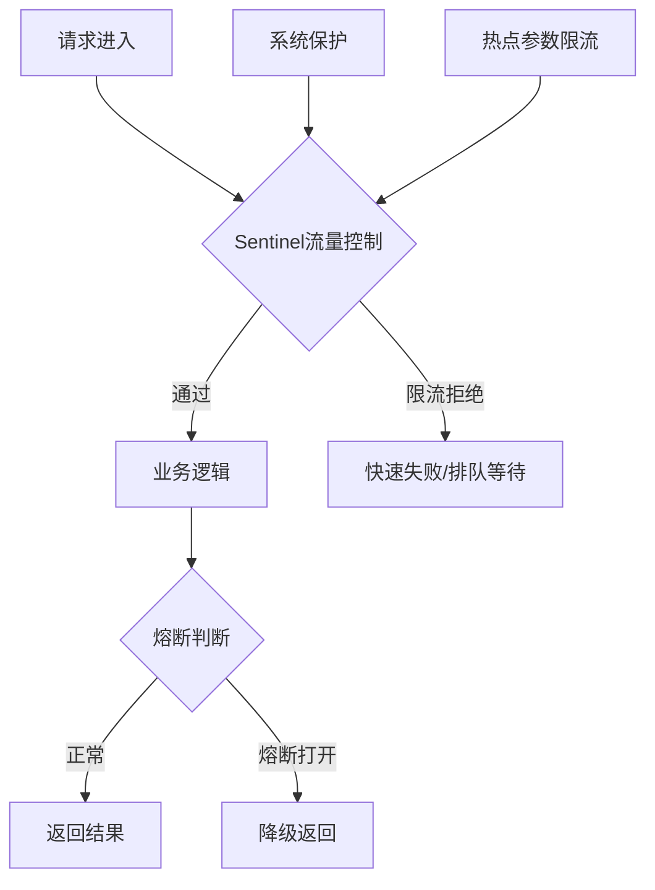
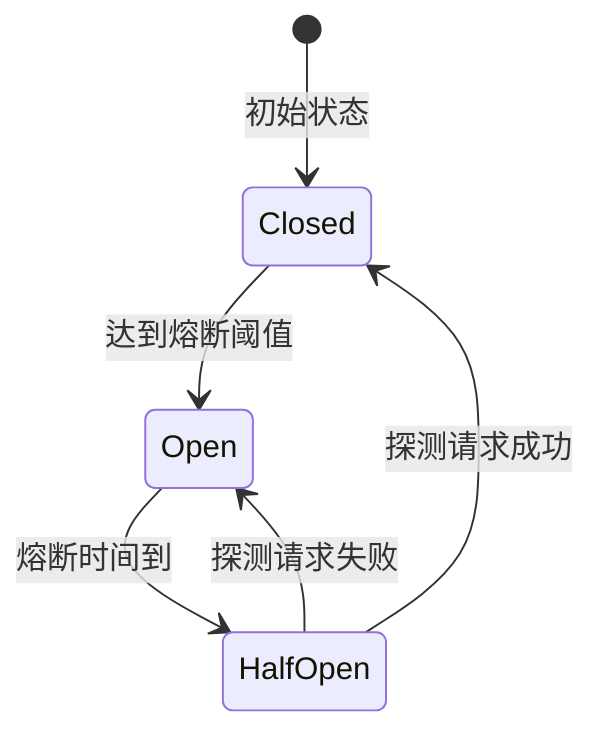

# Sentinel限流熔断实战

> **文档说明**：Sentinel是阿里巴巴开源的流量防卫组件，以流量为切入点，从限流、熔断降级、系统负载保护等维度保障服务稳定性。本文档覆盖核心概念、限流算法、熔断降级、热点参数、集群限流、Dashboard配置。
>
> **适用人群**：后端工程师、需要构建高可用服务的开发者
>
> **前置知识**：微服务架构、Spring Boot

---

## 一、Sentinel核心概念

### 1.1 功能全景



| 功能 | 说明 |
|------|------|
| **流量控制** | QPS/线程数限流，多种限流算法 |
| **熔断降级** | 慢调用/异常比例/异常数触发熔断 |
| **热点参数限流** | 针对参数值的精细化限流 |
| **系统自适应保护** | 基于CPU/负载/RT的系统级保护 |
| **集群限流** | 跨实例的全局限流 |
| **规则动态配置** | 支持Nacos/Apollo/ZooKeeper动态推送 |

### 1.2 与Hystrix对比

| 维度 | Sentinel | Hystrix |
|------|----------|---------|
| 隔离策略 | 信号量隔离 | 线程池/信号量 |
| 熔断触发 | 慢调用/异常比例/异常数 | 异常比例 |
| 限流 | 支持（QPS/线程数） | 不支持 |
| 热点限流 | 支持 | 不支持 |
| 系统保护 | 支持 | 不支持 |
| 控制台 | 丰富（Dashboard） | 简单（Turbine） |
| 维护状态 | 活跃 | 停止维护 |

---

## 二、限流算法

### 2.1 四种限流效果

| 效果 | 说明 | 适用场景 |
|------|------|---------|
| **快速失败** | 超过阈值直接拒绝（默认） | 秒杀、接口保护 |
| **Warm Up** | 冷启动，流量缓慢增加到阈值 | 系统刚启动，避免瞬间打满 |
| **匀速排队** | 请求排队，固定间隔通过 | 消息处理、削峰填谷 |
| **预热+匀速** | 组合模式 | 复杂场景 |

### 2.2 算法原理

```text
1. 滑动窗口（默认）
   将时间窗口分为多个小格，统计每个小格的请求数
   精度高，内存占用适中

2. 漏桶算法（匀速排队）
   请求进入漏桶，以固定速率流出
   平滑流量，允许突发请求排队

3. 令牌桶（Warm Up）
   以固定速率生成令牌，请求需获取令牌
   允许突发流量（桶中有积累令牌时）
```

### 2.3 代码配置限流

```java
// 1. 定义资源
@SentinelResource(value = "createOrder", blockHandler = "blockHandler")
public Order createOrder(OrderDTO dto) {
    return orderService.create(dto);
}

// 限流降级处理
public Order blockHandler(OrderDTO dto, BlockException ex) {
    log.warn("请求被限流: {}", ex.getRule());
    throw new BusinessException("系统繁忙，请稍后重试");
}

// 2. 代码加载规则
private void initFlowRules() {
    List<FlowRule> rules = new ArrayList<>();
    FlowRule rule = new FlowRule();
    rule.setResource("createOrder");
    rule.setGrade(RuleConstant.FLOW_GRADE_QPS);  // QPS模式
    rule.setCount(100);                           // 每秒100次
    rule.setControlBehavior(RuleConstant.CONTROL_BEHAVIOR_DEFAULT);  // 快速失败
    rules.add(rule);
    FlowRuleManager.loadRules(rules);
}
```

### 2.4 限流维度

```java
// QPS限流
rule.setGrade(RuleConstant.FLOW_GRADE_QPS);
rule.setCount(100);  // 每秒100次

// 线程数限流
rule.setGrade(RuleConstant.FLOW_GRADE_THREAD);
rule.setCount(20);   // 最多20个并发线程

// 关联限流（关联资源达到阈值时限流当前资源）
rule.setStrategy(RuleConstant.STRATEGY_RELATE);
rule.setRefResource("queryOrder");  // queryOrder达到阈值时限流createOrder

// 链路限流（只限制指定链路的请求）
rule.setStrategy(RuleConstant.STRATEGY_CHAIN);
rule.setRefResource("nodeA");  // 只限制从nodeA进来的流量
```

---

## 三、熔断降级

### 3.1 三种熔断策略

| 策略 | 触发条件 | 说明 |
|------|---------|------|
| **慢调用比例** | 慢调用占比 > 阈值 | 响应时间超过RT阈值算慢调用 |
| **异常比例** | 异常占比 > 阈值 | 异常数/总请求数 |
| **异常数** | 异常数 > 阈值 | 统计窗口内异常总数 |

### 3.2 熔断状态机



- **Closed（关闭）**：正常放行，统计指标
- **Open（打开）**：直接拒绝/降级，持续设定时间
- **HalfOpen（半开）**：放行少量请求探测，成功则关闭，失败则继续打开

### 3.3 熔断规则配置

```java
// 慢调用比例熔断
DegradeRule slowRule = new DegradeRule();
slowRule.setResource("createOrder");
slowRule.setGrade(CircuitBreakerStrategy.SLOW_REQUEST_RATIO.getType());
slowRule.setCount(500);       // 慢调用RT阈值：500ms
slowRule.setSlowRatioThreshold(0.5);  // 慢调用比例>50%
slowRule.setTimeWindow(10);   // 熔断持续10秒
slowRule.setMinRequestAmount(10);  // 最小请求数10

// 异常比例熔断
DegradeRule errorRule = new DegradeRule();
errorRule.setResource("createOrder");
errorRule.setGrade(CircuitBreakerStrategy.ERROR_RATIO.getType());
errorRule.setCount(0.5);       // 异常比例>50%
errorRule.setTimeWindow(10);
errorRule.setMinRequestAmount(10);

// 异常数熔断
DegradeRule errorCountRule = new DegradeRule();
errorCountRule.setResource("createOrder");
errorCountRule.setGrade(CircuitBreakerStrategy.ERROR_COUNT.getType());
errorCountRule.setCount(10);    // 异常数>10
errorCountRule.setTimeWindow(10);
```

### 3.4 降级处理

```java
@SentinelResource(value = "queryUser", fallback = "fallback")
public User queryUser(Long id) {
    return userMapper.selectById(id);
}

// fallback：异常或熔断时调用
public User fallback(Long id, Throwable ex) {
    log.warn("降级处理: id={}, error={}", id, ex.getMessage());
    // 返回兜底数据
    User user = new User();
    user.setId(id);
    user.setName("默认用户");
    return user;
}

// blockHandler：限流时调用（与fallback区分）
public User blockHandler(Long id, BlockException ex) {
    throw new BusinessException("请求过于频繁");
}
```

> `fallback`处理异常和熔断，`blockHandler`处理限流。可同时配置，限流时优先blockHandler。

---

## 四、热点参数限流

### 4.1 概念

对资源的某个参数值进行精细化限流，例如：
- 某个商品ID的查询频率限制
- 某个用户ID的操作频率限制
- 某个IP的请求频率限制

### 4.2 配置

```java
@SentinelResource(value = "queryProduct", blockHandler = "blockHandler")
public Product queryProduct(@ParamValue Long productId, String type) {
    return productMapper.selectById(productId);
}

// 热点参数规则
ParamFlowRule rule = new ParamFlowRule("queryProduct");
rule.setParamIdx(0);              // 第0个参数（productId）
rule.setGrade(RuleConstant.FLOW_GRADE_QPS);
rule.setCount(10);                // 默认每个参数值每秒10次

// 特定参数值例外配置
ParamFlowItem hotItem = new ParamFlowItem();
hotItem.setObject(String.valueOf(1001L));  // productId=1001（爆款商品）
hotItem.setCount(100);             // 爆款商品允许每秒100次
hotItem.setClassType(int.class.getName());
rule.setParamFlowItemList(Collections.singletonList(hotItem));

ParamFlowRuleManager.loadRules(Collections.singletonList(rule));
```

---

## 五、系统自适应保护

### 5.1 保护维度

| 维度 | 说明 | 阈值参考 |
|------|------|---------|
| **CPU使用率** | 系统CPU负载 | >70%触发 |
| **Load** | 系统负载（Linux） | >CPU核数*2.5 |
| **平均RT** | 所有入口请求平均响应时间 | >500ms |
| **并发线程数** | 所有入口请求并发数 | >1000 |
| **入口QPS** | 所有入口请求总QPS | 自定义 |

### 5.2 配置

```java
SystemRule rule = new SystemRule();
rule.setHighestSystemLoad(3.0);     // Load阈值
rule.setHighestCpuUsage(0.7);      // CPU使用率70%
rule.setAvgRt(500);                // 平均RT 500ms
rule.setMaxThread(1000);           // 最大并发线程
rule.setQps(5000);                 // 总QPS上限
SystemRuleManager.loadRules(Collections.singletonList(rule));
```

---

## 六、Dashboard控制台

### 6.1 启动Dashboard

```bash
# 下载并启动Sentinel Dashboard
java -Dserver.port=8080 -Dcsp.sentinel.dashboard.server=localhost:8080 \
     -Dproject.name=sentinel-dashboard -jar sentinel-dashboard-1.8.6.jar
```

### 6.2 客户端接入

```yaml
spring:
  cloud:
    sentinel:
      transport:
        dashboard: localhost:8080    # Dashboard地址
        port: 8719                   # 客户端通信端口
      eager: true                    # 立即初始化（懒加载关闭）
      web-context-unify: false       # 区分不同URL的上下文
```

### 6.3 Dashboard功能

- 实时监控：QPS、响应时间、异常数
- 规则管理：流控/熔断/热点/系统规则的增删改查
- 簇点链路：调用链路展示
- 规则推送：推送到Nacos/Apollo实现持久化

---

## 七、规则持久化（Nacos）

```java
// 引入依赖
// spring-cloud-starter-alibaba-sentinel-datasource-nacos

@Configuration
public class SentinelNacosConfig {
    @Bean
    public Converter<String, List<FlowRule>> flowRuleConverter() {
        return source -> JSON.parseObject(source, new TypeReference<List<FlowRule>>() {});
    }

    @Bean
    public DataSource<List<FlowRule>> flowRuleDataSource(
            @Value("${spring.cloud.sentinel.datasource.ds.nacos.server-addr}") String serverAddr,
            Converter<String, List<FlowRule>> converter) throws Exception {
        ReadableDataSource<String, List<FlowRule>> ds = new NacosDataSource<>(
            serverAddr, "DEFAULT_GROUP", "sentinel-flow-rules", converter);
        FlowRuleManager.register2Property(ds.getProperty());
        return ds;
    }
}
```

Nacos中配置规则JSON：
```json
[
  {
    "resource": "createOrder",
    "grade": 1,
    "count": 100,
    "controlBehavior": 0
  }
]
```

---

## 八、最佳实践

1. **资源命名规范**：使用`类名:方法名`格式，便于管理
2. **限流粒度**：核心接口QPS限流，非核心接口线程数限流
3. **熔断配置**：外部依赖必须配置熔断，防止级联故障
4. **热点限流**：爆款商品、热门用户必须配置热点参数限流
5. **系统保护**：生产环境必须开启系统自适应保护
6. **规则持久化**：使用Nacos/Apollo持久化规则，避免重启丢失
7. **降级兜底**：每个@SentinelResource配置fallback，返回合理兜底数据
8. **监控告警**：监控限流次数、熔断次数，异常时告警

---

## 关联文档

- [[微服务核心组件知识点系统梳理_优化版]] — 微服务全景
- [[API网关实战]] — 网关层限流
- [[高可用架构设计]] — 高可用
- [[高并发系统设计案例]] — 限流在高并发中的应用
- [[秒杀系统架构设计]] — 秒杀限流实战

---

> 💡 **实战建议**：Sentinel是微服务稳定性的基石。核心接口配置QPS限流+慢调用熔断，外部依赖必须配置熔断。热点参数限流是秒杀/爆款场景的必备功能。生产环境务必将规则持久化到Nacos，Dashboard只做监控和临时调整。


## 补充：概述

Sentinel 是阿里巴巴开源的**流量防卫组件**，以流量为切入点，从限流、熔断降级、系统负载保护、热点参数限流等多个维度保障服务的稳定性。Sentinel 是 Hystrix 的替代者，具有更强大的功能、更好的性能（无侵入、低开销）、更丰富的生态（Spring Cloud Alibaba、Dubbo、gRPC 集成），是微服务架构中服务容错的首选方案。

| 功能 | 说明 |
|------|------|
| **流量控制** | QPS/线程数限流，支持直接拒绝/冷启动/匀速排队三种效果 |
| **熔断降级** | 慢调用比例/异常比例/异常数触发熔断，半开状态探测恢复 |
| **热点参数限流** | 针对请求参数值的精细化限流（如某个商品 ID、某个用户 ID） |
| **系统自适应保护** | 基于 CPU 使用率/负载/RT/入口 QPS/线程数的系统级保护 |
| **授权控制** | 黑白名单控制（按调用方应用名） |
| **规则动态配置** | 支持 Nacos/Apollo/ZooKeeper 动态推送规则，无需重启 |
| **控制台** | 提供 Dashboard 进行规则管理、监控查看、簇点链路 |
| **集群限流** | 跨实例的全局限流（Token Server 模式） |

**核心概念**：
| 概念 | 说明 |
|------|------|
| **资源** | 需要保护的对象（方法、URL、服务），用资源名标识 |
| **规则** | 保护策略（限流规则、熔断规则、系统规则等） |
| **Slot Chain** | 插槽链，Sentinel 的核心处理流程，每个 Slot 负责一个功能 |
| **Context** | 上下文，保存当前调用的元信息（入口、调用链） |
| **Entry** | 资源入口，进入资源时创建，退出时关闭 |

**Sentinel vs Hystrix vs Resilience4j**：
| 维度 | Sentinel | Hystrix（已停止维护） | Resilience4j |
|------|----------|---------------------|-------------|
| 隔离策略 | 信号量（并发线程数） | 线程池/信号量 | 信号量 |
| 熔断策略 | 慢调用/异常比例/异常数 | 异常比例 | 异常比例/慢调用 |
| 限流 | ✅ QPS/线程数/热点参数 | ❌ | ✅（RateLimiter） |
| 系统保护 | ✅ CPU/负载/RT | ❌ | ❌ |
| 控制台 | ✅ Dashboard | ✅（Hystrix Dashboard） | ❌ |
| 动态规则 | ✅ Nacos/Apollo | ❌（需重启） | ✅（配置文件） |
| 性能开销 | 低（~1μs） | 中（线程池开销） | 低 |
| 维护状态 | 活跃 | 停止维护（2018） | 活跃 |

**适用场景**：微服务流量控制、秒杀/大促限流、接口防刷、服务熔断降级、系统负载保护、热点商品/用户限流、多维度流量治理。
**不适用场景**：简单单体应用（用 Guava RateLimiter 即可）、需要复杂路由的场景（用 API 网关）、非 Java 技术栈（Sentinel 主要支持 Java，Go/C++ 有客户端但功能较少）。

---

## 补充：常见问题与排查

| 问题 | 原因 | 解决方案 |
|------|------|---------|
| 限流不生效 | 资源名不匹配、规则未加载、Sentinel 未初始化 | 检查资源名拼写、规则是否推送到客户端、是否调用了 `SphU.entry()` |
| 熔断后不恢复 | 半开状态探测一直失败 | 检查后端服务是否恢复，调整 `recoveryTimeout`（恢复超时时间） |
| 规则推送不生效 | Nacos/Apollo 配置错误、监听未注册 | 检查 dataId/group、客户端是否注册了监听器、网络连通性 |
| 热点参数限流不生效 | 参数类型不支持、参数索引错误 | 支持基本类型和 String，检查 `paramIdx` 是否正确（从 0 开始） |
| 集群限流不准 | Token Server 宕机、网络延迟、Token 分配不均 | 检查 Token Server 状态、部署多个 Token Server、调整 Token 配额 |
| 性能开销大 | 资源数过多、规则过多、监控采集频繁 | 控制资源数量（<1000）、减少不必要的规则、降低监控采集频率 |
| 异步调用上下文丢失 | 异步线程未传递 Context | 使用 `ContextUtil.runOnContext()` 或手动传递 Entry |
| Dashboard 看不到监控 | 客户端未配置 Dashboard 地址、传输失败 | 检查 `csp.sentinel.dashboard.server` 配置、网络连通性 |
| 限流阈值设置不合理 | 阈值过高（不起作用）或过低（误杀） | 根据压测结果和实际流量设置，逐步调整，按接口分级 |

### 排查命令/方法

```java
// 1. 查看当前加载的规则
FlowRuleManager.getRules()       // 限流规则
DegradeRuleManager.getRules()    // 熔断规则
SystemRuleManager.getRules()     // 系统规则
ParamFlowRuleManager.getRules()  // 热点参数规则

// 2. 查看资源的实时指标
ClusterNode node = ClusterBuilderSlot.getClusterNode(resourceName);
if (node != null) {
    System.out.println("QPS: " + node.passQps());
    System.out.println("拒绝QPS: " + node.blockQps());
    System.out.println("平均RT: " + node.avgRt());
    System.out.println("异常数: " + node.exceptionQps());
    System.out.println("当前线程数: " + node.curThreadNum());
}

// 3. 查看熔断状态
DegradeRuleManager.getRules().forEach(rule -> {
    System.out.println("资源: " + rule.getResource() +
        " 熔断策略: " + rule.getGrade() +
        " 阈值: " + rule.getCount());
});
```

```bash
# 4. 查看 Sentinel 日志（日志文件在 ~/logs/csp/ 目录）
tail -f ~/logs/csp/sentinel-block.log   # 被限流/熔断的请求
tail -f ~/logs/csp/sentinel-record.log  # 详细记录
ls -la ~/logs/csp/                        # 查看所有日志文件

# 5. Dashboard 查看
# 访问 http://dashboard-ip:8080
# 左侧菜单：实时监控（QPS/拒绝/RT）、簇点链路（资源调用链）、规则管理
```
