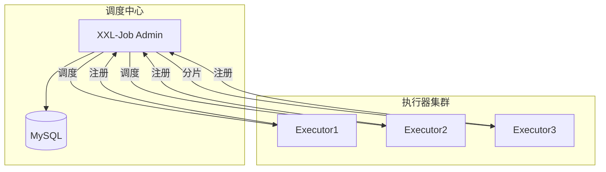

# 分布式任务调度实战

> **文档说明**：分布式任务调度解决多实例环境下定时任务的重复执行、分片执行、失败重试问题。本文档覆盖XXL-Job和ElasticJob两大框架的架构、配置、分片、故障转移、运维管理。
>
> **适用人群**：后端工程师、需要构建定时任务系统的开发者
>
> **前置知识**：Spring Boot、分布式系统概念

---

## 一、为什么需要分布式任务调度

### 1.1 单机定时任务的问题

| 问题 | 说明 |
|------|------|
| 重复执行 | 多实例部署时，每个实例都执行，数据重复 |
| 单点故障 | 任务执行节点宕机，任务无法执行 |
| 无法分片 | 大数据量任务无法并行处理 |
| 管理困难 | 任务分散在各服务，无统一管理界面 |
| 无重试 | 执行失败无自动重试机制 |
| 无监控 | 执行状态、耗时、成功率无法统计 |

### 1.2 分布式调度框架对比

| 维度 | XXL-Job | ElasticJob | Quartz集群 |
|------|---------|-----------|-----------|
| 模型 | 中心化调度 | 去中心化 | 数据库锁 |
| 分片 | 支持 | 支持（弹性） | 不支持 |
| 管理界面 | 丰富 | 简单 | 无 |
| 失败重试 | 支持 | 支持 | 不支持 |
| 依赖 | MySQL | ZooKeeper | MySQL |
| 学习成本 | 低 | 中 | 中 |
| 适用 | 通用业务调度 | 大数据分片 | 简单定时 |

---

```text
## 二、XXL-Job实战
```

### 2.1 架构



| 角色 | 说明 |
|------|------|
| **调度中心（Admin）** | 统一管理任务，触发调度，统计执行结果 |
| **执行器（Executor）** | 嵌入业务应用，接收调度并执行任务 |
| **任务Handler** | 业务逻辑实现，@XxlJob注解标记 |

### 2.2 快速集成

```xml
<!-- Maven依赖 -->
<dependency>
    <groupId>com.xuxueli</groupId>
    <artifactId>xxl-job-core</artifactId>
    <version>2.4.0</version>
</dependency>
```

```yaml
# 执行器配置
xxl:
  job:
    admin:
      addresses: http://xxl-job-admin:8080/xxl-job-admin  # 调度中心地址
    executor:
      appname: order-service-executor  # 执行器名称
      address:                         # 执行器地址（自动注册可不填）
      ip:
      port: 9999                       # 执行器端口
      logpath: ./logs/xxl-job          # 日志路径
      logretentiondays: 30             # 日志保留天数
```

```java
@Configuration
public class XxlJobConfig {
    @Value("${xxl.job.admin.addresses}")
    private String adminAddresses;
    @Value("${xxl.job.executor.appname}")
    private String appname;
    @Value("${xxl.job.executor.port}")
    private int port;

    @Bean
    public XxlJobSpringExecutor xxlJobExecutor() {
        XxlJobSpringExecutor executor = new XxlJobSpringExecutor();
        executor.setAdminAddresses(adminAddresses);
        executor.setAppname(appname);
        executor.setPort(port);
        executor.setLogPath("./logs/xxl-job");
        executor.setLogRetentionDays(30);
        return executor;
    }
}
```

### 2.3 任务开发

```java
@Component
@Slf4j
public class OrderJobHandler {

    // 简单任务
    @XxlJob("dailyOrderSettlement")
    public void dailyOrderSettlement() {
        log.info("每日订单结算开始");
        try {
            orderService.settleDailyOrders();
            log.info("每日订单结算完成");
        } catch (Exception e) {
            log.error("每日订单结算失败", e);
            XxlJobHelper.handleFail("结算失败: " + e.getMessage());
        }
    }

    // 分片任务
    @XxlJob("batchProcessOrders")
    public void batchProcessOrders() {
        int shardIndex = XxlJobHelper.getShardIndex();  // 当前分片序号
        int shardTotal = XxlJobHelper.getShardTotal();  // 总分片数

        log.info("分片执行: index={}, total={}", shardIndex, shardTotal);

        // 按分片取模，每个执行器处理一部分数据
        List<Order> orders = orderMapper.selectPendingOrders();
        orders.stream()
            .filter(o -> o.getId() % shardTotal == shardIndex)
            .forEach(this::processOrder);
    }

    // 命令行参数任务
    @XxlJob("exportReport")
    public void exportReport() {
        String param = XxlJobHelper.getJobParam();  // 获取任务参数
        log.info("导出报表, 参数: {}", param);
        reportService.export(param);
    }
}
```

### 2.4 调度策略

| 策略 | 说明 |
|------|------|
| Cron | Cron表达式，最灵活 |
| 固定速度 | 固定间隔执行（从上一次开始时间算） |
| 固定延迟 | 固定延迟执行（从上一次结束时间算） |
| 固定频率 | 固定频率（类似固定速度） |
| 一次性 | 只执行一次 |

### 2.5 路由策略

| 策略 | 说明 |
|------|------|
| FIRST | 第一个执行器 |
| LAST | 最后一个执行器 |
| ROUND | 轮询 |
| RANDOM | 随机 |
| CONSISTENT_HASH | 一致性哈希 |
| LEAST_FREQUENTLY_USED | 最不经常使用 |
| LEAST_RECENTLY_USED | 最近最久未使用 |
| FAILOVER | 故障转移（依次尝试） |
| BUSYOVER | 忙碌转移（选最空闲的） |
| SHARDING_BROADCAST | 分片广播（所有执行器都执行，各处理一个分片） |

### 2.6 高级特性

```java
// 1. 任务超时
@XxlJob("longRunningTask")
public void longRunningTask() {
    // Admin端配置超时时间，超时自动标记失败
}

// 2. 失败重试（Admin端配置重试次数）
// 执行失败自动重试，最多重试N次

// 3. 任务依赖（子任务）
// Admin端配置子任务，父任务成功后自动触发子任务

// 4. 手动触发
// Admin界面点击"执行一次"，支持传入参数

// 5. 日志查看
// Admin界面查看每次执行的详细日志
```

---

## 三、ElasticJob实战

### 3.1 架构特点

- 基于ZooKeeper协调，去中心化
- 弹性分片：实例增减时自动重新分片
- 支持数据流式处理（Dataflow）
- 支持脚本任务

### 3.2 快速集成

```xml
<dependency>
    <groupId>org.apache.shardingsphere.elasticjob</groupId>
    <artifactId>elasticjob-lite-spring-boot-starter</artifactId>
    <version>3.0.1</version>
</dependency>
```

```yaml
elasticjob:
  reg-center:
    server-lists: zk1:2181,zk2:2181,zk3:2181
    namespace: elastic-job
```

```java
// 简单任务
@Component
public class MySimpleJob implements SimpleJob {
    @Override
    public void execute(ShardingContext context) {
        int shardItem = context.getShardingItem();
        int shardTotal = context.getShardingTotalCount();
        String param = context.getJobParameter();

        // 按分片处理数据
        List<Data> dataList = dataMapper.selectAll();
        dataList.stream()
            .filter(d -> d.getId() % shardTotal == shardItem)
            .forEach(this::process);
    }
}

// 配置类
@Configuration
public class ElasticJobConfig {
    @Bean
    public JobBootstrap myJobBootstrap(MySimpleJob job) {
        return new JobBootstrap(job, JobConfiguration.newBuilder("myJob", 3)
            .cron("0 0 2 * * ?")
            .shardingItemParameters("0=A,1=B,2=C")
            .failover(true)
            .misfire(true)
            .build());
    }
}
```

### 3.3 Dataflow流式任务

```java
@Component
public class MyDataflowJob implements DataflowJob<Order> {
    @Override
    public List<Order> fetchData(ShardingContext context) {
        // 抓取待处理数据（每次最多N条）
        return orderMapper.selectPending(context.getShardingItem(), 100);
    }

    @Override
    public void processData(ShardingContext context, List<Order> data) {
        // 处理数据
        data.forEach(this::process);
    }
}
// streamingProcess=true时，fetchData不为空就持续执行
```

---

## 四、运维与监控

```text
### 4.1 XXL-Job Admin功能
```

- 任务管理：新增/编辑/删除/启动/停止任务
- 执行器管理：执行器注册、在线机器列表
- 调度日志：每次执行的详细日志、状态、耗时
- 调度报表：成功率、执行次数统计图表
- 用户管理：用户权限、角色管理

### 4.2 关键监控指标

| 指标 | 说明 | 告警 |
|------|------|------|
| 任务成功率 | 成功次数/总次数 | <95%告警 |
| 任务执行时长 | 单次执行耗时 | 超过阈值告警 |
| 调度延迟 | 实际执行-计划执行 | >30s告警 |
| 执行器在线数 | 注册的执行器数量 | <预期数量告警 |
| 失败任务数 | 执行失败的任务 | >0告警 |

### 4.3 常见问题

| 问题 | 原因 | 解决方案 |
|------|------|---------|
| 任务不执行 | 执行器未注册/路由策略问题 | 检查Admin执行器列表 |
| 重复执行 | 调度中心集群未做HA | Admin部署HA（主备） |
| 分片不均 | 执行器数量变化 | 触发重新分片 |
| 日志丢失 | 日志保留时间短 | 增大logretentiondays |
| 任务超时 | 业务逻辑耗时长 | 优化逻辑/增大超时/分片 |

---

## 五、选型建议

| 场景 | 推荐 |
|------|------|
| 通用业务定时任务 | XXL-Job（管理界面丰富，上手快） |
| 大数据量分片处理 | ElasticJob（弹性分片，去中心化） |
| 简单定时任务 | Spring @Scheduled（单实例） |
| 复杂工作流/DAG | Airflow/DolphinScheduler |
| 纯Java生态 | XXL-Job |
| 已有ZooKeeper集群 | ElasticJob |

---

## 关联文档

- [[微服务核心组件知识点系统梳理_优化版]] — 微服务全景
- [[分布式事务 知识点系统梳理_优化版]] — 分布式事务
- [[高可用架构设计]] — 高可用
- [[Linux命令速查表]] — Cron表达式

---

> 💡 **实战建议**：XXL-Job是国内最流行的分布式任务调度框架，管理界面丰富，上手简单，推荐首选。生产环境注意：1. Admin部署HA避免单点；2. 核心任务配置失败重试；3. 大数据量任务使用分片广播；4. 监控任务成功率和执行时长。


## 补充：概述

分布式任务调度是分布式系统中的重要组件，用于在多节点环境下**可靠、高效、可观测地执行定时任务和异步任务**。在单机环境中，用 cron 或 Timer 就能满足需求；但在分布式环境中，需要解决**任务不重复执行（幂等/分布式锁）、高可用（单点故障转移）、弹性伸缩（动态分配任务）、可观测（执行日志/告警）**等问题。

| 调度类型 | 说明 | 示例 |
|---------|------|------|
| **定时任务** | 按时间规则周期性执行 | 每天凌晨 2 点备份数据、每 5 分钟同步数据 |
| **延迟任务** | 延迟一定时间后执行 | 订单 30 分钟未支付取消、延迟通知 |
| **一次性任务** | 只执行一次的任务 | 数据迁移、批量处理、报表生成 |
| **工作流（DAG）** | 有依赖关系的任务编排 | 数据同步 → 清洗 → 聚合 → 报表 |
| **分片任务** | 大任务拆分为多个分片并行执行 | 批量处理 100 万数据，拆分为 10 个分片 |

**主流分布式任务调度框架对比**：
| 框架 | 特点 | 适用场景 |
|------|------|---------|
| **XXL-Job** | 轻量级、易上手、调度中心+执行器模型、Web 管理界面 | 中小团队、定时任务为主 |
| **ElasticJob** | 当当网开源、弹性扩容、分片任务、ZooKeeper 协调 | 大规模分片任务、高可用要求 |
| **SchedulerX** | 阿里商业版、功能强大、支持 DAG/工作流 | 企业级、复杂任务编排 |
| **Quartz** | 老牌调度框架、功能丰富、但分布式支持弱（需要数据库锁） | 单体应用、简单定时任务 |
| **Celery** | Python 生态、任务队列+定时任务、简单易用 | Python 技术栈、异步任务为主 |
| **Airflow** | 工作流编排、DAG 强大、数据工程首选 | 数据管道、ETL、复杂依赖 |
| **DolphinScheduler** | 国产、可视化 DAG、多租户、云原生 | 数据平台、复杂工作流 |
| **K8s CronJob** | K8s 原生、简单、无额外组件 | K8s 环境、简单定时任务 |

**核心问题与解决方案**：
| 问题 | 解决方案 |
|------|---------|
| **任务重复执行** | 分布式锁（Redis/ZooKeeper）、数据库唯一约束、幂等设计 |
| **单点故障** | 调度中心集群部署、任务持久化、故障转移 |
| **任务丢失** | 任务持久化到数据库、执行结果记录、失败重试 |
| **动态扩缩容** | 任务分片、弹性分配、服务发现 |
| **任务依赖** | DAG 工作流编排、上游完成触发下游 |
| **可观测性** | 执行日志、执行历史、失败告警、指标监控 |
| **任务优先级** | 优先级队列、高优先级任务优先调度 |

---

## 补充：进阶与最佳实践

### 1. 任务幂等性设计

分布式任务调度中，任务可能因为重试、网络超时、重复调度等原因被执行多次，**幂等性是必须的**。

| 幂等方案 | 原理 | 适用场景 |
|---------|------|---------|
| **唯一键去重** | 任务执行前检查唯一键是否已存在 | 数据写入类任务（如同步订单） |
| **状态机** | 任务有明确的状态流转，重复执行时检查状态 | 有状态的任务（如订单处理） |
| **数据库唯一约束** | 利用数据库唯一索引防止重复插入 | 数据写入类任务 |
| **分布式锁** | 执行前获取锁，执行完释放 | 防止并发执行同一任务 |
| **版本号/乐观锁** | 更新时检查版本号，冲突则放弃 | 数据更新类任务 |

```java
// 幂等执行模板
public void executeTask(TaskContext context) {
    String taskId = context.getTaskId();
    
    // 1. 尝试获取分布式锁（防止并发执行）
    RLock lock = redissonClient.getLock("task:lock:" + taskId);
    try {
        if (!lock.tryLock(0, 300, TimeUnit.SECONDS)) {
            log.warn("任务正在执行中，跳过: {}", taskId);
            return;
        }
        
        // 2. 检查任务是否已执行（幂等检查）
        if (taskRecordService.isExecuted(taskId)) {
            log.info("任务已执行，跳过: {}", taskId);
            return;
        }
        
        // 3. 标记任务开始执行
        taskRecordService.markRunning(taskId);
        
        // 4. 执行业务逻辑
        doBusiness(context);
        
        // 5. 标记任务完成
        taskRecordService.markSuccess(taskId);
        
    } catch (Exception e) {
        log.error("任务执行失败: {}", taskId, e);
        taskRecordService.markFailed(taskId, e.getMessage());
        throw e;  // 抛出异常让调度框架重试
    } finally {
        if (lock.isHeldByCurrentThread()) {
            lock.unlock();
        }
    }
}
```

### 2. 任务分片与并行执行

大任务（如处理 100 万条数据）可以拆分为多个分片，由多个执行器并行处理：

```java
// ElasticJob 分片示例
public class DataSyncJob implements SimpleJob {
    @Override
    public void execute(ShardingContext context) {
        int shardingTotalCount = context.getShardingTotalCount();  // 总分片数
        int shardingItem = context.getShardingItem();              // 当前分片编号
        
        // 按分片编号取模，每个执行器只处理自己的分片
        List<Data> dataList = dataMapper.selectBySharding(
            shardingItem, shardingTotalCount);
        // SQL: SELECT * FROM data WHERE id % #{shardingTotalCount} = #{shardingItem}
        
        for (Data data : dataList) {
            process(data);
        }
    }
}
```

**分片策略**：
| 策略 | 说明 | 适用场景 |
|------|------|---------|
| **平均分配** | 平均分到各执行器 | 数据均匀、执行器性能相近 |
| **按取模分配** | ID 取模分配 | 数据 ID 连续、均匀 |
| **按范围分配** | ID 范围分段 | 数据 ID 有序、范围明确 |
| **一致性哈希** | 一致性哈希环分配 | 动态扩缩容、减少数据迁移 |

### 3. 任务监控与告警

| 监控指标 | 说明 | 告警阈值 |
|---------|------|---------|
| **任务成功率** | 成功次数 / 总次数 | < 95% 告警 |
| **任务执行时长** | 单次执行耗时 | 超过历史 P99 的 2 倍告警 |
| **任务超时** | 执行超过设定时间 | 超时告警（可能卡死） |
| **任务堆积** | 待执行任务数 | 持续增长告警 |
| **调度延迟** | 实际执行时间 - 计划执行时间 | > 1 分钟告警 |
| **失败次数** | 连续失败次数 | 连续失败 3 次告警 |

**告警方式**：邮件、钉钉/飞书/企业微信机器人、短信、电话（P0 故障）。

### 4. 任务调度最佳实践

- [ ] **任务幂等**：所有任务必须幂等，防止重复执行导致数据错误
- [ ] **任务无状态**：任务执行器无状态，状态存数据库/缓存，支持弹性扩缩
- [ ] **失败重试**：配置合理的重试次数和间隔（指数退避），避免无限重试
- [ ] **超时控制**：每个任务设置超时时间，防止任务卡死占用资源
- [ ] **任务分片**：大任务拆分为小分片并行执行，提升吞吐量
- [ ] **错峰执行**：避免所有任务在同一时间点执行（如整点），加随机偏移
- [ ] **资源隔离**：重要任务和普通任务隔离执行，避免互相影响
- [ ] **执行日志**：记录每次执行的开始/结束时间、耗时、结果、错误信息
- [ ] **灰度发布**：新任务先在少量实例/小范围执行，验证后全量
- [ ] **死信队列**：多次失败的任务进入死信队列，人工介入处理
- [ ] **定期清理**：定期清理历史执行日志，避免数据库膨胀
