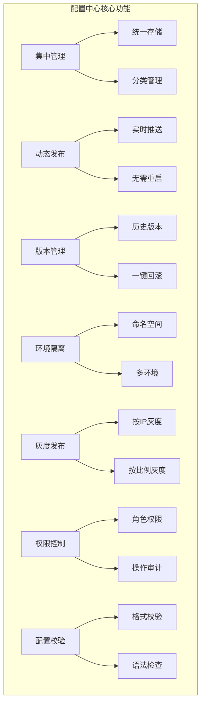
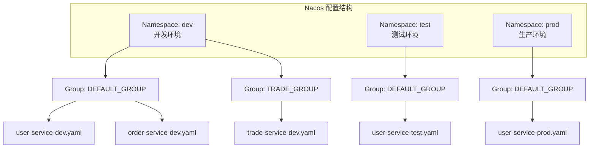
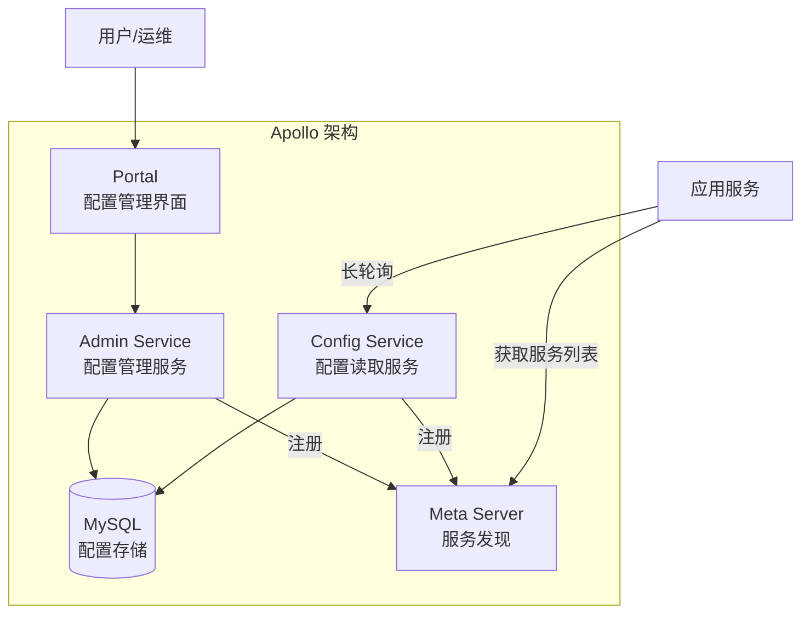

# 配置中心实战

> **文档说明**：系统讲解微服务配置中心的核心概念、主流方案对比（Nacos/Apollo/Consul/Etcd/Spring Cloud Config）、Nacos 配置中心完整实战（命名空间/分组/配置集/灰度发布/版本回滚）、Apollo 架构与使用、配置最佳实践，以及动态配置刷新原理。
>
> **适用人群**：后端开发工程师、微服务架构师、DevOps 工程师
>
> **前置知识**：[[微服务架构核心概念]]、[[SpringCloud-服务注册与发现]]、[[SpringBoot-自动装配原理]]

---

## 一、概述

**配置中心**是微服务架构中的核心基础设施，用于集中管理所有服务的配置信息，支持配置的动态发布、版本管理、灰度发布、环境隔离、权限控制等功能。

### 1. 为什么需要配置中心

传统配置方式（配置文件打包在应用中）的痛点：

| 痛点 | 说明 |
|------|------|
| **修改配置需重新打包部署** | 改一个参数就要重新打包发布，效率低 |
| **配置分散** | 配置散落在各个服务的配置文件中，难以统一管理 |
| **环境不一致** | 开发/测试/生产环境配置容易混淆 |
| **无法动态刷新** | 运行时修改配置需要重启服务 |
| **无版本管理** | 配置修改无历史记录，出错无法回滚 |
| **无权限控制** | 任何人都能修改配置，安全风险高 |
| **无灰度能力** | 配置修改全量生效，出问题影响大 |

### 2. 配置中心核心功能



### 3. 主流配置中心对比

| 特性 | Nacos | Apollo | Consul | Etcd | Spring Cloud Config |
|------|-------|--------|--------|------|---------------------|
| **出品方** | 阿里巴巴 | 携程 | HashiCorp | CoreOS | Pivotal/Spring |
| **配置管理** | ✅ 强 | ✅ 极强 | ✅ 中 | ✅ 中 | ✅ 中 |
| **服务发现** | ✅ 内置 | ❌ 无 | ✅ 内置 | ✅ 内置 | ❌ 无 |
| **动态推送** | ✅ 长轮询 | ✅ HTTP 长轮询 | ✅ 长轮询 | ✅ Watch | ⚠️ 需配合 Bus |
| **灰度发布** | ✅ 支持 | ✅ 极强（灰度/发布单） | ❌ 无 | ❌ 无 | ❌ 无 |
| **版本回滚** | ✅ 历史版本 | ✅ 历史版本+发布单 | ⚠️ 需自行实现 | ⚠️ 需自行实现 | ✅ Git 版本 |
| **权限管理** | ✅ 命名空间权限 | ✅ 细粒度权限 | ❌ 无 | ❌ 无 | ❌ 无 |
| **审计日志** | ✅ 操作记录 | ✅ 完整审计 | ❌ 无 | ❌ 无 | ❌ 无 |
| **配置校验** | ✅ 格式校验 | ✅ 校验+灰度校验 | ❌ 无 | ❌ 无 | ❌ 无 |
| **多环境** | ✅ 命名空间 | ✅ 环境+集群 | ✅ Key 前缀 | ✅ Key 前缀 | ✅ Profile |
| **UI 界面** | ✅ 简洁 | ✅ 功能丰富 | ✅ 简单 | ❌ 无 UI | ❌ 无 UI |
| **部署复杂度** | 低（单机/集群） | 中（需 DB） | 低 | 低 | 低（需 Git） |
| **国内生态** | 极好（Spring Cloud Alibaba） | 好 | 一般 | 一般 | 好（Spring 官方） |
| **适用场景** | 国内微服务首选 | 对配置管理要求极高 | 服务发现为主 | K8s 生态 | Spring 传统项目 |

**选择建议**：
- **国内微服务项目** → Nacos（同时提供配置中心+服务发现，生态好，上手简单）
- **对配置管理要求极高**（金融、大型企业）→ Apollo（灰度发布、权限、审计最强）
- **已有 Consul/Etcd 做服务发现** → 复用 Consul/Etcd 做配置（减少技术栈）
- **K8s 原生环境** → Etcd（K8s 内置）或 ConfigMap
- **传统 Spring 项目** → Spring Cloud Config（Git 存储，简单）

---

## 二、Nacos 配置中心核心概念

### 1. 核心概念

| 概念 | 说明 | 类比 |
|------|------|------|
| **Namespace（命名空间）** | 最顶层隔离，用于环境隔离（dev/test/prod）或租户隔离 | 不同的文件夹根目录 |
| **Group（分组）** | 命名空间内的分组，用于业务分组（如 DEFAULT_GROUP、TRADE_GROUP） | 文件夹 |
| **Data ID（配置集 ID）** | 配置文件的唯一标识，通常是 `应用名-环境.扩展名` | 文件名 |
| **配置集（Configuration Set）** | 一组相关配置的集合，对应一个配置文件 | 配置文件内容 |
| **配置项（Configuration Item）** | 配置集中的单个键值对 | 配置文件中的一行 |
| **租户（Tenant）** | 命名空间的另一种称呼，用于多租户场景 | - |

### 2. 命名空间与分组设计



**命名空间设计最佳实践**：
- 按环境划分：dev、test、staging、prod（最常用）
- 按租户划分：多租户 SaaS 系统
- 不建议按服务划分命名空间（应该用 Group 或 Data ID 区分）

**Data ID 命名规范**：
```text
格式：${prefix}-${spring.profiles.active}.${file-extension}
示例：
- user-service-dev.yaml
- user-service-prod.yaml
- order-service-test.properties

默认：
- prefix = spring.application.name
- spring.profiles.active = 当前环境
- file-extension = yaml/properties
```

### 3. Nacos 配置加载优先级

Spring Cloud Alibaba Nacos Config 的配置加载顺序（优先级从高到低）：

```text
1. 命令行参数（--server.port=8080）
2. 操作系统环境变量
3. JVM 系统属性（-Dserver.port=8080）
4. Nacos 远程配置（扩展配置 > 共享配置 > 应用配置）
5. 本地 application-{profile}.yaml
6. 本地 application.yaml
7. bootstrap.yaml（引导配置，最先加载但优先级低）
```

**Nacos 内部配置优先级**：
- 扩展配置（extension-configs）> 共享配置（shared-configs）> 应用自身配置
- 同一级别下，order 越大优先级越高

---

## 三、Nacos 配置中心实战

### 1. 快速集成

**Maven 依赖**：
```xml
<dependency>
    <groupId>com.alibaba.cloud</groupId>
    <artifactId>spring-cloud-starter-alibaba-nacos-config</artifactId>
</dependency>
<!-- Spring Boot 2.4+ 需要引入 -->
<dependency>
    <groupId>org.springframework.cloud</groupId>
    <artifactId>spring-cloud-starter-bootstrap</artifactId>
</dependency>
```

**bootstrap.yaml 配置**（必须用 bootstrap，不能用 application）：
```yaml
spring:
  application:
    name: user-service
  profiles:
    active: dev
  cloud:
    nacos:
      server-addr: 127.0.0.1:8848
      username: nacos
      password: nacos
      config:
        namespace: dev                    # 命名空间（环境隔离）
        group: DEFAULT_GROUP              # 分组
        file-extension: yaml              # 配置文件格式
        refresh-enabled: true             # 开启动态刷新
        # 共享配置（多个服务共用）
        shared-configs:
          - data-id: common-redis.yaml
            group: DEFAULT_GROUP
            refresh: true
          - data-id: common-mysql.yaml
            group: DEFAULT_GROUP
            refresh: true
        # 扩展配置（当前服务额外的配置）
        extension-configs:
          - data-id: user-service-extra.yaml
            group: DEFAULT_GROUP
            refresh: true
```

**Nacos 控制台创建配置**：
1. 登录 Nacos 控制台（http://localhost:8848/nacos）
2. 进入"配置管理" → "配置列表"
3. 选择命名空间（dev）
4. 点击"+"新建配置
5. 填写 Data ID：`user-service-dev.yaml`
6. Group：`DEFAULT_GROUP`
7. 配置格式：YAML
8. 配置内容：
```yaml
server:
  port: 8081

spring:
  datasource:
    url: jdbc:mysql://localhost:3306/user_db
    username: root
    password: root

user:
  max-login-attempts: 5
  session-timeout: 1800
```

### 2. 动态配置刷新

**方式1：@RefreshScope 注解（推荐）**：
```java
@RestController
@RequestMapping("/user")
@RefreshScope  // 开启动态刷新，配置变化时自动重建 Bean
public class UserController {

    @Value("${user.max-login-attempts:5}")
    private int maxLoginAttempts;

    @Value("${user.session-timeout:1800}")
    private int sessionTimeout;

    @GetMapping("/config")
    public Map<String, Object> getConfig() {
        Map<String, Object> config = new HashMap<>();
        config.put("maxLoginAttempts", maxLoginAttempts);
        config.put("sessionTimeout", sessionTimeout);
        return config;
    }
}
```

**方式2：@ConfigurationProperties**：
```java
@Component
@ConfigurationProperties(prefix = "user")
@RefreshScope  // 也需要加 @RefreshScope
@Data
public class UserProperties {
    private int maxLoginAttempts = 5;
    private int sessionTimeout = 1800;
    private List<String> blacklist = new ArrayList<>();
}
```

**方式3：监听配置变化事件**：
```java
@Component
public class ConfigChangeListener {

    @EventListener
    public void onConfigChange(RefreshEvent event) {
        // 配置变化时触发
        System.out.println("配置已刷新: " + event);
    }

    // Nacos 专用监听器
    @NacosConfigListener(dataId = "user-service-dev.yaml")
    public void onNacosConfigChange(String config) {
        System.out.println("Nacos 配置变化: " + config);
    }
}
```

**注意事项**：
- `@RefreshScope` 会在配置变化时销毁并重建 Bean，Bean 中的状态会丢失
- 不是所有配置都适合动态刷新（如数据库连接、端口号，需要重启）
- 线程池大小、日志级别、功能开关等适合动态刷新
- 配置变化时注意线程安全和数据一致性

### 3. 灰度发布

Nacos 配置中心支持基于 Beta 发布的灰度能力：

**Beta 发布步骤**：
1. 在 Nacos 控制台编辑配置
2. 勾选"Beta 发布"
3. 填写 Beta 客户端 IP（多个 IP 用逗号分隔）
4. 发布配置

**只有指定 IP 的服务实例会收到新配置**，其他实例仍然使用旧配置。验证无误后再全量发布。

**灰度发布配置示例**：
```yaml
# 灰度配置：先在 10.0.0.101 这台机器验证
user:
  feature:
    new-recommendation-enabled: true  # 新功能开关
    new-algorithm-version: v2         # 新算法版本
```

### 4. 版本回滚

Nacos 自动保存配置的历史版本：
1. 控制台 → 配置列表 → 点击配置的"详情"
2. 点击"历史版本"标签
3. 查看所有历史版本（含修改人、修改时间、修改内容）
4. 选择要回滚的版本，点击"回滚"

**回滚注意事项**：
- 回滚也是一次发布，会触发配置变更通知
- 回滚后建议验证配置是否生效
- 重要配置回滚前建议先在测试环境验证

### 5. 配置加密（敏感信息）

对于数据库密码、密钥等敏感信息，Nacos 支持自定义加密：

```java
// 自定义加密解密器
@Component
public class EncryptablePropertyResolver implements PropertyResolver {

    private final AESUtil aesUtil = new AESUtil("your-secret-key");

    @Override
    public String resolveProperty(String value) {
        // 以 ENC() 包裹的值需要解密
        if (value != null && value.startsWith("ENC(") && value.endsWith(")")) {
            String encrypted = value.substring(4, value.length() - 1);
            return aesUtil.decrypt(encrypted);
        }
        return value;
    }

    // PropertyResolver 其他方法实现...
}
```

```yaml
# Nacos 配置中使用加密值
spring:
  datasource:
    password: ENC(加密后的密文)
```

---

## 四、Apollo 配置中心

### 1. Apollo 架构



| 组件 | 说明 |
|------|------|
| **Portal** | 配置管理 Web 界面，用户操作入口 |
| **Admin Service** | 配置管理服务（增删改、发布、灰度） |
| **Config Service** | 配置读取服务（客户端长轮询获取配置） |
| **Meta Server** | 服务发现（Portal/客户端通过 Meta 找到 Admin/Config） |
| **MySQL** | 配置数据存储 |

### 2. Apollo 核心概念

| 概念 | 说明 |
|------|------|
| **App（应用）** | 配置的基本单位，对应一个微服务 |
| **Cluster（集群）** | 应用下的集群划分（如默认集群、华东集群、灰度集群） |
| **Namespace（命名空间）** | 配置的分类，类似配置文件（application、redis、mysql 等） |
| **Environment（环境）** | dev/fat/uat/pro 四套环境 |
| **Release（发布）** | 配置的发布版本，每次发布生成一个 Release |
| **灰度发布** | 按 IP/比例灰度发布配置 |

**Apollo vs Nacos 概念对应**：

| Apollo | Nacos | 说明 |
|--------|-------|------|
| Environment | Namespace | 环境隔离 |
| App + Cluster | Group | 应用/集群分组 |
| Namespace | Data ID | 配置文件 |
| Release | 历史版本 | 配置版本 |

### 3. Apollo 优势

| 优势 | 说明 |
|------|------|
| **灰度发布极强** | 支持按 IP、按比例灰度，有发布单流程 |
| **权限管理细粒度** | 应用级、集群级、Namespace 级权限 |
| **审计日志完整** | 所有操作都有审计记录，可追溯 |
| **配置校验** | 发布前校验配置格式和语法 |
| **发布回滚** | 一键回滚到任意历史版本 |
| **多环境管理** | dev/fat/uat/pro 四套环境统一管理 |
| **配置同步** | 支持配置在不同环境间同步 |

---

## 五、配置最佳实践

### 1. 配置分类

| 配置类型 | 说明 | 存储位置 | 是否动态刷新 |
|---------|------|---------|------------|
| **启动配置** | 端口、服务名、注册中心地址 | 本地 bootstrap.yaml | ❌ 需重启 |
| **业务配置** | 业务参数、阈值、开关 | 配置中心 | ✅ 动态刷新 |
| **基础设施配置** | 数据库、Redis、MQ 连接 | 配置中心（加密） | ⚠️ 一般需重启 |
| **日志配置** | 日志级别、格式 | 配置中心 | ✅ 动态刷新 |
| **功能开关** | 新功能灰度开关 | 配置中心 | ✅ 动态刷新 |
| **限流配置** | 限流阈值、熔断参数 | 配置中心 | ✅ 动态刷新 |

### 2. 命名规范

```yaml
# Data ID 命名：${app-name}-${profile}.${ext}
user-service-dev.yaml
user-service-prod.yaml
order-service-test.properties

# 配置项命名：小写+中划线，层级用点
user:
  max-login-attempts: 5
  session-timeout: 1800
  feature:
    new-recommendation: true

# 分组命名：业务域分组
DEFAULT_GROUP          # 默认分组
TRADE_GROUP            # 交易域分组
USER_GROUP             # 用户域分组
COMMON_GROUP           # 公共配置分组
```

### 3. 动态刷新注意事项

| 注意点 | 说明 |
|--------|------|
| **适合动态刷新** | 功能开关、阈值参数、日志级别、限流配置、黑白名单 |
| **不适合动态刷新** | 端口号、数据库连接池、线程池核心参数（需重建）、注册中心地址 |
| **@RefreshScope 副作用** | 配置变化时 Bean 会被销毁重建，Bean 内状态丢失 |
| **线程安全** | 配置变化时注意并发访问的线程安全 |
| **配置校验** | 动态刷新前校验配置合法性，避免非法配置导致服务异常 |
| **灰度验证** | 重要配置先灰度发布，验证无误再全量 |
| **回滚预案** | 配置发布前确保有回滚能力 |

### 4. 配置安全

- [ ] **敏感信息加密**：数据库密码、API Key、密钥等必须加密存储
- [ ] **权限控制**：生产环境配置修改需要审批流程，限制修改人员
- [ ] **操作审计**：所有配置修改操作记录审计日志（谁、何时、改了什么）
- [ ] **环境隔离**：开发/测试/生产环境严格隔离，避免误操作
- [ ] **配置备份**：定期备份配置，配置中心本身也要高可用
- [ ] **最小权限**：服务只读取需要的配置，不授予修改权限

### 5. 配置中心高可用

| 组件 | 高可用方案 |
|------|-----------|
| **Nacos** | 集群部署（至少 3 节点）+ MySQL 主从 + VIP/负载均衡 |
| **Apollo** | Admin/Config 多实例 + MySQL 主从 + Meta Server 多实例 |
| **客户端** | 配置本地缓存（Nacos/Apollo 都有本地快照，配置中心不可用时用本地缓存） |

**客户端本地缓存**：
- Nacos：`~/nacos/config/` 目录下缓存配置快照
- Apollo：`~/opt/data/{appId}/config-cache/` 目录下缓存
- 配置中心不可用时，客户端使用本地缓存启动和运行
- 配置中心恢复后，自动同步最新配置

---

## 六、常见问题与排查

| 问题 | 原因 | 解决方案 |
|------|------|---------|
| 配置不生效 | bootstrap.yaml 未配置 / Data ID 不匹配 | 检查 bootstrap 配置，确认 Data ID/Group/Namespace 正确 |
| 配置不刷新 | 未加 @RefreshScope / refresh-enabled=false | 加 @RefreshScope 注解，确认 refresh-enabled=true |
| 配置优先级不对 | 本地配置覆盖了远程配置 | 检查配置优先级，远程配置优先级高于本地 application.yaml |
| 命名空间不匹配 | 客户端 namespace 和控制台不一致 | 确认 namespace ID（不是名称）一致 |
| 配置中心连不上 | 网络不通 / 地址错误 / 鉴权失败 | 检查 server-addr、网络连通性、用户名密码 |
| 配置乱码 | 编码格式不一致 | 统一使用 UTF-8，Nacos 配置文件编码设为 UTF-8 |
| 灰度不生效 | Beta IP 填写错误 / 客户端 IP 获取不对 | 检查 Beta IP 配置，确认客户端实际出口 IP |
| 配置回滚失败 | 权限不足 / 配置被锁定 | 检查用户权限，确认配置未被其他人锁定 |
| 敏感信息泄露 | 配置未加密 / 日志打印配置 | 敏感配置加密，避免在日志中打印完整配置 |
| 配置中心宕机 | 单点部署 / 数据库故障 | 集群部署，数据库主从，客户端本地缓存兜底 |

---

## 七、关联笔记

### 微服务
- [[微服务架构核心概念]] · [[SpringCloud-服务注册与发现]] · [[Gateway-网关路由与鉴权]]
- [[分布式事务解决方案]] · [[分布式锁原理与实现]] · [[分布式ID生成方案]]

### 后端
- [[SpringBoot-自动装配原理]] · [[SpringBoot-部署与Docker化]] · [[SpringCache-缓存抽象]]
- [[统一AI网关设计与实现]]

### 架构
- [[高可用架构设计]] · [[高并发系统设计案例]] · [[技术选型决策指南]]

### 云原生
- [[Docker-核心原理与镜像优化]] · [[K8s-核心概念与架构]] · [[Nginx-反向代理与负载均衡]]
- [[CI-CD持续集成与部署]]

### 导航
- [[MOC-后端开发]] · [[MOC-云原生与运维]] · [[全栈+AI工程双轨融合学习路线图]]

> **学习路径建议**：先掌握 [[SpringBoot-自动装配原理]] 理解配置加载 → 学习本文配置中心实战 → 深入 [[微服务架构核心概念]] 服务化 → 实践 [[SpringCloud-服务注册与发现]] 服务发现 → 研究 [[高可用架构设计]] 和 [[CI-CD持续集成与部署]] 运维体系。

---

## 💡 全文深度讲解

本文系统梳理了配置中心实战的核心知识体系，从概述入手，深入Nacos 配置中心核心概念的底层机制，再通过Nacos 配置中心实战掌握实战应用，最后涵盖常见问题与排查与关联笔记。学习时建议先建立整体认知，再动手实践，最后结合常见问题深化理解。

## 📝 全文精简总结

- **概述**：掌握本模块的核心概念与关键要点
- **Nacos 配置中心核心概念**：掌握本模块的核心概念与关键要点
- **Nacos 配置中心实战**：掌握本模块的核心概念与关键要点
- **Apollo 配置中心**：掌握本模块的核心概念与关键要点
- **配置最佳实践**：掌握本模块的核心概念与关键要点
- **常见问题与排查**：掌握本模块的核心概念与关键要点
- **关联笔记**：掌握本模块的核心概念与关键要点

